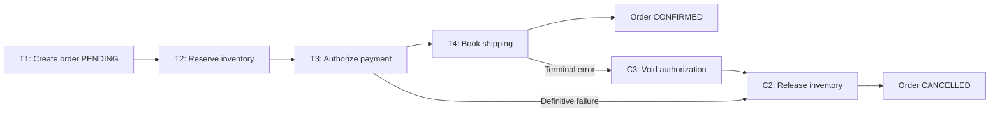
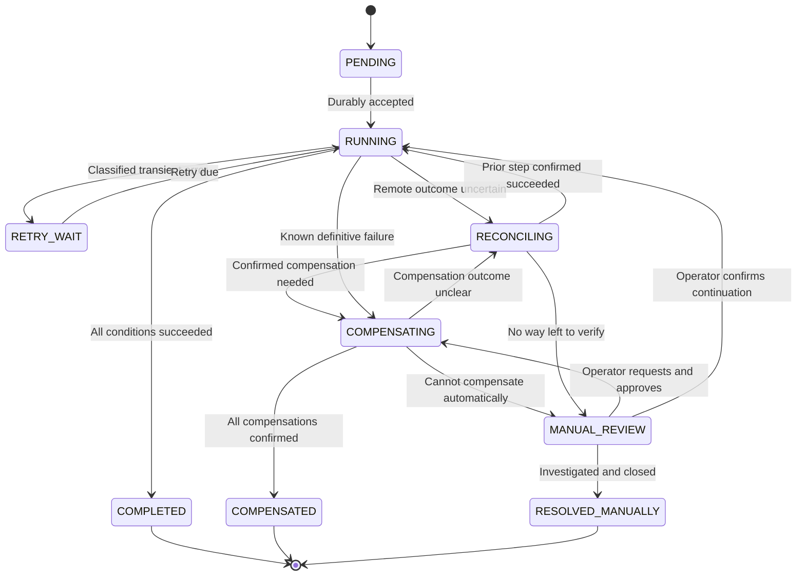
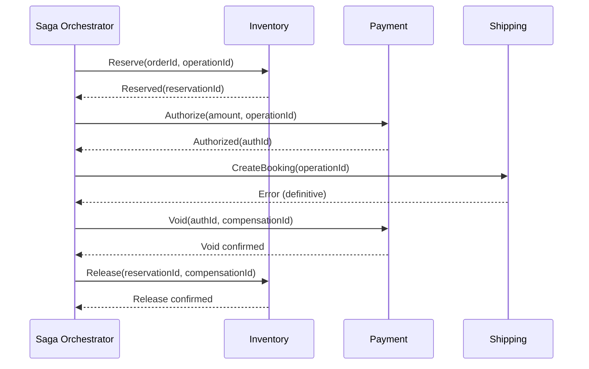
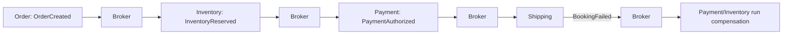

# Sagas, Compensating Actions, and Recovery Limits for External Side Effects

An order transaction rarely stays inside a single database. A Spring Boot application may need to reserve stock via an Inventory API, request payment via a Payment API, save the order in PostgreSQL, emit an event to Kafka, and book shipment through an HTTP partner. Each system has its own state, timeouts, and commit mechanism. If the final step fails, no single `ROLLBACK` statement can make all preceding actions vanish.

A **Saga** structures the workflow into local transactional steps and explicit actions to run when a step fails. Calling an action "compensating," however, does not mean the original action was completely undone. Charged funds may only be returned via a brand-new refund transaction; an email already sent cannot be recalled from an inbox; goods handed to a customer cannot walk back into the warehouse just by calling a cancel-shipment API. With external tasks, the biggest hazard is sometimes **not knowing whether the effect happened at all** after a timeout.

This lesson belongs to the **Consistency and Deduplication** chapter of the `SPRING_BOOT_INTEGRATION` module, framing Sagas inside Spring Boot integrations across HTTP clients, databases, caches, message brokers, and Spring Integration adapters. The emphasis is on transaction boundaries, data contracts, retries, idempotency, error management, observability, and testing for realistic recovery workflows.

## 1. Learning objectives

After this lesson, you should be able to:

1. Distinguish **local transaction rollback**, **compensation**, **retry**, **reconciliation**, and **manual resolution**.
2. Model a Saga with explicit states, forward steps, compensating steps, deadlines, and escalation branches.
3. Choose between **orchestration** and **choreography**, identifying strengths, limits, and coordination ownership for each.
4. Design **idempotency keys**, **inbox/outbox**, optimistic locking, and conditional state transitions to prevent duplicate execution.
5. Explain why external timeouts produce an **UNKNOWN** outcome, not definitive failure.
6. Sequence operations to defer hard- or impossible-to-compensate actions until preconditions are met.
7. Write Spring Boot examples for calling HTTP APIs, persisting state, emitting events, and driving durable compensation.
8. Identify the limits of automated recovery, operational metrics/SLAs, and crash-point tests.

## 2. Why don't local transactions solve multi-service workflows?

A JDBC transaction manages changes on database resources sharing the same transaction manager. Consider:

```text
Order DB          Inventory API         Payment API          Shipping API
   |                    |                     |                     |
   |-- INSERT order --> |                     |                     |
   |-- local COMMIT --- |                     |                     |
   |------------------- reserve -------------->|                     |
   |---------------------------------------- charge ---------------->|
```

This diagram is intentionally high-level: each system owns its commit mechanism. Once `Order DB` commits, its data is durable even if the Inventory API later rejects the reservation. Conversely, the Payment API may have collected funds right before the HTTP response dropped.

Buggy example trying to rely on `@Transactional`:

```java
@Transactional
public void placeOrder(CreateOrderCommand command) {
    orderRepository.save(Order.pending(command));
    inventoryApi.reserve(command.orderId(), command.items());
    paymentApi.charge(command.paymentRequest());
    shippingApi.createShipment(command.shippingRequest());
}
```

If `shippingApi.createShipment` throws an exception, Spring can roll back changes in **Order DB**, yet that will not release reserved stock or refund captured funds. The database transaction also holds connections/locks across slow HTTP calls. If the caller retries the whole method, external side effects can execute a second time.

**Never assume** that wrapping a chain of remote calls in `@Transactional` creates a distributed atomic transaction. Even when transaction support exists between a database and a broker, third-party payment APIs rarely join the same commit protocol.

## 3. What is a Saga?

A Saga is a sequence of **local transactions** and follow-up actions where each step completes under the mechanism of the system owning it. If the workflow cannot proceed, the Saga triggers **compensating actions** corresponding to the recorded effects.

Example:



Compensation branches are valid only once external system states are sufficiently clear. If the Payment API times out on an authorization request, the application **must not assume** no authorization exists and jump straight to cancelling the order; it may need to query transaction status, await a webhook, or reconcile.

Core characteristics:

- **Local transactions:** each step maintains integrity within its owning system.
- **Durable progress:** step outcomes and next actions must be persisted so restarts know how to resume.
- **Business compensation:** invoking a new operation to offset or mitigate a prior step's effect.
- **Eventual consistency:** multiple systems converge on the desired state over time, potentially passing through intermediate states.
- **Idempotency and reconciliation:** ensure retries/replays never double side effects, and resolve discrepancies when remote outcomes are unclear.

Sagas **do not provide atomic visibility** across systems, do not prevent all dirty reads/semantic anomalies, and do not make physical-world actions magically rollbackable.

## 4. Distinguishing six easily confused concepts

| Concept | Action | When applied | Limitation |
|---|---|---|---|
| **Local rollback** | DB discards uncommitted changes in the current transaction | SQLException before DB commit | Cannot undo already succeeded HTTP side effects |
| **Retry** | Re-attempt the same operation | Transient error or uncertain outcome, when safe | Can duplicate side effects if operation is not idempotent |
| **Compensation** | Execute a new business action to handle an earlier effect | Prior step occurred and a valid compensating action exists | May not restore the exact initial state |
| **Reconciliation** | Cross-check internal state against partner's actual state | Timeouts, lost callbacks, crashes, data drift | Requires lookup APIs, reports, or trusted data sources |
| **Forward recovery** | Continue completing the workflow from current state | Reached an irreversible milestone; business allows | May require alternate paths or manual intervention |
| **Manual resolution** | Operator resolves discrepancies from evidence | Missing compensation API, expired window, disputed outcome | Needs auditing, access controls, and post-review |

The two primary recovery directions are **backward recovery** (compensating completed steps) and **forward recovery** (completing remaining steps). Not every failure should trigger backward compensation; if goods shipped and payment settled, finishing delivery or handling customer support may be the right path.

## 5. Running scenario: an order placement workflow

Suppose Order Service receives a valid order command and must perform four tasks:

1. Save the order as `PENDING` in PostgreSQL.
2. Call the Inventory API to **reserve** items by `orderId`.
3. Call the Payment API to **authorize** funds. Split authorization and capture where partners support it.
4. Call the Shipping API to create a tentative booking; once confirmation conditions are met, move the order to `CONFIRMED` and permit dispatch later.

Compensability table:

| Forward step | Planned compensating action | Restores exact initial state? |
|---|---|---|
| Create `PENDING` order | Transition to `CANCELLED`, keep audit record | Does not erase evidence the order was created |
| Inventory reserve | Release confirmed reservation | Often close to equivalent; depends on TTL, batches, and reservation state |
| Payment authorize | Void/cancel authorization | Can expire, already be captured, or incur fees |
| Payment capture | Refund, ledger adjustment | No; refund is a new transaction, has latency/fees, and can fail |
| Create shipping booking | Cancel booking if still allowed | May incur fees; once picked up, cannot undo shipping via a simple API |
| Send email/SMS | Send correction notice | Cannot unsend content already read by the recipient |

Workflows generally try to **defer hard-to-compensate actions** until after cancellable steps succeed—for example, authorizing payment before capturing, or creating a booking before dispatching. However, ordering cannot ignore business rules: inventory holds, payment regulations, and partner SLAs impose constraints too.

### 5.1. Business invariants

Before building a Saga, explicitly document invariants:

- One `orderId` must never trigger two independent charges due to retries.
- Never mark `PAID` without contract-defined proof that payment was captured/settled.
- Never dispatch without both a valid reservation and valid payment status.
- When an order is cancelled, there must be a clear release/void/refund trail or tracked obligation.
- Once dispatched, the system cannot simply mark `CANCELLED` and pretend every side effect vanished.
- Every external side effect must carry a stable **business operation ID** for querying and deduplication.

Saga state machines and tests should derive from these invariants rather than merely splitting code across REST calls.

## 6. Designing transparent Saga states

Avoid a single boolean `success` or `failed`; it cannot represent timeouts or refunds in flight.

Example state machine:



This is a reference model. State names vary by domain, yet should distinguish at minimum:

- **Intent persisted:** system recorded its plan to call the partner.
- **In flight:** request may have reached the partner; prohibited from launching a new operation under a new key.
- **Definitively succeeded/failed:** backed by partner evidence.
- **Unknown:** caller only knows the request timed out or failed locally, not whether the side effect happened.
- **Compensation requested/in progress/confirmed:** compensation has its own lifecycle.
- **Manual review:** automation reached its limit; obligations remain to finish.

Customer-facing order states (`PENDING_PAYMENT`, `CONFIRMED`, `CANCELLING`, `CANCELLED`, etc.) may differ from internal Saga orchestration states; define an explicit mapping between the two.

### 6.1. Individual Saga steps also need state

A Saga may sit in `RECONCILING` solely because the payment authorization step is unclear. A step table might record:

```text
step=RESERVE_INVENTORY
  operationId=reserve:O-101:v1
  state=SUCCEEDED
  remoteReference=reservation-884

step=AUTHORIZE_PAYMENT
  operationId=authorize:O-101:v1
  state=UNKNOWN
  remoteReference=<unknown>

step=CREATE_SHIPPING
  state=NOT_STARTED
```

If the Saga stores only one top-level `FAILED` flag, a restarted worker cannot tell whether to release inventory, query payment, or cancel shipping. Persisting **per-step state** lets recovery act on concrete evidence.

## 7. Orchestration and choreography

Two common Saga styles:

### 7.1. Orchestration: a central coordinator decides



The orchestrator holds state and decides next steps, retries, compensations, and escalations. It may live inside Spring Boot application code, a workflow engine, or a dedicated coordination service.

**Pros:** full workflow visibility, clear state monitoring, explicit compensation order, easier business-rule testing. **Trade-offs:** orchestrator becomes critical infrastructure requiring durable state, recovery workers, clear ownership, and versioning for in-flight workflows.

### 7.2. Choreography: services react to events



Each participant listens for events and emits subsequent events without a central orchestrator calling each step. This fits shorter flows with clear domain events and autonomous services.

**Pros:** removes coupling to a central coordinator; leverages broker infrastructure. **Trade-offs:** harder to visualize the end-to-end flow, risk of event loops or uncoordinated duplicate compensations, harder timeout detection ("no event ever arrived"), and trickier versioning/ownership.

### 7.3. Which style to choose?

| Criterion | Orchestration | Choreography |
|---|---|---|
| Multi-branch flows and timeouts | Easy to express centrally | Requires tight correlation, timers, and ownership design |
| Observing one Saga instance | State lives at the coordinator | Must aggregate across multiple event logs |
| Changing business rules | Primarily in the orchestrator | May touch multiple participants |
| Coupling | Depends on participant call/command protocols | Depends on event contracts and semantics |
| Coordinated compensation | Coordinator controls ordering | Must assign clear owners to avoid duplicates |
| Recoverability | Coordinator must be durable and restart-safe | Every participant + broker must be idempotent/durable |

You can **combine both**: an orchestrator persists state and sends commands over Kafka/RabbitMQ, while participants act locally and reply via events. Do not assume orchestration requires HTTP or choreography requires Kafka.

## 8. Local transactions, outboxes, and inboxes in a Saga

Sagas do not remove the need for transactions; every step must be persisted durably.

### 8.1. Transactional outbox

When Order DB must save an order and emit `ReserveInventory`, never do:

```java
orderRepository.save(order);
kafkaTemplate.send("reserve-inventory", command); // Can fail after DB commit.
```

Even with `@Transactional`, the DB transaction and broker send are not atomic. A crash window can leave an order without a command, or a command in the broker after the DB rolled back.

An outbox writes both the order and command-publish intent in **one local SQL transaction**:

```text
BEGIN DB transaction
  INSERT order(state=PENDING)
  INSERT saga_instance(state=RUNNING)
  INSERT outbox_message(eventId=evt-100, type=ReserveInventory, ...)
COMMIT

Publisher:
  read unpublished outbox rows
  publish command using stable eventId
  await broker confirmation
  mark outbox row published
```

If the publisher crashes after broker receipt yet before marking the outbox, the command can be republished. Hence participants need an inbox or operation idempotency.

### 8.2. Inbox at participants

An Inventory consumer can receive the same `ReserveInventory` multiple times. Inside the **same database transaction** as business processing, it writes:

```sql
CREATE TABLE processed_commands (
    consumer_name VARCHAR(100) NOT NULL,
    command_id VARCHAR(160) NOT NULL,
    processed_at TIMESTAMPTZ NOT NULL DEFAULT CURRENT_TIMESTAMP,
    PRIMARY KEY (consumer_name, command_id)
);
```

If already processed, the participant replays/re-emits the stored outcome or accepts the duplicate without reserving again. If creating the reservation calls an external API instead of staying in the same DB, an inbox alone is **not enough** to prevent duplicates atomically; use API idempotency keys, status lookups, or an external workflow.

### 8.3. Outbox/inbox do not eliminate all duplicates

| Technique | Solves well | Does NOT solve automatically |
|---|---|---|
| Outbox | DB commit atomic with publish intent | Broker messages can still be delivered multiple times |
| Inbox + unique constraint | Blocks reprocessing inside one DB transaction | External HTTP side effects outside the transaction can still repeat |
| Partner-side idempotency key | Prevents duplicate operations across request retries | Partner must implement and retain results by key |
| Broker transaction | Atomic boundaries within supported broker operations | SQL transactions + external HTTP calls |
| Saga compensation | Handles committed effects when workflow cannot continue | Cannot erase history or physical actions |

## 9. Idempotency keys for every forward and compensating step

For order `O-101`, each operation needs its own stable key:

```text
reserve inventory:  reserve:O-101:revision-1
release inventory:  release:O-101:revision-1
authorize payment:  authorize:O-101:revision-1
void payment:       void:O-101:revision-1
create booking:     booking:O-101:revision-1
cancel booking:     cancel-booking:O-101:revision-1
```

**Never** reuse the same key for `authorize` and `void` just because they share an order; they are different operations. **Never** generate a fresh random UUID on every retry; the partner will treat them as independent requests.

If an order permits retrying a distinct new operation legitimately, add a `revision` or an `operationId` generated **once when business intent is created**, saved durably, and reused. Never construct keys from attempt timestamps.

### 9.1. Idempotency contracts must carry clear semantics

Partners must specify:

- Is the key scoped per merchant/account/endpoint or globally across the API?
- How long are keys and results retained?
- Does reusing a key with a different payload return an error or modify the request?
- What does retrying while the first request is in flight return: `IN_PROGRESS`, `409`, `202`, or the eventual result?
- When a response is lost, is there a `GET by operationId`/`GET by clientReference` endpoint?
- Do void/refund keys prevent issuing two separate refunds?

An `Idempotency-Key` header **does not magically make an API idempotent** if the receiver does not enforce the contract. With an API lacking support, applications can only reduce risk via bounded retries, reference lookups, callbacks/reconciliation, and manual intervention—never claim exactly-once.

## 10. Most critical failure window: timeouts with uncertain outcomes

Suppose the Payment API receives an authorize command:

```mermaid
sequenceDiagram
    participant O as Order Saga
    participant P as Payment API
    O->>P: POST /authorizations, key=authorize:O-101
    P->>P: Persist authorization successfully
    Note over O,P: Response lost on the network
    O--xP: Client timeout
    Note over O: Only knows timeout; remote state = UNKNOWN
```

**A client timeout does not prove the Payment API rolled back or failed to execute.** At least three real states are possible:

1. The request never reached the partner; no authorization exists.
2. The request arrived, the partner succeeded, and the response dropped.
3. The request arrived and the partner is still processing or ended in failure.

Immediately calling `authorize` with a new key risks charging/holding funds twice. Immediately calling `void` without a reference may fail or void the wrong authorization.

Safe behavior:

```text
POST authorize timeout
    -> persist step = UNKNOWN, preserve operationId
    -> query payment by operationId/clientReference
    -> if known SUCCEEDED: store authId, proceed or void per Saga decision
    -> if reliably known FAILED/NOT_FOUND: retry with same key or compensate prior steps
    -> if still PENDING/UNKNOWN: backoff, await webhook/reconciliation
    -> past deadline/insufficient evidence: MANUAL_REVIEW
```

`NOT_FOUND` does not always mean "never executed": the API may be eventually consistent or read replicas may lag. Partner contracts must define when `NOT_FOUND` is authoritative confirmation.

## 11. Compensating actions are new business transactions

Compensation usually must **append** a new event or transaction:

```text
Payment authorization A-77: AUTHORIZED
Void request V-88: VOID_REQUESTED
Void confirmed: VOIDED

or if already CAPTURED:
Payment capture C-99: CAPTURED
Refund request R-10: REFUND_REQUESTED
Refund settled: REFUNDED
```

Never delete old authorization/capture records from the audit trail. Accounting systems require visibility into both the original transaction and the refund/offsetting entry.

### 11.1. Compensation is not a mathematical inverse function

If `T` is an external action and `C` is its compensation, you generally **cannot guarantee**:

\[
C(T(s)) = s
\]

for all states `s`. For example, after sending an email, an apology email does not delete the first; after capture and refund, funds may take days to settle and transaction fees may remain.

The realistic goal is bringing the system to an **acceptable business state** with complete evidence and explicit tracking of remaining losses or obligations. Hence Sagas must model **compensation outcomes** rather than flipping a single `ROLLED_BACK=true` flag.

### 11.2. Classifying compensability

| Task type | Example | Strategy |
|---|---|---|
| **Nearly fully reversible** | Reserve then release unshipped stock | Idempotent compensation, verify reservation state |
| **Offset via counter-transaction** | Capture then refund | Track settlement, fees, and refund deadlines |
| **Conditionally compensable** | Cancel shipment before pickup | Check cutoff/booking status before cancelling |
| **Irreversible** | Delivered goods, sent emails, received SMS OTP | Forward recovery, customer support, audit and manual handling |
| **Uncertain status** | HTTP timeout, lost webhook | Reconcile before deciding to compensate |

## 12. Compensation order and inter-step dependencies

A starting rule of thumb is compensating in **reverse order** of completed steps:

```text
Forward:
  reserve inventory -> authorize payment -> create booking

Backward when booking definitively fails:
  void payment authorization -> release inventory
```

However, reverse order holds only if dependencies and business invariants permit. You may need to hold a reservation until confirming payment has no dangling charge; or a shipping booking may have succeeded without its reply arriving, requiring querying/cancelling shipping before voiding/releasing.

### 12.1. Compensate only steps confirmed to have happened

Never call `releaseReservation` if you do not even know whether a reservation exists—unless the API guarantees release-by-operationId is idempotent and safe when absent. Never issue refunds based on guessing a charge succeeded. Compensations require:

- Target evidence: `reservationId`, `authorizationId`, `chargeId`, or a stable operation reference.
- Preconditions: which states still permit cancel/void/refund.
- Dedicated compensation idempotency key.
- Expected outcome and how completion is verified.
- Deadlines, retry policies, and escalation paths when compensation fails.

### 12.2. Parallel steps require a dependency graph

If inventory reservation and fraud checks run in parallel, there is no single "reverse order." Define a dependency graph: one compensation can run alongside another only when invariants stay intact. Once any step passes an irreversible milestone, switch to appropriate handling instead of mechanically running every compensation.

## 13. Recovery limits for external tasks

Not every API provides a compensating operation. Even when cancel/refund endpoints exist, permissions and time windows may be restricted.

| Limitation | Example | Saga consequence |
|---|---|---|
| **No counter-API** | Email/SMS already sent | Can only issue corrections, notices, or support |
| **Cutoff times** | Shipment already picked up | Cancel booking cannot return goods to the warehouse |
| **Fees and settlement lag** | Card refunds take days | Order needs `REFUND_PENDING`, not immediate `REFUNDED` |
| **Short idempotency TTL** | Partner forgets keys after 24 hours | Late retries can create new transactions; query/reconcile first |
| **Limited lookup API** | Cannot query payment by client reference | `UNKNOWN` states may require manual reconciliation |
| **Rate limits/quotas** | Refund API throttled | Backoff, queues, and dedicated compensation SLAs |
| **Legal/accounting rules** | Ledgers/transactions cannot be deleted | Compensate with new offsetting entries and audit trails |
| **Human involvement** | Parcel already packed/dispatched | Requires manual workflows and confirmations |
| **Eventual consistency lag** | API reports success while status GET shows pending | Never misread a single GET immediately after write |
| **Cascading dependencies** | Cancelling shipping requires updating insurance | Compensation itself may be a multi-step workflow |

An often-forgotten limit: **a compensating API call can also time out after succeeding**. When that happens, the Saga must not retry compensation with a new key. Compensation needs persistent intent, stable keys, `UNKNOWN` tracking, and reconciliation just like forward steps.

## 14. Designing partner contracts before writing the Saga

For each external API, answer:

| Topic | Question |
|---|---|
| Operation creation | Can the client supply a stable `operationId`/`merchantReference`? |
| Idempotency | Does repeating the same key + payload return the same logical result? |
| Status lookup | Is there a query endpoint by client reference? Are there webhooks/callbacks? |
| Compensation | Are cancel/void/refund/release supported, and under what preconditions/deadlines? |
| Result semantics | Do `200`/`202`/`409` mean "completed," "accepted," or "processing"? |
| Errors | Which status/error codes are retryable? Can timeouts occur after side effects? |
| Rate limits | What quotas, throttling, `Retry-After`, and backoff rules apply? |
| Security | API scopes, mTLS/token rotation, and which fields may be logged? |
| Reconciliation | Daily settlement reports, reference queries, dispute/chargeback SLAs? |
| Data retention | Key TTLs, transaction history retention, and support escalation after expiry |

If a vendor lacks idempotency keys or idempotent lookups, **explicitly document that risk**. Never write "exactly once" in architecture docs simply because your app has an inbox table.

## 15. Orchestration durability: persist state before remote calls

In an orchestrated Saga, every outbound command needs a **persisted intent**:

```text
1. DB transaction:
   - pick Saga ready for AUTHORIZE_PAYMENT
   - store operationId / requestHash / state=IN_FLIGHT
   - COMMIT

2. Outside DB transaction:
   - POST Payment API (Idempotency-Key=operationId)

3. DB transaction:
   - store remoteReference, result=SUCCEEDED or UNKNOWN
   - update Saga state, next step, and outbox event
   - COMMIT
```

Never wrap writing `IN_FLIGHT` and sending HTTP inside one long-held SQL transaction. On a crash between 1 and 2, a worker retries with the **same key**; on a crash between 2 and 3, a worker queries or retries idempotently. This converts crash windows into manageable states.

### 15.1. Persisting intent does not mean the remote was not called

Seeing `IN_FLIGHT` after a crash cannot tell whether the request reached the partner. Recovery workers must never infer "not called" from an empty `remoteReference`. The safe assumption is **it may have happened**; rely on `operationId`, idempotency contracts, and reconciliation.

### 15.2. Preventing multiple workers from owning the same step

Two workers can inspect the same Saga when scaled horizontally. Use atomic claims/leases, optimistic locking/versions, or proper DB locking so only one valid transition runs at a time; still, **lease expiration does not prove the old worker's remote side effect stopped**. Therefore you need both:

- CAS/version or fencing tokens so an old worker cannot overwrite newer Saga state.
- Stable operation IDs so two attempts converge on a single logical side effect at the partner.
- Reconciliation when a slow attempt or delayed response arrives late.

Never lock a DB row across the entire HTTP call just to block duplicates: that starves pools, triggers lock timeouts, and still fails across crashes.

## 16. Saga data model in PostgreSQL

A small implementation can start with Saga, operations, and outbox tables. This schema is **illustrative**; production systems need migrations, indexes, constraints, retention, and appropriate partitioning.

```sql
CREATE TABLE order_sagas (
    saga_id       UUID PRIMARY KEY,
    order_id      VARCHAR(100) NOT NULL UNIQUE,
    state         VARCHAR(40) NOT NULL,
    current_step  VARCHAR(80) NOT NULL,
    version       BIGINT NOT NULL DEFAULT 0,
    last_error    VARCHAR(500),
    created_at    TIMESTAMPTZ NOT NULL DEFAULT now(),
    updated_at    TIMESTAMPTZ NOT NULL DEFAULT now()
);

CREATE TABLE saga_operations (
    saga_id          UUID NOT NULL REFERENCES order_sagas(saga_id),
    step_name        VARCHAR(80) NOT NULL,
    operation_id     VARCHAR(160) NOT NULL UNIQUE,
    direction        VARCHAR(15) NOT NULL, -- FORWARD / COMPENSATE
    state            VARCHAR(40) NOT NULL, -- PENDING / IN_FLIGHT / UNKNOWN / ...
    request_hash     VARCHAR(100) NOT NULL,
    remote_reference VARCHAR(180),
    attempt_count    INT NOT NULL DEFAULT 0,
    next_attempt_at  TIMESTAMPTZ,
    lease_until      TIMESTAMPTZ,
    last_error_code  VARCHAR(100),
    updated_at       TIMESTAMPTZ NOT NULL DEFAULT now(),
    PRIMARY KEY (saga_id, step_name, direction)
);

CREATE TABLE saga_outbox (
    message_id     UUID PRIMARY KEY,
    saga_id        UUID NOT NULL REFERENCES order_sagas(saga_id),
    event_type     VARCHAR(100) NOT NULL,
    payload_json   JSONB NOT NULL,
    published_at   TIMESTAMPTZ,
    created_at     TIMESTAMPTZ NOT NULL DEFAULT now()
);

CREATE INDEX idx_saga_operations_due
    ON saga_operations(state, next_attempt_at);

CREATE INDEX idx_saga_outbox_unpublished
    ON saga_outbox(created_at)
    WHERE published_at IS NULL;
```

Key field purposes:

| Field | Purpose |
|---|---|
| `saga_id` | Identifies a workflow instance; does not replace `orderId` |
| `state` | Overall workflow state; never inferred solely from the last HTTP status |
| `current_step` | Active step for sequential flows; complex flows may need a dependency graph |
| `version` | Optimistic locking/CAS blocking concurrent transitions |
| `operation_id` | Stable key sent upstream and used to reconcile |
| `request_hash` | Detects reusing the same key with a different payload |
| `remote_reference` | Confirmation ID issued by upstream, needed for cancel/void/refund |
| `attempt_count`/`next_attempt_at` | Bounded retries without hot spinning |
| `lease_until` | Detects stalled workers holding a step; does not prove remote didn't run |
| `published_at` | Tracks outbox broker confirmation per publish policy |

`UNIQUE(order_id)` is strictly an **example** for a single-order-creation Saga. If an order can legitimately undergo multiple Sagas (payment, exchange, refund), add `saga_type`, `business_operation_id`, and uniqueness matching actual domain rules.

### 16.1. Atomic worker claim

In PostgreSQL, claim a ready operation atomically in the database:

```sql
UPDATE saga_operations
SET state = 'IN_FLIGHT',
    attempt_count = attempt_count + 1,
    lease_until = now() + interval '45 seconds',
    updated_at = now()
WHERE saga_id = :sagaId
  AND step_name = :stepName
  AND direction = :direction
  AND (
        state = 'PENDING'
        OR (state = 'RETRY_WAIT' AND next_attempt_at <= now())
        OR (state = 'IN_FLIGHT' AND lease_until < now())
      )
RETURNING operation_id, request_hash, attempt_count;
```

This is an example of an **atomic claim**, run in a local transaction committed before calling HTTP. For `UNKNOWN` state, route to a dedicated **reconciliation path** instead of letting this claim resend the operation automatically. When a lease expires, the new worker taking over must reuse the original `operation_id`.

At higher workloads, combine `SELECT ... FOR UPDATE SKIP LOCKED` to pick batches of due work with less contention, while still preserving predicates, versions, and idempotency. If an old worker's late response arrives, recording results must use CAS on `version`/attempt ownership or valid state predicates so stale results never overwrite newer state.

### 16.2. Conditional state transitions

Never update a Saga via blind "read then overwrite state":

```sql
UPDATE order_sagas
SET state = 'RUNNING',
    current_step = 'CREATE_SHIPPING',
    version = version + 1,
    updated_at = now()
WHERE saga_id = :sagaId
  AND version = :expectedVersion
  AND state = 'RUNNING'
  AND current_step = 'AUTHORIZE_PAYMENT';
```

If affected rows equals `0`, reload current state and determine whether it is a duplicate callback, valid concurrency, or consistency bug. Never blindly retry overwriting.

Save the step result, Saga transition, and outbox event in the **same local transaction** so you never end up with "payment recorded succeeded, yet no shipping command queued."

## 17. Spring Boot example: orchestrating an HTTP step with uncertain outcomes

This section focuses on **transaction boundaries and recovery decisions**, not building a full Saga framework in a few lines. `SagaWorkStore`, `PaymentApi`, and `PaymentAuthorization` are application contracts to implement and test.

### 17.1. Payment API contract

```java
public interface PaymentApi {

    PaymentAuthorization authorize(
        String orderId,
        long amountMinor,
        String currency,
        String idempotencyKey
    );

    PaymentStatus findByOperationId(String operationId);

    VoidResult voidAuthorization(
        String authorizationId,
        String idempotencyKey
    );
}

public record PaymentAuthorization(
    String authorizationId,
    String status
) {}

public record PaymentStatus(
    String status,          // AUTHORIZED / DECLINED / PENDING / UNKNOWN
    String authorizationId
) {}

public record VoidResult(
    String status           // VOIDED / PENDING / NOT_ALLOWED ...
) {}
```

Types are shown together for illustration. In real Java sources, each `public` top-level type goes in its own file. Statuses must map faithfully to partner docs; `HTTP 200` does not always mean `AUTHORIZED`, and `HTTP 202` may simply mean the request was accepted.

### 17.2. A worker calling remote APIs outside DB transactions

```java
import java.util.UUID;
import org.springframework.stereotype.Service;
import org.springframework.web.client.ResourceAccessException;

@Service
public class PaymentSagaWorker {

    private final SagaWorkStore store;
    private final PaymentApi paymentApi;

    public PaymentSagaWorker(
            SagaWorkStore store,
            PaymentApi paymentApi) {
        this.store = store;
        this.paymentApi = paymentApi;
    }

    public void executeAuthorization(UUID sagaId) {
        var claimed = store.claimAuthorization(sagaId);
        if (claimed.isEmpty()) {
            return; // Owned by another worker or not yet due.
        }
        var work = claimed.get();

        try {
            var result = paymentApi.authorize(
                work.orderId(),
                work.amountMinor(),
                work.currency(),
                work.operationId() // Preserved across all attempts.
            );

            if ("AUTHORIZED".equals(result.status())) {
                store.completeAuthorization(
                    work, result.authorizationId());
            } else if ("DECLINED".equals(result.status())) {
                store.recordDefinitiveRejection(work, "DECLINED");
            } else {
                store.recordUnknown(work, "REMOTE_PENDING");
            }
        } catch (ResourceAccessException ex) {
            // Timeout/connection error: do not infer remote rollback.
            store.recordUnknown(work, "TRANSPORT_UNCERTAIN");
        } catch (DefinitivePaymentRejection ex) {
            // Use only when contract confirms zero side effect occurred.
            store.recordDefinitiveRejection(work, ex.errorCode());
        }
    }
}
```

`SagaWorkStore` must expose matching methods such as `claimAuthorization`, `completeAuthorization`, `recordUnknown`, and `recordDefinitiveRejection`. Each executes a **local DB transaction** in a separate bean using conditional updates/CAS, persisting step results and outbox messages per transition. `DefinitivePaymentRejection` is a domain exception classified by the adapter per partner contract. This code illustrates design structure and requires DTOs/stores/adapters to compile standalone.

Principles more important than syntax:

1. After `claimAuthorization`, the local transaction must **commit before** calling the Payment API.
2. After HTTP success, `completeAuthorization` writes the result, advances state, and inserts an outbox row in one transaction.
3. After a timeout, `recordUnknown` preserves the operation ID; a worker will **reconcile** rather than silently firing a request with a new key.
4. If the process crashes **before** `recordUnknown` or `completeAuthorization`, leases and a recovery scanner must still detect overdue `IN_FLIGHT` rows and verify payment status.
5. If a late response arrives after another instance already advanced the Saga, recording results must guard on expected state/version so newer state is never reverted.

### 17.3. Dedicated reconciler for UNKNOWN

```java
@Service
public class PaymentReconciler {

    private final SagaWorkStore store;
    private final PaymentApi paymentApi;

    public PaymentReconciler(
            SagaWorkStore store,
            PaymentApi paymentApi) {
        this.store = store;
        this.paymentApi = paymentApi;
    }

    public void reconcile(UUID sagaId) {
        var pending = store.findAuthorizationRequiringReconcile(sagaId);
        if (pending.isEmpty()) {
            return;
        }

        var work = pending.get();
        try {
            var status = paymentApi.findByOperationId(
                work.operationId());
            switch (status.status()) {
                case "AUTHORIZED" ->
                    store.completeAuthorization(
                        work, status.authorizationId());
                case "DECLINED" ->
                    store.recordDefinitiveRejection(
                        work, "REMOTE_DECLINED");
                case "PENDING", "UNKNOWN" ->
                    store.scheduleReconciliation(work);
                default ->
                    store.scheduleManualReview(
                        work, "UNKNOWN_REMOTE_STATUS");
            }
        } catch (ResourceAccessException ex) {
            store.scheduleReconciliation(work);
        }
    }
}
```

On `NOT_FOUND`, do not rush to treat it as rejected: verify the partner's consistency guarantees and delay before lookups become authoritative. If a partner offers no query-by-operation-ID endpoint, the reconciler may rely on verified webhooks, settlement reports, batch reconciliation, or manual review.

### 17.4. Why not put `@Transactional` on the outer orchestration method?

Putting `@Transactional` around `executeAuthorization` holds a DB transaction open across the HTTP call; rolling back after a timeout cannot undo a payment side effect. Placing transactions on **store methods in a separate bean** commits cleanly at each milestone. When calling `@Transactional` methods inside the same class, mind Spring AOP proxy rules so transaction boundaries are actually enforced.

## 18. Implementing compensation as a stateful workflow

When the Shipping API definitively rejects a booking after payment was authorized, the Saga must void the authorization. **Never** just call `paymentApi.void(...)` inside a `catch` block and stamp `CANCELLED`.

Model:

```text
Saga state=COMPENSATING
  step VOID_PAYMENT:
    operationId=void:O-101:revision-1
    targetAuthorizationId=auth-77
    state=PENDING

Worker claims -> IN_FLIGHT
  -> POST /authorizations/auth-77/void
  -> response VOIDED:
       record step SUCCEEDED
       create RELEASE_INVENTORY intent
  -> timeout:
       record UNKNOWN
       lookup void state or payment status
  -> remote says NOT_ALLOWED (already captured):
       escalate to REFUND workflow or MANUAL_REVIEW
```

### 18.1. Do not collapse all compensating steps into one shared state

A Saga may hold:

```text
VOID_PAYMENT        SUCCEEDED
RELEASE_INVENTORY   UNKNOWN
ORDER_CANCEL        PENDING
```

At that point, you **cannot** declare `COMPENSATED` because inventory release is unconfirmed. If the UI must inform the customer that the order cannot proceed, display `CANCELLING` alongside internal tracking—never mask unresolved compensations.

### 18.2. Compensations can be retried

Suppose the `void` HTTP call times out. If the partner supports stable keys and lookups, retrying or reconciling must use the **exact same compensation operation ID**. A failed compensation is not necessarily permanent: it may be rate-limited, awaiting a new processing window, or needing operator intervention because remote state changed.

### 18.3. Compensation failure after partial completion

If voiding payment succeeds while releasing inventory fails, the Saga remains in `COMPENSATING`/`RECONCILING`, clearly recording what remains unfinished. The reverse case needs clear tracking too. Rerunning an entire compensation chain from the top is safe only when every compensating action is idempotent and step statuses are tracked accurately.

## 19. Choosing backward recovery vs. forward recovery

A Saga often needs no compensation when a valid forward path remains:

| Situation | Potentially suitable direction | Reason |
|---|---|---|
| Inventory reserve definitively fails before payment auth | Stop and cancel order | Minimal side effects; no money involved |
| Payment authorize times out | Reconcile/continue or compensate once state is clear | Outcome uncertain |
| Shipping booking hits transient failure, order unshipped | Retry booking or switch carrier | Contract can still be fulfilled |
| Payment captured, booking fails persistently | Refund or alternate fulfillment per SLA | Requires business decision |
| Goods already picked up, customer cancels | New return/refund workflow | Cannot reverse physical dispatch |
| Notification email sent before order finalized | Send correction/support notice | Cannot recall already-read email |

A successful Saga can include **switching to an alternative option** (such as booking carrier B when carrier A is unavailable), provided contracts, deadlines, costs, and permissions allow. Systems do not always have to force a return to the starting point.

### 19.1. Pivot transactions and points of no return

In many Saga designs, steps fall into three categories:

- **Compensatable:** if a later step fails, a valid compensating action exists.
- **Pivot:** a business milestone that is hard or impossible to undo; afterward, the workflow drives toward completion.
- **Retryable:** steps after the pivot designed to keep retrying until completion per policy.

For example, physical dispatch is often a pivot. Once a carrier picks up the parcel, a simple "cancel order" Saga no longer applies; a separate return/refund workflow is needed. This classification guides design, yet does not guarantee post-pivot tasks **cannot** fail: human intervention, rescheduled deliveries, or compensation may still be necessary.

## 20. Timeouts, deadlines, retry budgets, and backoff

Every step needs at least three timeout tiers:

1. **Attempt timeout:** cap for a single remote call.
2. **Step deadline:** maximum time allowed to complete or verify a step.
3. **Saga/business deadline:** business cutoff where state must transition (e.g., 15-minute inventory hold).

```text
Inventory reservation TTL: 15 minutes
Payment authorization step deadline: 2 minutes
Shipping booking deadline: 5 minutes
Saga confirmation deadline: 12 minutes

Attempt #1 timeout: 3 seconds
Retry schedule: exponential backoff + jitter
Reconcile: periodic check per API contract
Past deadline: explicit compensate/forward/manual decision
```

These numbers are illustrative. No universal timeout fits every partner or endpoint; request timeouts and actual remote processing durations can differ.

### 20.1. Be careful when retrying after uncertain outcomes

Distinguish:

| Error category | Retry forward operation? | Reason |
|---|---|---|
| TCP connection refused, request definitely not sent | Can retry | No evidence of remote side effect; still reuse same operation ID |
| Read timeout after request sent | Only with idempotency or after reconciliation | Remote may have completed it |
| HTTP 429/503 | Can retry per contract/`Retry-After` | May have been processed or transiently rejected; check semantics |
| HTTP 400 invalid payload | Never auto-retry same payload | Fix data or contract first |
| HTTP 401/403 | Never retry infinitely | Credentials/permissions need fixing |
| HTTP 409 | Contract-dependent | Could be idempotent duplicate, pending op, or genuine conflict |
| Compensation timeout | Query/retry with same compensation ID | Compensation also has side effects |

If the HTTP client, application service, broker listener, and worker scheduler all layer their own retries, total attempts multiply dramatically. Assign **one primary owner for business retries** and an overall budget. Use circuit breakers and bulkheads to protect resources, remembering an open circuit only says you shouldn't call right now—it says nothing about the state of prior operations.

### 20.2. Deadlines end automation, never erase obligations

When a deadline expires, the Saga moves to `MANUAL_REVIEW` or `COMPENSATING` per policy; never delete records, mark `DONE`, or assume funds refund themselves. An unsettled refund must keep being tracked even after the customer sees a cancellation accepted.

## 21. Concurrency, ordering, and consistency anomalies

Sagas lack the global isolation of a single database transaction. Other processes can read or write intermediate states.

Example:

```text
T1: Order A reserves the last 1 unit in stock
T2: Order B reads cache showing 1 unit left
T3: Order B tries to reserve
T4: Order A cancels and releases stock
```

You cannot rely solely on a Saga coordinator to prevent overselling. **Inventory service** must enforce atomic reservations and stock invariants via transactions, conditional updates, unique reservations, or proper locking in its own store.

### 21.1. Semantic locks and intermediate states

In Order DB, use states like `PENDING_PAYMENT` or `CANCELLING` so other flows know an order is mid-Saga. Any edit/cancel endpoint must inspect current state to avoid clashing with in-flight steps.

Example:

```sql
UPDATE orders
SET status = 'CANCELLING',
    version = version + 1
WHERE order_id = :orderId
  AND status IN ('PENDING_PAYMENT', 'RESERVED')
  AND version = :expectedVersion;
```

Check updated row count to detect concurrent transitions. A semantic lock is a **business convention enforced inside each service**, not an automatic distributed lock.

### 21.2. Late and out-of-order events

A `PaymentAuthorized` webhook can arrive after the Saga already transitioned to `COMPENSATING`. Never blindly handle a late event by forcing `CONFIRMED`. Instead:

- Check `operationId` and `eventId` to confirm whether the message belongs to the current operation.
- Decide transitions based on current state and version.
- If authorization succeeded after cancellation started, trigger or continue **void** instead of advancing to shipping.
- Deduplicate callbacks using message/event IDs and uniqueness constraints.
- Log/audit late events and how they were resolved.

A Kafka key on `orderId` helps maintain partition order across events sharing a topic and partitioner, yet guarantees no ordering across HTTP callbacks or separate topics/queues. Never assume system-wide total order.

## 22. Sagas with Kafka/RabbitMQ and Spring Integration

In the Spring Boot Integration module, Sagas may start from HTTP, Kafka records, RabbitMQ messages, or Spring Integration flows. Input acknowledgment boundaries must align with **durably persisting execution intent**.

### 22.1. Accepting a Kafka event into a Saga instance

```text
Kafka OrderRequested
    -> validate eventId/schema
    -> DB transaction:
         inbox records eventId
         insert Saga PENDING
         insert outbox StartSaga
    -> DB COMMIT
    -> container commits Kafka offset per AckMode

Separate worker:
    -> reads StartSaga/outbox
    -> claims ReserveInventory step
    -> calls Inventory API with stable operationId
```

With this model, the Kafka listener does not block for minutes awaiting payment/shipping before committing offsets. The listener's **consumption contract** is durably accepting the job into the DB; Saga workers carry the workflow to completion afterward. Still expose the accepted status (`ACCEPTED/PENDING`) honestly without confusing it with business success (`CONFIRMED`).

### 22.2. Acking before persisting is a severe bug

If a listener commits the Kafka offset before persisting Saga intent/outbox, a process crash skips the message while no workflow was created. Safe ordering is normally:

```text
persist inbox + Saga + outbox in transaction
    -> DB commit succeeds
    -> Kafka acknowledge / offset commit
```

The window between DB commit and Kafka commit can cause replays; the inbox ensures duplicate deliveries never create a second Saga. The same applies to RabbitMQ: messages can redeliver if a consumer committed to the DB before the AMQP ack was lost.

### 22.3. Producer confirmation does not equal consumer completion

A successful Kafka `send()` confirms only that the broker accepted the message at the configured `acks` level. RabbitMQ publisher confirms reflect broker publishing, not that participants committed their business transactions. The orchestrator must await **business outcome replies/events** carrying correlation + operation IDs or query partner status itself.

### 22.4. Spring Integration adapters

In Spring Integration, an inbound adapter pushes messages into a channel for downstream flows. Successful channel handoff does not automatically mean external side effects were durably recorded. When configuring acknowledgements, transaction advice, pollers, or error channels, check:

- At what milestone the adapter acks/commits.
- Whether processing is synchronous or crosses an async executor/channel boundary.
- Whether exceptions propagate back to the source or divert to an error flow.
- Whether Saga intent is persisted before confirming the input.
- Whether retry/error channels can cause commands to execute multiple times.

If a flow hops from a Kafka consumer thread onto an async channel, never assume `@Transactional` or offset acknowledgements extend automatically across threads.

## 23. Callbacks, webhooks, and out-of-order results

Many partners do not return final state in the HTTP response. For example, `POST /refunds` returns `202 ACCEPTED`, and a `RefundSettled` webhook arrives hours later.

Callback design:

```text
RefundRequested (operationId=refund:O-101:1)
   -> HTTP 202
   -> Saga state REFUND_PENDING
   -> webhook RefundSettled / RefundRejected
   -> verify signature + dedup eventId + match operationId
   -> DB transaction updates refund step and Saga state
   -> outbox state-changed event
```

Cases to tolerate:

- Same webhook arriving twice with the same event ID.
- Callback arriving **before** the initial HTTP response finished persisting, due to network/worker scheduling.
- Callback arriving late after a timeout and after reconciliation already handled the step.
- Callback reporting an older state after a newer state.
- Lost callback; reconciliation scheduler must still query/poll.
- Invalid signature or mismatched operation ID.

Persist minimal inbound webhook metadata and processed markers in an inbox/audit table with appropriate retention; always verify provider signatures/identities before trusting transaction state.

## 24. Separating internal Saga state from customer-facing state

A UI should not show a generic `FAILED` while the system is actively issuing a refund. Example mapping:

| Saga state | Exposed order state | Meaning to the customer |
|---|---|---|
| `RUNNING`, pre-authorize | `PENDING_PAYMENT` | Processing payment |
| `RETRY_WAIT`, slow booking | `PROCESSING` | Confirming shipping |
| `RECONCILING`, charge unclear | `PAYMENT_VERIFICATION` | Verifying transaction; payment success not yet confirmed |
| `COMPENSATING`, refund requested | `REFUND_PENDING` | Refund requested; settlement not yet confirmed |
| `COMPENSATED` | `CANCELLED` or `REFUNDED` per evidence | Compensation completed as defined |
| `MANUAL_REVIEW` | `NEEDS_SUPPORT` or equivalent | Requires support attention; obligation not hidden |
| `COMPLETED` | `CONFIRMED` | Order confirmation requirements satisfied |

Never display `REFUNDED` simply because `POST /refund` returned `202`. Where payment providers distinguish "refund accepted," "processing," and "settled," expose matching clarity in customer-facing states.

### 24.1. Consistency with caches and API read models

When Order DB updates Saga state, caches or read models can lag. Use versions, event timestamps, and invalidation/update logic so the UI does not show stale states too long. Never treat a cache as the source of truth for whether a refund settled when only the DB or partner holds authoritative evidence.

## 25. Testing failure windows step by step

Saga testing must go beyond happy paths and a single HTTP 500 mock. Test crash points where no distributed transaction hides the gaps:

| Failure point | Possible actual state | What must be proven |
|---|---|---|
| Before DB commits intent | Remote not called | Restart leaves no orphan operations |
| After DB commits intent, before HTTP request | `IN_FLIGHT` yet remote untouched | Recovery re-runs with the same operationId |
| Remote completes, before HTTP response | Side effect exists; caller times out | Reconciler discovers exact outcome without creating a second side effect |
| After HTTP success, before saving step result | Remote exists; DB unaware | Query/idempotent replay records success once |
| After saving step result, before outbox publish | DB has step success; broker unaware | Outbox continues emitting event |
| Broker accepts event, before outbox marks published | Event may publish twice | Participant inbox prevents duplicate processing |
| During void/refund, response lost | Compensation may have occurred | Query/retry with same compensation key |
| Duplicate or out-of-order webhook | Two updates for the same operation | CAS/monotonic transitions prevent regression |
| Reservation TTL expires while awaiting payment | Inventory auto-releases; Saga unaware | Revalidate reservation before confirming |
| Two workers claim the same Saga | Race possible via lease expiry | CAS/fencing and remote idempotency protect correctness |
| All retries exhausted | Side effect left dangling | `MANUAL_REVIEW` with clear owner and evidence |

### 25.1. Spring Boot tests with fake remote services

Use WireMock, MockWebServer, or an equivalent HTTP stub to simulate:

- `200/201` responses returning `operationId` and remote IDs.
- `202 PENDING` followed by delayed callbacks.
- HTTP response timeouts **after** the stub recorded the side effect.
- Duplicate requests with the same key returning the same logical response.
- Same key with different payload returning a conflict.
- Void/refund returning `NOT_ALLOWED` past cutoff.
- Network drops during compensation responses.

Pair with PostgreSQL Testcontainers or DB integration tests to assert transactional state and uniqueness. Avoid pointless tests repeating constants; focus on crash windows, transaction boundaries, and duplicate side effects.

### 25.2. Scenario: payment timeout after remote success

```text
Given:
  Order O-101 has reserved inventory.
  Saga operation authorize:O-101:1 is persisted.

When:
  Payment mock receives authorize and persists authorization A-77.
  Mock intentionally drops the response (client timeout).
  PaymentSagaWorker records UNKNOWN or process is killed before recording.
  Reconciler calls GET by operationId and receives AUTHORIZED A-77.

Then:
  Exactly one logical authorization A-77 exists.
  Saga stores remoteReference=A-77.
  Saga advances or voids per current state, never authorizing with a new key.
  No order is marked PAID solely from an HTTP timeout.
```

### 25.3. Scenario: compensation failure

```text
Given:
  Inventory reservation R-80 is confirmed.
  Payment authorization A-77 is confirmed.
  Shipping booking is definitively rejected.

When:
  Void authorization succeeds.
  Release reservation times out after remote already released it.
  Worker restarts and runs reconciler.

Then:
  Inventory has only one logical release.
  Saga transitions to COMPENSATED only after verifying release.
  If unverifiable, state stays RECONCILING/MANUAL_REVIEW.
  Order reflects remaining obligations accurately.
```

### 25.4. Testing ordering and fencing

Have worker A acquire a lease and simulate slowness; let worker B claim after lease expiry and finish. When A wakes up, A's update must be rejected if `expectedVersion` or ownership token is stale. Also verify both A and B called the remote using **one operation ID** rather than creating two charges/reservations.

## 26. Handling prolonged failures: manual review and scheduled reconciliation

Not every Saga finishes automatically. Production workflows need a **business exception queue**:

```text
MANUAL_REVIEW
  sagaId: 2b...
  orderId: O-101
  step: REFUND_PAYMENT
  operationId: refund:O-101:1
  remoteReference: capture-995
  lastKnownState: REFUND_PENDING
  attempts: 6
  lastError: PARTNER_STATUS_UNAVAILABLE
  nextAction: reconcile with settlement report
  owner: payments-operations
  deadline: per business SLA
```

Runbooks must specify:

1. Who is authorized to view/update state or trigger compensations?
2. Which evidence proves whether remote side effects happened?
3. Are retries permitted? Which key? Are there idempotency TTL expiry risks?
4. How to coordinate partner support tickets or settlement reconciliation files?
5. Is dual approval required for high-value refunds?
6. After manual action, how are ledgers, Saga history, and outbox events updated?
7. Which sensitive data must stay out of logs and support tickets?

Never offer an unconditional "force complete" button in ops dashboards. If an override must exist, record actor, reason, evidence, before/after state, and invariant checks; reckless overrides hide real financial liabilities.

### 26.1. Reconciliation is a first-class workflow

A scheduled reconciliation job can run:

```text
Read Sagas with overdue UNKNOWN/PENDING steps
  -> query status from partner API/reports
  -> normalize into verified remote status
  -> apply valid CAS transition
  -> write audit + outbox event
  -> if unclassifiable: escalate, MANUAL_REVIEW
```

This job must itself be idempotent and never trigger duplicate refunds/authorizations. At scale, add pagination, rate limiting, retries/backoff, checkpoints, and alerts on unresolved record age.

## 27. Saga operational metrics and alerts

Counting total successful Sagas is insufficient. A flow can report high success rates while hundreds of refunds sit unsettled.

| Metric/signal | Question to answer |
|---|---|
| Saga `started/completed/compensated/manual` by type | Which flows are failing? |
| Saga age by state/step | Which tasks are stuck past SLA? |
| Step execution latency p95/p99 | Which partner or step is slowing down? |
| `UNKNOWN` operation count/oldest age | How many side effects remain unverified? |
| Compensation attempted/succeeded/failed | Are compensations actually finishing? |
| Refund pending vs. settled | Are monetary obligations still open? |
| External API timeouts/429/5xx | Which partner is degrading? |
| Retry counts and circuit breaker states | Is the system over-calling? |
| Outbox unpublished age | Are commands/events stalled before the broker? |
| Inbox duplicate hits | How frequent are redeliveries/retries? |
| Reconciliation success rate | How many UNKNOWNs resolve automatically? |
| Manual review backlog and ticket age | Is ops keeping pace with exceptions? |

Metric labels should stay low-cardinality: `sagaType=ORDER_CHECKOUT`, `step=AUTHORIZE_PAYMENT`, `state=UNKNOWN`, `partner=payment`. Never put `sagaId`, `orderId`, or `idempotencyKey` into metric labels due to massive cardinality. Keep those IDs in access-controlled logs, traces, and audits.

### 27.1. Example trace

```text
POST /orders           traceId=tr-01, correlationId=corr-81
  DB create saga       sagaId=sg-101, orderId=O-101
  outbox command       operationId=reserve:O-101:1

Inventory worker      sagaId=sg-101, step=RESERVE_INVENTORY
  POST /reserve        result=SUCCESS, reservationId=R-80

Payment worker        sagaId=sg-101, step=AUTHORIZE_PAYMENT
  POST /authorize      result=TIMEOUT
  DB step=UNKNOWN

Payment reconciler    sagaId=sg-101, step=AUTHORIZE_PAYMENT
  GET by operationId   result=AUTHORIZED, authId=A-77
  Saga advance         step=CREATE_SHIPPING
```

Never assume multi-day asynchronous tasks live inside a single technical distributed trace. Link steps via Saga ID, business correlation ID, and span links where supported. Never log tokens, card data, or full financial payloads.

## 28. Runbook: Sagas stuck in COMPENSATING

When dashboards show many Sagas stuck in `COMPENSATING` beyond SLA:

1. **Scope it:** Saga ID, order ID, last succeeded step, operation ID, partner, state age, and remote reference.
2. **Check certainty:** was the error a timeout (`UNKNOWN`) or definitive rejection (`FAILED`)? Did any callback or reconciliation confirm it?
3. **Read compensation history:** which void/refund/release calls confirmed, which didn't? Did retries happen past idempotency TTL?
4. **Cross-check remote:** query APIs, settlement reports, or partner support; never assume success from a single `request sent` log line.
5. **Pick remediation:** drive forward, retry with same key, conditionally run new compensation, or escalate to manual review with an owner.
6. **Execute controlled transition:** avoid racing active workers; use CAS, audit logs, and outbox.
7. **Verify downstream impact:** order state, stock, auth/capture/refund, shipment, and customer notifications align.
8. **Close root cause:** fix timeouts, contracts, missing lookups, idempotency, tests, or operational alerts.

If admin tools provide a "replay Saga" command, it must specify **which step to replay**, which operation ID, preconditions, and monitored outcome. Replaying a workflow from step 1 while old side effects remain risks doubling charges or expenses.

## 29. Common anti-patterns

| Anti-pattern | Consequence | Fix |
|---|---|---|
| Wrapping all HTTP calls in one `@Transactional` | DB rollback doesn't undo remote; locks held long | Short transactions around state/outbox; HTTP outside transactions |
| Treating timeout as failure | Charge/booking may have succeeded | `UNKNOWN` state + lookup/reconcile |
| Retrying with a fresh UUID each time | Multiple logical side effects created | Persist operation ID once; reuse across retries |
| Calling `refund` without verifying charge happened | Corrupts balances or drops evidence | Verify capture/authorization first |
| Storing only a boolean `completed` | Unclear which steps need compensation | Saga state + per-step state and remote references |
| Compensating in `catch` without persistence | Process crash loses compensation intent | Persist compensation command/state; dedicated worker |
| Marking `CANCELLED` right after refund `202` | Customers mistakenly believe refund settled | Use `REFUND_PENDING` until settlement evidence arrives |
| Using correlation ID as dedup key | Drops valid subsequent workflow events | Scoped event ID / operation ID |
| Having an inbox while HTTP side effects aren't idempotent | SQL deduplicates, yet remote repeats | Remote idempotency + reconciliation |
| Assuming expired lease means old worker stopped | Two workers call remote concurrently | CAS/fencing + stable operation ID |
| Trusting delivery order across brokers/webhooks | Late callbacks regress state | Conditional transitions + version checks |
| Retrying forever on partner invalid-input errors | Load waste, never recovers | Non-retryable classification and manual/error flow |
| Treating local DB as sole truth for remote state | Remote diverges from DB | Periodic reconciliation and remote auditing |
| Mechanically reversing every step | One step is already irreversible | Dependency graph + business preconditions |
| Testing only the happy path | Misses crashes after side effects | Fault injection before/after every commit and call |
| Logging full payment request payloads | Sensitive data exposure | Sanitized structured logs, access control, auditing |

## 30. Practice scenarios with guided solutions

### Scenario A — Payment command times out

The Saga reserved inventory. `POST /authorizations` times out without returning `authorizationId`. The product owner wants to immediately cancel the order and release inventory.

*Analysis:* Cancelling the order may be business-valid, yet before treating obligations as clear, you must verify whether the authorization exists. Keep the operation ID and set the payment step to `UNKNOWN`; query or await callback. Pause shipping, but never conclude "no money was held" from a timeout alone.

### Scenario B — Refund API returns 202

Carrier cannot deliver and payment was already captured. The Saga submits a refund, the partner returns `202 ACCEPTED`, and the UI shows `REFUNDED`.

*Analysis:* `202` typically means accepted for processing, not settled. The UI should reflect `REFUND_PENDING` per contract; listen for webhooks or reconcile until settled/failed.

### Scenario C — Two workers run concurrently

Worker A sends a reserve request and pauses for 60 seconds. The 45-second lease expires; worker B reclaims and sends reserve again.

*Analysis:* CAS protects the Saga database, yet cannot prevent two HTTP requests reaching the remote. Both must send the **same operation ID** enforced idempotently by the Inventory API, while DB writes enforce conditional transitions/fencing.

### Scenario D — Partial compensation

Void payment succeeds, yet releasing inventory is rejected because the reservation already expired. Should the Saga be marked permanently failed?

*Analysis:* Check Inventory policy. If expiration automatically released the stock, the compensation goal may be satisfied once verified. If stock remains held by another operation, investigate further. Never decide solely from an HTTP status code.

### Scenario E — Already shipped

Customer cancels after the carrier picked up the order. The Saga runs `cancelBooking` and `releaseInventory` just as if unshipped.

*Analysis:* This crossed the **pivot**. Goods are in transit, so releasing inventory is invalid; initiate a return/refund or dispute workflow with dedicated states and tracking.

### Scenario F — Duplicate event after Kafka rebalance

A Kafka listener saved the Saga and outbox, then crashed before committing its offset. A new consumer receives `OrderRequested` again.

*Analysis:* An inbox unique constraint on `eventId` (or appropriate business operation ID) must stop creating a second Saga. The event may be reprocessed at delivery level, yet business side effects happen only once per logical operation.

### Scenario G — Outbox publishes twice

The publisher sends `ReserveInventory` successfully yet crashes before updating `published_at`, republishing the command on restart.

*Analysis:* That is expected at-least-once outbox behavior. The Inventory consumer needs an inbox or idempotent reservation API; the Saga event/command ID stays identical across both publishes.

### Scenario H — Partner idempotency expires

After a three-day outage, a worker retries `POST /refund` with the old key, yet the partner remembers keys for only 24 hours.

*Analysis:* The old key **no longer prevents duplicates**. Look up existing refunds via client reference or settlement reports, or resolve manually before reissuing; never rely blindly on "same header key" after expiry.

## 31. Saga implementation checklist in Spring Boot Integration

- [ ] Every forward step defines its business goal, preconditions, timeout, expected outcome, and remote reference.
- [ ] Every compensatable step is classified: reversible, conditionally compensable, or irreversible.
- [ ] Strategies exist when compensation lacks an API, expires, or yields an unknown outcome.
- [ ] Idempotency keys are generated once per **logical operation** and backed by partner contracts.
- [ ] Saga ID, operation ID, event ID, correlation ID, and Kafka key never conflate roles.
- [ ] DB transactions cover only local state and outbox/inbox; HTTP calls run outside long transactions.
- [ ] Per-step states (`PENDING/IN_FLIGHT/SUCCEEDED/FAILED/UNKNOWN`) and compensation states are tracked.
- [ ] Atomic claims/leases, CAS/versions, and stale-worker write protections are enforced.
- [ ] Bounded retries, jitter, step deadlines, and business deadlines exist without layered retry multiplication.
- [ ] Reconciliation APIs/webhooks/reports resolve uncertain remote outcomes.
- [ ] `MANUAL_REVIEW` state includes owners, audit trails, evidence, and runbooks.
- [ ] Kafka/RabbitMQ acknowledgements occur only after **durably persisting Saga intent** per contract.
- [ ] Idempotent consumers handle outbox duplicates and broker redeliveries safely.
- [ ] Tests inject crashes before/after HTTP calls, DB commits, broker acks, compensations, and webhooks.
- [ ] Read models/UIs never display completed/refunded when status is merely accepted/pending.
- [ ] Metrics track states, Saga age, pending compensations, reconciliations, DLT depth, and outbox backlog.
- [ ] API secrets, payment data, PII, audit trails, and manual-override permissions are secured.
- [ ] SLAs, fees, cutoffs, and external recovery limits are documented in business specs.

## 32. Summary

**Sagas coordinate local transactions to achieve business consistency over time.** When a step fails, the system may retry, recover forward, or run designed compensating actions. Compensation is a conditional new action that can itself fail and does not necessarily return the external world to its prior state; for refunded money, shipped goods, or sent emails, physical and business limits always apply.

Especially with HTTP APIs and external systems beyond Spring Boot, **a timeout can mean an UNKNOWN outcome**. Reliable recovery requires persisting intents and operation IDs before remote calls, enforcing partner-contracted idempotency, writing state and outbox atomically in the database, and reconciling both forward and compensating steps. When automated verification or reversal is impossible, Sagas must escalate to manual review with clear evidence, ownership, and SLAs. That is the pragmatic way to integrate databases, brokers, caches, and adapters while keeping duplicates, failures, and open obligations under control.
