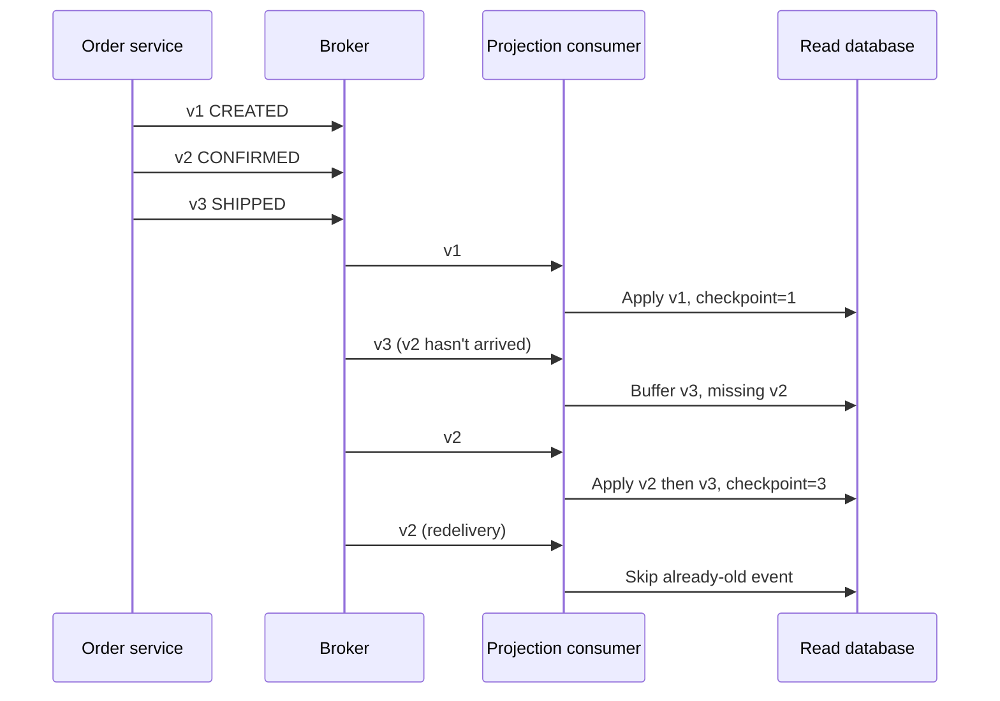
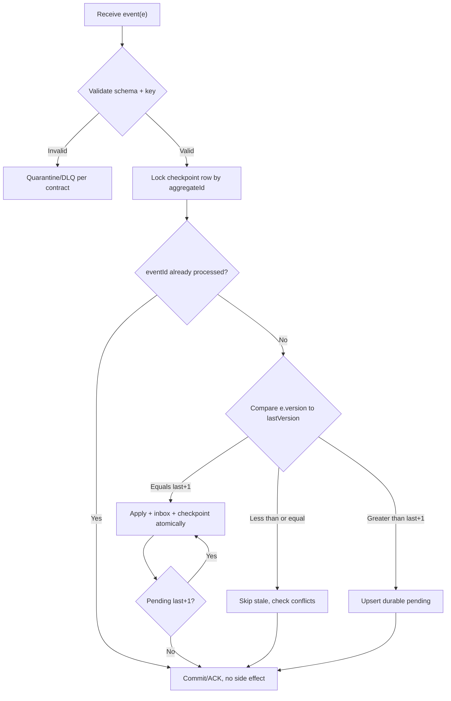

# Per-Entity Event Ordering and Handling Late Events

In a Spring Boot integration architecture, an order may sequentially be created, confirmed, handed off to a carrier, and completed. Changes are published over Kafka, RabbitMQ, Apache Pulsar, or a Spring Integration flow. However, events **published in order** do not mean **every consumer always observes and applies them in order**. Retries, multiple partitions, parallel consumers, slow networks, dead-letter redrives, and crash recovery can all cause events to arrive late or out of order.

This lesson belongs to the **Consistency and Deduplication** chapter of `SPRING_BOOT_INTEGRATION`, a module organizing Spring Boot integration across HTTP clients, databases, caches, message brokers, and Spring Integration adapters. We address a concrete question: **how to preserve accurate per-entity state when events arrive out of order**, while controlling transactions, idempotency, failures, testing, and observability.

The running example uses events for `order-42`. Assume the producer owns the `Order` aggregate, increments `aggregateVersion` by exactly one on each successful change, and emits one corresponding event. That is a **mandatory contract assumption** for algorithms requiring contiguous versions; if the producer does not guarantee this, choose a different design.

## 1. Understanding order properly: publish, receive, and apply

Three distinct moments must be separated:

| Moment | Question | Who controls it? |
| --- | --- | --- |
| Business write order | Which version of `Order` actually committed first? | The database and application service owning the aggregate. |
| Broker send/receive order | Which message was published, appended, delivered, or redelivered first? | Producer, partition/key, subscription, and broker. |
| Consumer apply order | Which version was written to the read model, cache, or external system first? | Consumer logic, transactions, checkpoints, and recovery policy. |

Example:

```text
Producer commits:
  Order(order-42) v1 CREATED
  Order(order-42) v2 CONFIRMED
  Order(order-42) v3 SHIPPED
  Order(order-42) v4 DELIVERED

Consumer observes:
  v1 -> v3 -> v2 -> v4 -> v2 (redelivery)
```

If the consumer updates `status` on every incoming event without checking versions, applying `v2` after `v3` can regress an order from `SHIPPED` back to `CONFIRMED`. If `v2` is redelivered after `v4` was processed, state can regress again.



The goal is not sorting every event across the **entire system** into one global sequence. Most problems require order **per entity/aggregate**: `order-42` has its own stream, while `order-43` can process in parallel. Ordering between two independent orders rarely carries business meaning.

## 2. Event contracts need enough metadata for recovery

Example message DTO decoupled from JPA entities:

```java
import java.time.Instant;
import java.util.UUID;

public record OrderStatusChangedV1(
        UUID eventId,
        String aggregateType,
        UUID aggregateId,
        long aggregateVersion,
        String status,
        Instant occurredAt,
        int schemaVersion,
        String correlationId) {
}
```

Illustrative payload:

```json
{
  "eventId": "0b4b4db4-37c4-4f18-8f11-f37e306bbbd1",
  "aggregateType": "Order",
  "aggregateId": "72e99948-84e2-42f6-8fa6-935776033d12",
  "aggregateVersion": 3,
  "status": "SHIPPED",
  "occurredAt": "2026-11-20T10:12:00Z",
  "schemaVersion": 1,
  "correlationId": "checkout-734"
}
```

| Field | Role | Common mistake |
| --- | --- | --- |
| `eventId` | Identity of **one logical event**, used to deduplicate on redelivery/redrive | Generating a new UUID on every publisher retry. |
| `aggregateId` | Key grouping events by entity | Using message delivery ID as the entity key. |
| `aggregateVersion` | Change sequence assigned by the **aggregate owner** | Replacing it with consumer timestamps or retry counts. |
| `occurredAt` | When the business event occurred, for time-based analysis | Using timestamps to infer absolute order despite clock skew. |
| `schemaVersion` | **Payload format** version | Confusing it with `aggregateVersion`, which is state version. |
| `correlationId` | Links a business journey across services | Treating correlation ID as an idempotency key for all operations. |

`aggregateVersion` should be assigned atomically alongside the aggregate update inside the **same database transaction**. If the producer runs multiple instances, use optimistic locking (`@Version`), row locks, or an equivalent versioning mechanism so two concurrent updates never both claim `v7`.

Example SQL assigning versions atomically on checked updates:

```sql
UPDATE purchase_orders
SET status = :newStatus,
    aggregate_version = aggregate_version + 1
WHERE id = :orderId
  AND aggregate_version = :expectedVersion
RETURNING aggregate_version;
```

If zero rows update, the producer must reload state, detect the conflict, and decide on a business retry; never emit an event with a guessed version. An outbox row holding the event ID, aggregate ID, and **committed version** must be inserted in the same transaction as the aggregate change. The outbox publisher may republish after a crash, yet must never turn a `v3` event into `v4` merely because it resent it.

**A design condition:** if one aggregate mutation can emit *multiple events*, they cannot simply share `aggregateVersion` and still expect consumers to see a unique version stream. Either add a per-aggregate `eventSequence` (with explicit order and uniqueness), or specify in the contract that events sharing a version are processed as a unit.

## 3. "Late," "duplicate," and "gapped" are three distinct cases

Suppose a consumer has applied up to `lastAppliedVersion = 5`:

| Received event | Preliminary classification | Decision for a contiguous *delta stream* |
| --- | --- | --- |
| `version = 6` | Next expected event | Validate contract then apply atomically. |
| `version = 5` | Already old or redelivery | Verify identity/ledger; do not re-apply. |
| `version = 4` | Old event arriving late | Do not overwrite newer state. |
| `version = 8` | Newer event **missing 6, 7** | Persist to durable pending table; wait for gap fill or rebuild. |
| `version = 6`, same `eventId` as active work | Concurrent duplicate delivery | Only one transaction may claim/commit. |
| `version = 6`, two different `eventId`s | Violates one-event-per-version contract | Alert/quarantine to investigate producer or bad data. |
| Event without version | Missing ordering metadata | Switch to a suitable design; never guess order from receipt time. |

Two additional distinctions:

- **Transport-delayed event:** a valid business event delayed by network, retries, or DLQ so it arrives behind later events.
- **Event with past business time:** e.g., a reconciliation system today emits an adjustment for last week's transaction. A *newly emitted* event may carry an old `occurredAt` while still holding a brand-new version. Do not drop it just because its timestamp is old.

An `eventId` can be redelivered multiple times; an `aggregateVersion` can be seen repeatedly. Idempotency governs *operations already executed*; version guards govern *application order*. When protecting external side effects, you usually need **both**.

## 4. Ordering at the broker: helpful, but insufficient

| Channel | How it keeps an entity together | Important limitations |
| --- | --- | --- |
| Kafka | Send messages with `aggregateId` as record key to hit the same partition under current config | Order holds only within **one partition**; multiple consumers, async work, or off-path retries can invert apply order. Changing partition counts alters key mapping. |
| Apache Pulsar | Set `aggregateId` message key; consider `Key_Shared` to shard load by key | Understand subscriptions, batching, redeliveries, and key-ordering limits; parallel processing inside a consumer can still reorder completion. |
| RabbitMQ | Queues preserve enqueue order; consider single active consumer, key-based sharding, or sequential queue consumers | Multiple consumers, prefetch, requeues, and concurrency make **completion order** differ from delivery order. |
| HTTP webhook | Sender provides `eventId` and version per resource | Concurrent requests arrive simultaneously; HTTP guarantees no inter-request order. |
| Spring Integration flow | Route by `aggregateId`, control executors/concurrency or aggregators/resequencers | Async channels, retry adapters, and thread hops can invert apply order. |

With multi-partition Kafka topics, producers must supply a stable key per aggregate; a consumer group assigns one partition to one consumer at a time, yet async handling in user code can still break in-partition order. Rebalances, retry topics, and DLQs can route the same aggregate onto a separate path. Regardless of "ordered" broker settings, consumers should enforce version checks at the point of write.

In Pulsar, `Shared` favors distribution; `Key_Shared` helps pin the same key to a consistent consumer. Never assume from subscription names that **every** edge case maintains strict order across retries or parallel `flatMap` processing. Test against your actual subscription type and client version.

In RabbitMQ, multiple workers can consume one queue. If A receives `v2` and hits a slow HTTP call while B receives `v3` and commits first, state still inverts even though the broker delivered in order. Dropping queue concurrency to 1 throttles independent orders unnecessarily; **key-based routing + consumer version guards** are a better solution.

## 5. Choosing a policy by event type

Not every payload must wait for contiguous versions. Before writing a consumer, clarify whether messages represent **deltas**, **snapshots**, or **commutative** operations:

| Type | Example | Can `v8` apply when only `v5` is stored? | Risk of skipping intermediate events |
| --- | --- | --- | --- |
| Business delta | `AddItem(quantity=2)`, `Debit(100)` | **No**, if v6/v7 alter the result | Loses unrecoverable effects. |
| State transition event | `PaymentAuthorized`, `PaymentCaptured` | Depends on state machine and invariants | May skip required validations or side effects. |
| Full snapshot | `OrderSnapshot(v8, allFields...)` | **Conditionally**, if consumer only needs latest state and source guarantees full snapshot | Misses transition-specific notifications/side effects. |
| Commutative / CRDT ops | Counter increments with unique event IDs | Can apply out of order if math/contract allows | Duplicates still double-count without deduplication. |
| Event-time analytics events | `PageViewed`, `SensorReading` | Can ingest/sort by time windows and watermarks | Window results may revise when late data arrives. |

Three common policies:

1. **Strict sequential:** apply only `version = last + 1`; buffer higher versions; fits deltas and state machines needing full history.
2. **Controlled latest-state-wins:** use only when events carry **complete** snapshots and skipping older versions is valid; updates must enforce `incomingVersion > storedVersion`. Never use consumer receipt timestamps as the primary guard.
3. **Recompute/rebuild:** when gaps cannot be filled or events arrive too late, query an authoritative snapshot or replay the event log to rebuild projections with clear auditing.

Never run `Math.max(lastVersion, incomingVersion)` and mark every event "processed" on a **delta stream**: if v7 arrives before v6, advancing the checkpoint to 7 loses v6 and permanently corrupts state.

## 6. Consumer database design: checkpoint, inbox, and pending

Assume the producer emits **exactly one** `OrderStatusChangedV1` per version increment for an aggregate; `aggregateId` is a UUID starting at version 1. The consumer maintains three data structures:

- **Projection/checkpoint:** applied state and `last_version` per order.
- **Inbox/processed-event:** successfully applied events; blocks duplicate side effects and supports investigation.
- **Pending event:** received events not yet eligible to apply; persisted durably before ACKing delivery.

Illustrative PostgreSQL schema:

```sql
CREATE TABLE order_projection (
    order_id       UUID PRIMARY KEY,
    status         VARCHAR(32) NOT NULL DEFAULT 'UNKNOWN',
    last_version   BIGINT NOT NULL DEFAULT 0 CHECK (last_version >= 0),
    updated_at     TIMESTAMPTZ NOT NULL DEFAULT CURRENT_TIMESTAMP
);

CREATE TABLE processed_order_event (
    consumer_name  VARCHAR(80) NOT NULL,
    event_id       UUID NOT NULL,
    order_id       UUID NOT NULL,
    event_version  BIGINT NOT NULL,
    event_status   VARCHAR(32) NOT NULL,
    processed_at   TIMESTAMPTZ NOT NULL DEFAULT CURRENT_TIMESTAMP,
    PRIMARY KEY (consumer_name, event_id),
    UNIQUE (consumer_name, order_id, event_version)
);

CREATE TABLE pending_order_event (
    consumer_name  VARCHAR(80) NOT NULL,
    order_id       UUID NOT NULL,
    event_version  BIGINT NOT NULL,
    event_id       UUID NOT NULL,
    payload        JSONB NOT NULL,
    received_at    TIMESTAMPTZ NOT NULL DEFAULT CURRENT_TIMESTAMP,
    PRIMARY KEY (consumer_name, order_id, event_version),
    UNIQUE (consumer_name, event_id)
);

CREATE INDEX idx_pending_order_received
    ON pending_order_event (received_at);
```

These tables serve **one canonical event stream per aggregate**. If a projection has multiple logical consumers or distinct version streams, redesign keys such as `(consumer_name, aggregateType, aggregateId, streamId, version)` accordingly. `UNIQUE (consumer_name, order_id, event_version)` holds only when the producer guarantees one event per version in this stream. `event_status` enables payload verification in a status-only example; for richer payloads, store a canonicalized fingerprint/hash or raw copy to catch same-`eventId`, differing-content anomalies.

For `order_projection`, `UNKNOWN` is strictly an internal pre-v1 placeholder; never expose it as a valid business status. Upon receiving v1, verify the contract's creation event type before transitioning to `CREATED`.

### Why must pending events be durable?

Suppose `v3` arrives before `v2`. If the consumer stores `v3` in an in-memory `HashMap` and ACKs the broker, a restart loses `v3`. If the consumer **withholds ACK** and blocks the delivery waiting for `v2`, it can stall the entire partition/queue or trigger requeue loops. Persisting pending rows in PostgreSQL and ACKing **after committing pending** lets the consumer proceed to `v2` without losing `v3`.

In return, once pending is ACKed, **the pending database owns recovery**, because the broker may never redeliver that event. You need a pending-drain worker, monitoring, retention, and runbooks for stuck pending rows. Adding a table without operating its drain lifecycle is not enough.

## 7. Version-ordered apply algorithm and transactions

For each event `e` belonging to `orderId`, execute inside one PostgreSQL transaction:

1. Validate `schemaVersion`, `eventId`, `aggregateId`, positive version, valid status, and tenant/authorization if applicable.
2. Ensure the checkpoint row exists; acquire a **row lock** on that `orderId` via `SELECT ... FOR UPDATE` to serialize concurrent applies across replicas.
3. If `eventId` is already in the inbox, return already-processed without repeating side effects.
4. If `e.version <= last_version`, classify as stale/duplicate. If conflicting payloads or event IDs appear for the same version, alert/quarantine without updating state.
5. If `e.version > last_version + 1`, persist the **original payload** into pending under unique constraints, check event/version conflicts, and commit; delivery can be ACKed.
6. If `e.version == last_version + 1`, validate the transition, apply the event, insert inbox, and advance the checkpoint **in the same transaction**.
7. Look up the new `last_version + 1` in pending and apply sequentially up to a batch cap; if more remain, let subsequent worker/drain transactions finish.
8. Only after the transaction commits does the listener signal success/ACK the broker. On DB rollback, redeliver/NACK per policy.



### 7.1. Locking the checkpoint so two replicas cannot overtake each other

One way to ensure the checkpoint row exists before locking:

```sql
INSERT INTO order_projection (order_id, status, last_version)
VALUES (:orderId, 'UNKNOWN', 0)
ON CONFLICT (order_id) DO NOTHING;

SELECT status, last_version
FROM order_projection
WHERE order_id = :orderId
FOR UPDATE;
```

Both SQL statements must run **in the same transaction**. The unique constraint on `order_id` and the row lock serialize two transactions handling the same order, even from different pods. Different orders still process in parallel in PostgreSQL. Never rely on JVM `synchronized`, since each pod has its own lock space.

If using optimistic compare-and-set instead of row locks, every update still needs `WHERE last_version = :expectedVersion` plus affected-row checks; failed transactions must retry against fresh checkpoints. Never do unconditional "last write wins" updates.

### 7.2. Illustrative application code

The Java snippet below delegates SQL to repositories to focus on orchestration logic. The interfaces are illustrative contracts to implement with Spring JDBC/JPA sharing the same `DataSource`/transaction manager:

```java
import java.util.UUID;
import org.springframework.stereotype.Service;
import org.springframework.transaction.annotation.Transactional;

public record OrderEvent(
        UUID eventId, UUID orderId, long version, String status) {
}

public enum ApplyResult {
    APPLIED, BUFFERED, DUPLICATE, STALE
}

@Service
public class OrderedOrderEventService {
    private static final String CONSUMER = "order-view-v1";
    private final OrderProjectionRepository projection;
    private final ProcessedEventRepository processed;
    private final PendingOrderEventRepository pending;

    public OrderedOrderEventService(
            OrderProjectionRepository projection,
            ProcessedEventRepository processed,
            PendingOrderEventRepository pending) {
        this.projection = projection;
        this.processed = processed;
        this.pending = pending;
    }

    @Transactional
    public ApplyResult accept(OrderEvent event) {
        validate(event);
        projection.createCheckpointIfAbsent(event.orderId());
        var checkpoint = projection.lockForUpdate(event.orderId());

        var previous = processed.findByEventId(CONSUMER, event.eventId());
        if (previous.isPresent()) {
            processed.assertSameEvent(previous.get(), event);
            return ApplyResult.DUPLICATE;
        }
        if (event.version() <= checkpoint.lastVersion()) {
            processed.assertNoVersionConflict(CONSUMER, event);
            return ApplyResult.STALE;
        }
        if (event.version() > checkpoint.lastVersion() + 1) {
            pending.insertOrAssertSameEvent(CONSUMER, event);
            return ApplyResult.BUFFERED;
        }

        applyAndAdvance(event);
        drainContiguousPending(event.orderId(), 100);
        return ApplyResult.APPLIED;
    }

    private void applyAndAdvance(OrderEvent event) {
        projection.applyTransitionAndAdvanceVersion(event);
        processed.insert(CONSUMER, event);
        pending.deleteIfMatches(CONSUMER, event);
    }

    private void drainContiguousPending(UUID orderId, int maxEvents) {
        for (int i = 0; i < maxEvents; i++) {
            long nextVersion = projection.currentVersion(orderId) + 1;
            var next = pending.find(CONSUMER, orderId, nextVersion);
            if (next.isEmpty()) {
                return;
            }
            applyAndAdvance(next.get());
        }
        // If contiguous pending events remain, a scheduler/outbox worker must drain further.
    }

    private void validate(OrderEvent event) {
        if (event.eventId() == null || event.orderId() == null
                || event.version() < 1 || event.status() == null) {
            throw new IllegalArgumentException("Invalid order event");
        }
    }
}
```

This code illustrates **one use case**, not a standalone buildable Java file: place each `public record`/`enum`/class in its own Java file; implement the three repositories, JSON mapping, `schemaVersion` validation, state machine, and proper package imports. `assertSameEvent`, `applyTransitionAndAdvanceVersion`, `insertOrAssertSameEvent`, and `assertNoVersionConflict` must enforce invariants and throw if an event ID or version carries conflicting business content. Plain `INSERT ... ON CONFLICT DO NOTHING` treating all conflicts as benign can hide corrupted events.

Example conditional checkpoint update:

```sql
UPDATE order_projection
SET status = :newStatus,
    last_version = :incomingVersion,
    updated_at = CURRENT_TIMESTAMP
WHERE order_id = :orderId
  AND last_version = :incomingVersion - 1;
```

Require affected rows equal to `1`. The version predicate acts as an extra safeguard alongside row locks. The `processed_event` insert shares the **same transaction** with the projection update; if either fails, both roll back. Cap how many pending events drain in one transaction to avoid holding row locks too long.

`@Transactional` must pass through a Spring proxy (listener calling a separate service bean), the transaction manager must bind to the right database, and the listener must confirm receipt only after the service method **returns and its transaction commits**. If the checkpoint sits in database A and the inbox in database B, a local `@Transactional` cannot guarantee atomicity across both.

### 7.3. Adding a pending-drain worker

A scheduled pending worker should identify orders with pending rows, lock the checkpoint per order, and apply contiguous events. When workers process different orders concurrently, use `FOR UPDATE SKIP LOCKED` with a suitable claim strategy or shard work by key. Never take a single global lock across all orders.

To prevent races, always drain inside the same transaction and using the same consumer version rules; the pending worker **must never bypass** validation, inbox checks, or the state machine. If `v3` arrives before `v2`, pending holds `v3`; when `v2` arrives, the listener applies `v2` and drains `v3`. If the listener crashes before commit, both v2/v3 applications roll back and the broker redelivers `v2`; `v3` stays safe in pending if already committed earlier.

## 8. Late events arriving after the checkpoint has moved far ahead

When a consumer is already at v10 and receives v8, clarify the business semantics:

- **Current-state projection:** if v8 is merely an earlier delta already reflected, safely skip it after verifying ID/version compatibility. Never overwrite v10 state.
- **Late event previously missed while the projection jumped to v10 via snapshot:** does v8's side effect still need to happen? If so, run a dedicated handling/reconciliation path rather than blindly skipping.
- **Retroactive adjustment:** a brand-new event with `aggregateVersion=11` whose `effectiveAt` is last week; apply with bitemporal/historical-adjustment semantics rather than calling it stale because its effective date is old.
- **Event arriving past a business cutoff:** e.g., a cancellation arriving after delivery. Never blindly apply `CANCELLED`; let the state machine reject it or start a return/refund workflow.

For event-time analytics (such as hourly order counts), **watermarks and allowed lateness** apply:

```text
Window 10:00-11:00
Watermark passed 11:05
Allowed lateness until 11:10
Event 10:40 arrives at 11:08 -> update window result per policy
Event 10:35 arrives at 11:15 -> route to side output/quarantine or adjustment
```

Watermarks estimate event-time progress, not an aggregate's `lastAppliedVersion`. Updating an analytics window after emission may require downstream retractions/upserts and versioned outputs. Never use watermark thresholds to drop order-state events requiring a full delta sequence.

## 9. Handling gaps that never get filled

An event `v7` sitting in pending for over an hour while the checkpoint stays at `v4` signals that `v5`/`v6` were never published, dropped in the pipeline, sent to a DLQ, or failed schema checks. Pending rows must not sit indefinitely without operational action.

| Situation | Recommended action |
| --- | --- |
| `v5` sits in a retry topic or DLQ | Investigate failure, fix root cause, redrive **preserving** `eventId`, `aggregateId`, `version`. |
| Producer committed `v5` yet outbox hasn't published | Inspect outbox backlog, publisher offsets, broker confirms, and republish idempotently. |
| Producer never emitted `v5` though aggregate jumped v4 to v6 | Identify publisher contract bug; recover from event store or authoritative snapshot. |
| Snapshot v10 can replace projection without intermediate side effects | Execute controlled rebuild/fast-forward with audit trail, updating checkpoint atomically. |
| Event fails deserialization | Send to quarantine/DLQ keeping raw payload, schema version, and error; never mark applied. |
| `v5` passed retention with no snapshot available | Unrecoverable gap automatically; alert and reconcile from the source of truth. |

A periodic reconciliation process can:

1. Find `orderId`s with pending rows older than a threshold, noting `last_version` and `min(pending_version)`.
2. Compute the missing version range; query the producer's outbox/event store or an authorized snapshot endpoint.
3. When missing events are found, feed them through the standard pipeline (preserving IDs/versions) to reuse idempotency, state machine, and transactions.
4. If choosing a rebuild, verify which intermediate side effects still need execution; apply the snapshot with an explicit `sourceVersion`.
5. Once fixed, drain pending events in order and monitor lag until backlog clears.

Never manually bump `last_version` to `MAX(pending_version)` to "unstick" a projection: doing so falsely marks unapplied deltas as processed.

## 10. Retries, dead-lettering, redrives, and ACKs

An integration flow can receive the same event multiple times when a consumer crashes between commit and ACK. Handling policy:

| Situation | When can you ACK? | What NOT to do |
| --- | --- | --- |
| Event applied | After DB transaction commits successfully | ACK before commit. |
| Duplicate already applied | After verifying state/inbox, with no side effect | Re-run HTTP payment or DB writes. |
| Future version buffered | After **durable pending commit**, with a drain worker | ACK while holding the event only in memory. |
| Permanent schema error | After durable quarantine/DLQ per adapter/broker | Tight infinite retry loop on the same bad payload. |
| Database disconnected | Cannot confirm apply/buffer; retry with backoff | Treat as processed or swallow exceptions. |
| Overdue gap | Do not ACK as complete; escalate/reconcile | Bump checkpoint past missing versions. |

Across Spring Kafka, Spring AMQP, Spring for Apache Pulsar, and Spring Integration inbound adapters, ACKs/NACKs, retry topics, and DLQs differ in APIs and commit semantics. Configure per adapter; never copy `acknowledge()` or `@Transactional` assumptions blindly from one adapter to another.

**Practical rule:** wrap `accept(event)` in a `@Transactional` service and have a synchronous listener call it. Only once the service returns after commit does the container/adapter mark delivery complete. With async handlers, await operation completion before ACKing. When processing must call external HTTP APIs, a DB transaction cannot cover HTTP; persist the outbound command into a **transactional outbox** and let an idempotent publisher execute the external side effect post-commit.

### Why must stale events still be verified?

When `version <= checkpoint`, not all cases are identical:

- If the inbox shows the **same eventId was already applied**, it is a genuine duplicate; ACK without side effects.
- If the same version carries a **different eventId** than what was applied, the one-event-per-version contract was broken; quarantine/alert.
- If the version is older than the checkpoint and the inbox row already aged out per retention, skip **only when** projection policy guarantees the checkpoint covers that entire version range. Keep appropriate audit evidence for investigations.

For duplicate `(orderId, version)` in pending, matching event IDs and payloads can be deduplicated; differing payloads must never be silenced with `ON CONFLICT DO NOTHING`. Seeing the same event ID with a different version is also a contract error.

## 11. Events spanning multiple aggregates and cross-service flows

Ordering by `aggregateId` solves **one** stream owned by **one** producer; it does not establish global ordering across services.

Example:

```text
Order service:   OrderConfirmed(order-42, orderVersion=5)
Payment service: PaymentCaptured(payment-19, paymentVersion=3)
Shipping service: ShipmentCreated(shipment-8, shipmentVersion=1)
```

Versions 5, 3, and 1 belong to **three independent streams** and cannot be compared numerically. Coordinating across them requires correlation/causation IDs, state machines or sagas/orchestrators, explicit preconditions ("ship only after payment capture confirmed"), and idempotent commands. If a consumer receives `ShipmentCreated` before `PaymentCaptured`, buffer based on persisted business preconditions rather than taking `MAX(version)` across distinct aggregates.

If an event carries `aggregateVersion=8` yet multiple writers modify it without a single source of truth, that version cannot enforce order either. Establish clear ownership (single writer per aggregate) or an explicit concurrency/distributed ordering protocol. Relying on `occurredAt` across differing server clocks rarely resolves such conflicts.

## 12. When to use locks vs. optimistic concurrency?

Inside a single consumer instance, `synchronized(orderId)` serializes tasks by key, yet across three replicas, JVM locks offer zero cross-process protection.

| Mechanism | Protects | Limitations |
| --- | --- | --- |
| `SELECT ... FOR UPDATE` on checkpoint | Serializes updates for the same order in one DB | Requires shared DB and active transaction; long holds cause contention. |
| Optimistic compare-and-set version | Prevents stale SQL writes, detects conflicts | Must inspect affected rows and retry properly; does not store pending rows by itself. |
| Spring Integration distributed `LockRegistry` | Ensures one worker holds key lock while lease is valid | Leases can expire while old worker still runs; still requires version checks/idempotency. |
| Keyed broker partitions/subscriptions | Improves sequential delivery and lowers contention | Retries/redrives, async completion, and multiple producers can still reorder. |
| Database unique constraints/inbox | Prevents duplicate event application in local transaction | Does not handle gapped versions or external HTTP side effects alone. |

In the `order_projection` example, short transactions with row locks and version predicates suffice for DB state. When slow HTTP calls are involved, **never** hold DB row locks across the network thinking it enforces order. Persist ordered/versioned outbox commands, dispatch post-commit, and guard the receiver with idempotency keys or fencing/versions.

## 13. Meaningful tests: out-of-order deliveries and crash simulation

Tests must prove correctness across **state**, **inbox**, **pending**, **ACK**, and side effects. Unit tests verify policy logic; integration tests with real PostgreSQL + real brokers verify concurrency, transactions, and redeliveries.

### 13.1. Test matrix

| Scenario | Input sequence | Expected outcome |
| --- | --- | --- |
| In order | v1 → v2 → v3 | Checkpoint 3, status v3, pending empty. |
| Out of order | v1 → v3 → v2 | After v3: pending holds v3; after v2: applies v2 then v3, checkpoint 3. |
| Duplicate after commit | v1 → v2 → v2 | One inbox row for v2, not re-applied. |
| Very late stale event | v1 → v2 → v3 → v1 | Checkpoint stays 3, state never regresses. |
| Prolonged gap | v1 → v4 | Pending holds v4, checkpoint 1; alerts past SLA. |
| Version conflict | Two distinct event IDs for same aggregate/version | Quarantined or raises contract violation; never silently drops one. |
| Event ID conflict | Same event ID with two differing versions/payloads | Bad data detected; zero side effects executed. |
| Two replicas process v2 concurrently | Simultaneous deliveries to shared DB | Only one transaction applies; the other returns duplicate/stale. |
| Crash before committing v2 | Dies mid-projection update | Transaction rolls back; redelivery applies v2 once. |
| Crash after commit, before ACK | DB at v2, broker unacked | Redelivery deduplicated, no repeated side effects. |
| Crash after committing pending, before ACK | v4 saved in pending | Redelivery inserts no conflicting rows; pending survives restart. |
| Redrive from DLQ | Missing v2 resent after v4 | Drains v2, v3, v4 sequentially once contiguous. |
| High-version snapshot | v10 snapshot after v5 | Fast-forwards only if contract permits without losing side effects. |
| Two independent orders | Order A/v2 and Order B/v3 concurrently | Proceed without blocking each other; both reach accurate state. |
| Invalid state machine transition | `DELIVERED` → `CREATED` even with newer version | Rejected/quarantined per rules, never blindly accepting higher version. |

### 13.2. Concurrency tests with two real transactions

Using Testcontainers PostgreSQL, have two threads/contexts invoke the service with different `eventId`s or the same `aggregateId`/version. Synchronize both workers with a barrier to start simultaneously. Verify:

1. One transaction acquires the row lock first and applies the next version.
2. The second transaction acquires the lock afterward, sees the updated checkpoint, and never overwrites.
3. If two distinct event IDs share a version, the system flags a conflict per contract rather than treating both as valid.
4. If v3 arrives before v2, v3 buffers durably, and v2 triggers the drain.

Do not annotate the **entire test method** with `@Transactional`, as that holds connections/locks and masks real service concurrency. Let each worker commit independently, then assert state in a fresh transaction afterward.

### 13.3. Broker and crash-point tests

Using real Kafka/Pulsar/RabbitMQ containers, publish messages sharing the **same aggregate key**, while triggering retries or redrives so they arrive in order v1, v3, v2. Assert PostgreSQL state and adapter ACK/offset behavior—never just assert call order on a fake repository.

To simulate a crash after commit yet before ACK, use a hook/fixture that kills the worker process at that exact boundary; throwing an exception inside the same JVM is useful yet does not fully replicate a dropped broker connection. Once the new process receives the redelivery, verify external HTTP calls do not repeat and the inbox shows completion.

## 14. Observability, alerting, and backlog operations

Do not measure only successful apply counts. Ordering can fail silently if checkpoints advance while pending rows never drain.

| Metric/log | Meaning | Alert trigger |
| --- | --- | --- |
| `event_apply_total{result}` (`applied`, `buffered`, `duplicate`, `stale`, `conflict`) | Explains why consumers ACK/skip | Rising `conflict` or abnormal `buffered` spikes. |
| `projection_last_version` by low-cardinality group/tenant | Tracks overall progress | Projection falls far behind source or stalls for long. |
| Pending count, `min(received_at)`, oldest pending age | Detects stuck gaps | Pending ages past SLA or climbs continuously. |
| Missing range `next_expected` to `min_pending_version` | Pinpoints awaited versions | Gaps remain unfilled by producer/outbox. |
| Consumer lag, broker redeliveries, DLQ depth | Locates transport root causes | Lag/DLQ rises alongside pending rows. |
| In-flight processing, lock waits, DB deadlocks | Detects per-aggregate contention | Long lock holds or hot retry loops. |
| Outbox backlog, publish failures, broker confirms | Spots events stuck pre-broker | Source versions advance while downstream lacks events. |

High-cardinality `aggregateId` and `eventId` must not become metric labels; keep them in access-controlled structured logs and traces. Useful log fields include `eventId`, `aggregateId`, `eventVersion`, `checkpointBefore`, `checkpointAfter`, `result`, `correlationId`, `consumerName`, and `traceId`. Never dump secrets or PII payloads recklessly into DLQs, traces, or logs.

During rollouts:

- All instances of the same consumer logic share the same checkpoint/inbox/pending schema and contract version.
- Never point two consumer versions with incompatible logic at the **same** checkpoint without proving compatibility.
- Keep sufficient retention for event stores/outboxes, pending rows, and replay history; archive processed-event rows without breaking deduplication inside active windows.
- Backoff retries on DB/broker failures; never let one gapped message tight-requeue and starve a partition.
- Plan projection bootstrapping/rebuilds for new consumers: define starting version, snapshots, and catch-up past the snapshot.

## 15. Common design mistakes

| Mistake | Why it is wrong | Fix |
| --- | --- | --- |
| Ordering by `receivedAt` | Arrival order shifts across networks/consumers | Use authoritative source sequences/versions. |
| Ordering by producer machine timestamps | Clocks skew; concurrent events share timestamps | Assign versions/sequences atomically. |
| Using `MAX(version)` for deltas | Drops intermediate deltas | Apply only `last+1`; persist gaps and reconcile. |
| ACKing future events before persisting | In-memory pending events vanish on crash | Commit durable pending before ACK. |
| Using unique `eventId` without version checks | Fails to stop stale events with different IDs from regressing state | Combine inbox with version guards. |
| Using versions without an inbox | Side effects can duplicate on retries or pre-commit failures | Inbox/unique constraints in transaction + target idempotency. |
| Different payloads sharing a version, `ON CONFLICT DO NOTHING` | Silently masks producer contract bugs | Compare ID/hash and quarantine/alert on mismatch. |
| Consumer incrementing versions on retry | Turns every redelivery into a new event | Producer assigns versions on commit and preserves across retries. |
| Relying solely on Kafka keys without version guards | Retry topics/async workers still reorder | Enforce DB version guards and test redelivery/reordering. |
| One global lock across all aggregates | Unnecessarily throttles throughput | Lock per aggregate or checkpoint row. |
| Sharing `aggregateVersion` across multiple unordered events | Cannot determine the next step unambiguously | Add per-event sequences or group events by contract. |
| Dropping `v5` simply as "too old" | May lose an unexecuted side effect | Clarify stale semantics, check history, and reconcile. |
| Bumping version blindly from timestamps/snapshots | Unverified safety for skipping deltas | Explicit snapshot contracts, auditing, and controlled rebuilds. |

## 16. Implementation checklist and exercise

Before scaling a Spring Boot integration flow across multiple consumers/replicas, verify:

- [ ] Aggregate owners assign versions/sequences atomically and never reassign them on retries.
- [ ] `eventId`, `aggregateId`, `aggregateVersion`, and `schemaVersion` have distinct roles and validation.
- [ ] Per-aggregate keys/routing/subscriptions match actual broker semantics.
- [ ] Strict delta, snapshot, or commutative policy is chosen intentionally by business semantics.
- [ ] Consumers maintain durable checkpoints and inboxes with unique constraints, row locks, or optimistic CAS.
- [ ] Future events persist to durable pending storage, with drain workers and overdue-gap reconciliation.
- [ ] Stale, duplicate, and conflict cases are distinguished—never regressing state or hiding payload mismatches.
- [ ] ACKs happen only after applying or persisting pending commits; retries/DLQs/redrives preserve event identity.
- [ ] HTTP side effects use idempotency keys; critical outbound commands use outboxes or verified consistency patterns.
- [ ] Tests cover reordering, duplicates, multi-replica concurrency, crashes before/after commit, and version conflicts.
- [ ] Metrics track pending age/gaps, conflicts, backlog, outboxes, and recovery procedures from the source of truth.

**Hands-on exercise:** stand up `order_projection`, `processed_order_event`, and `pending_order_event` using PostgreSQL Testcontainers and a Spring Boot consumer. Publish `OrderCreated(v1)`, `OrderShipped(v3)`, `OrderConfirmed(v2)`, and `OrderShipped(v3)` again. Verify that after the first `v3`, the checkpoint stays at 1 and pending holds `v3`; after `v2`, the checkpoint reaches 3, status is `SHIPPED`, and pending empties; after the repeated `v3`, zero changes or second side effects occur. Next, have two workers receive `v4` concurrently, simulate a crash after commit before ACK, and verify the redelivery triggers both inbox and version guards. Finally, introduce a missing `v5` gap and write a reconciliation job that reports pending age, queries the source, and backfills only after confirming the right event/version.

**Key takeaway:** broker delivery order is a valuable helper, yet per-entity correctness is enforced at **the point where state is applied**. Explicit version contracts, transactional checkpoint/inbox/pending tables, gap handling, and crash recovery let Spring Boot handle late events without regressing state or losing essential business updates.
