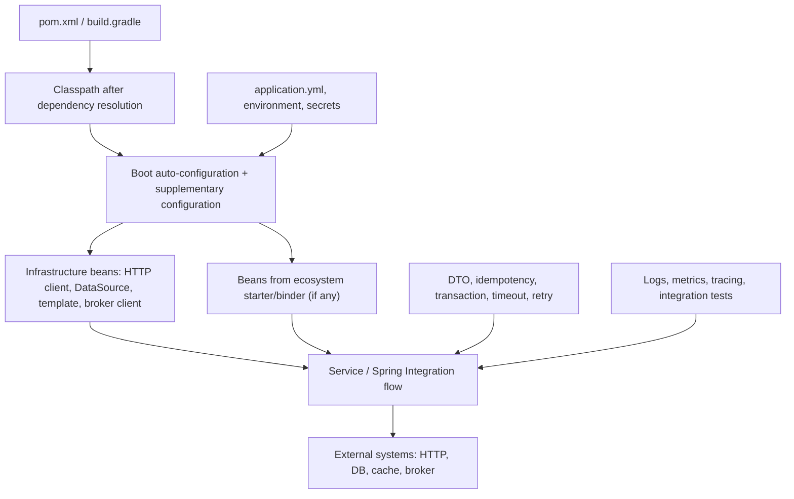
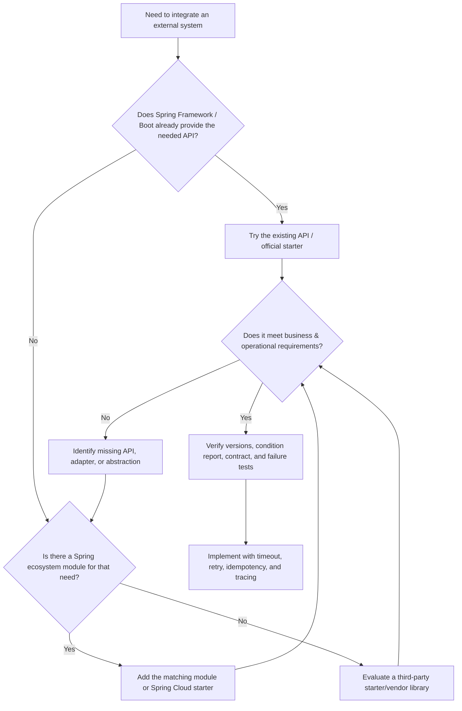

# Distinguishing Boot Built-in Integrations from Ecosystem Starters

> **Chapter:** Supplementary Libraries  
> **Scope:** In the **SPRING_BOOT_INTEGRATION** module, a Spring Boot application can integrate with systems via HTTP clients, databases, caches, message brokers, and Spring Integration adapters. This lesson clarifies which capabilities are supported by Spring Boot auto-configuration, when you need to add an ecosystem module or starter, and how to control versions, data contracts, transactions, errors, duplicates, testing, and observability when combining multiple libraries.

## 1. The Core Question: What Does "Boot Supports It" Mean?

When reading documentation or a project's dependencies, we often encounter remarks like "Spring Boot supports Redis", "Boot supports Kafka", or "just add the starter". These statements **do not mean the same thing**:

- **Library with execution APIs:** for example, Spring Framework provides HTTP clients, Spring Data provides repositories, and Spring AMQP provides RabbitMQ APIs. They are where most of the communication logic is implemented.
- **Spring Boot has auto-configuration:** when the library and matching configuration are present, Boot can pre-build infrastructure beans such as a client builder, connection factory, template, repository infrastructure, or transaction manager.
- **Spring Boot provides an official starter:** a dependency used to bundle the libraries commonly needed for a feature, helping users declare fewer dependencies.
- **Starter or module from the ecosystem:** another Spring project, Spring Cloud, or a third party can provide APIs, auto-configuration, and convenient dependencies for supplementary needs.

Therefore, **having a starter does not mean having a working connection**, and **having auto-configuration does not mean the business flow is fully designed**. For example, adding the Kafka library does not automatically create topics, event contracts, idempotency keys, or retry policies.

## 2. Properly Layering the Components

| Layer | Examples | What Does It Do? | Who Maintains the Core Part? |
| --- | --- | --- | --- |
| **Spring Framework / foundational Spring projects** | `RestClient`, `WebClient`, Spring Transaction, Spring Messaging, Spring AMQP, Spring Integration | APIs and implementations for HTTP, transactions, messaging, and integration flows | The respective Spring projects |
| **Spring Boot auto-configuration** | Configures `DataSource`, `RestClient.Builder`, `KafkaTemplate`, `RabbitTemplate` when conditions are met | Creates infrastructure beans, binds properties, sets defaults | Spring Boot |
| **Official Spring Boot starter** | `spring-boot-starter-web`, `spring-boot-starter-data-jpa`, `spring-boot-starter-amqp`, `spring-boot-starter-integration` | Bundles compatible dependencies; allows auto-configuration to activate | Spring Boot |
| **Supplementary module in the Spring ecosystem** | `spring-integration-http`, `spring-integration-jdbc`, `spring-kafka` | Adds specific adapters or APIs; does not necessarily have "starter" in its name | Dedicated Spring project |
| **Spring Cloud starter / binder** | `spring-cloud-starter-openfeign`, `spring-cloud-stream-binder-kafka` | Raises the abstraction level for declarative HTTP clients, message bindings, and distributed system needs | Spring Cloud, with its own release train |
| **Third-party starter** | `redisson-spring-boot-starter`, `springdoc-openapi-starter-webmvc-ui` | Adds specialized functionality, may register author-provided auto-configuration | External library maintainers |

An artifact name containing the word `starter` **does not prove** that it is an official starter released by Spring Boot. Conversely, a library like `spring-kafka` can still be **auto-configured by Boot** even though its own name does not include "starter".

### 2.1. A Starter Is a Dependency Bundle; Auto-configuration Is Behavior

These two concepts should be understood separately:

1. A **starter** is typically an artifact whose job is to pull in related dependencies via *transitive dependencies*.
2. **Auto-configuration** consists of conditional configuration classes. Boot can load them when it sees matching classes, properties, and beans.
3. **Business integration** is the part the application must design itself: routes, DTOs, schemas, authentication, transactions, retries, duplicate handling, and operational metrics.

A third-party starter may contain auto-configuration or bring another auto-configuration artifact onto the classpath. However, **there is no rule** that every dependency with the word `starter` will automatically create the exact beans you expect.

### 2.2. Diagram from Dependencies to Business Flow



Beans are created only when the auto-configuration conditions are satisfied. Many classes use `@ConditionalOnClass`, `@ConditionalOnMissingBean`, `@ConditionalOnProperty`, or depend on other beans. If the application declares its own replacement bean, an auto-configuration may **back off**.

## 3. Common Integration Scenarios

| Need | Typically Start with Existing Boot / Spring | When to Consider the Supplementary Ecosystem? |
| --- | --- | --- |
| **Calling partner REST/HTTP APIs** | `spring-boot-starter-web` with `RestClient`; or `spring-boot-starter-webflux` with `WebClient` | Need an interface-based declarative API client, Spring Cloud integration, or shared client management → consider OpenFeign; Spring HTTP Interface can also be used |
| **Relational DB access** | `spring-boot-starter-jdbc` or `spring-boot-starter-data-jpa` and a JDBC driver | Need a migration library, specialized query tool, CDC, or other data adapter → add the component fitting the need |
| **Application caching** | `spring-boot-starter-cache` + `@EnableCaching` + a compatible cache provider | Need distributed locks, specialized data structures, or a dedicated Redis client → evaluate other libraries and review their semantics |
| **Redis as data store/cache** | `spring-boot-starter-data-redis`, Spring Data Redis components | Need specialized features of a third-party client; check for connection/cache configuration conflicts |
| **RabbitMQ** | `spring-boot-starter-amqp`, `RabbitTemplate`, `@RabbitListener` | Need a broker-agnostic abstraction for event-driven flows → consider a Spring Cloud Stream binder |
| **Kafka** | `spring-kafka` with Boot auto-configuration, `KafkaTemplate`, `@KafkaListener` | Need functional message binding / binder abstraction → Spring Cloud Stream Kafka binder |
| **Routing, transformer, filter, aggregator** | `spring-boot-starter-integration` and the needed `spring-integration-*` modules | Need an adapter not bundled out of the box, a specialized protocol, or a third-party library |
| **Health, metrics, tracing** | `spring-boot-starter-actuator`, Micrometer, and appropriate instrumentation | Need an exporter, tracing bridge, or agent for the observability system in use |
| **Circuit breaker, bulkhead, rate limit** | Boot provides general configuration infrastructure; Boot itself does not enforce a single resilience policy across all calls | Consider Resilience4j, Spring Cloud Circuit Breaker, or gateway tools; configure per dependency |

Dependency names and auto-configuration behavior can vary across Spring Boot version lines; always check the dependency tree and documentation for **the exact version of your project**. In particular with Kafka, using `spring-kafka` and Boot's auto-configuration mechanism should not be confused with having to find an artifact named `spring-boot-starter-kafka` in every version.

### 3.1. HTTP: RestClient/WebClient vs. OpenFeign

Spring Framework provides:

- `RestClient`: a fluent, **blocking** HTTP client API, suitable for most synchronous services.
- `WebClient`: an HTTP client API supporting reactive/non-blocking execution; effective when the rest of the pipeline is also organized accordingly.
- **HTTP Interface** with `@HttpExchange` and a proxy factory: programming against an interface using Spring Framework's mechanism, while still requiring proper client/proxy setup.

Spring Boot can pre-configure builders or supporting components depending on dependencies and versions, such as `RestClient.Builder` from Spring Boot 3.2+. Meanwhile, **Spring Cloud OpenFeign** adds a Feign-based interface HTTP client along with Spring Cloud integrations. Choosing OpenFeign should come from a real need, not just to avoid writing a few lines of HTTP client setup.

An application using WebMVC with `RestClient` can still be a standard servlet application. Simply adding `WebClient` does not automatically make all downstream JDBC/JPA calls non-blocking.

### 3.2. Messaging: Communication Libraries vs. Binders and Integration Flows

With Spring AMQP or Spring Kafka, the application typically controls `RabbitTemplate`/`KafkaTemplate`, listeners, consumer groups, and acknowledgment policies directly. **Spring Cloud Stream** provides a *binding* abstraction between message-handling functions and the broker via a binder; this is very useful if the team wants a consistent model for publishing and consuming messages.

**Spring Integration** has a different goal: building integration flows with channels, gateways, transformers, routers, splitters, aggregators, and adapters. It can invoke HTTP clients, DBs, or brokers from within a flow. A system can use both Integration flows and broker libraries directly; only add Cloud Stream when you need the binder model and its conventions.

No library layer automatically guarantees "exactly once" across databases, brokers, and HTTP. Event contracts, duplicate handling, ordering, ack/redelivery, and outbox still need to be designed.

## 4. Example A: Using Built-in Boot Features for HTTP Calls

Suppose a service needs to check an order's status in a partner system. The requirement is simply to send a GET request and decode a JSON response; you can start by using `RestClient` instead of adding a new client starter.

With Spring Boot **3.2+** and `spring-boot-starter-web`:

```xml
<dependency>
    <groupId>org.springframework.boot</groupId>
    <artifactId>spring-boot-starter-web</artifactId>
</dependency>
```

```yaml
partner:
  base-url: ${PARTNER_BASE_URL:http://localhost:8089}
```

```java
package com.example.integration.partner;

import org.springframework.beans.factory.annotation.Value;
import org.springframework.context.annotation.Bean;
import org.springframework.context.annotation.Configuration;
import org.springframework.web.client.RestClient;

@Configuration
class PartnerHttpConfiguration {

    @Bean
    PartnerOrderClient partnerOrderClient(
            RestClient.Builder builder,
            @Value("${partner.base-url}") String baseUrl) {
        return new PartnerOrderClient(builder.baseUrl(baseUrl).build());
    }
}

final class PartnerOrderClient {
    private final RestClient client;

    PartnerOrderClient(RestClient client) {
        this.client = client;
    }

    PartnerOrder getOrder(String orderId) {
        return client.get()
                .uri("/orders/{orderId}", orderId)
                .retrieve()
                .body(PartnerOrder.class);
    }
}

record PartnerOrder(String id, String status) {}
```

**What is already supported:** the HTTP client library and basic builder configuration; you can rely on Spring Boot's dependency management for libraries under Boot's managed versions.

**What the application still has to do:** configure connect/read timeouts, credentials and TLS, 4xx/5xx error classification, DTO validation, correlation ID propagation, idempotent retry rules, and partner contract compatibility tests. `RestClient` is a blocking API, so thread pool sizing must be considered under high concurrency.

Note that `RestClient.Builder` is auto-configured in a matching environment, but **there is no reason to assume every production option is already optimized by default**. If using Spring Boot older than 3.2, choose an API supported in the corresponding version.

## 5. Example B: Adding Spring Cloud OpenFeign When a Declarative Client Is Needed

Suppose the team has many partner-calling interfaces and chooses a declarative client convention. In that case, Spring Cloud OpenFeign is an option from the **Spring Cloud ecosystem**, **not a core Spring Boot starter**.

In addition to the Spring Boot parent/BOM in use, declare the Spring Cloud BOM with a release train **compatible** with your Boot version (the illustrative value intentionally avoids tying to a specific version):

```xml
<properties>
    <spring-cloud.version>REPLACE_WITH_COMPATIBLE_RELEASE_TRAIN</spring-cloud.version>
</properties>

<dependencyManagement>
    <dependencies>
        <dependency>
            <groupId>org.springframework.cloud</groupId>
            <artifactId>spring-cloud-dependencies</artifactId>
            <version>${spring-cloud.version}</version>
            <type>pom</type>
            <scope>import</scope>
        </dependency>
    </dependencies>
</dependencyManagement>

<dependencies>
    <dependency>
        <groupId>org.springframework.cloud</groupId>
        <artifactId>spring-cloud-starter-openfeign</artifactId>
    </dependency>
</dependencies>
```

Do not use this placeholder string as a real version when building. Choose a compatible release train from the Spring Cloud documentation and put the chosen version into the project's dependency management. Then you can define the interface:

```java
package com.example.integration.partner;

import org.springframework.cloud.openfeign.FeignClient;
import org.springframework.web.bind.annotation.GetMapping;
import org.springframework.web.bind.annotation.PathVariable;

@FeignClient(name = "partnerOrders", url = "${partner.base-url}")
public interface PartnerOrdersFeignClient {

    @GetMapping("/orders/{orderId}")
    PartnerOrder getOrder(@PathVariable("orderId") String orderId);
}
```

On the application class, enable Feign client scanning:

```java
package com.example.integration;

import com.example.integration.partner.PartnerOrdersFeignClient;
import org.springframework.boot.SpringApplication;
import org.springframework.boot.autoconfigure.SpringBootApplication;
import org.springframework.cloud.openfeign.EnableFeignClients;

@SpringBootApplication
@EnableFeignClients(basePackageClasses = PartnerOrdersFeignClient.class)
public class IntegrationApplication {
    public static void main(String[] args) {
        SpringApplication.run(IntegrationApplication.class, args);
    }
}
```

In the example, `PartnerOrdersFeignClient` must be a `public` interface so that the application class in another package can import it via `basePackageClasses`. The DTO `PartnerOrder` is placed in the same package as the client so it works in the example; if sharing DTOs across multiple packages, extract it as a `public` type and organize source files accordingly. When code is organized by modules, make sure to scan the right package containing the Feign interfaces.

**Practical differences:**

| Criterion | RestClient with Boot | Spring Cloud OpenFeign |
| --- | --- | --- |
| Programming style | Build requests via fluent API | Define annotated interfaces |
| Supplementary libraries | Based on Spring Framework + corresponding Boot integration | Adds Spring Cloud OpenFeign and related dependencies |
| Version management | Mostly via Spring Boot BOM | Via Spring Boot **and** compatible Spring Cloud BOM |
| Client initialization | Build `RestClient` from builder | Feign client proxy from `@FeignClient` and `@EnableFeignClients` |
| Behavior control | Customize client, request factory, interceptors | Customize Feign config, HTTP client, encoder/decoder, interceptors |
| Retry, timeout, resilience | Application configures deliberately | Still must be configured deliberately; not safe by default |

Spring Cloud OpenFeign can be a good fit when the system is already standardized on Spring Cloud; however, you should evaluate the version line, upgrade cost, and maintenance status of each library during the period the project uses it.

## 6. Example C: Direct Broker Client or Spring Cloud Stream Binder?

### 6.1. Sending/Receiving RabbitMQ Messages with Spring AMQP

When the requirement is specifically to use RabbitMQ and you need explicit control over exchanges, queues, routing keys, and ack/nack, you can start with:

```xml
<dependency>
    <groupId>org.springframework.boot</groupId>
    <artifactId>spring-boot-starter-amqp</artifactId>
</dependency>
```

The application can inject `RabbitTemplate`, use `@RabbitListener`, and configure `spring.rabbitmq.*`. You still need to declare exchanges/queues/bindings, durable/persistent message policies, and appropriate listener acknowledgments. Boot helps build infrastructure components, but it does not automatically know your business routing.

### 6.2. Adding a Binder When You Want Functional Message Binding

If using Spring Cloud Stream, the team designs functions like `Consumer<OrderCreated>` and links inputs/outputs to the broker via binding configuration. A specific binder adapter, such as the Kafka binder or Rabbit binder, handles connecting to the corresponding broker.

Conceptual example with a consumer binding:

```java
import java.util.function.Consumer;
import org.springframework.context.annotation.Bean;
import org.springframework.context.annotation.Configuration;

@Configuration
class EventConsumerConfiguration {

    @Bean
    Consumer<OrderCreated> handleOrder(OrderApplicationService service) {
        return service::accept;
    }
}

record OrderCreated(String eventId, String orderId) {}
```

```yaml
spring:
  cloud:
    function:
      definition: handleOrder
    stream:
      bindings:
        handleOrder-in-0:
          destination: orders.created
          group: order-processing-service
```

This snippet illustrates the **binding contract** and is not enough to run standalone: you still need `spring-cloud-stream` and the matching broker binder, connection properties, the `OrderApplicationService` class, and security configuration. The `Consumer` bean executes under the binder model, while commit/ack, retry, DLQ, and transaction mechanisms still depend on the binder and its properties.

**When should each approach be preferred?** If the project is tightly coupled to RabbitMQ and intentionally uses RabbitMQ-specific APIs, direct Spring AMQP usually makes behavior easier to see clearly. If multiple services share a functional messaging model and need consistency at the binding layer, Spring Cloud Stream can be helpful. Neither approach eliminates the need for idempotency, schema versioning, and integration tests with a real broker.

## 7. Distinguishing Spring Integration Adapters from Infrastructure Starters

In Spring Integration, **gateways, routers, transformers, filters, splitters, aggregators, and channels** are used to organize message routing. Some dependencies provide orchestration capabilities, while others add **adapters** for specific protocols.

Examples:

| Component | Role |
| --- | --- |
| `spring-boot-starter-integration` | Brings core Spring Integration components and Spring Boot integration into the application |
| `spring-integration-http` | Adds HTTP inbound/outbound gateways and adapters for flows |
| `spring-integration-jdbc` | Adds JDBC adapters to poll/write data in a flow |
| `spring-integration-amqp` | Connects flows to Spring AMQP components |
| `spring-integration-kafka` | Connects flows to Spring Kafka components |

Adding the Integration starter does not enable all adapters for every system by default. Only add the protocol modules actually used, while checking the dependencies and required beans of each module.

For example, the goal "receive message from broker → normalize DTO → call partner HTTP → write DB → publish event" can be designed using Spring Integration DSL, potentially without needing another ecosystem starter if the adapters already satisfy the requirements. Conversely, a project that only needs a few services calling `RestClient` and `JpaRepository` may not need Spring Integration's flow orchestration.

## 8. Version Management: Boot BOM, Spring Cloud BOM, External Libraries

A **BOM (Bill of Materials)** specifies a set of versions tested and aligned together. It does not automatically add libraries to the application; it only manages versions when dependencies are declared.

| Dependency Source | Common Management Approach | Risk If Used Incorrectly |
| --- | --- | --- |
| Official Spring Boot starters, many libraries in Boot's supported set | Use Boot parent or `spring-boot-dependencies` BOM | Arbitrarily overriding versions causes mismatches in Spring Framework, Reactor, Jackson, Hibernate, or client libraries |
| Spring Cloud starters/binders | Import the Spring Cloud BOM **compatible** with the Boot version in use | Choosing a mismatched release train prevents the application context from starting or causes API errors |
| Other Spring Integration / Spring Data modules | Prefer versions managed by the Boot BOM when available | Pulling in multiple incompatible Spring versions |
| External vendor libraries/starters | Check vendor documentation, Boot/Java support matrix, intentionally pin version if not managed by a BOM | Jakarta/Javax mismatch, auto-config changes, dependency conflicts, CVEs |

A safe sequence of steps when adding a starter:

1. Identify the exact **Spring Boot, Spring Framework, and Java** versions in use; for Spring Cloud, find the compatible release train.
2. Check which project owns the starter, its support status, changelog, Java/Jakarta requirements, and transitive dependencies.
3. Add **one** starter/module matching the need; do not pull in multiple frameworks with overlapping roles without defining clear boundaries.
4. Inspect the dependency tree and auto-configured beans before adding manual configuration.
5. Test the actual flow with errors, timeouts, resilience, security, and resource constraints.

Common dependency inspection commands:

```bash
# Maven
./mvnw dependency:tree

# Gradle
./gradlew dependencies --configuration runtimeClasspath
```

On Windows, use the project's corresponding wrapper, such as `mvnw.cmd` or `gradlew.bat`. The dependency tree output must be read to determine the **actual resolved versions**, rather than inferring them solely from directly declared dependencies.

### 8.1. Common Conflicts

- **Two HTTP client stacks** appearing together due to multiple starters: identify which flows are blocking, which are reactive, and set resource limits accordingly.
- **Multiple beans of the same type** such as `CacheManager`, `DataSource`, `RestClient.Builder`, or connection factories: actively select beans using `@Qualifier` or `@Primary` when needed. Providing a custom bean can cause auto-configuration to back off.
- **Namespace change** from `javax.*` to `jakarta.*` when upgrading Spring Boot 2.x → 3.x: you cannot assume old starters remain compatible.
- **Multiple versions of JSON/Netty/Reactor libraries pulled in** through starters: use BOMs and inspect dependency resolution instead of "patching" with scattered overrides.
- **Enabling different cache managers or tracing bridges simultaneously** can produce inconsistent observability behavior, double counting, or lost spans if configuration is not aligned.

## 9. Checking What Boot Has Auto-configured

Do not guess from artifact names or rely entirely on tutorials from another version. There are three kinds of concrete evidence:

1. **Classpath:** is the dependency present on the runtime classpath?
2. **Condition evaluation:** which auto-configurations matched / did not match, and which condition decided it?
3. **Beans and behavior:** which beans were actually created, and do requests/messages follow the expected flow and transaction boundaries?

You can enable the condition evaluation report in development environments:

```properties
debug=true
```

Or use the Actuator `conditions` endpoint if Actuator has been added and access controls are properly configured. This endpoint can expose infrastructure configuration details, so it should not be exposed publicly on the Internet.

Example diagnostic interpretations:

- If `RestClient.Builder` is missing, check the Boot version and the required conditions for RestClient auto-configuration.
- If Kafka is added but the expected `KafkaTemplate` is missing, check the classpath, producer factory, custom beans, and `spring.kafka.*` properties.
- If the application defines its own `DataSource`, Boot may stop creating a default `DataSource` due to `@ConditionalOnMissingBean`.
- If a Feign interface does not become a bean, check `@EnableFeignClients`, package scanning, the Cloud BOM, and annotations.

Do not conclude that because a bean exists, the network connection has succeeded. Testing actual connectivity to external brokers/DBs/HTTP endpoints remains a separate verification layer.

## 10. Choosing Libraries Based on Integration Flow Risks

Before adding a starter, identify the **primary capability to add** and the **operational issues that will emerge**.

### 10.1. Timeouts and Errors

Every HTTP client needs explicit timeouts, transient/permanent error classification, and a retry policy. Depending on the library, configuration may live on the request factory, HTTP client, Feign config, retry advice, or circuit breaker. Adding a starter does not mean these mechanisms are automatically enabled or have suitable defaults.

For requests with side effects, a timeout does not prove the partner system has not processed the request. An idempotency key and a way to look up the outcome are needed before retrying.

### 10.2. Transactions and Duplicate Handling

A `@Transactional` on a service only manages the transaction for the transaction manager being used; it does not implicitly span HTTP APIs, Redis caches, and message brokers. If the business requires reliable "write DB then publish event" semantics, consider a transactional outbox. Message receivers need an inbox/idempotency check or appropriate unique constraints to handle redelivery.

When switching from a RabbitMQ listener to Spring Cloud Stream, or from a manual HTTP client to Feign, **business duplicate-protection mechanisms must not be removed**. Different frameworks can change where exceptions are caught and when acks happen, so actual behavior must be tested.

### 10.3. Resources and Observability

- Blocking HTTP/JDBC requires properly sized thread and connection pools; reactive clients require pipelines configured not to block the event loop.
- Cache providers need TTL/invalidation policies and handling when the cache backend is down; do not assume the cache is consistent with the DB.
- Broker adapters require monitoring lag, retries, DLQs, requeues, consumer concurrency, and backpressure/queue saturation.
- An integration flow needs a correlation/trace ID spanning HTTP, DB, and messages; sensitive data must not appear in logs or metric tags.

Adding too many starters increases the number of auto-configurations and transitive dependencies, making incident investigation harder. Choose the layer that best fits the existing boundaries in the project.

## 11. Criteria for Evaluating an External Starter

| Question | Evidence to Look For |
| --- | --- |
| **Who maintains it?** | An official Spring project, Spring Cloud, or a third-party vendor/community? |
| **What is it compatible with?** | Spring Boot/Framework, Java, Jakarta namespace, Reactor/Netty, and broker/client libraries |
| **Which beans does it create?** | List of auto-configurations, `@ConditionalOn...`, bean names, and property prefixes |
| **What dependencies does it bring?** | Runtime dependency tree, version conflicts, native clients, and codec libraries |
| **How does it change processing contracts?** | Exception mapping, retry, timeout, ack, transaction, fallback, serialization |
| **Can it be upgraded/maintained?** | Release notes, support policy, security vulnerabilities, and replaceability |
| **Is it observable and testable?** | Metric/tracing hooks, health checks, test slices, integration tests with real infrastructure |
| **Is it truly necessary?** | Does the added value reduce enough errors or complexity to justify the dependency cost? |

Third-party starters are not inherently untrustworthy; some libraries solve needs outside Boot core's scope very well. The key is to verify **ownership, compatibility, behavior, and operational risk** before bringing one into the system.

## 12. Testing When Adding an Ecosystem Integration

| Test Layer | Recommended Scope |
| --- | --- |
| **Context test** | Application starts with the starter added; expected beans exist, no ambiguity/circular dependencies, properties bind properly |
| **Contract test** | HTTP DTOs, JSON schemas, event versions, route names, content types, and error codes match the contract |
| **Integration test** | Uses HTTP mock server, PostgreSQL/Testcontainers, Redis/RabbitMQ/Kafka matching production environments |
| **Failure test** | Timeouts, 4xx/5xx, DB unavailable, cache unavailable, broker redelivery, listener retry/DLQ |
| **Concurrency test** | Two requests with the same business key, multiple consumers receiving events concurrently, bounded connection pools/queues |
| **Observability test** | Correlation IDs present, metrics for errors/retries/latency, no leaked credentials or sensitive payloads |
| **Upgrade test** | Check behavior and dependency tree before/after changing Boot/Cloud/vendor versions |

For example, a very valuable test scenario: when replacing a hand-written HTTP client with Feign, the partner server receives the command and writes data successfully, but the client loses connection before receiving the response. The test must prove that a retry does not create two records. That tests the business contract, not merely whether Feign can make an HTTP call.

## 13. Concise Decision-Making Process



**Combined example:** A service that receives orders via RabbitMQ, calls a partner REST API, and saves to a DB can use `spring-boot-starter-amqp`, `spring-boot-starter-web`, and `spring-boot-starter-data-jpa`. If the flow needs complex routers/transformers, add `spring-boot-starter-integration` and the required adapters. If the organization has standardized on declarative clients, consider Spring Cloud OpenFeign. In every option, ensure duplicate messages do not create duplicate transactions, timeouts have an outcome lookup mechanism, errors are routed properly to retries/DLQ, and state is observable.

### Self-Check Questions

1. How does a starter differ from auto-configuration? Why does adding a dependency not guarantee a bean will be created?
2. Why can `spring-kafka` be auto-configured by Boot even though its artifact name does not contain "starter"?
3. What is the difference in role between `spring-boot-starter-integration`, `spring-integration-http`, and a Spring Cloud Stream binder?
4. When is `RestClient` sufficient? When is OpenFeign worth considering?
5. Why does a project using Spring Cloud need to check **both** the Boot BOM and the Spring Cloud BOM?
6. If adding a third-party starter causes two `CacheManager` beans to appear, what should you check?
7. If switching Kafka/RabbitMQ libraries causes a flow to start processing duplicate messages, which responsibilities belong to the adapter and which belong to business logic?
8. How can you tell if an auto-configuration was skipped because of an application-defined bean?

**Key takeaway:** "Spring Boot supports integration" mainly refers to dependency management and conditional configuration for libraries present on the classpath. Official Boot starters bundle dependencies; Spring modules, Spring Cloud starters/binders, and third-party starters add specialized adapters or abstractions. Choose based on real needs, manage versions within the right ecosystem, verify actual beans and behavior; then clearly design data contracts, transactions, retries, idempotency, testing, and observability so the flow operates reliably.
