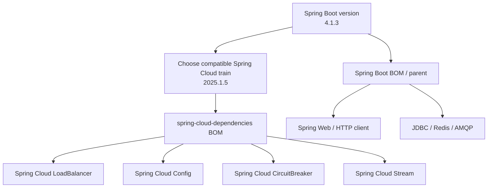
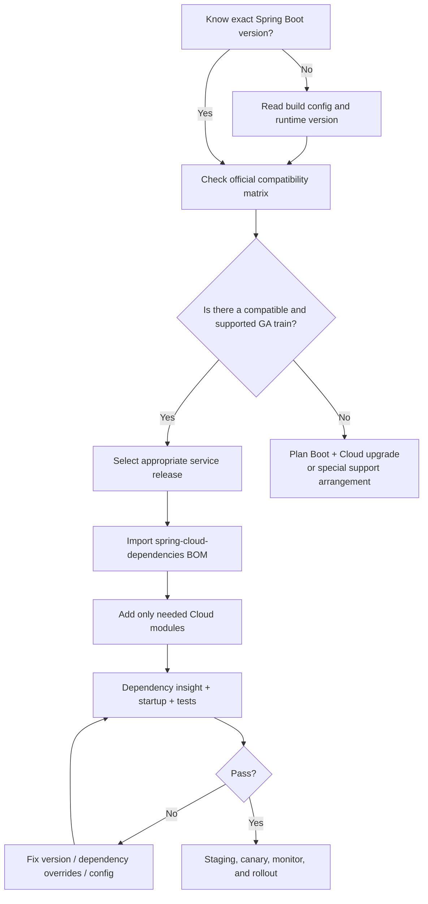
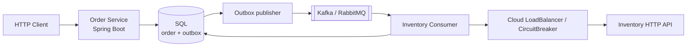

# Spring Cloud Release Trains and Spring Boot Compatibility

A Spring Boot application that connects to an inventory system over HTTP, fetches configuration from Config Server, uses service discovery, limits failures with a circuit breaker, or consumes messages via a broker often needs multiple **Spring Cloud** libraries. If these libraries have their versions chosen individually without controlling their relationship to **Spring Boot**, the application may compile successfully yet fail at startup, miss beans, throw `NoSuchMethodError`, or misbehave due to changed API contracts.

Spring Cloud solves this with a **release train**: a set of versions released and tested for compatibility together, accompanied by a **Bill of Materials (BOM)** to manage Spring Cloud dependencies. However, a release train only fits **specific Spring Boot branches**. Choosing the right Boot–Cloud pair is a foundational design step before writing any integration adapter.

This lesson belongs to the **Supplementary Libraries** chapter of the **SPRING_BOOT_INTEGRATION** module. The module focuses on integrating Spring Boot via HTTP clients, SQL, caches, brokers, and Spring Integration adapters, along with configuration management, data contracts, transactions, errors, duplicates, testing, and observability. Therefore, beyond the release train concept, this lesson covers practical version management, mismatch detection, upgrades, testing, and assessing impacts on integration flows.

> **Information checkpoint:** Version examples are illustrated based on official announcements published up to **2026-11-21**. Release trains, patches, and support timelines change over time; always cross-check the official compatibility matrix and release notes before applying them to another project.

## 1. Learning Objectives

After this lesson, you will be able to:

1. Explain the differences between **Spring Boot**, **Spring Framework**, **Spring Cloud**, and a **Spring Cloud release train**.
2. Understand release train naming, service releases, GA, milestones, and release candidates.
3. Look up and select compatible Spring Boot–Spring Cloud pairs without confusing **compatible** with **still maintained**.
4. Use the `spring-cloud-dependencies` BOM properly in Maven and Gradle alongside Boot's dependency management.
5. Know when Spring Cloud libraries are needed, and when Spring Boot/Spring Integration/Spring Kafka/Spring AMQP alone suffice.
6. Diagnose compatibility errors using the compatibility verifier, dependency trees, and testing.
7. Plan an upgrade for an HTTP–SQL–broker flow while keeping errors, duplicate data, and observability under control.

## 2. How Are Spring Boot and Spring Cloud Related?

### 2.1. Role of Each Layer

| Component | Purpose | Examples in Integration Systems |
| --- | --- | --- |
| **Spring Framework** | Core container, dependency injection, MVC/WebFlux, transactions, HTTP clients, and foundational abstractions | `RestClient`, `WebClient`, `@Transactional` |
| **Spring Boot** | Auto-configuration, starters, application lifecycle, configuration, and operations | `spring-boot-starter-webmvc`, Actuator, datasource setup |
| **Spring Cloud** | Distributed system patterns: config, discovery, load balancing, gateway, circuit breaker, stream, etc. | Spring Cloud Config, LoadBalancer, Gateway, Stream |
| **Spring Data** | Data stores and repository abstractions | JPA, JDBC, Redis, MongoDB, Elasticsearch |
| **Spring Integration** | Enterprise integration patterns: message channels, transformers, routers, and adapters | `IntegrationFlow` |
| **Spring for Apache Kafka / Spring AMQP** | Clients and listeners integrating with specific brokers | `@KafkaListener`, `@RabbitListener` |

**Spring Cloud is not a "Spring Boot upgrade"**. It is a supplementary suite of projects for distributed patterns, built on top of a compatible Spring Boot/Framework foundation. An application using HTTP clients, JDBC, Redis, and RabbitMQ is **not required** to add Spring Cloud if existing Boot/Spring libraries already meet its needs.

### 2.2. A Release Train Manages Multiple Projects Simultaneously

Suppose a system uses:

- Spring Cloud Config to load centralized configuration.
- Spring Cloud LoadBalancer to call instances of a service.
- Spring Cloud CircuitBreaker to limit the impact of failing external APIs.
- Spring Cloud Stream to bind business events to a broker.
- Spring Cloud Gateway to route HTTP traffic at the system edge.

If each module is given an arbitrary version, they may require different versions of Spring Cloud Commons, Spring Framework, Reactor, or third-party libraries.

A **release train** provides a coordinated set of Cloud project versions released together. The application chooses **one release train version**, imports the BOM, and typically **does not specify versions manually** for individual artifacts managed by the BOM.



The diagram illustrates **dependency management**, not that all libraries are loaded into the application. Only add the starters or modules actually used.

## 3. Understanding Release Train Names and Release Status

### 3.1. Calendar-Based Naming

Modern Spring Cloud release trains typically use **Calendar Versioning (CalVer)**. A name like `2025.1.5` can be interpreted as:

- `2025`: year of the release train line.
- `1`: release line number within the year (not Java 1 or Spring Boot 1).
- `5`: fifth service release/patch of that line under Spring Cloud's naming convention.

Release `2025.1` also has the codename **Oakwood**, `2025.0` is **Northfields**, and `2026.0` is **Paddington**. Codenames help when discussing release history, but **do not replace the version in the BOM**.

A train **does not guarantee** that all child artifacts have the version `2025.1.5`. For example, the same train may manage Spring Cloud Commons `5.0.x`, Gateway `5.0.x`, or CircuitBreaker on separate branches. Let the BOM resolve specific artifact versions.

### 3.2. GA, Service Releases, and Previews

| Type | Meaning | Selection Policy |
| --- | --- | --- |
| **GA / RELEASE** | Official release for general use | Prefer for production if still supported |
| **Service release / patch** | Bug/security fix updates for the same train | Usually choose the latest suitable patch of the train |
| **M / milestone** | Feature preview release | Evaluation/testing only per project policy |
| **RC / release candidate** | Pre-GA candidate | Upgrade readiness testing, not default for production |
| **SNAPSHOT** | Development build subject to change | Avoid for reproducible builds and production |

Do not infer **"a higher year is always better"**. Spring Cloud `2026.0.0` should only be paired with its confirmed compatible Spring Boot line; do not replace `2025.1.x` with `2026.0.0` in an app still running Boot `4.1.x` without upgrading Boot and testing.

### 3.3. Release Train, BOM, and Plugin Are Three Different Concepts

- **Release train**: a coordinated collection of Spring Cloud projects/versions released together.
- **BOM**: a POM declaring `dependencyManagement` to select versions for many artifacts without automatically adding dependencies.
- **Maven/Gradle plugin**: a tool to build and package the application, e.g., `spring-boot-maven-plugin` or the `org.springframework.boot` Gradle plugin.

Importing a BOM **does not automatically enable** Config Server, service discovery, or circuit breakers. To use features, you still must add starters/modules, declare beans/configuration, and test behavior.

## 4. Spring Boot–Spring Cloud Compatibility Matrix

As of **2026-11-21**, official Spring sources list the following representative version pairs:

| Spring Boot | Compatible Spring Cloud Release Train | Codename | Notes |
| --- | --- | --- | --- |
| **4.2.x** | **2026.0.x** | Paddington | `2026.0.0` GA on 2026-11-20, based on Boot `4.2.0` |
| **4.1.x** | **2025.1.x** | Oakwood | Boot 4.1 support added starting from `2025.1.2` |
| **4.0.x** | **2025.1.x** | Oakwood | Cloud line sharing Boot 4.0/4.1 group, per compatible patch |
| **3.5.x** | **2025.0.x** | Northfields | Check maintenance status separately |
| **3.4.x** | **2024.0.x** | Moorgate | Older line; check EOL before selecting |
| **3.3.x / 3.2.x** | **2023.0.x** | Leyton | Boot 3.3 from `2023.0.2` |
| **3.1.x / 3.0.x** | **2022.0.x** | Kilburn | Boot 3.1 from `2022.0.3`; historical line |

**Reference sources:** [Spring Cloud page — release train table](https://spring.io/projects/spring-cloud/), [Spring Cloud supported versions](https://github.com/spring-cloud/spring-cloud-release/wiki/Supported-Versions), and [2026.0.0 release announcement on 2026-11-20](https://spring.io/blog/2026/11/20/spring-cloud-2026-0-0-has-been-released/).

Two things to keep in mind:

1. **Compatible does not mean still under OSS support.** Older versions may remain listed in compatibility tables for historical reference, yet have reached end of public maintenance. Check support status at [Spring Cloud Support](https://spring.io/projects/spring-cloud/#support) and [Spring project generations](https://spring.io/projects/generations).
2. **Version granularity matters.** A train can add support for a new Boot version in a **specific service release**. Therefore, saying only "Cloud 2025.1 with Boot 4.1" is inaccurate if picking `2025.1.0`/`2025.1.1`. You must check the patch level announced as compatible.

### 4.1. Two Concrete Examples as of This Lesson's Checkpoint

**Example A — An application running Spring Boot 4.1.3:** can use Spring Cloud `2025.1.5`. This Cloud release was published on 2026-11-20 and belongs to the train that added Boot 4.1 support starting in `2025.1.2`. When deploying, you still must test the Java stack, plugins, and actual starters.

**Example B — A new application on Spring Boot 4.2.0:** Spring Cloud `2026.0.0` was announced GA on 2026-11-20, built on Boot `4.2.0`. This is a **different pair**, not merely changing the BOM version on a Boot 4.1 app while keeping the runtime unchanged.

For new applications, prioritize **GA and supported** pairs that satisfy deployment policies. For existing applications, plan to update both Boot and Cloud when the current branch reaches end of maintenance.

## 5. Process for Choosing the Right Version

### 5.1. Start from Spring Boot, Not from a Cloud Artifact

Recommended process:

1. Identify the exact Spring Boot version running in build and runtime, e.g., `4.1.3`.
2. Check the **Release Trains** table on the Spring Cloud page or use `start.spring.io` by selecting the Boot version along with the needed Cloud projects.
3. Choose the compatible train, then pick the **appropriate service release** in that train, preferring GA and the latest supported patch.
4. Verify JDK, Spring Framework, runtime/container, Maven/Gradle, Gradle plugins, and the Cloud modules actually used.
5. Import a single Spring Cloud BOM for the application and let the BOM manage Cloud module versions.
6. Check the dependency tree and startup compatibility verifier.
7. Run unit tests, HTTP contract tests, broker/SQL integration tests, and smoke tests before deployment.

For example, with a Boot `4.1.x` app, do not look up the latest `spring-cloud-gateway` artifact and infer the Cloud train from it; choose the **train from the Boot version** and let the BOM determine the corresponding Gateway version.

### 5.2. A Simple Decision Flowchart



The BOM solves most **version alignment** issues, but does not prove a business flow is safe under failure. Changes to config, authentication, retries, listener acknowledgments, or JSON serialization still need testing.

## 6. Maven Configuration: Boot Parent and Spring Cloud BOM

The example below uses the verified pair: **Spring Boot 4.1.3 + Spring Cloud 2025.1.5**.

### 6.1. Minimal POM

```xml
<project xmlns="http://maven.apache.org/POM/4.0.0"
         xmlns:xsi="http://www.w3.org/2001/XMLSchema-instance"
         xsi:schemaLocation="http://maven.apache.org/POM/4.0.0
                             https://maven.apache.org/xsd/maven-4.0.0.xsd">
    <modelVersion>4.0.0</modelVersion>

    <groupId>com.example.integration</groupId>
    <artifactId>inventory-adapter</artifactId>
    <version>1.0.0-SNAPSHOT</version>

    <parent>
        <groupId>org.springframework.boot</groupId>
        <artifactId>spring-boot-starter-parent</artifactId>
        <version>4.1.3</version>
        <relativePath/>
    </parent>

    <properties>
        <java.version>17</java.version>
        <spring-cloud.version>2025.1.5</spring-cloud.version>
    </properties>

    <dependencyManagement>
        <dependencies>
            <dependency>
                <groupId>org.springframework.cloud</groupId>
                <artifactId>spring-cloud-dependencies</artifactId>
                <version>${spring-cloud.version}</version>
                <type>pom</type>
                <scope>import</scope>
            </dependency>
        </dependencies>
    </dependencyManagement>

    <dependencies>
        <dependency>
            <groupId>org.springframework.cloud</groupId>
            <artifactId>spring-cloud-starter-loadbalancer</artifactId>
        </dependency>

        <dependency>
            <groupId>org.springframework.boot</groupId>
            <artifactId>spring-boot-starter-test</artifactId>
            <scope>test</scope>
        </dependency>
    </dependencies>
</project>
```

Explanation:

- `spring-boot-starter-parent` selects build configuration and Boot-managed versions; do not manually alter Spring Framework or Jackson versions without good reason.
- `spring-cloud-dependencies` only **manages dependencies**: it does not automatically add `spring-cloud-starter-loadbalancer`.
- `spring-cloud.version` is the **train BOM** version, not a version to put on every starter.
- The `spring-cloud-starter-loadbalancer` dependency **omits `<version>`** because the BOM manages it.
- `java.version` must match the Java requirement of the stack in use and the production image.
- The Maven wrapper (`./mvnw`) and plugin versions must also match the JDK/toolchain, as the Cloud BOM does not manage all plugins.

### 6.2. When Not Using the Spring Boot Parent

A project using an organizational parent can import the Spring Boot BOM alongside the Cloud BOM in `dependencyManagement`:

```xml
<dependencyManagement>
    <dependencies>
        <dependency>
            <groupId>org.springframework.boot</groupId>
            <artifactId>spring-boot-dependencies</artifactId>
            <version>4.1.3</version>
            <type>pom</type>
            <scope>import</scope>
        </dependency>
        <dependency>
            <groupId>org.springframework.cloud</groupId>
            <artifactId>spring-cloud-dependencies</artifactId>
            <version>2025.1.5</version>
            <type>pom</type>
            <scope>import</scope>
        </dependency>
    </dependencies>
</dependencyManagement>
```

This is only the `dependencyManagement` section, not a standalone POM. You must declare dependencies and plugins per project.

When using two BOMs, you must understand **Maven `dependencyManagement` precedence rules** and overlapping entries, rather than relying on the intuition that "the later imported BOM wins". Maven has specific rules for `dependencyManagement` in the current POM, imported BOMs, and import order; inspect the **effective POM and dependency tree** to know the final resolved versions. Do not manually pin versions for the same artifact in multiple places.

## 7. Gradle Configuration: Importing the BOM into the Build

**Groovy DSL** example with the same Boot–Cloud pair:

```groovy
plugins {
    id 'java'
    id 'org.springframework.boot' version '4.1.3'
    id 'io.spring.dependency-management' version '1.1.7'
}

group = 'com.example.integration'
version = '1.0.0-SNAPSHOT'

java {
    toolchain {
        languageVersion = JavaLanguageVersion.of(17)
    }
}

repositories {
    mavenCentral()
}

ext {
    set('springCloudVersion', '2025.1.5')
}

dependencyManagement {
    imports {
        mavenBom "org.springframework.cloud:spring-cloud-dependencies:${springCloudVersion}"
    }
}

dependencies {
    implementation 'org.springframework.cloud:spring-cloud-starter-loadbalancer'
    testImplementation 'org.springframework.boot:spring-boot-starter-test'
}

tasks.named('test') {
    useJUnitPlatform()
}
```

In the example:

1. The Spring Boot plugin configures build/packaging logic for a Boot application.
2. The `io.spring.dependency-management` plugin provides the `dependencyManagement` DSL and Maven BOM import support. Plugin version `1.1.7` is an example that should be checked against actual Gradle/Boot compatibility when upgrading.
3. The Cloud BOM manages Cloud starter versions, so `spring-cloud-starter-loadbalancer` does not specify its own version.
4. The Boot plugin and Boot BOM still need proper management; **the Cloud BOM does not replace** the Boot plugin or dependency management for Spring Boot.

### 7.1. Alternative: Gradle Native Platform

Gradle supports importing a BOM as a `platform`. Example **dependencies snippet**:

```groovy
dependencies {
    implementation platform(
        'org.springframework.cloud:spring-cloud-dependencies:2025.1.5'
    )
    implementation 'org.springframework.cloud:spring-cloud-starter-loadbalancer'
}
```

If using this native approach, you must **ensure Boot dependency management is already configured** (e.g., importing the corresponding Boot BOM or using a project/plugin-applied mechanism). Do not mix `platform`, `enforcedPlatform`, and the dependency management plugin arbitrarily, as how Gradle resolves versions/constraints can change the outcome.

**Rule:** Choose one consistent dependency management policy for the repository and inspect the actual `runtimeClasspath`, not just the `build.gradle` file.

## 8. Verifying That the BOM Actually Manages Versions

### 8.1. Maven

Diagnostic commands, **run in a project with `pom.xml`**:

```bash
./mvnw help:effective-pom
./mvnw dependency:tree
./mvnw dependency:tree -Dincludes=org.springframework.cloud
./mvnw test
```

On Windows, you can use `mvnw.cmd` instead of `./mvnw`. `effective-pom` reveals dependency management configuration after inheritance/imports. `dependency:tree` shows the actual resolved artifacts and versions along with transitive dependency sources.

Some build systems may use custom plugins or mirror repositories; exact syntax/output can vary by Maven version. The goal is to confirm the **resolved version**, not just the declared snippet.

### 8.2. Gradle

```bash
./gradlew dependencies --configuration runtimeClasspath
./gradlew dependencyInsight --dependency spring-cloud-commons --configuration runtimeClasspath
./gradlew dependencyInsight --dependency spring-cloud-loadbalancer --configuration runtimeClasspath
./gradlew test
```

`dependencyInsight` shows why a version was chosen and which constraints conflicted. It is useful when the application imports additional BOMs from other libraries, or when an internal module pulls in an older Spring Cloud version.

### 8.3. When You See a Wrong Version

Verify in this order:

1. Is the build using the right file/branch and the right Maven/Gradle wrapper?
2. What version are the Boot plugin/parent/BOM?
3. Is there strictly **one dominant Cloud release train** in the application dependency graph?
4. Is a Cloud version forced directly in `dependencies`, `resolutionStrategy`, or dependency constraints?
5. Is there a multi-module project using different BOMs across modules?
6. Is a transitive library pulling in an old Cloud version? Does dependency management actually override/align it?
7. Are there profiles or snapshot repositories causing CI builds to differ from local machines?

Do not fix every error by indiscriminately adding `exclude group: 'org.springframework.cloud'`; that can omit required modules and cause new startup errors.

## 9. Spring Cloud's Compatibility Verifier

Some Spring Cloud Commons lines provide a **compatibility verifier** to check the Spring Boot version on the classpath at startup. If the Boot–Cloud pair does not match, the application may report a startup failure suggesting compatible versions.

Illustrative error output:

```text
APPLICATION FAILED TO START

Description:
Your project setup is incompatible with our requirements.
Spring Boot [x.y.z] is not compatible
with this Spring Cloud release train.

Action:
Use a supported Spring Boot version or
select a compatible Spring Cloud release train.
```

The actual message varies by version. Spring Cloud Commons documentation describes these properties:

```properties
spring.cloud.compatibility-verifier.enabled=false
spring.cloud.compatibility-verifier.compatible-boot-versions=4.1.x
```

**This information is for diagnosis, not an upgrade solution.**

- `enabled=false` can disable the check on versions with this mechanism; **it does not make APIs compatible**.
- `compatible-boot-versions` overrides the set of versions the verifier treats as acceptable in supported versions; it should not be used to "legitimize" a pair not released together.
- Defaults and whether the verifier runs can vary across generations and loaded module types. If the verifier does not run, do not conclude the dependency combination is safe.

For example, forcing Spring Boot `4.2.x` to run with Cloud `2025.1.x` might get past a check if the verifier is disabled, yet still fail with binary linkage errors, auto-configuration failures, or broken runtime behavior. **The fix is to pick the official matching train**, not to hide the warning.

Source: [Spring Cloud Commons — Compatibility Verification](https://docs.spring.io/spring-cloud-commons/reference/spring-cloud-commons/common-abstractions.html).

## 10. Why Version Mismatches Often Cause Confusing Errors

### 10.1. Types of Mismatches

| Mismatch Group | Symptoms | Typical Cause |
| --- | --- | --- |
| **Spring Boot–Cloud train** | Startup failure, compatibility warning | Pairing Boot with an incompatible train |
| **Spring Framework API** | `NoSuchMethodError`, `ClassNotFoundException` | Library built against a different API |
| **Auto-configuration** | Missing bean, duplicate beans, unmet condition | Starter/module changed across generations |
| **Java runtime** | `UnsupportedClassVersionError` | Running a JDK lower than required bytecode |
| **Jakarta/Javax migration** | Missing annotation/servlet classes | Old library uses `javax.*`, newer stack uses `jakarta.*` |
| **Reactor/Netty/HTTP client** | Runtime errors or unexpected timeouts | Unaligned client transport/versions |
| **Serialization/schema** | Message read failures, changed JSON structure | Upgraded binder/converter without contract testing |
| **Config precedence** | App reads config from unexpected source | Changed config import/refresh behavior across versions |
| **Dependencies outside BOM** | One starter works, another module fails | Library version forced or outside Cloud BOM management |

Not every error above is caused by the wrong Cloud train. They are **investigation signals**: cross-check the stack trace, `dependency tree`, release notes, and config changes before concluding.

### 10.2. Example Failure from Upgrading Cloud While Keeping Boot

```text
Before upgrade:
  Spring Boot 4.1.x
  Spring Cloud 2025.1.x

Unsafe change:
  Spring Boot 4.1.x
  Spring Cloud 2026.0.x

Approach:
  1. Check target train used for Boot 4.2.x.
  2. Create a branch to upgrade Boot to the compatible line.
  3. Upgrade the Cloud BOM to the matching train.
  4. Run startup, API, SQL, and broker tests.
  5. Roll out via canary with a rollback plan ready.
```

A new Cloud train reaching GA does not mean the current app is allowed to swap the BOM immediately. **Upgrading the underlying platform** is an integration change capable of affecting runtime behavior across many adapters.

## 11. Spring Cloud Projects Related to the Integration Module

Choose libraries based on technical need rather than pulling every starter onto the classpath.

| Tool | Where Does It Sit in Architecture? | What to Test When Upgrading |
| --- | --- | --- |
| **Spring Cloud Config** | Provides centralized configuration to applications | Config import, access permissions, refresh, secret handling |
| **Spring Cloud LoadBalancer** | Selects service instances for HTTP clients | Service IDs, instance lists, timeouts, fallbacks |
| **Spring Cloud CircuitBreaker** | Protects outbound calls with circuit breaker / time limiter | Error thresholds, OPEN state, retries, and deadlines |
| **Spring Cloud Gateway** | Inbound/outbound routing at system edge | Routes, filters, auth, headers, caching, timeouts |
| **Spring Cloud OpenFeign** | Interface-based declarative HTTP client | Contract/paths/headers, retries, serialization |
| **Spring Cloud Stream** | Abstraction for functions/messages and broker binders | Serializers, consumer groups, binder mappings, retries, DLQ |
| **Spring Cloud Vault** | Reads secrets from Vault via appropriate config | Auth, refresh, rotation, access control |
| **Discovery integration** | Finds instances from registry/discovery | Registration, health, service naming |
| **Spring Cloud Task** | Lifecycle of short-lived tasks/batches | Job lifecycle, metadata persistence, failure recovery |

### 11.1. Do Not Confuse Spring Cloud Stream with Spring Integration

- **Spring Cloud Stream** is commonly used to build message-driven apps over binders (e.g., Kafka/RabbitMQ), based on the abstractions/function model provided by Cloud Stream.
- **Spring Integration** describes flows using `MessageChannel`, `IntegrationFlow`, gateways, routers, transformers, filters, and adapters.
- **Spring Kafka / Spring AMQP** provide direct APIs and listeners for their respective brokers.

They can **work together** in one application, not as a forced one-to-one replacement. The Cloud release train manages the **Spring Cloud Stream** artifacts belonging to that train; do not assume it manages every component of Spring Integration, Spring Data, JDBC drivers, or broker runtimes.

### 11.2. HTTP Service Interfaces and OpenFeign

Spring Framework has `@HttpExchange` and `HttpServiceProxyFactory`; Spring Cloud OpenFeign has its own client contract. Both approaches can declare HTTP clients as interfaces, but they differ in:

- Annotations and argument-binding capabilities.
- How transport, retries, load balancing, and observability are configured.
- Dependencies, compatibility, and project lifecycle.

If you only need an outbound HTTP client, you do not have to add OpenFeign by default. With a suitable Spring Boot version, you can use `RestClient`/`WebClient` and needed adapters, adding LoadBalancer/CircuitBreaker if truly required. Choose based on codebase conventions and operational cost.

## 12. Example Integration Flow Affected by Dependency Versions

An order service performs:

1. Receives an HTTP request to create an order.
2. Writes the order and outbox in a single SQL transaction.
3. Publisher sends `OrderCreated` via a broker.
4. Consumer calls Inventory Service via an HTTP client with service discovery/load balancing.
5. Writes result state and emits the next event.



### 12.1. Related Dependencies

| Component | Example Libraries | Common Version Management Source |
| --- | --- | --- |
| HTTP server/client | Spring Web MVC, `RestClient` | Spring Boot BOM / Spring Framework |
| SQL transaction/JDBC | `spring-boot-starter-jdbc`, JDBC driver | Spring Boot BOM + vendor |
| Cloud LoadBalancer | `spring-cloud-starter-loadbalancer` | Spring Cloud BOM |
| Circuit breaker | Spring Cloud CircuitBreaker starter | Spring Cloud BOM |
| Message abstraction | Spring Cloud Stream/binder | Spring Cloud BOM, binder compatibility |
| Direct broker client | Spring for Apache Kafka/AMQP | Spring Boot BOM and related BOMs |
| Enterprise Integration Patterns | Spring Integration | Corresponding Spring Boot/Spring Integration dependency management |

Choosing the right Cloud train ensures a layer of **dependency compatibility** among components managed by the train, but does not replace business design.

### 12.2. Invariants to Protect During Upgrades

- **Data contracts:** JSON/event schemas, content types, headers, timestamps, error codes, and topic/queue names do not change unintentionally.
- **Transactions:** `@Transactional` on SQL does not cover HTTP/brokers; outbox/inbox patterns must keep working.
- **Idempotency:** the same `eventId`/`operationId` does not produce duplicate side effects after retries.
- **Error handling:** timeouts/429/5xx are classified; retries are bounded.
- **Ordering:** consumers do not overwrite newer state with events carrying an older version.
- **Security:** tokens/client credentials/TLS and authorization remain accurate after the upgrade.
- **Observability:** metrics, spans, log fields, and correlation IDs remain sufficient for investigation.

Many errors here **do not cause compile errors**. Therefore, running `./mvnw package` alone is not enough to conclude an upgrade is safe.

## 13. Upgrade Plan for Spring Boot and Spring Cloud

A reliable strategy typically includes these steps:

### 13.1. Before Upgrading

- Record the current Boot–Cloud pair, Java version, Maven/Gradle plugins, BOMs, and dependency overrides.
- Check maintenance status, CVEs, release notes, and breaking changes.
- List active adapters: HTTP, SQL, Redis/cache, Kafka/RabbitMQ, Spring Integration, Cloud Gateway/Config/LoadBalancer.
- Capture a baseline: startup success, test pass rate, HTTP p95 latency, consumer lag, error rate, duplicate event count, and recovery time.
- Define rollback criteria, deployment window, and decision owner.

### 13.2. Upgrading as a Matched Pair

When upgrading from Boot `4.1.x`/Cloud `2025.1.x` to Boot `4.2.x`/Cloud `2026.0.x`:

1. Create an upgrade branch, updating Boot and Cloud as a **compatible pair**—never push only half to production.
2. Verify Java/toolchain and build plugins.
3. Remove unnecessary overrides; import the proper BOM.
4. Read release notes for every Cloud starter actually used.
5. Fix deprecated/removed APIs and configuration changes.
6. Run dependency tree checks, compilation, tests, and runtime verification.
7. Deploy to staging and canary/blue-green per project policy, observe, then ramp up traffic.

**The version examples here are a specific pair as of 2026-11-21, not advice to hardcode fixed version numbers forever.** When keeping an app on an older Cloud line, prioritize valid security patches within the train and plan major/minor upgrades separately.

### 13.3. Required Test Layers

| Test Layer | What to Verify |
| --- | --- |
| **Dependency resolution** | No drifting Cloud versions or mis-pinned artifacts |
| **Application context test** | HTTP/Cloud/SQL/broker beans are created properly |
| **HTTP contract test** | Methods, paths, headers, auth, JSON, status/error mapping |
| **SQL integration test** | Drivers, migrations, transactions, unique constraints |
| **Broker integration test** | Serialization, routing, consumer groups, ack, DLQ, retry |
| **Failure injection** | Timeouts, 429/503, broker loss, duplicates, crashes between steps |
| **Security test** | Credentials/config import, TLS, authorization, tenant isolation |
| **End-to-end / smoke** | Order flow runs correctly across adapters |
| **Observability check** | HTTP metrics, tracing, correlation IDs, consumer lag |

You can use **Testcontainers** to spin up PostgreSQL/Redis/brokers for integration tests and mock HTTP servers to verify partner APIs. Other parts of the contract require a sandbox or production-like environment to properly verify network/TLS and systems that cannot run in containers.

### 13.4. Rollback Must Account for Data

Rolling back code/BOM does not roll back SQL schemas, event schemas, or messages sitting in a broker. When deploying a new version, you should:

- Prefer forward/backward-compatible migrations whenever possible.
- Avoid changing event schemas in a way that breaks old consumers before all consumers have upgraded.
- Run controlled dual-read/dual-write strategies during transition windows if necessary.
- Design cross-version retry/idempotency so old messages can be reprocessed safely.
- Maintain replay, reconciliation, and rollback plans grounded in **real data**, not just application images.

## 14. Common Failure Scenarios and How to Handle Them

| Symptom | Where to Check | What Not to Do |
| --- | --- | --- |
| `Spring Boot ... incompatible` at startup | Check matrix, choose Cloud BOM matching train and patch | Disable verifier and ignore it |
| `NoSuchMethodError` / `ClassNotFoundException` | `dependencyInsight`/`dependency:tree`, API release notes | Add multiple overlapping jars of different versions |
| One Cloud module is newer than the rest | BOM/overrides/transitive dependencies | Pin individual modules manually |
| `@LoadBalanced` client cannot call service | LoadBalancer starter, service discovery, beans, and service ID | Blame the BOM when config is missing |
| Config Server import fails | `spring.config.import`, credentials, Config Client/Server versions | Commit secrets to source to "test quickly" |
| Gateway route changes after upgrade | Route definitions, filter order, MVC/WebFlux handler stack | Roll out globally without contract tests |
| Consumer fails deserializing old messages | Schema version, serializer, binder config | Purge the queue to hide the problem |
| Retry creates duplicate orders/reservations | Idempotency key, inbox/outbox, ack policy | Assume Spring Cloud guarantees exactly-once |
| CI passes but production fails | JDK/plugins, runtime classpath, auth, TLS, broker version | Rely solely on unit tests |
| Modules use different Boot/Cloud BOMs across subprojects | Centralized version catalog/BOM, per-module dependency tree | Let each module "pick the latest" independently |

If an error occurs **after** an upgrade, the first step should usually be comparing the dependency graph and configuration changes against the previous version, rather than rushing to edit business logic.

## 15. Version Management in a Multi-Module Repository

In a monorepo with `common`, `http-adapter`, `messaging-adapter`, and `service-app` modules:

- Enforce a rule of **a unified Cloud train** at the application build/parent or platform/version catalog level.
- Do not let two modules package different Spring Cloud Commons versions into the same runtime.
- Shared library modules should declare only the API dependencies actually needed, avoiding forcing every consumer to pull in unrelated Cloud starters.
- With Gradle `java-library`, carefully scope `api`/`implementation`/`runtimeOnly` so unnecessary dependencies are not leaked.
- Inspect the **runtime classpath at the final application** because compatibility errors typically surface where the full dependency graph is assembled.
- When deploying multiple independent services, they can upgrade Boot/Cloud on separate schedules **if they communicate over compatible contracts** (HTTP, message schemas)—there is no need to force every service onto the same version on the same day.

**The runtime versions of two independent microservices do not have to match.** A Boot 4.2 service and a Boot 4.1 service can communicate over HTTP/brokers as long as data contracts, security, and wire protocol compatibility hold. The "same train" rule applies mainly to **libraries inside the same application/runtime**, not to every process in a distributed system.

## 16. Security, Support, and Observability

### 16.1. Support Lifecycle Is an Operational Decision

A **compatible** Boot–Cloud pair may still lack public support if it is end-of-life. For production systems, track:

- OSS/enterprise support timelines for Boot and Cloud lines.
- Service releases patching vulnerabilities or operational bugs.
- Security advisories directly impacting Gateway, Config, Stream, discovery, or transitive libraries.
- When to move to a new train and the dependency update plan.

A BOM coordinates versions but **does not replace security risk management**. After choosing versions, still run dependency vulnerability scans per policy, read CVE advisories, and determine whether affected dependencies are actually used/exploitable.

### 16.2. Observing Upgrade Impact

Signals to compare before and after changes:

- **Startup failures** and service health/readiness.
- **HTTP client latency**, timeouts, 4xx/5xx, circuit breaker states, and retry rates.
- **SQL pool**, transaction errors, migration failures, and commit latency.
- **Broker consumer lag**, redelivery, DLQ, and serialization errors.
- **Config refresh/load failures**, failed secret fetch counts.
- **Correlation IDs/tracing** across inbound HTTP → SQL → broker → outbound client.

Spring Boot Actuator and Micrometer support operations when configured properly; adding a Cloud starter does not automatically guarantee all metrics/spans are exported. Verify instrumentation and metric names for your version. Do not put tokens, secrets, sensitive raw payloads, or high-cardinality event IDs into metric labels.

## 17. Release Train Selection Checklist

Before approving a pull request that adds or upgrades Spring Cloud:

- [ ] Current Spring Boot version is clearly identified.
- [ ] Cloud train and **service release** are chosen from official compatibility documentation.
- [ ] Selected branch is still supported under organizational policy.
- [ ] Proper Spring Cloud BOM is present, with no arbitrary hardcoded Cloud starter versions.
- [ ] Spring Boot parent/BOM, JDK, and build plugins are compatible.
- [ ] Runtime dependency tree has been reviewed and conflicting overrides removed.
- [ ] Release notes / migration guides for used Cloud projects have been read.
- [ ] Application context starts cleanly without disabling the compatibility verifier.
- [ ] HTTP contract tests, message schema tests, SQL migrations, and integration tests all pass.
- [ ] Retries, idempotency, timeouts, and transaction boundaries have not changed unintentionally.
- [ ] Auth/TLS/secret config and observability are verified post-upgrade.
- [ ] A staging/canary strategy, code rollback, **and** data recovery plan are in place.

## 18. Self-Check Questions

1. What problem does a Spring Cloud release train solve when a system uses Config, LoadBalancer, and Stream simultaneously?
2. Why should Spring Cloud `2026.0.0` not be added arbitrarily to an application running Boot `4.1.x`?
3. Is CalVer `2025.1.5` directly the version of `spring-cloud-gateway`? Why or why not?
4. Does importing the `spring-cloud-dependencies` BOM automatically add an HTTP client or broker listener to the application?
5. Why might a "technically compatible" pair still be unsuitable for production deployment?
6. In Maven, how does the role of `spring-boot-starter-parent` differ from the Spring Cloud BOM?
7. In Gradle, what does `dependencyInsight` help uncover after importing multiple BOMs?
8. Why should you not resolve a compatibility verifier error by setting `enabled=false`?
9. When upgrading from Boot 4.1/Cloud 2025.1 to Boot 4.2/Cloud 2026.0, what business boundaries must be tested beyond application startup?
10. Can two services using different Boot/Cloud versions still communicate? What determines that?
11. Why does the Cloud BOM not automatically make SQL transactions, message brokers, and HTTP side effects atomic with each other?
12. If an upgrade causes a consumer to receive messages multiple times, at which layers must idempotency be checked?

### Practice Exercises

**Exercise A — Version selection:** Create a table for three applications running Boot `3.5.x`, `4.1.x`, and `4.2.x`. Look up the corresponding Cloud trains from official sources, note the **minimum patch level where specified**, intended GA version, and maintenance status. Explain why you do not use one shared Cloud BOM across all runtimes.

**Exercise B — Dependency management:** Create two simple applications, one using Maven and one using Gradle. Both use a compatible Boot–Cloud pair and `spring-cloud-starter-loadbalancer`. Inspect the effective POM/dependency tree/Gradle `dependencyInsight`, confirming that no Cloud starter had to specify its own version.

**Exercise C — Integration upgrade:** Suppose a service consumes `OrderCreated` from RabbitMQ, calls an Inventory API over HTTP, and writes results to PostgreSQL. Plan a Boot–Cloud pair upgrade, write test scenarios for timeout, HTTP 429, duplicate messages, database connection loss, and rollback. Identify which metrics help compare results before and after the upgrade.

## 19. Key Takeaways

- A **Spring Cloud release train** is a coordinated set of Cloud project versions; the **Spring Cloud BOM** manages those versions in Maven/Gradle.
- **Spring Boot and Spring Cloud must be chosen as compatible pairs**, including the **service release level** when a train extends support to a new Boot branch.
- **A BOM only manages dependencies**—it does not add starters, replace the Boot parent/plugin, or guarantee distributed business logic is correct.
- **The compatibility verifier** helps catch certain misconfigurations, but disabling it does not turn an unsupported combination into a compatible one.
- **Compatible does not mean still maintained**: check support status, security advisories, release notes, and upgrade plans.
- For **SPRING_BOOT_INTEGRATION** applications, every version change must pass tests for HTTP contracts, SQL transactions, caches, brokers, retries, idempotency, schemas, and observability—not just a successful build.

### Official References

1. [Spring Cloud — Overview, Release Trains, and BOM](https://spring.io/projects/spring-cloud/)
2. [Spring Cloud release — Supported Versions](https://github.com/spring-cloud/spring-cloud-release/wiki/Supported-Versions)
3. [Spring Cloud 2026.0.0 (Paddington) GA — 2026-11-20](https://spring.io/blog/2026/11/20/spring-cloud-2026-0-0-has-been-released/)
4. [Spring Cloud 2025.1.5 (Oakwood) — 2026-11-20](https://spring.io/blog/2026/11/20/spring-cloud-2025-1-5-has-been-released/)
5. [Spring Cloud 2025.1.2 — Adding Boot 4.1 Compatibility](https://spring.io/blog/2026/06/11/spring-cloud-2025-1-2-aka-oakwood-has-been-released/)
6. [Spring Cloud Commons — Compatibility Verification](https://docs.spring.io/spring-cloud-commons/reference/spring-cloud-commons/common-abstractions.html)
7. [Spring Cloud release reference](https://docs.spring.io/spring-cloud-release/reference/)

**Conclusion:** Selecting the right Spring Cloud release train for your Spring Boot version is a foundational requirement so an integration system can start up, upgrade, and operate reliably. A sound dependency foundation must be paired with **integration contracts, clear transaction boundaries, failure testing, and observability**, because a release train cannot replace those architectural decisions.
