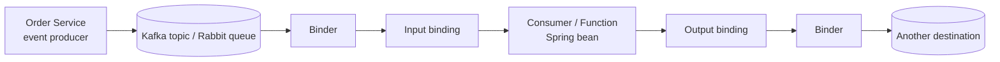
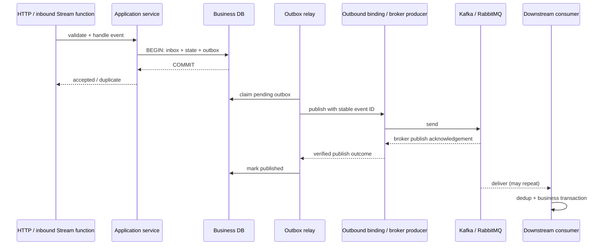
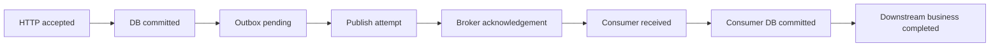

# Spring Cloud Stream, Binders, and the Functional Message-Processing Model

> **Chapter:** Supplementary Libraries  
> **Module:** `SPRING_BOOT_INTEGRATION` — organizing system integration in Spring Boot via HTTP clients, databases, caches, message brokers, and Spring Integration adapters, focusing on configuration, data contracts, transactions, errors, duplicate handling, testing, and observability of real integration flows.
>
> **Version note:** This lesson uses the **functional** programming model of Spring Cloud Stream and Spring Cloud Function. Artifact names, properties, and detailed binder capabilities depend on the combined **Spring Boot + Spring Cloud release train + Spring Cloud Stream + broker client** versions. Examples use the Kafka binder; when switching to RabbitMQ or another library branch, consult the documentation and run tests on the actual target version.

## 1. The Problem: An Order Event Flowing Across Multiple Systems

The Order service receives an HTTP request, commits the order to PostgreSQL, and then needs to notify the Inventory, Notification, and Analytics services. Each side has its own processing timing, scaling needs, and retry strategy.

One option is calling each service over HTTP, which couples the flow to the latency of every downstream party. Another option is publishing an `OrderPlaced` event via Kafka or RabbitMQ. Spring Cloud Stream helps applications express **message processing as Java functions**; connecting a function to a broker destination is configured through **bindings** and **binders**.



In this model:

- The **function** decides what to do with the payload.
- The **binding** names the function's inputs/outputs and links them to a destination.
- The **binder** implements communication with the specific middleware.
- The **broker** transports and stores messages according to its own model.
- The **application** must still guarantee data contracts, transactions, idempotency, and observability of business outcomes.

Cloud Stream makes wiring more uniform, but **does not automatically turn a database call and a message send into an atomic transaction**.

### Learning Objectives

After this lesson, you will be able to:

1. Distinguish `Spring Cloud Stream`, `Spring Cloud Function`, binder, binding, destination, and consumer group.
2. Write `Supplier<T>`, `Function<T,R>`, and `Consumer<T>` as `@Bean` definitions.
3. Configure binding names `<function>-in-0` / `<function>-out-0` and declare target topics/queues.
4. Use `StreamBridge` to publish from an HTTP endpoint or outbox relay, with an accurate understanding of send confirmation limits.
5. Know which aspects depend on the Kafka binder, Rabbit binder, native broker, and framework version.
6. Design schemas, retry/DLQ, inbox/outbox, tests, and observability for real integration flows.

## 2. What Does Spring Cloud Stream Add to Spring Boot?

Spring Framework provides IoC, dependency injection, transactions, web, and Spring Messaging. Spring Boot organizes starters, auto-configuration, and environment-based configuration. Spring Cloud Function enables registering, discovering, and composing functions using Java's functional interfaces. **Spring Cloud Stream** connects those functions to middleware via binders.

| Component | Responsibility | Examples |
|---|---|---|
| **Spring Framework** | Bean container, transactions, message abstractions | `@Bean`, `@Transactional`, `Message<T>` |
| **Spring Boot** | Application startup, externalized config, Actuator | `application.yml`, auto-configured beans when conditions match |
| **Spring Cloud Function** | Function model, discovery, and definition | `Supplier`, `Function`, `Consumer` |
| **Spring Cloud Stream** | Binding lifecycle and message-processing abstractions | `spring.cloud.stream.bindings.*`, `StreamBridge` |
| **Binder** | Connects a binding to middleware | Kafka binder, RabbitMQ binder |
| **Broker** | Topics/queues, transport, persistence, ACK/redelivery | Apache Kafka or RabbitMQ |
| **Business code** | Contracts, state, deduplication, side-effect retries | `InventoryApplicationService.applyOnce(...)` |

**There is no "generic broker" called Cloud Stream.** A binder is a library running **inside the application** to connect to external broker infrastructure, not a standalone broker cluster.

### 2.1. When Is This Abstraction Layer Needed?

For example, the same `Consumer<OrderPlacedEvent>` function can keep its business logic intact when switching configuration/binders from one middleware to another. However, do not interpret that as "swapping one dependency gives complete compatibility": topology, keys/partitions, ordering, retries, DLQs, offsets/ACKs, retention, and authentication still differ.

For a service that only needs `@KafkaListener` and `KafkaTemplate`, the native library can be easier to follow and give finer control. For multiple services following an event-driven model that want a standardized way to define inputs/outputs via functions, Cloud Stream is often worth considering.

## 3. Four Naming Layers: Function, Binding, Destination, Binder

This is one of the easiest areas to misconfigure. Look at this example:

```yaml
spring:
  cloud:
    function:
      definition: reserveInventory
    stream:
      bindings:
        reserveInventory-in-0:
          destination: orders.placed.v1
          group: inventory-service
        reserveInventory-out-0:
          destination: inventory.commands.v1
```

There are four distinct categories of names:

| Name | Value in Example | Meaning |
|---|---|---|
| Function definition | `reserveInventory` | **Function bean** name selected by Spring Cloud Function |
| Input binding name | `reserveInventory-in-0` | Input index `0` of the function |
| Output binding name | `reserveInventory-out-0` | Output index `0` of the function |
| Destination | `orders.placed.v1` / `inventory.commands.v1` | Topic or communication entity routed to by the binder |
| Binder | Selected Kafka binder / Rabbit binder | Implementation connecting to the middleware |

`-in-0` and `-out-0` **are not part of the Kafka topic name**. They are logical binding names in Spring Cloud Stream. Renaming the `reserveInventory` method without updating `spring.cloud.function.definition` and `bindings.*` can prevent the application from creating the intended bindings.

### 3.1. Binding Naming Convention Generated from Functional Beans

For simple functions, the conventional naming pattern is usually:

```text
<functionBeanName>-in-0
<functionBeanName>-out-0
```

- `Consumer<T>` has an **input**, usually no output.
- `Function<T,R>` has **input and output**.
- `Supplier<T>` has an **output**, usually no input.

Index `0` represents the first input/output of a basic function. Cases with multiple inputs/outputs, composition, or reactive functions have more complex rules; do not assume every function always has only a single binding.

### 3.2. A Binding Is Not a Physical Queue

A binding is a **logical attachment point** between the application and middleware. The Kafka binder typically maps a destination to a Kafka topic. The RabbitMQ binder uses corresponding exchanges/queues/bindings, depending on group and configuration. Having the same destination name does not guarantee identical physical topology or semantics between two binders.

### 3.3. Group and Consumer Identity

`group: inventory-service` allows instances with the same role to share processing according to the broker's mechanism:

- **Kafka binder:** group typically maps to a Kafka consumer group; consumers in the same group split partitions and manage offsets per configuration.
- **Rabbit binder:** a named group typically results in a queue with a corresponding identity, where consumers in the same group share consumption; exact queue naming and durability depend on binder settings.

If `group` is omitted, Cloud Stream may use an **anonymous subscription/group** with a different lifecycle that is unsuitable for certain durable processing needs. For critical business consumers, explicitly set a **stable group** and test restart behavior.

## 4. The Function Model: Supplier, Function, Consumer

Spring Cloud Stream uses standard `java.util.function` interfaces as message-processing contracts.

| Type | Input | Output | Typical Use |
|---|---|---|---|
| `Supplier<T>` | None | `T` | Application-provided message source |
| `Function<T,R>` | `T` | `R` | Receive and transform a message for downstream publishing |
| `Consumer<T>` | `T` | None | Receive and execute business logic |

These types can use raw payloads or `org.springframework.messaging.Message<T>` to access headers. Converting payloads from bytes/JSON into Java types depends on content type, converters/schemas, the binder, and the framework version.

**Separate pure functions from side effects.** Functions that only transform data are easy to test and compose. Consumers that write to a database or call HTTP must take responsibility for transactions, retries, and idempotency. Suppliers producing messages from durable data need checkpoints and progress tracking; the `Supplier` interface itself does not provide a reliable queue.

## 5. Setting Up a Minimal Kafka Binder Application

Example using Spring Boot, the Spring Cloud Stream functional model, and the Kafka binder. Gradle Groovy DSL:

```gradle
dependencies {
    implementation("org.springframework.boot:spring-boot-starter")
    implementation("org.springframework.cloud:spring-cloud-starter-stream-kafka")
    implementation("org.springframework.boot:spring-boot-starter-actuator")

    testImplementation("org.springframework.boot:spring-boot-starter-test")
}
```

**Important:** a compatible Spring Cloud release train version must be managed through the project's BOM/dependency management. Do not copy random Spring Boot, Spring Cloud Stream, and Kafka client versions from different generations and assume compiling is enough.

Assuming only one Kafka binder is on the classpath and the application defines the `reserveInventory` function:

```yaml
spring:
  cloud:
    function:
      definition: reserveInventory
    stream:
      bindings:
        reserveInventory-in-0:
          destination: orders.placed.v1
          group: inventory-service
          content-type: application/json
        reserveInventory-out-0:
          destination: inventory.commands.v1
          content-type: application/json
      kafka:
        binder:
          brokers: ${KAFKA_BOOTSTRAP_SERVERS:localhost:9092}
```

The configuration specifies which function is active, the input/output topics, and the consumer group. `spring.cloud.stream.kafka.binder.brokers` belongs to the **Kafka binder**, not `spring.kafka.bootstrap-servers` of an app using plain Spring Kafka. Some properties may be inherited or configured separately by the binder; check the actual configuration classes in the running version.

Do not assume topics are allowed to auto-create in production. Provision topics, partitions, replication, ACLs, and schemas through proper governance processes.

## 6. Function Example: Receiving OrderPlaced, Emitting InventoryReservationRequested

Define two message contracts at the application layer:

```java
public record OrderPlacedEvent(
    String eventId,
    String orderId,
    String tenantId,
    long amountMinor,
    String currency,
    int schemaVersion
) {}

public record InventoryReservationRequested(
    String commandId,
    String causationEventId,
    String orderId,
    String tenantId,
    int schemaVersion
) {}
```

Function:

```java
import java.util.function.Function;
import org.springframework.context.annotation.Bean;
import org.springframework.context.annotation.Configuration;

@Configuration(proxyBeanMethods = false)
class OrderStreamFunctions {

    @Bean
    Function<OrderPlacedEvent, InventoryReservationRequested> reserveInventory() {
        return event -> new InventoryReservationRequested(
            "reserve-" + event.eventId(),
            event.eventId(),
            event.orderId(),
            event.tenantId(),
            1
        );
    }
}
```

Here:

1. The Kafka binder receives a record from `orders.placed.v1` via the input binding.
2. The message converter transforms JSON into `OrderPlacedEvent` if content type/serialization matches.
3. Spring Cloud Function invokes the `reserveInventory` bean.
4. The return value is sent via the output binding to `inventory.commands.v1`.
5. `commandId` is deterministically derived from `eventId`; if the event is redelivered, the downstream consumer has a deduplication key.

**This is a message transformation example, not direct inventory reservation.** When side effects like deducting stock are needed, you need a business consumer with transactions and idempotency on the inventory-owning side. If choosing to make HTTP calls inside a function, analyze the fact that the function may execute again on binder retry/redelivery.

### 6.1. Which Thread Does a Function Run On?

Do not assume a function always runs on a dedicated thread, an automatic executor, or inside a single transaction wrapping the whole work. Threading, concurrency, ACK, and transactions depend on the binder, consumer configuration, and how the application handles messages. When a function blocks for long HTTP/DB calls, throughput and lag will suffer.

### 6.2. Is the Output Sent Atomically with the Input?

Not by default. When transforming from Kafka input to Kafka output, certain binder/transaction configurations can support specific middleware-scoped processing. However, even if the binder configures transactions, **writing to PostgreSQL or calling HTTP does not automatically become part of a Kafka transaction**. When DB changes and messages must stay consistent together, consider a transactional outbox and consumer idempotency.

## 7. Consumer Example: Receiving an Event and Updating Once

If Inventory Service only needs to receive `OrderPlacedEvent` and process it once, use `Consumer<T>`:

```java
import java.util.function.Consumer;
import org.springframework.context.annotation.Bean;
import org.springframework.context.annotation.Configuration;

@Configuration(proxyBeanMethods = false)
class InventoryConsumerConfiguration {

    @Bean
    Consumer<OrderPlacedEvent> applyOrderPlaced(
            InventoryApplicationService inventoryService) {

        return inventoryService::applyOnce;
    }
}
```

`InventoryApplicationService` is a service **implemented by the project**. Configuration deploying only the consumer:

```yaml
spring:
  cloud:
    function:
      definition: applyOrderPlaced
    stream:
      bindings:
        applyOrderPlaced-in-0:
          destination: orders.placed.v1
          group: inventory-service
          content-type: application/json
```

When a message arrives, the function bean is invoked and the service receives the payload. If the method throws an exception, the error/retry path depends on the **binder, consumer binding, error handler, and version**; do not assert that messages automatically move to a DLQ after an exact fixed number of attempts without checking.

### 7.1. A Consumer Without Output Still Requires ACK

`Consumer<T>` returns `void`, yet the broker still tracks consumption progress. Kafka uses offsets/groups; RabbitMQ uses delivery acknowledgments per container/binder. "Returning no value" **does not mean** the caller can ignore transaction commits or business processing state.

### 7.2. Accepting Message<T> to Read Headers

```java
import java.util.function.Consumer;
import org.springframework.context.annotation.Bean;
import org.springframework.messaging.Message;

@Bean
Consumer<Message<OrderPlacedEvent>> applyOrderPlacedWithHeaders(
        InventoryApplicationService service) {

    return message -> {
        OrderPlacedEvent event = message.getPayload();
        Object correlationId = message.getHeaders().get("correlationId");

        // Correlation ID is for observability, not used as a dedup key.
        service.applyOnce(event);
    };
}
```

If using this bean instead of the previous one, update `spring.cloud.function.definition` to `applyOrderPlacedWithHeaders` and the input binding name accordingly. Header delivery/serialization must be verified between producer and consumer, especially when clients do not use the same binder.

## 8. Idempotent Consumer with a Database Inbox

A broker can redeliver a message when a worker crashes after a database commit but before ACK. A producer may also publish the same event twice. Therefore, consumers generally must handle **at-least-once** delivery, even if the transport has features that reduce duplicates.

Illustrative PostgreSQL table:

```sql
CREATE TABLE processed_message (
    consumer_name VARCHAR(120) NOT NULL,
    event_id VARCHAR(160) NOT NULL,
    processed_at TIMESTAMPTZ NOT NULL DEFAULT CURRENT_TIMESTAMP,
    PRIMARY KEY (consumer_name, event_id)
);
```

The application executes within **a single database transaction**:

```java
import org.springframework.jdbc.core.JdbcTemplate;
import org.springframework.stereotype.Service;
import org.springframework.transaction.annotation.Transactional;

@Service
public class InventoryApplicationService {

    private final JdbcTemplate jdbc;

    public InventoryApplicationService(JdbcTemplate jdbc) {
        this.jdbc = jdbc;
    }

    @Transactional
    public void applyOnce(OrderPlacedEvent event) {
        int inserted = jdbc.update(
            """
            INSERT INTO processed_message (consumer_name, event_id)
            VALUES (?, ?)
            ON CONFLICT (consumer_name, event_id) DO NOTHING
            """,
            "inventory-service",
            event.eventId()
        );

        if (inserted == 0) {
            return; // Already processed the same event in a previous transaction.
        }

        // Example: write a reservation request to the DB in the same transaction.
        jdbc.update(
            """
            INSERT INTO reservation_request (command_id, order_id, status)
            VALUES (?, ?, 'PENDING')
            ON CONFLICT (command_id) DO NOTHING
            """,
            "reserve-" + event.eventId(),
            event.orderId()
        );
    }
}
```

The snippet assumes `reservation_request` was created via migration with a unique key on `command_id`. This is a **PostgreSQL illustration**; in production, validate schema version, tenant, order state, business invariants, and avoid passing untrusted events straight into SQL.

Because both statements share the same transaction, if inserting the reservation request fails and the transaction rolls back, the dedup record rolls back too. If the consumer dies **after commit but before broker ACK**, the redelivery hits `processed_message` and does not repeat the side effect.

**Do not use `correlationId` as the dedup key**: multiple events in the same workflow can share a correlation ID. If an external HTTP call runs after DB commit, a DB unique key alone does not guarantee HTTP side effects are exactly-once; you need an outbox/job, partner-side idempotency key, or reconciliation.

## 9. Supplier Example: Creating a Message Source

`Supplier<T>` is a function with no input and an output. Example emitting a heartbeat/demo message:

```java
import java.time.Instant;
import java.util.function.Supplier;
import org.springframework.context.annotation.Bean;
import org.springframework.messaging.Message;
import org.springframework.messaging.support.MessageBuilder;

@Bean
Supplier<Message<String>> statusPulse() {
    return () -> MessageBuilder
        .withPayload("heartbeat:" + Instant.now())
        .setHeader("source", "integration-service")
        .build();
}
```

Output binding configuration:

```yaml
spring:
  cloud:
    function:
      definition: statusPulse
    stream:
      bindings:
        statusPulse-out-0:
          destination: integration.heartbeat.v1
          content-type: text/plain
```

With an **imperative Supplier**, Cloud Stream typically uses a poller mechanism to invoke the supplier on a schedule; cadence and poller configuration must be checked for your version. Do not copy this heartbeat example to emit a new business event from a database row **every time the poller runs** without a claim/checkpoint mechanism: it could repeatedly publish the same work.

### 9.1. When Is Supplier Appropriate?

- Self-triggered periodic/timer event sources with a clear contract.
- Reading data from an external source that has a checkpoint or durable processing marker.
- Generating test content or system status that does not require business-grade reliability like a payment event.

A continuously changing data source or emitting events from HTTP requests is usually better served by `StreamBridge` or an outbox relay than a polling supplier. `Supplier<Flux<T>>` belongs to the reactive model with different semantics from an imperative supplier; do not infer the same polling schedule for every kind of supplier.

## 10. StreamBridge: Publishing from an HTTP Controller or Application Service

Not every message starts at an inbound binder. An HTTP request can produce an event that needs publishing. Spring Cloud Stream provides `StreamBridge` to **send to an output binding by name** from imperative code.

```java
import org.springframework.cloud.stream.function.StreamBridge;
import org.springframework.messaging.support.MessageBuilder;
import org.springframework.stereotype.Service;

@Service
public class AuditStreamPublisher {

    private final StreamBridge streamBridge;

    public AuditStreamPublisher(StreamBridge streamBridge) {
        this.streamBridge = streamBridge;
    }

    public boolean publish(String eventId, String correlationId, String json) {
        return streamBridge.send(
            "auditEvents-out-0",
            MessageBuilder.withPayload(json)
                .setHeader("eventId", eventId)
                .setHeader("correlationId", correlationId)
                .setHeader("contentType", "application/json")
                .build()
        );
    }
}
```

Declare the matching destination:

```yaml
spring:
  cloud:
    stream:
      output-bindings: auditEvents-out-0
      bindings:
        auditEvents-out-0:
          destination: audit.events.v1
          content-type: application/json
```

`output-bindings` specifies output bindings to be eagerly created; `StreamBridge` can also create dynamic bindings when sending to an unconfigured name, depending on configuration. In business systems, **define an allowlist of binding/destination names** rather than passing names from user requests, avoiding creating many bindings/producers or sending to the wrong tenant/topic.

### 10.1. A Boolean Return Value Is Not Consumer Acknowledgement

`StreamBridge.send(...)` returns a boolean indicating the **result of sending through the message channel/binding abstraction**; it **must not be assumed to mean the broker durably persisted the message** or that a consumer processed it. Under asynchronous producer configurations, broker acknowledgments or send failures can happen after the method returns.

Therefore, **do not delete an outbox record solely because `StreamBridge.send(...) == true`** when "zero lost events" requires proof of broker acknowledgment. Identify the publish acknowledgment mechanism of the binder/transport in use, or use native APIs (such as Kafka producer callbacks/`KafkaTemplate` or Rabbit publisher confirms) when marking records published requires explicit confirmation.

### 10.2. When Is StreamBridge Very Useful?

- An HTTP endpoint needs to publish an event **without an input function**.
- A scheduled task or background job needs to emit messages to a fixed binding name.
- An external adapter such as webhook/SFTP/scheduler pushes payloads into a Cloud Stream pipeline.
- Sending events to multiple **configured and controlled** destinations without creating duplicate function beans.

Decide clearly whether the HTTP response means "accepted" or "published". If work must survive a JVM crash, writing the task/outbox to a durable DB before returning the response is safer than sending asynchronously and ignoring the outcome.

## 11. Kafka Binder vs. RabbitMQ Binder: Similarities and Differences

Cloud Stream hides some differences in the **function** and **binding** APIs, but the brokers still retain distinct semantics.

| Aspect | Kafka Binder | Rabbit Binder |
|---|---|---|
| Typical destination | Kafka topic | Exchange + queue/binding provisioned by binder per config |
| Group | Kafka consumer group and offsets | Group typically maps to a named queue per binder |
| Distribution within group | Members share partition assignments | Consumers on the same queue typically share deliveries |
| Re-reading data | Can replay records within retention via offsets | Standard queues have no Kafka-style replay log |
| Progress tracking | Offset commit/ack per consumer container | Delivery ACK/NACK/requeue |
| Keys/ordering | Key commonly determines partition routing | Routing keys/bindings and queue ordering have different semantics |
| DLQ | DLT/topic and error handler/binder-specific config | DLQ/dead-letter exchange/TTL, binder-specific config |
| Durability | Depends on acks, replication, ISR, retention | Depends on queue type/durability, message persistence, confirms |
| Fan-out | Multiple independent consumer groups | Multiple queues bound to an exchange |

Therefore:

- `spring.cloud.stream.bindings.*` holds shared abstraction settings.
- `spring.cloud.stream.kafka.*` and `spring.cloud.stream.rabbit.*` hold binder-specific settings.
- Depending on special requirements, you may need **Spring Kafka / Spring AMQP native APIs** for finer broker control.

### 11.1. Multiple Binders in One Application

An application can use multiple binders. When doing so, declare **binder configurations** and specify `binder` on each binding:

```yaml
spring:
  cloud:
    stream:
      bindings:
        kafkaEvents-in-0:
          destination: orders.placed.v1
          binder: kafkaPrimary
        rabbitCommands-out-0:
          destination: inventory.commands
          binder: rabbitPrimary
      binders:
        kafkaPrimary:
          type: kafka
        rabbitPrimary:
          type: rabbit
```

**This example only illustrates binding-to-binder mapping** and lacks broker connection, authentication, function, and data model configuration. To run, the application must have both binder dependencies, appropriate function definitions, configured broker endpoints, and namespace/queue/topic provisioning. Do not assume payloads, ACKs, and transactions convert compatibly between the two binders automatically.

### 11.2. Switching Binders Is More Than Changing a Property

When migrating an application from Kafka to RabbitMQ, re-verify:

1. Do the event contract and serializer/content type remain intact?
2. Are groups and fan-out topology created as intended?
3. Are ordering/keys/partitions vs. routing keys equivalent?
4. Do retry/DLQ and ACK/offset mechanics change failure modes?
5. Do producer acknowledgments, transactions, and replay capabilities still satisfy business requirements?
6. Have metrics, ACLs, consumer backlog monitoring, and operational runbooks been updated?

## 12. Content Type, Message<T>, and Data Contracts

Spring Cloud Stream can convert payloads based on `contentType` and the Java type expected by the function. However, never assume "everything converts cleanly to the right POJO" when new fields, timestamps, enums, or incompatible schemas appear.

A message might look like:

```json
{
  "eventId": "evt-order-88",
  "type": "order.placed.v1",
  "schemaVersion": 1,
  "occurredAt": "2026-11-21T03:00:00Z",
  "aggregateId": "order-88",
  "correlationId": "checkout-88",
  "payload": {
    "orderId": "order-88",
    "tenantId": "shop-a",
    "amountMinor": 12550,
    "currency": "USD"
  }
}
```

This is an **application-defined envelope**, not a mandatory Spring Cloud Stream format. In another contract, `eventId` and `correlationId` might reside in message headers.

### 12.1. Recommended Metadata

| Attribute | Purpose | Remember |
|---|---|---|
| `eventId` / `commandId` | Business idempotency key | Stable across retries of the same event/command |
| `type`, `schemaVersion` | Consumer selects how to parse and handle | Have a backward-compatibility policy |
| `aggregateId` | Order/product ID | Can serve as partition key if per-aggregate ordering is needed |
| `correlationId` | Workflow tracing | Multiple valid events can share a correlation ID |
| `causationId` | Direct reason the event was produced | Useful for investigating event chains |
| `occurredAt` | Time the event occurred | Not synonymous with publish time or consume time |
| `producer` | Business source name | Does not replace broker authentication/ACLs |

### 12.2. Header Propagation Depends on the Binder

`MessageBuilder` can set headers in Spring Messaging. Over the wire, how headers are serialized/embedded, reserved headers, header names, and client support are not uniform across all binders. Test contracts with **real producers and consumers** instead of inferring from an in-JVM `Message<?>` object.

### 12.3. Schema Evolution

When a new producer deploys before old consumers:

- Are new fields optional or required? How do old consumers handle unknown fields?
- Were any field names, enums, or timestamp representations changed?
- Can older messages remaining in Kafka retention or DLQ still be read after upgrade?
- When changing JSON/Avro/Protobuf, which binder converter or serializer is actually used?
- Have contract tests been run across mixed-version deployments?

**Cloud Stream does not replace a schema registry or data contracts.** It provides connectivity and conversion, while versioning and compatibility remain design responsibilities.

## 13. Retry, Error Handlers, DLQ/DLT: Identifying the Right Layer

When a `Consumer<OrderPlacedEvent>` throws an exception, the framework may retry, route to an error channel, or dead-letter depending on the binder and configuration. However:

- Parse/schema errors differ from transient database errors.
- Kafka binder and Rabbit binder handle retries/DLQs differently.
- Reactive functions and imperative functions have different semantics.
- ACK/offset commit and database transactions are separate boundaries by default.

### 13.1. Example Retry Configuration on an Input Binding

```yaml
spring:
  cloud:
    stream:
      bindings:
        applyOrderPlaced-in-0:
          destination: orders.placed.v1
          group: inventory-service
          consumer:
            max-attempts: 3
            back-off-initial-interval: 1000
            back-off-multiplier: 2.0
            back-off-max-interval: 10000
```

This is an example of **retry configured on the consumer binding** for imperative processing where supported by the binder. Properties like `max-attempts`/`back-off-*` may operate at the application layer depending on version and binder; this does not mean every error is retried identically or that the broker already has a DLQ. Verify exact semantics in real tests.

### 13.2. Binder-Specific DLQ Configuration

**Kafka binder** example in a DLQ-supporting configuration:

```yaml
spring:
  cloud:
    stream:
      kafka:
        bindings:
          applyOrderPlaced-in-0:
            consumer:
              enable-dlq: true
              dlq-name: orders.placed.v1.inventory.dlt
```

Requirements for the DLT topic, partitions, producer permissions, error-message serializer, and dead-letter metadata must be verified in a real environment. Simply setting `enable-dlq` does not give every broker and every consumer type the same behavior. With the Rabbit binder, use Rabbit binder DLQ/dead-letter properties and matching topology rather than copying Kafka properties into Rabbit.

### 13.3. Error Classification

| Error | Examples | Appropriate Policy |
|---|---|---|
| **Transient** | DB timeout, connection reset, downstream temporarily unavailable | Bounded retry + backoff/jitter, monitor lag |
| **Non-retryable** | Malformed payload schema, missing permissions, hard domain validation failure | DLT/quarantine or explicit business failure response |
| **Unknown outcome** | HTTP timeout after partner may have processed request | Idempotency key / status lookup before retrying |
| **Poison message** | Repeated unrecoverable deserialization failure | DLT and alert; do not retry indefinitely |
| **Duplicate delivery** | Same `eventId` already committed in DB | Deduplicate then ACK normally, track with dedicated metric |

### 13.4. Do Not ACK Before Work Is Durably Saved

Suppose a consumer receives an event, calls `@Async` to process it later, and returns. The binder may consider processing complete and commit the offset/ACK before the worker finishes; if the pod dies, the work is lost. To decouple processing, persist a task/outbox into a durable database or broker **before the function returns normally**, or design controlled container acknowledgments and test thoroughly.

## 14. Transactions: Binder Transactions Do Not Cover All Systems

Suppose a consumer executes:

```text
Receive event from Kafka
→ Update PostgreSQL
→ Emit command to another topic
→ ACK input offset
```

These span at least **three systems/state boundaries**: the database, the output broker, and consumer progress. A JDBC transaction manager does not implicitly span brokers; a Kafka transaction does not automatically include HTTP or PostgreSQL.

With certain binders, transactions can be configured within the **middleware scope** to coordinate publish/consume. Read your version's docs and test crash recovery before claiming exactly-once. When DB side effects are involved, a common approach is:

1. Process the input event idempotently inside a DB transaction alongside an inbox record.
2. Write business state and an **outbox event/command** in the same DB transaction.
3. Commit DB.
4. Relay sends the outbox entry to the broker, retrying on uncertain outcomes.
5. Downstream consumers also deduplicate by business ID.

### 14.1. Transactional Outbox in a Cloud Stream Flow



The diagram depicts **a relay capable of observing publish confirmation from the transport**. If the relay uses plain `StreamBridge.send`, do not treat `true` as sufficient proof that the broker durably stored the message; use verified acknowledgments on the binder/native API or design the relay around middleware operations.

### 14.2. Outbox Alone Does Not Solve Everything

The relay can publish successfully and then crash before updating the outbox; the event will be sent again. Thus **consumer deduplication remains essential**. The system must have a stable `eventId` key, schema contracts, and reconciliation policies when downstream has side effects outside the DB.

### 14.3. Downstream Caches and HTTP

If a consumer updates a Redis cache after DB commit, the cache may lag or invalidation may fail. Design TTLs/versioning/reconciliation; do not treat a function completing successfully as proof that every cache replica is synchronized.

If a consumer calls a partner HTTP API, use timeouts, idempotency keys, and reconciliation policies for uncertain outcomes. Usually you should not hold a database transaction open while waiting on slow remote HTTP calls.

## 15. Partitioning, Concurrency, and Ordering

Under high load, you want multiple Inventory Service instances processing together. Setting `group` lets the binder place instances into the same group, but ordering and scaling work differently across brokers.

### 15.1. Kafka Binder

- Within the same consumer group, record assignment depends on the topic's **partition** count.
- Events for the same aggregate should use a **stable partition key** when relative ordering within a partition is required.
- Ordering is not guaranteed across multiple partitions.
- Increasing concurrency beyond the partition count does not automatically increase effective parallel processing.
- Rebalances/redeliveries can cause messages to be processed again; rely on event IDs and aggregate versions.

### 15.2. Rabbit Binder

- Consumers on the same queue typically share deliveries.
- Routing keys/exchange bindings are not identical to Kafka partition keys.
- Prefetch, concurrency, and requeues can affect observed ordering and unacked memory usage.
- To fan out to independent systems, use a topology with multiple queues/bindings rather than simply increasing consumers on one queue.

### 15.3. Partitioning Is Data Design, Not Just Properties

Spring Cloud Stream provides producer/consumer partitioning properties at the abstraction layer, but how they apply and behave depends on the binder. Design key resolvers and partition counts for the characteristics of your actual broker rather than assuming every binder automatically yields the same ordering and failover guarantees.

In particular, if an `OrderPaid(version=3)` event arrives after `OrderCancelled(version=4)`, the consumer must check the **aggregate version** instead of relying solely on timestamps or arrival order.

## 16. Multiple Functions and Composition

An application can define multiple function beans:

```java
@Bean
Function<String, String> normalize() {
    return value -> value.trim().toLowerCase();
}

@Bean
Consumer<String> audit() {
    return value -> System.out.println("audit received: " + value);
}
```

When multiple function candidates exist, you usually need `spring.cloud.function.definition` to avoid ambiguity—for example, activating just one function:

```yaml
spring:
  cloud:
    function:
      definition: normalize
```

Spring Cloud Function supports **composition** of type-compatible functions. Exact syntax, generated binding names, and semantics must be verified for your version. When you want two independent consumers to receive the same event, **do not treat function composition as equivalent to two independent subscriptions**: composing can turn them into a single pipeline in the same execution, sharing the same error boundary.

In production systems, do not use `System.out.println` to log business data as in the toy example above; use structured logging with event IDs and avoid printing sensitive payloads.

### 16.1. Routing and Multiple Event Types

When one topic carries multiple event types, you need a version/type in headers or payload to classify them. Spring Cloud Function supports routing through appropriate mechanisms, while Spring Integration has stronger routers/transformers/filters for multi-step flows. Do not pass untrusted user input directly into routing expressions or function names without validation/allowlisting.

## 17. When to Use Cloud Stream, Native Spring Kafka/AMQP, or Spring Integration?

| Criterion | Spring Cloud Stream | Native Spring Kafka/AMQP | Spring Integration |
|---|---|---|---|
| Core model | Functions with binding/binder abstraction | Templates, listeners, containers, and broker APIs | Message channels/gateways/routers/transformers/adapters |
| Multi-broker integration | Possible via compatible binders | Code needs specific adapters per broker | Many transport adapters available |
| Native Kafka offset/producer control | Partially accessible via binder config | Typically more direct and granular | Depends on inbound/outbound adapters |
| Multi-step flows, complex routing | Possible via functions/composition | Must coordinate manually | Strong in Enterprise Integration Patterns |
| Cross-DB/broker reliability | Still requires explicit design | Still requires explicit design | Still requires explicit design |
| Configuration complexity | Binding names, groups, binders, destinations | Broker-specific properties | Channels, endpoints, pollers, gateways |
| Best fit when | Standardizing multiple services on functional event processing | Leveraging broker-specific capabilities | Coordinating multiple sources/targets and EIP |

### 17.1. Avoid Redundant Abstractions

Do not combine Cloud Stream, a custom Spring Integration flow, a native `@KafkaListener`, and a custom consumer for **the exact same topic and responsibility** without understanding how subscribers divide messages. That can lead to double processing, diverging consumer groups, or unintended queues.

If an app has HTTP webhooks, a database inbox/outbox, a Kafka consumer, and a file adapter, you might choose Spring Integration for orchestrating files/HTTP and Cloud Stream for event-driven functions. Just keep boundaries clear: who **owns** ACK, who retries, who publishes, and who enforces unique keys.

## 18. Testing Functionality and Real Brokers

Spring Cloud Stream provides a **test binder** for testing function/binding logic without starting Kafka or RabbitMQ. In modern versions, the test binder library is typically brought in via the testing dependency matching the release train.

### 18.1. Isolate Pure Logic Tests

Example testing a `Function` directly:

```java
import static org.assertj.core.api.Assertions.assertThat;
import java.util.function.Function;
import org.junit.jupiter.api.Test;

class OrderFunctionUnitTest {

    @Test
    void keepsStableCommandId() {
        Function<OrderPlacedEvent, InventoryReservationRequested> function =
            event -> new InventoryReservationRequested(
                "reserve-" + event.eventId(),
                event.eventId(),
                event.orderId(),
                event.tenantId(),
                1
            );

        OrderPlacedEvent event = new OrderPlacedEvent(
            "evt-88", "order-88", "shop-a", 12550, "USD", 1);

        InventoryReservationRequested command = function.apply(event);

        assertThat(command.commandId()).isEqualTo("reserve-evt-88");
        assertThat(command.orderId()).isEqualTo("order-88");
    }
}
```

This unit test checks mapping logic; **it does not prove topic binding, contentType conversion, broker ACK, or retry behavior**.

### 18.2. Test Binder for Wiring

With a compatible test binder, you can send bytes/messages into **InputDestination** and inspect output via **OutputDestination**. Conceptual example using Spring Cloud Stream test APIs:

```java
import static org.assertj.core.api.Assertions.assertThat;

import org.junit.jupiter.api.Test;
import org.springframework.beans.factory.annotation.Autowired;
import org.springframework.cloud.stream.binder.test.InputDestination;
import org.springframework.cloud.stream.binder.test.OutputDestination;
import org.springframework.messaging.Message;
import org.springframework.messaging.support.MessageBuilder;

class FunctionalBindingTest {

    @Autowired InputDestination input;
    @Autowired OutputDestination output;

    @Test
    void transformsOrderIntoInventoryCommand() {
        input.send(
            MessageBuilder.withPayload("""
                {"eventId":"evt-88","orderId":"order-88",
                 "tenantId":"shop-a","amountMinor":12550,
                 "currency":"USD","schemaVersion":1}
                """.getBytes(java.nio.charset.StandardCharsets.UTF_8))
                .setHeader("contentType", "application/json")
                .build(),
            "orders.placed.v1"
        );

        Message<byte[]> received = output.receive(5_000, "inventory.commands.v1");
        assertThat(received).isNotNull();
    }
}
```

This is an **illustrative test body** without Spring test context / test binder registration configuration and without asserting the command payload. Destination names must match the test configuration; `InputDestination.send` / `OutputDestination.receive` signatures and binder registration must be checked against your version. A complete test should check the JSON output, correlation headers, and error paths. **The test binder does not accurately simulate Kafka partition assignment or RabbitMQ DLQs**.

### 18.3. Integration Testing with a Real Broker

To verify true transport semantics, use a Kafka/RabbitMQ test environment or Testcontainers and test:

1. The function binds to the intended topic/exchange and group.
2. JSON/schema messages decode properly; headers propagate across the broker.
3. Two instances in the same group split messages per the expected topology.
4. Consumer commits DB then crashes before ACK → idempotent redelivery.
5. Transient errors retry with backoff and non-retryable errors move to dead-letter per config.
6. Publisher publishes and loses confirmation → outbox relay re-emits the same event ID.
7. Rolling upgrade with old consumers and new producers does not break schemas.
8. Under load, queue/lag increases and configured limits take effect.

### 18.4. @SpringBootTest Does Not Replace Broker Integration Tests

`@SpringBootTest` verifies context, dependency injection, and auto-configuration. It does not prove middleware is running, topologies are provisioned, timeouts are right, or consumers are idempotent. For transaction/unique constraint issues, prefer a database matching production.

## 19. Observing and Operating Cloud Stream Flows



An "accepted" request at step A does not prove H has finished. Track **correlation ID**, **event ID**, and business state together.

| Layer | Metrics/Logs to Observe | Meaningful Alerts |
|---|---|---|
| HTTP/API | Request rate, validation errors, latency | Spike in 4xx/5xx, signature failures |
| Database/inbox | Commit errors, duplicate count, lock waits | Growing inbox backlog or DB timeouts |
| Outbox relay | Oldest pending age, attempts/failures | Events committed but not yet published |
| Binder/producer | Send errors, publish latency, buffer/backpressure | Slow broker or serialization failure |
| Broker | Kafka consumer lag, Rabbit queue depth/unacked | Consumers falling behind |
| Consumer | Duration, retries, DLT/DLQ, dedup count | Poison messages or retry storms |
| End-to-end | Event ID, correlation ID, status transitions | Which boundary an event "disappeared" at |

Spring Boot Actuator/Micrometer and binder-specific instrumentation can supply technical metrics depending on version, dependencies, and configuration. **Business metrics** such as `inventory.reservation.applied` or `outbox.pending.age` usually need custom instrumentation; do not assume adding Actuator reveals the entire pipeline automatically.

### 19.1. Logging and Security

- Log event ID, binding name, destination, consumer group, schema version, and error category.
- Do not log tokens/credentials or payloads containing PII or payment details.
- Enforce ACLs per topic/queue, consumer group, and tenant/namespace.
- Limit header/payload sizes and dead-letter retention; avoid pushing sensitive data into easier-to-access destinations.
- Ensure correlation/tracing context actually propagates across the real binder, not only in JVM unit tests.

## 20. Common Misconceptions

| Misconception | Accurate Understanding |
|---|---|
| "Cloud Stream is the broker." | It is an abstraction/framework inside the app; the broker runs externally. |
| "Binding name and topic are the same." | `reserveInventory-in-0` is a binding; `orders.placed.v1` is a destination. |
| "If a function bean exists, it auto-binds properly." | Definition, binder, and binding/destination must be configured correctly. |
| "Switching Kafka to Rabbit is just swapping a dependency." | ACK, groups, topology, ordering, DLQ, and durability differ. |
| "`Function` is automatically retried exactly once." | Retries depend on binder/config and failure modes; idempotency is required. |
| "`StreamBridge.send(...) == true` means the consumer finished." | It only reflects sending through the abstraction; it is not business acknowledgment. |
| "DB `@Transactional` covers Kafka publishing." | Those are two distinct boundaries; use an outbox or explicit coordination. |
| "Same group guarantees each message runs once." | Redelivery can still happen; consumers must deduplicate by event ID. |
| "A Supplier can poll a database without a checkpoint." | It can emit duplicates or lose work after a crash. |
| "Having contentType application/json ensures schema compatibility." | Converters do not replace schema versioning or contract tests. |
| "Having the test binder means no need for Kafka/Rabbit tests." | The test binder does not simulate full broker semantics. |
| "Omitting group is the best way to scale consumers." | Anonymous groups have a different lifecycle; use stable groups for recoverable business work. |
| "Turning on dead-letter handles everything automatically." | Requires topic/queue, permissions, alerts, ownership, and a reprocessing workflow. |
| "Event ID and correlation ID are interchangeable." | Event ID is for deduplication; correlation ID links multiple workflow steps. |

## 21. Process for Choosing Cloud Stream for a New Integration

A pragmatic decision should follow this order:

1. **Business contract:** is this a command, event, or query/reply? Who owns the outcome?
2. **Broker:** Kafka, RabbitMQ, or another transport? What replay, ordering, throughput, and durability are needed?
3. **Abstraction:** do you need standardized functional bindings, or is a native client simpler?
4. **Function type:** `Supplier` as source, `Function` to transform, or `Consumer` to apply state?
5. **Naming & access:** where are function names, input/output bindings, destinations, groups, and binders declared?
6. **Schema:** type/version, headers, correlation/event IDs, serialization, and compatibility?
7. **State:** DB transactions, inbox/outbox, idempotency keys, and behavior when the broker is temporarily unavailable?
8. **Errors:** retryable/non-retryable classification, retry budget, backoff, DLT/DLQ, and error ownership?
9. **Load:** concurrency, partitioning/routing, memory/connection pools, lag/queue depth?
10. **Testing:** unit functions, test binder, database+broker integration, crash/replay, mixed-version?
11. **Operations:** metrics, logs, tracing, ACLs, secret management, rolling deployment, and runbooks?

### Quick Self-Check

**Q1:** How do `applyOrderPlaced-in-0` and `orders.placed.v1` differ?  
**A:** The first is the logical input binding name derived from the function; the second is the middleware destination.

**Q2:** `Function<OrderPlaced, Command>` returns a command. Does Cloud Stream automatically send it?  
**A:** If the function is bound and configured properly, the framework forwards the return value via the output binding; do not assume an atomic transaction with the DB.

**Q3:** `Consumer<OrderPlaced>` committed to the DB and then crashed before ACK. Can it be processed again?  
**A:** Yes. An inbox/dedup check inside the DB transaction is needed so side effects do not repeat.

**Q4:** `StreamBridge.send("auditEvents-out-0", msg)` returns `true`. Should the outbox record be deleted immediately?  
**A:** Not based solely on that boolean when durable broker acknowledgment is required. Use a reliable publish confirmation mechanism suited to the binder/native client.

**Q5:** Does switching from the Kafka binder to the Rabbit binder preserve consumer group and replay semantics?  
**A:** Not by default. Topology, offsets/ACKs, queues, and retention/replay differ; re-test everything.

**Q6:** When JSON fails to parse, should you raise `max-attempts` indefinitely?  
**A:** No. Classify poison messages, route them to quarantine/DLT appropriately, and establish a remediation process.

**Q7:** Can a polled `Supplier` produce duplicate messages?  
**A:** Yes, if reading a source without a checkpoint/claim or regenerating the same business event; ID contracts and durable marking are required.

### Official Documentation to Cross-Check by Version

- [Spring Cloud Stream Reference](https://docs.spring.io/spring-cloud-stream/reference/).
- [Spring Cloud Function Reference](https://docs.spring.io/spring-cloud-function/reference/).
- [Spring Cloud Stream Kafka Binder](https://docs.spring.io/spring-cloud-stream/reference/kafka/kafka-binder/).
- [Spring Cloud Stream Rabbit Binder](https://docs.spring.io/spring-cloud-stream/reference/rabbit/rabbit_overview/).

These URLs point to the current reference documentation branches of the Spring projects; **this lesson does not pin a specific release train**. When copying configuration or trying examples, choose the documentation matching the versions managed in your project.

---

In the **Supplementary Libraries** chapter of `SPRING_BOOT_INTEGRATION`, remember: **Spring Cloud Stream connects message-handling functions to brokers via bindings and binders**. `Supplier` creates sources, `Function` transforms, `Consumer` processes inputs, and `StreamBridge` publishes messages from non-function-input sources. These abstractions reduce wiring code, but **do not replace designing contracts, transactions, idempotency, retries, DLQs, and integration flow observability**.
