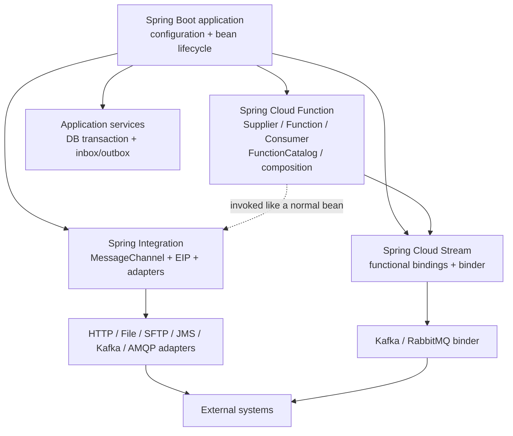
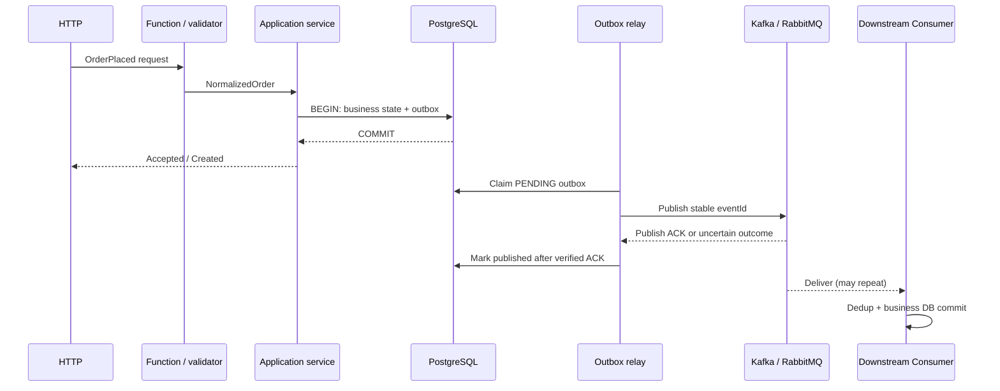
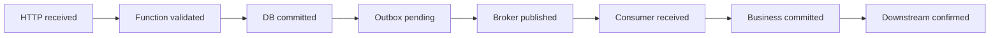
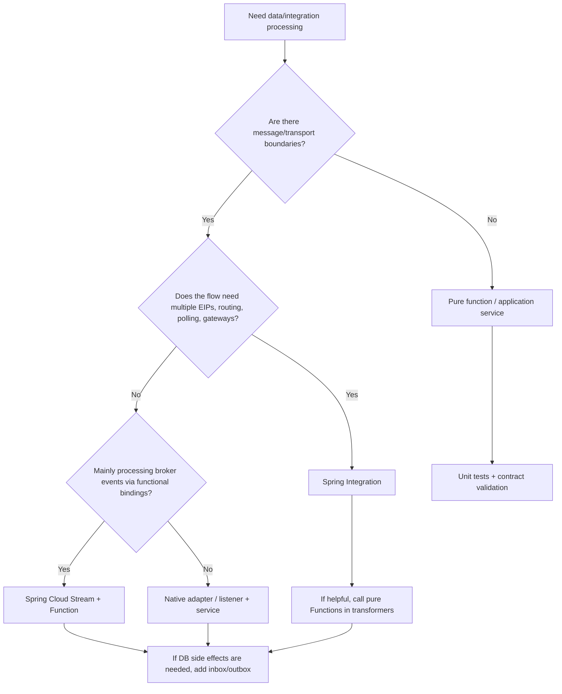

# Spring Cloud Function and Its Boundary with Spring Integration

> **Chapter:** Supplementary Libraries  
> **Module:** `SPRING_BOOT_INTEGRATION` — organizing system integration in Spring Boot via HTTP clients, databases, caches, message brokers, and Spring Integration adapters. The focus is on configuration, data contracts, transactions, error handling, duplicate prevention, testing, and observing real integration flows.
>
> **Version scope:** This lesson uses the functional model of Spring Cloud Function, Java 17+, and Spring Integration DSL in the Spring Boot 3 / Spring Framework 6 era for illustration. Artifact names, APIs, binder options, and auto-configurations must be cross-checked against your actual **Spring Boot + Spring Cloud release train**. Standalone code snippets are meant to explain architectural choices; do not combine all demo configurations into a single production application.

## 1. The Problem: Does an Order-Processing Function Need an IntegrationFlow Too?

A service receives an `OrderPlaced` webhook from a partner, normalizes the data, writes to PostgreSQL, and publishes an event to Kafka for Inventory and Billing to process. The development team is debating three options:

1. Write a `Function<OrderPlaced, NormalizedOrder>` to normalize data, then invoke it from an HTTP controller.
2. Use an `IntegrationFlow` with `MessageChannel`, filters, routers, and outbound adapters to orchestrate the entire chain.
3. Use `Spring Cloud Stream` to receive `OrderPlaced` from a topic and invoke a `Consumer<OrderPlaced>`.

All three can coexist in a Spring Boot system, yet **they do not solve the same problem**:

- A **Function** represents a data transformation or processing step with an input/output contract.
- An **IntegrationFlow** expresses *the journey of a message* across multiple endpoints and Enterprise Integration Patterns (EIP).
- A **Stream binding** connects a function to a message broker source/destination via a binder.

If you treat a `Function` as a durable queue, an EIP router, or a transaction manager, the application will easily mishandle timeouts, ACKs, retries, and duplicate errors.

### Learning Objectives

After this lesson, you will be able to:

1. Distinguish Spring Framework, Spring Boot, Spring Cloud Function, Spring Integration, and Spring Cloud Stream.
2. Write `Supplier`, `Function`, and `Consumer` as Spring beans; invoke them via DI or `FunctionCatalog`.
3. Understand composition, routing, payload/header types, and the limits of functional abstractions.
4. Write an `IntegrationFlow` connecting processing steps with channels, filters, transformers, routers, gateways, and service activators.
5. Decide when to use a standalone function, a standalone `IntegrationFlow`, or combine them.
6. Identify HTTP–database–broker boundaries, transactions, ACKs, retries, idempotency, and observability.
7. Test each layer without confusing a function unit test with a broker integration test.

## 2. Diagram of Where Libraries Sit in a Spring Boot Application



| Technology | What It Defines Most Clearly | What It Does Not Automatically Guarantee |
|---|---|---|
| **Spring Framework** | IoC/DI, AOP, HTTP, transactions, core Spring Messaging | Does not automatically build a durable message pipeline across all transports |
| **Spring Boot** | Starters, externalized configuration, conditional auto-configuration, Actuator | Does not automatically make business logic idempotent or create distributed transactions |
| **Spring Cloud Function** | Model and registration/invocation/composition of functions | Does not automatically create topics, queues, or a message broker |
| **Spring Integration** | Enterprise Integration Patterns, channels, endpoints, gateways, and transport adapters | Does not automatically turn every channel into a durable queue |
| **Spring Cloud Stream** | Binding functions to brokers through binders | Does not hide every difference in ACK, ordering, or DLQ across brokers |
| **Business service** | Data contracts, transactions, retry budgets, and business outcomes | Must be integrated and tested across real boundaries |

**There is no mandatory rule saying "you must use Cloud Function before using Integration".** An `IntegrationFlow` can call a POJO/service directly. A `Function` can run inside ordinary Java code. Cloud Stream typically uses Spring Cloud Function to discover and connect functions to binders.

## 3. Spring Cloud Function: Minimal Code Model

The core interfaces come from `java.util.function`:

| Type | Approximate Mathematical Form | Meaning |
|---|---|---|
| `Supplier<T>` | `() -> T` | Produces data when called |
| `Function<T,R>` | `T -> R` | Transforms input into output |
| `Consumer<T>` | `T -> void` | Accepts input and performs an action |

Plain Java code:

```java
import java.util.function.Consumer;
import java.util.function.Function;
import java.util.function.Supplier;

Supplier<String> currentStatus = () -> "READY";
Function<String, String> normalizeCode =
    code -> code.trim().toUpperCase();
Consumer<String> auditCode =
    code -> System.out.println("Audit code: " + code);

String value = normalizeCode.apply(" a-101 ");
auditCode.accept(value);
```

This does **not** yet require Spring Cloud Function, Spring Integration, or a broker. Those are JDK functional interfaces. Spring Cloud Function adds **discovery, catalog, adaptation, and composition** when functions are registered in a Spring context.

A pure function without I/O or mutable state is very easy to test. A `Consumer` that writes to a database or calls HTTP is still a side-effecting operation that must design timeouts/transactions and idempotency like any other service.

## 4. Registering Functional Beans in Spring Boot

Example using Java records to represent the order contract:

```java
import java.time.Instant;

public record OrderPlaced(
    String eventId,
    String orderId,
    String tenantId,
    long amountMinor,
    String currency,
    Instant occurredAt
) {}

public record NormalizedOrder(
    String eventId,
    String orderId,
    String tenantId,
    long amountMinor,
    String currency,
    Instant occurredAt
) {}
```

Registering the function bean:

```java
import java.util.Locale;
import java.util.function.Function;
import org.springframework.context.annotation.Bean;
import org.springframework.context.annotation.Configuration;

@Configuration(proxyBeanMethods = false)
public class OrderFunctions {

    @Bean
    Function<OrderPlaced, NormalizedOrder> normalizeOrder() {
        return event -> {
            if (event.eventId() == null || event.eventId().isBlank()) {
                throw new IllegalArgumentException("eventId is required");
            }
            if (event.orderId() == null || event.orderId().isBlank()) {
                throw new IllegalArgumentException("orderId is required");
            }
            return new NormalizedOrder(
                event.eventId().trim(),
                event.orderId().trim(),
                event.tenantId(),
                event.amountMinor(),
                event.currency().toUpperCase(Locale.ROOT),
                event.occurredAt()
            );
        };
    }
}
```

This snippet is **data transformation**. In a real application, also validate `currency != null`, `tenantId`, monetary amounts, and timestamp validity before dereferencing. `IllegalArgumentException` illustrates rejection, not a full strategy for translating errors to HTTP 4xx/DLQ.

You can inject the function directly as a Spring bean:

```java
import java.util.function.Function;
import org.springframework.beans.factory.annotation.Qualifier;
import org.springframework.stereotype.Service;

@Service
public class NormalizationService {
    private final Function<OrderPlaced, NormalizedOrder> normalizeOrder;

    public NormalizationService(
            @Qualifier("normalizeOrder")
            Function<OrderPlaced, NormalizedOrder> normalizeOrder) {
        this.normalizeOrder = normalizeOrder;
    }

    public NormalizedOrder normalize(OrderPlaced event) {
        return normalizeOrder.apply(event);
    }
}
```

**Key distinction:** injecting directly via `@Qualifier` is standard Spring DI; you do not need `FunctionCatalog` when you already know the exact bean and have no need for dynamic lookup/composition.

## 5. FunctionCatalog: Discovering and Invoking Functions by Name

`org.springframework.cloud.function.context.FunctionCatalog` is Spring Cloud Function's API to **look up** and invoke functional beans, including functions that may be adapted or composed by the framework depending on version.

```java
import java.util.function.Function;
import org.springframework.cloud.function.context.FunctionCatalog;
import org.springframework.stereotype.Service;

@Service
public class CatalogBasedNormalizer {
    private final FunctionCatalog catalog;

    public CatalogBasedNormalizer(FunctionCatalog catalog) {
        this.catalog = catalog;
    }

    public NormalizedOrder normalize(OrderPlaced event) {
        Function<OrderPlaced, NormalizedOrder> function =
            catalog.lookup("normalizeOrder");

        if (function == null) {
            throw new IllegalStateException("normalizeOrder not registered");
        }
        return function.apply(event);
    }
}
```

`lookup(...)` returns a function matching the catalog's adaptation capabilities. When the framework applies type conversion or wrappers for message/reactive types, **actual input/output types must be tested** rather than inferred from generic casts allowed by the compiler.

### 5.1. When Should You Use the Catalog?

- An adapter needs to pick a function from a **controlled set**.
- You need composition by name instead of manually calling multiple beans sequentially.
- Integrating with framework binder/HTTP/function invocation adapters.
- Writing a library built around the functional model rather than a service using direct injection.

If you only use one stable function inside an application service, constructor injection is usually **simpler and easier to debug** than the catalog.

### 5.2. Bean Name Is Part of the Configuration Contract

`normalizeOrder` in the example is the **`@Bean` method name**, so it becomes the default bean name. If renamed to `normalizeOrderEvent` without updating `FunctionCatalog.lookup(...)`, composition definitions, or `spring.cloud.function.definition`, endpoints/bindings may fail to find the function.

Treat functional bean names referenced by external adapters as a **configuration contract** to review during refactoring.

## 6. Composition: Chaining Simple Transformations

Suppose you need to normalize a code and add a partner prefix:

```java
import java.util.Locale;
import java.util.function.Function;
import org.springframework.context.annotation.Bean;
import org.springframework.context.annotation.Configuration;

@Configuration(proxyBeanMethods = false)
class CodeFunctions {

    @Bean
    Function<String, String> trimAndUppercase() {
        return text -> text.trim().toUpperCase(Locale.ROOT);
    }

    @Bean
    Function<String, String> prefixPartner() {
        return text -> "PARTNER-" + text;
    }
}
```

Using Spring Cloud Function composition:

```yaml
spring:
  cloud:
    function:
      definition: trimAndUppercase|prefixPartner
```

The pipe `|` declares composition in Spring Cloud Function on supported branches. You can look up a composed function:

```java
Function<String, String> pipeline =
    catalog.lookup("trimAndUppercase|prefixPartner");

String result = pipeline.apply(" a-101 ");
// result: "PARTNER-A-101"
```

**Composition is chained function invocation**—it does not create message channels, persisted queues, or checkpoints. If the first function succeeds and the second throws an exception, there is no database rollback/compensation unless the caller established a transaction and the operations participate in it.

### 6.1. Conditions for Composition

Two functions must be **type-compatible** at the output/input boundary. `Function<A,B>` composed with `Function<B,C>` is cleaner than `Function<A,B>` composed with `Function<X,C>` lacking an explicit converter.

With `Supplier` or `Consumer`, composition capabilities and wrapper behavior depend on the adapter and function definitions. Start with chains of simple `Function<T,R>` beans and keep side effects in services with explicit contracts.

### 6.2. Composition Is Not Routing

Composition: **A then B** on the same flow. Routing: **choose A or B** based on metadata/payload. Spring Cloud Function has dedicated routing mechanisms; Spring Integration has `Router`, `Filter`, and other EIPs. Choose routing when messages must go to **different branches**, rather than trying to force every decision into a linear function chain.

## 7. Routing and Safety When Function Names Come from Input

A dispatcher may want to select a function based on `eventType`. Even though Spring Cloud Function supports function routing, do not allow untrusted HTTP headers or message payloads to decide **arbitrary** executable function names or expressions.

Example of using an **allowlist** at the application layer:

```java
import java.util.Map;
import java.util.function.Function;

public final class EventDispatchService {

    private final Map<String, Function<String, String>> handlers;

    public EventDispatchService(
            Function<String, String> normalizeShipment,
            Function<String, String> normalizePayment) {
        this.handlers = Map.of(
            "shipment.updated.v1", normalizeShipment,
            "payment.captured.v1", normalizePayment
        );
    }

    public String dispatch(String eventType, String payload) {
        Function<String, String> handler = handlers.get(eventType);
        if (handler == null) {
            throw new IllegalArgumentException("Unsupported event type");
        }
        return handler.apply(payload);
    }
}
```

The two functions in the constructor are **application-supplied values**. When multiple beans have the same `Function<String,String>` signature, wire them in Spring using `@Qualifier` or an explicit factory.

In Spring Integration, a `HeaderValueRouter` or `PayloadTypeRouter` can express routing and target channel mapping. Either way, **input must never have permission to pick arbitrary beans/channels/topics** without policy enforcement.

## 8. Message<T>, Headers, and Data Contracts

A plain `Function<T,R>` only sees the payload. If you need correlation ID, event ID, or transport metadata, you can use `org.springframework.messaging.Message<T>`:

```java
import java.util.function.Function;
import org.springframework.context.annotation.Bean;
import org.springframework.messaging.Message;
import org.springframework.messaging.support.MessageBuilder;

@Bean
Function<Message<OrderPlaced>, Message<NormalizedOrder>>
        normalizeWithCorrelation(
            Function<OrderPlaced, NormalizedOrder> normalizeOrder) {

    return inbound -> {
        NormalizedOrder normalized =
            normalizeOrder.apply(inbound.getPayload());

        Object correlation = inbound.getHeaders().get("correlationId");

        MessageBuilder<NormalizedOrder> output =
            MessageBuilder.withPayload(normalized);

        if (correlation != null) {
            output.setHeader("correlationId", correlation);
        }
        output.setHeader("eventId", normalized.eventId());
        return output.build();
    };
}
```

**Point to verify:** when the app has multiple `Function<OrderPlaced,NormalizedOrder>` beans, inject with `@Qualifier("normalizeOrder")` as shown in Section 4. With `Message<T>`, **whitelist headers** permitted to pass forward; do not blindly copy headers containing credentials, transport metadata, or routing/ACK control headers.

### 8.1. A Spring Message Is Not a Topic

`Message<T>` is an object carrying a payload and headers. It **does not automatically create a broker message**, nor does it have a cursor or retention. A message traversing a Spring Integration `MessageChannel` within a single JVM may live entirely in RAM; only when sent via Kafka/RabbitMQ does an adapter or binder encode and publish it.

### 8.2. Which Metadata Must Be Stable?

| Field | Meaning | Notes |
|---|---|---|
| `eventId` | Identifies a business event | Stable when the producer retries/republishes |
| `commandId` | Identifies an action request | Consumer deduplicates by command ID |
| `correlationId` | Groups multiple steps of a workflow | Does not replace event ID |
| `causationId` | Event/command that directly caused the current message | Helps with auditing |
| `aggregateId` | Order/product/account | Can be used as partition key |
| `schemaVersion` | Contract version | Consumer picks parser and checks compatibility |
| `MessageHeaders.ID` | ID of a Spring Message at a boundary | Does not replace broker ID or event ID |

Do not assume headers are automatically preserved across every adapter/binder, especially with serialization, Kafka message headers, and RabbitMQ properties. **Test the real path**, not just a `Message<?>` object in a unit test.

## 9. Payload Typing, JSON, and Data Conversion

Spring Cloud Function has adaptation/conversion support when invoked through compatible adapters; Spring Integration has corresponding transformers/converters. However, **not every Java lambda automatically knows how to parse JSON**.

Example:

```java
Function<String, String> upper = String::toUpperCase;
upper.apply("{\"orderId\":\"o-1\"}");
```

The result is merely an **entirely upper-cased JSON string**, not a valid `OrderPlaced` with normalized fields. Mapping JSON to a DTO requires a declared parser/`MessageConverter`/type conversion mechanism plus validation.

### 9.1. Manage Both Schema and Semantic Validation

An event contract can have an envelope:

```json
{
  "eventId": "evt-902",
  "eventType": "order.placed.v1",
  "schemaVersion": 1,
  "correlationId": "checkout-902",
  "occurredAt": "2026-11-21T03:00:00Z",
  "payload": {
    "orderId": "order-902",
    "tenantId": "shop-a",
    "amountMinor": 12550,
    "currency": "USD"
  }
}
```

Schema parsing checks structure; business validation checks tenant, amounts, status, and ID validity. Content type `application/json` **does not guarantee** both sides agree on field semantics or compatibility when a producer upgrades before a consumer.

### 9.2. Separate Responsibilities Properly

- The adapter receives JSON and converts it into a verified DTO.
- A pure function normalizes/extracts data and produces an output DTO.
- The business service decides whether to accept or reject the state.
- The message adapter/binder serializes the output according to the contract.

When transformation has multiple complex steps, Spring Integration offers `Transformer`, `Enricher`, or `Splitter`; there is no need to cram all logic into a single `Function<String,String>`.

## 10. Spring Integration Solves a Different Class of Problems

Spring Integration implements **Enterprise Integration Patterns** via message channels, endpoints, and adapters. Common EIPs include:

| Pattern | Purpose | When Functional Composition Is Not Clear Enough |
|---|---|---|
| **Message Channel** | Decouples producer and consumer in a message flow | Need boundaries between endpoints/threads |
| **Gateway** | Lets callers invoke an API and turns it into a message | Need request/reply, timeouts, correlation |
| **Transformer** | Converts payload/headers from one type to another | Need transparent step-by-step mapping |
| **Filter** | Passes or drops messages based on a predicate | Need explicit discard channel/handling |
| **Router** | Chooses an output channel conditionally | Multiple processing branches by event type |
| **Splitter** | Splits a list-bearing message into individual messages | Reading a file/batch and processing items |
| **Aggregator** | Combines multiple messages into a group | Has correlation, release/expiry policies |
| **Resequencer** | Orders messages according to a sequence rule | Handling out-of-order messages with state |
| **Service Activator** | Calls a business service from a message | Has side effects, error handling |
| **Inbound/Outbound Adapter** | Connects HTTP, file, SFTP, JMS, Kafka, AMQP, etc. | Needs concrete transport boundaries |
| **Poller** | Triggers periodic source reads | Files/DBs/job queues without push |

A linear function `A.andThen(B)` **does not automatically provide** a correlation store for an aggregator, a retry advice chain, dead-letter routing, or polling adapter lifecycle management.

### 10.1. Quick Summary of the Boundary

**Cloud Function** answers "what input → which function → what output?".  
**Spring Integration** answers "which channel/endpoint does the message traverse, down which branch, over which transport, and who coordinates timeouts and errors?".  
The two perspectives **complement** each other and are not mutually exclusive.

## 11. MessageChannel and Thread/Durability Semantics

Spring Integration offers multiple channel types. Channel choice dictates **when the handler runs** and how coordination works, not just a name.

| Channel | Characteristics | Risks to Control |
|---|---|---|
| `DirectChannel` | Invokes handler synchronously on sender thread when no executor boundary exists | Caller bears handler latency and exceptions |
| `ExecutorChannel` | Dispatches via an executor | Thread/transaction context does not carry over intact automatically |
| `QueueChannel` | In-application pull/poll queue | Often in RAM; lost on process crash without a durable store |
| `PublishSubscribeChannel` | Broadcasts to multiple subscribers in context | In-JVM fan-out does not replace durable broker fan-out |
| `PriorityChannel` | Prioritized queue | Priority alone does not prevent starvation/recovery issues |
| `FluxMessageChannel` | Reactive channel following publisher semantics | Requires understanding backpressure and subscriber lifecycle |

### 11.1. DirectChannel Is Not "Asynchronous Messaging"

For example, `MessageChannel.send(...)` to a `DirectChannel` can execute downstream immediately on the same thread. If downstream writes slowly to the DB, the caller slows down too. If a bean is `@Transactional` and both steps share the thread/transaction manager, they may share context per configuration.

Switching to `ExecutorChannel` introduces a new thread boundary; **ThreadLocal transaction context does not automatically cross to worker threads**. If existing code appeared to have an end-to-end transaction, swapping the channel can alter commit/rollback behavior.

### 11.2. QueueChannel Is Not Automatically a Durable Broker

A default `QueueChannel` may store messages in memory. ACKing a webhook merely because a message was placed onto such a `QueueChannel` can **lose work if the JVM crashes**. When durability is needed, use a properly designed persistent `MessageStore`, DB job/inbox/outbox, or an external broker with appropriate ACK policies.

## 12. IntegrationFlow: Expressing a Pipeline with DSL

Example flow receiving `OrderPlaced`, normalizing it, and calling a service. **Assumes** the `normalizeOrder` bean from Section 4 and an application-provided service `OrderIntakeService.accept(NormalizedOrder)`.

```java
import java.util.function.Function;
import org.springframework.beans.factory.annotation.Qualifier;
import org.springframework.context.annotation.Bean;
import org.springframework.context.annotation.Configuration;
import org.springframework.integration.channel.DirectChannel;
import org.springframework.integration.dsl.IntegrationFlow;
import org.springframework.messaging.MessageChannel;

@Configuration(proxyBeanMethods = false)
public class OrderIntegrationFlowConfiguration {

    @Bean
    MessageChannel orderInput() {
        return new DirectChannel();
    }

    @Bean
    IntegrationFlow orderIntakeFlow(
            @Qualifier("normalizeOrder")
            Function<OrderPlaced, NormalizedOrder> normalizeOrder,
            OrderIntakeService service) {

        return IntegrationFlow.from("orderInput")
            .transform(OrderPlaced.class, normalizeOrder::apply)
            .handle(NormalizedOrder.class, (payload, headers) -> {
                service.accept(payload);
                return null;
            })
            .get();
    }
}
```

This structure intentionally reuses the **existing Function** to transform messages inside `IntegrationFlow`. There is no need to register a second function just to rewrite the same logic.

- `orderInput` is a logical input channel, not a Kafka topic.
- `transform(...)` takes the payload, invokes the function, and produces a message with the transformed result per the DSL.
- `handle(...)` is a service-activator-style endpoint; in this example the service executes a side effect and produces no reply.
- Because the channel is `DirectChannel`, the whole flow can run synchronously on the caller thread, with no automatic persistence or retry on JVM crash.

### 12.1. A Gateway for External Code to Call the Flow

Instead of injecting `MessageChannel` into every controller, you can use a messaging gateway:

```java
import org.springframework.integration.annotation.Gateway;
import org.springframework.integration.annotation.MessagingGateway;

@MessagingGateway
public interface OrderIntakeGateway {

    @Gateway(requestChannel = "orderInput")
    void accept(OrderPlaced event);
}
```

Some setups require `@IntegrationComponentScan` to register the gateway interface as a Spring bean, for example on a `@Configuration`:

```java
import org.springframework.context.annotation.Configuration;
import org.springframework.integration.config.EnableIntegration;
import org.springframework.integration.annotation.IntegrationComponentScan;

@Configuration(proxyBeanMethods = false)
@EnableIntegration
@IntegrationComponentScan
class GatewayRegistrationConfiguration {
}
```

When using the Spring Boot Integration starter, part of the infrastructure may be auto-configured by Boot; do not duplicate bean registration merely because an example uses `@EnableIntegration`. Verify your actual context and package scanning. A gateway **does not automatically create an HTTP endpoint**; an HTTP controller must inject the gateway and call its method.

## 13. Gateway, Request/Reply, and Correlation Differ from Function.apply()

A `Function<T,R>` returns data after applying logic. An Integration gateway can also let callers invoke a method and receive a reply, but message-based request/reply adds:

- Request/reply channels, reply timeouts, and error channels.
- Correlation when using splitters/aggregators.
- Support for bridging synchronous requests into asynchronous flows when designed for it.
- Header propagation, routing, and conversion at endpoints.

For example, a flow with a splitter and aggregator handles **multi-message** problems: one request containing many items, split into individual messages, processed independently, and aggregated using a correlation/release strategy. A `Function<List<Item>,Result>` can certainly loop, but when individual items must traverse queues/brokers with independent timeouts and retries, Integration's aggregator/`MessageStore` patterns express the boundary more clearly.

Do not automatically reach for `IntegrationFlow` just because code makes three method calls; when there are no messaging boundaries or orchestration needs, **a plain service or function is enough**.

## 14. Combining Function and Integration: Choosing the Right Intersection

There are three practical ways to combine them.

### 14.1. Pure Function as a Transformer

```java
return IntegrationFlow.from("orderInput")
    .transform(OrderPlaced.class, normalizeOrder::apply)
    .handle(NormalizedOrder.class, (payload, headers) -> {
        orderService.accept(payload);
        return null;
    })
    .get();
```

Advantage: normalization can be tested independently without a Spring Integration runtime. The flow decides **when** and **via which channel** to invoke it.

### 14.2. Application Service Using FunctionCatalog with an Allowlist

An adapter can look up a function by an **approved configuration name** and call it. Useful when function implementations vary by deployment/feature, though it introduces misconfiguration or type mismatch risks. Never let external payloads choose arbitrary function names.

### 14.3. Using Integration to Orchestrate Multiple Functions

An `IntegrationFlow` can chain transform → filter → route → service activator, each step delegating to a functional bean. Usually prefer *one single place* owning routing and retries: if a Cloud Function router, Integration router, and binder header router all make decisions, it becomes hard to explain which branch a message took.

### 14.4. Do Not Mistake Composition for a Channel Graph

`FunctionCatalog.lookup("a|b")` builds a chain of compatible functions. It does not alter `MessageChannel` topology, configure pollers, or provide queues/durable stores. If you need fan-out, aggregation, delayed retries, or request/reply timeouts, Integration usually provides clearer expressive patterns.

## 15. Spring Cloud Stream: When a Function Needs to Connect to a Broker

A function without a broker is just a Java bean. To make Spring Boot **subscribe to a Kafka/Rabbit topic and feed payloads to the function**, you can use a **Spring Cloud Stream binder**.

Consumer example:

```java
import java.util.function.Consumer;
import org.springframework.context.annotation.Bean;
import org.springframework.context.annotation.Configuration;

@Configuration(proxyBeanMethods = false)
class InventoryStreamFunctions {

    @Bean
    Consumer<OrderPlaced> applyOrderPlaced(
            InventoryApplicationService service) {
        return service::applyOnce;
    }
}
```

Kafka binder configuration:

```yaml
spring:
  cloud:
    function:
      definition: applyOrderPlaced
    stream:
      bindings:
        applyOrderPlaced-in-0:
          destination: orders.placed.v1
          group: inventory-service
          content-type: application/json
      kafka:
        binder:
          brokers: ${KAFKA_BOOTSTRAP_SERVERS:localhost:9092}
```

Example dependencies (a compatible Spring Cloud BOM must be configured in the project):

```gradle
dependencies {
    implementation("org.springframework.cloud:spring-cloud-stream-binder-kafka")
    implementation("org.springframework.boot:spring-boot-starter-jdbc")
    runtimeOnly("org.postgresql:postgresql")
}
```

Here:

- `applyOrderPlaced` is the **functional bean name**.
- `applyOrderPlaced-in-0` is the Spring Cloud Stream **input binding name**.
- `orders.placed.v1` is the **destination** (a Kafka topic for this binder).
- `inventory-service` is the application's **consumer group**.
- The Kafka binder is responsible for connecting to the broker and invoking the function via the binding.

**Spring Cloud Function core does not subscribe to Kafka automatically.** Adding a function bean without a matching binder/adapter/controller will not create a consumer.

### 15.1. Inputs/Outputs by Function Name

Typically:

```text
Consumer<T>   -> <beanName>-in-0
Function<T,R> -> <beanName>-in-0 and <beanName>-out-0
Supplier<T>   -> <beanName>-out-0
```

When multiple functional beans exist, set `spring.cloud.function.definition` to choose explicitly instead of relying on arbitrary discovery. Functions can be composed; when they are, binding names must follow your framework/version's rules rather than guessing by concatenating bean names arbitrarily.

### 15.2. The Binder Abstraction Does Not Hide All Transport Semantics

Kafka groups/offsets/partitions differ from RabbitMQ queues/ACKs/requeues. The same `Consumer<OrderPlaced>` can preserve business logic, yet startup, provisioning, retries, DLQs, backpressure, and ordering still need broker-specific design.

If the application needs deep control over consumer offsets, publisher confirms, or specialized serializers, native APIs like `@KafkaListener`, `KafkaTemplate`, `@RabbitListener`, or Spring Integration adapters may fit better.

## 16. StreamBridge and Functions: When the Source Is HTTP or an Outbox Relay

Not every message arrives from an inbound stream binding. An HTTP controller or scheduled relay may need to publish an event already saved in the database.

Spring Cloud Stream provides `StreamBridge`:

```java
import org.springframework.cloud.stream.function.StreamBridge;
import org.springframework.messaging.support.MessageBuilder;
import org.springframework.stereotype.Service;

@Service
class OutboundOrderEventAdapter {
    private final StreamBridge bridge;

    OutboundOrderEventAdapter(StreamBridge bridge) {
        this.bridge = bridge;
    }

    boolean send(OrderPlaced event) {
        return bridge.send(
            "orderEvents-out-0",
            MessageBuilder.withPayload(event)
                .setHeader("eventId", event.eventId())
                .setHeader("contentType", "application/json")
                .build()
        );
    }
}
```

```yaml
spring:
  cloud:
    stream:
      output-bindings: orderEvents-out-0
      bindings:
        orderEvents-out-0:
          destination: orders.placed.v1
          content-type: application/json
```

`StreamBridge` is a **Spring Cloud Stream** API, not `FunctionCatalog` or a Spring Integration `MessageChannel`. The boolean result of `send` reflects delivery status across the binding abstraction—it is **not proof that a consumer has processed it**, and **does not always equal a durable broker ACK** in every producer configuration.

If an outbox relay must mark `PUBLISHED` only after a real broker acknowledgment, use a confirmation mechanism proven supported by your binder/native client (such as appropriate callbacks/confirms) and test lost-response scenarios. Do not delete outbox rows just because `bridge.send(...) == true`.

## 17. Spring Integration Adapters vs. Stream Binders: Do Not Double-Consume

One application could contain:

- Spring Kafka's `@KafkaListener`.
- A Kafka inbound channel adapter in Spring Integration.
- A Kafka binder input binding in Spring Cloud Stream.
- An HTTP gateway pushing messages onto a channel.

All of them can call the same `InventoryApplicationService`, but they create **different consuming endpoints**, sometimes with separate groups/offsets and ACKs.

### 17.1. Risk of Reading the Same Business Event Twice

If you configure both an Integration Kafka inbound adapter and a Cloud Stream consumer for the same topic with **different groups**, both receive the record and may run side effects twice. If they share the same group, they may split partitions and make ordering/observability hard to reason about.

Do not assume "same topic means Spring merges them into one listener". Choose **one ingress owner** per business responsibility, and when multiple valid ingresses must exist, protect with `eventId`/deduplication.

### 17.2. When Are Integration Adapters Appropriate?

- A flow chaining multiple sources like SFTP → transform → database → JMS/Kafka.
- Needing EIPs such as splitter/aggregator/router, pollers, gateways, and error channels.
- Managing multi-step pipelines with clear thread/channel boundaries.
- Existing native broker infrastructure where you want to plug inbound/outbound adapters into a channel graph.

### 17.3. When Are Binders Appropriate?

- Many services processing messages via `Function`/`Consumer`/`Supplier`.
- Teams wanting standardized declarations for input/output/destination/group.
- Use cases mostly receiving one event, applying logic, and optionally emitting another event.
- Broker-specific controls can be exposed cleanly through binder configuration.

**There is no "every broker is effortlessly swappable" option.** Portability only holds for the parts of the abstraction genuinely supported by both binders.

## 18. HTTP Adapters and Serverless Adapters: A Function Is Not an HTTP Controller

Spring Cloud Function has adapters to expose/invoke functions over transports such as web or certain serverless platforms depending on dependencies and configuration. However, a bean like:

```java
@Bean
Function<String, String> normalizeCode() {
    return value -> value.trim().toUpperCase();
}
```

does not automatically create a Spring MVC `@PostMapping` in an app with only the core starter. You can:

1. Use a Spring MVC controller, inject the function, and call `apply(...)`.
2. Use the Spring Cloud Function web adapter **if you added the right dependency and accept its endpoint contract**.
3. Use a Spring Integration HTTP inbound gateway to turn HTTP requests into messages.
4. Use a cloud-function adapter for serverless environments per the target deployment model.

### 18.1. Choose Clear HTTP Boundaries

When an HTTP request requires signature verification, tenant authorization, schema validation, idempotency keys, status codes, and problem details, an **explicit controller/adapter** is usually easier to govern than auto-exposing every function.

A pure function should accept a **validated DTO** and avoid reading HTTP headers or servlet contexts directly if you want to reuse it via brokers or batch jobs.

### 18.2. Request/Reply Does Not Replace a State Machine

A `Function` returning output within the same request does not prove downstream events were processed. For slow operations like reserving inventory via a broker, HTTP should usually return an accepted status with a request ID and offer a query endpoint for progress, rather than holding the request open waiting on all subscribers if the SLA does not require it.

## 19. Imperative vs. Reactive Functions: Different Semantics

Spring Cloud Function supports the imperative model and certain reactive models via `Publisher`/`Flux` when paired with compatible adapters.

Pure Reactor function example:

```java
import java.util.function.Function;
import reactor.core.publisher.Flux;

Function<Flux<String>, Flux<String>> normalizeEvents =
    incoming -> incoming.map(String::trim)
        .filter(value -> !value.isBlank());
```

This is a reactive transformation; it **does not automatically subscribe to a Pulsar/Kafka topic** or create a broker subscription. When combined with Cloud Stream reactive functions, how the framework subscribes, dispatches, and manages ACKs differs from imperative listeners; check the documentation for your binder/version.

### 19.1. Do Not Put Blocking JDBC Calls Arbitrarily Inside Reactive Operators

`JdbcTemplate` and JDBC jOOQ use blocking I/O. Calling them directly inside `map(...)` running on a reactive pipeline's event loop can block other tasks. Choose an appropriate scheduler/worker pool, or use reactive data access when the entire path needs to be non-blocking.

`publishOn`/`subscribeOn` can shift thread scheduling, but **do not create transactions or idempotency**. When a stream replays after an error, side effects inside `map/flatMap` can run multiple times.

### 19.2. Reactive Supplier Differs from Polling Supplier

`Supplier<Flux<T>>` can emit a publisher stream subscribed to by the adapter under its model; an imperative `Supplier<T>` may be polled by the binder according to policy. Do not infer identical poller, lifecycle, or retry semantics merely because both use the `Supplier` interface.

## 20. Transactions: Function, Integration, and Broker Do Not Share a Natural Commit

Consider the flow:

```text
HTTP receives OrderPlaced
→ Function normalizeOrder
→ PostgreSQL inserts order
→ Kafka publishes OrderPlaced
→ Inventory consumes
→ PostgreSQL reserves inventory
→ HTTP supplier update
```

These are **multiple transaction boundaries**. Java function composition, `DirectChannel`, and Stream bindings do not merge them automatically.

| Boundary | What Can Commit | What Is Not Automatically in That Commit |
|---|---|---|
| Spring JDBC `@Transactional` | Multiple SQL statements on the matching datasource/manager | Kafka publishing, HTTP side effects |
| Kafka producer transaction (if used) | Broker operations within the supported scope | Automatic JDBC business transactions |
| Integration `DirectChannel` | Runs handler synchronously on caller thread | Does not automatically create a DB transaction |
| Integration `ExecutorChannel` | Dispatches message on another thread | Does not automatically carry ThreadLocal transaction context |
| Cloud Stream Consumer | Processing and broker progress per binder/config | Does not guarantee exactly-once PostgreSQL side effects |
| Cloud Function `apply(...)` | Returns a value or throws an exception | Has no commit/checkpoint unless the caller designs one |

### 20.1. Transactional Outbox for HTTP–DB–Broker Flows



The function only normalizes the contract; the **application service** decides the transaction; the **relay** owns publish retries; the **consumer** must deduplicate.

### 20.2. Why Is an Outbox Insufficient Without Idempotency?

The relay might publish successfully and crash before updating `PUBLISHED`. After restarting, it may publish **the same event again**. Consumers must use `eventId` (or `commandId`) so business effects are not duplicated. At-least-once transport + idempotent processing is usually more practical than claiming exactly-once across both DB and broker.

## 21. Designing an Idempotent Consumer with PostgreSQL

Example handling `OrderPlaced` arriving from a Spring Cloud Stream consumer or an Integration inbound adapter. Both can call the same shared application service:

```sql
CREATE TABLE processed_message (
    consumer_name VARCHAR(100) NOT NULL,
    event_id VARCHAR(160) NOT NULL,
    processed_at TIMESTAMPTZ NOT NULL DEFAULT CURRENT_TIMESTAMP,
    PRIMARY KEY (consumer_name, event_id)
);

CREATE TABLE inventory_command (
    command_id VARCHAR(180) PRIMARY KEY,
    order_id VARCHAR(160) NOT NULL,
    state VARCHAR(24) NOT NULL
);
```

```java
import org.springframework.jdbc.core.JdbcTemplate;
import org.springframework.stereotype.Service;
import org.springframework.transaction.annotation.Transactional;

@Service
public class InventoryApplicationService {
    private final JdbcTemplate jdbc;

    public InventoryApplicationService(JdbcTemplate jdbc) {
        this.jdbc = jdbc;
    }

    @Transactional
    public void applyOnce(OrderPlaced event) {
        int inserted = jdbc.update(
            """
            INSERT INTO processed_message (consumer_name, event_id)
            VALUES (?, ?)
            ON CONFLICT (consumer_name, event_id) DO NOTHING
            """,
            "inventory-service",
            event.eventId()
        );

        if (inserted == 0) {
            return;
        }

        jdbc.update(
            """
            INSERT INTO inventory_command(command_id, order_id, state)
            VALUES (?, ?, 'PENDING')
            ON CONFLICT (command_id) DO NOTHING
            """,
            "reserve-" + event.eventId(),
            event.orderId()
        );
    }
}
```

This is a **PostgreSQL** example; tables/constraints must be created via migrations. Input has already been parsed and validated before reaching this point. If `eventId` is unique only per tenant rather than globally, the unique key and `commandId` must include `tenantId`.

**Transaction required:** both INSERTs must use the same `DataSource` and transaction manager. If the method fails before commit, the inbox insert rolls back so the message can be retried. If the consumer dies **after commit but before broker ACK**, redelivery hits the primary key and avoids repeating the side effect.

Do not rely on `System.out.println`, a mutable in-RAM `Set<String>`, or a broker's `MessageId` as proof of business idempotency.

## 22. Error Handling: Who Receives the Error at Each Layer?

Different scenarios have different error paths:

| Error Location | Example | Who Bears Primary Responsibility |
|---|---|---|
| Inside `Function.apply` | Valid schema, failed business validation | Caller/adapter decides HTTP 4xx, reject, or DLQ |
| Inside synchronous `IntegrationFlow` | Transformer/handler throws exception via `DirectChannel` | Caller/gateway may receive the exception |
| Inside asynchronous Integration flow | Endpoint on `ExecutorChannel` fails | Error channel/handler and retry advice per config |
| Inside Cloud Stream consumer | DB timeout while handler runs | Binder/consumer error infrastructure + app classification |
| Deserialization before function | JSON/Avro fails to decode | Adapter/binder converter/error handling |
| Broker publish | Wrong topic, auth failure, timeout | Producer/binder/native client and relay |
| Downstream HTTP | Timeout with uncertain outcome | HTTP adapter, idempotency key, and reconciliation |

Do not write `try/catch(Exception) { log(); }` and return normally inside a consumer if the broker will ACK on return: messages can **vanish from processing** even though the business work never finished.

### 22.1. Retry Ownership Must Be Unified

A transient database error can trigger:

- Retries inside the application service (e.g., Spring Retry / Resilience4j).
- Retries on a Spring Integration endpoint/advice.
- Redelivery from the Kafka/Rabbit binder or native listener.
- Retries from the outbox/job relay.

If each layer retries 5 times, total load can multiply sharply. Assign one layer to own retries, set budgets, backoff/jitter, and a route to send poison messages to quarantine/DLT/DLQ. Do not retry unrecoverable contract errors.

### 22.2. Error Channel Is Not a Broker Dead-Letter

Spring Integration's `errorChannel` carries exceptions inside the **application message flow**, possibly only in the JVM. Broker DLQ/DLT is a middleware destination. To persist errors durably, configure an adapter/handler that actually publishes or stores them to a durable location per contract.

## 23. Threads, Backpressure, and Processing Order

A pure function runs on whatever thread the caller uses. When placed inside an `IntegrationFlow` or Cloud Stream, scheduling is determined by the endpoint, channel, or binder.

- `DirectChannel`: usually runs on the sender's thread; easy to reason about transactions, easy to block callers.
- `ExecutorChannel`: asynchronous; involves queues, thread pools, saturation, and context propagation.
- Kafka binder: partitions/groups/concurrency govern parallelism and per-partition ordering.
- Rabbit binder: queues, prefetch, concurrency, and requeues govern throughput/ordering.
- Reactive functions: subscriber demand/scheduling/backpressure depend on the framework and transport.

### 23.1. Do Not Turn Synchronous Work into "Fire-and-Forget" Using a Thread Pool

Submitting a message to an `Executor` or an in-memory `QueueChannel` and returning HTTP `200` does not prove work was durably saved. When crash recovery is needed, persist to a database job/inbox or an ACK-confirmed broker before returning "accepted".

### 23.2. Ordering Is Its Own Contract

For the same `orderId`, there are events `OrderPaid(version=3)` and `OrderCancelled(version=4)`. Even when a broker tries to preserve key-based ordering, replays and retries can cause consumers to observe events out of expected order. For critical state machines, check `aggregateVersion` or transition rules in the DB; function composition does not solve ordering on its own.

## 24. Layered Testing: Do Not Confuse Guarantee Levels

| Test Layer | What It Verifies | What It Does Not Prove |
|---|---|---|
| Function unit test | Input → output, validation, schema mapping | Channels, brokers, transactions |
| FunctionCatalog integration test | Function bean registration, lookup/composition | Kafka/Rabbit topics and ACKs |
| IntegrationFlow test | Channel routing, filters/transforms/handlers | External brokers if tested in-memory only |
| Cloud Stream test binder | Functional bindings, content-type conversion | Real partitions/offsets/DLQs |
| DB integration test | Transactions, unique keys, rollback/idempotency | Broker publish ACKs |
| Broker integration test | Topics/groups, serialization, retries, DLQ/ACK | Correct remote HTTP side effects |
| End-to-end failure test | Crashes/retries, outbox/inbox, eventual processing | Needs production-like environment for full confidence |

### 24.1. Unit Testing a Function Without a Spring Context

```java
import static org.assertj.core.api.Assertions.assertThat;
import java.util.function.Function;
import org.junit.jupiter.api.Test;

class CodeFunctionTest {

    @Test
    void normalizesAndPrefixes() {
        Function<String, String> normalize = String::trim;
        Function<String, String> prefix =
            code -> "PARTNER-" + code.toUpperCase();

        assertThat(normalize.andThen(prefix).apply(" a-101 "))
            .isEqualTo("PARTNER-A-101");
    }
}
```

Unit tests verify pure logic; they do not confirm that `FunctionCatalog` discovered the bean or that YAML configured composition correctly.

### 24.2. Testing the Spring Cloud Function Catalog

A small test context can import configuration beans and verify the catalog:

```java
import static org.assertj.core.api.Assertions.assertThat;
import java.util.function.Function;
import org.junit.jupiter.api.Test;
import org.springframework.beans.factory.annotation.Autowired;
import org.springframework.boot.test.context.SpringBootTest;
import org.springframework.cloud.function.context.FunctionCatalog;

@SpringBootTest
class FunctionCatalogIntegrationTest {

    @Autowired
    FunctionCatalog catalog;

    @Test
    void composedFunctionCanBeResolved() {
        Function<String, String> fn =
            catalog.lookup("trimAndUppercase|prefixPartner");

        assertThat(fn).isNotNull();
        assertThat(fn.apply(" a-101 "))
            .isEqualTo("PARTNER-A-101");
    }
}
```

The test requires both `CodeFunctions` from Section 6 and Spring Cloud Function dependencies/infrastructure loaded into the Spring context. If the app has multiple functions or the context does not scan that config class, add `@Import(CodeFunctions.class)` or valid test context configuration. Avoid mixing with broker tests unless needed.

### 24.3. IntegrationFlow Test: Sending a Message to a Channel

Assuming the context registered `orderInput` and `orderIntakeFlow` from Section 12:

```java
import org.junit.jupiter.api.Test;
import org.springframework.beans.factory.annotation.Autowired;
import org.springframework.boot.test.context.SpringBootTest;
import org.springframework.beans.factory.annotation.Qualifier;
import org.springframework.messaging.MessageChannel;
import org.springframework.messaging.support.MessageBuilder;

@SpringBootTest
class OrderFlowWiringTest {

    @Autowired
    @Qualifier("orderInput")
    MessageChannel orderInput;

    @Test
    void acceptsMessageIntoFlow() {
        OrderPlaced event = new OrderPlaced(
            "evt-1", "order-1", "shop-a", 12550, "USD",
            java.time.Instant.parse("2026-11-21T03:00:00Z")
        );

        boolean accepted =
            orderInput.send(MessageBuilder.withPayload(event).build());

        org.assertj.core.api.Assertions.assertThat(accepted).isTrue();
    }
}
```

This test **only confirms the channel accepted the message**; it does not assert transactions or service outcomes. For a higher-value test, inject a mock `OrderIntakeService` or a test DB and verify side effects; to test a broker, run real transport integration tests.

### 24.4. Cloud Stream Test Binder and Real Brokers

Spring Cloud Stream includes a test binder supporting `InputDestination`/`OutputDestination` per compatible dependency and version. It helps verify function definitions and bindings without real Kafka; however, to test group assignment, ordering, poison messages, publisher ACKs, retries, and dead-lettering, **you must run broker tests**.

When the flow involves a database and Kafka/Rabbit, use a database matching production and broker test infrastructure, then inject crashes/failures: DB commit before ACK, publish succeeds while relay fails to update status, duplicate consumer deliveries, and schema evolution during rolling deploys.

## 25. Observability: A Request Does Not Equal a Final Outcome



A "function completed" metric at step B cannot substitute for a publish ACK metric at E or a business outcome at H.

| Layer | Signals to Monitor | Why |
|---|---|---|
| Function | Invocation count, latency, validation errors | Are logic and schemas holding up? |
| IntegrationFlow | Channel send failures, filter discards, error channel volume, poller lag | At which endpoint did messages stop? |
| HTTP adapter | Request ID, status, timeouts, retries | Is the partner meeting its SLA? |
| DB | Active pool, transaction latency, inbox duplicates | Is DB congested or are duplicates retrying? |
| Outbox | Pending count, oldest pending age, publish attempts | Are committed events stuck unpublished? |
| Broker | Producer ACKs, consumer lag/queue depth, DLT/DLQ | Are consumers keeping up? |
| Business | Accepted/processed/failed/reconciled counts | Did the business flow finish? |

Use `eventId` for dedup, `correlationId` for workflow tracing, and `causationId` for causal links. Do not use `eventId` as a high-cardinality metric label; place it in structured logs/traces with appropriate masking and retention.

Spring Boot Actuator, Micrometer, tracing, and Spring Integration/Cloud Stream instrumentation support observability depending on dependencies and versions, but **do not automatically emit complete end-to-end business metrics** unless the application instruments them.

## 26. Security, Governance, and Operational Policies

### 26.1. Function Routing and Untrusted Input

Never allow arbitrary HTTP headers to pick any `FunctionCatalog.lookup(...)`, Spring bean, or channel name. Use enums/allowlists and validate types/versions. With expression-based routers (SpEL or scripts), untrusted input must never become freely executable expressions.

### 26.2. Payloads and Secrets

- Do not log full payloads containing personal data, tokens, or payment details.
- Do not copy every header from inbound HTTP to the broker; auth headers could leak to many subscribers.
- Use secret managers/environment-specific config and TLS/ACLs for databases and brokers.
- For multi-tenant apps, validate `tenantId` against the authenticated caller identity, not only a JSON field.
- Define retention periods for dead-letter queues, inbox/outbox tables, and temporary data in Integration `MessageStore`.

### 26.3. Startup and Compatibility Pitfalls

- Pin a compatible Spring Boot + Spring Cloud release train pair; never mix arbitrary generations.
- If renaming a function bean, update `spring.cloud.function.definition` and binding names.
- When adding/removing a Spring Cloud Stream binder dependency, check auto-configuration and function discovery.
- When switching `DirectChannel` to `ExecutorChannel`, re-test transactions, ordering, and error paths.
- When changing schemas, test old consumers and messages sitting in backlogs/retention.
- If a custom bean causes Boot auto-configuration to back off, use the Condition Evaluation Report to distinguish wiring issues from broker failures.

## 27. Anti-patterns and Better Alternatives

| Anti-pattern | Consequence | Better Choice |
|---|---|---|
| Putting all logic into one giant `Function<String,String>` | Hard to test, hard to classify errors and transactions | Separate parsing, pure transforms, application services, and adapters |
| Treating `FunctionCatalog` as a broker | No durable delivery/ACK | Choose a Stream binder or Integration adapter |
| Treating `IntegrationFlow` as a transaction manager | HTTP/broker side effects do not roll back with DB | Transaction boundaries + outbox/inbox |
| Replacing a simple two-method call chain with 8 channels | Overengineering, hard to observe | Plain function/service |
| Writing `Thread.sleep` and infinite retries inside a function | Blocks threads, causes retry storms | Retry owner/budget/backoff and quarantine |
| Enabling both Kafka binder and Kafka inbound adapter for the same responsibility | Duplicate consumers or confusing assignments | Pick one ingress owner, use dedup |
| Putting a message on an in-memory `QueueChannel` and ACKing HTTP | Crash loses work | Persist task/inbox before ACK |
| `StreamBridge.send(...) == true` → delete outbox immediately | May lack durable broker acknowledgment | Transport confirmation or verified relay design |
| Letting payloads pick function/channel names | Uncontrolled routing, security risks | Fixed allowlist |
| Copying all inbound headers to output | Credential/PII leakage | Propagate only contract headers |
| Relying on correlation ID as dedup key | Multiple events share a correlation ID | Use stable event ID and unique constraints |
| Enabling a reactive pipeline then calling blocking JDBC on event loop | Drops throughput, stalls threads | Choose proper scheduler or reactive data access |
| Unit testing a function and claiming "Kafka works" | Does not check broker/converter/ACK | Test binder + real broker tests |
| Switching Kafka to Rabbit by only swapping the dependency | Different topology, replay, ordering, ACK/DLQ | Redesign transport semantics and runbooks |

## 28. Choosing Tools by Scenario

| Scenario | Starting Point | Reason |
|---|---|---|
| Normalize a DTO before writing to database | Pure `Function<T,R>` or service method | Easy to test, no messaging middleware needed |
| Invoke functions by name/config and compose transformers | Spring Cloud Function + `FunctionCatalog` | Discovery/composition |
| Consume Kafka events and invoke a business consumer | Spring Cloud Stream `Consumer<T>` or native Spring Kafka | Choose based on needed abstraction vs. control |
| Receive HTTP webhook, emit event after DB commit | Controller + transaction + outbox + publisher | Durable boundary matters more than a function registry |
| File/SFTP → split → route → enrich → DB/broker | Spring Integration `IntegrationFlow` | Clear EIP patterns and adapters |
| HTTP request/reply through a flow with timeout/correlation | Spring Integration gateway or controller/service | Pick based on step count and messaging needs |
| Multiple different middlewares in one flow | Spring Integration adapters or Stream binders by design | Never assume a single global transaction |
| Need fine-grained Kafka-native offsets/producer confirms | Spring Kafka native API | Direct transport control |
| Many pure functions deployed via HTTP/serverless | Spring Cloud Function + matching adapter | Separates logic from invocation mechanism |
| Job processing millions of records with checkpoint/restart | Spring Batch; use functions as transformers where sensible | Job/Step/ExecutionContext and recoverability |

### 28.1. Decision Process



There is no rule saying "more abstractions are better". Choose the minimal set of components that accurately expresses **transport, lifecycle, ownership, and business invariants**.

## 29. Pre-Production Review Checklist

1. **Boundaries:** do services/functions, Integration endpoints, Stream bindings, brokers, and databases have clear responsibilities?
2. **Functions:** are bean names and input/output types stable, and are compositions type-compatible?
3. **Lookup/routing:** are function/channel/destination names allowlisted rather than taken arbitrarily from user input?
4. **Messages:** are `eventId`/`schemaVersion`/`aggregateId`, content-type, and header contracts defined?
5. **DI:** do `@Bean` definitions, `FunctionCatalog`, and `@Qualifier` work cleanly when multiple beans share a type?
6. **IntegrationFlow:** are channel types, thread boundaries, gateway timeouts, filter discards, `errorChannel`, and `MessageStore` verified?
7. **Stream:** do `function.definition`, input/output bindings, destinations, consumer groups, and binders match?
8. **Broker:** have ACK, retries, ordering, keys/partitions, DLT/DLQ, and retention been tested?
9. **DB:** are the transaction manager and datasource correct, with unique constraints on inbox/outbox?
10. **Retries:** who owns retries, what are the attempt budget and backoff/jitter, and where do poison messages go?
11. **Idempotency:** does a consumer crash after commit but before ACK avoid duplicating business effects?
12. **Outbox:** are DB commit and event intent atomic; does the relay publish safely when ACK is uncertain?
13. **Resources:** are executor queues/threads, JDBC pools, HTTP timeouts, backpressure, and batch sizes bounded?
14. **Security:** are secrets, authorization, tenant isolation, schema/versioning, and header masking enforced?
15. **Observability:** are correlation/event IDs, channel errors, outbox age, consumer lag, and business outcomes visible?
16. **Tests:** are unit functions, catalog, IntegrationFlow, test binder, DB/broker integration, and failure injection covered?
17. **Upgrades:** are release trains compatible, and do deprecations, bean names, and binding properties have regression tests?
18. **Runbooks:** do replay/reprocessing/DLQ and stopping/pausing consumers have clear owners and idempotency rules?

## 30. Knowledge Self-Check

**Q1:** Does `Function<OrderPlaced, NormalizedOrder>` automatically receive messages from Kafka?  
**A:** No. You need a Spring Cloud Stream binder, a Spring Integration adapter, a native listener, or another adapter invoking the function.

**Q2:** Is `FunctionCatalog.lookup("a|b")` equivalent to an `IntegrationFlow` with channels/queues/retries?  
**A:** No. It expresses function composition, without creating message transport or durable message stores.

**Q3:** When is Integration usually a better fit than a plain function?  
**A:** When the flow needs gateways, splitters/aggregators, routers, pollers, multiple adapters, or message pipeline lifecycle/error channels.

**Q4:** Is `DirectChannel` an asynchronous, durable queue?  
**A:** No. It typically dispatches synchronously on the caller's thread with no automatic persistence.

**Q5:** Does `StreamBridge.send(...)` returning `true` mean the consumer committed to the DB?  
**A:** No. It reflects sending across the binding abstraction; consumer business acknowledgment is a separate boundary.

**Q6:** What happens if a consumer writes to the DB successfully and crashes before the broker ACK?  
**A:** The broker may redeliver. The consumer needs an idempotency key and transaction to prevent duplicating side effects.

**Q7:** Should two independent services needing the same event share the same consumer group?  
**A:** Usually no. Each business service has its own group/subscription; multiple replicas of the same service share progress per transport semantics.

**Q8:** Can you swap the Kafka binder for the Rabbit binder while preserving ordering and replay?  
**A:** Not automatically. Broker topology, offsets/ACKs, queues/replay, DLQs, and routing differ; you must redesign and re-test.

**Q9:** Why should you not use correlation ID as a deduplication key?  
**A:** One workflow can emit many events with the same correlation ID. Use a stable event/command ID and properly scoped uniqueness.

**Q10:** Does `@Transactional` on a Function roll back HTTP calls and Kafka publishes along with PostgreSQL?  
**A:** No. By default it only manages resources enlisted with that transaction manager; use outbox/inbox and reconciliation.

### Documentation to Cross-Check by Version

- [Spring Cloud Function Reference](https://docs.spring.io/spring-cloud-function/reference/).
- [Spring Integration Reference](https://docs.spring.io/spring-integration/reference/).
- [Spring Cloud Stream Reference](https://docs.spring.io/spring-cloud-stream/reference/).
- [Spring Boot Messaging](https://docs.spring.io/spring-boot/reference/messaging/).
- [Enterprise Integration Patterns](https://www.enterpriseintegrationpatterns.com/).

These links are starting points for lookup; examples in this lesson **do not pin a single version**. When upgrading, pick documentation matching your project's compatible release train, verify actual methods/annotations/properties, and run tests at the transport layer.

---

In the **Supplementary Libraries** chapter of `SPRING_BOOT_INTEGRATION`, remember: **Spring Cloud Function defines functions and how to compose/invoke them; Spring Integration orchestrates messages via channels and Enterprise Integration Patterns; Spring Cloud Stream connects functional beans to brokers via bindings/binders**. They can be combined, not substituted blindly for one another. True reliability across HTTP–database–cache–broker flows depends on data contracts, transaction boundaries, outbox/inbox, idempotency, retries, security, testing, and observability—not on how many abstractions are stacked together.
