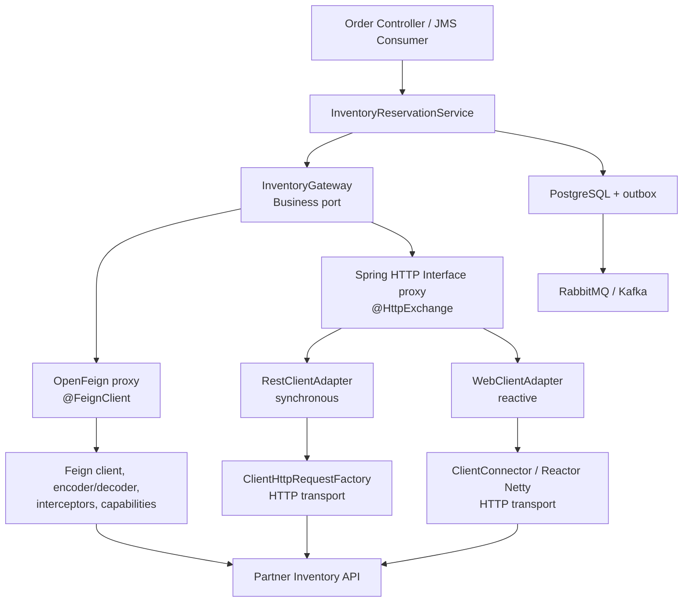
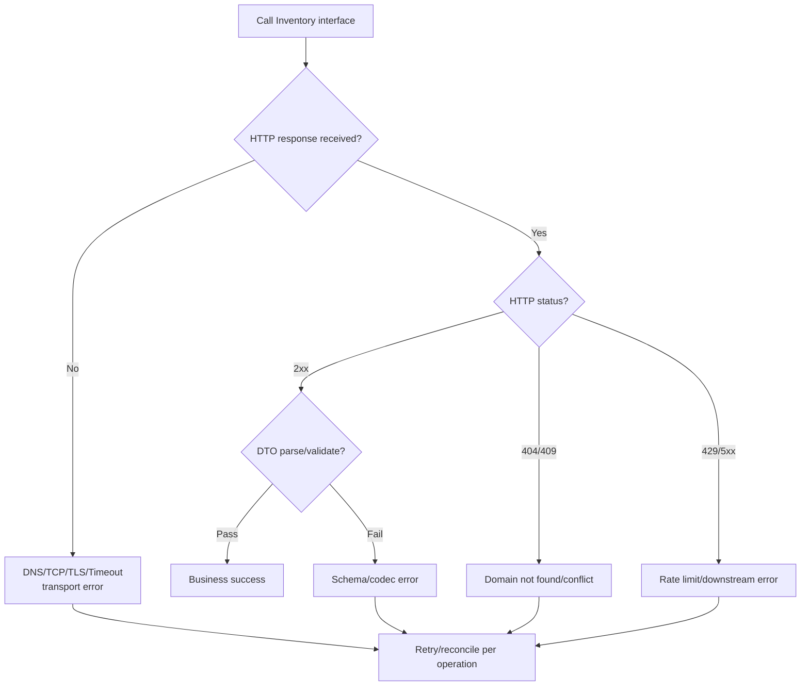
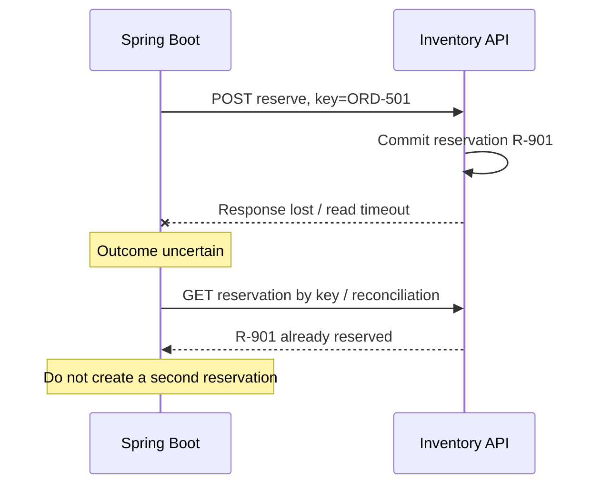
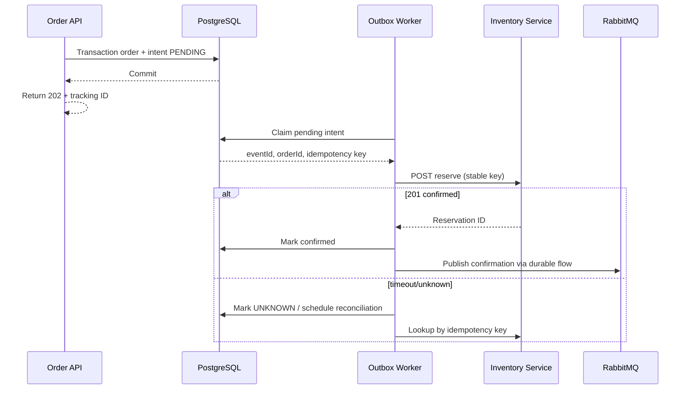
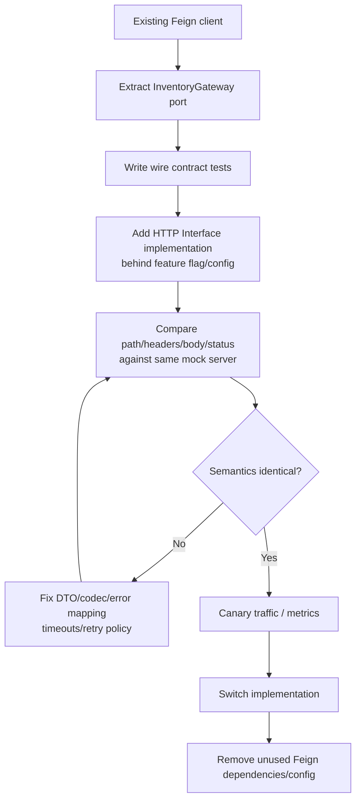

# OpenFeign, HTTP Interface, and Choosing a Declarative Client

## 1. Context: Why Does Spring Boot Need a Declarative HTTP Client?

In the **SPRING_BOOT_INTEGRATION** module, a Spring Boot service often needs to communicate with other systems: calling an inventory API to reserve stock, querying customers, submitting payment requests, updating a CRM, or sending data to a legacy adapter. HTTP calls must follow **data contracts**, environment configuration, timeouts, retries, error handling, security, and observability.

If you write every call using chained `RestClient` or `WebClient` calls, you repeat the URI, method, headers, and response reading:

```java
InventoryDto inventory = restClient.get()
    .uri("/v1/inventory/{sku}", sku)
    .retrieve()
    .body(InventoryDto.class);
```

A **declarative HTTP client** encapsulates that contract into a Java interface:

```java
interface InventoryHttpApi {
    InventoryDto findInventory(String sku);
}
```

The framework generates a proxy that executes the calls based on annotations and configuration. In the Spring ecosystem, two common options are:

1. **Spring Cloud OpenFeign** with `@FeignClient`, Spring MVC-style annotations, encoders/decoders, named clients, and Spring Cloud integrations.
2. **Spring Framework HTTP Interface** with `@HttpExchange`, `@GetExchange`, `@PostExchange`, and `HttpServiceProxyFactory`, which can use `RestClient` or `WebClient` as the transport.

The **main benefit** is making the contract explicit at the system boundary. However, declaring an interface **does not automatically solve** network failures, duplicate handling, circuit breaking, cross-system transactions, or durable work persistence.

### Learning Outcomes

After this lesson, you will be able to:

- Compare `OpenFeign`, Spring HTTP Interface, `RestClient`, and `WebClient`.
- Write a Feign client with request/response DTOs, headers, path variables, and query parameters.
- Create an HTTP interface proxy backed by `RestClientAdapter` or `WebClientAdapter`.
- Configure URLs, authentication, timeouts, codecs, error handling, and logging at the right layer.
- Distinguish between **HTTP status errors**, **DNS/TCP/TLS/timeouts**, and **business rejections**.
- Set retry policies grounded in idempotency so payment/order commands are not sent twice.
- Test real requests through an HTTP mock server and control differences across proxies/clients/frameworks.
- Decide when to migrate from Feign to HTTP Interface, when to keep Feign, and when to use an explicit programmatic client.

> **Version scope:** Snippets using `RestClient` and `RestClientAdapter` assume **Spring Framework 6.1+**, typically paired with **Spring Boot 3.2+**. Spring HTTP Interface has existed since Spring Framework 6.0, though configuration and adapters vary by version. Spring Cloud OpenFeign must use a **Spring Cloud release train compatible** with the running Spring Boot version; do not mix major/minor versions arbitrarily.

## 2. Declaring an Interface Does Not Create a Server API

A declarative client describes **outbound HTTP requests sent by the application**, not a REST controller on the receiving side. Compare:

```java
// Client-side: sends an HTTP GET to the remote service.
@GetExchange("/v1/inventory/{sku}")
InventoryDto findInventory(@PathVariable String sku);
```

with:

```java
// Server-side: handles an HTTP GET received by this application.
@GetMapping("/v1/inventory/{sku}")
InventoryDto getInventory(@PathVariable String sku) {
    return inventoryService.findInventory(sku);
}
```

Spring's HTTP Interface has its own set of annotations to express **client-side** requests. OpenFeign in Spring Cloud commonly reuses `@GetMapping`/`@PostMapping` as the client contract. **Do not copy an interface and assume it can substitute for a controller on both sides** without checking the framework and annotation scope.

A well-designed declarative interface describes the **partner's** API (paths, queries, bodies, headers) and keeps business decisions like retries, caching, fallbacks, and error mapping in an adapter/service with clear ownership.

## 3. Architecture: The Interface Proxy Sits Above HTTP Transport



The diagram shows **alternative options**; a deployment does not need to run all three client types simultaneously. In an integration module, define a dedicated business interface so you can swap HTTP implementations without changing the order-processing service.

Example business port:

```java
public interface InventoryGateway {
    Availability check(String sku);
    ReservationReceipt reserve(
        String orderId, String sku, int quantity
    );
}
```

The OpenFeign or HTTP Interface adapter is responsible for mapping business types to API contracts/HTTP statuses, avoiding coupling the entire service to `FeignException` or `WebClientResponseException`.

## 4. Quick Comparison of Related HTTP Clients

| Option | Programming Style | HTTP Execution | Focus |
| --- | --- | --- | --- |
| **Spring Cloud OpenFeign** | `@FeignClient` interface | Mostly synchronous/blocking in standard stacks | Named clients, Spring Cloud integrations, ecosystem |
| **Spring HTTP Interface + RestClient** | `@HttpExchange` interface | Synchronous/blocking | Declarative client with core Spring Framework |
| **Spring HTTP Interface + WebClient** | `@HttpExchange` interface | Reactive when return types/reactive stack fit | Non-blocking API contracts; `Mono`/`Flux` |
| **RestClient** | Fluent imperative | Synchronous/blocking | Flexible HTTP calls without requiring an interface |
| **WebClient** | Fluent reactive | Reactive/non-blocking | Streaming, reactive composition, backpressure |
| **RestTemplate** | Legacy imperative | Synchronous/blocking | Legacy code; not preferred for new code when `RestClient` is available |
| **JDK HttpClient** | JDK API | Sync/async | No default dependency on Spring converters/annotations |

**OpenFeign is not WebClient wrapped in an interface.** Traditional Spring Cloud OpenFeign does not provide reactive client support in the same mechanism as Spring HTTP Interface with `WebClientAdapter`. A Feign call `InventoryDto check(...)` normally occupies a worker thread while waiting on HTTP.

**HTTP Interface is not automatically "reactive" either.** If the proxy is built on `RestClientAdapter`, calls are normally synchronous; `WebClientAdapter` combined with matching return types provides reactive semantics.

## 5. Rules for Choosing a Client by Technical Goal

| Need | Better Fit | Reason |
| --- | --- | --- |
| Project already uses Spring Cloud OpenFeign stably | Keep OpenFeign while it still fits | Avoid migrations that add no value |
| Spring Boot 3.2+ project not needing Spring Cloud | HTTP Interface + RestClient | Fewer dependencies and cloud configs |
| Synchronous Spring MVC/service with a few fixed APIs | HTTP Interface + RestClient or RestClient | Concise contract, easy to test |
| End-to-end WebFlux, streaming, or reactive fan-out | HTTP Interface + WebClient or direct WebClient | Does not block event loop, manages publishers |
| Highly dynamic per-request behavior, streaming uploads, custom status workflows | Direct RestClient/WebClient | Fluent API offers explicit per-request control |
| Many service names with Spring Cloud LoadBalancer/discovery | OpenFeign or HTTP Interface with explicit integration | Depends on Spring Cloud / version |
| Need a typed API interface shared across adapters | HTTP Interface | Core Spring Framework |
| Operations team already standardized Feign customizations | OpenFeign | Leverages existing conventions and diagnostics |
| API needs durable delivery/retry after crash | **Outbox/broker**, not just an HTTP client | Proxies do not durably store work |

Do not choose an API just for the fewest lines of code. Choose based on **contract stability, async vs. blocking, dependencies, observability, migration cost, and real failure modes**.

## 6. Release Trains and Dependency Compatibility

Spring Cloud OpenFeign belongs to **Spring Cloud**, not core Spring Framework. Therefore, do not add the latest starter independently to any Spring Boot project.

Maven example (the release train is illustrative and compatibility must be checked against your actual Boot version):

```xml
<dependencyManagement>
  <dependencies>
    <dependency>
      <groupId>org.springframework.cloud</groupId>
      <artifactId>spring-cloud-dependencies</artifactId>
      <version>${spring-cloud.version}</version>
      <type>pom</type>
      <scope>import</scope>
    </dependency>
  </dependencies>
</dependencyManagement>

<dependencies>
  <dependency>
    <groupId>org.springframework.cloud</groupId>
    <artifactId>spring-cloud-starter-openfeign</artifactId>
  </dependency>
</dependencies>
```

In this XML snippet, `${spring-cloud.version}` is a Maven property declared by the **project** according to the compatible release train; it is not an environment variable declared in this lesson. The Spring Boot BOM/parent and Spring Cloud BOM must have aligned versions.

With Spring HTTP Interface + RestClient, a Boot 3.2+ app gets `spring-web` via `spring-boot-starter-web` (or the appropriate dependency):

```xml
<dependency>
  <groupId>org.springframework.boot</groupId>
  <artifactId>spring-boot-starter-web</artifactId>
</dependency>
```

If using the `WebClient` adapter, Spring WebFlux must be on the classpath:

```xml
<dependency>
  <groupId>org.springframework.boot</groupId>
  <artifactId>spring-boot-starter-webflux</artifactId>
</dependency>
```

Having both starter-web and starter-webflux **does not automatically make the server reactive**: Spring Boot normally prefers the MVC server when both stacks are present, unless configured otherwise. Using `WebClient` in a Spring MVC app is valid; the key is selecting the right I/O model and managing threads.

### Note on Long-Term Direction

Spring Cloud OpenFeign is currently described as **feature-complete** in the Spring Cloud OpenFeign documentation, pointing toward Spring HTTP Service Interfaces for new development. This is a **signal about technology direction**, not a requirement to drop Feign immediately or a claim that any specific version is already end-of-life. Check actual release trains and support timelines before planning upgrades.

## 7. Running Example: Inventory System API Contract

Suppose a partner provides two endpoints:

```text
GET  /v1/inventory/{sku}
POST /v1/reservations
```

Successful GET:

```json
{
  "sku": "SKU-001",
  "availableQuantity": 27
}
```

POST request:

```json
{
  "orderId": "ORD-501",
  "sku": "SKU-001",
  "quantity": 2
}
```

POST response:

```json
{
  "reservationId": "R-901",
  "status": "RESERVED"
}
```

Java DTOs:

```java
public record InventoryDto(
    String sku,
    int availableQuantity
) {}

public record ReservationRequest(
    String orderId,
    String sku,
    int quantity
) {}

public record ReservationResponse(
    String reservationId,
    String status
) {}
```

In production, use `@NotBlank`/`@Positive` and contract validation at boundaries; these DTOs are minimal to focus on the client. You can use `Integer` instead of `int` when you need to distinguish a **missing field** from 0 in JSON. Java records work nicely for wire DTOs; never expose JPA/Hibernate entities directly as API payloads.

Additional integration rules:

- `X-Correlation-Id` to trace requests across systems; do not use it as a business key.
- Stable `Idempotency-Key` for POST when the client is allowed to retry.
- Partner may return HTTP 404 for unknown SKU, 409 for inventory conflict, 429 for rate limit, 503 for unavailable.
- After a POST timeout, the remote side effect **may already have succeeded**; the workflow must check status by `orderId`/idempotency key before creating another command.

## 8. Getting Started with Spring Cloud OpenFeign

In a Spring Boot application with a compatible starter, enable component scanning for Feign interfaces:

```java
import org.springframework.boot.SpringApplication;
import org.springframework.boot.autoconfigure.SpringBootApplication;
import org.springframework.cloud.openfeign.EnableFeignClients;

@SpringBootApplication
@EnableFeignClients(basePackages = "com.example.integration.clients")
public class IntegrationApplication {
    public static void main(String[] args) {
        SpringApplication.run(
            IntegrationApplication.class, args
        );
    }
}
```

`@EnableFeignClients` scans `@FeignClient` interfaces in the specified packages. If not enabled or if placed outside the scanned package, the app may fail reporting **no qualifying bean for the interface** even though the dependency is present.

Do not scatter Feign clients into arbitrary packages hoping Spring Boot will find them automatically. In multi-module projects, specify `basePackages` or `clients` explicitly.

## 9. Declaring @FeignClient with the Spring MVC Contract

A Feign client for the inventory partner:

```java
package com.example.integration.clients;

import org.springframework.cloud.openfeign.FeignClient;
import org.springframework.web.bind.annotation.GetMapping;
import org.springframework.web.bind.annotation.PathVariable;
import org.springframework.web.bind.annotation.PostMapping;
import org.springframework.web.bind.annotation.RequestBody;
import org.springframework.web.bind.annotation.RequestHeader;

@FeignClient(
    name = "inventory",
    url = "${clients.inventory.base-url}"
)
public interface InventoryFeignClient {

    @GetMapping("/v1/inventory/{sku}")
    InventoryDto getInventory(
        @PathVariable("sku") String sku,
        @RequestHeader("X-Correlation-Id")
        String correlationId
    );

    @PostMapping("/v1/reservations")
    ReservationResponse reserve(
        @RequestHeader("Idempotency-Key")
        String idempotencyKey,
        @RequestHeader("X-Correlation-Id")
        String correlationId,
        @RequestBody ReservationRequest request
    );
}
```

Here `InventoryDto`, `ReservationRequest`, and `ReservationResponse` are defined in the appropriate domain/contract module and imported into the actual interface.

Key points to understand:

1. `name="inventory"` is the logical Feign client name used for named configuration.
2. `url=... ` points to a **specific endpoint**, which can be read from properties. When a URL is explicitly specified, Feign normally bypasses service discovery/load balancing based on the client name for this call.
3. `@GetMapping`, `@PostMapping`, and `@RequestBody` belong to Spring MVC annotations but are interpreted by the **Feign Contract** to build requests—they do not register controller endpoints.
4. `@RequestHeader` describes headers the method caller must provide. Blank or invalid header values are not automatically fixed by the framework per business contracts.
5. Methods return DTOs **synchronously**; the call waits for a response or timeout and may throw a Feign exception.
6. A connection-level successful HTTP request does not mean the application's message broker/SQL workflow has committed.

### Avoiding Wrong URL/Port in Containers

```yaml
clients:
  inventory:
    base-url: ${INVENTORY_BASE_URL:http://localhost:8091}
```

The `localhost` fallback is strictly for local examples. Inside Docker/Kubernetes, `localhost` points to the application's own container/pod; production must specify the real host/service name with hostname verification and TLS.

**Never let HTTP callers pass `base-url` directly for Feign/WebClient to call**; that opens SSRF and internal service access risks. Remote endpoints must be configured/allowlisted per verified tenant or environment.

## 10. Feign RequestInterceptor: Shared Headers, Auth, and Correlation

When multiple methods need bearer tokens or correlation headers, a `RequestInterceptor` can add headers before sending:

```java
import feign.RequestInterceptor;
import org.springframework.context.annotation.Bean;

public class InventoryFeignConfiguration {

    @Bean
    RequestInterceptor inventoryTokenInterceptor(
            InventoryTokenProvider tokenProvider) {

        return template -> {
            String token = tokenProvider.accessToken();
            template.header(
                "Authorization", "Bearer " + token
            );
        };
    }
}
```

And attach the configuration to the specific named client:

```java
@FeignClient(
    name = "inventory",
    url = "${clients.inventory.base-url}",
    configuration = InventoryFeignConfiguration.class
)
public interface InventoryFeignClient {
    // Methods from section 9
}
```

`InventoryTokenProvider` is an application-provided abstraction; it must handle token expiry and refresh per actual auth policies. This is a **configuration pattern**, not runnable code without the provider.

**Bean scope warning:** if `InventoryFeignConfiguration` is picked up by Spring component scanning as a global configuration, `RequestInterceptor` beans inside it may apply more broadly than intended. Control packages/scope and verify with tests having two clients using different credentials.

Do not:

- Attach client A's bearer token to requests going to client B.
- Log access tokens in Feign DEBUG/FULL logging.
- Read `SecurityContextHolder` assuming a context always exists when invoked from `@Async`, schedulers, or broker listeners.
- Forward user tokens to an unauthorized service solely because they share a correlationId.

For OAuth2 client credentials or token relay, use appropriate Spring Security/OAuth2 mechanisms and controlled token caching instead of issuing an HTTP login request on every invocation.

## 11. Named-Client OpenFeign Configuration

In Spring Cloud OpenFeign 4.x, properties include:

```yaml
spring:
  cloud:
    openfeign:
      client:
        config:
          inventory:
            connectTimeout: 2000
            readTimeout: 5000
            loggerLevel: basic
```

**Units:** `connectTimeout` and `readTimeout` in this Spring Cloud OpenFeign 4.x example represent **milliseconds**; verify metadata/docs for your exact Spring Cloud version. Do not confuse them with `Duration` values like `2s` used in other Spring Boot properties.

Meaning:

- **Connect timeout**: limits connection establishment time in the transport client; does not guarantee the entire request finishes in 2 seconds.
- **Read timeout**: limits waiting/reading data per the client implementation; does not automatically create an **end-to-end workflow deadline** covering queues, retries, DNS, token refreshes, and non-HTTP work.
- **loggerLevel**: Feign logging verbosity level, though whether logs appear also depends on Java logger/SLF4J levels and configuration.
- The `inventory` config binds to the **logical client name/contextId** per Spring Cloud OpenFeign mechanics; verify if multiple Feign clients share a name with distinct `contextId` values.

### Spring Cloud OpenFeign's Default Retry Differs from Core Feign

Spring Cloud OpenFeign defaults to `Retryer.NEVER_RETRY`, **unlike** core Feign which may have default retries for certain `IOException`/`RetryableException` cases. That means: **do not rely on automatic retries** when using Spring Cloud OpenFeign. When retries are needed, declare an explicit policy with conditions, limits, and idempotency.

Also, if you enable Feign retries + Spring Retry/Resilience4j + gateway retries, **call counts can multiply**. Define who owns retries at a boundary for a given operation.

## 12. OpenFeign HTTP Errors: FeignException and ErrorDecoder

An HTTP response that **arrived** with a 4xx/5xx status differs from getting no response due to DNS/TCP/TLS/timeout. With OpenFeign, non-success responses can become a `FeignException` or an exception chosen by `ErrorDecoder`.

Example contract classification:

| Status | Possible Meaning in Inventory API | Business Policy |
| --- | --- | --- |
| 200 | SKU read succeeded | Deserialize/validate response |
| 201/202 | Reservation accepted per contract | Check receipt/tracking status |
| 400 | Malformed request schema, negative quantity | Do not retry the same payload |
| 401/403 | Auth/permission issue | Fix token/permissions; avoid hot retries |
| 404 | SKU does not exist | Domain `InventoryNotFound` |
| 409 | Insufficient stock / version conflict | Domain conflict; may re-read before deciding |
| 429 | Rate limit | Backoff and `Retry-After` if contract supports it |
| 500/502/503/504 | Remote/service infrastructure issue | Conditional retry + deadline |
| Timeout/network failure | No confirmed HTTP response | Possibly an unknown outcome for POST |

### A Scoped ErrorDecoder

```java
import feign.Response;
import feign.codec.ErrorDecoder;

public final class InventoryErrorDecoder
        implements ErrorDecoder {

    private final ErrorDecoder defaultDecoder =
        new ErrorDecoder.Default();

    @Override
    public Exception decode(String methodKey, Response response) {
        return switch (response.status()) {
            case 404 -> new InventoryNotFoundException(
                "Inventory SKU not found"
            );
            case 409 -> new InventoryConflictException(
                "Inventory reservation rejected"
            );
            case 429 -> new InventoryRateLimitedException(
                "Inventory API rate limited"
            );
            default -> defaultDecoder.decode(methodKey, response);
        };
    }
}
```

`InventoryNotFoundException`, `InventoryConflictException`, and `InventoryRateLimitedException` are application-defined exceptions; the snippet illustrates the mapping idea. Register `ErrorDecoder` as a bean inside the **Feign client's own configuration** if you want to avoid applying it across all integrations by mistake.

**Do not parse unbounded raw error bodies** just to look for an `errorCode`. A partner can return huge HTML 502 pages, malformed JSON, or PII. If reading an error body is necessary, cap bytes, charset, and schema, then map to a safe error. Never return raw remote messages or stack traces to internal HTTP callers.

### ErrorDecoder Does Not Catch Every Failure

`ErrorDecoder` handles **HTTP response statuses**, not every network exception prior to receiving a response. DNS failures, SSL handshakes, connection resets, and connect/read timeouts must be classified in the appropriate adapter/resilience layer.

## 13. OpenFeign Encoders, Decoders, and Jackson

A Feign client translates:

- Java method arguments → URI, query, headers, body (request template + encoder).
- HTTP response bytes → Java return type (decoder).
- Error response status → exception (`ErrorDecoder`).

Spring Cloud OpenFeign with Spring MVC Contract and Spring HTTP message converters can use Jackson to serialize DTOs to JSON based on `Content-Type` and configuration. Still, **never assume** every body is JSON or every response has a body.

Example:

```java
@PostMapping(
    value = "/v1/reservations",
    consumes = "application/json",
    produces = "application/json"
)
ReservationResponse reserve(
    @RequestHeader("Idempotency-Key") String key,
    @RequestBody ReservationRequest body
);
```

Align on:

- JSON property names/nullable fields, enum values, timestamp/decimal formats.
- 204 responses with no body: a method returning a non-null DTO may violate the contract.
- Unknown fields, binary bodies, streaming responses, and max payload sizes.
- Jackson modules: Java Time, Kotlin, records, naming strategies.
- Validation on both sender and receiver; an outbound declarative interface **does not automatically enforce all domain invariants**.
- Error payloads have their own schema/version; do not use a success DTO to deserialize a 400 response.

In particular, if using a `Retryer` and the request has a non-replayable streaming body, retrying may be unsafe or fail. Consider idempotency and buffer/stream lifecycles before retrying uploads.

## 14. Specific URLs vs. Service Discovery / Load Balancing

Two ways to configure Feign:

**Calling via an explicit URL:**

```java
@FeignClient(
    name = "inventory",
    url = "${clients.inventory.base-url}"
)
interface InventoryByUrlClient {
    // ...
}
```

**Calling via a logical service name:**

```java
@FeignClient(name = "inventory-service")
interface InventoryByServiceNameClient {
    // ...
}
```

With the second approach, if the environment has **Spring Cloud LoadBalancer** or discovery integration configured, the logical name can resolve to service instances. Without the required configuration, merely declaring `name` does not ensure endpoints are found.

Distinguish:

1. **DNS-based balancing:** URL points to a hostname managed by external DNS or load balancers.
2. **Client-side balancing:** Feign/transport uses Spring Cloud LoadBalancer to pick an instance from service discovery/configuration.
3. **Provider-managed balancing:** an API gateway or mesh endpoint picks the backend.
4. **Failover/retry:** picking another instance does not make the same request idempotent.

Do not set a fixed URL while expecting client-side discovery to switch instances. And do not automatically retry a POST against another instance if the side effect could already have executed on the first one.

## 15. Circuit Breakers, Fallbacks, and Real Load

Spring Cloud OpenFeign can integrate with **Spring Cloud CircuitBreaker** when the corresponding dependencies and configuration are added/enabled, but simply adding `spring-cloud-starter-openfeign` **does not** automatically wrap every method with a circuit breaker and fallback.

Some systems use Resilience4j at the service/adapter boundary for:

- Circuit breaker: temporarily stop calling when downstream failures exceed a threshold.
- Time limiter: impose a caller-side wait limit (does not guarantee cancelling remote side effects).
- Retry: retry transient failures with bounded backoff/jitter.
- Bulkhead/semaphore: bound concurrency toward a partner.
- Rate limiter: honor requests-per-second quotas.

**A fallback is a business decision**, not merely a framework handler:

- For **GET inventory**, you might return a cached snapshot with a timestamp if the API tolerates stale data.
- For **POST reserve**, never fabricate `RESERVED` when the partner is unavailable; retain `PENDING`/`UNKNOWN` state for reconciliation.
- For **payment commands**, a fallback fabricating "fake success" is a critical bug.

Timeouts, circuit breakers, and retries must align with brokers, HTTP connection pools, and transaction budgets. Multiple independent retry layers are a common cause of retry storms.

## 16. OpenFeign Logging and Observability

Spring Cloud OpenFeign supports logging via the Feign logger and can integrate with Micrometer/Observation via compatible dependencies, capabilities, and auto-configuration.

Typical Feign logging levels:

| Level | Logged Information | Warning |
| --- | --- | --- |
| `NONE` | Nothing logged by Feign logger | Metrics/tracing can still operate independently |
| `BASIC` | Method, URL, status, latency | URLs may contain PII in query params if poorly designed |
| `HEADERS` | Adds headers | Authorization, cookies, and API keys can leak |
| `FULL` | Adds request/response bodies | High risk of leaking PII/secrets and huge logs |

**Never enable HEADERS/FULL globally in production for routine debugging.** Sanitization/masking must exist in the logging layer actually used; do not assume every logger hides tokens automatically. Metrics should use low-cardinality labels like `client=inventory`, method, outcome, status group; never use order IDs, SKUs, tokens, or raw variable URIs as tags.

With OpenTelemetry/Micrometer, verify context propagation across `@Async`, message consumers, and HTTP interceptors. AOP/proxies do not automatically copy every ThreadLocal trace/security context.

## 17. Spring HTTP Interface: Declarative Clients on Core Spring Framework

Spring Framework supports client-side annotations:

| Annotation | Meaning |
| --- | --- |
| `@HttpExchange` | Defines base path/content type and shared HTTP metadata |
| `@GetExchange` | HTTP GET |
| `@PostExchange` | HTTP POST |
| `@PutExchange` | HTTP PUT |
| `@PatchExchange` | HTTP PATCH |
| `@DeleteExchange` | HTTP DELETE |
| `@PathVariable` | Binds URI template variable |
| `@RequestParam` | Binds query/form parameter per client stack |
| `@RequestHeader` | Binds request header |
| `@RequestBody` | Binds request body |
| `@RequestPart` | Binds multipart part when supported by adapter |

HTTP Interface uses `org.springframework.web.service.annotation.*`. Note that `@RequestHeader`, `@RequestParam`, `@PathVariable`, and `@RequestBody` live in `org.springframework.web.bind.annotation`; the annotations look like server-side ones, yet are interpreted by the **client proxy**.

Example:

```java
package com.example.integration.clients;

import org.springframework.web.bind.annotation.PathVariable;
import org.springframework.web.bind.annotation.RequestBody;
import org.springframework.web.bind.annotation.RequestHeader;
import org.springframework.web.service.annotation.GetExchange;
import org.springframework.web.service.annotation.HttpExchange;
import org.springframework.web.service.annotation.PostExchange;

@HttpExchange(
    url = "/v1",
    accept = "application/json",
    contentType = "application/json"
)
public interface InventoryHttpService {

    @GetExchange("/inventory/{sku}")
    InventoryDto getInventory(
        @PathVariable("sku") String sku,
        @RequestHeader("X-Correlation-Id")
        String correlationId
    );

    @PostExchange("/reservations")
    ReservationResponse reserve(
        @RequestHeader("Idempotency-Key") String key,
        @RequestHeader("X-Correlation-Id") String correlationId,
        @RequestBody ReservationRequest request
    );
}
```

This is only the **interface definition**. Unlike `@FeignClient`, no bean appears automatically unless you build an `HttpServiceProxyFactory` (or use registration mechanisms supported in newer Spring versions). In these Boot 3.2/3.3 examples, we create the proxy bean explicitly.

## 18. Creating a Synchronous HTTP Interface Proxy with RestClientAdapter

Example suited for **Spring Framework 6.1+ / Spring Boot 3.2+**:

```java
import org.springframework.context.annotation.Bean;
import org.springframework.context.annotation.Configuration;
import org.springframework.web.client.RestClient;
import org.springframework.web.client.support.RestClientAdapter;
import org.springframework.web.service.invoker.HttpServiceProxyFactory;

@Configuration(proxyBeanMethods = false)
public class InventoryHttpServiceConfiguration {

    @Bean
    InventoryHttpService inventoryHttpService(
            RestClient.Builder restClientBuilder,
            InventoryEndpointProperties properties) {

        RestClient client = restClientBuilder
            .baseUrl(properties.baseUrl())
            .defaultHeader("Accept", "application/json")
            .build();

        RestClientAdapter adapter =
            RestClientAdapter.create(client);

        HttpServiceProxyFactory factory =
            HttpServiceProxyFactory
                .builderFor(adapter)
                .build();

        return factory.createClient(InventoryHttpService.class);
    }
}
```

`InventoryEndpointProperties` is an application-defined configuration record; `baseUrl()` should read a controlled endpoint from environment/secret configuration rather than accepting arbitrary values from HTTP requests. Example record for Boot configuration:

```java
import org.springframework.boot.context.properties.ConfigurationProperties;

@ConfigurationProperties(prefix = "clients.inventory")
public record InventoryEndpointProperties(
    String baseUrl
) {}
```

Enable `@ConfigurationPropertiesScan` or `@EnableConfigurationProperties(InventoryEndpointProperties.class)` in the app so the bean is registered. The `RestClient.Builder` provided by Spring Boot typically includes useful customizations such as message converters and observability; **do not** call `RestClient.builder()` everywhere if you rely on centralized customizations.

A `RestClientAdapter` executes calls over synchronous HTTP transport. It does not make a method returning `ReservationResponse` non-blocking, and an `@HttpExchange` interface **does not automatically include retries or a circuit breaker**.

## 19. Reading Endpoint Configuration via Validated @ConfigurationProperties

Additional example to register properties and avoid blank URLs:

```java
import org.springframework.boot.context.properties.EnableConfigurationProperties;
import org.springframework.context.annotation.Configuration;

@Configuration(proxyBeanMethods = false)
@EnableConfigurationProperties(InventoryEndpointProperties.class)
public class InventoryEndpointRegistration {
}
```

```yaml
clients:
  inventory:
    base-url: ${INVENTORY_BASE_URL}
```

The properties record in Section 18 only illustrates binding; for validation that genuinely enforces a safe HTTP(S) URL, use `@Validated` with Jakarta Bean Validation and a validator matching your security requirements. A plain `String baseUrl` **does not reject** empty strings or `file:` schemes on its own if allowed by the framework.

**Never mix local/test/prod endpoints in code.** Use profiles or environment properties and verify per deployment. If multiple tenants have distinct endpoints, verify tenant ownership/allowlists before selecting a host to prevent SSRF/DNS rebinding per application network policies.

## 20. Reactive HTTP Interface with WebClientAdapter

If the Spring Boot flow uses Reactor, you can create an HTTP interface proxy backed by `WebClient`:

```java
import reactor.core.publisher.Mono;

import org.springframework.web.bind.annotation.PathVariable;
import org.springframework.web.bind.annotation.RequestBody;
import org.springframework.web.bind.annotation.RequestHeader;
import org.springframework.web.service.annotation.GetExchange;
import org.springframework.web.service.annotation.HttpExchange;
import org.springframework.web.service.annotation.PostExchange;

@HttpExchange(url = "/v1", accept = "application/json")
public interface ReactiveInventoryHttpService {

    @GetExchange("/inventory/{sku}")
    Mono<InventoryDto> getInventory(
        @PathVariable("sku") String sku
    );

    @PostExchange("/reservations")
    Mono<ReservationResponse> reserve(
        @RequestHeader("Idempotency-Key") String key,
        @RequestBody ReservationRequest body
    );
}
```

Creating the proxy:

```java
import org.springframework.context.annotation.Bean;
import org.springframework.context.annotation.Configuration;
import org.springframework.web.reactive.function.client.WebClient;
import org.springframework.web.reactive.function.client.support.WebClientAdapter;
import org.springframework.web.service.invoker.HttpServiceProxyFactory;

@Configuration(proxyBeanMethods = false)
class ReactiveInventoryConfiguration {

    @Bean
    ReactiveInventoryHttpService reactiveInventoryHttpService(
            WebClient.Builder builder,
            InventoryEndpointProperties properties) {

        WebClient webClient = builder
            .baseUrl(properties.baseUrl())
            .build();

        WebClientAdapter adapter =
            WebClientAdapter.create(webClient);

        HttpServiceProxyFactory factory =
            HttpServiceProxyFactory.builderFor(adapter).build();

        return factory.createClient(
            ReactiveInventoryHttpService.class
        );
    }
}
```

Using it from a service:

```java
public Mono<Availability> findAvailability(String sku) {
    return inventoryApi.getInventory(sku)
        .map(dto -> new Availability(
            dto.sku(),
            dto.availableQuantity()
        ));
}
```

`inventoryApi`, the `Availability` record, and the method belong to a project-defined service; the snippet simply illustrates `Mono` composition.

**Important characteristics**:

- The HTTP request starts upon subscription; creating a `Mono` does not mean the remote service was called yet.
- Each subscription to a cold publisher can execute the remote HTTP request again. Do not arbitrarily `retry`/`subscribe` if a POST creates side effects.
- On the WebFlux event loop, avoid `.block()` and imperative JDBC/Feign calls not offloaded to a bounded scheduler.
- With `WebClient`, filters, connectors, codecs, TLS, and timeouts must be configured on the exact `WebClient.Builder` used to create the proxy.
- `Mono`/`Flux` do not turn an event into durable work surviving a process crash. Use an outbox/broker if the business contract requires crash recovery.

## 21. Choosing Synchronous vs. Reactive Independent of Annotations

A common mistake is seeing `@HttpExchange` and assuming the interface always uses the same thread/concurrency model.

| Proxy Configuration | Typical Return Types | I/O Behavior |
| --- | --- | --- |
| `RestClientAdapter` | `InventoryDto`, `ResponseEntity<T>` | Imperative/blocking |
| `WebClientAdapter` | `Mono<T>`, `Flux<T>` (when appropriate) | Reactive/non-blocking |
| Standard Spring Cloud `OpenFeign` | `T`/`Response` | Typically blocking |
| Fluent `WebClient` | `Mono<T>`/`Flux<T>` | Reactive/non-blocking |
| Fluent `RestClient` | `T`/`ResponseEntity<T>` | Imperative/blocking |

When an endpoint returns a single response and the app is Spring MVC, HTTP Interface + RestClient is usually simpler than WebClient + `block()`. If the app is WebFlux and needs concurrent calls to multiple downstream services, WebClient + a reactive interface fits better; concurrency still needs limits matching HTTP connection pools and partner quotas.

**Do not convert a blocking JDBC/JPA app to WebFlux just to use HTTP Interface.** Pick a design consistent with your execution model and resource limits.

## 22. Configuring Connect/Read Timeouts with RestClient

`RestClient` uses a `ClientHttpRequestFactory`. How timeouts are configured depends on the chosen request factory and HTTP transport. Illustrative example using `SimpleClientHttpRequestFactory`:

```java
import java.time.Duration;

import org.springframework.context.annotation.Bean;
import org.springframework.web.client.RestClient;
import org.springframework.http.client.SimpleClientHttpRequestFactory;

@Bean
RestClient inventoryRestClient(
        RestClient.Builder builder,
        InventoryEndpointProperties properties) {

    SimpleClientHttpRequestFactory requestFactory =
        new SimpleClientHttpRequestFactory();

    requestFactory.setConnectTimeout(
        Duration.ofSeconds(2)
    );
    requestFactory.setReadTimeout(
        Duration.ofSeconds(5)
    );

    return builder
        .baseUrl(properties.baseUrl())
        .requestFactory(requestFactory)
        .build();
}
```

**Version note:** `Duration` overloads on request factories can differ across Spring Framework minor versions; if your project only has millisecond overloads, use the API matching your running version. Do not copy a literal `2s` into a property expecting numeric milliseconds.

`SimpleClientHttpRequestFactory` keeps the example brief, **not as the sole recommendation for production**. High-volume systems must consider connection pooling, TLS, HTTP/2, proxies, connection reuse, and connection acquisition wait times. You can use JDK HttpClient or Apache HttpComponents 5 / Jetty / Reactor Netty depending on classpath and Spring version.

**Distinguish timeout types clearly**:

- DNS resolution can behave differently from connect timeout.
- Connect timeout does not limit the time to receive the full response.
- Read timeout does not control retry counts or the total business deadline.
- Caller-side timeouts may not cancel remote side effects.
- Pool acquisition timeout differs from TCP connect timeout.
- If a thread waits 30 seconds in an executor queue before starting the request, a 5-second HTTP timeout does not ensure business completion within 5 seconds.

Keep timeout policies consistent and place values in a **dedicated client configuration**, avoiding a global override that unintentionally affects every partner.

## 23. WebClient Timeouts, Response Buffering, and Connection Pooling

With WebClient/Reactor Netty, you can configure Netty's `HttpClient`:

```java
import java.time.Duration;

import io.netty.channel.ChannelOption;
import reactor.netty.http.client.HttpClient;

import org.springframework.http.client.reactive.ReactorClientHttpConnector;
import org.springframework.web.reactive.function.client.WebClient;

HttpClient httpClient = HttpClient.create()
    .option(ChannelOption.CONNECT_TIMEOUT_MILLIS, 2_000)
    .responseTimeout(Duration.ofSeconds(5));

WebClient inventoryWebClient = WebClient.builder()
    .baseUrl("https://inventory.example.internal")
    .clientConnector(
        new ReactorClientHttpConnector(httpClient)
    )
    .codecs(codecs -> codecs.defaultCodecs()
        .maxInMemorySize(256 * 1024))
    .build();
```

Here:

- `CONNECT_TIMEOUT_MILLIS` and `responseTimeout` are distinct limits.
- `maxInMemorySize` caps **codec aggregation** cases, not a universal streaming body cap.
- Reactor Netty manages connection pools/resources; in production, inspect max connections, pending acquire timeouts, idle/max lifetimes, TLS, and global vs. per-client resource pools.
- Creating a new `HttpClient`/`ConnectionProvider` per request breaks connection reuse and can exhaust sockets.
- `responseTimeout` is not an end-to-end business deadline when queues, retries, circuit breakers, or multiple HTTP hops exist.

Calling `WebClient.builder()` directly skips customizations Spring Boot may have registered. In a real app, inject `WebClient.Builder` and only override the connector when truly necessary and after verifying metrics/tracing/TLS.

## 24. How Does HTTP Interface Handle 4xx/5xx Responses?

HTTP Interface **does not have an error rule set independent of its transport**. When a proxy runs via `RestClientAdapter`, it inherits `RestClient` semantics. When backed by `WebClientAdapter`, it inherits `WebClient` semantics.

With standard `retrieve()` usage:

- `RestClient` can throw `RestClientResponseException` (or an appropriate subtype) on 4xx/5xx HTTP statuses.
- `WebClient` can throw `WebClientResponseException` for error HTTP statuses.
- **Network failures before any response** typically surface as `ResourceAccessException` with blocking `RestClient` (depending on request factory) or `WebClientRequestException` with `WebClient`.
- Unparseable JSON responses are codec/conversion errors, **not** HTTP 404 when the actual status is 200.
- HTTP 204 may map to `null` or an empty publisher depending on return type; keep an explicit API contract instead of assuming a DTO is always present.

Separate technical failures from business outcomes:



**Do not return HTTP 500 for every error** when your service acts as an adapter. For instance, inventory 404 can map to domain not-found; remote 503 can map to "availability unknown", not "out of stock"; schema-invalid JSON responses need a clear contract error for investigation.

## 25. Placing Error Mapping at the Adapter Boundary

A design where services depend directly on `FeignException` or `WebClientResponseException` makes migrating clients difficult and couples tests to a specific library.

Define a business exception model:

```java
public final class InventoryUnavailableException
        extends RuntimeException {
    public InventoryUnavailableException(String message,
                                         Throwable cause) {
        super(message, cause);
    }
}

public final class InventoryNotFoundException
        extends RuntimeException {
    public InventoryNotFoundException(String message) {
        super(message);
    }
}
```

Example Feign adapter:

```java
import feign.FeignException;
import org.springframework.stereotype.Component;

@Component
public final class FeignInventoryGateway
        implements InventoryGateway {

    private final InventoryFeignClient client;
    private final CorrelationIdProvider correlationIds;

    public FeignInventoryGateway(
            InventoryFeignClient client,
            CorrelationIdProvider correlationIds) {
        this.client = client;
        this.correlationIds = correlationIds;
    }

    @Override
    public Availability check(String sku) {
        try {
            InventoryDto dto = client.getInventory(
                sku,
                correlationIds.currentOrNew()
            );
            return new Availability(
                dto.sku(), dto.availableQuantity()
            );
        } catch (FeignException.NotFound ex) {
            throw new InventoryNotFoundException(
                "Inventory SKU not found"
            );
        } catch (FeignException ex) {
            throw new InventoryUnavailableException(
                "Inventory service request failed", ex
            );
        }
    }

    @Override
    public ReservationReceipt reserve(
            String orderId, String sku, int quantity) {
        // Illustrative key for one reservation per order and SKU.
        // Include a stable line ID if duplicate order lines are allowed.
        String key = "reserve:" + orderId + ":" + sku;
        try {
            ReservationResponse dto = client.reserve(
                key,
                correlationIds.currentOrNew(),
                new ReservationRequest(orderId, sku, quantity)
            );
            return new ReservationReceipt(
                dto.reservationId(), dto.status()
            );
        } catch (FeignException ex) {
            throw new InventoryUnavailableException(
                "Inventory reservation outcome requires handling",
                ex
            );
        }
    }
}
```

`InventoryGateway`, `Availability`, `ReservationReceipt`, and `CorrelationIdProvider` are project-defined abstractions. The code implements both methods of the port by signature; a real app must validate DTOs and confirm business status. The illustrative key `orderId + sku` only holds when each order/SKU has a single reservation; if multiple lines share a SKU, use a stable business line ID. An exception on POST timeout represents an **unknown outcome**, requiring reconciliation rather than blind retries.

**Do not swallow `ErrorDecoder` domain exceptions** by assuming `catch (FeignException)` covers them. When an `ErrorDecoder` turns 404 into `InventoryNotFoundException`, let it pass through the adapter or map it consistently. Avoid registering conflicting decoders and catch blocks.

With HTTP Interface, an analogous adapter can catch `RestClientResponseException`/`WebClientResponseException` per transport and translate them into the same `InventoryUnavailableException`, keeping the business service independent.

## 26. A Non-Empty Response Body Does Not Guarantee a Valid Contract

Consider HTTP 200 with this response:

```json
{
  "sku": null,
  "availableQuantity": -99
}
```

Jackson can instantiate the DTO if fields are nullable/primitive-compatible, yet the business contract is violated. Beyond HTTP status exceptions, validate the **response DTO**:

- `sku` is non-blank and matches the request when specified by the contract.
- `availableQuantity >= 0` or matches partner semantics.
- `reservationId` is non-null/non-blank when status is `RESERVED`.
- Timestamps/amounts/currencies have explicit types, units, and timezones.
- `schemaVersion` and enum values belong to the set supported by the consumer.
- Oversized bodies, deeply nested JSON, or HTML returned instead of JSON must be bounded and flagged as contract errors.

**Bean Validation on a record does not automatically run on every outbound HTTP response** merely because `@Valid` appears on a method signature. Enforce explicit validation in the adapter, a custom decoder, or contract tests for your stack.

Never trust a remote response returning `sku=SKU-999` when the caller requested `SKU-001`, if doing so could reserve stock for the wrong product.

## 27. Retrying GET Differs from POST: Idempotency and Unknown Outcomes

A minimal decision table:

| Operation | Retry Network/5xx? | Conditions |
| --- | --- | --- |
| GET inventory | Yes, bounded | Read-only without side effects and deadline permits |
| HEAD/GET metadata | Yes | Appropriate cache/conditional headers |
| PUT with stable resource ID | Yes, if semantics are idempotent | Partner truly supports idempotency/conditional updates |
| DELETE | Only when API defines it as idempotent | Distinguish "already deleted" from not found |
| POST reserve | **Do not retry blindly** | Needs stable `Idempotency-Key`, query/reconciliation, or guaranteed contract |
| POST payment | With extreme caution | Reliable idempotency key and transaction status lookup |
| Large streaming upload | With caution | Body may not be replayable; integrity/checkpoints required |

A retry can cause **duplicate side effects** during a failure window:



When a partner supports `Idempotency-Key`, send the **exact same key** across all retries of the same business command; never generate a new UUID on each attempt. The idempotency key must be sufficiently stable with mutually agreed scope and retention.

**A declarative HTTP client cannot automatically know which POST is safe to retry.** Place that policy in the adapter/workflow that understands business semantics.

## 28. Retry Layers: Avoid Multiplying Call Counts

A system may have:

- Feign Retryer.
- Spring Retry / Resilience4j in the service.
- Spring Cloud LoadBalancer retries.
- Gateway/ingress retries.
- HTTP client transport retries.
- Broker redelivery / outbox retries.

If three layers independently retry up to 3 times each, that can produce up to 27 attempts along one execution path—before counting any other layers. Avoid "add a retry at every layer just to be safe" without an overall deadline and budget.

Sound design:

1. Assign a single **retry owner** per operation type.
2. Only retry recoverable transient failures when the payload is replayable.
3. Bound attempts, use exponential backoff with jitter, and enforce a total deadline.
4. Honor `Retry-After` on 429/503 when the partner provides it properly.
5. Pair with circuit breakers/rate limiters so overloaded downstreams are not hammered.
6. Log/meter attempt numbers, final outcomes, and error classifications.
7. For POST, enforce a tested idempotency/reconciliation path.
8. When a broker/outbox owns durable retries, do not block an HTTP request thread for minutes.

**Retries should smooth transient blips, not mask schema or auth bugs.** HTTP 400, JSON mismatches, invalid TLS certificates, and wrong credentials will not turn valid on the 10th retry.

## 29. Circuit Breakers, Timeouts, and Async Thread Models

When a Spring MVC service uses Feign or RestClient, each blocking call holds a worker thread. If downstream slows down, the entire server can exhaust threads before the HTTP connection pool times out.

Mechanisms to coordinate:

| Mechanism | What It Protects Against | What It Does Not Protect Against |
| --- | --- | --- |
| Connect/read timeout | Indefinite HTTP transport waits | Overall workflow, DB transactions, broker backlog |
| Connection pooling | Socket reuse and connection caps | Business rate limits without quotas |
| Semaphore/bulkhead | Max concurrent calls to a partner | Durable message queuing |
| Circuit breaker | Reduces calls to a failing dependency | Substituting a valid business result |
| Rate limiter | Requests-per-second quota | Correctness when retrying POST |
| Broker/outbox | Intent survives restarts, distributes work | Guaranteeing exactly-once by itself |
| Idempotency key/inbox | Prevents duplicate side effects | Automatic delivery success |

**Never wrap a blocking Feign call inside `Mono.just(feignClient.get(...))` on the WebFlux event loop.** That executes the call eagerly when creating the `Mono`, blocking the event loop. If a blocking adapter must be used inside a reactive flow, isolate it on a proper bounded scheduler, or use reactive WebClient if the architecture permits.

Similarly, invoking Feign via `@Async` does not make Feign non-blocking I/O; it only shifts the blocking work to another thread pool. Pool sizing, queues, and rejection policies are still required.

## 30. Observability: URLs, Tokens, Traces, and Errors

A logging/metrics standard across all declarative clients should capture:

- Logical client name: `inventory`, not sensitive internal hostnames.
- HTTP method and **URI template** rather than raw URLs containing `orderId` or tokens.
- Status group 2xx/4xx/5xx or error category.
- Request latency p50/p95/p99 and timeout rate.
- Retry attempt count, circuit-breaker state, rate-limit counts.
- Connection pool active/pending, DNS/TLS failures.
- Business state: reservation `PENDING`/`CONFIRMED`/`UNKNOWN`.
- Correlation/trace ID across HTTP, database outbox, and broker.

Do not:

- Log bearer tokens, cookies, or `Authorization` headers.
- Put per-order IDs, SKUs, or specific paths into metric labels.
- Echo raw remote error bodies containing PII back to API callers.
- Treat an HTTP 200 as marking an outbox workflow successful if local state has not committed.

Micrometer Observation, HTTP client instrumentation, OpenTelemetry propagation, and Spring Boot Actuator support vary by dependency and version. Verify actual emitted metrics; **do not claim** that merely adding `@FeignClient` or `@HttpExchange` ensures all trace spans are created and propagated.

## 31. Testing HTTP Interface with MockRestServiceServer

With `RestClient`, Spring Test supports `MockRestServiceServer`, letting you verify URIs, HTTP methods, and DTO deserialization without network calls. Illustrative example for Spring Framework 6.1+:

```java
import static org.assertj.core.api.Assertions.assertThat;
import static org.springframework.test.web.client.match.MockRestRequestMatchers.method;
import static org.springframework.test.web.client.match.MockRestRequestMatchers.requestTo;
import static org.springframework.test.web.client.response.MockRestResponseCreators.withSuccess;

import org.junit.jupiter.api.Test;
import org.springframework.http.HttpMethod;
import org.springframework.http.MediaType;
import org.springframework.test.web.client.MockRestServiceServer;
import org.springframework.web.client.RestClient;
import org.springframework.web.client.support.RestClientAdapter;
import org.springframework.web.service.invoker.HttpServiceProxyFactory;

class InventoryHttpInterfaceTest {

    @Test
    void readsInventoryContract() {
        RestClient.Builder builder = RestClient.builder()
            .baseUrl("http://inventory.test");

        MockRestServiceServer server =
            MockRestServiceServer.bindTo(builder).build();

        RestClient client = builder.build();

        InventoryHttpService api =
            HttpServiceProxyFactory
                .builderFor(RestClientAdapter.create(client))
                .build()
                .createClient(InventoryHttpService.class);

        server.expect(
                requestTo(
                    "http://inventory.test/v1/inventory/SKU-001"
                )
            )
            .andExpect(method(HttpMethod.GET))
            .andRespond(withSuccess(
                """
                {"sku":"SKU-001","availableQuantity":27}
                """,
                MediaType.APPLICATION_JSON
            ));

        InventoryDto response =
            api.getInventory("SKU-001", "trace-test-1");

        assertThat(response.sku()).isEqualTo("SKU-001");
        assertThat(response.availableQuantity()).isEqualTo(27);
        server.verify();
    }
}
```

What this test proves:

- The HTTP interface method constructs the expected path and HTTP method.
- The adapter uses the test-bound `RestClient`.
- Jackson decodes the JSON response into the record.
- Responses map cleanly to the DTO.

What it does **not** prove: DNS, TLS, connection pooling, network timeouts, proxies/ingress, remote signatures, or server-side idempotency. For those, write **HTTP socket tests** and integration/environment tests.

### Also Test HTTP Error Cases

Add tests returning 404/409/429/503 via `withStatus(HttpStatus.NOT_FOUND)` or matching creators; assert domain exception mapping at the adapter. Specifically verify that **404 is not retried like 503** and **a POST timeout does not generate a new key**.

## 32. Testing Real Requests via an HTTP Mock Server

To test Feign or HTTP Interface over **real HTTP transport**, use MockWebServer or WireMock. MockWebServer example (version-compatible OkHttp API/test dependency):

```java
import static org.assertj.core.api.Assertions.assertThat;

import java.util.concurrent.TimeUnit;

import okhttp3.mockwebserver.MockResponse;
import okhttp3.mockwebserver.MockWebServer;
import okhttp3.mockwebserver.RecordedRequest;
import org.junit.jupiter.api.Test;
import org.springframework.web.client.RestClient;
import org.springframework.web.client.support.RestClientAdapter;
import org.springframework.web.service.invoker.HttpServiceProxyFactory;

class InventoryHttpSocketTest {

    @Test
    void sendsGetOverRealHttpSocket() throws Exception {
        try (MockWebServer server = new MockWebServer()) {
            server.start();
            server.enqueue(new MockResponse()
                .setResponseCode(200)
                .addHeader("Content-Type", "application/json")
                .setBody("""
                    {"sku":"SKU-001","availableQuantity":27}
                    """));

            RestClient restClient = RestClient.builder()
                .baseUrl(server.url("/").toString())
                .build();

            InventoryHttpService api = HttpServiceProxyFactory
                .builderFor(RestClientAdapter.create(restClient))
                .build()
                .createClient(InventoryHttpService.class);

            InventoryDto result =
                api.getInventory("SKU-001", "trace-1001");

            RecordedRequest request =
                server.takeRequest(2, TimeUnit.SECONDS);

            assertThat(request).isNotNull();
            assertThat(request.getMethod()).isEqualTo("GET");
            assertThat(request.getPath())
                .isEqualTo("/v1/inventory/SKU-001");
            assertThat(request.getHeader("X-Correlation-Id"))
                .isEqualTo("trace-1001");
            assertThat(result.availableQuantity()).isEqualTo(27);
        }
    }
}
```

This test traverses local sockets and the real HTTP client implementation **without** needing a live remote partner. With Spring Cloud OpenFeign, you can write a `@SpringBootTest` setting `clients.inventory.base-url` dynamically from the mock server URL and verify identically. Ensure proper test profiles/dynamic property registration and avoid fixed ports when CI runs tests in parallel.

Depending on the MockWebServer major version, packages/APIs may differ. This example targets OkHttp MockWebServer 4.x; when using 5.x, check the matching artifact/package. **Do not** treat a Mockito unit test of a Feign client as evidence of timeouts, actual headers, or JSON conversion on the wire.

## 33. Testing Network Failures Separately from HTTP Errors

A test returning HTTP 503 receives a **valid HTTP status response**, which is not equivalent to a DNS failure or connect timeout. Include dedicated test cases:

| Scenario | How to Test | Expectation |
| --- | --- | --- |
| HTTP 200 + valid JSON | Mock server returns valid body | DTO parses and passes validation |
| HTTP 200 + invalid JSON schema | Return missing/wrong-typed fields | Contract error, no side effects written |
| HTTP 404 | Return status 404 | Maps to domain not-found; no infinite retry |
| HTTP 409 | Return conflict | Never reports "inventory available" |
| HTTP 429 + Retry-After | Return header/status | Bounded backoff honoring quota |
| HTTP 503 | Return server error | Conditional retry, no fake success |
| Read timeout | Delay response past client deadline | Client times out; POST yields unknown outcome |
| Connection refused | Connect to an unbound port in isolated test | Transport error, bypasses HTTP status handlers |
| TLS certificate failure | Test HTTPS server with untrusted cert | Handshake error; verification never bypassed |
| Slow/drip response body | Server drips body slowly | Verifies read/overall deadlines and buffer policies |
| Oversized error body | Return huge HTML/JSON | Logging/buffering capped; no OOM |
| Retry same POST | Deliberately time out first response | Same `Idempotency-Key` kept, no double reservation |

With reactive `WebClient`, use `StepVerifier` or subscription integration tests; verify no remote call occurs before subscription and that **each retry/resubscription** can issue a new request. For all clients, tests must assert **business outcomes** and invocation counts, not just catch an exception class.

## 34. Contract Tests and Schema Versioning

A typed Java interface improves readability, but **does not prevent** remote API changes:

- Partner changes `/v1` to `/v2`.
- `availableQuantity` changes from a number to a string.
- 404 changes meaning from "SKU not found" to "partner under maintenance".
- POST returns 202 + tracking ID instead of 201 + reservation object.
- `Idempotency-Key` is dropped or its scope/retention changes.
- Response `Content-Type` stops being JSON.
- New required fields appear that are missing from the request DTO.
- URLs become per-tenant hosts, introducing auth/SSRF considerations.

Testing techniques:

1. Consumer-driven contract tests (e.g., Pact) when two teams maintain supported contracts.
2. WireMock/MockWebServer tests for serialization and HTTP status behavior.
3. Versioned JSON schema fixtures or OpenAPI-generated contracts checked in CI.
4. Integration tests against a partner staging/sandbox environment with rate limits and test data.
5. Golden payload tests covering `null`, missing fields, unknown enums, and schema evolution.
6. Version compatibility matrices for producer/consumer deployments.
7. Load tests and failure injection on connection pools, network/TLS, and upstream timeouts.

**Do not let contract tests replace runtime guards.** A partner can still emit malformed or oversized responses in production; codec caps, validation, and error policies must exist in the live client.

## 35. Combining HTTP Clients with an Outbox/Broker Architecture

Suppose an API receives `POST /orders` and must reserve stock in Inventory Service. Calling remote HTTP inside the PostgreSQL transaction creates failure windows:

```text
BEGIN SQL TRANSACTION
  INSERT order
  POST inventory/reservations
COMMIT SQL
```

If the remote reserve succeeds and PostgreSQL rolls back, the two systems diverge. If PostgreSQL commits and the app crashes before calling remote, the command is never sent. Choosing OpenFeign vs. HTTP Interface **does not fix** this problem.

A resilient design:



Rules:

- The business DB writes the order and outbox intent **in the same transaction**.
- The worker calls HTTP via a declarative client while maintaining `PENDING/UNKNOWN/CONFIRMED/REJECTED` states.
- Retries reuse a **stable idempotency key**, never generating a new one per attempt.
- 409 is classified at the domain level, never treated as success.
- 429/503 use backoff/deadlines without jamming the queue with hot retries.
- After a crash, another worker can claim the durable task and continue.
- Publishing to a broker after HTTP success also has failure windows; use outbox/durable state for outgoing events when required.
- Tracing/correlation IDs link stages together, **not as a distributed transaction lock**.

## 36. Anti-patterns When Using Declarative HTTP Clients

1. **Choosing Feign thinking it is reactive:** standard OpenFeign is blocking; never call it on the WebFlux event loop.
2. **Assuming `@HttpExchange` creates beans automatically:** in Boot 3.x you normally need `HttpServiceProxyFactory` or explicit registration.
3. **Ignoring the Spring Cloud compatibility matrix:** Feign starters and Boot versions can conflict.
4. **Setting a fixed `url` while expecting discovery load balancing:** those are two separate mechanisms.
5. **Using `localhost` in containers to call another service:** points to the wrong network namespace.
6. **Creating a `RestClient`/`WebClient` per request:** loses connection reuse and breaks metrics management.
7. **Omitting connect/read timeouts:** workers can hang indefinitely when remote endpoints stall.
8. **Setting only a future timeout and assuming HTTP POST rolled back:** the remote side may have committed.
9. **Enabling multiple independent retry layers:** multiplies attempts and triggers retry storms.
10. **Retrying POST with a fresh idempotency key:** can create duplicate reservations.
11. **Enabling Feign FULL logging in production:** risks leaking tokens, PII, and massive log volume.
12. **Letting HTTP callers specify the declarative client's host:** exposes SSRF and tenant isolation holes.
13. **Lumping 404/409/429/503 into one "unknown" error:** loses business semantics and causes bad retries.
14. **Leaking `FeignException` through the domain layer:** increases coupling during migrations.
15. **Putting `@Valid` on the interface and assuming all responses are validated:** explicit contract checks are required.
16. **Turning 503 into "out of stock":** masks infrastructure outages as business facts.
17. **Not capping error body sizes:** huge HTML/JSON payloads can spike memory/logs.
18. **Using reactive HTTP interfaces and calling `subscribe()` fire-and-forget:** loses error/transaction tracking.
19. **Sending remote HTTP inside a JDBC transaction assuming atomicity:** there is no default distributed transaction.
20. **Mocking proxy methods without testing wire bytes/headers:** misses real path, codec, and timeout bugs.
21. **Treating a partner's HTTP 202 as reservation completion:** must still follow tracking/confirmation contracts.
22. **Failing to reconcile unknown outcomes:** inventory is reserved while the application keeps retrying.
23. **Not bounding concurrency toward a partner:** triggers rate limits and connection pool exhaustion.
24. **Using one global token interceptor across all clients:** leaks credentials to wrong hosts.
25. **Not planning schema versioning when migrating Feign to HTTP Interface:** technical refactoring alters wire contracts unintentionally.

## 37. Incrementally Migrating from OpenFeign to Spring HTTP Interface

If existing Feign code is stable, **do not rewrite everything at once**. Use an incremental strategy:



### What Commonly Differs During Migration

| Topic | OpenFeign | Spring HTTP Interface |
| --- | --- | --- |
| Annotations | `@FeignClient` + Spring MVC mappings | `@HttpExchange`/`@GetExchange`... |
| Bean creation | `@EnableFeignClients` + named client | `HttpServiceProxyFactory` (in Boot 3.x) |
| Transport | Feign client/HTTP stack selected by Spring Cloud | RestClient/WebClient adapter you choose |
| Errors | `FeignException`/ErrorDecoder | RestClient/WebClient exceptions/status handling |
| Interceptors | `RequestInterceptor` | RestClient interceptors / WebClient filters |
| Timeouts | Feign named-client properties/transport | RequestFactory/connector-specific config |
| Retries | Retryer / Spring Cloud integrations | Resilience layer / transport / reactive operators |
| Metrics | Feign capabilities / Micrometer integration | RestClient/WebClient observations per config |
| Load balancing | Spring Cloud integration/config | Configured on underlying client / Cloud integration |
| Return types | Usually sync | Sync via RestClient, reactive via WebClient |

**Do not change transport, serialization, retries, and transactions all at once.** First write contract tests pinning critical bytes/headers/statuses/semantics; then swap one layer at a time and measure via canary so business behavior does not shift unexpectedly.

## 38. Choosing Clients When an Application Has Multiple Partners

An integration system might talk to:

- **Inventory API:** REST JSON, GET + idempotent POST, low latency required.
- **Payment API:** OAuth2/mTLS, sensitive side effects, requires reconciliation.
- **CRM API:** strict rate limits, scheduled batch/sync.
- **Legacy XML API:** SOAP XML or specialized HTTP forms.
- **Event feed:** server-sent events/streaming.
- **Internal services:** load balanced via cluster DNS/service discovery.

Do not share one `RestClient.Builder` carrying every auth header and one global retry policy across all of them. Organize cleanly:

```text
integration/
  inventory/
    InventoryGateway
    InventoryHttpService
    InventoryHttpServiceConfiguration
    InventoryContractDtos
    InventoryExceptionMapping
  payment/
    PaymentGateway
    PaymentHttpClient
    PaymentIdempotencyRepository
    PaymentReconciliationWorker
  crm/
    CrmGateway
    CrmRateLimiter
    CrmSyncScheduler
```

This is a **suggested layering**, not a requirement to name folders identically or generate files while studying this lesson. HTTP interfaces stay faithful to each downstream's contract; business ports in the service layer maintain domain language and valid data.

## 39. Synthesis Scenario: Reserving Stock During Peak Traffic

An order service runs Spring Boot MVC, PostgreSQL, and RabbitMQ. Initially, the team used OpenFeign to call the Inventory API:

```text
@FeignClient(name="inventory", url=...)
  GET /v1/inventory/{sku}
  POST /v1/reservations
```

Incidents:

- Feign timeouts were interpreted as "insufficient stock", wrongly rejecting many orders.
- A Feign retry layer, a Resilience4j retry layer, and an API gateway retry layer were all enabled; POST traffic spiked abnormally.
- Reservation HTTP POST sometimes succeeded while the response was lost; the app retried with a new idempotency key and created duplicate reservations.
- A global interceptor sent the Inventory API bearer token to the CRM API.
- Tests only mocked the Feign interface and missed a renamed JSON field.
- The team wants to move to HTTP Interface to reduce Spring Cloud dependencies, but fears changing production behavior.

### Resolution Plan

**Step 1 — Lock down behavior before picking libraries.** Distinguish `AVAILABLE`, `OUT_OF_STOCK`, `UNKNOWN`, and `RESERVED`. An HTTP 503 or read timeout is **not** out-of-stock.

**Step 2 — Extract a business port.** `InventoryGateway` exposes `check/reserve`; services never catch `FeignException`.

**Step 3 — Design durable state.** A PostgreSQL transaction records the order + outbox intent; a worker calls the Inventory API. On timeout, mark `UNKNOWN` and reconcile by stable key.

**Step 4 — Unify the retry owner.** Do not let Feign/gateway/worker retry unchecked. Retry only transient failures with a bounded budget, jitter, and the same business idempotency key.

**Step 5 — Isolate security configuration.** Inventory token providers/interceptors must never apply to CRM. Every endpoint has allowlisting and TLS policies.

**Step 6 — Test wire contracts.** Point both the Feign and HTTP Interface implementations at the same `MockWebServer`, comparing method/path, headers, JSON bodies, error mapping, timeouts, and idempotency.

**Step 7 — Switch under control.** Run HTTP Interface + RestClient in staging/canary, keeping Feign as a **deployment-level** config fallback—never fire two parallel POST requests to "compare".

**Step 8 — Monitor.** Dashboards show HTTP latency, 404/409/429/5xx, timeouts, retry attempts, outbox age, and confirmed/duplicate reservation counts.

**Step 9 — Load test.** Bound thread/pool counts, HTTP connections, concurrency toward Inventory, and partner quotas instead of merely raising timeouts to mask congestion.

**Step 10 — Decide whether to keep or drop Feign.** If HTTP Interface simplifies dependencies without losing needed cloud integrations, migrate gradually. If Feign is stable and deeply tied into service discovery, do not switch just to chase trends.

## 40. Declarative HTTP Client Deployment Checklist

- [ ] Know which Spring Boot, Spring Framework, and Spring Cloud release train versions are compatible.
- [ ] Distinguish Feign `@FeignClient` from Spring `@HttpExchange`, never mixing annotations haphazardly.
- [ ] Choose blocking (Feign/RestClient) or reactive (WebClient) based on actual execution model.
- [ ] HTTP interface proxy beans are explicitly created/registered with the right adapter and transport.
- [ ] `baseUrl` comes from controlled config; never accept arbitrary URLs from requests.
- [ ] Explicit URL vs. logical service name/load balancing is chosen intentionally.
- [ ] Token/auth interceptors/filters apply strictly per client, per audience, with credential redaction.
- [ ] JSON contracts define paths/queries/headers, bodies, nullability, enums, versions, and status semantics.
- [ ] `connectTimeout`, `read/responseTimeout`, pool acquire timeout, and overall deadline are configured per transport.
- [ ] Body/error body sizes, JSON parser depth, field lengths, and collection counts are bounded.
- [ ] HTTP 404/409/429/503 errors are classified distinctly from DNS/TCP/TLS/timeouts.
- [ ] Never treat POST timeouts as failed/rolled back; implement idempotency keys and reconciliation.
- [ ] Retries have one owner, bounded attempts, backoff/jitter, and an overall deadline.
- [ ] Circuit breakers, bulkheads, and rate limiters match each partner; fallbacks never fake business success.
- [ ] Never block the Reactor event loop with Feign/RestClient or `Mono.just(blockingCall())`.
- [ ] HTTP response DTOs are validated, not trusted solely on status 200 or successful deserialization.
- [ ] Adapters hide framework exceptions from domain/business services.
- [ ] Tracing/correlation IDs span HTTP, DB outbox, and brokers with low-cardinality metric labels.
- [ ] Tests verify real methods/paths/queries/headers/content types/JSON bytes/statuses, not just Mockito.
- [ ] Test HTTP 4xx/5xx, DNS/connect/read timeouts, TLS, and malformed/oversized responses separately.
- [ ] For critical operations, use outbox/inbox or durable workflow state rather than calling HTTP inside `@Transactional`.
- [ ] When migrating Feign → HTTP Interface, use golden contract tests, canary rollouts, and rollback plans.
- [ ] Never enable Feign FULL logging or log bearer tokens/raw PII in production.
- [ ] Review service-side rate limits, retries, circuit breakers, and client connection pools before raising concurrency.
- [ ] When upgrading versions, cross-check property names/API signatures and test the live adapter.

**Key takeaway:** **OpenFeign** and **Spring HTTP Interface** both let you express HTTP contracts as Java interfaces, while differing in framework dependencies, proxy construction, error types, and transport/resilience wiring. `@HttpExchange` + `RestClientAdapter` suits most modern synchronous applications; `@HttpExchange` + `WebClientAdapter` suits reactive flows; OpenFeign remains practical when standardized on Spring Cloud integrations. Integration quality depends on **data contracts, timeouts, conditional retries, security, load limits, idempotency, resilience, and real testing**—not merely how concise the interface looks.

## References

- [Spring Framework Reference – REST Clients](https://docs.spring.io/spring-framework/reference/integration/rest-clients.html): `RestClient`, `WebClient`, and HTTP Interface clients.
- [Spring Framework Javadoc – HttpServiceProxyFactory](https://docs.spring.io/spring-framework/docs/current/javadoc-api/org/springframework/web/service/invoker/HttpServiceProxyFactory.html): creating HTTP service proxies and adapters.
- [Spring Cloud OpenFeign Reference](https://docs.spring.io/spring-cloud-openfeign/reference/): `@FeignClient`, named clients, timeouts, retries, request interceptors, circuit breakers, and Spring Cloud integration.
- [Spring Boot Reference – Calling REST Services](https://docs.spring.io/spring-boot/reference/io/rest-client.html): `RestClient.Builder`, `WebClient.Builder`, and customization.
- [Spring Framework Reference – Testing REST Clients](https://docs.spring.io/spring-framework/reference/testing/spring-mvc-test-client.html): `MockRestServiceServer` and client request verification.
- [Project Reactor Reference](https://projectreactor.io/docs/core/release/reference/): `Mono`/`Flux`, retries, resource lifecycles, and backpressure.
- [Resilience4j Documentation](https://resilience4j.readme.io/docs): circuit breakers, rate limiters, retries, bulkheads, and time limiters.
- [Testcontainers for Java](https://java.testcontainers.org/): integration testing environments for PostgreSQL, brokers, and dependencies.
- [IETF HTTP Semantics (RFC 9110)](https://www.rfc-editor.org/rfc/rfc9110): HTTP methods, idempotency, statuses, and semantics.

Reference links may point to newer Spring Framework/Spring Cloud versions than your project uses. Before copying examples, verify the **Spring Boot BOM, Spring Cloud release train, Spring Framework minor version, and HTTP transport libraries** actually used by your project.
