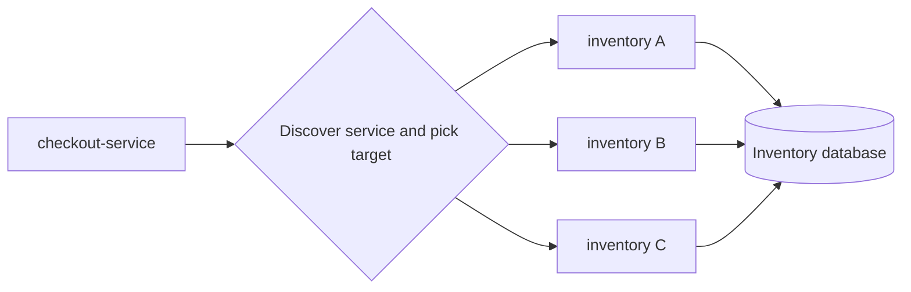
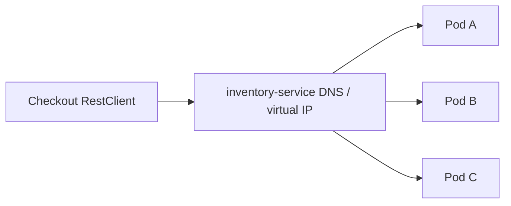
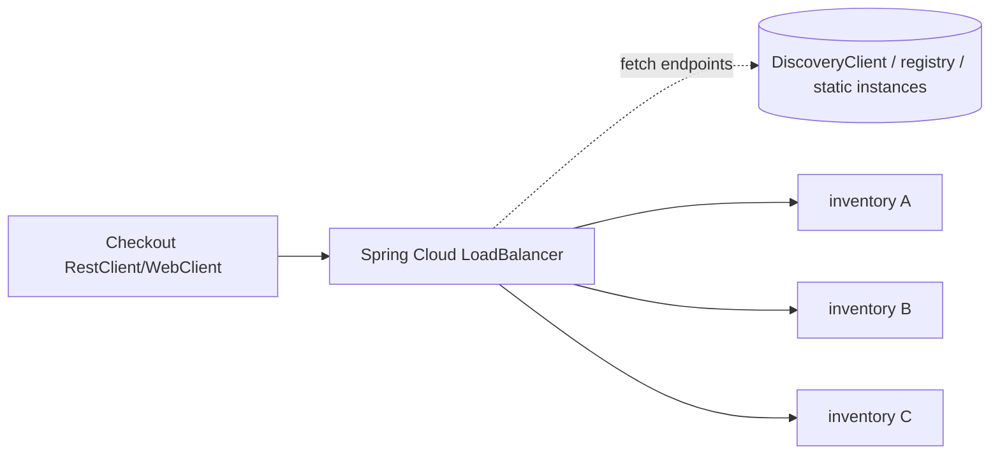
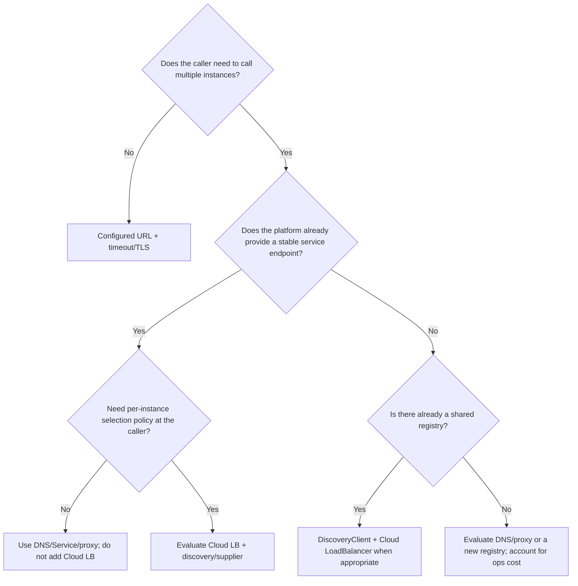
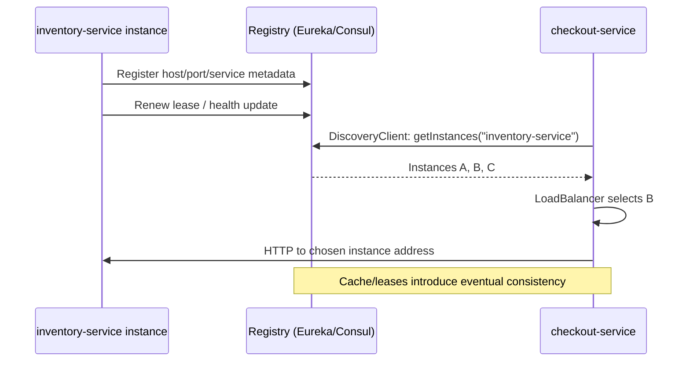
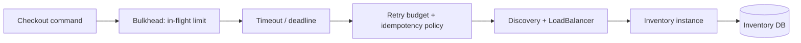
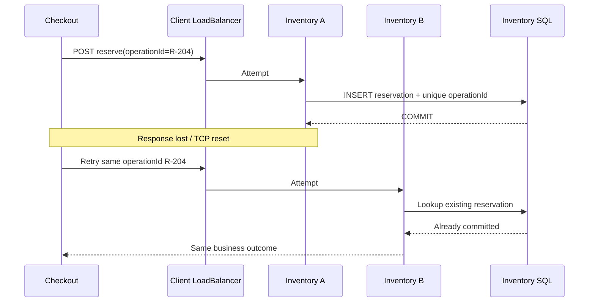
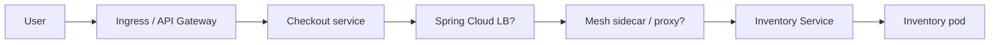
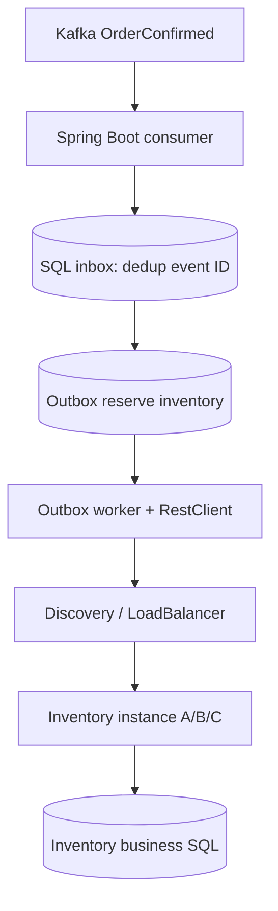
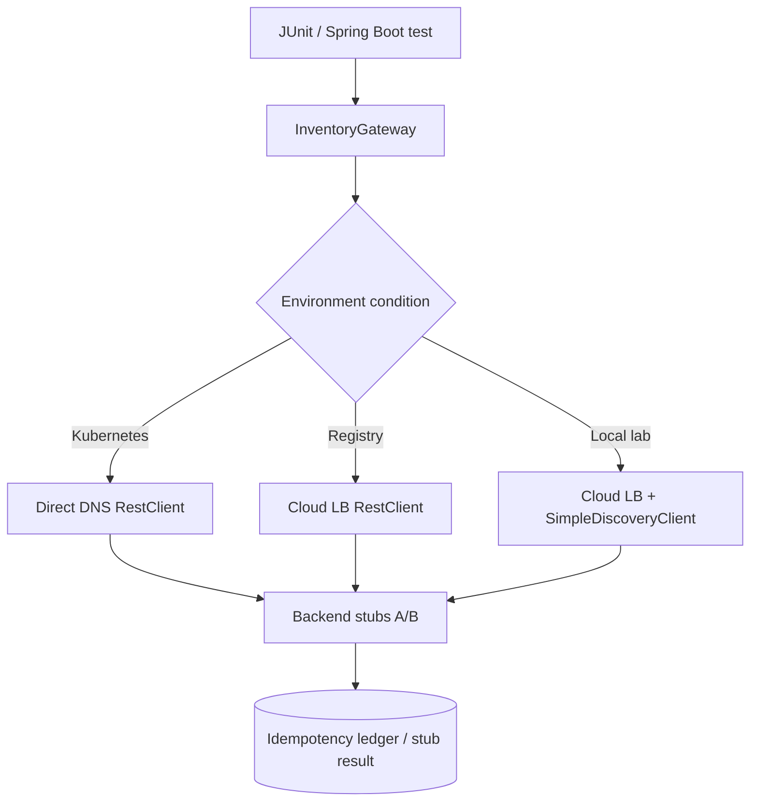

# Service Discovery, Load Balancing, and Conditions for Adding Spring Cloud

> **Chapter:** Supplementary Libraries  
> **Scope:** The **SPRING_BOOT_INTEGRATION** module structures system integration in Spring Boot across HTTP clients, databases, caches, message brokers, and Spring Integration adapters. This lesson focuses on **finding service addresses (service discovery)**, **distributing requests across instances (load balancing)**, and choosing between **DNS, deployment-platform primitives, or Spring Cloud**, while analyzing transactions, timeouts, retries, idempotency, security, observability, and testing in integration flows.

## 1. The Practical Problem: A Service's Address Is Not Fixed

A `checkout-service` calls `inventory-service` over HTTP to check stock availability. Locally, a single URL works:

```yaml
integration:
  inventory:
    base-url: http://localhost:8081
```

In production, however, `inventory-service` has multiple instances:

```text
inventory-service:
  instance A: 10.20.3.21:8080
  instance B: 10.20.4.38:8080
  instance C: 10.20.5.19:8080
```

When instance B is replaced during a rolling deployment, the host list changes. If `checkout-service` hardcodes B's address, it will call an instance that no longer exists. If every request hits instance A, A can overload while B and C sit idle.



Solving this can involve **service discovery**, **load balancing**, **health/readiness**, **timeouts**, and **error-handling mechanisms**. **Not every system needs Spring Cloud**: on Kubernetes, `Service` DNS and the network dataplane already solve much of this without bringing a registry and client-side load balancing into every application.

### Learning Objectives

After this lesson, readers will be able to:

1. Distinguish service registry, discovery client, service instance, DNS, and load balancer.
2. Choose between **fixed URL**, **Kubernetes Service DNS**, **reverse proxy/service mesh**, and **Spring Cloud LoadBalancer + DiscoveryClient**.
3. Know when adding Spring Cloud is warranted and when adding it only increases complexity.
4. Configure the Spring Cloud BOM and starters for a compatible Spring Boot version.
5. Practice `@LoadBalanced RestClient.Builder` and `WebClient.Builder` with instance lists.
6. Understand the limits of round-robin, readiness, instance caching, connection reuse, and zone affinity.
7. Handle no-instance errors, stale endpoints, timeouts, retries, circuit breakers, idempotency, and transaction boundaries.
8. Avoid confusing HTTP service discovery with the native discovery mechanisms of Kafka, MongoDB, Redis, JDBC, or RSocket.
9. Test instance restarts, rolling deployments, duplicate side effects, and observe instance selection.

## 2. Terminology: Discovery and Load Balancing Are Not the Same Job

| Term | Question Answered | Example |
| --- | --- | --- |
| **Service ID/name** | Which logical target does the caller want? | `inventory-service` |
| **Service instance** | Which concrete endpoint serves the service? | `10.20.3.21:8080`, metadata such as zone |
| **Service registry** | Who stores the list of registered instances? | Eureka, Consul; platforms may have their own |
| **Discovery client** | How does the caller fetch the instance list? | Spring Cloud `DiscoveryClient`, DNS query, platform API |
| **Load balancing** | Once targets are known, which instance gets the request? | Round-robin, random, zone-aware, proxy/load balancer |
| **Health/readiness** | Is the instance eligible to serve new traffic? | Kubernetes readiness probe, registry health check |
| **Circuit breaker** | Temporarily halt consecutive calls to a failing dependency? | Resilience4j / Spring Cloud CircuitBreaker if selected |
| **Retry** | Under what policy should a failed request be retried? | Bounded retries for idempotent operations |
| **Gateway** | An entry point routing/enforcing policies on traffic | Spring Cloud Gateway or ingress/reverse proxy |

**Discovery returns callable candidates; load balancing selects one candidate.** Either or both can live in the client, a proxy, or infrastructure. A registry can exist without a client-side load balancer; a load balancer can also run over a static list without a registry.

### 2.1. A Service ID Is Not a Physical Address

```text
Logical target: inventory-service

Can resolve to:
  Kubernetes Service DNS:
      inventory-service.production.svc.cluster.local:8080

  Registry-based discovery:
      10.20.3.21:8080, 10.20.4.38:8080, 10.20.5.19:8080

  Static configuration:
      localhost:18081, localhost:18082 (local/test only)
```

**Never pass a user-supplied service ID straight into an HTTP client** letting callers pick arbitrary hostnames or instances. In integration systems, service IDs should come from controlled allowlists/config to prevent SSRF, cross-tenant routing, and internal network exposure.

## 3. Two Primary Load-Balancing Models

### 3.1. Server-Side Load Balancing

The client calls **one stable endpoint**. A proxy, load balancer, or platform routes to pods/instances:



In Kubernetes, a `Service` has a stable DNS name; traffic to the Service is distributed across eligible endpoints by the cluster dataplane (e.g., kube-proxy or eBPF solutions). Normally **you do not need Spring Cloud LoadBalancer** just to call a Kubernetes Service via DNS.

**Note:** balancing often occurs at the **connection/transport flow** level, not always per individual HTTP request. HTTP keep-alive, HTTP/2 multiplexing, or a long-lived RSocket TCP connection can make per-pod request ratios **differ** from connection ratios.

### 3.2. Client-Side Load Balancing

The client retrieves the list of service instances and picks one before sending an HTTP request:



Spring Cloud LoadBalancer is a **caller-side** component that can use a discovery client or a supplier-provided instance list. It does not create a service registry, manage backend health on its own, or turn backends into a consistent database.

### 3.3. Comparison

| Criterion | Infrastructure/Proxy Balancing | Spring Cloud Client-Side LB |
| --- | --- | --- |
| Does the client need to know pod/IP lists? | Usually no | Usually yes, via supplier/discovery |
| App configuration | Fixed URL to service/gateway | Starter, `@LoadBalanced`, discovery/supplier |
| Metadata/zone-based policies | Depends on platform/proxy | Configurable on the client when needed |
| Registry dependency in JVM | Not necessarily | Yes if supplier fetches from a registry |
| Operations | Centralized in the platform | Additional behavior and caching in every caller |
| Rolling deploys | Depends on readiness/endpoint updates | Depends on registry freshness, health, and retries |
| Observability | Proxy/mesh metrics + client metrics | Must measure both client selection and HTTP exchange |
| Best fit when | Kubernetes Service, ingress, or proxy is enough | Outside Kubernetes or needing custom client-side selection policies |

**Do not equate "using Kubernetes" with "never needing client-side LB".** There are valid zone/metadata routing use cases or services outside the cluster. Still, **the reason must be clear** to avoid running two redundant routing layers with no measurable gain.

## 4. Deciding Before Adding a Spring Cloud Dependency

Apply a simple decision tree:



### 4.1. Cases That Usually **Do Not Need** Spring Cloud

1. A Spring Boot API calling one stable partner URL provided by an external vendor.
2. Service-to-service HTTP inside Kubernetes already using `Service` DNS in the proper namespace.
3. A platform load balancer or service mesh already handles routing, health, and retries under centrally operated policies.
4. A batch job calling a fixed service over a private endpoint/VPN.
5. An RSocket server called over a platform-balanced **connection** endpoint without per-message instance switching requirements.
6. A Kafka client using bootstrap brokers and **Kafka protocol** metadata discovery—it does not need Eureka to pick brokers.
7. A MongoDB driver using its own connection string / replica-set discovery—it does not go through Spring Cloud LoadBalancer.

### 4.2. Cases That **May Need** Spring Cloud

1. Many Spring Boot services running on VMs/bare metal where the system already operates **Eureka/Consul** for registration, lookup, and health.
2. Callers needing **zone-aware instance selection**, metadata routing, or filtering out instance groups by policies DNS/proxies cannot express adequately.
3. Needing a unified client-side load balancer shared across `RestClient`, `WebClient`, and Spring Cloud declarative clients.
4. Another confirmed architectural need: Spring Cloud Gateway, Config, CircuitBreaker, or Spring Cloud Kubernetes features; **add only the starters truly needed**.
5. A hybrid VM–Kubernetes–cloud environment requiring a managed and thoroughly tested discovery abstraction.

**Spring Cloud is not a "mandatory Spring Boot upgrade".** Spring Boot, Spring Framework `RestClient`/`WebClient`, Actuator, and JDBC/Redis/Kafka integrations all run fine without Spring Cloud.

## 5. Plain Spring Boot: HTTP Clients Still Call DNS Directly

With a stable endpoint such as a Kubernetes Service, simply use Spring Framework's `RestClient` or `WebClient`, configuring timeouts and security:

```yaml
integration:
  inventory:
    base-url: ${INVENTORY_URL:http://inventory-service:8080}
```

```java
package com.example.integration.inventory;

import org.springframework.beans.factory.annotation.Value;
import org.springframework.stereotype.Service;
import org.springframework.web.client.RestClient;

@Service
public class DirectInventoryClient {
    private final RestClient client;

    public DirectInventoryClient(
            RestClient.Builder builder,
            @Value("${integration.inventory.base-url}")
            String inventoryBaseUrl) {
        this.client = builder.baseUrl(inventoryBaseUrl).build();
    }

    public InventoryAvailability get(String sku) {
        return client.get()
                .uri("/api/inventory/{sku}", sku)
                .retrieve()
                .body(InventoryAvailability.class);
    }
}

record InventoryAvailability(
        String sku, long availableQuantity) {}
```

In this example **without `@LoadBalanced`**, `inventory-service` is a DNS name or host resolved by platform networking. When running directly on a laptop, `inventory-service` has no automatic DNS; set `INVENTORY_URL=http://localhost:8081` or run in an environment with matching network naming.

**Production requirements not yet shown in the snippet:** transport TLS/mTLS, connect/response/read timeouts, HTTP pooling, authentication, error mapping, retry budgets, and observability. All of these can be supplied via customizers and HTTP request factories chosen and tested directly—**Spring Cloud is not needed** just to add those essentials.

### 5.1. Spring Framework HTTP Interface Does Not Require Spring Cloud

With `@HttpExchange`/`HttpServiceProxyFactory`, the application can build declarative HTTP clients backed by `RestClient` or `WebClient`. It can call a **fixed base URL** without Eureka, Feign, or Spring Cloud. If you later want caller-side instance selection, integrate the HTTP adapter with a load-balanced builder/client rather than assuming the annotation name enables discovery on its own.

## 6. Kubernetes Service DNS: Often the Simplest Solution

A ClusterIP `Service` exposes a logical address for a group of pods:

```yaml
apiVersion: v1
kind: Service
metadata:
  name: inventory-service
  namespace: production
spec:
  selector:
    app: inventory-service
  ports:
    - name: http
      port: 8080
      targetPort: 8080
```

Callers in the `production` namespace can call:

```text
http://inventory-service:8080

Or FQDN:
http://inventory-service.production.svc.cluster.local:8080
```

**Prerequisites:** cluster DNS and Service/Endpoints are configured properly, network policies allow the connection, and pods report readiness. Kubernetes updates **EndpointSlices** as pod states change; the dataplane distributes connections across ready endpoints.

### 6.1. Readiness Differs from Liveness

- **Readiness:** whether a pod should receive new requests; crucial during rolling deploys and startup migrations/warmups.
- **Liveness:** whether a pod is healthy enough to avoid a restart if wedged; never let a brief dependency outage trigger mass pod restarts.
- **Startup probe:** protects slow-starting processes from being killed prematurely by liveness checks.

```yaml
readinessProbe:
  httpGet:
    path: /actuator/health/readiness
    port: 8080
  periodSeconds: 5
  failureThreshold: 1
livenessProbe:
  httpGet:
    path: /actuator/health/liveness
    port: 8080
  periodSeconds: 10
  failureThreshold: 3
```

This is a **Kubernetes container spec snippet**, not a complete Deployment. Spring Boot Actuator readiness/liveness probes must be enabled/configured and exposed on the right port. A passing probe does not prove backend transactions or consumer offsets have committed.

### 6.2. DNS Does Not Replace Application Error Handling

Between a Service endpoint update and an outbound client request, a pod may have received SIGTERM or closed an existing connection. You still need:

- Finite timeouts and SLA-aligned deadlines.
- Coordinated graceful shutdown / admission gating.
- HTTP retries **only when idempotency makes them safe**.
- Circuit breakers/bulkheads when failures can cascade.
- Concurrency and connection pool limits.
- Monitoring 502/503/connection resets during deploys.

**Do not enable Spring Cloud LB retries, mesh retries, and HTTP client retries independently without calculating total attempts**; three layers can multiply requests dramatically.

### 6.3. When to Consider Spring Cloud Kubernetes?

If your Java client needs to **read pod/EndpointSlice lists, metadata, and namespaces directly** or apply Spring Cloud discovery/load-balancing logic, evaluate Spring Cloud Kubernetes and its starters. That introduces dependencies on the Kubernetes API, RBAC permissions, caches, watch/retry behavior, and in-cluster testing.

Simply calling `http://inventory-service:8080` via a Kubernetes Service does **not require** `spring-cloud-starter-kubernetes-client-discovery`. If granting RBAC for direct discovery, grant least-privilege permissions and never give runtime service accounts cluster-admin rights.

## 7. Spring Cloud Consists of Separate Modules

Several modules are often lumped together as "one package":

| Component | Role | Needed for HTTP Discovery/LB? |
| --- | --- | --- |
| **Spring Cloud Commons** | Abstractions like `DiscoveryClient` and load-balanced client integration | Foundation for many starters |
| **Spring Cloud LoadBalancer** | Client-side selection and HTTP client integration | **Yes**, if choosing instances at the caller |
| **Spring Cloud Netflix Eureka Client** | Registers and discovers instances with Eureka | **Only when using Eureka** |
| **Spring Cloud Consul Discovery** | Registers/discovers services with Consul | **Only when using Consul** |
| **Spring Cloud Kubernetes Discovery** | Kubernetes-platform-backed discovery | **Only if API-based discovery is truly needed** |
| **Spring Cloud Gateway** | Reverse proxy/gateway routing, filters/policies | Not a mandatory dependency per client |
| **Spring Cloud OpenFeign** | Declarative HTTP client | Optional; not required to use `RestClient` |
| **Spring Cloud CircuitBreaker** | Fault-tolerance abstraction | Does not create a registry/discovery |
| **Spring Cloud Config** | Distributes centralized configuration | Independent of instance selection |

**Add Spring Cloud only after identifying the exact feature and operational owner.** Never add a starter just because a system has multiple microservices.

### 7.1. Technologies Frequently Confused

`Ribbon` was widely used for Netflix client-side load balancing in older tutorials, but **should not be chosen for modern Spring Boot/Spring Cloud projects**; use Spring Cloud LoadBalancer if equivalent capability is needed in the Spring ecosystem.

`Hystrix` is a legacy library seen in older examples; for modern fault tolerance, evaluate Resilience4j/Spring Cloud CircuitBreaker matching your version, which is a **separate decision** from discovery.

## 8. Aligning Spring Cloud Versions with Spring Boot

**First technical requirement before adding Spring Cloud:** the **Spring Cloud release train** version must be **compatible with your Spring Boot version**. Never copy a BOM/version from last year's tutorial into a project running a different Boot version.

### 8.1. Dependency Management

```xml
<properties>
    <java.version>17</java.version>
    <!-- Select a compatible release train from official documentation. -->
    <spring-cloud.version>REPLACE_WITH_COMPATIBLE_RELEASE_TRAIN</spring-cloud.version>
</properties>

<dependencyManagement>
    <dependencies>
        <dependency>
            <groupId>org.springframework.cloud</groupId>
            <artifactId>spring-cloud-dependencies</artifactId>
            <version>${spring-cloud.version}</version>
            <type>pom</type>
            <scope>import</scope>
        </dependency>
    </dependencies>
</dependencyManagement>

<dependencies>
    <dependency>
        <groupId>org.springframework.cloud</groupId>
        <artifactId>spring-cloud-starter-loadbalancer</artifactId>
    </dependency>
</dependencies>
```

This is a **skeleton template**, not a ready-to-build `pom.xml`: replace `REPLACE_WITH_COMPATIBLE_RELEASE_TRAIN` with a version **verified against the Spring Cloud compatibility matrix**, and ensure the project has a Spring Boot parent/BOM or matching dependency management. Never manually attach versions to individual Spring Cloud artifacts managed by the BOM.

### 8.2. Compatibility Checklist

1. Identify exact `Spring Boot`, `Spring Framework`, Java, and Spring Cloud release train versions.
2. Read the official supported releases table and release notes for each starter you plan to use.
3. Verify Jakarta namespaces/APIs and the security stack of that version.
4. Confirm `RestClient`/`WebClient` load-balancer integration is supported in the chosen train.
5. Prevent transitive dependencies from pulling in two different versions of Spring Cloud Commons/LoadBalancer.
6. Run smoke tests for startup, discovery instance resolution, and HTTP requests in a realistic environment.
7. Pin versions deliberately with an upgrade/rollback plan.

**Never disable or bypass the compatibility verifier just to get the app to start** when the BOM actually mismatches. Fix dependency management properly before troubleshooting runtime issues.

### 8.3. Without a Registry, LoadBalancer Can Still Be Useful

Spring Cloud LoadBalancer can obtain instances via `ServiceInstanceListSupplier` or a static **SimpleDiscoveryClient**. Thus **Eureka is not required just to test client-side load balancing**. Yet in production, if the platform already provides DNS/proxies, ask again why the client needs another selection layer.

## 9. Registry-Based Service Discovery: Eureka, Consul, and Trade-Offs

### 9.1. Registration/Lookup Flow



The diagram illustrates conceptual interactions, not the exact network API or watch mechanism of every registry. **A registry can be slow to notice dead instances**, and discovery clients also cache lists. Therefore, you must still handle `connection refused`, `503`, and timeouts.

### 9.2. Eureka

In systems **already operating Eureka**, a service can use the Spring Cloud Netflix Eureka client to register and discover:

```xml
<dependency>
    <groupId>org.springframework.cloud</groupId>
    <artifactId>spring-cloud-starter-netflix-eureka-client</artifactId>
</dependency>
```

```yaml
spring:
  application:
    name: inventory-service

eureka:
  client:
    service-url:
      defaultZone: ${EUREKA_SERVER_URL:http://localhost:8761/eureka/}
```

**Note:** Eureka's `defaultZone` property uses its own camelCase naming, so preserve the exact form supported by your release train. The local URL above is for development only; production requires TLS/auth/network policies and trusted registry zones.

Registration does not mean an instance is business-ready. If an app hasn't finished startup/migrations yet while the registry routes traffic to it, coordinate **health/readiness/registration lifecycles** and test in the deployment environment.

### 9.3. Consul

With infrastructure already running Consul, you can use:

```xml
<dependency>
    <groupId>org.springframework.cloud</groupId>
    <artifactId>spring-cloud-starter-consul-discovery</artifactId>
</dependency>
```

```yaml
spring:
  application:
    name: checkout-service
  cloud:
    consul:
      host: ${CONSUL_HOST:localhost}
      port: ${CONSUL_PORT:8500}
      discovery:
        enabled: true
```

In production, explicitly configure security/ACLs, TLS, health checks, service tags, deregistration, datacenter, and ownership. Never stand up a new Consul cluster solely to avoid writing a Kubernetes Service DNS name when platform networking suffices.

### 9.4. Service Metadata Is Not Authorization

A registry may store `zone`, `version`, `secure`, or tags. They assist routing, yet **are not backend authentication**: the caller must still verify TLS certificates/identities, send audience-scoped OAuth2 tokens, and enforce server-side authorization. Never trust metadata sent by a malicious registration to steer traffic to the wrong endpoint.

## 10. Spring Cloud DiscoveryClient Abstraction

Spring Cloud Commons provides `DiscoveryClient` for callers to query instances of a logical service:

```java
package com.example.integration.discovery;

import java.util.List;

import org.springframework.cloud.client.ServiceInstance;
import org.springframework.cloud.client.discovery.DiscoveryClient;
import org.springframework.stereotype.Service;

@Service
public class ServiceDirectory {
    private final DiscoveryClient discoveryClient;

    public ServiceDirectory(DiscoveryClient discoveryClient) {
        this.discoveryClient = discoveryClient;
    }

    public List<ServiceInstance> inventoryInstances() {
        return List.copyOf(
                discoveryClient.getInstances("inventory-service"));
    }
}
```

`DiscoveryClient.getInstances(...)` returns endpoints for a service ID when discovery is configured. If the service isn't found, the list may be empty. Never call `instances.get(0)` without bounds checking or assume the list stays immutable across a request.

### 10.1. ReactiveDiscoveryClient

Spring Cloud also provides a reactive discovery abstraction where supported. **Do not confuse using `ReactiveDiscoveryClient` with a guarantee that all registry/network operations are non-blocking**: the adapter and registry backend determine that. When already using `@LoadBalanced WebClient.Builder`, let LoadBalancer invoke its supplier instead of hand-rolling `flatMap(discovery.getInstances(...))` with random selection.

### 10.2. ServiceInstance Contract

A `ServiceInstance` carries fields such as `serviceId`, host, port, URI, secure flag, and a metadata map. A caller needs to:

- Pick the right URL scheme (`http` vs. `https`).
- Verify backend identity/TLS, not just the `secure=true` metadata flag.
- Avoid logging credentials or sensitive full URIs.
- Avoid reusing a pod's specific host/port after it has moved without retries or re-resolution.

**DiscoveryClient does not send HTTP requests itself.** It only supplies candidates for other components to select and invoke.

## 11. Local Lab Without Eureka: SimpleDiscoveryClient

To verify load-balancing clients without running a registry, you can supply **static service instances**:

```yaml
spring:
  application:
    name: checkout-service
  cloud:
    discovery:
      client:
        simple:
          instances:
            inventory-service:
              - uri: http://localhost:18081
              - uri: http://localhost:18082
```

Prerequisites: compatible Spring Cloud Commons/LoadBalancer versions configured, and two local test servers listening on those ports. `SimpleDiscoveryClient` is handy for **local/test setups or statically managed lists**, but does not automatically discover new pods/containers when IPs change.

**In production:** if two static backends sit behind a proxy or Kubernetes Service, consider calling one stable endpoint. Do not maintain hardcoded IP lists in YAML when autoscaling and rolling deployments continually churn instances.

## 12. Client-Side Load Balancing for RestClient

With Spring Cloud LoadBalancer compatible with your Spring Framework/Boot version, define a `@LoadBalanced` `RestClient.Builder`:

```java
package com.example.integration.inventory;

import org.springframework.cloud.client.loadbalancer.LoadBalanced;
import org.springframework.context.annotation.Bean;
import org.springframework.context.annotation.Configuration;
import org.springframework.web.client.RestClient;

@Configuration(proxyBeanMethods = false)
public class InventoryLoadBalancingConfiguration {

    @Bean("loadBalancedRestClientBuilder")
    @LoadBalanced
    RestClient.Builder loadBalancedRestClientBuilder() {
        return RestClient.builder();
    }
}
```

When the matching Cloud auto-configuration is active and `ServiceInstanceListSupplier`/discovery returns endpoints, a client can use the **service ID as the logical host**:

```java
package com.example.integration.inventory;

import org.springframework.beans.factory.annotation.Qualifier;
import org.springframework.stereotype.Component;
import org.springframework.web.client.RestClient;

@Component
public class LoadBalancedInventoryClient {
    private final RestClient client;

    public LoadBalancedInventoryClient(
            @Qualifier("loadBalancedRestClientBuilder")
            RestClient.Builder builder) {
        this.client = builder
                .baseUrl("http://inventory-service")
                .build();
    }

    public InventoryAvailability available(String sku) {
        return client.get()
                .uri("/api/inventory/{sku}", sku)
                .retrieve()
                .body(InventoryAvailability.class);
    }
}
```

`InventoryAvailability` is the DTO declared in Section 5. With `@LoadBalanced`, the host `inventory-service` is a **service ID resolved by the load balancer**, not necessarily a real DNS hostname. Do not write `http://10.20.3.21:8080` if your goal is load balancing by logical service name.

### 12.1. Requirements for This Example to Work

1. `spring-cloud-starter-loadbalancer` and compatible dependency management are present.
2. Discovery/supplier returns at least one `ServiceInstance` for `inventory-service`.
3. Spring Cloud auto-configuration actually attaches the load-balancing interceptor/customizer to this builder.
4. Backend instances expose `/api/inventory/{sku}` with compatible DTOs/codecs.
5. HTTP timeouts, TLS, connection pooling, authentication, and error mapping are designed.

If you simply call `RestClient.create("http://inventory-service")` or `RestClient.builder()` inside a method without using the load-balanced builder, **never assume Spring Cloud automatically intercepts every RestClient in the process**.

### 12.2. Do Not Lose Spring Boot Customizers

`RestClient.builder()` creates a Spring Framework builder, whereas many Spring Boot apps register configuration/customizers for request factories, SSL, tracing, or codecs. If you define your own `@Bean RestClient.Builder`, **review how Boot customizers are applied** and test timeouts/tracing/security. Do not assume `@LoadBalanced` alone configures all HTTP client concerns.

### 12.3. Mixing Regular and Load-Balanced Builders

```text
Regular RestClient.Builder:
  -> https://partner.example/api  (direct DNS)

@LoadBalanced RestClient.Builder:
  -> http://inventory-service     (logical service ID)
```

Use explicit bean names/`@Qualifier` to avoid ambiguity. Never put `@LoadBalanced` on all HTTP clients if you also call external partner URLs outside the registry: the LB client could treat external hostnames as service IDs and fail with **no available instances**.

## 13. WebClient and Reactive Load Balancing

For code using WebFlux/Project Reactor, Spring Cloud LoadBalancer integrates with `WebClient.Builder`:

```java
package com.example.integration.inventory;

import org.springframework.cloud.client.loadbalancer.LoadBalanced;
import org.springframework.context.annotation.Bean;
import org.springframework.context.annotation.Configuration;
import org.springframework.web.reactive.function.client.WebClient;

@Configuration(proxyBeanMethods = false)
public class ReactiveInventoryClientConfiguration {

    @Bean("loadBalancedWebClientBuilder")
    @LoadBalanced
    WebClient.Builder loadBalancedWebClientBuilder() {
        return WebClient.builder();
    }
}
```

```java
package com.example.integration.inventory;

import org.springframework.beans.factory.annotation.Qualifier;
import org.springframework.stereotype.Component;
import org.springframework.web.reactive.function.client.WebClient;
import reactor.core.publisher.Mono;

@Component
public class ReactiveInventoryClient {
    private final WebClient client;

    public ReactiveInventoryClient(
            @Qualifier("loadBalancedWebClientBuilder")
            WebClient.Builder builder) {
        client = builder.baseUrl("http://inventory-service").build();
    }

    public Mono<InventoryAvailability> available(String sku) {
        return client.get()
                .uri("/api/inventory/{sku}", sku)
                .retrieve()
                .bodyToMono(InventoryAvailability.class);
    }
}
```

Using `WebClient` requires the `spring-webflux` dependency (typically via `spring-boot-starter-webflux`) alongside the load balancer starter; **you do not need to switch an entire MVC app to a reactive server** just to use `WebClient`. However, code consuming `Mono` must never call `block()` on the Reactor Netty event loop. Blocking JDBC/remote dependencies must be scheduled on appropriate thread pools.

### 13.1. Reactive Does Not Automatically Handle High Load Well

`flatMap(client::available)` can fire many concurrent remote requests. To protect inventory:

```java
Flux<InventoryAvailability> result = Flux.fromIterable(skus)
        .flatMap(client::available, 8);
```

`skus` is an application-provided iterable; the number 8 caps inner publishers **within that single pipeline**, not across the entire pod or cluster. Under high concurrency, you still need global bulkheads/rate limiters, bounded queues, and capacity planning.

### 13.2. Load Balancing Is Not Backpressure

LoadBalancer picks an instance **for a single HTTP exchange**; it does not stop callers from sending too many requests. Reactive backpressure regulates demand between publishers and subscribers, yet an unbounded `flatMap` can still overwhelm downstream services. Manage **instance selection, concurrency, request size, and retry budgets** together.

## 14. Instance Selection: Round-Robin, Random, Zone, and Cache

Spring Cloud LoadBalancer provides instance selection strategies and a `ServiceInstanceListSupplier` pipeline to supply and filter lists. **Round-robin** is a common default in many setups, though it does not guarantee every instance receives an identical number of requests.

| Strategy/Factor | Useful When | What to Verify |
| --- | --- | --- |
| Round-robin | Backends are relatively uniform | Connection reuse, concurrency, instance churn |
| Random | Simple distribution when order does not matter | Ratios only even out statistically over large samples |
| Zone-aware filtering | Reducing cross-zone latency/cost when local instances exist | Fallback when a zone loses all healthy instances |
| Health-check supplier | Discovery lists instances, some unhealthy | Health endpoint policy and probing cost |
| Sticky/session affinity | Ephemeral unshared session state or locality | Instance failover and state recovery |
| Instance caching | Reducing repeated registry calls | Stale entries during rolling deployments |
| Weighted selection | Instances have uneven capacity | Requires verified algorithm/metadata/capacity |

### 14.1. Caching Is a Trade-Off Between Latency and Freshness

If a registry returns `[A, B, C]` and the caller caches it for 30 seconds, and B dies right after the fetch, the caller may keep picking B until the cache refreshes or a health filter catches it.

```text
T0   Discovery cache = [A, B, C]
T1   B starts terminating / is killed
T2   Caller still picks B from stale cache
T3   Connection refused / 503 / timeout
T4   Discovery refresh = [A, C]
```

Do not blindly set cache = 0 everywhere if the registry faces heavy traffic. Choose TTL/watch/refresh/health strategies matching churn and SLOs, and ensure **requests have timeouts and semantically sound fallbacks/retries**.

### 14.2. One Cache Layer Is Usually Enough

When both discovery-client caching and load-balancer supplier caching exist, layers can compound. **Avoid enabling multiple cache layers without knowing the source of truth and combined refresh delay.** Check cache settings in your registry client and Cloud version before tuning.

### 14.3. Zone-Aware Does Not Replace HA

Preferring zone A lowers latency, yet if zone A degrades and the client fails to fall back properly, all requests can fail even while zone B is healthy. Test **zone evacuation**, not merely distribution when both zones are up.

## 15. Discovery/Load-Balancing Failures You Must Handle

A client-side load balancer does not eliminate errors. It shifts **where errors occur**: before HTTP runs, there is an instance lookup and target selection step.

| Observed Error | Possible Causes | Investigation / Policy |
| --- | --- | --- |
| **No available instances** | Service ID absent from registry, casing/name typo, empty cache, failing readiness | Check service name, registry/EndpointSlice, discovery client, and lookup permissions |
| `UnknownHostException` | Client using plain DNS and hostname does not resolve | Check `@LoadBalanced` builder or actual DNS/networking |
| `Connection refused` | Old instance closed port, stale cached endpoint, pod not ready | Ensure readiness, timeouts, and retries if operation is safe |
| Connection reset / EOF | Pod terminated mid-request, proxy reset, or pool held stale connection | Graceful shutdown, idempotent retries, connection pool tuning |
| HTTP 503 from backend | Backend overloaded/draining or unready | Limit concurrency, retry/backoff if permitted |
| HTTP 401/403 | Wrong token/audience/role or auth lost across hosts | Fix identity/authorization; **do not** blindly retry on another instance |
| HTTP 404 | Wrong route/API version, not necessarily a broken instance | Check contract; do not blame discovery for every 404 |
| TLS handshake / cert mismatch | Cert does not match actual hostname/identity; broken trust chain | TLS validation, DNS/URI scheme, service identity |
| p99 latency spikes after scale-out | Shared DB bottleneck, cold instances, zone mismatch, or retry storm | Trace across instances, backend capacity, DB metrics |
| Only one instance gets traffic | Sticky sessions, connection reuse, HTTP/2, LB policy, or stale list | Distinguish connection balancing from request balancing |

### 15.1. No Available Instances Must Map to a Meaningful Error

```text
Caller -> inventory-service (logical ID)
    -> Discovery returns []
    -> LoadBalancer has no target
    -> Client receives adapter-generated error/response (often 503 in HTTP context)
```

**Do not hardcode exact exception classes or HTTP status codes across every adapter/version**: `RestClient`, `WebClient`, Gateway, and custom LoadBalancer filters can report failures differently. Define an **application error taxonomy**, test on your real version, and distinguish:

- Discovery found no targets.
- A target existed, but TCP/TLS failed.
- Backend returned a valid business error.
- Backend received the request, yet the response timed out with unknown outcome.

Never convert all errors into `null` or `200 OK + empty inventory`, which tricks callers into thinking "out of stock" instead of "dependency unavailable".

### 15.2. An Unhealthy Instance Is Not the Only Cause of Bad Business State

If one instance returns 500 when reading data due to a bug, failing over to another instance may return the same 500 because **all instances share the same database/schema**. Retries and load balancing cannot fix corrupted data. Root-cause the bug and use circuit breaking/fail-fast and backpressure when a shared dependency fails.

### 15.3. An Unready Instance Can Still Hold Open Connections

Kubernetes readiness and registry health normally govern **new traffic**; an existing TCP keep-alive/HTTP/2/RSocket connection can stay active for a while. Shutdown still requires **in-flight draining**, not merely waiting for the endpoint to disappear from the registry and immediately killing the process.

## 16. Timeouts, Retries, Circuit Breakers, and Bulkheads Are Separate Decisions

A distributed system has four control layers:



**LoadBalancer chooses the target; timeouts bound waiting; retries decide re-attempts; circuit breakers shed load to failing dependencies; bulkheads contain overload.** A load-balancer starter does not automatically implement all of these policies properly.

### 16.1. End-to-End Deadline Timeouts

Suppose a user-facing HTTP request has a 2-second SLA:

```text
Gateway / caller overall timeout: 2.0s
  authentication + validation: 0.1s
  inventory outbound budget: 0.5s
  business SQL transaction: 0.4s
  safety margin / serialization: 0.2s
  ... sum of segments must fit within deadline
```

These numbers are **illustrative**, not universal defaults. Measure real p95/p99 latencies and configure connect/read/response timeouts accordingly. If the HTTP client timeout is 30 seconds while ingress times out at 2 seconds, handlers can keep occupying pools/threads long after the caller gave up.

### 16.2. Retries Can Amplify Load

```text
HTTP client retries:    up to 3 attempts
Gateway retries:        up to 2 attempts
Service mesh retries:   up to 2 attempts

Worst case if all retry independently:
  3 × 2 × 2 = 12 upstream attempts
  for a single initial business request
```

Not every setup produces this exact product; the example illustrates the **risk of retry amplification**. Assign clear ownership: **one primary layer orchestrates retries**, with a shared budget, exponential backoff + jitter, and a cap within the deadline.

### 16.3. Retries Are Safe Only for Operations with Matching Semantics

| Operation | How Can It Be Retried? |
| --- | --- |
| `GET /inventory/{sku}` read-only, no side effects | Finite retries on transient network/503 if SLA permits |
| `PUT /resource/{id}` idempotent per contract | Can retry if body/ID are stable and server truly enforces idempotency |
| `POST /reservations` creates reservation | **Do not** retry unconditionally; needs operation/idempotency key + status lookup |
| Payment/charge | Retry strictly per provider policy with the same idempotency key |
| Kafka/JMS publish | Use ack/producer semantics and outbox when needed; HTTP LB does not control broker delivery |
| Request with non-replayable body stream | Cannot simply retry; needs a safely replayable body source |

Standard HTTP `GET` should have no business side effects, yet **do not assume every GET is safe** in poorly designed legacy systems. Base idempotency on **actual behavior**, not just the HTTP verb.

### 16.4. Bounded Reactor Retry Example

```java
Mono<InventoryAvailability> result = reactiveInventoryClient
        .available("SKU-42")
        .retryWhen(
                reactor.util.retry.Retry
                        .backoff(2, java.time.Duration.ofMillis(150))
                        .filter(this::isTransientDependencyFailure));
```

This is a **snippet inside a class method** with an application-defined `isTransientDependencyFailure(Throwable)` helper and an injected `ReactiveInventoryClient`. `backoff(2, ...)` permits **up to 2 retries after the initial attempt**, not two total calls. Classify network/5xx/429 errors, respect the total deadline, note that resubscribing re-runs the HTTP exchange, and never use this on a side-effecting POST lacking idempotency.

### 16.5. A Circuit Breaker Is Not a Cluster-Wide Health Check

A circuit breaker typically evaluates failure/slow-call rates over a **sliding window** and temporarily short-circuits subsequent requests. If one breaker covers all instances of a service, one bad instance can trip protection for the **entire service**; if tracked per instance, you must manage cardinality as instances churn.

Choose scope deliberately. Circuit breakers do not remove instances from registries or replace backend readiness/liveness. When a shared database fails, retrying against another instance will not help.

## 17. Load Balancing and Transactions: Business Correctness Is Still Separate

`checkout-service` sends `POST /inventory/reservations` to one of three instances, all sharing one SQL database:



The danger: a retry may **pick a different instance**, which does not mean the earlier request failed to commit. If instance A committed and the response was lost, instance B **must locate the durable operation outcome** via the shared data store or status service.

### 17.1. Durable Idempotency Keys

```sql
CREATE TABLE inventory_reservations (
    tenant_id VARCHAR(80) NOT NULL,
    operation_id VARCHAR(120) NOT NULL,
    sku VARCHAR(120) NOT NULL,
    requested_quantity BIGINT NOT NULL,
    request_hash VARCHAR(64) NOT NULL,
    reservation_id VARCHAR(120) NOT NULL,
    state VARCHAR(32) NOT NULL,
    created_at TIMESTAMPTZ NOT NULL DEFAULT CURRENT_TIMESTAMP,
    PRIMARY KEY (tenant_id, operation_id)
);
```

This is an **illustrative PostgreSQL business schema**, not part of Spring Cloud. When a command arrives:

1. Authenticate caller/tenant, validate SKU and quantity.
2. Normalize the business operation ID and payload fingerprint.
3. Inside a transaction, check/insert the reservation and adjust stock according to invariants.
4. On duplicate key, **compare the fingerprint and return the existing result** without creating a new reservation.
5. If the operation ID matches an older request with a different payload, return an explicit conflict.
6. Only return a successful business response after transaction commit; if the response is lost, the caller queries by operation ID.

**A unique key alone is insufficient** if other steps in the transaction are flawed or inventory can be oversold. Use proper isolation, atomic updates, optimistic locking, and concurrent reservation tests.

### 17.2. Timeout After POST Yields UNKNOWN Outcome

```text
T0: POST reserve R-204 sent to A
T1: A executes SQL COMMIT successfully
T2: Network connection resets before response arrives
T3: Caller observes timeout

TRUE conclusion: remote outcome is unknown from caller's perspective.
FALSE conclusion: reservation was definitely not created.
```

**Service discovery and load balancing do not resolve UNKNOWN outcomes.** You need a lookup API like `GET /reservations/by-operation/{id}` or business reconciliation paired with an idempotency key. If calling directly via RSocket request-response, the exact same principle applies.

### 17.3. Local @Transactional Cannot Encompass Remote Services

```java
@Transactional
public void placeOrder(OrderCommand command) {
    orderRepository.insertPending(command);
    inventoryClient.reserve(command); // HTTP POST, outside JDBC TX
    orderRepository.markReserved(command.orderId());
}
```

This is an **anti-pattern illustrating transaction boundaries**, not production code. If SQL rolls back after HTTP succeeded, the inventory reservation remains orphaned. If HTTP times out while SQL holds locks, database pools also saturate.

For critical integrations, consider **business state + transactional outbox** in the local SQL transaction, a worker sending remote commands with a stable operation ID, recording `SENT/UNKNOWN/FAILED`, and reconciling timeouts.

### 17.4. Load Balancing Does Not Guarantee Ordering

If commands `version=2` and `version=3` for the same order are sent concurrently to two instances, they can reach the DB out of order. Round-robin guarantees neither ordering nor affinity. Enforce version checks, optimistic locking, per-key partitioning, or serialization in the business layer; never rely on instance selection as a transaction coordinator.

## 18. Spring Integration: Using a Load-Balanced HTTP Client

Spring Integration can call REST APIs via handlers or HTTP outbound gateways. Within a flow, load balancing only works if **the underlying HTTP client actually has LB configured**. Never assume adding `spring-cloud-starter-loadbalancer` to the classpath makes every outbound HTTP adapter resolve service IDs.

### 18.1. A Flow Calling a Service via a Client Bean

```java
package com.example.integration.inventory;

import org.springframework.context.annotation.Bean;
import org.springframework.context.annotation.Configuration;
import org.springframework.integration.dsl.IntegrationFlow;

record InventoryLookup(String sku) {}

@Configuration(proxyBeanMethods = false)
public class InventoryFlowConfiguration {

    @Bean
    IntegrationFlow inventoryLookupFlow(
            LoadBalancedInventoryClient inventoryClient) {
        return IntegrationFlow.from("inventoryLookupInput")
                .handle(InventoryLookup.class,
                        (query, headers) ->
                                inventoryClient.available(query.sku()))
                .get();
    }
}
```

This is a **simple request–reply flow**: input is `InventoryLookup`, output is `InventoryAvailability`. When invoked from a gateway/API, ensure proper timeouts and error-channel semantics. The service client can use `@LoadBalanced RestClient` (Section 12) or a direct DNS client without Cloud (Section 5) **without changing the Integration DSL**.

### 18.2. When Using Spring Integration's HTTP Outbound Gateway

An HTTP outbound endpoint may use `RestTemplate`/an HTTP client or another mechanism depending on version. To resolve logical service IDs via Spring Cloud, configure the **specific adapter and client** to actually use LoadBalancer; having a `@LoadBalanced RestClient.Builder` bean elsewhere does not automatically modify every HTTP outbound gateway.

**Test end-to-end**: verify that a logical `http://inventory-service` route resolves to mock/static instances, preserves headers/auth, maps timeouts/errors to `ErrorMessage` cleanly, and does not drop idempotency keys on retries.

### 18.3. Async Flows and Reply Timeouts

If a message crosses an `ExecutorChannel` or broker before hitting the HTTP handler, caller timeouts can fire before downstream completes. **Never promise business success just because sending to a channel returned `true`.** For async jobs, return `202 Accepted` only after work is durably saved, with an operation ID and status endpoint.

## 19. Do Not Apply Spring Cloud LoadBalancer Uniformly to Every Protocol

Integration systems have distinct discovery and fault-tolerance mechanisms:

| Protocol/Backend | Typical Target Discovery Mechanism | What Not to Assume |
| --- | --- | --- |
| **HTTP REST** | DNS/proxy or Spring Cloud Discovery + LB | Either can work; Spring Cloud is optional |
| **RSocket TCP/WebSocket** | DNS/platform routing, requester connection management, or client-specific discovery | `@LoadBalanced RestClient` does not balance RSocket streams |
| **Kafka** | Bootstrap servers → broker metadata/partitions managed by Kafka client | Do not treat `kafka.bootstrap-servers` as a Eureka service ID by default |
| **RabbitMQ/AMQP** | AMQP client addresses / cluster topology / broker endpoints | HTTP LoadBalancer does not govern broker failover/ACK |
| **JMS** | Connection factory / provider discovery / failover URL | Eureka does not replace JMS session/transaction semantics |
| **MongoDB** | Connection URI, MongoDB driver replica-set / sharded cluster discovery | Never pick random MongoDB members via Cloud LB |
| **Redis Cluster/Sentinel** | Redis client aware of cluster topology / sentinel / master state | Never pick Redis nodes with HTTP round-robin |
| **PostgreSQL/JDBC** | DNS/proxy/driver failover/HA routing aligned with primary/replica roles | Never route write transactions arbitrarily to read replicas |
| **SFTP/FTP** | Host config, DNS/VIP/partner gateway | Connection balancing does not replace file idempotency/checksums |

### 19.1. RSocket: Long-Lived Connections Make Distribution Differ from HTTP

An `RSocketRequester.Builder.tcp(host, port)` opens an RSocket connection; thousands of request–response, request-stream, or request-channel interactions can multiplex over that connection. If DNS/platform balances only at **TCP connection setup**, all subsequent logical requests can hit the **same instance** until the connection cycles.

Do not measure requests/second across pods and immediately conclude Kubernetes Service LB is broken. Inspect connection cardinality, stream counts, and connection lifecycles. Per-stream/per-request distribution requires an **RSocket-aware connection pool / load-balancing design** supported by your library version and tested for resubscription/cancellation/replay—never try applying HTTP annotations to RSocket.

### 19.2. Broker Partitioning Creates Its Own Affinity

Kafka assigns partitions to consumer group members; it does not aim to round-robin **individual messages** across Spring Boot pods like HTTP requests. Kafka relies on partition keys, ordering, offsets, and consumer rebalances; Spring Cloud LB **does not** coordinate those semantics.

Similarly, RabbitMQ delivery is governed by prefetch, ACK, and consumer concurrency; an HTTP load balancer does not ensure fair broker dispatch or deduplication.

## 20. Security: Registries and Endpoints Are Trusted Boundaries

Adding service discovery introduces a **sensitive source of routing information**. If an attacker registers a rogue instance named `payment-service` or alters routing metadata, callers could send business payloads to an untrusted endpoint.

### 20.1. Boundaries to Protect

1. **Registry write access:** who can register/deregister services, edit tags/health, or write ACLs?
2. **Registry read access:** who can view host/IP lists, zones, and metadata?
3. **Service identity:** TLS/mTLS, certificate validation, and credential audiences.
4. **Caller identity:** OAuth2 workload identity, service accounts, or proper auth schemes.
5. **Authorization:** backends enforce scopes/tenants themselves; discovery never grants business permissions.
6. **DNS/proxy trust:** prevent DNS spoofing, misrouted networks, and plaintext traffic where TLS is required.
7. **Config security:** registry URLs/tokens and service metadata must stay out of logs.
8. **Request destination policy:** never let callers supply arbitrary service IDs/hosts (SSRF prevention).

### 20.2. Never Forward Tokens with the Wrong Audience

A caller receives a token scoped for `checkout-service`; that token is not automatically valid for `inventory-service`. If an HTTP client configures a global authorization header, when LoadBalancer picks another target or a caller reuses that builder for an external partner, credentials can leak.

Design **per-service client configurations**: separate identities, audiences, credentials, allowed destinations, and timeouts. With circuit breakers/retries, verify token refresh/expiry and log redaction do not accidentally replay sensitive data.

### 20.3. Never Log Full ServiceInstance Metadata

Registry metadata may contain internal hosts, zones, tags, or sensitive operational values. Logs should stay at this level:

```text
targetService=inventory-service
selectionOutcome=selected
zone=zone-a
connectOutcome=success
requestMethod=GET
routeTemplate=/api/inventory/{sku}
latencyMs=32
```

Do not use raw full URLs with query tokens, user IDs, or `orderId` as high-cardinality metric tags. To debug a single request, use **distributed tracing** and access-controlled logs with correlation IDs rather than creating millions of metric time series.

## 21. Service Mesh / Gateway: Avoid Overlapping Policies

An organization may deploy **Ingress + service mesh + Spring Cloud LoadBalancer + HTTP client retries** simultaneously. Each layer has a role, yet overlapping configuration creates subtle failures.



**Questions before enabling any new policy:**

- **Who owns discovery?** Kubernetes DNS, mesh control plane, Eureka, or Consul?
- **Who owns retries?** Gateway, mesh, client, Spring Retry/Reactor?
- **Who limits concurrency?** App bulkhead, proxy/mesh circuit breaker, backend worker pool?
- **Who manages TLS identity?** Mesh mTLS, workload certificates, or application HTTP clients?
- **Who records metrics?** Can you tell when retries generate multiple upstream attempts?
- **Who manages degraded mode?** Does fallback return meaningful outcomes or corrupt data?

### 21.1. Gateways Are Not Mandatory for Internal Calls

Spring Cloud Gateway is valuable when you need **routing, filters, rate limiting, and API policies** at an entry point, yet not every internal service-to-service call needs to pass through a gateway. Routing internal traffic unconditionally through a gateway adds hops, latency, and a potential single bottleneck unless designed for HA.

### 21.2. A Mesh Does Not Replace Application Idempotency

A service mesh can retry HTTP on network resets or failed instances, yet **does not know whether a SQL transaction committed or a partner charged money**. A proxy rule retrying POST is dangerous unless the application enforces an idempotency contract. Coordinate policies between platform teams and business owners.

## 22. Readiness, Graceful Shutdown, and Scale-Out

A registry or Kubernetes EndpointSlice updates the instance list during deployments, yet clients still face a **stale routing window**.

```text
Pod inventory-B receives SIGTERM
  -> B transitions readiness to NOT_READY / deregisters
  -> Discovery/proxy updates endpoint list
  -> Clients may still hold connections/caches pointing to B briefly
  -> B drains in-flight requests and closes resources
  -> Replacement B2 becomes ready and starts receiving traffic
```

### 22.1. A Deployment Needs Proper Rollout Settings

```yaml
apiVersion: apps/v1
kind: Deployment
metadata:
  name: inventory-service
spec:
  replicas: 3
  strategy:
    type: RollingUpdate
    rollingUpdate:
      maxSurge: 1
      maxUnavailable: 0
  selector:
    matchLabels:
      app: inventory-service
  template:
    metadata:
      labels:
        app: inventory-service
    spec:
      terminationGracePeriodSeconds: 60
      containers:
        - name: app
          image: example/inventory-service:1.0.0
          ports:
            - containerPort: 8080
          readinessProbe:
            httpGet:
              path: /actuator/health/readiness
              port: 8080
            periodSeconds: 5
            failureThreshold: 1
```

This is an **illustrative manifest**, omitting resources, secrets, security context, ServiceAccount, PodDisruptionBudget, liveness/startup probes, and HPA settings. `maxUnavailable: 0` requires extra capacity for new pods and does not guarantee zero downtime if the DB or network fails. Verify real capacity and readiness behavior.

### 22.2. Connection Draining and Discovery Refresh

If graceful web-server shutdown allows 20 seconds for in-flight requests, `terminationGracePeriodSeconds` must cover **both route propagation and cleanup**. If Cloud LB caches lists for 60 seconds while a pod is killed after 10 seconds, callers can keep hitting the dead instance. Align registry TTLs/health suppliers/caches and readiness together; never tweak one timeout in isolation and assume the risk is gone.

### 22.3. Health Endpoints Must Not Overload Downstreams

A readiness probe running every 2 seconds across thousands of pods should not execute an expensive query across five dependencies on every check. Separate **application liveness**, **traffic readiness**, and **dependency degraded status**. If a shared database glitches and every pod simultaneously marks itself NOT_READY, a minor blip can become a total availability outage.

### 22.4. Autoscaling Does Not Fix Shared Bottlenecks

Scaling inventory pods from 3 to 30 helps only when CPU or per-instance concurrency is the bottleneck. If all pods contend on one PostgreSQL connection pool/lock or a partner rate limit, adding pods can **overload the database even further**. Measure throughput, DB connections, queue lag, p95/p99, and system error budgets before enabling autoscale.

## 23. Observability: Know Which Instance Was Selected and Why It Failed

Load balancing makes troubleshooting harder if logs only say "inventory failed". One request may hit instance A, retry on B, and both run SQL against the same database. Observe **both instance selection and business outcomes**.

### 23.1. Minimum Signals

| Signal | Question Answered |
| --- | --- |
| `targetServiceId` | Which logical service did the caller intend to invoke? |
| `resolvedInstanceCount` | How many candidates did registry/supplier see? |
| `selectionOutcome` | Was a target selected or did selection fail? |
| `backendZone` / version | Did routing follow zone/canary policies? |
| HTTP connect/response latency | Was the slowdown in the network or backend? |
| HTTP status and exception category | How do 503, business 404, 401 auth, timeout, and reset compare? |
| Attempts per logical operation | Are gateway/mesh/client multiplying retries? |
| Circuit breaker state / rejections | Is the breaker failing fast when dependencies fail? |
| Connection pool active/waiting | Is the pool saturating or reusing connections abnormally? |
| Backend readiness and pod restarts | Are newly started, unready instances getting picked? |
| Registry refresh/cache age | How stale can the caller's instance list be? |
| Business idempotency conflicts | Are post-timeout retries hitting duplicates or payload conflicts? |
| Outbox pending/UNKNOWN age | Were remote calls issued whose outcome remains unresolved? |

These metrics are **recommendations**, not guaranteed default Micrometer metric names across every Spring Cloud starter. Spring Boot Actuator, Micrometer Observation, HTTP client instrumentation, Cloud LB metrics, and registry/network exporters vary by version and configuration.

### 23.2. Choosing Appropriate Cardinality

Good metric dimensions:

```text
target_service = inventory-service
method = GET
route = /api/inventory/{sku}
outcome = timeout
zone = zone-a
client_type = restclient
```

Avoid as metric tags:

```text
customerId / orderId / idempotencyKey / traceId
full URLs with arbitrary path parameters
registry tokens / Authorization headers
every pod IP/port when churn is very high
```

To debug individual requests, use **distributed tracing** and access-controlled logs with correlation IDs rather than turning per-request operation IDs into millions of time series.

### 23.3. Request Counts Do Not Always Split Evenly

Do not assert that each instance receives exactly 1/3 of traffic after three requests. In practice:

- Round-robin state can live independently on each caller instance.
- HTTP/2 or keep-alive causes connection distribution to differ from request distribution.
- Health/zone/canary policies intentionally skew traffic.
- Concurrent requests finish at different times.
- Some backends return errors and get retried onto other instances.

Evaluate distribution over a **sufficiently large window**, separate **attempts** from **logical operations**, and measure alongside latency and error rates.

## 24. Testing Discovery and Load Balancing

### 24.1. Unit Testing an Instance-Selection Algorithm Is Not Enough

A unit test mocking `DiscoveryClient.getInstances(...)` does not prove:

- `RestClient`/`WebClient` actually uses the load-balanced builder.
- URI `http://inventory-service` resolves to real endpoint hosts/ports.
- Connection pools, tracing, TLS, and auth headers still work.
- A dead instance lingering in cache is handled properly.
- Missing instances produce the expected application error.
- Retrying POST after a timeout does not create duplicate business outcomes.

Test layers:

1. **Contract tests:** API routes/DTOs/error codes match.
2. **Component tests:** supplier/discovery returns lists; client selects valid endpoint types.
3. **Integration tests:** two real HTTP servers, Spring application context, and LB client.
4. **Failure tests:** stop an instance, trigger timeouts, return 429/503, mutate registry entries.
5. **End-to-end/chaos:** multi-pod rollouts, DNS/proxies, service mesh, and database.

### 24.2. Local Setup with Two Stub Backends

To practice, run two HTTP stub servers:

```text
localhost:18081 -> GET /api/inventory/SKU-42
                   {"sku":"SKU-42","availableQuantity":12}

localhost:18082 -> GET /api/inventory/SKU-42
                   {"sku":"SKU-42","availableQuantity":12}
```

Use `SimpleDiscoveryClient` (Section 11) to register both URIs under `inventory-service`. Then:

- Call `LoadBalancedInventoryClient.available("SKU-42")` repeatedly.
- Verify both stubs receive traffic over a sufficiently large window.
- Stop stub `18082` while the discovery list remains unchanged.
- Observe errors and retry policy; do not assume 100% caller success when an instance dies abruptly.
- Remove `18082` from the list/supplier and verify the client routes exclusively to `18081` after refresh.

### 24.3. An Integration Test Skeleton

```java
package com.example.integration.inventory;

import static org.assertj.core.api.Assertions.assertThat;

import org.junit.jupiter.api.Test;
import org.springframework.beans.factory.annotation.Autowired;
import org.springframework.boot.test.context.SpringBootTest;
import org.springframework.cloud.client.discovery.DiscoveryClient;

@SpringBootTest(properties = {
        "spring.cloud.discovery.client.simple.instances."
                + "inventory-service[0].uri=http://localhost:18081",
        "spring.cloud.discovery.client.simple.instances."
                + "inventory-service[1].uri=http://localhost:18082"
})
class InventoryDiscoveryIT {

    @Autowired
    DiscoveryClient discoveryClient;

    @Test
    void hasTwoConfiguredInstances() {
        assertThat(discoveryClient.getInstances("inventory-service"))
                .hasSize(2);
    }
}
```

This is a **test skeleton**: the project needs a compatible Spring Cloud BOM/starter with `SimpleDiscoveryClient` initialized from properties; testing real requests also requires running two HTTP stubs on those ports. The test only verifies **two candidate instances are configured**, not HTTP load balancing or traffic distribution.

In systems with multiple `DiscoveryClient` beans on the classpath, composite discovery may exist: check how instances are aggregated per your version's order/policy. Isolate unused discovery backends in tests instead of guessing they always return strictly two instances.

### 24.4. End-to-End Test Using the Configured Client

```java
@Autowired
LoadBalancedInventoryClient inventoryClient;

@Test
void callsInventoryByLogicalServiceId() {
    // Setup: HTTP stubs running on 18081 and 18082.
    // Can use WireMock/MockWebServer/Testcontainers as appropriate.
    InventoryAvailability result =
            inventoryClient.available("SKU-42");

    assertThat(result.sku()).isEqualTo("SKU-42");
    assertThat(result.availableQuantity()).isEqualTo(12);

    // Assert at least one stub received the request with expected route and headers;
    // add tests measuring distribution across many requests if needed.
}
```

This snippet belongs in a test class with the necessary imports, assertions, and initialized fixtures. **Never treat literal localhost ports as a production contract**; in CI, use ephemeral ports injected into properties before the application context starts.

### 24.5. Required Failure Matrix

| Test Case | Outcome to Prove |
| --- | --- |
| Service ID absent from registry | Returns meaningful dependency-unavailable error; never returns fake empty data |
| One instance returns 503 | Bounded retries per policy or clear error; does not flood backend |
| One instance dies mid-TCP handshake | Timeout/connection exception classified properly |
| Registry returns a stale instance | Client recovers once list updates, no permanent cache |
| Instance B registered before ready | Health/readiness gating blocks or test exposes the design flaw |
| Typo in service name | Clear diagnostic, never falls back to arbitrary partner URLs |
| Token valid for A, B returns 401 | Investigate auth config; never bypass by retrying another instance |
| B has invalid TLS certificate | Connection rejected; verification never disabled |
| Client sends 100 parallel requests | Connection pools and bulkheads stay within bounds |
| POST commits, response lost | Retry with same idempotency key creates no second side effect |
| Both mesh and client retry | Attempt count stays within total budget |
| Zone A completely down | Fallback/fail-fast follows policy, never hangs indefinitely |
| Rolling deployment under continuous traffic | P99, 5xx, draining, and instance refresh stay within SLO |

## 25. Integration Testing with Database/Broker: Correctness Matters More Than Distribution

Spring Cloud load balancing sits primarily on the outbound HTTP path. Yet in the integration module, that HTTP call often follows or triggers a SQL transaction and message broker:



Test objectives:

1. Message redelivery with the same `eventId` does not create two outbox commands.
2. Regardless of which instance the outbox worker selects, it sends **the same operation ID**.
3. Timeout after remote commit leaves `UNKNOWN`, then reconciles accurately.
4. Duplicate request with the same operation ID and matching hash returns the prior business outcome.
5. Duplicate operation ID with a different payload is rejected.
6. If discovery finds no instances, the outbox is **not marked SENT**.
7. Once the service recovers, pending work resumes without deleting broker offsets.
8. When all backends fail due to a shared database outage, circuit breakers/bulkheads prevent retry storms.

### 25.1. Timed Crash Injection

```text
T1: SQL writes outbox PENDING
T2: Worker claims operationId=R-204
T3: LoadBalancer selects inventory A
T4: A commits reservation to SQL
T5: A's response is lost, worker times out
T6: Worker receives SIGTERM/SIGKILL
T7: New pod starts; LB selects inventory B
T8: B receives R-204 again and returns existing result
T9: Outbox marks SENT with the remote reservation ID
```

If at step T7 the worker **generates a new operation ID**, the backend cannot recognize it as a valid replay. This is a business bug that tests measuring only load distribution will miss.

### 25.2. Testing Shared Failures Instead of Single-Instance Failures

Have all inventory instances A/B/C lose connectivity to their shared PostgreSQL: retrying another instance **will not help**. Observe attempt counts, rate limits, circuit breakers, and ensure workers do not hold SQL transactions open waiting on slow HTTP. Shed load or defer outbox processing rather than multiplying requests while the dependency is still down.

## 26. Migrating Incrementally from Fixed URLs to Spring Cloud

A team currently uses:

```yaml
integration:
  inventory:
    base-url: http://inventory-vm-01.internal:8080
```

They are moving to multiple VMs with Eureka/Consul. Do not swap the URL and add an entire starter suite in a single commit and deploy everywhere.

### Phase 1: Confirm Requirements

- How many services need discovery? How frequently does autoscaling run?
- Is existing DNS/VIP infrastructure already enough?
- Are Eureka/Consul already operated, or would you be building a new cluster?
- Is client-side metadata/zone/canary/custom routing genuinely needed?
- What are the SLOs for endpoint updates/churn/failover?
- Security: registry ACLs, identity, TLS, trusted networks?

If you only have 2 VMs behind a reverse proxy or virtual IP, you probably **do not need a registry**.

### Phase 2: Standardize the Client Adapter

Define an application interface:

```java
public interface InventoryGateway {
    InventoryAvailability available(String sku);
}
```

You can implement two adapters: `DirectInventoryClient` (fixed DNS) and `LoadBalancedInventoryClient` (Cloud), while **never registering both beans for the same interface without explicit qualifiers/profiles/conditional selection**. Decoupling business logic from routing makes testing and rollbacks clean.

### Phase 3: Add Dependencies Under Control

1. Select a Spring Cloud release train compatible with Spring Boot.
2. Add `spring-cloud-starter-loadbalancer`.
3. Add a registry starter **only if using a registry**.
4. Put service IDs/metadata/timeouts in config—never hardcode pod IPs.
5. Test with static instances before connecting to a live registry.
6. Verify TLS/auth, tracing, Boot customizers, and HTTP error behavior after switching builders.

### Phase 4: Canary Rollout

```text
5% traffic  -> new LB client
95% traffic -> old endpoint

Monitor:
  no-instance rate
  HTTP 5xx / timeouts
  p95/p99 latency
  instance selection distribution
  registry query rate / cache staleness
  business duplicates/conflicts
```

Canary percentages can be controlled by a gateway/mesh/platform; **do not assume Spring Cloud LoadBalancer provides a built-in feature flag splitting traffic between two architectures**. If the canary fails, roll back the adapter/client configuration—never delete registries or business state.

### Phase 5: Transfer Operational Ownership

Runbooks must specify who owns:

- Registry availability, upgrades, backups, and ACLs.
- Service registration/lease/health policies.
- Client LB config/TTL/zone selection.
- HTTP timeouts/retries/circuit breakers.
- Broker/outbox retries and business reconciliation.
- Dashboards/alerts/no-instance responses.

Never treat "installed the Spring Cloud starter" as finishing a production architecture.

## 27. Operational Runbooks for Common Incidents

### Incident A: All Callers Report No Available Instances

1. Confirm the exact service ID, namespace, and registration name.
2. Check whether the registry / `DiscoveryClient` returns a list.
3. On Kubernetes, distinguish **DNS Service lookup** from **API-based DiscoveryClient**.
4. Inspect Service selectors, EndpointSlices, pod readiness, network policies, and RBAC if using the Kubernetes API.
5. Check cache refresh and whether zone filtering eliminated all instances.
6. Check if all backends are healthy yet unmatched due to config/version mismatch.
7. Restore traffic only after smoke tests pass; never fall back to untrusted hosts.

### Incident B: Spike in Connection Refused Right After Rollouts

1. Compare pod termination timestamps against readiness/registry deregistration.
2. Check Cloud LB cache TTL and stale entries.
3. Inspect whether old HTTP keep-alive/HTTP2 connections are still reused or closed abruptly.
4. Cross-check Spring Boot graceful shutdown with Kubernetes termination grace period.
5. Verify pool settings and idempotent retries.
6. Measure 5xx/p99 before–during–after rollout; avoid knee-jerk rollbacks if brief transients fall within defined SLOs.

### Incident C: Retries Cause Duplicate Reservations

1. Stop unbounded retries; throttle traffic if creating bad side effects.
2. Gather `operationId`, backend commit logs, and caller attempts.
3. Check whether proxy/mesh, Cloud client, and application have stacked retry layers.
4. Inspect DB unique keys/fingerprints and reservation transaction logic.
5. Reconcile `UNKNOWN` operations against the source of truth.
6. Fix policy to retry only under an idempotency contract; add crash-injection tests.
7. Never "fix" this by pinning all requests to one instance: that instance can still crash after commit.

### Incident D: Clients Hit Wrong Zone with High Latency

1. Inspect backend `zone` metadata, service registrations, and topology.
2. Verify the zone-aware supplier policy is actually active.
3. Test fallback behavior when the local zone has no healthy instances.
4. Check if DNS/proxy/mesh applies conflicting zone routing causing double-routing.
5. Compare cross-zone p95/p99 and failure modes, not just node-to-node pings.

## 28. Practice Exercise: Picking the Right Solution for Three Environments

### Context

The team builds `checkout-service` and `inventory-service` with these requirements:

- `checkout-service` calls GET inventory and POST reservations.
- Three inventory replicas share one PostgreSQL source of truth.
- A service consumes Kafka `OrderConfirmed`, writes inbox/outbox, and calls inventory.
- Pods change addresses during rolling updates.
- Operators need visibility into no-instance errors, stale targets, retry counts, and business duplicates.
- Local development has no Eureka or Consul.

### Task A — Kubernetes

Do not add Spring Cloud right away. Create a `Service` and configure `INVENTORY_URL=http://inventory-service:8080` in a standard `RestClient`. Test readiness, rolling deploys, and graceful shutdown. Only if a requirement demands direct pod/zone selection the platform cannot satisfy, propose Spring Cloud Kubernetes/LoadBalancer alongside its RBAC/cache cost.

### Task B — VMs Already Running Consul

Add a compatible Spring Cloud BOM, Consul Discovery starter, and LoadBalancer. Use `@LoadBalanced RestClient.Builder` with `http://inventory-service`. Test registry unavailability, stale caches, service deregistration, and TLS/ACL; never enable POST retries without idempotency keys.

### Task C — Only Two Static Endpoints

Use `SimpleDiscoveryClient` + Cloud LoadBalancer in a lab to learn `@LoadBalanced`, or put a reverse proxy/DNS stable endpoint in front if real production needs no registry. Weigh the cost of each choice; never deploy a Eureka server just to balance GETs across two hosts.

### Shared Test Design



### Acceptance Criteria

| Requirement | Evidence |
| --- | --- |
| Architecture fits needs | Diagram, owner, cost/benefit comparison against DNS |
| Valid service identity | Client cannot call arbitrary user-supplied hosts |
| Discovery works | Local/static or registry returns instances |
| Load balancing works | Requests reach more than one stub when policy allows |
| No instances | Clear error mapping/telemetry, never returns fake data |
| Rolling updates | Stale connections handled within timeout/retry budgets |
| Safe GET retries | Finite retries on transient failures |
| POST creates no duplicates | Stable operation ID + SQL uniqueness + replay tests |
| Multi-tenant | Backend verifies tenant authorization; client never trusts unverified caller claims |
| Observability | Selection/outcome/retries/latency and business source of truth visible |

## 29. Common Misconceptions and Anti-patterns

1. **"Spring Boot microservices require Spring Cloud."** False: Boot + DNS/proxies work fine.
2. **"Service discovery is the same as load balancing."** False: lookup and instance selection are distinct steps.
3. **"Even with Kubernetes Service, you still must install Eureka."** False: DNS/Service can already handle it.
4. **"Adding `spring-cloud-starter-loadbalancer` balances every HTTP call."** False: requires properly wired clients/builders/adapters.
5. **"Every `RestClient.builder()` is `@LoadBalanced`."** False: you must use the annotated/customized bean.
6. **"Using `@LoadBalanced` for public partner URLs is harmless."** False: it may try resolving them as logical service IDs and fail.
7. **"Having a Eureka client eliminates all instance failures."** False: registry/cache eventual consistency and network errors still happen.
8. **"A registered service is ready."** False: proper health/readiness policies are still needed.
9. **"Round-robin guarantees each instance gets exactly 33.33% of requests at all times."** False: statistical distribution, connections, and concurrency vary.
10. **"LoadBalancer always picks the fastest zone automatically."** False: policies/metadata must be configured and tested.
11. **"DNS LoadBalancer always switches pods on every HTTP request."** False: connection reuse and HTTP/2 multiplexing keep connections pinned.
12. **"A network timeout on retry proves the remote side didn't commit."** False: the outcome may be UNKNOWN.
13. **"Retrying POST against a different instance avoids duplicates."** False: it can duplicate side effects without idempotency.
14. **"One `@Transactional` covers two services over HTTP."** False: local SQL transactions do not control remote services.
15. **"Circuit breakers replace registry health checks."** False: breakers and readiness serve different purposes.
16. **"More retries always increase availability."** False: retry amplification can collapse a struggling backend.
17. **"Spring Cloud LoadBalancer balances Kafka partitions."** False: Kafka uses broker metadata and consumer group semantics.
18. **"MongoDB/Redis/JDBC should go through an HTTP client load balancer."** False: their drivers handle topology and roles natively.
19. **"RSocket sends every stream to a different pod via DNS."** False: long-lived connections multiplex streams.
20. **"Spring Cloud Gateway must sit between all internal calls."** False: it can add unnecessary hops and bottlenecks.
21. **"Service mesh retries guarantee exactly-once."** False: meshes do not understand business SQL commits or outboxes.
22. **"Having `DiscoveryClient` means logging all registry metadata."** False: leaks internal hosts/secrets and bloats cardinality.
23. **"Fix errors by disabling TLS certificate validation."** False: destroys service identity verification.
24. **"Storing business state in instance memory is safe once load-balanced."** False: routing does not preserve in-memory state when pods die.
25. **"Adding replicas automatically scales throughput."** False: shared databases or partner limits may be the bottleneck.
26. **"A BOM mismatch is just a warning—disable the verifier."** False: fix dependency compatibility instead.
27. **"Mocking `DiscoveryClient` proves production failover."** False: real HTTP stubs, networking, and rolling/fault tests are required.

## 30. Pre-Production Checklist Before Adopting Spring Cloud

1. **Clear problem:** Do you actually need instance lookup, target selection, zone affinity, or a registry—or just a DNS name?
2. **Non-Cloud baseline:** Have you tried Spring Boot + Kubernetes Service/DNS/proxy?
3. **Operational owner:** Who manages registry availability, certificates, ACLs, failover, and backups?
4. **Compatibility:** Spring Boot/Framework/Cloud release train and Java versions verified.
5. **Minimal dependencies:** Add LoadBalancer/registry/Gateway/CircuitBreaker only when justified.
6. **Correct client wiring:** `@LoadBalanced` on the right builders, qualifiers, and HTTP adapters; never applied blindly to public partner URLs.
7. **Service identity:** Standard names/namespaces/metadata, allowlisted and authorized.
8. **Availability:** Readiness, health, deregistration, cache freshness, and lifecycle draining configured.
9. **Networking:** TLS/mTLS, service accounts/token audiences, firewall/RBAC, and secrets secured.
10. **Timeouts/deadlines:** Connect/read/response timeouts match SLAs; never hold SQL transactions across slow HTTP.
11. **Retry budget:** Single primary owner, backoff/jitter, no stacked retry amplification.
12. **Idempotency:** Unique operation IDs/fingerprints, inbox/outbox, remote status lookups, replay tests.
13. **Concurrency:** Client pools, bulkheads, rate limits, per-key ordering, DB capacity bounded.
14. **Protocol boundaries:** Do not force HTTP LB onto RSocket/Kafka/Rabbit/JMS/Mongo/Redis/JDBC where incompatible.
15. **Observability:** No-instance rates, selections, connect/response errors, latency, attempts, and backend/DB state tracked.
16. **Rolling deployments:** Stale caches, connection reuse, readiness, and graceful shutdown tested.
17. **Quality gates:** Contract tests, two-instance integration tests, fault injection, load tests, and zone-outage tests.
18. **Rollback:** Path back to direct DNS / previous adapter without corrupting business state.
19. **Cost control:** Routing benefits weighed against CPU/latency/network/registry maintenance overhead.
20. **Runbooks:** Documented procedures for no instances, registry outages, stale routes, retry storms, auth/TLS failures, and `UNKNOWN` remote outcomes.

### Self-Check Questions

1. How does service discovery differ from load balancing?
2. When is plain Spring Boot calling a Kubernetes Service DNS name sufficient?
3. Why should you avoid setting up Eureka just to call two hosts behind a stable proxy?
4. How do client-side and server-side load balancing differ?
5. What do `DiscoveryClient` and `ServiceInstance` provide, and what do they not provide?
6. Why can `Spring Cloud LoadBalancer` work with `SimpleDiscoveryClient` without a registry?
7. How does `@LoadBalanced RestClient.Builder` differ from a plain `RestClient.builder()`?
8. Why must you check Spring Cloud release train compatibility with Spring Boot?
9. When using `WebClient`, does `flatMap(..., 8)` limit concurrency across the entire cluster?
10. Is a registered Eureka instance guaranteed to be ready for traffic?
11. Why can discovery caching send requests to a terminated pod?
12. Does round-robin guarantee each instance receives the exact same request count over a few seconds?
13. Why do HTTP/2 and RSocket cause connection distribution to differ from logical request distribution?
14. Is retrying an HTTP POST creating a reservation onto another instance automatically safe?
15. If the remote side committed but the response timed out, which ID should the caller use to reconcile?
16. Does a single `@Transactional` ensure an inventory HTTP POST rolls back along with checkout SQL?
17. How do circuit breakers and bulkheads differ from registry health checks?
18. Does Spring Cloud LoadBalancer replace Kafka broker metadata or MongoDB replica-set discovery?
19. If a service mesh already retries, why must the client check retry budgets before adding its own retries?
20. Which tests must run before switching a production service from a fixed URL to Cloud LB?

## 31. References

- [Spring Cloud — Projects and Release Trains](https://spring.io/projects/spring-cloud): versions and Spring Boot compatibility matrices.
- [Spring Cloud Commons — LoadBalancer](https://docs.spring.io/spring-cloud-commons/reference/spring-cloud-commons/loadbalancer.html): `@LoadBalanced`, `ServiceInstanceListSupplier`, and instance-selection algorithms.
- [Spring Cloud Commons — DiscoveryClient](https://docs.spring.io/spring-cloud-commons/reference/spring-cloud-commons/common-abstractions.html): discovery abstractions, service instances, and client integrations.
- [Spring Cloud Netflix](https://docs.spring.io/spring-cloud-netflix/reference/): Eureka client/server, registration, and discovery.
- [Spring Cloud Consul](https://docs.spring.io/spring-cloud-consul/reference/): Consul discovery/registration/configuration.
- [Spring Cloud Kubernetes](https://docs.spring.io/spring-cloud-kubernetes/reference/): Kubernetes-backed discovery, configuration, and load-balancer integration.
- [Spring Framework — REST Clients](https://docs.spring.io/spring-framework/reference/integration/rest-clients.html): `RestClient`, `WebClient`, and HTTP service interfaces.
- [Spring Boot — Web / HTTP Clients](https://docs.spring.io/spring-boot/reference/web/): client configuration, health, lifecycles, and observations.
- [Kubernetes — Services](https://kubernetes.io/docs/concepts/services-networking/service/): `Service`, ClusterIP, and DNS-backed service discovery.
- [Kubernetes — EndpointSlices](https://kubernetes.io/docs/concepts/services-networking/endpoint-slices/): endpoint sets, readiness, and scaling.
- [Kubernetes — Pod Lifecycle](https://kubernetes.io/docs/concepts/workloads/pods/pod-lifecycle/): readiness, termination, and graceful shutdown.
- [Spring Integration — Reference](https://docs.spring.io/spring-integration/reference/): message channels, HTTP adapters, and error handling.
- [Spring Framework — Transaction Management](https://docs.spring.io/spring-framework/reference/data-access/transaction.html): transaction boundaries and local SQL limits.

**Key takeaway:** **Spring Boot does not require Spring Cloud for service-to-service calls to work.** If infrastructure already provides stable **DNS/Service/proxy** endpoints, using standard `RestClient`/`WebClient` with timeouts, TLS, and observability can be the simplest path. Add **Spring Cloud LoadBalancer and DiscoveryClient** only when callers truly need registry-based lookup or custom metadata/policy selection, using a **Spring Boot-compatible release train**. Regardless of whether distribution uses DNS, a gateway, a mesh, or Cloud LB, **retrying against another instance does not undo a committed transaction**, registries do not replace authorization, and high traffic does not vanish on its own. Building a reliable Spring Boot integration flow demands **readiness, deadlines, idempotency keys, inbox/outbox, recovery, metrics, and tests for disconnects/redeploys/concurrency** alongside service discovery.
