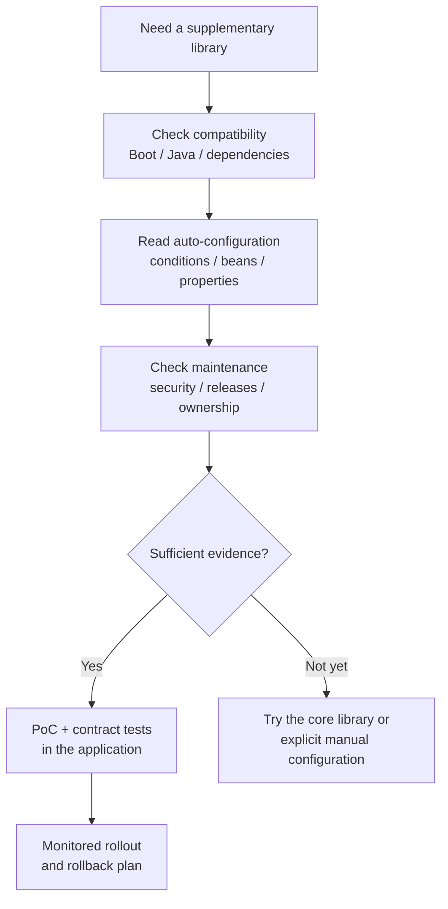

# Evaluating Third-Party Starters by Version, Bean Conditions, and Maintenance

## 1. Why Evaluate a Spring Boot Starter Before Adding It?

In the **SPRING_BOOT_INTEGRATION** module, a Spring Boot application typically integrates over HTTP clients, JDBC/JPA, Redis, Kafka, RabbitMQ, or Spring Integration adapters. Supplementary libraries can help auto-configure connection factories, retries, circuit breakers, serialization, telemetry, or client SDKs faster. However, a **third-party starter** can alter how Spring instantiates beans, pull in new dependencies, and automatically activate behavior when the application starts.

For example, suppose a library documents this dependency:

```groovy
dependencies {
    // Hypothetical coordinates and version to illustrate the evaluation process.
    implementation("com.example.partner:dispatch-spring-boot-starter:1.2.3")
}
```

Once added, the fact that the application starts does not mean the starter is safe: it might create its own `RestClient`, register a scheduler, pick unsuitable timeouts, introduce a different Jackson version, auto-start a consumer, or log raw payloads. A minor update can alter bean creation conditions so the app suddenly ends up with **two clients**, loses the team's customizers, or connects to an unintended environment.

This lesson structures the evaluation along **three primary axes**:

1. **Versions and compatibility**: does the starter fit your Spring Boot, Spring Framework, JDK, Jakarta APIs, and running dependencies?
2. **Bean creation conditions and side effects**: under what conditions does auto-configuration activate, and does it override application beans or trigger unexpected side effects?
3. **Maintenance and lifecycle**: who publishes releases, patches security bugs, writes release notes, and owns updates when upstreams change or a project stalls?

These three axes connect directly to configuration management, data contracts, retries/idempotency, transactions, testing, and observability in integration flows.



## 2. How Do Starters, Auto-Configuration, and Core Libraries Differ?

| Component | Function | Typical Impact |
| --- | --- | --- |
| **Core library** | Provides APIs, adapters, or client implementations | Application creates beans and config itself |
| **Auto-configuration module** | Declares `@AutoConfiguration`, `@Bean` definitions, and conditions | Spring creates beans when classpath/properties/beans match |
| **Starter** | Convenience dependency pulling in the core library, auto-config, and needed pieces | Adding one Gradle/Maven coordinate can activate many configurations |
| **Official Spring Boot starter** | Maintained in lockstep with Spring Boot via its BOM/ecosystem | Has compatibility docs and a Spring Boot-aligned roadmap |
| **Third-party starter** | Maintained by an external organization or community | Requires separate verification of maintenance and compatibility |

An artifact name ending in `-spring-boot-starter` **does not guarantee** it has been vetted by Spring Boot. Treat it purely as a dependency packaging convention; inspect the source, artifact metadata, and runtime behavior.

A starter may be structured like:

```text
dispatch-spring-boot-starter
  ├─ dispatch-core
  ├─ dispatch-spring-boot-autoconfigure
  ├─ HTTP client dependency
  ├─ metrics / retry dependency
  └─ transitive dependencies
```

Not every starter follows this exact layout. If you only need `dispatch-core` while the starter auto-configures too many beans, **using the core library with `@Configuration` you control** can lower risk. Decide based on actual development cost and operational ownership.

## 3. Establish Version Compatibility Baselines Before Trying It

Evaluation must begin from **the stack currently deployed**, not from the starter's highest version number.

| Component | What to Record | Reason |
| --- | --- | --- |
| Spring Boot | Exact major/build version and active BOM | Defines the tested set of aligned library versions |
| Spring Framework | Version managed by Boot | Auto-configuration APIs and SPIs can differ |
| Java/JDK | Actual runtime and bytecode target | Incompatible class files/features fail to load |
| Servlet/Jakarta | `jakarta.*` vs. `javax.*` for migrated APIs | Spring Boot 3 / Spring Framework 6 transitioned to Jakarta |
| Spring Data / Security / Integration | Corresponding APIs and starters | Compatibility of repositories/adapters/filters |
| Jackson, Reactor, Netty, Kafka client | Versions resolved on the runtime classpath | Version drift can trigger runtime linkage errors |
| Third-party starter | Releases, supported branches, compatibility statements | A version that happens to run may not be upstream-supported |

**Example of a major transition:** Spring Boot 3 builds on Spring Framework 6 and requires Java 17+, moving many Servlet/Validation/JPA APIs from `javax.*` to `jakarta.*`. However, Java SE APIs like `javax.sql.DataSource` **remain in `javax.sql`**. Never perform mechanical string replacements across namespaces.

When evaluating Spring Boot 4 or a newer major release, verify the **starter's own support matrix** and test at runtime; do not assume an old version supporting Boot 3 works unchanged on a newer major release.

### Version Checklist

- Does the starter explicitly state tested minimum and maximum Spring Boot/Spring Framework/JDK versions?
- Does it build/test against matching major versions, or only make a vague "Spring Boot compatible" claim?
- Does the starter use public APIs or internal classes that may change in minor releases?
- Does it depend on `javax.servlet`, `javax.validation`, or old Spring Security APIs?
- Does it release promptly alongside CVE fixes in key dependencies?
- Have behavior or config properties changed between releases without a migration guide?

If compatibility documentation is missing, treat it as **unproven** and build a PoC on your application's exact runtime version.

## 4. Managing Dependencies with BOMs and Inspecting the Dependency Tree

Spring Boot manages many library versions via a BOM. A third-party starter can declare its own dependency versions or introduce libraries outside the BOM. Always inspect the **final versions resolved at runtime**.

In a Gradle project with a wrapper, use these commands during evaluation on a real checkout:

```bash
./gradlew dependencies --configuration runtimeClasspath
./gradlew dependencyInsight --dependency spring-web --configuration runtimeClasspath
./gradlew dependencyInsight --dependency jackson-databind --configuration runtimeClasspath
./gradlew dependencyInsight --dependency reactor-netty --configuration runtimeClasspath
```

On Windows, run the corresponding `gradlew.bat` wrapper. These commands are **practical instructions**, not steps executed inside this lesson.

With Maven, `mvn dependency:tree` inspects pulled dependencies and narrows down scope as needed. Save the dependency tree **before and after adding the starter** so you have concrete comparison evidence.

### Red Flags in the Dependency Tree

| Signal | Risk |
| --- | --- |
| Starter pulls a different major Jackson/Netty/Reactor version than the stack | `NoSuchMethodError`, `ClassNotFoundException`, or incompatible runtime behavior |
| Two logging bridges or multiple SLF4J providers appear | Duplicate logs, binding errors, or missing telemetry |
| Depends on an unmaintained library | Unpatched CVEs, incompatible with newer JDKs |
| Starter pulls unexpected actuator, web stack, scheduler, or broker clients | Bloats classpath, bean count, attack surface, and side effects |
| Forcing `spring-*` versions with global resolution rules | Breaks the Spring Boot version set tested together |
| Dependency pulls test libraries into runtime | Increases artifact size and unnecessary license/security exposure |

**Never use `exclude` or force versions as a "quick fix" and skip tests.** Excluding a transitive dependency the starter actually needs can cause auto-config to fail only at runtime when a specific code path runs. If an override is unavoidable, document the reason, compatibility tests, and a review date.

### Pinning Versions and Controlling Artifact Sources

For third-party starters, use vetted versions, trusted artifact repositories, dependency locking/verification mechanisms, and review diffs before upgrading. Avoid snapshot or changing versions in production unless governed by a dedicated process. A BOM guarantees version selection for **modules managed by the BOM**; it does not automatically make external artifacts compatible.

## 5. How Does Spring Boot Decide Whether to Create a Bean?

The most critical aspect when reviewing a starter is **conditional auto-configuration**.

| Annotation / Mechanism | Meaning When Reading Source | Questions to Check |
| --- | --- | --- |
| `@AutoConfiguration` | Declares an automatically imported configuration class | Where is it registered? |
| `@ConditionalOnClass` | Applies only when specific classes exist | Could this class appear accidentally via another dependency? |
| `@ConditionalOnBean` | Applies only when a matching bean already exists | If the bean is created late or renamed, does config vanish? |
| `@ConditionalOnMissingBean` | Backs off when a user-defined bean already exists | Check bean type, name, qualifier, and evaluation order |
| `@ConditionalOnProperty` | Toggles via property | Is the default on or off? Does a missing property count as a match? |
| `@ConditionalOnResource` | Applies only when a resource exists | Is the resource inside a JAR or external config? |
| `@ConditionalOnWebApplication` | Depends on web application type | Does it behave differently in batch/consumer apps? |
| `@ConditionalOnSingleCandidate` | Requires a single unambiguous candidate | Are multi-`DataSource` or multi-client apps affected? |
| `@ConditionalOnMissingClass` | Activates when a class is absent | Does it pick a fallback implementation? |
| `@AutoConfigureAfter` / ordering | Defines auto-configuration evaluation order | Does it depend on `@ConditionalOnMissingBean` from another config? |

**Beans are created conditionally, not just by dependency name.** The same starter can produce different beans across web, batch, test, staging profiles, or when another library enters transitively.

Conditions typically inspect *bean definitions known at evaluation time*; `@ConditionalOnMissingBean` does not mean "search the entire future finished context". Auto-configuration registration/evaluation order can decide whether a starter backs off for user configuration. Therefore, test both **user-provided bean** and **multiple-candidate** scenarios explicitly.

### From Registration File to Live Beans

Spring Boot 3 typically loads auto-configuration classes via:

```text
META-INF/spring/org.springframework.boot.autoconfigure.AutoConfiguration.imports
```

Example contents:

```text
com.example.partner.autoconfigure.DispatchAutoConfiguration
```

Older layouts listed auto-configurations in `META-INF/spring.factories`; Spring Boot 2.7 introduced the imports format, while Boot 3 uses `AutoConfiguration.imports` for auto-configuration registration. **`spring.factories` still serves other purposes in the Spring ecosystem**; do not treat every file with that name as "obsolete" or safe to delete blindly.

Inspect the **actual published JAR**, not just the `main` branch source: a module with `@AutoConfiguration` classes missing the registration file will not auto-import. Conversely, a starter bundling an undocumented auto-config can create surprising beans.

## 6. Example of a Testable Auto-Configuration

Suppose a hypothetical starter creates a partner HTTP client. The goal is: create `DispatchClient` only when **the feature is enabled**, the class is on the classpath, and **the application has not supplied its own bean of that type**.

```java
import java.net.URI;
import java.time.Duration;
import org.springframework.boot.autoconfigure.AutoConfiguration;
import org.springframework.boot.autoconfigure.condition.ConditionalOnClass;
import org.springframework.boot.autoconfigure.condition.ConditionalOnMissingBean;
import org.springframework.boot.autoconfigure.condition.ConditionalOnProperty;
import org.springframework.boot.context.properties.ConfigurationProperties;
import org.springframework.boot.context.properties.EnableConfigurationProperties;
import org.springframework.context.annotation.Bean;

// Illustrative source code for a third-party-provided starter.
@AutoConfiguration
@ConditionalOnClass(DispatchClient.class)
@EnableConfigurationProperties(DispatchProperties.class)
public class DispatchAutoConfiguration {

    @Bean
    @ConditionalOnMissingBean(DispatchClient.class)
    @ConditionalOnProperty(
            prefix = "partner.dispatch",
            name = "enabled",
            havingValue = "true",
            matchIfMissing = false)
    DispatchClient dispatchClient(DispatchProperties properties) {
        return new DispatchClient(
                properties.baseUrl(),
                properties.timeout());
    }
}

// These minimal types belong to the same hypothetical illustration.
@ConfigurationProperties(prefix = "partner.dispatch")
public record DispatchProperties(URI baseUrl, Duration timeout) {}

public record DispatchClient(URI baseUrl, Duration timeout) {}
```

This illustrates **conditions**, not a real starter where three public types are pasted into one Java file. In real implementations, each public type lives in its own file; `DispatchProperties` needs validation (HTTPS base URL, positive timeout), and the client must configure TLS, retries, timeouts, and telemetry per contract.

Suppose the starter uses:

```yaml
partner:
  dispatch:
    enabled: true
    base-url: https://partner.example.test
    timeout: 2s
```

Questions to answer during review:

1. If `enabled` is missing, does the starter create the client and call external services? In this example **no**, because `matchIfMissing=false`.
2. If `DispatchClient` is absent, is the auto-config safely skipped?
3. If the app provides its own `DispatchClient` bean, does `@ConditionalOnMissingBean` truly back off?
4. If `base-url` is invalid, does the program fail fast with a safe message or create a broken bean that retries forever?
5. If the starter registers an extra `ObjectMapper`, `RestClient.Builder`, or `KafkaListenerContainerFactory`, does it alter behavior across the entire app?

A well-behaved third-party starter provides **clear enable/disable and override options**, uses a dedicated property prefix, avoids fighting the application for beans, and avoids starting network activity until conditions are met.

## 7. Testing Auto-Configuration Conditions with ApplicationContextRunner

Do not evaluate a starter merely by booting a full Spring Boot application and checking whether startup succeeds. `ApplicationContextRunner` in `spring-boot-test` spins up lightweight contexts to test exact combinations of **classpath / properties / user-provided beans**.

For the hypothetical `DispatchAutoConfiguration` above:

```java
import static org.assertj.core.api.Assertions.assertThat;

import java.net.URI;
import java.time.Duration;
import org.junit.jupiter.api.Test;
import org.springframework.boot.autoconfigure.AutoConfigurations;
import org.springframework.boot.test.context.runner.ApplicationContextRunner;
import org.springframework.context.annotation.Bean;
import org.springframework.context.annotation.Configuration;

class DispatchAutoConfigurationTest {

    private final ApplicationContextRunner runner =
            new ApplicationContextRunner()
                    .withConfiguration(AutoConfigurations.of(
                            DispatchAutoConfiguration.class));

    @Test
    void disabledByDefault() {
        runner.run(context ->
                assertThat(context).doesNotHaveBean(DispatchClient.class));
    }

    @Test
    void enabledPropertyCreatesExactlyOneClient() {
        runner.withPropertyValues(
                "partner.dispatch.enabled=true",
                "partner.dispatch.base-url=https://partner.example.test",
                "partner.dispatch.timeout=2s")
              .run(context -> {
                  assertThat(context).hasSingleBean(DispatchClient.class);
                  assertThat(context.getBean(DispatchClient.class).timeout())
                          .isEqualTo(Duration.ofSeconds(2));
              });
    }

    @Test
    void userProvidedBeanTakesPrecedence() {
        runner.withPropertyValues(
                "partner.dispatch.enabled=true",
                "partner.dispatch.base-url=https://partner.example.test",
                "partner.dispatch.timeout=2s")
              .withUserConfiguration(UserClientConfiguration.class)
              .run(context -> {
                  assertThat(context).hasSingleBean(DispatchClient.class);
                  assertThat(context.getBean(DispatchClient.class).baseUrl())
                          .isEqualTo(URI.create(
                                  "https://custom.example.test"));
              });
    }

    @Configuration(proxyBeanMethods = false)
    static class UserClientConfiguration {
        @Bean
        DispatchClient dispatchClient() {
            return new DispatchClient(
                    URI.create("https://custom.example.test"),
                    Duration.ofSeconds(5));
        }
    }
}
```

This is an illustrative test suite for the previous example classes. In a real project, place them in proper Java source files with `spring-boot-starter-test`. In production code, real clients may require additional dependencies and health/network resources.

Expected outcomes of the three tests:

| Condition | Expected `DispatchClient` Bean |
| --- | --- |
| Missing `partner.dispatch.enabled` | No bean |
| `enabled=true`, no user bean | Exactly one bean created by auto-config |
| `enabled=true`, user declared custom bean | User bean wins; auto-config backs off |

Expand tests using `FilteredClassLoader` to simulate **missing optional classes**, and `withPropertyValues` to test malformed URIs, negative timeouts, renamed property aliases, or invalid endpoints. If a starter uses `@ConditionalOnBean` or `@ConditionalOnSingleCandidate`, add tests with **0, 1, and 2 candidate beans**.

`ApplicationContextRunner` **does not replace integration tests**: a minimal context does not prove the real HTTP client communicates, that Kafka consumers don't subscribe to the wrong topic, or that retries behave safely when a database commits and the consumer crashes. Bean conditions must be tested at both unit and application integration levels.

## 8. Inspecting Live Configuration with ConditionEvaluationReport

Spring Boot provides a report explaining why auto-configurations **matched** or **did not match**. When a starter creates unexpected beans, look here before randomly excluding dependencies.

In development, enable the condition report with `--debug` at startup (depending on launch method). With Spring Boot Actuator, the `/actuator/conditions` endpoint exposes evaluated auto-configuration conditions.

```yaml
# Illustrates dev/test configuration only when Actuator is present.
management:
  endpoints:
    web:
      exposure:
        include: health,info,conditions
```

**Never expose `/actuator/conditions` publicly in production.** The report reveals bean names, classpath details, configuration, and infrastructure topology. Restrict access via Spring Security/network policy or inspect offline reports in test environments.

When reading the report, verify:

1. Was the starter's auto-configuration class **imported**?
2. If not imported, does the JAR contain `AutoConfiguration.imports` and the matching class?
3. If imported yet the bean is missing, which condition evaluated negative: classpath, property, resource, bean, or web environment?
4. If the bean is present, which auto-config created it, with what scope/qualifier, and does it conflict with intended app beans?
5. If the bean exists yet cannot connect, the issue likely lies in **configuration properties, network, TLS, or permissions**, not conditions.

Do not rely solely on `@Bean` names. Two starters can declare beans of the same **type** under different names, making by-type injection ambiguous; or a `@Primary` bean can silently alter wiring while the application still starts normally.

### Example Failure with Multiple Beans

Suppose an application has two `DataSource` beans for business and audit databases. A starter adds:

```java
@Bean
@ConditionalOnSingleCandidate(javax.sql.DataSource.class)
SomeJdbcRecorder recorder(javax.sql.DataSource dataSource) {
    return new SomeJdbcRecorder(dataSource);
}
```

With one `DataSource`, the recorder bean is created. With two `DataSource` beans and no single resolved primary candidate, the condition fails, causing the recorder to **vanish** after a config change. With a `@Primary` bean, the condition passes—yet attaches to the **wrong database** if the design wasn't explicit.

Similarly, adding a custom `KafkaTemplate` or `ObjectMapper` can make auto-config back off or bind to a different candidate. Therefore write **multi-bean wiring** tests, not just `contextLoads()`.

## 9. Side Effects to Scrutinize in Integration Starters

A starter may register beans whose side effects only trigger on `ApplicationReadyEvent`, when listener containers start, or on first invocation. During review, inspect carefully:

| Area | Potential Emergent Behavior | Testing Evidence |
| --- | --- | --- |
| HTTP client | Picks default base URL, proxy, timeout, TLS trust, or retry interceptor | Verify requests hit intended host, timeouts, and cert validation |
| JDBC/JPA | Creates extra `DataSource`/transaction manager or runs schema init | Verify DB/schema, connections, transactions, no unintended writes |
| Kafka | Registers producers/consumers, listener containers, topic creation | Observe group IDs, topics, auto-startup, offsets, and ACLs |
| RabbitMQ | Auto-declares exchanges/queues, auto-listeners, retry/DLQ | Check topology, permissions, redeliveries, and duplicates |
| Redis/cache | Creates `RedisConnectionFactory`, cache managers, serializers, and TTLs | Test key namespaces, serialization, expiry, and connectivity |
| Spring Integration | Registers unexpected flows/adapters/pollers/channels | Check poll frequency, message volume, thread pools, and duplicates |
| Resilience | Adds retries, circuit breakers, timeouts, or schedulers | Test total attempts, timeout budgets, and interceptor order |
| Observability | Enables metrics/tracing/payload logging, health indicators | Check for leaked secrets/PII and metric cardinality |

**Stacked retries** are a classic trap: HTTP client retries, Spring Retry retries, Kafka listener retries, and broker redelivery. For example, three layers each allowing up to three attempts can multiply into **27 calls** for a single operation depending on config and failure point. Define **who owns the retry policy** and cap total attempts, especially for payment APIs or non-idempotent operations.

If a starter adds `@Transactional`, interceptors, or transactional event listeners, inspect exact COMMIT/ACK boundaries and AOP proxy ordering. Changing advice order can cause ACK before DB commit or place retries outside transactions differently than intended.

### Risks from Default Configurations

Defaults worth scrutinizing include:

- Auto-enabling by default instead of requiring `enabled=true`.
- Defaulting to `localhost` or demo endpoints when properties are missing, causing cross-environment calls.
- Infinite retries or huge wait times, stalling consumers.
- Disabling hostname/TLS certificate chain verification.
- Auto-creating tables/indexes/topics when running with production permissions.
- Sending telemetry to third parties or logging bodies containing tokens and customer data.
- Creating dedicated thread/connection pools per bean instead of using managed pools.

Verify defaults from source code, metadata/configuration, and runtime tests rather than trusting a summary sentence on a project homepage.

## 10. Evaluating Maintainability and Supply-Chain Safety

A starter may work today yet become a liability when Spring Boot upgrades major versions or a vulnerability surfaces. Evaluate the health of the maintenance process, not just repository star counts.

| Signal | What to Collect | Interpretation |
| --- | --- | --- |
| Releases | Recent versions, release notes, changelogs, explicit Boot version support | Is there a viable upgrade path? |
| Issues/PRs | How maintainers respond to bugs, security issues, incompatibilities | Does someone resolve critical defects? |
| Tests/CI | Unit tests, integration tests, JDK/Boot matrices, dependency updates | Do critical behaviors have regression coverage? |
| Artifact provenance | Official release repositories, checksums/signatures where available | Do binaries come from trusted sources tied to source/tags? |
| Security | CVEs/advisories, vulnerability disclosure and patching process | Can vulnerabilities be patched within your SLA? |
| License | Licenses of the starter and transitive dependencies | Compatible with your organization's usage/distribution policy? |
| Documentation | Config reference, migration notes, support channels, deprecation policy | Can your team diagnose and recover when things break? |
| Exit plan | Can you switch to core APIs directly or swap to another starter? | How bounded is single-maintainer lock-in? |

**Infrequent recent commits are not automatically bad** if a library is small, stable, and has a clear response process. Conversely, rapid commits and releases do not prove safety. Judge by **support for your target versions, incident responsiveness, and test quality**.

Scan CVEs/advisories across the **entire runtime dependency tree**, generate SBOMs if required by org policy, check licenses, and verify artifact provenance. Automated scanner hits must be triaged: an advisory may not touch an active code path, yet should not be dismissed carelessly because "the starter doesn't call that module directly".

### When Upstream Maintenance Stops

Ask:

1. Is there an official replacement or core Spring Boot/Spring Data/SDK API with sufficient capabilities?
2. Can it be replaced by a concise internal `@Configuration` maintained by the team?
3. Is there an actively maintained fork, or does the organization have capacity to own patches?
4. If kept temporarily, how are network/permissions/dependencies constrained and what is the replacement target date?

**Self-forking** only makes sense if someone owns CI, releases, security patches, and reviews long-term. Forking to fix one bug and abandoning it creates deeper operational debt.

## 11. Decision Matrix: Use the Starter or Configure Directly?

Score each criterion as `PASS`, `RISK`, or `FAIL` backed by evidence rather than adding abstract points:

| Criterion | PASS | RISK | FAIL |
| --- | --- | --- | --- |
| Boot/JDK compatibility | Explicitly published and tests pass | Unpublished, though PoC succeeds | Uses removed APIs or crashes at runtime |
| Auto-config | Clear conditions, overrides, and tests | Some tricky defaults, but cleanly disableable | Uncontrolled bean overrides or side effects |
| Dependencies | Clean dependency resolution | Needs tested overrides | Major version conflicts with no reliable fix |
| Security | No unresolved issues, clear patching process | Requires extra controls and monitoring | Severe vulnerability with no remediation path |
| Operations | Safe metrics/health/logs and rollback | Missing some telemetry that can be added | Cannot detect failures or disable safely |
| Maintenance | Responsive maintainers, clear releases | Slow maintenance, though stable features | Abandoned, blocking required upgrades |

Adopt a starter only when there are **no critical FAILs** and every `RISK` has a mitigation accepted by the team. If a starter only saves a few lines of `@Bean` boilerplate while introducing hard-to-maintain dependencies and heavy side effects, use the **core SDK/library** with explicit configuration.

### Comparison Example in a Kafka → HTTP Service

Requirement: a Kafka consumer receives `OrderPaid`, calls a partner HTTP API with a 2-second timeout, records idempotency in SQL, and sends permanent failures to a DLT.

**Option A: Third-party starter.** It auto-creates the HTTP client, retries, metrics, and an error handler. If chosen, verify final retry counts, retryable error types, TLS policy, bean names, whether it hijacks the shared `CommonErrorHandler`, and how the app overrides it.

**Option B: Core HTTP SDK/library.** The application declares `RestClient`/`WebClient`, retry policies, and Kafka `DefaultErrorHandler` in its own `@Configuration`. It requires more configuration code, while keeping responsibility boundaries crystal clear.

If a starter silently retries a POST after timeout, the partner may already have processed the first request; **idempotency keys** and reconciliation remain necessary regardless of how the client was initialized.

## 12. Controlled Testing and Rollout Process

A meaningful PoC runs on the **exact Boot BOM, JDK, and runtime dependencies** of the target application. Verification sequence:

1. **Baseline:** capture key beans, dependency tree, active endpoints/consumers, and metrics before adding the starter.
2. **Add dependency on a test branch:** choose a vetted version, recording rationale and upstream docs.
3. **Diff runtime classpath:** look for changes in Spring, Jackson, Reactor/Netty, JDBC, Kafka, logging, and security.
4. **Inspect auto-config metadata/conditions:** list beans, properties, conditional branches, and side effects.
5. **Lightweight context tests:** use `ApplicationContextRunner` for disabled/enabled/override/multi-bean/classpath combinations.
6. **Integration tests:** test real SQL/HTTP/brokers via Testcontainers or matching fixtures.
7. **Fault injection:** timeouts, auth failures, broker disconnects, duplicate events, DB commit followed by crash before ACK, DLT publish failures.
8. **Canary:** roll out to a slice of traffic; compare metrics/latency/error rates and inspect live beans/endpoints.
9. **Rollout/rollback:** keep a fast kill switch where possible, previous artifacts for rollback, and migration procedures if the starter alters schemas.
10. **Ownership:** assign who tracks security advisories, Boot upgrades, and dependency review dates.

**Disabling a bean via property does not necessarily remove all dependency impact.** The JAR remains on the classpath, potentially influencing dependency resolution or other auto-configurations. When a full rollback is needed, also verify removing the starter cleanly.

### Excluding Auto-Configuration When Isolation Is Needed

Spring Boot can exclude **a specific auto-configuration class** when appropriate:

```yaml
spring:
  autoconfigure:
    exclude:
      - com.example.partner.autoconfigure.DispatchAutoConfiguration
```

This is a **hypothetical** class name from the example. Use this only after verifying the actual class exists and is listed in the starter's auto-configurations. If the starter registers extra listeners, component scans, or other auto-configurations, excluding one class may not disable everything. Prefer author-supported feature flags and test the disabled path.

## 13. Staged Upgrade Plan for Starters

An upgrade can change both **APIs** and **bean creation conditions** even without touching application source code. Build a checklist table for every upgrade:

| Phase | Actions Required | Evidence |
| --- | --- | --- |
| Pre-upgrade | Read changelogs/migration guides; verify versions from BOM/lockfile | List of breaking changes |
| Dependency resolution | Compare `runtimeClasspath` before/after | Explained dependency diff |
| Boot context | Verify bean counts, names, qualifiers, and conditions | `ApplicationContextRunner` tests + report |
| Integration contracts | Verify serialization/deserialization, timeouts, retries, error mapping | Contract/integration tests |
| Failure paths | Simulate disconnects, redeliveries, stale credentials | Zero lost or duplicated business work |
| Deployment | Canary, compare metrics and logs | Clear rollback thresholds |
| Post-deploy | Monitor CVEs, lag, pool exhaustion, and incidents | Ownership and review cadence |

Upgrading Spring Boot major, Kafka client major, and multiple third-party starters simultaneously introduces too many variables. Whenever possible, break upgrades into scoped, evidence-backed steps to isolate regressions quickly.

## 14. Common Mistakes

1. **Choosing a starter by its familiar name:** failing to verify publisher, versions, and actual auto-configurations.
2. **"App starts green" = "compatible":** bugs hide until retry/TLS/transaction paths execute.
3. **Skipping transitive dependency checks:** Jackson, logging, or Reactor versions get silently swapped at runtime.
4. **Thinking `@ConditionalOnClass` is enough:** the class is on the classpath, yet beans/properties are wrong or unintended defaults turn on.
5. **Assuming `@ConditionalOnMissingBean` always backs off:** registration order, types, names, and qualifiers were never tested.
6. **Skipping multi-bean tests:** production has two `DataSource` or `KafkaTemplate` beans, changing conditions from dev.
7. **Starter spawns hidden consumers/pollers:** silently increases processors, duplicates, or backlogs.
8. **Multi-layer stacked retries:** downstream call counts far exceed configured expectations.
9. **Accepting trust-all TLS or raw payload logging defaults:** leaks sensitive data and breaks TLS verification.
10. **No dependency owner:** CVEs or Spring Boot major upgrades arrive with nobody responsible for fixing them.
11. **Reading only the `main` source branch:** published artifacts can differ from HEAD.
12. **No rollback path:** the starter mutates DB schemas or broker topics before the team detects bad behavior.

## 15. Lab Exercise: Evaluating a Hypothetical HTTP/Kafka Starter

**Scenario:** a team runs Spring Boot 3.x, Java 17+, Spring Kafka, and PostgreSQL. A third party proposes `dispatch-spring-boot-starter` to auto-create an HTTP client with retries and metrics.

Lab tasks:

1. Build a version matrix covering Boot, Framework, JDK, Kafka client, HTTP stack, and the proposed starter version.
2. Record dependency tree diffs, especially Jackson, Netty/Reactor, retries, and logging.
3. Verify the JAR contains `AutoConfiguration.imports`; list the auto-configs and client bean conditions.
4. Write `ApplicationContextRunner` tests for default disabled, enabled, missing dependencies, and user-provided beans.
5. Build a small integration app with two HTTP client beans and two `DataSource` beans to test wiring/qualifiers.
6. Simulate HTTP 503, timeout after a successful POST, and Kafka redelivery after DB commit; measure total attempts and side effects.
7. Toggle the starter on and off via configuration flags; confirm no unexpected connections or pollers start.
8. Evaluate maintainers, license, security policy, BOM compatibility, and an exit plan to core SDKs if needed.
9. Summarize findings in a `PASS/RISK/FAIL` table with evidence, owner, and deployment decision.

### Acceptance Criteria

| Criterion | Expectation |
| --- | --- |
| Versions | Real stack tested with no unexplained dependency conflicts |
| Bean conditions | Default, toggle, override, and multi-bean scenarios behave as intended |
| HTTP behavior | Timeouts, TLS, retries, and idempotency tested against real faults |
| Kafka/SQL | COMMIT/ACK ordering preserved; retries cause no duplicate side effects |
| Security | No trust-all TLS, no leaked tokens/PII in logs or telemetry |
| Operations | Metrics/alerts, disable switch, and rollback path are clear |
| Maintenance | Maintainer/owner, acceptable license, and upgrade plan confirmed |

## 16. Self-Check Questions

1. How does a dependency named `-spring-boot-starter` differ from an auto-config module and a core library?
2. Why inspect **`runtimeClasspath`** instead of just reading declared dependencies?
3. How do `@ConditionalOnClass`, `@ConditionalOnBean`, and `@ConditionalOnMissingBean` differ?
4. How does `matchIfMissing=true` on `@ConditionalOnProperty` affect secure defaults?
5. In Spring Boot 3, in which file are auto-configurations typically listed?
6. Why must `@ConditionalOnMissingBean` be tested with an application-defined bean?
7. How do you explain a starter creating a client in dev yet missing the bean in production when two `DataSource` beans exist?
8. What does `ApplicationContextRunner` verify, and what still requires `@SpringBootTest`/integration tests?
9. Why can starter retries increase outbound HTTP calls after a timeout even though the app called one method?
10. What evidence justifies accepting a starter with few recent releases that is still maintained?
11. Why does disabling auto-config via a property not necessarily remove all dependency tree effects?
12. When upstream maintenance stops, what must be prepared before deciding to fork or replace with the core library?

## Summary

Evaluating a third-party starter is a decision about **version compatibility, how Spring Boot constructs the `ApplicationContext`, and long-term maintenance ownership**. In `SPRING_BOOT_INTEGRATION`, a starter can speed up creating HTTP clients, database connections, Kafka/RabbitMQ adapters, or observability, yet can also alter dependencies, auto-start listeners, change retries, and impact transactions. Check versions/BOMs, read `AutoConfiguration.imports` and `@Conditional...` annotations, test beans with `ApplicationContextRunner`, test side effects along boundary failures, and evaluate security, licensing, maintainers, and rollback. Bring a starter into your system only with proof that it solves a real need while leaving configuration, consistency, and operations under your control.

### References

- [Spring Boot Reference — Developing Auto-configuration](https://docs.spring.io/spring-boot/reference/features/developing-auto-configuration.html)
- [Spring Boot Reference — Condition Evaluation](https://docs.spring.io/spring-boot/reference/actuator/endpoints.html)
- [Spring Boot Reference — Managing Dependencies](https://docs.spring.io/spring-boot/reference/using/build-systems.html)
- [Spring Boot API — ApplicationContextRunner](https://docs.spring.io/spring-boot/api/java/org/springframework/boot/test/context/runner/ApplicationContextRunner.html)
- [Gradle User Manual — Viewing Dependencies](https://docs.gradle.org/current/userguide/viewing_debugging_dependencies.html)
- [OWASP — Software Component Verification Standard](https://owasp.org/www-project-software-component-verification-standard/)
