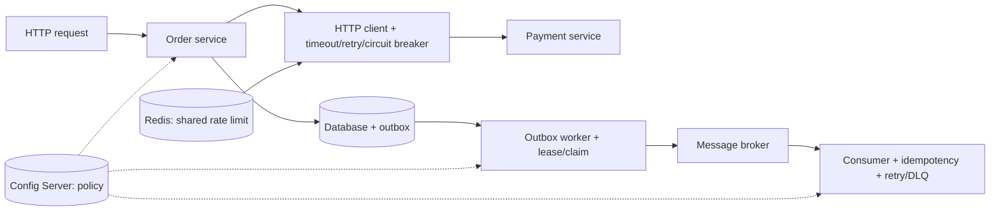
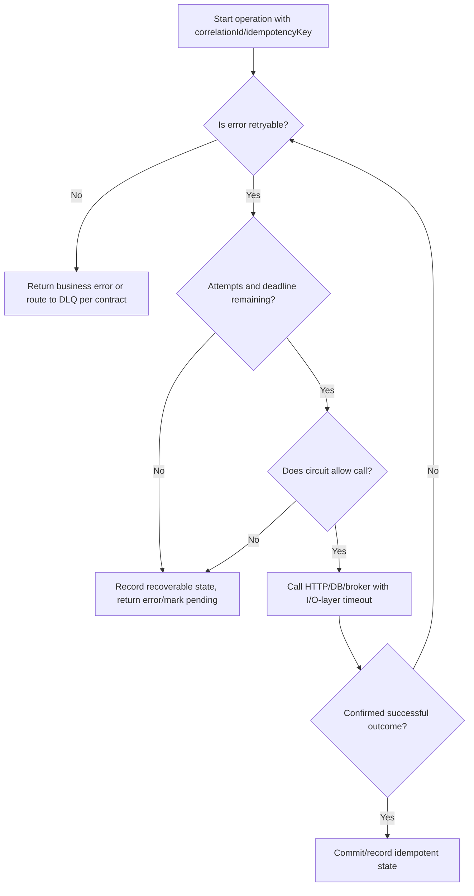

# Resilience Activation Conditions and Distributed Configuration by Library

In a **Spring Boot Integration** application, a business flow often traverses HTTP clients, databases, caches, brokers, and Spring Integration adapters. When a dependency slows down or drops connections, the application may need *retries*, *circuit breakers*, *timeouts*, *bulkheads*, *rate limiting*, or cross-instance coordination. These capabilities usually come from **supplementary libraries**, yet merely adding a dependency to the project does not guarantee the protection mechanism is active.

Even easier to misunderstand is the word **"distributed"**. Loading identical Resilience4j configuration across five pods does not share circuit breaker state across those five pods; likewise, five in-memory rate limiters can permit total traffic exceeding the system-wide limit. To choose the right tool, distinguish clearly between **each library's activation conditions**, **runtime state scope**, and **how configuration is distributed versus how state is coordinated across nodes**.

## 1. Objectives and Running Scenario

After this lesson, you will be able to:

- Distinguish resilience mechanisms at the method, HTTP client, message handler, gateway, background scheduler, and cluster-wide levels.
- Identify when starters, annotations, AOP proxies, beans, factories, advice, or shared state backends are required for a feature **to actually execute**.
- Explain the local scope of mechanisms in Resilience4j, Spring Retry, and Spring Cloud CircuitBreaker.
- Distinguish **centralized configuration**, **configuration propagation**, **shared state**, and **distributed coordination**.
- Design retries and timeouts aligned with time budgets, idempotency, and HTTP/database/broker transaction semantics.
- Recognize when to use Redis-backed rate limiting, ShedLock, or durable jobs/outboxes.
- Plan tests for scaling replicas, restarting pods, changing configuration, or handling Redis/broker failures.

**Scenario:** a Spring Boot service receives `POST /orders`, saves the order to PostgreSQL, calls a payment service over HTTP, and publishes an event to a broker. The application runs three replicas plus a scheduled job moving events from an outbox table to the broker. The payment partner enforces a shared limit of 120 requests/minute across the service's entire client account. Decisions to resolve: which errors to retry, where the circuit breaker lives, whether the 120-request cap is shared, and whether all three replicas run the outbox job simultaneously.

## 2. Four Questions to Answer Before Adding a Library

The same library can sit in dependencies without affecting the execution path at all. Before writing configuration, establish:

| Question | Meaning | Examples |
|---|---|---|
| **What activates it?** | Dependency, bean, annotation, AOP, auto-configuration, advice, or gateway filter? | Resilience4j `@Retry` needs the matching Spring aspect; `RetryTemplate` must be called or wired into handlers |
| **Which execution segment does it wrap?** | A method, HTTP call, inbound message, poller, or scheduled job? | Retries wrapping an HTTP client differ from broker redelivery |
| **Where does state live?** | Inside pod heap, database, Redis, or broker state? | Resilience4j `CircuitBreaker` keeps state per JVM by default |
| **What happens on failure?** | Retry, fail fast, DLQ, rollback, return error, keep queued, or await recovery? | Retrying after a `POST` timeout can create duplicate transactions without an idempotency key |

Without clear boundaries around the protected action, teams commonly hit **stacked retries**, **timeouts that fail to cancel underlying I/O**, or **an open circuit breaker that does not reflect cluster-wide status**.

### 2.1. Diagram of Placement Points



Redis in the diagram can hold **shared quota state**. Config Server supplies **configuration values**. The broker coordinates **message delivery**, while the database protects business state. None of those components automatically makes every resilience library share runtime state.

## 3. Activation Conditions Matrix by Library

The table below is a selection map; artifact names illustrate the Spring Boot 3.x ecosystem. When using another Spring Boot or Spring Cloud major version, check your BOM and version docs.

| Library / Mechanism | Actual Activation Requirement | Default State Scope | Multi-Instance Needs |
|---|---|---|---|
| **Resilience4j** (`CircuitBreaker`, `Retry`, `RateLimiter`, `Bulkhead`) | Matching module; invoke decorator/programmatic API or annotations active via Spring AOP/aspects | Per JVM/registry | Distribute **policy** via config; global quotas require a dedicated shared-state solution |
| **Spring Retry** | Use `RetryTemplate` directly or configure `@EnableRetry` + `@Retryable`/proxy with required dependencies | Per-invocation retry context, in-process | Caps retries per caller; no default distributed retry budget |
| **Spring Cloud CircuitBreaker** | Provider starter present and `CircuitBreakerFactory`/reactive factory invoked around protected calls | Provider-dependent, usually local | Sync policies via config; breaker state is not shared by default |
| **Spring Integration retry advice** | Attach `RequestHandlerRetryAdvice`/advice to the target message handler or poller with retry policy | Within handler/poller invocation | Coordinate with claims, broker redelivery, and idempotency; no shared retry state |
| **Local Bucket4j** | Create bucket and invoke `tryConsume`/consume via API | In instance memory | Use shared extensions/providers via Redis, Hazelcast, JDBC, etc. for global quotas |
| **Spring Cloud Gateway RedisRateLimiter** | Configure `RequestRateLimiter` filter, `KeyResolver`, and Redis-backed limiter on target gateway routes | Token bucket coordinated via Redis | Multiple gateway replicas share backend/key namespace and quota policy |
| **ShedLock** | Shared lock provider, `@EnableSchedulerLock`, and `@SchedulerLock` or programmatic lock API | Lock record in shared storage | All scheduler nodes must share the same lock provider and lock name |
| **Spring Cloud Config / Bus** | Config client/import and, if needed, refresh/distribution mechanism | **Configuration values**, not breaker/quota state | Distributes config and verifies replicas applied it; does not replace Redis/DB shared state |

**How to read the table:** "having the dependency" only puts classes on the classpath. For a feature to take effect, the real execution path must pass through the wrapper, annotation, handler, or configured route filter.

## 4. Resilience4j: Execution Requirements and State Limits

Resilience4j provides independent modules such as circuit breaker, retry, time limiter, rate limiter, and bulkhead. It can be used via **decorator/programmatic APIs** or Spring annotations/auto-configuration depending on the module.

### 4.1. Dependencies and AOP Conditions

A common Gradle setup for Spring Boot 3.x:

```groovy
dependencies {
    implementation 'io.github.resilience4j:resilience4j-spring-boot3'
    implementation 'org.springframework.boot:spring-boot-starter-aop'
    implementation 'org.springframework.boot:spring-boot-starter-actuator'
}
```

This example relies on the Spring Boot 3 starter integration and project-managed versions. For reactive apps or specialized integrations, add modules compatible with your return types and stack; annotations only take effect when the corresponding aspects/classes are registered.

Things to verify:

1. The bean holding the annotated method must be Spring-managed, and calls must go **through the Spring proxy** when relying on AOP proxies.
2. `self-invocation` (a method inside the same bean calling a `@CircuitBreaker`-annotated method directly) typically bypasses advice.
3. Classes/methods that cannot be proxied under current config, or objects instantiated with `new` outside the Spring container, prevent annotations from firing as expected.
4. Configuration under `resilience4j.*` cannot protect an HTTP client unless a call site is actually decorated or intercepted by the aspect.
5. The instance name in the annotation/API must match the configured name. Mismatches silently fall back to default settings, making visual inspection deceptive.

### 4.2. CircuitBreaker Example for an HTTP Client

```yaml
resilience4j:
  circuitbreaker:
    instances:
      billingApi:
        slidingWindowType: COUNT_BASED
        slidingWindowSize: 20
        minimumNumberOfCalls: 10
        failureRateThreshold: 50
        waitDurationInOpenState: 30s
        permittedNumberOfCallsInHalfOpenState: 3

  retry:
    instances:
      billingStatus:
        maxAttempts: 3
        waitDuration: 250ms

  ratelimiter:
    instances:
      billingApi:
        limitForPeriod: 40
        limitRefreshPeriod: 60s
        timeoutDuration: 0
```

`billingApi` under `ratelimiter` is a **local limit per registry inside one JVM**. If each replica allows 40 calls/minute, three replicas can generate traffic approaching 120 calls/minute when balanced evenly. That does not guarantee strict cluster-wide quota enforcement: replica counts, traffic skew, and refresh timing all vary.

A service using `@CircuitBreaker`:

```java
import io.github.resilience4j.circuitbreaker.annotation.CircuitBreaker;
import org.springframework.stereotype.Service;
import org.springframework.web.client.RestClient;

@Service
public class BillingStatusClient {

    private final RestClient restClient;

    public BillingStatusClient(RestClient restClient) {
        this.restClient = restClient;
    }

    @CircuitBreaker(name = "billingApi", fallbackMethod = "onFailure")
    public BillingStatus getStatus(String paymentId) {
        return restClient.get()
                .uri("/payments/{id}/status", paymentId)
                .retrieve()
                .body(BillingStatus.class);
    }

    private BillingStatus onFailure(String paymentId, Throwable cause) {
        // Never fake success when payment status is unknown.
        throw new BillingStatusUnavailableException(paymentId);
    }
}
```

`BillingStatus` and `BillingStatusUnavailableException` are illustrative business types. Fallbacks must preserve the contract: never return "paid" just because the endpoint is failing. HTTP connect/read/response timeouts must be configured on the **actual HTTP client**; opening a circuit breaker does not replace network timeouts.

### 4.3. Retry, TimeLimiter, and Bulkhead Have Distinct Boundaries

- **Retry** re-runs a call after classified failures. Retry only safe operations, or write operations carrying idempotency keys and prior-outcome lookup.
- **Circuit breaker** estimates call health over a sliding window to avoid hammering failing dependencies. It is neither a request queue nor a retry replacement.
- **TimeLimiter** enforces a time limit on supported asynchronous/`CompletionStage` or reactive executions. A wrapper timeout does not guarantee underlying blocking I/O actually cancelled; configure timeouts on the network driver/client too.
- **Bulkhead** caps concurrent executions to protect resources. Semaphore bulkheads and thread-pool bulkheads behave differently; thread-pool bulkheads add queues and switch execution contexts.
- **RateLimiter** limits invocation rate; Resilience4j's `RateLimiter` maintains local per-process state by default.

When placing multiple annotations on one method, **aspect ordering** decides whether retry sits inside or outside the circuit breaker, how attempts count toward metrics, and when fallbacks execute. Check the configured order for your Resilience4j version rather than guessing from source annotation order.

## 5. Spring Retry: Proxies, Annotations, and Per-Invocation Retries

Spring Retry fits retrying Java operations with explicit error policies. It does not automatically provide distributed quotas or cluster-wide circuit breakers.

With Spring Retry 2.x, for example:

```groovy
dependencies {
    implementation 'org.springframework.retry:spring-retry'
    implementation 'org.springframework.boot:spring-boot-starter-aop'
}
```

```java
import org.springframework.context.annotation.Configuration;
import org.springframework.retry.annotation.EnableRetry;

@Configuration
@EnableRetry
class RetryConfiguration {}
```

```java
import org.springframework.retry.annotation.Backoff;
import org.springframework.retry.annotation.Recover;
import org.springframework.retry.annotation.Retryable;
import org.springframework.stereotype.Service;

@Service
public class PartnerLookupClient {

    @Retryable(
            retryFor = TemporaryPartnerException.class,
            maxAttempts = 3,
            backoff = @Backoff(delay = 200, multiplier = 2)
    )
    public PartnerResult lookup(String requestId) {
        // Call HTTP client with timeout; throw TemporaryPartnerException
        // when encountering an actually retryable failure.
        return invokePartner(requestId);
    }

    @Recover
    public PartnerResult recover(
            TemporaryPartnerException error,
            String requestId
    ) {
        throw new PartnerUnavailableException(requestId);
    }
}
```

Undefined methods and domain types here are placeholders focusing on retry mechanics. `@Recover` can return a fallback value or throw a classified exception; never swallow errors as fake success. Methods must be invoked through the Spring proxy for `@Retryable` to apply, and internal calls within the same bean may skip retries.

**Critical transaction note:** if retry advice sits **inside** an already-open transaction, subsequent attempts may hit a rollback-only transaction or unexpected data state. When database errors require retrying the entire transaction, place retries **outside** each transaction start—or have a retry service call a separate transactional service—and verify advice vs. transaction ordering. Never assume HTTP side effects can roll back with the database.

### 5.1. Using `RetryTemplate` Instead of Annotations

`RetryTemplate` fits when you want explicit retry boundaries, such as retrying calls outside a transaction loop:

```java
RetryTemplate retryTemplate = RetryTemplate.builder()
        .maxAttempts(3)
        .fixedBackoff(250)
        .retryOn(TemporaryPartnerException.class)
        .build();

PartnerResult result = retryTemplate.execute(
        context -> partnerClient.lookupOnce(requestId)
);
```

In this snippet, `lookupOnce` executes a single attempt; if that method is also annotated with `@Retryable`, total attempts can multiply across retry layers. Maintain **one clear retry owner per I/O segment**.

## 6. Spring Cloud CircuitBreaker: Factory Is the Abstraction, Provider Decides Behavior

Spring Cloud CircuitBreaker exposes circuit breakers via a shared factory API. This library requires a **provider implementation** (such as Resilience4j) and code must invoke the breaker from the factory; merely adding the starter does not protect all HTTP calls automatically.

Example dependency aligned with a Spring Boot-compatible Spring Cloud BOM:

```groovy
dependencies {
    implementation 'org.springframework.cloud:spring-cloud-starter-circuitbreaker-resilience4j'
}
```

Usage:

```java
import org.springframework.cloud.client.circuitbreaker.CircuitBreakerFactory;
import org.springframework.stereotype.Service;

@Service
public class InventoryGateway {
    private final CircuitBreakerFactory<?, ?> breakerFactory;

    public InventoryGateway(CircuitBreakerFactory<?, ?> breakerFactory) {
        this.breakerFactory = breakerFactory;
    }

    public InventorySnapshot load(String sku) {
        return breakerFactory.create("inventoryService").run(
                () -> fetchFromInventory(sku),
                error -> unavailableSnapshot(sku)
        );
    }
}
```

`fetchFromInventory` and `unavailableSnapshot` are illustrative business helpers. In an ordering flow, a fallback returning fabricated stock counts could cause overselling, so safer choices are an "unknown" result or a retryable error depending on contract.

For `WebClient`/Reactor flows, choose the starter and **`ReactiveCircuitBreakerFactory`** built for the reactive stack instead of forcing blocking styles. When using Spring Cloud LoadBalancer to pick downstream instances, decide whether the breaker sits at the **logical service** boundary or per endpoint/instance; that is a metrics and fault-isolation decision not automatically made by the load balancer.

With Spring Cloud, align **Spring Boot, Spring Cloud release train, and Resilience4j provider** versions through the BOM. Never copy starter version numbers while ignoring the compatibility matrix.

## 7. Spring Integration: Retry Advice and Error Channels in Flows

For Spring Integration adapters and message handlers, retries are typically attached directly to handlers or pollers via advice. Retries at this layer differ from HTTP client retries and broker redeliveries.

Example configuring `RequestHandlerRetryAdvice` with Spring Retry:

```java
import org.springframework.context.annotation.Bean;
import org.springframework.context.annotation.Configuration;
import org.springframework.integration.handler.advice.RequestHandlerRetryAdvice;
import org.springframework.retry.support.RetryTemplate;

@Configuration
class IntegrationRetryConfiguration {

    @Bean
    RequestHandlerRetryAdvice integrationRetryAdvice() {
        RetryTemplate retry = RetryTemplate.builder()
                .maxAttempts(3)
                .fixedBackoff(300)
                .retryOn(TemporaryPartnerException.class)
                .build();

        RequestHandlerRetryAdvice advice =
                new RequestHandlerRetryAdvice();
        advice.setRetryTemplate(retry);
        return advice;
    }
}
```

That bean only defines the advice; for it to take effect, **attach it to the target endpoint/handler** via Java DSL/XML or the endpoint advice mechanism of your Spring Integration version. If the handler bypasses the advice, the config does not protect the flow.

Design questions to clarify:

- Does retry execute before or after the poller's transaction boundary?
- Are exceptions caught by the handler and routed as error messages, or thrown to roll back the transaction?
- Once retries exhaust, does the message return to the broker for redelivery, enter `errorChannel`, route to a DLQ, or persist as a failed job?
- Is `Message<?>` / payload safe to reprocess, especially if partial side effects already committed?
- Does the flow cross an `ExecutorChannel` or async executor, losing the thread-bound transaction context?

For instance, a consumer reads an event, writes to the database, and ACKs the broker. If DB write succeeds while ACK fails, the broker can redeliver the same event. Even with properly configured retry advice, **database idempotency** is what prevents duplicate writes. Routing failed messages to `errorChannel` or a DLQ must also follow payload and credential protection contracts.

### 7.1. Distinguishing Three Retry Sources

| Retry Source | Who Decides | Risk to Control |
|---|---|---|
| `RetryTemplate`/`@Retryable` around HTTP calls | Application | One event can trigger multiple HTTP calls |
| Spring Integration handler advice | Flow/endpoint | One message can re-run the handler multiple times |
| Broker redelivery after reject/rollback/lost ACK | Broker/session | Entire message redelivered later, possibly on another instance |

If each layer allows up to three attempts, worst-case partner calls can escalate quickly. Cap retries using an **end-to-end budget**, classify errors, and persist idempotency keys across attempts; never configure the same retry policy independently across all three layers.

## 8. Rate Limiting: Local Quotas vs. Redis-Shared Quotas

### 8.1. Local Limiters Are Not Cluster-Wide Quotas

Suppose a partner enforces **120 requests/minute across the whole account**. If three replicas each configure a local limiter at 120/minute, peak throughput can far exceed the partner's quota. Even dividing to 40/minute per replica breaks accuracy and wastes quota when scaling to four replicas or facing uneven traffic.

Resilience4j `RateLimiter` fits protecting **each JVM**. When the requirement is a **single unified budget** shared across replicas, use an atomic coordinating backend.

### 8.2. Bucket4j with a Shared Backend

Bucket4j implements token-bucket algorithms with distributed storage integrations via matching extensions. Distributed behavior does not appear merely by adding `bucket4j-core`.

A deployment needs:

1. Choose a state backend, such as Redis, with a compatible adapter/extension version.
2. Configure the proxy manager or integration so every node operates on **the same bucket key**.
3. Define policies: capacity, refill rate, burst limit, key TTL, and behavior when the backend is unreachable.
4. Key buckets by real quota identity (e.g., `partner-account:billing-prod`), never splitting quotas by hostname/pod.
5. Test concurrent instances, refill windows, node restarts, and slow/disconnected Redis.

When using **Spring Cloud Gateway's** Redis-backed rate limiter, explicitly configure the `RequestRateLimiter` filter with `RedisRateLimiter` and `KeyResolver` on target routes. Gateway limiters only govern traffic **passing through that gateway**; HTTP calls from background workers or other services can bypass the gateway and ignore the limit.

### 8.3. Deciding Behavior When Redis Fails

| Policy | Consequence | When to Consider |
|---|---|---|
| **Fail closed** (reject/wait) | Protects quota, lowers availability when Redis fails | Hard partner quotas, abuse prevention, costly operations |
| **Fail open** (allow temporarily) | Keeps service available, risks exceeding quota | Internal workloads prioritizing availability with secondary limits and alerts |
| **Fallback to small local limit** | Continues with conservative cap, still lacks exact cluster accuracy | Controlled replica count and accepted trade-off |

Specify who owns this policy, Redis timeout limits, blocked-request metrics, and fallback handling if downstream responds `429 Too Many Requests`. Never treat Redis errors as "tokens available"; that is a business decision, not a universal library default.

## 9. ShedLock and Distributed Jobs: Preventing Overlapping Schedules, Not Replacing Idempotency

With multiple replicas, every instance can trigger the same `@Scheduled` job. When a job runs a single aggregation pass or outbox sweep, you may want **at most one instance holding execution rights at a time**.

ShedLock stores locks in a shared repository such as JDBC or Redis, depending on the chosen provider. Conceptual configuration:

```java
import net.javacrumbs.shedlock.spring.annotation.EnableSchedulerLock;
import net.javacrumbs.shedlock.spring.annotation.SchedulerLock;
import org.springframework.context.annotation.Configuration;
import org.springframework.scheduling.annotation.EnableScheduling;
import org.springframework.scheduling.annotation.Scheduled;
import org.springframework.stereotype.Component;

@Configuration
@EnableScheduling
@EnableSchedulerLock(defaultLockAtMostFor = "PT10M")
class SchedulingConfiguration {}

@Component
class OutboxReconciliationJob {

    @Scheduled(fixedDelay = 30000)
    @SchedulerLock(
            name = "outbox-reconciliation",
            lockAtMostFor = "PT10M",
            lockAtLeastFor = "PT1S"
    )
    public void reconcile() {
        // Find pending outbox rows; publish/update status with retry and idempotency.
    }
}
```

This snippet is **incomplete standalone**. The application still needs `shedlock-spring`, a compatible provider, and a `LockProvider` bean backed by shared storage such as a JDBC lock table or Redis. Annotations only fire when AOP/scheduling is configured properly for your ShedLock and Spring versions.

Limits to understand clearly:

- ShedLock is a **time-leased lock**, not a distributed transaction over all side effects.
- If a job runs longer than `lockAtMostFor`, the lease expires and a second instance can start while the first is still running.
- If a worker dies after publishing an event yet before marking it sent, the next job run must handle re-emitting safely.
- With the JDBC provider, use database time where supported to reduce clock-skew issues.
- Under heavy workloads, locking the whole job becomes a bottleneck. An alternative is **claiming individual outbox records** via database locks/leases so multiple workers process disjoint batches concurrently.

Combining ShedLock with outboxes and idempotent consumers is far sounder than expecting ShedLock to guarantee "each message processes exactly once".

## 10. Centralized Configuration Differs from Distributed State

This is the single most important distinction in multi-instance deployments.

| Mechanism | Shared Data | Does It Sync Runtime State? |
|---|---|---|
| Git repo holding `application.yml` | Versioned policy files | No; each instance loads config via deployment |
| Spring Cloud Config Server | Centralized property source | No; only serves configuration to clients |
| Spring Cloud Bus / refresh | Config update events to matching nodes | Does not synchronize circuit breaker state or token buckets |
| Resilience4j Registry | In-JVM breaker/retry/rate-limiter config and state | **No** by default |
| Redis-backed token bucket | Token/limit counts per shared bucket key | **Yes**, within the adapter/algorithm using shared storage |
| ShedLock with shared provider | Lock/lease records | **Yes**, for job execution rights |
| Database outbox/job table | Durable business state | **Yes**, via designed transactions/locking |
| Broker queues and subscriptions | Delivery state and message ACKs | Per broker semantics; not HTTP circuit breaker state |

### 10.1. Spring Cloud Config Example

In apps using a compatible Spring Cloud Config Client version, config import looks like:

```yaml
spring:
  application:
    name: order-integration
  config:
    import: "configserver:http://config-service:8888"
```

The app requires the Spring Cloud Config Client dependency, secure transport config, and access rights to Config Server. The example omits `optional:` because critical resilience policies may require failing fast when config fails to load; projects may choose another strategy with controlled fallback config.

Config Server can deliver the exact same `resilience4j.circuitbreaker.instances.billingApi` block to every pod. Still:

- Each pod maintains **its own breaker state**; one pod being OPEN does not trip other pods to OPEN.
- Two pods may hold **two different config versions** mid-rolling-update or refresh.
- Pushing new config via Bus/`/actuator/refresh` does not automatically guarantee every bean, registry, and annotation aspect rebinds. Test refresh/rebind behavior on **your exact library version**.
- Never expose refresh endpoints or log secrets in config logs without strict authentication and authorization.

Manage config by deployment version, log safe `configVersion` metadata, and keep rollback readiness. If dynamically changing policies, verify live runtime state after refresh via metrics or integration tests rather than merely checking that the property source updated.

### 10.2. Changing Cluster-Wide Quotas Is a State Logic Change

Even with a Redis-backed quota, pushing YAML changes to all nodes does not ensure capacity/refill changes apply atomically and consistently. Depending on the library, you may need bucket policy migrations, versioned keys, or backend config update mechanisms. Design how existing tokens behave when policies shift; new YAML values alone do not answer that.

## 11. Layering Timeouts, Retries, Circuit Breakers, and Transactions

A seemingly "safe" configuration can actually worsen integration outages if layers are ordered poorly.

### 11.1. Time Budgets

Suppose an HTTP API has a 3-second deadline, while each partner call has a 2-second timeout and up to three attempts. Without managing the total deadline, retries can take over 3 seconds, consume connection pools, and run wasted work after the caller already abandoned the request.

Specify:

- Caller deadline and budget for the full flow.
- Connect timeout, read/response timeout on HTTP clients, and timeouts on database/broker layers.
- Max attempts, backoff/jitter, and maximum total wait time.
- Whether the circuit breaker counts **each attempt** or **one logical operation** per decorator ordering.
- Handling timeouts with **unknown** outcomes (upstream may have committed before the response dropped).

Never use `TimeLimiter` as a substitute for connect/read timeouts, and never hold DB transactions open across long HTTP retry loops without strong justification.

### 11.2. Classifying Retryable Errors

| Error | Suggested Handling | Reason |
|---|---|---|
| HTTP `429` from partner | Honor valid `Retry-After` when supplied; cap retries | Quotas/overload worsen under aggressive retries |
| HTTP `500/502/503/504` | Controlled retry per contract and idempotency | Transient error, though POST may already have run |
| Timeout / connection loss | Treat outcome as unknown; query status/idempotency key | Unclear whether downstream committed |
| HTTP `400` bad payload | Usually do not retry same payload | Data errors do not self-heal |
| HTTP `401/403` | Fix credentials/permissions; avoid infinite loops | Fast retries with the same secret are futile |
| DB unique constraint | Interpret conflict/idempotency; do not retry blindly | Business constraint |
| Deadlock / transient DB failure | Can retry the **entire transaction** with a short budget | Requires a fresh transaction and idempotent writes |
| Message broker redelivery | Idempotent consumer, DLQ when unrecoverable | Message may have caused side effects on prior attempt |

For caches, retrying Redis repeatedly during an outage can trigger request cascades; prefer tight timeouts, controlled degradation, and local breakers. For brokers, application-level retries do not replace broker DLQ/requeue policies.

### 11.3. Flow Design Pattern



This flow is **guiding logic**, not a replacement for concrete transaction design. For side effects with unknown outcomes, insert a status lookup or idempotency check before retrying.

## 12. Synthesis Scenario: Three Replicas and One Partner Quota

Suppose a system runs three `order-service` instances, one PostgreSQL database, one Redis instance, and a broker for outbox events.

| Need | Suitable Tool | Boundaries and Conditions |
|---|---|---|
| Calling slow/failing payment partner | Resilience4j `CircuitBreaker` + HTTP client timeouts + classified retries | Attached at HTTP adapter; local breaker, requests carry idempotency keys |
| Stay under 120 req/min **cluster-wide** | Bucket4j with shared Redis backend, or Redis-backed gateway limiter if all calls cross gateway | One shared quota key; handle Redis outages, prevent traffic bypassing limiter |
| Persist order and publish intent atomically | DB transaction + outbox | Broker publishing/retries run post-commit with durable checkpoints |
| Only one periodic reconciliation job starts | ShedLock with shared `LockProvider` | Handle lease expiry; job remains idempotent |
| Allow multiple workers to publish outbox concurrently | Claim individual rows via DB lock/lease or queue coordination | Scales better than a single global job lock at high throughput |
| Consumer handles redelivered messages | Unique constraints / idempotency store + DLQ policy | Does not rely on shared circuit breakers |
| Distribute identical policy config | Spring Cloud Config or versioned deployment config | Verify each instance applied config; does not replace shared runtime state |

### Example Multi-Layer Incident

A new request arrives at pod A; partner HTTP times out even though the partner processed it successfully. Pod A retries immediately without an idempotency key, creating a duplicate transaction. Pod A's circuit breaker then trips OPEN, while pods B and C keep sending requests, draining the Redis quota. An outbox worker publishes a confirmation message and dies before saving state, so the broker receives a duplicate event upon restart.

Real resilience here requires more than "adding a circuit breaker": it demands payment idempotency keys, a shared quota with a stable key, retry policies respecting deadlines and uncertain outcomes, a durable outbox, and duplicate-tolerant consumers. Supplementary resilience libraries regulate load, while **data contracts and side-effect correctness** determine whether the system is safe.

## 13. Testing Activation Conditions and Distributed Behavior

A good test suite proves **mechanisms actually execute**, not just that beans were created.

### 13.1. Testing Local Activation

- **Resilience4j:** invoke the service through the Spring context/proxy, force enough failures to cross thresholds, verify breaker state and downstream call counts. For `@Retry`, assert exact attempt counts and retryable exception types.
- **Spring Retry:** call methods through the Spring bean, assert attempt counts, reasonable backoff, and `@Recover` paths. Test self-invocation risks if any exist in the codebase.
- **Spring Cloud CircuitBreaker:** exercise the actual `CircuitBreakerFactory.create(...).run(...)` path and fallback contracts instead of merely checking the starter is on the classpath.
- **Spring Integration:** send messages to real endpoints carrying advice, verifying whether errors propagate/roll back or hit `errorChannel` alongside transaction boundaries.
- **ShedLock:** verify annotations actually invoke `LockProvider` and prevent overlapping runs under normal timing.

### 13.2. Multi-Instance Testing

| Scenario | Test Setup | Assertion |
|---|---|---|
| Two instances sharing Redis quota | Run two clients sharing Redis/key and policy | Total permitted requests match bucket policy |
| Scaling from three to four replicas | Vary worker/instance count in load test | Cluster quota does not grow with replica count |
| Slow or unreachable Redis | Fault injection or controlled test backend | Defined fail-open/fail-closed behavior and bounded timeouts |
| Two schedulers firing together | Two application contexts sharing `LockProvider`/store | No concurrent execution within active lease; handles expired-lease overrun |
| Worker crashes after publish | Kill worker between event publish and outbox update | Event may replay, yet consumer stays idempotent |
| Unsynchronized config rollout | Deliver policy updates to two instances at different times | Metrics track config version; transition remains safe |
| HTTP timeout after side effect | Fake upstream records request then times out | Retries produce no duplicate side effects due to idempotency |

In CI, a single-JVM test cannot prove cross-JVM state sharing. For Redis or ShedLock, maintain at least one integration test group using a shared backend and **two independent execution contexts**; for higher confidence, run multiple processes/containers.

### 13.3. Runtime Observability

Monitor using normalized `dependency`, `operation`, `instance`, and `configVersion` dimensions:

- Permitted/rejected request counts from breakers and rate limiters, breaker states, retry counts, backoff durations.
- Layer-specific timeouts: connect, response, total deadline; bulkhead rejection counts.
- Partner HTTP `429/5xx`, p95/p99 latency, pool saturation.
- Redis limiter latency/errors, fail-open/fail-closed triggers, quota rejection rates.
- ShedLock status: executed vs. skipped job counts, lock hold times, lease expirations, backlogs.
- Outbox pending count, oldest event age, republish counts, DLQs, and deduplicated messages.

Never place message payloads, access tokens, or emails into metric labels or correlation IDs. For per-instance resilience, dashboards must support **per-pod views as well as service aggregates** so an OPEN breaker on a single pod is never hidden.

## 14. Common Implementation Mistakes

| Symptom | Likely Cause | First Check |
|---|---|---|
| Resilience4j added, yet HTTP calls keep firing | Decorator unused; annotation bypassed proxy; missing AOP/aspect | Is there a real call site/bean/aspect? |
| `@Retryable` does not retry | Missing `@EnableRetry`/AOP or self-invocation; exception excluded from policy | Call via Spring bean; check actual exception and advice |
| Circuit breaker OPEN on pod A, pod B still calls | Breaker state is local by default | Do you truly need shared breaker state or a global rate limit? |
| Added Redis, yet quota still scales with replicas | Each pod builds a local bucket or uses distinct keys | Do all requests share the exact backend and key? |
| Redis failure hangs the entire API | No timeout or failure policy configured on limiter | Redis timeouts, retry policies, and fail mode |
| Spring Integration advice does nothing | Advice bean wasn't attached to handler/poller | Endpoint advice chain and transaction placement |
| Messages processed twice despite retries | Broker redelivery after uncertain ACK/commit | Idempotency store, DLQ, and end-to-end attempts |
| ShedLock still lets two jobs run | Shared `LockProvider` missing; lock lease expired early | Lock table/key, job name, `lockAtMostFor`, clocks |
| Edited YAML, yet breaker keeps old policy | Refresh updated property source without rebinding registry/aspect | Library refresh mechanics and runtime metrics |
| Total HTTP timeout exceeds expectations | Nested retries; misaligned I/O timeouts and deadlines | Count attempts and measure duration per layer |

## 15. Selection and Release Checklist

- [ ] Identify each segment requiring protection: HTTP clients, repositories, consumers, adapters, scheduled jobs, or gateways.
- [ ] Document exact libraries, starters/providers, Boot/Cloud BOMs, and activation conditions.
- [ ] AOP annotations are invoked through Spring proxies; test to catch self-invocation.
- [ ] Each execution path has one retry owner, with error classification, max attempts, backoff/jitter, and overall deadline.
- [ ] HTTP/DB/broker clients set real I/O timeouts; `TimeLimiter` never replaces transport timeouts.
- [ ] Write/publish operations carry idempotency keys and unresolved-outcome reconciliation.
- [ ] Circuit breakers, rate limiters, and bulkheads are explicitly classified as **local state vs. shared state**.
- [ ] When cluster-wide quotas are required, distributed backends/keys/policies are tested across multiple replicas.
- [ ] When single-runner scheduling is required, lock providers are shared and jobs stay idempotent if leases expire.
- [ ] Separate **config distribution** systems from **runtime state** stores; plan config rollout/rollback.
- [ ] Spring Integration handler advice, error channels, broker redelivery, and transaction boundaries are tested together.
- [ ] Monitor attempts, breaker state, limiter rejects, Redis errors, outbox backlogs, and duplicates per instance.
- [ ] Integration tests cover network faults, pod restarts, Redis outages, scale-out, config rollouts, and mid-side-effect crashes.

**Key takeaway:** resilience capabilities activate only when **execution actually flows through the library's mechanisms** and all required dependencies, beans, and proxies are wired. In multi-replica deployments, identical configuration **does not** imply shared runtime state. Match each control layer properly: Resilience4j/Spring Retry for local calls, Spring Integration advice for handlers, Redis-backed limiters for shared quotas, ShedLock for scheduled jobs, and databases/outboxes/idempotency for distributed transaction correctness.
