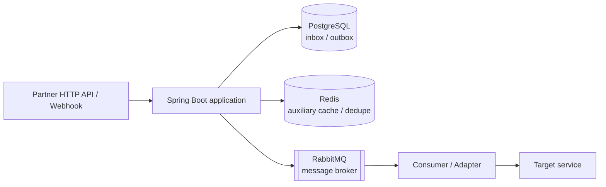
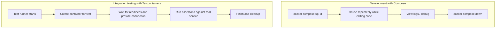
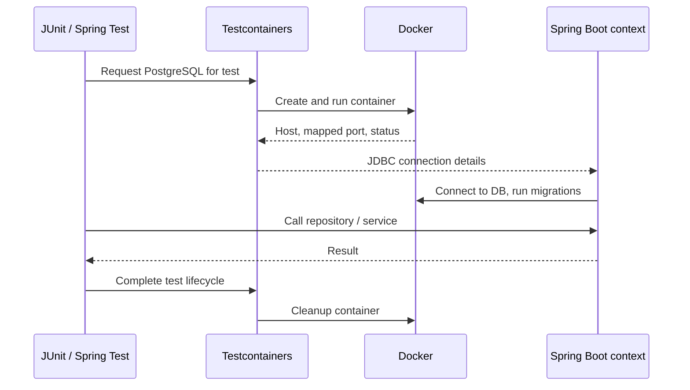
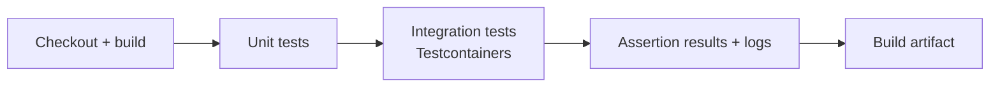

# The Role of Docker Compose and Testcontainers in Integration Development

When a Spring Boot application calls external APIs, writes data to PostgreSQL, uses Redis for caching, and exchanges messages via RabbitMQ or Kafka, simply running the Java application alone is not enough to prove that the **integration flow** works. Developers must have the appropriate dependent services available to test connectivity, configuration, transactions, timeouts, retries, duplicate handling, and behavior when external systems fail.

**Docker Compose** and **Testcontainers** both leverage containers to provide infrastructure for development and testing, but they address two distinct needs:

- **Docker Compose** describes a set of services that can be started together, making it very useful for spinning up a local development environment and running flows continuously.
- **Testcontainers** lets tests create, connect to, and clean up dependent containers within the test lifecycle, enabling behavior verification against real databases, caches, or brokers and running reliably in CI.

This lesson belongs to the **Development Services** chapter of the **SPRING_BOOT_INTEGRATION** module, where applications are organized to integrate via HTTP clients, SQL, caches, message brokers, and Spring Integration adapters. The lesson focuses on setting up environments realistic enough to verify **configuration, data contracts, transactions, errors, idempotency, testing, and observability** across these flows.

## 1. Learning Objectives

After this lesson, you will be able to:

1. Explain the differences between a container, image, volume, network, Docker Compose, and Testcontainers.
2. Use Compose to start PostgreSQL, Redis, and RabbitMQ for Spring Boot application development.
3. Distinguish between connections from an application running on the host machine and an application running inside the same Docker network.
4. Understand how Spring Boot supports Docker Compose service connections and how to configure them manually when needed.
5. Use Testcontainers to spin up an ephemeral PostgreSQL instance for integration tests that verify unique constraints and real SQL syntax.
6. Design appropriate tests for caching, brokers, transactions, retries, duplicates, failures, and system observability.
7. Identify common issues in CI: Docker daemon, ports, readiness, leftover data, and parallel test execution.

## 2. Why Does Integration Development Need External Services?

A unit test using mocks can verify that a service calls `repository.insert(...)`, but it does not confirm:

- Whether the JDBC driver can actually connect to PostgreSQL.
- Whether the SQL statement `ON CONFLICT DO NOTHING` executes properly on PostgreSQL and protects data when two requests arrive concurrently.
- Whether Redis stores and expires cache keys according to the intended configuration.
- Whether RabbitMQ routes messages to the right exchange, routing key, and queue.
- Whether the consumer handles reprocessing safely after a connection drop or encountering a duplicate message.
- Whether the application starts properly when an environment variable is missing or a dependency is not ready yet.

These are behaviors at the **integration boundary**: they must be tested against the real system or a protocol-compatible version of it. Containers help developers run the same types of services with shareable, reproducible configurations.

Example of a flow receiving events from a partner:



During development, Compose can provide PostgreSQL, Redis, and RabbitMQ for the running application. In integration tests, Testcontainers can create each required dependency and pass dynamic connection addresses to a `@SpringBootTest`.

**Scope of guarantees:** A PostgreSQL container tests PostgreSQL behavior; it does not prove that a real partner endpoint works. For external HTTP APIs, use a mock server or sandbox along with supplementary contract tests. Similarly, testing RabbitMQ does not automatically substitute for testing Kafka if the application deploys Kafka.

## 3. Foundational Concepts

| Concept | Meaning in integration development |
| --- | --- |
| **Image** | Filesystem package and metadata used to create a container; for example, `postgres:16-alpine` |
| **Container** | OS-isolated process running an image with environment and network configuration |
| **Volume** | Storage location outside the container lifecycle; allows a dev DB to retain data across restarts |
| **Docker network** | Network between containers; in Compose, services typically call each other by **service name** |
| **Published port** | Port on the host machine mapped to a port inside the container |
| **Docker Compose** | Declarative configuration defining multiple services, networks, and volumes in a single project |
| **Testcontainers** | Library that controls container lifecycles from test code, retrieving host/port and connection details at runtime |
| **Readiness / health check** | Checking that a service is ready to serve requests, deeper than whether the process has started |
| **Service connection** | Mechanism where Spring Boot uses information from a running service to automatically provide connection details to the corresponding client |

### 3.1. Typical Usage Lifecycle



Compose is typically used to keep an environment running during a development session; Testcontainers ties the service lifecycle to a test/class or test suite depending on configuration. You do not have to choose only one tool: the same project can use both.

## 4. Setting Up a Local Integration Environment with Docker Compose

### 4.1. Creating the Compose File

In the Spring Boot application directory, create a `compose.yaml` file (illustrative example):

```yaml
services:
  postgres:
    image: postgres:16-alpine
    environment:
      POSTGRES_DB: integration_db
      POSTGRES_USER: integration_app
      POSTGRES_PASSWORD: local_only_password
    ports:
      - "127.0.0.1:5432:5432"
    volumes:
      - postgres_data:/var/lib/postgresql/data
    healthcheck:
      test:
        - CMD-SHELL
        - pg_isready -U $$POSTGRES_USER -d $$POSTGRES_DB
      interval: 5s
      timeout: 3s
      retries: 15

  redis:
    image: redis:7-alpine
    ports:
      - "127.0.0.1:6379:6379"
    healthcheck:
      test: ["CMD", "redis-cli", "ping"]
      interval: 5s
      timeout: 3s
      retries: 15

  rabbitmq:
    image: rabbitmq:3-management
    environment:
      RABBITMQ_DEFAULT_USER: integration_app
      RABBITMQ_DEFAULT_PASS: local_rabbit_password
    ports:
      - "127.0.0.1:5672:5672"
      - "127.0.0.1:15672:15672"
    healthcheck:
      test: ["CMD", "rabbitmq-diagnostics", "-q", "ping"]
      interval: 5s
      timeout: 5s
      retries: 15

volumes:
  postgres_data:
```

This is a **local configuration** for learning and development:

- `postgres` exposes port 5432; the `postgres_data` volume preserves data when the container restarts.
- `redis` exposes 6379; this cache example does not persist a volume because cache data can be regenerated.
- `rabbitmq` exposes 5672 for AMQP and 15672 for the management UI; the `-management` image includes the management plugin.
- `127.0.0.1` restricts the published port to the host loopback in this configuration, reducing the risk of accidentally exposing development services to external networks.
- Passwords in the example are **dummy values strictly for local environments**—do not reuse them in production or treat them as secure secrets.
- `healthcheck` provides a basic readiness signal; a green healthcheck **does not prove** that all tables, exchanges, permissions, or business migrations are correct.

In Compose syntax, `$$POSTGRES_USER` and `$$POSTGRES_DB` use `$$` to preserve the variables for the shell **inside the container** instead of having Compose interpolate them immediately on the host.

> **Version note:** The image names here illustrate a major version chosen for a development environment. For real projects, align image versions across developer machines, CI, and target systems; pin specific tags or digests if high reproducibility is required. Do not blindly use `latest` for every environment.

### 4.2. Operating Compose

In a terminal with Docker Engine/Docker Desktop and the Docker Compose CLI available:

```bash
docker compose version
docker compose config
docker compose up -d
docker compose ps
docker compose logs --tail=100 postgres
```

`docker compose config` validates and displays the interpolated configuration. `up -d` creates/starts services in the background; `ps` shows container status and ports. To stream logs continuously:

```bash
docker compose logs -f rabbitmq
```

Stopping the environment:

```bash
docker compose down
```

By default, `docker compose down` does not delete named volumes such as `postgres_data`. For a test environment where **wiping all local data is allowed**, you can use:

```bash
docker compose down -v
```

The `-v` flag deletes volumes managed by the Compose project, so PostgreSQL data in the sample volume will be lost. Use it only when you intentionally want to reset the test environment.

### 4.3. Understanding Connection Addresses: Host vs. Container Network

This is a very common cause of connection errors:

| Where does the Spring Boot app run? | PostgreSQL host/port | Redis host/port | RabbitMQ host/port |
| --- | --- | --- | --- |
| **Directly on the developer machine** | `localhost:5432` | `localhost:6379` | `localhost:5672` |
| **In a container on the same Compose project/network** | `postgres:5432` | `redis:6379` | `rabbitmq:5672` |
| **Testcontainers integration test** | Host and mapped port returned by Testcontainers | Dynamic host and mapped port | Dynamic host and mapped port |

`localhost` always refers to **the calling process's own network namespace**. Inside an application container, `localhost:5432` does not automatically point to the `postgres` container. Containers in the same Compose network typically resolve service names via internal DNS.

In Testcontainers, do not hardcode `localhost:5432` because mapped ports can change on every run and the host may differ depending on the Docker environment.

## 5. Connecting Spring Boot to Compose Services

There are two typical approaches: **declaring connection properties manually** or **using Spring Boot's Docker Compose integration** when the version and service type are supported.

### 5.1. Approach A: Application Using Manual Connection Configuration

Suppose Java runs **directly on the host**, while PostgreSQL/Redis/RabbitMQ run via Compose.

Illustrative Gradle dependencies (Groovy DSL):

```groovy
dependencies {
    implementation 'org.springframework.boot:spring-boot-starter-jdbc'
    implementation 'org.springframework.boot:spring-boot-starter-data-redis'
    implementation 'org.springframework.boot:spring-boot-starter-amqp'
    runtimeOnly 'org.postgresql:postgresql'

    testImplementation 'org.springframework.boot:spring-boot-starter-test'
}
```

In `application-local.yml`:

```yaml
spring:
  datasource:
    url: ${DB_URL:jdbc:postgresql://localhost:5432/integration_db}
    username: ${DB_USER:integration_app}
    password: ${DB_PASSWORD:local_only_password}
  data:
    redis:
      host: ${REDIS_HOST:localhost}
      port: ${REDIS_PORT:6379}
  rabbitmq:
    host: ${RABBIT_HOST:localhost}
    port: ${RABBIT_PORT:5672}
    username: ${RABBIT_USER:integration_app}
    password: ${RABBIT_PASSWORD:local_rabbit_password}
```

Run the application with the `local` profile. When the application runs **inside the same Compose network**, you must set the hosts `postgres`, `redis`, and `rabbitmq` for the corresponding variables, or use a dedicated profile configuration.

Crucially, the default values in the example are strictly for a **local demo**. Production should retrieve secrets from a secret manager or managed deployment mechanism, use TLS and least-privilege access, and never store real credentials in Git.

### 5.2. Approach B: Spring Boot Docker Compose Support

Starting with **Spring Boot 3.1**, Spring Boot provides Docker Compose integration when the `spring-boot-docker-compose` module is present and the environment meets the conditions. For recognized service images, Spring Boot can create **service connection details** instead of requiring manual entry of JDBC URLs, hosts, and ports.

Gradle example:

```groovy
dependencies {
    implementation 'org.springframework.boot:spring-boot-starter-jdbc'
    implementation 'org.springframework.boot:spring-boot-starter-data-redis'
    implementation 'org.springframework.boot:spring-boot-starter-amqp'
    runtimeOnly 'org.postgresql:postgresql'

    developmentOnly 'org.springframework.boot:spring-boot-docker-compose'
}
```

When starting the application in a development environment with a `compose.yaml` file and Docker Compose available, Spring Boot can start the required services, discover connection details, and configure the corresponding clients. When the application exits, stopping behavior depends on the prior state and the lifecycle management mode.

An optional configuration:

```yaml
spring:
  docker:
    compose:
      enabled: true
      lifecycle-management: start-and-stop
```

Several things to keep in mind:

1. This integration depends on the Spring Boot version, Docker Compose, and **the image types** for which Spring Boot knows how to create service connections. Custom images may require appropriate metadata/labels or manual configuration.
2. `developmentOnly` is the Gradle dependency scope for development environments; the goal is to avoid shipping automated Compose management into production deployments.
3. If the project already has `application-local.yml` with manually configured URLs/credentials, you must verify which connection source is being used. Service connections discovered by Spring Boot can take precedence over the corresponding connection properties.
4. Depending on the lifecycle mode and whether services are already running, Spring Boot may simply reuse services rather than starting/stopping all of them; do not treat the app lifecycle as a local data management tool.
5. To disable automatic Compose management in an environment, use `spring.docker.compose.enabled=false` or exclude the development dependency from packaging.

This pattern reduces manual steps in the "checkout project → run app → have database/cache/broker" workflow. It still **does not create business tables**, does not guarantee valid migrations, and does not provide consumer idempotency out of the box.

## 6. What Does Testcontainers Do in Integration Tests?

When using local Docker Compose, multiple tests can accidentally rely on **the same database containing yesterday's data**. A test passes because tables already exist, data was seeded, or a service happened to stay running, yet fails on a teammate's machine or in CI.

Testcontainers addresses this by having **the test declare its dependencies**: the library starts containers when needed, waits for readiness, supplies host/port/credentials to the application, and cleans up after testing completes.



Benefits:

- **Correct dependency type**: tests PostgreSQL statements against PostgreSQL rather than inferring from an embedded database with a different dialect.
- **Dynamic addresses**: reduces port collisions across parallel runs or multiple CI processes.
- **Reproducible environment**: image versions, container environment, and schema are declared in test code/configuration.
- **Self-managed lifecycle**: reduces reliance on developers remembering to start services before running tests.
- **Composable**: multiple dependencies can be combined in a single test involving SQL, cache, and broker.

However, Testcontainers requires an accessible Docker-compatible runtime. It does not automatically fix broken schema migrations, test data leaking between cases, ordering issues, or business retry logic.

## 7. Example: Testing Duplicate Event Writes Against Real PostgreSQL

Suppose a service receives `(partnerId, eventId)` from an HTTP webhook and stores the event before forwarding it to a consumer. The partner might resend the same event on a timeout. Test goal: **only one record is created**, even when duplicates arrive.

The following Java examples target a **Spring Boot 3.x / Java 17+ project with Testcontainers 1.x**. If your project's dependency management uses Testcontainers 2.x or a different Spring Boot version, verify imports/modules against the selected version; the testing principles and service connection concepts remain the same.

### 7.1. Dependencies for Integration Testing

Gradle (alongside the JDBC starter, JDBC driver, and Spring Boot Test):

```groovy
dependencies {
    implementation 'org.springframework.boot:spring-boot-starter-jdbc'
    runtimeOnly 'org.postgresql:postgresql'

    // If the application uses Flyway for schema:
    implementation 'org.flywaydb:flyway-core'
    implementation 'org.flywaydb:flyway-database-postgresql'

    testImplementation 'org.springframework.boot:spring-boot-starter-test'
    testImplementation 'org.springframework.boot:spring-boot-testcontainers'
    testImplementation 'org.testcontainers:junit-jupiter'
    testImplementation 'org.testcontainers:postgresql'
}
```

When using the Spring Boot BOM, let dependency management select compatible versions. Whether Flyway requires a separate PostgreSQL module depends on the Flyway version; the snippet above illustrates the common module set in newer Flyway releases. If not using Flyway, you can use Liquibase or whatever schema initialization mechanism the project specifies.

### 7.2. SQL Migration

Example migration file `src/main/resources/db/migration/V1__create_received_event.sql`:

```sql
CREATE TABLE received_event (
    partner_id VARCHAR(64) NOT NULL,
    event_id VARCHAR(128) NOT NULL,
    received_at TIMESTAMPTZ NOT NULL DEFAULT CURRENT_TIMESTAMP,
    CONSTRAINT pk_received_event PRIMARY KEY (partner_id, event_id)
);
```

The `PRIMARY KEY (partner_id, event_id)` constraint creates a unique key in the database capable of withstanding two application instances writing concurrently. Checking existence with `SELECT` followed by `INSERT` without a constraint leaves the check-and-write vulnerable to race conditions.

### 7.3. Repository Implementing Deduplication

```java
package com.example.integration.inbox;

import org.springframework.jdbc.core.JdbcTemplate;
import org.springframework.stereotype.Repository;

@Repository
public class ReceivedEventRepository {
    private final JdbcTemplate jdbc;

    public ReceivedEventRepository(JdbcTemplate jdbc) {
        this.jdbc = jdbc;
    }

    public boolean insertOnce(String partnerId, String eventId) {
        int affectedRows = jdbc.update("""
                INSERT INTO received_event (partner_id, event_id)
                VALUES (?, ?)
                ON CONFLICT (partner_id, event_id) DO NOTHING
                """, partnerId, eventId);
        return affectedRows == 1;
    }
}
```

`ON CONFLICT` is PostgreSQL syntax. Testing against the exact database type uncovers SQL dialect, constraint, driver, mapping, and transaction issues that mock repositories usually miss.

### 7.4. JUnit Testcontainers and Spring Boot Service Connection

```java
package com.example.integration.inbox;

import static org.junit.jupiter.api.Assertions.*;

import java.util.UUID;

import org.junit.jupiter.api.Test;
import org.springframework.beans.factory.annotation.Autowired;
import org.springframework.boot.test.context.SpringBootTest;
import org.springframework.boot.testcontainers.service.connection.ServiceConnection;
import org.springframework.jdbc.core.JdbcTemplate;

import org.testcontainers.containers.PostgreSQLContainer;
import org.testcontainers.junit.jupiter.Container;
import org.testcontainers.junit.jupiter.Testcontainers;

@SpringBootTest
@Testcontainers
class ReceivedEventRepositoryIT {

    @Container
    @ServiceConnection
    static PostgreSQLContainer<?> postgres =
            new PostgreSQLContainer<>("postgres:16-alpine");

    @Autowired
    ReceivedEventRepository repository;

    @Autowired
    JdbcTemplate jdbc;

    @Test
    void storesSamePartnerEventOnlyOnce() {
        String eventId = UUID.randomUUID().toString();

        assertTrue(repository.insertOnce("carrier-a", eventId));
        assertFalse(repository.insertOnce("carrier-a", eventId));

        Integer count = jdbc.queryForObject("""
                SELECT COUNT(*)
                FROM received_event
                WHERE partner_id = ? AND event_id = ?
                """, Integer.class, "carrier-a", eventId);

        assertEquals(1, count);
    }
}
```

Line-by-line explanation:

- `@Container` with `@Testcontainers` lets JUnit 5 manage the container lifecycle. The `static` container in this sample is typically shared across test methods within the class.
- `@ServiceConnection` is a **Spring Boot 3.1+** convenience: Spring Boot recognizes `PostgreSQLContainer` and automatically supplies connection details for the datasource. Using this avoids hardcoding the JDBC URL and port.
- The test runs a real Spring context, injects the repository along with `JdbcTemplate`, and checks the row in PostgreSQL.
- The new event name uses `UUID` so runs do not rely on stale data. With class-scoped Testcontainers, the container is created for the class lifecycle, yet migrations, transactions, and data still require explicit control.
- The test assumes the migration `V1__create_received_event.sql` succeeded during application startup. Not creating the table manually in the test also verifies the application's migration configuration.

**Test scope distinction:** The test above confirms that two sequential writes with the same key create only one row. To test a **race condition**, add a test where two independent threads/transactions concurrently insert the same key and assert that only one transaction can create the record; calling twice on the same thread does not test concurrency.

### 7.5. Alternative: DynamicPropertySource

If you do not use `@ServiceConnection`, Spring Test provides `@DynamicPropertySource` to register properties from the container:

```java
import org.springframework.test.context.DynamicPropertyRegistry;
import org.springframework.test.context.DynamicPropertySource;

@DynamicPropertySource
static void databaseProperties(DynamicPropertyRegistry registry) {
    registry.add("spring.datasource.url", postgres::getJdbcUrl);
    registry.add("spring.datasource.username", postgres::getUsername);
    registry.add("spring.datasource.password", postgres::getPassword);
}
```

This is an **alternative** to `@ServiceConnection` in a test class—there is no need to use both simultaneously for the same datasource. It is useful when Spring Boot lacks a service connection factory for a technology, or when the project needs to declare custom properties.

Do not assume port 5432 on the host machine; use `postgres.getJdbcUrl()`, `getHost()`, or `getMappedPort(5432)` via the container API.

## 8. Testing Redis and Brokers with Testcontainers

In an integration flow, correct SQL alone is not enough: a cache can corrupt state, a broker can redeliver messages, and a consumer can acknowledge at the wrong moment.

### 8.1. Redis: Cache Must Not Become an Accidental Source of Truth

Useful scenarios:

- Cache miss → query database → write cache → cache hit read-back.
- TTL actually expires and data is freshly loaded.
- Two requests for the same key do not cause a race condition that compromises correctness.
- Redis unavailable: how the application handles it under the chosen policy (fail-open or fail-closed).
- When invalidation fails, how long data can remain stale and whether that is acceptable.

For example, use a dynamic Redis container and point `spring.data.redis.host`/`port` to the mapped endpoint; in Spring Boot versions that support `@ServiceConnection` for an appropriate Redis image, you can use service connection instead of manual property registration.

**Do not test with a HashMap instead of Redis** and conclude that TTL, codecs, key prefixes, atomic operations, or network timeouts work properly.

### 8.2. RabbitMQ: Verifying Message Behavior

Scenarios to verify:

1. Producer publishes message to the right exchange/routing key.
2. Message is routed to the declared queue.
3. Consumer deserializes the payload according to the contract.
4. On processing failure, the message is nacked/requeued or routed to the DLQ according to the configured policy.
5. When receiving the same `eventId` again, consumer side effects are not duplicated.

Testcontainers provides a module/container for RabbitMQ. With Testcontainers 1.x, the `RabbitMQContainer` class is used to spin up the broker; verify the package and artifact for your dependency version. Longer tests can use bounded waiting mechanisms (such as Awaitility) to wait for consumer results instead of flaky fixed-duration `Thread.sleep` calls.

A passing broker test is not enough to conclude **exactly-once end-to-end**. Broker acknowledgments, SQL transactions, and HTTP side effects belong to different boundaries, so idempotency, inbox/outbox, and recovery must be designed accordingly.

### 8.3. Kafka, HTTP, and Spring Integration

Depending on the flow, you can extend with:

- **Kafka container**: verify serialization/deserialization, topic, key, partition-level ordering, and consumer offset/retry behavior.
- **HTTP mock server**: test timeouts, `429`, `503`, schema errors, auth headers, and request/response contracts. An HTTP fake must include failure scenarios, not just return `200 OK`.
- **Spring Integration flow**: test transformers/routers/filters as messages traverse channels, including headers and error channels.
- **Combined SQL + broker**: test outbox: transaction writes business record and outbox entry, worker publishes, and consumer handles redelivery safely.

**Practical limit:** Spinning up too many containers per test makes suites slow and hard to diagnose. Small tests should launch only the dependencies needed to verify the target behavior, while a few end-to-end tests may require more services.

## 9. How Do Compose and Testcontainers Differ?

| Criterion | Docker Compose | Testcontainers |
| --- | --- | --- |
| **Primary purpose** | Service environment for development, debugging, demos, or environment-based testing | Infrastructure created and managed by the test run |
| **Configuration source** | `compose.yaml`, environment, volumes, networks | Code/test configuration, image, wait strategy, properties |
| **Lifecycle** | Managed by the user, Compose CLI, or Spring Boot Compose integration | Managed by the test runner/Testcontainers |
| **Ports** | Often fixed for local convenience; can still be dynamic | Typically uses dynamic mapped ports to avoid conflicts |
| **Data across runs** | Named volumes can retain state | Typically ephemeral; isolation depends on container/test setup |
| **Debugging experience** | Easy to open dashboards, connect SQL clients, send manual messages | Easy to reproduce bugs from automated tests and inspect container logs |
| **CI** | Can be used to spin up an entire CI test environment | Useful for self-contained tests defining dependencies per test |
| **Main risks** | Leftover state, wrong service versions, port conflicts, drift across machines | Dependency on Docker daemon, image pulls, startup cost, data isolation |

They are not mutually exclusive. A practical workflow typically uses:

- **Compose** for developers editing code, running the app continuously, calling APIs with Postman/curl, and inspecting service logs.
- **Testcontainers** for automated integration tests in CI pipelines and reproducing bugs in a clean environment.
- **Sandbox/contract tests** for external systems that cannot be containerized, such as payment gateways or shipping carriers.

## 10. Designing Isolated, Reproducible, Low-Flake Tests

### 10.1. Controlling Test Data

Sources of data leakage:

- Databases shared across multiple tests.
- Tests relying on records created by a previously executed case.
- Reused containers where schema/data are not reset.
- Asynchronous consumers still running when another test starts.
- Leftover keys/messages in caches or queues.

Strategies:

1. Use independent test IDs, such as prefixes or UUIDs, avoiding reliance on global sequence numbers.
2. Apply migrations just like the real application; avoid one-off manual schema edits.
3. Choose rollback, truncation, clearing queue/cache keys, or dedicated containers depending on the required isolation level.
4. Do not assume a test's `@Transactional` can roll back a **message broker** or outbound HTTP operations already sent.
5. When running in parallel, avoid having two tests create the same queue/topic name or the same idempotency key, unless concurrency testing is intentional.

**A fresh container does not automatically guarantee test isolation** if multiple tests share a single container holding leftover data, cache entries, or background consumers.

### 10.2. Readiness and Startup Order

Waiting for a container process to run is **not the same** as waiting for the dependency application to be ready. PostgreSQL must finish DB initialization, RabbitMQ must start its broker, and migrations may still be executing.

- With Compose, use appropriate healthchecks; if dependency ordering is needed, Compose supports `depends_on` with health conditions depending on version/deployment support.
- With Testcontainers, container modules typically include default wait strategies; if a custom service needs extra time, declare a wait strategy based on a meaningful signal.
- With Spring Boot, determine whether the application retries connections while dependencies are starting; do not equate healthcheck success with valid migrations or contracts.

Do not fix flakiness by blindly adding `Thread.sleep(30000)` to every test. Wait for the required condition with a reasonable timeout and report a clear cause upon expiration.

### 10.3. Pinning Versions and Matching Production

For example, testing against PostgreSQL 16 while production runs PostgreSQL 14 can miss feature or SQL planner differences. If production uses Redis Cluster, local standalone Redis will not reproduce topology differences. Images help create repeatable environments, but **production parity is a design decision**, not an automatic feature of containers.

Regularly audit differences in versions, extensions, collations, timezones, TLS, auth, topology, and resources across local/test/staging/production.

## 11. Testing Failure Modes: The Highest Value of Real Infrastructure

Basic success ("can connect to the database") is only the first step. For real integrations, possible failures must be verified.

### 11.1. Scenario Matrix

| Failure | Question to test | Design expectation |
| --- | --- | --- |
| PostgreSQL not ready when app starts | Does the app fail fast or retry? Is the message clear enough? | Policy-dependent, with health/readiness |
| SQL transaction fails after writing outbox | Do the business record and outbox roll back together? | No half-committed transactions |
| Redis loses connection | Can stale data be served? Is business logic affected? | Fail-open/fail-closed per requirements |
| RabbitMQ restarts mid-processing | Can messages be redelivered? | Idempotent consumer |
| Consumer receives duplicate event | Are side effects applied twice? | Business key/unique constraint |
| Target HTTP returns 429 | Are limits and backoff respected? | Bounded, observable retries |
| Target HTTP times out after commit | Can the client determine the outcome reliably? | Lookup by operation ID/idempotency |
| Record/version arrives out of order | Does state regress backward? | Clear versioning/ordering rules |
| Migration not executed | How do the app/tests detect it? | Diagnosable test failure |

Testcontainers runs dependencies in a controllable environment, but it **does not provide fault injection out of the box**. To simulate dropped connections, latency, or timed restarts, tests must actively control containers/networks or use an appropriate proxy/fault-injection tool. Ensure scenarios are repeatable rather than relying on random timing.

### 11.2. Correct Transaction Boundaries

`@Transactional` on a single `DataSource` can protect multiple SQL statements within the same transaction. It does not automatically turn those operations into a distributed transaction with RabbitMQ or HTTP.

Example:

```text
1. Write order and outbox_event in the same SQL transaction.
2. SQL commit succeeds.
3. Worker reads outbox and publishes message to broker.
4. Worker fails before marking outbox as sent.
5. Worker runs again and may publish a second time.
```

Tests must verify that the consumer or downstream system handles duplicate execution safely. "Using Testcontainers with green tests" does not mean all external side effects have exactly-once guarantees.

## 12. Running in CI: Prerequisites to Prepare

Testcontainers fits CI when the runner environment provides a Docker daemon or compatible runtime that Testcontainers can connect to. Typical pipeline flow:



Operational checklist:

- **Docker runtime:** CI runners have proper access to Docker; without it, container-dependent tests cannot run. Review security policies when granting Docker socket access.
- **Image download:** accessible registry, sensible caching, pinned image versions; avoid relying on tags that mutate unexpectedly.
- **Resources:** sufficient RAM/CPU/disk to run multiple databases, caches, and brokers concurrently.
- **Ports:** prefer Testcontainers' dynamic mapped ports; do not force tests to compete for fixed host ports.
- **Data and secrets:** use test credentials and isolated environments; never accidentally connect to production.
- **Test reports:** retain stack traces, secret-redacted container logs, and timing metrics when tests fail.
- **Parallelism:** cap the number of concurrent containerized tests if CI infrastructure is constrained; ensure tests do not share data unintentionally.

Some CI environments use Docker-in-Docker, a Docker socket, or a remote daemon. Connection configuration depends on the platform, so verify specific networking and container create/delete permissions. Having the Docker CLI in `PATH` **does not guarantee** the test process can reach the daemon.

### 12.1. Should Containers Be Reused Across Multiple Tests?

You can optimize using class/suite-scoped containers or reuse mechanisms supported by your tool and version, but weigh the trade-offs:

- Reuse reduces startup time and image pull overhead.
- Reuse increases the risk of state leaking between tests/classes.
- When running tests in parallel, shared consumers/brokers/caches must use independent keys/topics/queues or reliable cleanup.
- Testcontainers reusable containers require explicit configuration and environment suitability. Do not enable reuse by default in CI, as it can make failures hard to reproduce.

Start with **understandable, properly isolated tests**, then optimize startup costs in genuinely resource-heavy test groups.

## 13. Observability and Diagnostics in Development Environments

Compose and Testcontainers both provide observability at the **infrastructure layer**; Spring Boot requires logs/metrics/traces at the application layer.

| Signal | Where to observe | Purpose |
| --- | --- | --- |
| Container status | `docker compose ps` or container API | Detect stopped/restarting processes |
| Startup logs | `docker compose logs` / Testcontainers logs | Find auth, migration, or configuration errors |
| PostgreSQL connections and queries | DB logs/metrics, HikariCP pool metrics | Distinguish slow SQL from connection exhaustion |
| Redis cache hit/miss/latency | Client metrics and Redis metrics | Spot cache stampedes or stale data |
| RabbitMQ queue depth / consumers | Management API/UI, application metrics | Track backlog, redelivery, DLQ |
| Outbound HTTP status and latency | HTTP client metrics/logs/traces | Distinguish 429/5xx/timeouts |
| Correlation ID / event ID | Logs and distributed tracing | Trace a business flow across multiple adapters |

Common errors and how to diagnose them:

| Symptom | Possible cause | Check first |
| --- | --- | --- |
| `Connection refused` when app runs on host | Compose not up, wrong port, or DB not ready | `docker compose ps`, health, published ports |
| App container fails calling `localhost:5432` | `localhost` refers to app container, not PostgreSQL container | Use service name `postgres` inside the network |
| `address already in use` | Host port 5432/6379/5672 already taken | Check published ports; change host port if needed |
| Test passes locally but fails in CI | CI lacks Docker daemon/permissions, cannot pull images | Check Docker connectivity and image registry |
| `relation ... does not exist` | Migration did not run or connected to wrong DB/schema | Verify JDBC URL, migration history |
| Test fails intermittently | Shared data, async timing, retries, leftover queue messages | Use unique IDs, condition waits, isolated queues |
| Results differ from production | Different version/schema/topology/extensions | Match target versions and configuration |
| Test passes even though Redis is stopped | Mock bean/profile replaced real Redis | Verify context and where the client is actually connecting |

**Observability security:** connection logs must never leak passwords/tokens; avoid dumping full sensitive payloads into CI artifacts or dashboards. Use event codes and correlation IDs for diagnostics without storing sensitive contents.

## 14. Recommended Workflow for an Integration Development Team

Suppose a team is developing a feature "receive webhook → write SQL inbox → publish message → consumer updates cache":

1. **Design the contract:** specify event ID, version, schema, webhook authentication rules, success criteria, and idempotency.
2. **Set up Compose:** run PostgreSQL, Redis, and RabbitMQ locally using aligned image versions, healthchecks, and controlled data resets.
3. **Run Spring Boot:** choose either manual connection config or Spring Boot Compose integration; do not mix unclear configuration sources.
4. **Write the first integration test:** Testcontainers PostgreSQL to verify JDBC driver, migrations, unique constraints, and transactions.
5. **Add Redis/broker tests:** verify TTL, routing, acknowledgment, redelivery, and safe reprocessing.
6. **Test failure scenarios:** DB not ready, timeouts, broker restart, duplicates, stale versions, and invalid contract payloads.
7. **Integrate into CI:** run containerized tests automatically, collect logs on failure, and manage parallelism and image pull speed.
8. **Observe the flow:** track latency metrics, SQL pool, cache hit rate, queue depth, retries, DLQ, and correlation IDs, using these exact signals to diagnose incidents.

Scope according to business risk. A microservice that only reads PostgreSQL may not need a RabbitMQ container yet; an outbox/consumer flow must test both SQL transactions and the broker.

## 15. Self-Check Questions

1. Why can't a repository unit test with mocks prove that `ON CONFLICT` SQL works properly on PostgreSQL?
2. How does a Compose volume help during development, and how can it make tests hard to reproduce?
3. When a Spring Boot application runs **inside a Compose container**, should it call PostgreSQL via `localhost` or `postgres`? Why?
4. When Testcontainers uses dynamic mapped ports, why must tests not hardcode `localhost:5432`?
5. What does `@ServiceConnection` in Spring Boot do, and in what scenarios is `@DynamicPropertySource` an alternative?
6. Why can migration or query errors still occur even after waiting for a container to start?
7. How does testing two sequential inserts with the same `eventId` differ from testing two concurrent requests?
8. If a consumer writes SQL successfully and then fails before acknowledging RabbitMQ, what test is needed?
9. Why doesn't `@Transactional` on a database automatically roll back messages already sent to a broker?
10. What minimum prerequisites does a CI pipeline need to run Testcontainers reliably?
11. When a Redis test passes using a mock map, what real Redis behaviors remain untested?
12. How do Docker Compose and Testcontainers complement each other across the development lifecycle of an integration flow?

### Practical Exercise

Implement an endpoint accepting `POST /events` with fields `source` and `eventId`. Use Compose to run PostgreSQL/RabbitMQ during development; write a migration with a unique constraint on `(source, eventId)`; use `JdbcTemplate` to store events idempotently. Then:

- Write a Testcontainers PostgreSQL test that sends the same key twice and verifies only one row is stored.
- Add a test with two concurrent transactions writing the same key.
- Add a failure case after writing the SQL transaction to verify rollback.
- If publishing a message, use a RabbitMQ container to verify the consumer handles duplicates safely.
- Record at least three useful metrics: new events, duplicate events, and processing duration.

**Completion criteria:** Tests run from a clean environment with Docker available, without relying on stale data from a developer's machine; failures produce diagnostic information; stored results and side effects match the business contract.

## 16. Key Takeaways

- **Docker Compose** is convenient for local environments containing multiple declared services together; understanding networks, ports, volumes, and healthchecks is essential to avoid false connection errors.
- **Testcontainers** lets integration tests self-manage real services within the test lifecycle, connecting via dynamically assigned host/ports and reducing manual environment dependencies.
- Spring Boot provides **Docker Compose integration** and **`@ServiceConnection`** in supported versions, but auto-configuration does not replace schema migrations, data contracts, or business tests.
- **PostgreSQL, Redis, and brokers** must be tested at the exact boundaries they affect: SQL constraints/transactions, cache semantics, message acknowledgments/retries, and duplicate handling.
- Containers make testing more reproducible; you must continue managing **versions, test data, readiness, CI runtime, failure modes, and observability** to achieve trustworthy results.

For the **SPRING_BOOT_INTEGRATION** module, the ultimate goal of Docker Compose and Testcontainers is to build a repeatable development foundation and an integration test suite capable of verifying behavior when systems actually exchange data, handle load, or experience failures.
