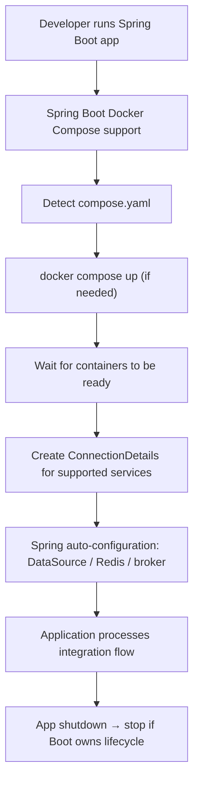
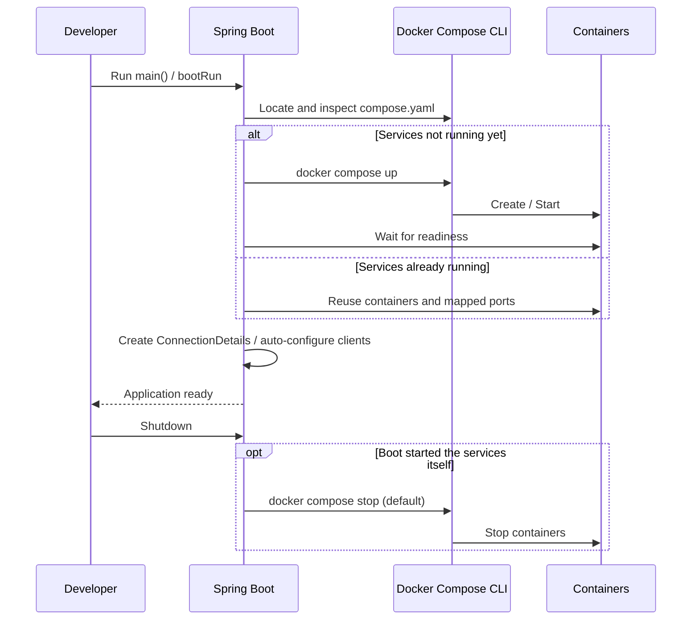
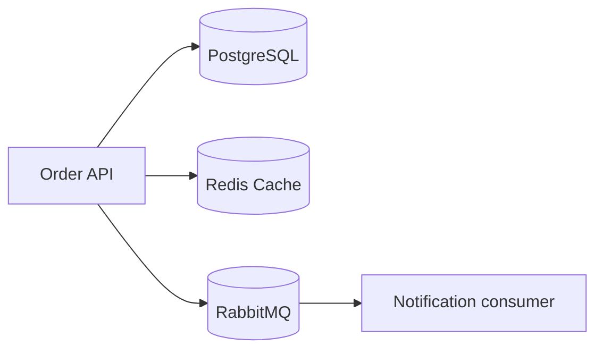
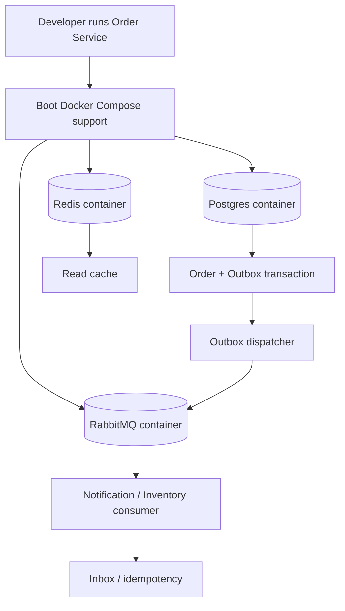

# spring-boot-docker-compose and Local Service Lifecycle

## 1. Why Does Spring Boot Need to Manage Development Services?

In the **SPRING_BOOT_INTEGRATION** module, an application rarely runs in isolation: it may call HTTP APIs, connect to PostgreSQL/MySQL, read from a Redis cache, push events to RabbitMQ/Kafka, or use Spring Integration adapters. To develop an integration flow such as "save order → publish event → update cache," developers often need multiple external services running concurrently.

If each person manually installs PostgreSQL, Redis, and a broker with their own custom ports/usernames/passwords, environments quickly diverge. Application startup can fail due to a missing broker or accidentally connecting to another project's database. **Docker Compose** describes service containers declaratively in YAML, while **`spring-boot-docker-compose`** allows Spring Boot to assist with the lifecycle and connection configuration of those containers during development.



Questions to answer before using it:

- **Which dependency** provides this feature, and does it belong to the development runtime or the production artifact?
- **Who owns the container lifecycle**: the developer or Spring Boot?
- **Which containers** does Boot detect and **which ports** does it connect through?
- What does "ready" mean: container running, TCP port open, or accepting business operations?
- On app restart, running multiple apps, CI testing, or broker connection failure, how are services handled?

This lesson follows **Spring Boot 3.x (3.1 and later)** conventions. APIs and properties may change across versions; check the documentation for the exact version your project uses. The Docker commands below **illustrate the workflow** and do not need to be executed while reading.

## 2. Distinguishing Docker Compose, the Support Module, and Service Connection

These are distinct layers:

| Layer | Role | Example |
| --- | --- | --- |
| **Docker Engine + Compose CLI** | Actually creates, starts, stops, and monitors containers | `docker compose up`, `docker compose ps` |
| **Compose file** | Declares images, environment, port mappings, volumes, healthchecks | `compose.yaml` |
| **Spring Boot Docker Compose support** | Invokes Compose CLI along the app lifecycle, detects supported services, and supplies connection details | `spring-boot-docker-compose` |
| **Spring Boot auto-configuration** | Uses connection details to configure the corresponding client libraries | `DataSource`, `RedisConnectionFactory`, `RabbitConnectionFactory` |

The `spring-boot-docker-compose` module is **not a Java Docker Engine**, does not replace the CLI, and does not embed PostgreSQL/Redis inside a JAR. Nor does it turn every image into a built-in `ConnectionDetails`: only service types recognized and supported by Spring Boot are auto-configured.

**Service Connection** is the mechanism that passes connection information (host, mapped port, and sometimes credentials/other settings) into Spring Boot auto-configuration. Connection details beans are used when the corresponding backend has matching dependencies. **`ConnectionDetails` typically takes precedence over corresponding connection properties** such as `spring.datasource.url` or `spring.data.redis.host`. This is the source of many cases where "I configured the host via properties, yet the app connected to the Compose container instead."

## 3. Prerequisites and Dependencies

### 3.1. Installing Tools on the Development Machine

The machine needs:

1. A working Docker Engine or Docker Desktop with daemon access permissions.
2. A Docker Compose CLI supported by Spring Boot (for Spring Boot 3.5, at least Compose 2.2.0).
3. The `docker`/`docker compose` executable paths resolvable in the environment running the application from the IDE or terminal.
4. Ability to pull images from registries, sufficient RAM/CPU/disk, and unblocked network ports.

Verify using common commands:

```bash
docker version
docker compose version
docker info
```

If it works in a terminal but the IDE reports Docker/Compose cannot be found, check the IDE process's `PATH` environment variable and Docker context configuration. If the Docker daemon is unreachable, merely having `spring-boot-docker-compose` on the classpath still will not start containers.

### 3.2. Adding the Module to a Maven Application

```xml
<dependency>
    <groupId>org.springframework.boot</groupId>
    <artifactId>spring-boot-docker-compose</artifactId>
    <optional>true</optional>
</dependency>
```

Maven configuration is managed by the Spring Boot parent/BOM. `optional=true` indicates the dependency should not become a default transitive dependency for other modules; it is a development module, not a business logic API.

**Under Spring Boot's default packaging configuration, the Docker Compose module is normally excluded from repackaged executable archives.** If you intentionally need to package it (not a typical production choice), the Spring Boot Maven Plugin provides the `excludeDockerCompose` option; change it only when you fully understand the runtime environment and operational impact.

### 3.3. Adding the Module to a Gradle Application

```groovy
dependencies {
    developmentOnly("org.springframework.boot:spring-boot-docker-compose")
}
```

`developmentOnly` allows the module to participate during development runs without treating it as a production application dependency. Whether the app automatically runs Compose still depends on **the actual runtime classpath of the run task** and a discovered Compose file.

Adding this module alone is **not enough** for the app to access Redis/JDBC/RabbitMQ: you still need the client starters:

```groovy
dependencies {
    implementation("org.springframework.boot:spring-boot-starter-jdbc")
    implementation("org.springframework.boot:spring-boot-starter-data-redis")
    implementation("org.springframework.boot:spring-boot-starter-amqp")
    runtimeOnly("org.postgresql:postgresql")
    developmentOnly("org.springframework.boot:spring-boot-docker-compose")
}
```

The snippet above illustrates an application integrating three backends. Add only the starters actually needed; do not pull the entire infrastructure into the app simply because they share one Compose file.

## 4. A Compose File for PostgreSQL, Redis, and RabbitMQ

In the application working directory, create `compose.yaml` (or use one of the standard Compose filenames Boot discovers):

```yaml
services:
  postgres:
    image: postgres:16
    environment:
      POSTGRES_DB: orders
      POSTGRES_USER: devuser
      POSTGRES_PASSWORD: devpass
    ports:
      - "5432"
    volumes:
      - orders-pg-data:/var/lib/postgresql/data
    healthcheck:
      test: ["CMD-SHELL", "pg_isready -U devuser -d orders"]
      interval: 5s
      timeout: 3s
      retries: 12

  redis:
    image: redis:7
    ports:
      - "6379"
    healthcheck:
      test: ["CMD", "redis-cli", "ping"]
      interval: 5s
      timeout: 3s
      retries: 12

  rabbitmq:
    image: rabbitmq:3-management
    ports:
      - "5672"
      - "15672"
    healthcheck:
      test: ["CMD", "rabbitmq-diagnostics", "ping"]
      interval: 5s
      timeout: 5s
      retries: 12

volumes:
  orders-pg-data:
```

**Credentials like `devuser/devpass` are strictly for local examples** and must not be used in production, shared CI, or environments with real data. In real projects, use per-machine secrets/environments and avoid committing secrets.

Clarifying common points of confusion:

- `ports: - "5432"` publishes **container port 5432 to a dynamically chosen host port**. It is not equivalent to `"5432:5432"`, which fixes port 5432 on the host.
- With dynamic ports, multiple Compose projects can run concurrently with fewer port collisions. Spring Boot Docker Compose support uses **the mapped host port published by Docker**, rather than assuming host port equals container port.
- The PostgreSQL volume preserves data across `docker compose stop` and usually across plain `docker compose down`; `down -v` can remove named volumes and lose local data.
- `healthcheck` helps distinguish a container that merely has a running process from a service ready at the probed level. It does not replace checking schema migrations, broker destinations, or application authentication.
- RabbitMQ port 15672 is the management UI when the image includes the management plugin; do not publish this port if unused. Never expose management ports or default accounts to public networks.

For a Spring Boot application running **on the host**, Boot can create connection details for PostgreSQL, Redis, and RabbitMQ when corresponding starters are present. Manually adding `spring.datasource.url=jdbc:postgresql://localhost:5432/...` in the same profile is unnecessary and misleading because Boot may use a different mapped port.

## 5. Default Lifecycle on Application Startup and Shutdown

Spring Boot Docker Compose support has default behavior suited for a local application: starting services when needed, preparing service connections, and stopping services **whose startup it managed** when the application exits.

A typical lifecycle:



**Important exception:** if Compose services were **already running before the application started**, Boot normally only creates service connections and **neither runs up again nor stops them when the app exits**. This prevents "hijacking ownership" of a dev stack started by another developer or another app.

### 5.1. Scenario Matrix

| State before running app | Typical Boot action | When app stops |
| --- | --- | --- |
| No containers for the Compose project | Calls `docker compose up` | Calls `docker compose stop` under default lifecycle |
| Project containers are stopped | Calls up/start per configuration | Stops the services Boot brought up |
| Related stack already running | Connects to services, typically skips up command | **Does not** stop the already-running stack |
| `lifecycle-management=start-only` enabled | Starts if needed | Keeps stack running |
| `lifecycle-management=none` enabled | Does not issue start/stop commands | Does not issue stop commands |
| Compose support disabled | Does not control Compose and creates no service connections from this module | Performs no action |

If the app is forcibly terminated (`kill -9`, machine crash, JVM crash), shutdown hooks may **not execute**; containers may remain running. Do not rely on the app's stop hook as a 100% guaranteed resource cleanup mechanism.

### 5.2. "Stopping the App Stops Services" Does Not Mean Data Is Deleted

`docker compose stop` stops containers without deleting volumes; `docker compose down` removes project-managed containers and networks; adding `--volumes` can delete data volumes as well. For a local database, this distinction matters when debugging schemas/migrations: stopping the app does not equal resetting the database.

If a completely clean environment is needed, follow a manual reset procedure agreed upon by the team. Avoid setting `stop.command=down` with volume-removal flags as a default, as local data could be wiped on every app shutdown.

## 6. Controlling Lifecycle with spring.docker.compose.*

Configuration in `application-dev.yml` (activated only with the Spring profile `dev`):

```yaml
spring:
  docker:
    compose:
      enabled: true
      lifecycle-management: start-and-stop
      start:
        command: up
      stop:
        command: stop
        timeout: 30s
      readiness:
        timeout: 2m
```

Important properties in Spring Boot 3.5:

| Property | Meaning | Reference default |
| --- | --- | --- |
| `spring.docker.compose.enabled` | Enables/disables Docker Compose support | `true` when module is active |
| `spring.docker.compose.file` | Explicit Compose file path; used when Boot auto-discovery is not desired | Optional |
| `spring.docker.compose.lifecycle-management` | Start/stop control policy | `start-and-stop` |
| `spring.docker.compose.start.command` | Compose start command | `up` |
| `spring.docker.compose.stop.command` | Compose stop command | `stop` |
| `spring.docker.compose.stop.timeout` | Stop timeout limit | `10s` |
| `spring.docker.compose.start.skip` | Rule for skipping start when stack is already running | `if-running` |
| `spring.docker.compose.readiness.timeout` | Total readiness wait timeout | `2m` |
| `spring.docker.compose.readiness.wait` | Readiness wait policy | `always` |
| `spring.docker.compose.skip.in-tests` | Skips Docker Compose in tests by default | `true` |
| `spring.docker.compose.profiles.active` | Activates Docker Compose profiles | When needed |
| `spring.docker.compose.arguments` | Arguments passed to the Compose CLI | When needed |

These properties belong to the Docker Compose module in the corresponding Spring Boot 3.x releases, **not Docker Compose YAML properties**. If your application uses a different version, check the property metadata for that exact release before copying.

### 6.1. Three Values of lifecycle-management

```yaml
spring:
  docker:
    compose:
      lifecycle-management: start-only
```

| Value | Does Boot start Compose? | Does Boot stop Compose? | When to use? |
| --- | --- | --- | --- |
| `start-and-stop` | Yes, when needed | Yes, for services Boot started | Each application has its own dev stack |
| `start-only` | Yes, when needed | No | Want containers to stay alive across multiple app restarts |
| `none` | No | No | Services are orchestrated externally or by a dedicated script |

`none` **does not mean `enabled=false`**. When support remains enabled with lifecycle management turned off, Spring Boot can still use running container information to build service connections under configured conditions. If you want zero interaction with Docker Compose through Boot, set `spring.docker.compose.enabled=false` or exclude the module from the runtime classpath.

### 6.2. Choosing up/start and stop/down

```yaml
spring:
  docker:
    compose:
      start:
        command: up
      stop:
        command: stop
```

- `up` can create non-existent containers and apply Compose configuration. This fits onboarding or local runs where the stack has not been created yet.
- `start` only starts previously created containers; it does not substitute for `up` to create everything fresh.
- `stop` preserves containers and volumes; `down` removes Compose resources per Docker Compose rules.
- `start.arguments`, `stop.arguments`, and `arguments` allow appending CLI flags. Be especially cautious with `--volumes`, `--force-recreate`, and `--build`, because their effects go far beyond merely "starting the app."

If multiple repositories on the same machine use Compose, define distinct **project names** or organize a shared Compose file with clear ownership; avoid having two apps unknowingly manage the same group of containers.

## 7. Where Does Boot Look for compose.yaml?

When the dependency is present and support is enabled, Spring Boot searches for common Compose filenames in the **working directory of the application process**. Working directories when running from an IDE, Maven/Gradle, or a monorepo project can differ.

If the compose file lives outside the current directory or has a custom name, declare it explicitly:

```yaml
spring:
  docker:
    compose:
      file: "../infra/compose.dev.yml"
```

The path can be an absolute path or a relative path according to your application/version rules. In monorepos, a more reliable approach is standardizing the working directory for run commands and configuring the file path explicitly.

**You do not need a Compose file in every small module** if multiple modules share a single set of PostgreSQL/Redis/broker services. However, you must decide who owns the stack lifecycle: module A starts it and module B shares it, or a development script outside Spring Boot starts it for everyone.

### 7.1. Docker Compose Profiles Differ from Spring Profiles

Spring profiles (`spring.profiles.active=dev`) determine application beans/configuration; Docker Compose profiles determine which services in a Compose file are enabled. They do not synchronize by name automatically.

Example in a Compose file:

```yaml
services:
  redis:
    image: redis:7
    ports: ["6379"]

  rabbitmq:
    image: rabbitmq:3-management
    profiles: ["messaging"]
    ports: ["5672"]
```

In Spring Boot:

```yaml
spring:
  docker:
    compose:
      profiles:
        active: "messaging"
```

This configuration tells Compose to start services belonging to the `messaging` profile. It **does not activate the Spring profile `messaging`**. To avoid confusion, use clear naming conventions such as `SPRING_PROFILES_ACTIVE=dev` and `spring.docker.compose.profiles.active=messaging`.

## 8. Service Connection: How Does the App Learn Host and Port?

One of the biggest values of the integration is that **Spring Boot reads container mapped host ports and creates `ConnectionDetails` beans** for recognized images.

Compose example:

```yaml
services:
  postgres:
    image: postgres:16
    environment:
      POSTGRES_DB: orders
      POSTGRES_USER: devuser
      POSTGRES_PASSWORD: devpass
    ports:
      - "5432"

  redis:
    image: redis:7
    ports:
      - "6379"
```

Docker might map:

```text
postgres: container 5432  -> localhost:49174
redis:    container 6379  -> localhost:49175
```

These host ports are merely examples. If Boot recognizes the services, `JdbcConnectionDetails` and `RedisConnectionDetails` (in Spring Boot 3.5) provide the corresponding connection details. When client starters/auto-configurations are present, `DataSource` and Redis clients use those values.

This reduces the need to maintain a set of local properties:

```yaml
# Example of manual configuration no longer strictly required
# if Boot already provides the corresponding connection details.
spring:
  datasource:
    url: jdbc:postgresql://localhost:5432/orders
    username: devuser
    password: devpass
  data:
    redis:
      host: localhost
      port: 6379
```

When `ConnectionDetails` is present, corresponding connection properties may be **lower in precedence** than connection details. Therefore, do not use `application-dev.yml` to try to "override" host/port when Boot is pulling them from Docker Compose; inspect connection details and remove redundant configuration sources or intentionally disable the integration.

### 8.1. Which Services Are Typically Recognized?

Spring Boot 3.x releases support connections for many common images, for example:

| Service | Common images | Connection details mechanism |
| --- | --- | --- |
| PostgreSQL | `postgres` | JDBC/R2DBC details depending on dependencies |
| MySQL/MariaDB | `mysql`, `mariadb` | JDBC/R2DBC details depending on dependencies |
| Redis | `redis`, certain Redis Stack images | Redis connection details |
| RabbitMQ | `rabbitmq` | Rabbit connection details |
| MongoDB | `mongo` | Mongo connection details |
| Elasticsearch | `elasticsearch` | Elasticsearch connection details |
| ActiveMQ Artemis | `apache/activemq-artemis` / `apache/artemis` | Artemis connection details |
| Neo4j | `neo4j` | Neo4j connection details |

The list of supported images/bean types **depends on the Boot version**; do not assume every broker or datastore has support. For example, a custom REST mock server or an internal company image with an unfamiliar name will not automatically become an HTTP client with a service connection. For external HTTP APIs, applications still typically configure `WebClient` base URLs per profile/env.

### 8.2. Custom Images and Docker Compose Labels

If a company has a Redis-compatible image whose name is not `redis`, Spring Boot may not recognize it from the image name alone. You can attach a label:

```yaml
services:
  redis:
    image: mycompany/customredis:7
    ports:
      - "6379"
    labels:
      org.springframework.boot.service-connection: redis
```

The `org.springframework.boot.service-connection` label hints the service connection type to Boot. The custom image must still actually be compatible in protocol, environment variables, and authentication; **a label cannot turn an arbitrary server into Redis**.

### 8.3. Ignoring Containers Outside Application Responsibility

```yaml
services:
  redis:
    image: redis:7
    ports:
      - "6379"
    labels:
      org.springframework.boot.ignore: true
```

With the `org.springframework.boot.ignore` label attached, Spring Boot skips that container for the relevant parts of Docker Compose support. Useful when the same Compose file contains an auxiliary dashboard, mock service, or container that the Spring app does not need to connect to automatically. Do not attach this label if the application expects Redis `ConnectionDetails` from that exact container.

## 9. Readiness: Container Running Does Not Mean Database Ready

Docker reporting "running" means the process/container is active—not that the service is accepting connections or has the required schema. Spring Boot supports waiting for container readiness; the most reliable way is defining a **Docker Compose healthcheck** for each service.

Example:

```yaml
services:
  postgres:
    image: postgres:16
    environment:
      POSTGRES_DB: orders
      POSTGRES_USER: devuser
      POSTGRES_PASSWORD: devpass
    ports:
      - "5432"
    healthcheck:
      test: ["CMD-SHELL", "pg_isready -U devuser -d orders"]
      interval: 5s
      timeout: 3s
      retries: 12
```

If a healthcheck is absent, Spring Boot also supports checking readiness via a TCP connection to the **mapped port**. An open TCP port **does not prove** that the database has tables, migrations have completed, the broker has provisioned queues, or credentials are valid. For integrations requiring business verification, add corresponding application health indicators and integration tests.

Adjusting wait times:

```yaml
spring:
  docker:
    compose:
      readiness:
        timeout: 3m
        tcp:
          connect-timeout: 2s
          read-timeout: 2s
```

These values illustrate a slow machine needing to pull images or initialize a database; setting overly long timeouts can mask startup hangs. Increasing timeouts is appropriate only when a service **genuinely needs time**, not as a substitute for fixing a broken healthcheck.

### 9.1. When TCP Readiness Checks Are Unsuitable

Some services use protocols not easily verified by TCP or require custom readiness logic. Spring Boot supports a label to disable **TCP readiness checks** for a selected container:

```yaml
services:
  custom-service:
    image: example/custom-service:1
    ports: ["9000"]
    labels:
      org.springframework.boot.readiness-check.tcp.disable: true
```

When disabling TCP checks, you must understand the remaining readiness strategy and how the application determines the dependency is ready; do not use this label to hide a genuinely failing service.

### 9.2. depends_on Does Not Replace All Checks

Docker Compose `depends_on` and conditions like `service_healthy` handle dependency ordering between **containers in the Compose file**. They do not replace real client checks in Spring Boot, do not create schemas, and do not guarantee a downstream HTTP service stays healthy after startup.

If Flyway/Liquibase migrations run when the Spring app starts, design the migration timing and permissions separately; PostgreSQL being healthy only means the DB server may be ready to accept connections.

## 10. Distinguishing Spring Boot and Docker Compose Lifecycles Across Shared Apps

Suppose two Spring Boot services (Order Service and Notification Service) share RabbitMQ and Redis on one machine. Each app running with a `compose.yaml` pointing to the same Docker Compose project can cause conflicts:

- App A starts the stack; App B sees containers are already running.
- App A stops and may stop containers App B still needs.
- App B logs broker connection errors even though it was running normally.

**Safer organizational models:**

| Model | Compose ownership | Application configuration |
| --- | --- | --- |
| Each repo has its own stack | Each app controls its own project | `start-and-stop` and separate project names |
| Shared dev team infrastructure stack | Script/Make/terminal or one owner app manages it | Other apps set `lifecycle-management=none` or `enabled=false` and use consistent connection config |
| Keep DB/Redis alive across app restarts | Developer | `start-only` and stop manually when done |
| CI running multiple tests in parallel | Test runner/test infrastructure coordinates | Service isolation; consider Testcontainers |

Do not rely on "Boot sees containers already running so it won't stop them" as a multi-app ownership protocol. That behavior is convenient locally, but it does not replace project isolation, port separation, and cleanup procedures.

### 10.1. Separating Project Names

Compose identifies container groups by **project name**. When two repos share the same directory name or use the same file, project name collisions can occur. Depending on your setup, set the project name via Compose `name:`, the `COMPOSE_PROJECT_NAME` environment variable, or the appropriate CLI option.

If configuring via Spring Boot:

```yaml
spring:
  docker:
    compose:
      arguments:
        - "--project-name=orders-dev"
```

Name projects consistently so apps from other repos do not interfere with the same stack. Do not arbitrarily change the project name between runs if you intend to reuse named volumes and local data.

## 11. Distinguishing Docker Compose Integration from Testcontainers

Both help provide external dependencies for an application, but their goals usually differ.

| Criterion | Spring Boot Docker Compose support | Testcontainers |
| --- | --- | --- |
| Service definition | `compose.yaml` | Java/Kotlin API or corresponding container configuration |
| Typical lifecycle owner | Spring Boot local run or dev script | Test runner, JUnit, dev launcher |
| Optimized for | Developers wanting app + local infra running quickly | Integration tests needing isolation and automatic resource provisioning |
| Connection details | From Compose image and mapped ports | Via `@ServiceConnection`/`DynamicPropertySource` when configured |
| Default test execution | **Skipped** in Spring Boot tests | Common in integration tests where Docker is available |
| Data durability across runs | Depends on named volumes and `stop`/`down` | Usually creates dedicated resources; depends on reuse/lifecycle config |
| Parallel CI execution | Requires Compose project isolation | Can create per-test containers, still needs resource budgeting |

Do not treat a test running against a mocked repository as sufficient to verify integration with Redis or RabbitMQ. For testing contracts, transactions, redelivery, and idempotency, you need infrastructure realistic enough at the corresponding protocol layer.

### 11.1. Configuration When Running Tests

By default, Spring Boot **does not automatically enable Docker Compose support in tests**. You can explicitly opt in:

```yaml
spring:
  docker:
    compose:
      skip:
        in-tests: false
```

In Gradle, if the dependency was added only with `developmentOnly` and is absent from test runtime, you must also configure the test classpath appropriately (some versions/plugins use `testAndDevelopmentOnly`). Do not assume setting the property above is enough for the test runner to always find the module.

For a CI pipeline requiring isolation, Testcontainers is usually easier to organize, especially when running multiple test suites in parallel; even then, you must still pin image versions, configure healthchecks, clean up resources, and protect environment secrets.

## 12. Verifying the Integration Flow Works Once Services Are Ready

Imagine Order Service has these dependencies:



Spring Boot Docker Compose support starts and configures supported services, but **does not verify the entire business contract across services**. After the application comes up, verify specific behaviors:

1. **JDBC:** can open connections, run migrations, and execute read/write transactions; credentials are valid.
2. **Redis:** read/write a key, TTL, and serializer per contract; invalidation works.
3. **RabbitMQ:** exchanges/queues/bindings exist, producer publishes with the right routing key, consumer ack/retry/DLQ work properly.
4. **HTTP client:** base URL points to the right local mock/downstream; Compose does not automatically create `WebClient` base URLs for arbitrary images.
5. **Idempotency:** resending the same event ID causes no duplicate side effects.
6. **Observability:** correlation IDs, latency metrics, error counts, and queue backlog are visible.

An example smoke test in Spring Boot (assuming JDBC starter, Redis starter, completed database migrations, and configured beans):

```java
import static org.assertj.core.api.Assertions.assertThat;

import org.junit.jupiter.api.Test;
import org.springframework.beans.factory.annotation.Autowired;
import org.springframework.boot.test.context.SpringBootTest;
import org.springframework.data.redis.core.StringRedisTemplate;
import org.springframework.jdbc.core.JdbcTemplate;

@SpringBootTest
class LocalDependenciesSmokeTest {

    @Autowired JdbcTemplate jdbc;
    @Autowired StringRedisTemplate redis;

    @Test
    void postgresAndRedisAreReachable() {
        Integer one = jdbc.queryForObject(
            "select 1", Integer.class
        );
        assertThat(one).isEqualTo(1);

        redis.opsForValue().set(
            "test:compose:ping", "ok",
            java.time.Duration.ofSeconds(30)
        );

        assertThat(redis.opsForValue()
            .get("test:compose:ping")).isEqualTo("ok");
    }
}
```

This test is an example verifying **connectivity and minimal operations**; it does not prove consistency across DB/cache/broker. When running inside `@SpringBootTest` by default, Docker Compose support is typically skipped as noted in Section 11; use a pre-provisioned test environment or intentionally enable test support.

Do not use a shared real team Redis with unisolated keys for testing; each test suite needs a namespace, cleanup/TTL, and explicit write permissions.

## 13. Common Errors and How to Investigate

| Symptom | Common cause | Investigation step |
| --- | --- | --- |
| App reports Docker Compose not found | Docker CLI not in `PATH`, daemon/Compose not installed | `docker version`, `docker compose version`, IDE PATH |
| Boot does not start Compose automatically | Missing module on dev classpath, `enabled=false`, file not found | Check dependencies/profile/working directory |
| Container created, app waits too long for readiness | Broken healthcheck, slow DB init, port mapping error | `docker compose ps`, logs, and health status |
| App connects to wrong port 5432 | Host port dynamically mapped and config hardcoded | Check actual mapped port/`ConnectionDetails` |
| Set `spring.datasource.url` but ignored | Service connection takes precedence over property | Check Compose support and connection details source |
| Custom image not recognized | Image name not in supported list | Use appropriate `org.springframework.boot.service-connection` label |
| Container stops when app stops | `start-and-stop` and Boot started the stack | Use `start-only` to keep the stack running |
| Container does not stop after app exits | Stack was already running, or stop hook did not run | Check ownership; stop manually when needed |
| `docker compose down -v` loses data | Named volume deleted | Establish clear local backup/reset procedures |
| RabbitMQ connects but publish fails | Wrong exchange/queue/ACL, missing topology migration | Provision topology, check publisher confirms |
| Redis healthy but cache errors | Serializer/TTL/key prefix or auth/ACL mismatch | Inspect app logs, key namespaces, and contract |
| Passes locally, fails in CI | Compose disabled in tests, missing Docker daemon, or project name collision | Check test classpath and CI provisioning |

### 13.1. Safe Investigation Command Set

```bash
# View merged Compose configuration
docker compose config

# View containers and published host ports
docker compose ps

# View logs for specific services
docker compose logs --tail=100 postgres
docker compose logs --tail=100 redis
docker compose logs --tail=100 rabbitmq

# View all running containers
docker ps
```

Run from the correct directory/Compose project. Avoid volume-deletion or global prune commands when your goal is merely checking status. The `config` command can print resolved environment variables containing secrets; never paste raw output into public tickets/chats.

### 13.2. Startup Fails Because the Environment Is Not Ready

If an application needs Redis or the DB to create beans right at startup, a readiness failure can cause the app to fail early. Do not fix this by adding arbitrary `sleep` calls in Java `main`. Check:

- service healthchecks (e.g., does PostgreSQL have the right user/database?);
- whether mapped ports are actually published to the host;
- whether service details are generated for the right image;
- whether image pulls timed out or the Docker daemon lacks resources;
- whether a container uses a different version causing schema/client incompatibility.

A healthcheck returning "healthy" while schema migrations still fail should be investigated at the database/application layer, not merely as a Docker Compose lifecycle issue.

## 14. Operations, Data Safety, and Security for Local Environments

Docker Compose development services shorten onboarding time, but local environments still cannot ignore operational principles.

**Data boundaries:**

- Use only synthetic data or anonymized datasets; never casually copy a production database containing PII onto personal laptops.
- Restrict published ports, preferring loopback binding when appropriate. Ports open on all interfaces can expose unauthenticated services over the network.
- Named volumes retain data across restarts; define how to reset data and handle incompatible schemas.
- Never commit production secrets to Compose files or print credentials in console logs.
- Pin image versions matching the environment being studied/tested; avoid `latest` if the team wants reproducible builds.

**Reliability limits:**

- A single container does not fully simulate Redis Sentinel/Cluster, HA RabbitMQ, or primary–replica PostgreSQL.
- Host-mapped ports do not simulate Kubernetes network policies, DNS, or TLS.
- Local healthchecks do not prove production SLAs. A broker may accept connections without having required ACLs or routing.
- Locally run services are usually configured more permissively than production; test TLS, authorization, and fault tolerance in staging.

**Observability:**

- Measure startup time per dependency, readiness wait duration, and connection open errors.
- Log connected service types and endpoints at allowed verbosity levels, without logging passwords/tokens.
- For brokers, measure queue depth and retry/DLQ counts; for Redis, measure cache latency and errors; for JDBC, measure pool saturation and migrations.
- Attach correlation IDs across the entire flow HTTP → DB → broker/consumer to distinguish application logic bugs from local infrastructure issues.

## 15. Configuration Patterns by Workflow

### A. Running One Spring Boot App and Letting Boot Manage Its Own Stack

```yaml
spring:
  docker:
    compose:
      file: "./compose.yaml"
      lifecycle-management: start-and-stop
```

Suited for developers working independently. Whenever the app needs a clean process environment, Boot starts services and stops them on exit; volume data can still be retained.

### B. Multiple App Restarts While Keeping Redis/PostgreSQL Running

```yaml
spring:
  docker:
    compose:
      lifecycle-management: start-only
```

Suited for hot-reloading or changing code frequently without waiting for DB and broker startups. The developer is responsible for stopping the stack at the end of the session.

### C. Local Infrastructure Managed by a Shared Script

```yaml
spring:
  docker:
    compose:
      lifecycle-management: none
```

Boot does not actively start/stop containers. If you still want `ConnectionDetails` from pre-existing Compose containers, ensure proper support and container discovery; if you want zero Docker Compose integration, switch to `enabled=false` and configure clients via app properties/environment.

### D. Never Running Docker Compose in Production

```yaml
spring:
  config:
    activate:
      on-profile: prod
  docker:
    compose:
      enabled: false
```

In production, **typically do not package this development module** at all; container orchestrators like Kubernetes or cloud infrastructure manage database/broker lifecycles. Setting `enabled=false` reinforces intent if the module is accidentally present, but it does not replace managing dependency scopes properly.

### E. Test Runner Owning Independent Infrastructure

For important integration tests, prefer one clear strategy: Testcontainers, pipeline-managed Compose, or a managed test environment. Do not let multiple test classes start/stop the same Compose project and wipe each other's data.

## 16. Capstone Exercise: An Integrated Order Service Environment

**Requirement:** Order Service writes orders to PostgreSQL, caches reads in Redis, and publishes `OrderCreated` via RabbitMQ. Developers want to run the app from their IDE without manually starting all three services every day.

**Design:**

1. Declare `postgres`, `redis`, and `rabbitmq` in `compose.yaml` with reasonably pinned image versions, port mappings, and healthchecks.
2. Add `spring-boot-docker-compose` in the development scope and JDBC/Data Redis/AMQP starters for the application.
3. Run the app in the IDE with the right working directory; Boot locates the Compose file, starts stopped services, and waits for readiness.
4. Boot creates connection details for recognized images; client auto-configurations use the mapped ports and credentials.
5. Order Service executes a database transaction writing the order and outbox; a separate publisher sends events to the broker after commit.
6. The consumer updates state idempotently using `eventId`, preventing duplicate processing on broker redelivery.
7. Tests verify database read/write, Redis TTL/invalidation, RabbitMQ publish/consume, retries, and DLQ; these tests cannot be replaced by a container merely being "healthy."
8. Observe logs/metrics on app restart or intentional broker stop to distinguish dispatch failures, timeouts, committed states, and proper retries.



**Scenarios to test yourself:**

- First app run when no containers exist; host ports are mapped dynamically.
- Second app run when the stack was started manually; when the app stops, the stack remains alive.
- Change `start-and-stop` to `start-only`; confirm containers are preserved after shutdown.
- Stop Docker Engine, rename an image to a custom image, then verify the error and the `service-connection` label.
- Make the Redis healthcheck fail; verify the app does not "falsely succeed" just because a port opened.
- Save data to PostgreSQL, `stop` then `start`; verify data remains in the volume.
- Test an outbound HTTP call outside Compose via `WebClient`: the Docker Compose module **does not automatically supply URLs for arbitrary HTTP services**.

### Implementation Checklist

- [ ] Are Docker Engine, Compose CLI, and proper permissions available?
- [ ] Is `spring-boot-docker-compose` strictly in the intended development scope/classpath?
- [ ] Are the Compose file and working directory explicitly identified?
- [ ] Are images and client dependencies supported by service-connection?
- [ ] Are port mappings actual host ports rather than hardcoded container ports?
- [ ] Is stack ownership clear along with the behavior of `start-and-stop`, `start-only`, and `none`?
- [ ] Are healthchecks, readiness timeouts, and diagnostic logs in place to investigate startup?
- [ ] Are real secrets avoided, sensitive ports not publicly exposed, and accidental `down --volumes` prevented?
- [ ] Are there independent integration tests for DB, Redis, broker, and message contracts?
- [ ] Are transactions, outbox/inbox, retries, and observability in place for reliability-critical flows?

**Conclusion:** `spring-boot-docker-compose` simplifies bringing **local dependent services** into Spring Boot's development lifecycle: discovering Compose files, starting/stopping per policy, waiting for readiness, and generating connection details for supported containers. However, it **does not** replace Docker Compose, validate complete business logic, or guarantee transactions spanning HTTP, databases, caches, or brokers. For Spring Boot integration applications, proactively manage lifecycles, resource ownership, failure testing, and data contracts so the local environment is both convenient and trustworthy.

## References

- [Spring Boot 3.5 — Development-time Services: Docker Compose Support](https://docs.spring.io/spring-boot/3.5/reference/features/dev-services.html)
- [Spring Boot 3.5 — Common Application Properties: Docker Compose Properties](https://docs.spring.io/spring-boot/3.5/appendix/application-properties/index.html)
- [Docker Docs — Compose file reference](https://docs.docker.com/reference/compose-file/)
