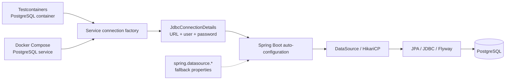
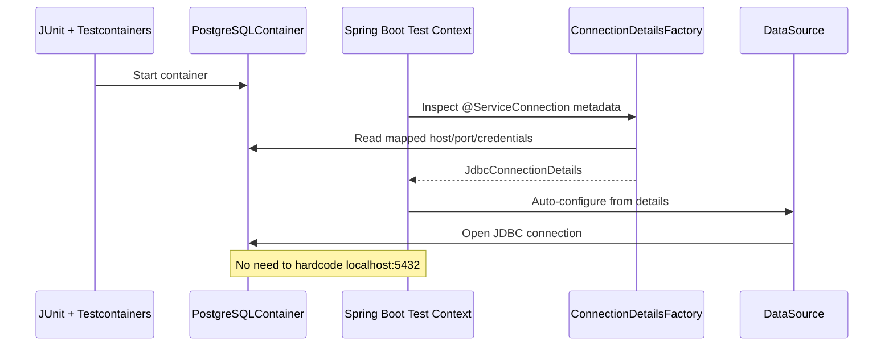
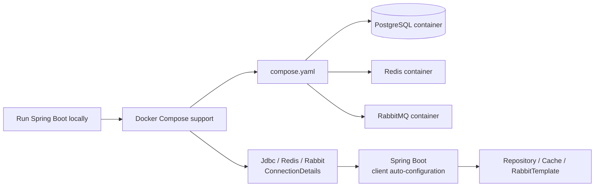
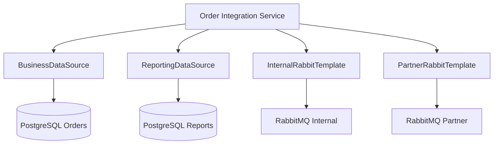
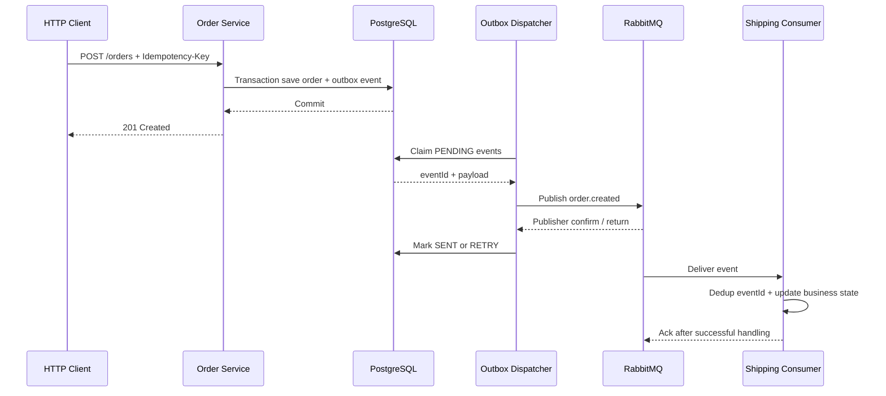
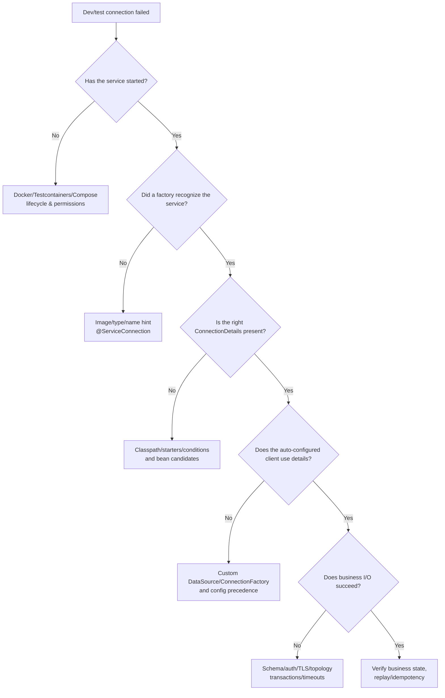

# Service Connection and ConnectionDetails Instead of Manual URL Assembly

## 1. Problem Statement: Ports and Connection Info Are No Longer Fixed

In the **SPRING_BOOT_INTEGRATION** module, a Spring Boot application typically uses HTTP clients, persists data in PostgreSQL, reads from a Redis cache, publishes events to RabbitMQ, or runs Spring Integration adapters simultaneously. Each external system has its own **endpoint, account, port, protocol, and lifecycle**.

During local development or integration testing, these systems may be started by Docker Compose or Testcontainers. Ports are assigned dynamically by Docker, containers can be recreated, passwords are for testing only, and the host accessed by the Java process may differ from the hostname used between containers.

Common manual configuration:

```yaml
spring:
  datasource:
    url: jdbc:postgresql://localhost:5432/orders
    username: app
    password: dev-password
  data:
    redis:
      host: localhost
      port: 6379
  rabbitmq:
    host: localhost
    port: 5672
```

These fixed URLs break easily when tests run in parallel, port `5432` is already occupied, CI uses a different container network, or an environment runs multiple brokers. Developers end up writing `@DynamicPropertySource` or scripts to assemble `spring.datasource.url` manually for each resource type.

Spring Boot addresses part of this problem with the concept of **service connection** and the **`ConnectionDetails`** API: development/test infrastructure can supply **typed** connection information so Boot's auto-configuration initializes JDBC, Redis, RabbitMQ, Kafka, and more without the application manually assembling host, port, username, and JDBC URLs.

### Lesson Objectives

1. Understand the nature of `ConnectionDetails`, `@ServiceConnection`, and the factories that create connection details.
2. Use Testcontainers so the application can test against real databases and brokers, even when Docker assigns dynamic ports.
3. Use Spring Boot's Docker Compose support for development services.
4. Distinguish **connection details** from **data contracts, transactions, retries, security, and readiness**.
5. Know when to use `ConnectionDetails`, when properties are still needed, and when to configure clients manually.
6. Test a real integration flow, debugging cases where beans are not created, the wrong service is targeted, or the wrong datasource is selected.

> **Version scope:** Service connections were introduced in Spring Boot 3.1; the examples below follow the modern Spring Boot 3.x approach. Spring Boot 4 and other major Testcontainers library releases may change packages, starters, or artifacts; check the documentation for your exact BOM before copying code.

## 2. Separating Three Layers: Service, ConnectionDetails, and Client Bean

A **service** is a running PostgreSQL, Redis, RabbitMQ, or other system. **`ConnectionDetails`** is the Java object describing how to connect to that service. A **client bean** is the `DataSource`, Redis connection factory, RabbitMQ connection factory, or infrastructure object that actually opens sockets and performs I/O.



**Distinctions:**

| Layer | Question | Example | Does not mean |
| --- | --- | --- | --- |
| **Service instance** | Which process/resource is running? | PostgreSQL container on a random host port | Spring already has a `DataSource` |
| **ConnectionDetails** | Which parameters does the client need to reach the service? | JDBC URL, username, password | A connection is already open or the schema is valid |
| **Auto-configuration** | Which beans are built from connection details? | `DataSource` or `RabbitConnectionFactory` | Every custom client is auto-configured |
| **Client bean** | Which component actually communicates? | Hikari pool, `RabbitTemplate`, Redis connection | Cross-system transactions are guaranteed |
| **Business adapter** | Under what contract is data read/written/sent? | Outbox repository, HTTP gateway, consumer | Retries/idempotency appear automatically |

For example, `JdbcConnectionDetails` may hold the exact JDBC URL generated by Testcontainers, yet Hibernate still needs entity mappings, Flyway still needs proper migrations, and the application still needs `@Transactional` boundaries. Similarly, `RabbitConnectionDetails` does not declare exchanges, queues, or business bindings on its own.

## 3. What Is ConnectionDetails?

`ConnectionDetails` in Spring Boot is a **marker abstraction** for objects providing information to connect to an external service. Specialized interfaces describe data meaningful to specific client types.

Common examples, depending on version and classpath dependencies:

| Connection details type | Infrastructure group | Typical information |
| --- | --- | --- |
| `JdbcConnectionDetails` | JDBC `DataSource` | JDBC URL, username, password |
| `R2dbcConnectionDetails` | R2DBC `ConnectionFactory` | R2DBC connection options |
| `RedisConnectionDetails` | Redis client | Address, credentials, SSL/connection mode |
| `RabbitConnectionDetails` | RabbitMQ client | Host, port, username, password, vhost depending on type |
| `KafkaConnectionDetails` | Kafka clients | Bootstrap servers |
| Other `*ConnectionDetails` | MongoDB, Cassandra, Elasticsearch, etc. | Protocol-specific details |

Verify interface names and support scope against the Spring Boot version you use. Do not assume every starter on the classpath has a corresponding connection-details factory for every container type.

### 3.1. Typed Object, Not a Global URL String

When Spring Boot creates `JdbcConnectionDetails` from a PostgreSQL container, it may use details such as:

```text
JdbcConnectionDetails
  getJdbcUrl()   = jdbc:postgresql://localhost:<mapped-port>/orders
  getUsername()  = test_user
  getPassword()  = test_password
```

This is a **structural illustration**, not actual runtime output. The mapped port is assigned by Docker and can change across runs.

One crucial difference:

- `ConnectionDetails` is **not** an operation that rewrites `spring.datasource.url` in `Environment`.
- A `DataSource` bean supported by auto-configuration reads the necessary information from connection details when provided.
- Application code still using `@Value("${spring.datasource.url}")` may see **stale, non-existent, or non-actual** property values; do not use that approach to infer the test host/port.
- A manually constructed HTTP client or custom JDBC factory that does not participate in `ConnectionDetails` integration will **not automatically pick up** Docker-assigned hosts/ports.

Therefore, if a class needs to interact with the database, **inject the `DataSource`, `JdbcTemplate`, or repository configured by Boot**, rather than parsing a URL and opening JDBC connections manually.

## 4. Why Move Away from Manual URL Assembly?

A familiar workaround in tests:

```java
// Legacy approach, still useful in some cases:
@DynamicPropertySource
static void registerDatabaseProperties(DynamicPropertyRegistry registry) {
    registry.add(
        "spring.datasource.url",
        postgres::getJdbcUrl
    );
    registry.add(
        "spring.datasource.username",
        postgres::getUsername
    );
    registry.add(
        "spring.datasource.password",
        postgres::getPassword
    );
}
```

This works when appropriate, but introduces several constraints:

1. The test class must know the exact property names `DataSourceAutoConfiguration` expects.
2. Each external system has its own property group: `spring.rabbitmq.*`, `spring.data.redis.*`, `spring.kafka.*`, etc.
3. A single service may need **multiple client types**. PostgreSQL can be accessed via both JDBC and R2DBC; a JDBC URL cannot be used directly for R2DBC.
4. The same test code must reassemble host, port, scheme, SSL mode, or credentials whenever a container changes.
5. Tests easily forget to configure accompanying components such as Flyway, Redis clients, broker publishers, or listener containers.

Service connections solve this by passing **typed connection information** to **auto-configurations that understand that type**, instead of relying on a string URL you assemble manually.

However, `@DynamicPropertySource` is **not replaced in every scenario**: it remains useful when a service is not directly supported by Spring Boot, a client is a self-configured library, or the app needs a property outside the `ConnectionDetails` interface. Choose the right tool per integration boundary.

## 5. How Does @ServiceConnection Connect with Testcontainers?

In integration tests, `@ServiceConnection` tells Spring Boot that the annotated container is a **source of one or more connection details**.

The factory creates details based on container type or Docker image metadata. For example, with a recognized `PostgreSQLContainer`, Boot can produce `JdbcConnectionDetails` to configure the `DataSource`.

Flow:



### Minimum Dependencies

Maven (versions managed by the Spring Boot BOM when compatible):

```xml
<dependencies>
    <dependency>
        <groupId>org.springframework.boot</groupId>
        <artifactId>spring-boot-starter-data-jpa</artifactId>
    </dependency>
    <dependency>
        <groupId>org.postgresql</groupId>
        <artifactId>postgresql</artifactId>
        <scope>runtime</scope>
    </dependency>

    <dependency>
        <groupId>org.springframework.boot</groupId>
        <artifactId>spring-boot-testcontainers</artifactId>
        <scope>test</scope>
    </dependency>
    <dependency>
        <groupId>org.testcontainers</groupId>
        <artifactId>junit-jupiter</artifactId>
        <scope>test</scope>
    </dependency>
    <dependency>
        <groupId>org.testcontainers</groupId>
        <artifactId>postgresql</artifactId>
        <scope>test</scope>
    </dependency>
    <dependency>
        <groupId>org.springframework.boot</groupId>
        <artifactId>spring-boot-starter-test</artifactId>
        <scope>test</scope>
    </dependency>
</dependencies>
```

This artifact syntax is standard for Testcontainers 1.x/Spring Boot 3.x; if your project uses Testcontainers 2.x or a newer Spring Boot generation, check the corresponding artifacts and BOM. `@ServiceConnection` belongs to the **`spring-boot-testcontainers`** module—it does not appear automatically just by adding the PostgreSQL driver dependency.

## 6. Integration Test Example with Dynamic-Port PostgreSQL

A complete illustrative test:

```java
import static org.assertj.core.api.Assertions.assertThat;

import org.junit.jupiter.api.Test;
import org.springframework.beans.factory.annotation.Autowired;
import org.springframework.boot.test.context.SpringBootTest;
import org.springframework.boot.testcontainers.service.connection.ServiceConnection;
import org.springframework.jdbc.core.JdbcTemplate;
import org.testcontainers.containers.PostgreSQLContainer;
import org.testcontainers.junit.jupiter.Container;
import org.testcontainers.junit.jupiter.Testcontainers;

@SpringBootTest
@Testcontainers
class DatabaseConnectionIT {

    @Container
    @ServiceConnection
    static PostgreSQLContainer<?> postgres =
        new PostgreSQLContainer<>("postgres:16-alpine")
            .withDatabaseName("integration_test")
            .withUsername("app_test")
            .withPassword("test_only_password");

    @Autowired
    JdbcTemplate jdbcTemplate;

    @Test
    void connectsToContainerDatabase() {
        Integer result = jdbcTemplate.queryForObject(
            "SELECT 1", Integer.class
        );
        assertThat(result).isEqualTo(1);
    }
}
```

This snippet assumes the application has an auto-configured `JdbcTemplate` (typically available with JDBC/JPA starters and a suitable `DataSource`). We do not specify `spring.datasource.url` pointing to `localhost:5432`; Boot obtains JDBC connection details from the container.

**Lifecycle notes:**

- `@Container` + `@Testcontainers` lets the Testcontainers JUnit extension manage the container in this example.
- `@ServiceConnection` lets Spring Boot consume connection details; **it does not replace all Testcontainers lifecycle rules**.
- Static containers are usually shared within a test class; when combined with Spring TestContext caching across multiple test classes, carefully examine the interaction between container lifecycle and context lifecycle so a datasource does not end up pointing to a stopped container.
- The host port is assigned by Docker, so the test works even when port `5432` on the developer's machine is already in use.
- `SELECT 1` only checks basic connectivity/querying—it does not prove migrations, transactions, or business logic are correct.

If a test needs to verify repositories/outboxes, add Flyway/Liquibase migrations and assert real data. A simple connection check is not a full business-flow integration test.

## 7. How ConnectionDetails Takes Precedence Over Application Properties

In Spring Boot auto-configurations that **support service connections**, a suitable `ConnectionDetails` bean typically takes **precedence** over connection properties like `spring.datasource.url` or `spring.rabbitmq.host`.

Example:

```yaml
spring:
  datasource:
    url: jdbc:postgresql://production-db.example.internal:5432/orders
    username: app
    password: ${DB_PASSWORD}
```

If a test provides `JdbcConnectionDetails` from a `@ServiceConnection PostgreSQLContainer`, the **Boot-managed** `DataSource` can use the container endpoint instead of the JDBC URL above.

However, **never leave real production configuration in an `application.yml` loaded by tests**. Use explicit profiles, secret managers, and test environments; service connections are a wiring mechanism, **not** a guardrail against accidentally touching production data.

### Precedence Has Bounded Scope

| Scenario | Expected outcome |
| --- | --- |
| Boot auto-configured `DataSource` + `JdbcConnectionDetails` from a test container | `DataSource` uses the matching connection details |
| Code manually reads `@Value("${spring.datasource.url}")` to open a socket | Still reads the `Environment` property; does not automatically see details |
| You create a custom `@Bean DataSource` via `new HikariDataSource()` | You are responsible for reading the right details/config |
| Multiple `JdbcConnectionDetails` candidates cannot be resolved | May fail with ambiguity/bean creation errors |
| No matching service connection exists | Auto-configuration falls back to standard properties |
| Custom `RSocketRequester` or HTTP client without a details factory | Does not automatically receive a Docker endpoint from service connection |

**In short:** precedence applies at **the auto-configuration layer that integrates with details**, rather than being a global property override mechanism.

## 8. Accessing ConnectionDetails Directly When Needed

Normally applications should inject configured client beans: `DataSource`, `JdbcTemplate`, `RabbitTemplate`, Redis operations, etc. However, when building a custom adapter, you can inject supported details interfaces.

Example reading `JdbcConnectionDetails` in a diagnostic component **for test/dev only**:

```java
import org.springframework.boot.autoconfigure.jdbc.JdbcConnectionDetails;
import org.springframework.context.annotation.Profile;
import org.springframework.stereotype.Component;

@Component
@Profile("test")
public class JdbcConnectionDiagnostic {

    private final JdbcConnectionDetails details;

    public JdbcConnectionDiagnostic(JdbcConnectionDetails details) {
        this.details = details;
    }

    public String jdbcScheme() {
        String url = details.getJdbcUrl();
        return url.startsWith("jdbc:postgresql:")
            ? "postgresql"
            : "other";
    }
}
```

The example intentionally **avoids logging** usernames/passwords or full URLs; JDBC URLs can still expose hosts, database names, or sensitive parameters. When implementing, import the exact package for your Spring Boot version.

Do not create awkward dependency cycles by taking a `DataSource` to infer a JDBC URL and then rebuilding `ConnectionDetails` for that same `DataSource`. If the client already exists and is Boot-managed, **use the client bean**.

### Do Not Equate Having Details with Availability

`JdbcConnectionDetails` only tells you **how to connect**. It does not mean PostgreSQL currently has the right schema, sufficient `INSERT` permissions, or meets query SLOs. To verify those, run health/integration tests and observe real I/O results.

## 9. One Container Can Provide Multiple Types of Details

The same PostgreSQL container can be accessed via **JDBC** or **R2DBC** when libraries, drivers, client factories, and the Spring Boot version support them. JDBC and R2DBC connections use different formats/options; do not take a JDBC string and swap the prefix by string concatenation in tests.

Some service-connection factories can supply multiple corresponding `ConnectionDetails` from a single container. If an application has both persistence stacks, be clear on which client receives which details.

In supported Spring Boot versions, `@ServiceConnection` provides a `type` attribute to restrict which connection details types are produced. Conceptual example:

```java
@Container
@ServiceConnection(type = JdbcConnectionDetails.class)
static PostgreSQLContainer<?> postgres =
    new PostgreSQLContainer<>("postgres:16-alpine");
```

The declaration above assumes the appropriate imports and test dependencies from Section 6; `JdbcConnectionDetails` is imported as in Section 8. This is useful when you **only want JDBC details** even though multiple client types exist on the classpath.

It does not automatically solve the **multiple databases** problem: if you have one PostgreSQL for orders and a separate PostgreSQL for analytics, both supplying `JdbcConnectionDetails` can make auto-configuration ambiguous. In multi-datasource applications, explicitly name and bind each `DataSource`/`EntityManagerFactory`/transaction manager.

## 10. Using RabbitMQ and Redis in the Same Integration Test

For a **Spring Boot Integration** flow with PostgreSQL holding the outbox, RabbitMQ sending messages, and Redis as a cache, a test can run three separate containers.

Example container declarations:

```java
import org.springframework.boot.testcontainers.service.connection.ServiceConnection;
import org.testcontainers.containers.GenericContainer;
import org.testcontainers.containers.PostgreSQLContainer;
import org.testcontainers.containers.RabbitMQContainer;
import org.testcontainers.junit.jupiter.Container;
import org.testcontainers.junit.jupiter.Testcontainers;
import org.testcontainers.utility.DockerImageName;

@Testcontainers
class IntegrationEnvironment {

    @Container
    @ServiceConnection
    static PostgreSQLContainer<?> postgres =
        new PostgreSQLContainer<>("postgres:16-alpine");

    @Container
    @ServiceConnection
    static RabbitMQContainer rabbitmq =
        new RabbitMQContainer("rabbitmq:3.13-management");

    @Container
    @ServiceConnection(name = "redis")
    static GenericContainer<?> redis =
        new GenericContainer<>(DockerImageName.parse("redis:7-alpine"))
            .withExposedPorts(6379);
}
```

This is a **declaration template**, not a complete `@SpringBootTest`. It demonstrates two recognition styles:

- For `PostgreSQLContainer` and `RabbitMQContainer`, Boot can rely on the **specialized container type**.
- For `GenericContainer`, `@ServiceConnection(name = "redis")` provides the **canonical service name** so Boot can locate the matching factory; merely exposing a port does not turn `GenericContainer` into `RedisConnectionDetails`.
- Factories are registered only when the supporting module and matching version are present.
- Redis, RabbitMQ, and PostgreSQL client dependencies must still be on the runtime/test classpath for the application to use them.

In a real integration test, add `@SpringBootTest` and exercise the Boot-created `JdbcTemplate`, Redis client, and `RabbitTemplate`. Do not build three sets of URLs by concatenating `container.getHost()` and `getMappedPort()` just to reconfigure beans Boot already supports.

### Not Every Test Needs to Start Everything

A repository test only needs PostgreSQL. A consumer test might need RabbitMQ and the database, without needing Redis if the cache is replaced by a fake. Scoping test dependencies keeps runs fast and reduces flakiness. **Explicitly identify the boundaries being verified**, rather than launching every container just to make a test look "more integrated."

## 11. What Are Docker Compose Development Services?

Unlike Testcontainers (which creates/manages containers per test lifecycle), Spring Boot includes **Docker Compose** support for local development. When enabled, Boot can locate a compose file, interact with running Docker Compose services or start them per policy, and create `ConnectionDetails` for recognized services.

This avoids requiring every developer to run Docker commands manually and copy hosts/ports into `application-local.yml`.



### Development-Only Dependency

Gradle (with the Spring Boot Gradle plugin supporting the `developmentOnly` configuration):

```groovy
dependencies {
    developmentOnly 'org.springframework.boot:spring-boot-docker-compose'
}
```

Maven:

```xml
<dependency>
    <groupId>org.springframework.boot</groupId>
    <artifactId>spring-boot-docker-compose</artifactId>
    <optional>true</optional>
</dependency>
```

This is **development infrastructure**, not a required dependency of a business module. Verify build/plugin settings so Docker Compose support does not accidentally leak into production artifacts. In Spring Boot, packaging mechanisms normally exclude development-only Docker Compose support from executable archives by default; do not rely on that in place of pipeline verification.

## 12. Example compose.yaml for PostgreSQL, Redis, and RabbitMQ

Place a `compose.yaml` file where Spring Boot Docker Compose support can locate it per project setup:

```yaml
services:
  postgres:
    image: postgres:16-alpine
    environment:
      POSTGRES_DB: orders
      POSTGRES_USER: app
      POSTGRES_PASSWORD: local_only_password
    ports:
      - "5432"

  redis:
    image: redis:7-alpine
    ports:
      - "6379"

  rabbitmq:
    image: rabbitmq:3.13-management
    environment:
      RABBITMQ_DEFAULT_USER: app
      RABBITMQ_DEFAULT_PASS: local_only_password
    ports:
      - "5672"
      - "15672"
```

### Why Write Only "5432" Instead of "5432:5432"?

In Docker Compose, `ports: ["5432"]` exposes container port 5432 to a **dynamically assigned host port**. The same configuration applies to Redis 6379 and RabbitMQ 5672. This reduces collisions when two projects use PostgreSQL on the same developer machine.

Spring Boot Docker Compose support inspects the **mapped port** and can create connection details with the right host/port for an application running **on the host machine**. Developers do not have to inspect ports via `docker compose ps` and edit `spring.datasource.url`.

Do not adopt this blindly if:

- You intentionally want a fixed port so external SQL tools can connect.
- Both the app and broker run **inside the same Docker network**, where the container hostname/service name is the proper address.
- A service does not expose a supported port; Boot cannot magically infer an address from an arbitrary YAML key.
- An internal company image is not recognized by repository name by the factory.

All passwords in the example are strictly for **development**. Production must use a secret manager, scoped accounts, TLS, and dedicated networking.

## 13. Minimal Application YAML When Using Compose Service Connections

When Docker Compose services are recognized and appropriate starters are present, you do not strictly need to declare host/port for the three external systems:

```yaml
spring:
  application:
    name: order-integration

  jpa:
    open-in-view: false
    hibernate:
      ddl-auto: validate

  flyway:
    enabled: true

  rabbitmq:
    publisher-confirm-type: correlated
    publisher-returns: true
    template:
      mandatory: true
```

Here:

- `ConnectionDetails` supplies **connection information** supported by Spring Boot.
- `spring.jpa.*` still configures **ORM behavior**, which is outside `ConnectionDetails`.
- `spring.flyway.*` still controls migrations; `ConnectionDetails` does not replace schema versioning.
- `spring.rabbitmq.publisher-*` still governs publisher confirms/returns; service connection does not automatically enable publish reliability.
- The application still needs dependencies for DataSource/JPA, Flyway, Redis, and RabbitMQ that it uses.

**Do not remove behavioral properties just because you adopted service connections.** Only **connection details supported by the factory/client** are supplied by this mechanism.

### What If Compose Is Not Running?

When Compose support is inactive (missing dependency, disabled, file not discovered, or Docker unavailable), the application falls back to normal behavior based on configuration: properties, custom beans, or startup failure if required settings are missing. Therefore, maintain **intentional profiles/fallbacks** and clear error logs rather than silently connecting to an unintended default database.

## 14. Useful Docker Compose Properties

Spring Boot supports the `spring.docker.compose.*` group to control the development environment. Example:

```yaml
spring:
  docker:
    compose:
      enabled: true
      file: ./compose.yaml
      lifecycle-management: start-and-stop
```

Configuration groups typically checked by version:

| Option | Main purpose | Use case |
| --- | --- | --- |
| `spring.docker.compose.enabled` | Enable/disable Docker Compose support | Disable in CI or environments without Docker |
| `spring.docker.compose.file` | Specify Compose file | Project uses a non-default filename/location |
| `spring.docker.compose.lifecycle-management` | Choose start/stop policy | Prevent Boot from stopping shared resources |
| Readiness options | Control how Boot waits for service readiness | Slow-starting broker or custom healthchecks |
| Related Docker Compose labels | Hint/exclude services from service connections | Custom images or services not meant to be managed |

Value names and lifecycle behaviors can change across releases; for instance, `start-and-stop`, `start-only`, or `none` should be checked against the Spring Boot docs you use.

### Does Lifecycle Matter?

Yes. Distinguish:

- **App launch:** Spring Boot may start compose services per configuration.
- **App shutdown:** Boot may stop services it manages, depending on lifecycle policy.
- **Pre-existing running services:** Boot may reuse them without restarting; understand how their shutdown is handled.
- **Multiple IDEs/processes sharing one compose project:** if one process stops Compose, another process may lose the database it is actively using.

If a Docker Compose stack is shared across multiple apps/tests, `start-only` or independent management policies may fit better. Base that choice on resource sharing and version support, not blind copy-paste.

## 15. Recognizing Services via Images and Labels

Spring Boot has factories that recognize service types to create connection details. With Docker Compose, recognition typically relies on **Docker image name** or metadata understood by Compose support. With Testcontainers, it can also rely on **container subclasses** like `PostgreSQLContainer`.

Example internal image:

```text
registry.example.internal/team/custom-postgres:16
```

If the repository name is not recognized by default factories as PostgreSQL, Spring Boot may **fail to create `JdbcConnectionDetails`**, even though the container runs genuine Postgres. Options include:

1. Use a standard image or supported `Container` subclass if suitable for tests.
2. Specify the service name explicitly with `@ServiceConnection(name = "postgres")` on a compatible Testcontainers source.
3. For Docker Compose, check the service recognition label supported by your Spring Boot version.
4. Configure connections via properties or a custom `ConnectionDetails` bean when factories do not cover it.

Do not rename images or add labels by guesswork. Read auto-configuration diagnostics and check which details interfaces are actually produced.

### GenericContainer Often Needs an Explicit Service Name

When using `GenericContainer`, Spring Boot does not always know the actual image while building bean definitions—especially for containers created via `@Bean` methods. `@ServiceConnection(name = "redis")` or another supported name explains **the service type** the container represents. That name is not an arbitrary Docker Compose service name; it must match a name supported by a factory.

## 16. @ServiceConnection on @Bean in Test Configuration

A test suite wanting to share Spring-managed containers can declare containers as beans instead of `@Container` static fields.

Example:

```java
import org.springframework.boot.test.context.TestConfiguration;
import org.springframework.boot.testcontainers.service.connection.ServiceConnection;
import org.springframework.context.annotation.Bean;
import org.testcontainers.containers.GenericContainer;
import org.testcontainers.utility.DockerImageName;

@TestConfiguration(proxyBeanMethods = false)
public class SharedRedisTestConfiguration {

    @Bean
    @ServiceConnection(name = "redis")
    GenericContainer<?> redisContainer() {
        return new GenericContainer<>(
            DockerImageName.parse("redis:7-alpine")
        ).withExposedPorts(6379);
    }
}
```

A test can import the configuration:

```java
import org.junit.jupiter.api.Test;
import org.springframework.boot.test.context.SpringBootTest;
import org.springframework.context.annotation.Import;

@SpringBootTest
@Import(SharedRedisTestConfiguration.class)
class RedisBackedIntegrationIT {

    @Test
    void contextUsesRedisServiceConnection() {
        // Perform real Redis operations to verify connectivity,
        // rather than only asserting ApplicationContext startup.
    }
}
```

In this `@Bean` pattern, Spring Boot manages container lifecycle appropriately. Do not put JUnit Testcontainers `@Container` on a `@Bean` method as though it were a JUnit-controlled static field. When switching from static `@Container` to `@Bean`, check start/stop rules and Spring context caching to avoid talking to a stopped container.

For a `@Bean` with a generic return type like `GenericContainer<?>`, the **name hint** is especially important because factories cannot infer the image repository from the method signature before bean creation. If there are multiple containers of the same type, bind each client explicitly to avoid ambiguous details beans.

## 17. Creating Custom JdbcConnectionDetails Without Standard Containers

Service connections do not force an application to use Testcontainers or Compose. An application can provide its own details bean for specialized environments, such as a dev database provisioned dynamically by an internal system.

**Simple example illustrating the typed API**, not a mandatory application setup:

```java
import org.springframework.beans.factory.annotation.Value;
import org.springframework.boot.autoconfigure.jdbc.JdbcConnectionDetails;
import org.springframework.context.annotation.Bean;
import org.springframework.context.annotation.Configuration;
import org.springframework.context.annotation.Profile;

@Configuration(proxyBeanMethods = false)
@Profile("internal-dev-db")
class InternalDatabaseConnectionConfiguration {

    @Bean
    JdbcConnectionDetails internalJdbcDetails(
            @Value("${integration.dev-db.jdbc-url}") String url,
            @Value("${integration.dev-db.username}") String user,
            @Value("${integration.dev-db.password}") String password) {

        return new JdbcConnectionDetails() {
            @Override
            public String getJdbcUrl() {
                return url;
            }

            @Override
            public String getUsername() {
                return user;
            }

            @Override
            public String getPassword() {
                return password;
            }
        };
    }
}
```

`integration.dev-db.*` are **application-defined properties**. When `DataSource` auto-configuration receives a matching `JdbcConnectionDetails` bean, it uses this typed information instead of relying solely on `spring.datasource.*`.

Considerations:

- This bean can **switch connection targets** from normal config if the profile is accidentally enabled in production; guard profiles, secrets, and permissions.
- A `JdbcConnectionDetails` bean does not automatically handle credential rotation for an open connection pool. If secrets change, implement an appropriate pool refresh/recreate strategy.
- If a project has two JDBC datasources, one default details bean cannot cleanly represent both sources; custom configuration is required.
- Never log or expose full URLs/passwords in health endpoints.
- If you only need one fixed JDBC URL, `spring.datasource.*` is simpler and you do not need to write a custom details bean.

## 18. Limitations: Multiple DataSources or Multiple Brokers

`@ServiceConnection` works smoothest when an application has **one service per type** and Boot auto-configures the corresponding client. When you have two PostgreSQL databases, two RabbitMQ brokers, or Redis used separately for caching and sessions, you need an explicit bean architecture.



If two containers both produce `JdbcConnectionDetails` in one Spring context, never assume Boot will automatically pick the right container for each repository. Proper design requires defining **ownership**:

1. Which `DataSource`/`ConnectionFactory` uses which service's details?
2. Which repositories/`EntityManagerFactory`/Flyway migrations belong to which database?
3. Which transaction manager does `@Transactional` use?
4. Which `RabbitTemplate` and listener container connect to which broker?
5. Which secrets and permissions are isolated across partners?
6. Which test proves production data is never sent to a test broker or vice versa?

You can use `@Qualifier`, `@Primary`, custom beans, and dedicated properties; for complex multi-connection setups, **writing explicit, typed manual configuration** is often safer than forcing one default service connection onto everything.

## 19. ConnectionDetails Does Not Replace Business Configuration

Service connections help Boot build clients with the right endpoints. They **know nothing** about the following:

| Concern | Who is responsible? |
| --- | --- |
| Exchange, queue, routing key names | Application topology / `RabbitAdmin` / IaC |
| JSON schema, Protobuf, DTO versions | Producer/consumer contract |
| Transactional outbox | DB schema, transaction service, and publisher worker |
| Deduplication | Event ID, unique constraint, idempotent consumer |
| Cache TTL and invalidation | Business/cache configuration |
| HTTP timeout, retry, circuit breaker | HTTP adapter/policy |
| Kafka consumer groups, offset semantics | Kafka client config and application |
| `DataSource` pool sizing | Hikari/JDBC configuration |
| TLS trust stores and authorization | Security/platform operations, client transport |
| Schema migrations | Flyway/Liquibase |
| Business completion | Workflow state and integration tests |

For example, Boot can pull RabbitMQ host/port from a service connection, yet these properties remain essential if publish reliability matters:

```yaml
spring:
  rabbitmq:
    publisher-confirm-type: correlated
    publisher-returns: true
    template:
      mandatory: true
```

The application author still must handle correlation data, confirm ACK/NACK, returned messages, outbox states, and safe retries. `ConnectionDetails` neither guarantees consumer commits nor delivers messages exactly once.

## 20. Real-World Integration Flow: JDBC + RabbitMQ + Outbox

Suppose an order creation API:



In an integration test for this pipeline:

- `@ServiceConnection PostgreSQLContainer` supplies `JdbcConnectionDetails` for JDBC/JPA.
- `@ServiceConnection RabbitMQContainer` supplies the matching connection details for Spring AMQP.
- Flyway runs migrations creating `order`, `outbox_event`, and `processed_event`.
- The application publishes with a stable event ID and tracks publisher confirms.
- The consumer handles duplicates inside a database transaction; the test sends the same event twice.
- Test assertions must verify **actual DB state and broker routing**, not just that client beans were injected.

If the database commits and then the broker goes down, service connections may still exist while publishing fails. **`ConnectionDetails` is not a durability mechanism**; the outbox preserves the publish intent for retries when the broker returns.

## 21. Test Scenarios Where Service Connections Truly Help

### Test 1: Verify DataSource Points to the Right PostgreSQL Container

The example in Section 6 used `SELECT 1`. For a stronger test, obtain a `Connection` from `DataSource`, assert expected schema/migrations, and run real repositories. Never log URLs containing credentials.

### Test 2: Verify RabbitTemplate Points to the Right Broker

A test with a RabbitMQ container can declare a **test-only** exchange/queue/binding, publish a message, and consume from the test queue. This proves routing through a real broker far better than mocking `RabbitTemplate.convertAndSend`. Use a unique queue per test or dedicated namespace to avoid CI contention.

### Test 3: Retry on Connection Loss

Stop or temporarily make the test broker unavailable, verify the outbox stays `PENDING`/`RETRY`. Restore the broker, verify the publisher resends, and confirm the consumer applies no duplicate side effects on redelivery.

### Test 4: Schema Migrations

Run Flyway/Liquibase against an empty PostgreSQL container, start JPA with `ddl-auto=validate`, and persist a real entity. If migrations are misordered or miss a unique constraint, the test must fail instead of turning on `ddl-auto=update` to "auto-fix" it.

### Test 5: Cache and Serialization

With a Redis container, verify key schema, TTL, eviction/invalidation, and serializers. Service connection only selects the Redis endpoint; it does not prove cache consistency with PostgreSQL.

**Define each test's scope.** Domain rule unit tests can use mocks, component tests can use fake adapters, integration tests use real containers, and end-to-end tests verify journeys across services.

## 22. Comparing @DynamicPropertySource, @ServiceConnection, and Docker Compose

| Criterion | `@DynamicPropertySource` | Testcontainers + `@ServiceConnection` | Spring Boot Docker Compose support |
| --- | --- | --- | --- |
| Endpoint source | Test-supplied function/lambda | Annotated container | Recognized Compose service/image/metadata |
| Data passed into Boot | Property keys you choose | Typed `ConnectionDetails` | Typed `ConnectionDetails` |
| Must know `spring.datasource.url`? | Usually yes | No when factory supports it | No when factory supports it |
| Best suited for | Custom properties or specialized clients | Isolated integration tests | Local development |
| Lifecycle | Managed by test/custom setup | Testcontainers/JUnit or Spring-managed container | Compose support + lifecycle policy |
| Dynamic ports | Must register mapped port manually | Factory reads mapped port | Reads published/mapped ports from Compose |
| Limitations | Boilerplate and missed properties | Only supported factories/client types | Depends on Docker Compose and image recognition |
| Production use | Not a standard deployment mechanism | Not a way to provision production databases | Must not be enabled as production orchestration |

No single tool wins universally. For instance, when writing a custom TCP client to a legacy system without a `*ConnectionDetails` factory, `@DynamicPropertySource` can be simpler and more transparent.

### A Common Configuration Mistake

```java
// Do not do this if a DataSource bean is already configured by Boot:
// Manually assembling a URL from assumed environment variables.
String url = "jdbc:postgresql://" + host + ":" + port + "/" + db;
DriverManager.getConnection(url, user, password);
```

In tests with random mapped ports or environments with custom SSL/options, this URL can diverge from `JdbcConnectionDetails`. Inject the `DataSource` or adapter managed by Boot.

## 23. Security: Test Secrets Are Not Production Secrets

`ConnectionDetails` can contain usernames/passwords. Even as a typed object, that information remains **sensitive** whenever resources are not completely isolated.

Principles:

1. Passwords in sample `compose.yaml` files are local-only; never reuse them as production secrets.
2. When TLS is required, configure trust/identity properly; service connections should not be assumed to automatically verify every certificate securely.
3. Never write `details.getPassword()` or full sensitive JDBC URLs to logs or Actuator.
4. Never allow CI service containers to reach a production host due to an accidentally inherited environment variable.
5. Tests should use dedicated accounts and vhosts/databases with least privilege; avoid remote `guest` or real admin credentials.
6. If CI grants access to a Docker socket, recognize that controlling Docker carries major privileges; use isolated runners.
7. Never load personal or real confidential data into test containers without justification and safeguards.
8. Restrict logging/tracing of sensitive endpoints, hostnames, headers, and payloads; define retention for test artifacts.

### SSRF and Arbitrary Hosts

If an application connects to multiple user-supplied systems, never turn `ConnectionDetails` into a mechanism allowing connections to arbitrary hosts. Enforce allowlists, service discovery, and authorization at the application layer, defending against DNS rebinding and sensitive internal endpoints whenever input is untrusted.

## 24. Readiness: Container Running Does Not Mean Service Ready

A container showing `running` does not mean PostgreSQL is ready for transactions or RabbitMQ has initialized vhosts/permissions. Docker Compose support and Testcontainers provide readiness/wait strategies, but you still must test real needs.

Distinguish:

| Level | Example | Not yet proven |
| --- | --- | --- |
| Docker container running | PID/container active | Port open or DB login works |
| Port reachable | TCP connect succeeds | Auth/schema/API contract |
| JDBC/AMQP handshake | Client connects successfully | Migrations/queue bindings are valid |
| Probe query/health | `SELECT 1` or broker ping | Business workflow correctness |
| Integration test | Write outbox, publish, process event | System won't fail under production load |

Some readiness checks rely on TCP ports or service healthchecks. If RabbitMQ needs time to create users/vhosts/queues or PostgreSQL needs migrations, the application still needs bounded startup/test retries and clear failure reporting when dependencies are unmet.

**Do not write tests with `Thread.sleep(5000)` assuming enough time has passed:** use wait strategies, health probes, and bounded eventual assertions, keeping CI stable and pinpointing root causes.

## 25. Debugging: Why Does @ServiceConnection Have No Effect?

Common symptoms:

| Symptom | Possibility | How to diagnose |
| --- | --- | --- |
| `@ServiceConnection` cannot be imported | Missing `spring-boot-testcontainers` or wrong version | Test dependency graph/BOM |
| `DataSource` bean still connects to `localhost:5432` | No `JdbcConnectionDetails` created, custom `DataSource`, or another test config | Conditions report, service connection factories, bean definitions |
| `GenericContainer` does not create Redis details | Service/image not recognized | Use `@ServiceConnection(name="redis")`, check factory support |
| `PostgreSQLContainer` runs but JPA startup fails | Wrong JDBC driver, migration/DDL, or properties | Root exception, migration history, Hibernate SQL |
| One test passes, another fails connection | Container stopped while cached application context stayed alive | Testcontainers lifecycle, static container reuse, Spring context cache |
| Docker Compose does not start | Missing dependency, file not found, Docker unavailable or disabled | Compose file path, effective profile/config, logs |
| Compose runs but no connection details exist | Unrecognized custom image or missing published port | Image name/labels, container ports, Boot support |
| `@Value("${spring.datasource.url}")` differs from real URL | Details do not overwrite `Environment` properties | Inject `DataSource`/`JdbcConnectionDetails` instead of reading property |
| Two databases of the same type cause ambiguity | Multiple details/candidates of the same type | Multi-datasource config, qualifiers, ownership |
| Docker container works but test times out | Service not ready, network, auth, or resource starvation | Wait strategies, healthchecks, logs, container metrics |
| `RabbitTemplate` bean exists but publishes do not reach queue | Wrong exchange/routing key/binding | Rabbit topology, publisher confirm/return |
| Test accidentally uses production credentials | Mixed properties/profiles/secrets | Environment isolation, guardrails, and network ACLs |

### Layered Debugging Workflow



When needed, enable `--debug` to view the Conditions Evaluation Report, or inspect Actuator `/actuator/conditions` and `/actuator/beans` in a secured environment. Never expose them publicly just for debugging, because bean/condition metadata can reveal valuable details to attackers.

## 26. When Should You Keep Manual URL Properties?

Service connections are not always the best choice:

- **Production:** endpoints/secrets typically come from secret managers, service discovery, cloud bindings, or deployment configs. Do not run Testcontainers to create production databases.
- **Legacy protocols:** no connection-details interface/factory exists, requiring a custom client or `@DynamicPropertySource`.
- **Many datasources/brokers:** require explicit owners, qualifiers, routing, and transaction managers.
- **Specialized connection options:** SSL, proxies, failover, cluster topologies, or driver-specific settings must be configured separately beyond basic details.
- **Security policies:** environments with strict boundaries where auto-service discovery must not ambiguously choose endpoints.
- **Remote CI infrastructure:** runners without a Docker socket must use fixed CI-provided services; properties or custom details beans can be used per design.

**The goal is not to erase every `spring.datasource.*` property**, but to avoid **guessing/hardcoding dynamic endpoints** in development/test when Spring Boot already provides an appropriate abstraction. Properties for pools, transactions, retries, and security remain essential.

## 27. Anti-Patterns and Alternatives

| Anti-pattern | Why it is dangerous | Replacement |
| --- | --- | --- |
| Hardcoding `localhost:5432` in CI | Port conflicts, different runner networks | Service connections with mapped ports |
| Building JDBC URLs via `getHost()+getMappedPort()` in every test | Boilerplate, missed options/credentials | `@ServiceConnection` when factories support it |
| Reading `spring.datasource.url` to verify actual container URL | `ConnectionDetails` does not modify `Environment` properties | Inspect `DataSource`/details within test scope |
| Every test spinning up PostgreSQL, Redis, and RabbitMQ | Slow, flaky | Choose dependencies per test boundary |
| Enabling Docker Compose support in production | Unexpected lifecycle, Docker socket access, not prod orchestration | Standard deployment orchestration and config/secrets |
| No fallback when a custom image is unrecognized | Client silently connects to a different endpoint | Name hint/label/custom details or explicit config |
| Creating multiple `JdbcConnectionDetails` without selecting a client | Ambiguous beans and wrong DB usage | Explicit `DataSource`s, qualifiers, separate contexts |
| Assuming container healthchecks prove business correctness | Schemas, routes, and transactions may still be broken | Business integration tests |
| Logging entire `ConnectionDetails` | Can leak credentials | Redact; log only service type/status |
| Using sample Compose passwords in real environments | Unauthorized access risk | Secret manager and least privilege |
| Writing DB and sending RabbitMQ in one transaction assuming atomicity | Two resources do not commit atomically together | Transactional outbox + idempotent consumer |
| Using fixed ports across all CI branches | Contention between concurrent jobs | Ephemeral ports, isolated projects |

## 28. Case Study: From Manual URL Assembly to Service Connections

A Spring Boot team has three dependent services: PostgreSQL (for orders/outbox), Redis (for state caching), and RabbitMQ (for event publishing). Previously, `application-test.yml` contained:

```yaml
spring:
  datasource:
    url: jdbc:postgresql://localhost:5432/orders
    username: test
    password: test
  data:
    redis:
      host: localhost
      port: 6379
  rabbitmq:
    host: localhost
    port: 5672
```

When two CI jobs ran on the same runner, the second job could not bind ports. A developer updated URLs per job port, yet forgot `spring.rabbitmq.port`; tests stayed green only because `RabbitTemplate` was mocked.

### Redesigning the Setup

1. **Choose the right dependencies:** `spring-boot-testcontainers`, Testcontainers JUnit, and PostgreSQL/RabbitMQ/Redis (`GenericContainer` where appropriate) modules alongside required Spring Boot starters.
2. **Apply `@ServiceConnection`:** use `PostgreSQLContainer`, `RabbitMQContainer`, and `GenericContainer` `name="redis"`; let Docker allocate ephemeral ports.
3. **Delegate wiring to Boot:** stop assembling `spring.datasource.url`, Redis host/port, or RabbitMQ port manually once client auto-configuration consumes matching details.
4. **Keep behavioral configuration:** Hibernate `ddl-auto=validate`, Flyway migrations, Redis TTL, Rabbit publisher confirms/returns, listener concurrency, timeouts, and retries.
5. **Test for real:** assert repository writes/reads on PostgreSQL; Redis set/get/TTL; `RabbitTemplate` publishing to a test queue and consumer handling.
6. **Test critical failures:** DB commits while broker is down keeps outbox pending; retrying the same event causes no duplicate business side effects.
7. **Protect environments:** CI uses only isolated containers with no production secrets loaded; test via provided connection details with fail-safe guards for wrong profiles.
8. **Local developers:** can use `spring-boot-docker-compose` with `compose.yaml` so Boot resolves host/mapped ports automatically instead of editing multiple property files.
9. **Observability:** record event IDs, publish outcomes, retry counts, backlog, and query/connection latencies; never log credentials.
10. **Review multi-datasource needs:** if the team adds a reporting database, switch to explicit bean ownership; never assume Boot routes one `JdbcConnectionDetails` type to two databases automatically.

**Case study conclusion:** service connections cut down dynamic endpoint boilerplate and improve integration test repeatability. They **do not replace** data contracts, schema migrations, routing, transactions, deduplication, or monitoring.

## 29. Practical Implementation Checklist

- [ ] Verify the Spring Boot version supports service connections and Testcontainers/Compose modules match the BOM.
- [ ] Use `@ServiceConnection` for supported containers or Docker Compose support in development.
- [ ] Identify which `*ConnectionDetails` are actually created and which client auto-configurations consume them.
- [ ] Never hardcode host ports when Docker allocates dynamically; never read `Environment` URLs to infer actual runtime targets.
- [ ] For `GenericContainer`/custom images, verify service name/factory recognition.
- [ ] Use Spring-managed vs. JUnit-managed containers consistently to avoid lifecycle clashes and stale context caches.
- [ ] When multiple datasources/brokers exist, define clear bean ownership and transaction boundaries.
- [ ] Preserve properties for JPA schemas, Hikari pools, Redis TTLs, publisher confirms, retries, TLS, and auth as required.
- [ ] Isolate Docker Compose/Testcontainers from production; protect the Docker socket, credentials, and test data.
- [ ] Test actual dependency readiness, not merely container running status or context startup.
- [ ] Run integration tests against real PostgreSQL/Redis/RabbitMQ for flows needing routing and transaction proof.
- [ ] Implement outbox/inbox, event IDs, retry/backoff, and idempotent consumers for cross-system business effects.
- [ ] Monitor pool exhaustion, connection failures, queue depth, publish confirms/returns, and business outcomes.
- [ ] When upgrading Boot/Testcontainers, check packages/artifacts, factory coverage, annotations, and Docker Compose lifecycle properties.

**Key takeaway:** **Service connection** is how Spring Boot discovers or receives connection details from development/test services. **`ConnectionDetails`** is the typed abstraction auto-configuration uses to build client beans. **`@ServiceConnection`** is typically used with Testcontainers, while Docker Compose support creates connections for local environments when services are recognized. This eliminates manual URL assembly, but it **does not** solve data contracts, transactions, security, retries, idempotency, or testing for a **SPRING_BOOT_INTEGRATION** flow.

## References

- [Spring Boot Reference – Testcontainers](https://docs.spring.io/spring-boot/reference/testing/testcontainers.html): `@ServiceConnection`, container lifecycles, and typed connection details.
- [Spring Boot Reference – Docker Compose Support](https://docs.spring.io/spring-boot/reference/features/dev-services.html): service discovery and development service connections.
- [Spring Boot Reference – Data Access](https://docs.spring.io/spring-boot/reference/data/sql.html): DataSource, JPA, JDBC, and migrations.
- [Spring Boot Reference – Messaging](https://docs.spring.io/spring-boot/reference/messaging.html): configuring message brokers and integration applications.
- [Testcontainers for Java](https://java.testcontainers.org/): container lifecycles, modules, and test infrastructure.

Linked documentation may describe a newer release than the one used in your project. When implementing, verify against your **exact versions** of Spring Boot, Testcontainers, and Docker images, especially regarding package/bean condition changes or Compose lifecycle mechanics.
