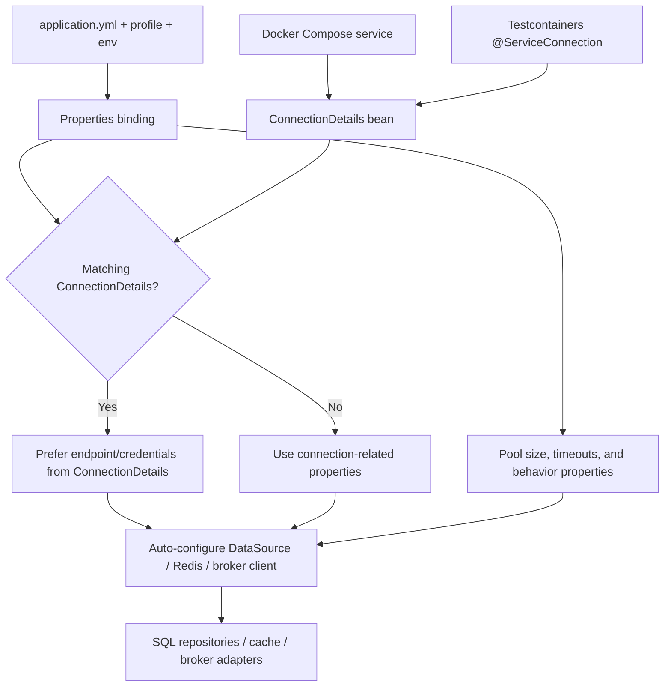
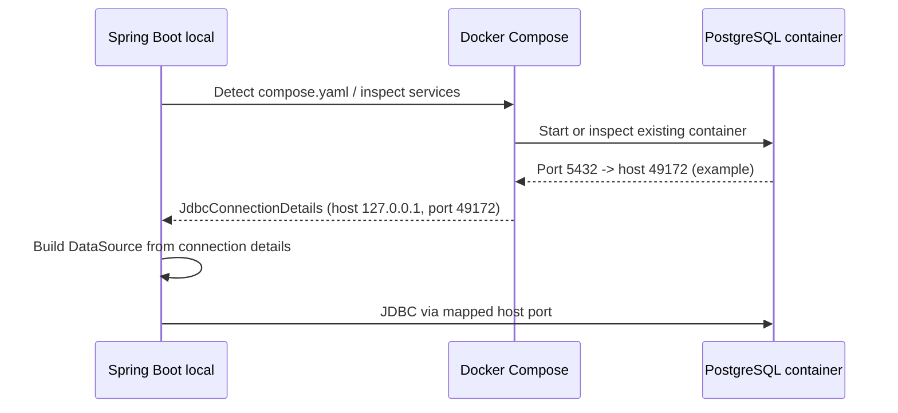
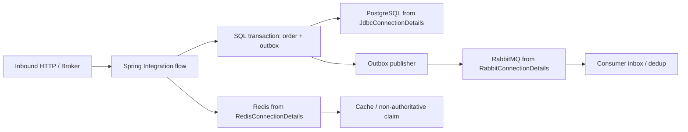

# Precedence of Service Connection Details Over Connection Properties

> **Chapter:** Development Services  
> **Scope:** The **SPRING_BOOT_INTEGRATION** module organizes system integration in Spring Boot across HTTP clients, databases, caches, message brokers, and Spring Integration adapters. This lesson explains why **service connection details** provided by Docker Compose or Testcontainers can take **precedence over connection configuration properties** in `application.yml`, while clarifying what still comes from properties, auto-configuration exceptions, how to test the real target, and how to avoid connecting to the wrong environment.

## 1. Real-World Problem: The URL in application.yml Is Not Always the Active URL

Suppose a Spring Boot worker reads orders from PostgreSQL, stores idempotency state, and publishes events through RabbitMQ. Its `application.yml` declares:

```yaml
spring:
  datasource:
    url: jdbc:postgresql://localhost:5432/orders_fallback
    username: local_user
    password: ${LOCAL_DB_PASSWORD:replace-me}
    hikari:
      maximum-pool-size: 8
  data:
    redis:
      host: localhost
      port: 6379
      timeout: 2s
```

Yet when running the application with **Docker Compose development services**, Docker publishes PostgreSQL on a random host port such as `127.0.0.1:49172`. If Boot detects the service and creates a `JdbcConnectionDetails` bean for that container, the auto-configured `DataSource` will connect to **port 49172**, not `5432` from `spring.datasource.url`. This is intentional by design, not an environment variable precedence bug.

Core rule:

> When **Spring Boot auto-configuration supports and consumes a matching `ConnectionDetails` bean**, connection information from that bean takes **precedence over connection-related configuration properties**. Non-connection properties, such as connection pool sizing or behavior, can continue to apply.

Since Spring Boot 3.1, the service connection concept has powered Docker Compose and Testcontainers support. This lesson uses conventions for **Spring Boot 3.x (e.g., 3.4/3.5), Java 17+**; `ConnectionDetails` types, recognized images, and configuration APIs may vary in other Boot lines. Always verify the documentation/BOM of **the exact version your application uses**, especially when upgrading to Boot 4.x.

**Learning objectives:** after this lesson, learners should be able to explain *why a seemingly valid property is not used*, *which component actually determines the connection*, and *how to verify targets so writes never land in the wrong SQL database, Redis instance, or broker*.

## 2. Distinguishing Three Configuration Layers

In a typical application, at least three concepts are frequently conflated:

| Layer | Examples | Responsibility |
| --- | --- | --- |
| **Configuration properties** | `spring.datasource.url`, `spring.data.redis.host`, `spring.rabbitmq.host` | Default or loaded settings from files, profiles, environment, command line |
| **`ConnectionDetails`** | `JdbcConnectionDetails`, `R2dbcConnectionDetails`, `RedisConnectionDetails`, `RabbitConnectionDetails` | Supplies runtime info for **auto-configuration** to connect to a service |
| **Client/resource bean** | `DataSource`, R2DBC `ConnectionFactory`, `RedisConnectionFactory`, RabbitMQ `ConnectionFactory` | Opens and uses connections; the business layer actually interacts with this bean |

A `ConnectionDetails` bean is **neither an open connection**, nor a `DataSource`, nor a new value overwritten into `Environment`. It is an information source that auto-configuration can read when creating a client/resource.



This diagram illustrates the **conceptual mechanism** of auto-configurations that support service connections; it does not claim every bean and library reads `ConnectionDetails`. For instance, a custom HTTP client built manually from `@Value("${partner.url}")` will **not automatically switch endpoints** just because the project uses Docker Compose.

### 2.1. Do Not Confuse This with PropertySource Precedence

Spring Boot has a precedence hierarchy across configuration sources like command-line arguments, environment variables, and profile YAML files. Service connection is an **additional mechanism at the auto-configuration layer**, not simply a higher-priority `PropertySource`.

Example:

```text
application.yml:
  spring.datasource.url = jdbc:postgresql://localhost:5432/orders_fallback

command line:
  --spring.datasource.url=jdbc:postgresql://localhost:65432/orders_cli

Service connection:
  JdbcConnectionDetails -> jdbc:postgresql://127.0.0.1:49172/orders_dev

Spring Boot auto-configured DataSource, if using JdbcConnectionDetails:
  ACTUAL CONNECTION -> 127.0.0.1:49172/orders_dev

Environment.getProperty("spring.datasource.url"):
  May still return -> jdbc:postgresql://localhost:65432/orders_cli
```

In this example, the CLI argument wins over `application.yml` at the **Environment** layer, yet a `JdbcConnectionDetails` bean is still used by auto-configuration for SQL connections. Hence, **reading `Environment` is insufficient to determine which database is being accessed**.

### 2.2. Quick Decision Table

| Situation | Actual endpoint source typically used |
| --- | --- |
| No other `JdbcConnectionDetails`; Boot auto-configures JDBC `DataSource` | `spring.datasource.url` and matching connection properties |
| Docker Compose detects PostgreSQL and creates matching `JdbcConnectionDetails` | Discovered container details, including host-published port |
| Testcontainers field annotated `@ServiceConnection` and recognized by factory | Connection details from Testcontainers |
| Manually declared `JdbcConnectionDetails` consumed by auto-configuration | Values provided by that bean |
| Plain Redis container without matching support/recognition | No guarantee of auto-generated service connection; may fall back to Redis properties |
| App manually declares `@Bean DataSource` with a hardcoded URL | Depends on **your custom bean code**; no guarantee it reads `JdbcConnectionDetails` |
| Multiple connection details of the same type not disambiguated by auto-config | May cause ambiguity errors or misselection depending on setup; separate resources explicitly |

**The most important condition is "consumed by auto-configuration."** Do not interpret this as "adding `@ServiceConnection` magically alters every network connection inside the JVM."

## 3. Distinguishing Connection Properties from Behavioral Properties

**Connection** properties identify *where to connect and with what identity*:

- JDBC: URL, username, password, corresponding driver metadata.
- R2DBC: connection URL, username/password, and related driver options.
- Redis: host, port, username/password, database/SSL depending on version and `ConnectionDetails` type.
- RabbitMQ: host/port, credentials, or address list within provider support.
- Kafka or other brokers: bootstrap servers, endpoints, and connection settings modeled in the corresponding `ConnectionDetails` type.

**Behavioral** properties describe *how the client operates once it knows the endpoint*:

| Example property | Typical category | When service connection is active |
| --- | --- | --- |
| `spring.datasource.url` | Connection | `JdbcConnectionDetails` can determine the effective JDBC URL |
| `spring.datasource.username` / `password` | Connection | May come from container/bean `ConnectionDetails` |
| `spring.datasource.hikari.maximum-pool-size` | Pool behavior | **Still applied** if auto-config creates HikariCP from properties |
| `spring.datasource.hikari.connection-timeout` | Pool behavior | **Still applied** per HikariCP configuration |
| `spring.data.redis.host` / `port` | Connection | `RedisConnectionDetails` can determine endpoint |
| `spring.data.redis.timeout` | Client timeout | Remains meaningful per auto-configuration/driver support |
| `spring.rabbitmq.listener.simple.concurrency` | Consumer behavior | Unchanged merely because broker host comes from service connection |
| `spring.cache.redis.time-to-live` | Cache retention | TTL is still governed by cache config, not Redis service connection |

Not every option sharing a prefix is categorized identically across Boot releases. For example, TLS, SSL bundles, multi-node topologies, or driver-specific connection options should be checked against the **`ConnectionDetails` interface of your exact running version** and its auto-configuration. Avoid claiming any `ConnectionDetails` always replaces **every** connection property uniformly.

### 3.1. Memorable Example: URL Changes While Pool Size Stays Intact

```yaml
spring:
  datasource:
    url: jdbc:postgresql://localhost:5432/old_db
    username: old_user
    password: ${OLD_DB_PASSWORD:unused-in-dev}
    hikari:
      pool-name: orders-dev-pool
      maximum-pool-size: 8
      minimum-idle: 2
      connection-timeout: 3s
```

If Docker Compose produces valid `JdbcConnectionDetails`, Boot's `DataSource` uses Compose's URL/credentials, yet HikariCP can still retain the name `orders-dev-pool` and `maximumPoolSize=8`. This is precisely what **preferring connection details without discarding all properties** means.

**Consequence:** seeing that the JDBC URL in YAML is ignored does not mean Hikari settings, validation queries, transaction timeouts, or JPA properties have lost effect.

## 4. Docker Compose: From Container to Connection Details

Spring Boot includes a module supporting development-time services via Docker Compose. In supported environments, it can read a `compose.yaml` file, start/detect containers, inspect port mappings, and create connection details for recognized services.

### 4.1. Development Dependency

Maven example:

```xml
<!-- For development; should not be packaged into production runtime. -->
<dependency>
    <groupId>org.springframework.boot</groupId>
    <artifactId>spring-boot-docker-compose</artifactId>
    <optional>true</optional>
</dependency>
```

In Gradle, use the `developmentOnly` configuration. Under Spring Boot's typical default packaging, the Docker Compose module is excluded from repackaged artifacts; if intentionally included at runtime, understand the risk of starting services outside development.

Environment requirements: Docker daemon and compatible Compose CLI, Docker permissions, valid compose file, and recognized/supported Docker images.

### 4.2. Compose File for PostgreSQL and Redis

```yaml
# compose.yaml - local development example
services:
  postgres:
    image: postgres:16-alpine
    environment:
      POSTGRES_DB: orders_dev
      POSTGRES_USER: orders_dev
      POSTGRES_PASSWORD: dev_password_only
    ports:
      - "5432"  # Docker picks an available host port instead of fixing 5432.
    healthcheck:
      test: ["CMD-SHELL", "pg_isready -U orders_dev -d orders_dev"]
      interval: 5s
      timeout: 3s
      retries: 10

  redis:
    image: redis:7-alpine
    ports:
      - "6379"
    healthcheck:
      test: ["CMD", "redis-cli", "ping"]
      interval: 5s
      timeout: 3s
      retries: 10
```

The password `dev_password_only` only illustrates an **isolated local environment**; never reuse it in production or commit real secrets to the repository. Avoid exposing Redis/PostgreSQL to public networks; configure Docker/network firewalls appropriately. `ports: ["5432"]` publishes the container port to a dynamically allocated host port; if you want a fixed port, use `"127.0.0.1:15432:5432"` after checking for port conflicts.

With proper Compose support, Boot detects the PostgreSQL image to create `JdbcConnectionDetails` (and `R2dbcConnectionDetails` if matching conditions hold) and the Redis image to create `RedisConnectionDetails`. Connections from **an app running on the host machine** normally use the **mapped host port**, not `postgres:5432` inside the Docker network.



**Port 49172 is only an example**—never hardcode it into deployment docs. Mapped ports can change when containers are recreated, so hardcoding ports in `application.yml` breaks easily after restarts.

### 4.3. Application Properties Still Have a Place

```yaml
spring:
  datasource:
    # Fallback strictly for when NO service connection exists.
    url: ${JDBC_URL:jdbc:postgresql://localhost:5432/orders_fallback}
    username: ${JDBC_USER:fallback_user}
    password: ${JDBC_PASSWORD:unused-in-compose}
    hikari:
      maximum-pool-size: 8
      connection-timeout: 3s
  data:
    redis:
      host: ${REDIS_HOST:localhost}
      port: ${REDIS_PORT:6379}
      timeout: 2s
  cache:
    type: redis
    redis:
      time-to-live: 5m
```

While service connection is active, the app pulls PostgreSQL/Redis endpoints from the containers. When Compose is disabled or running a packaged artifact without Docker Compose support, fallback properties apply, **assuming no other `ConnectionDetails` source is present**.

A safe system should **never put dangerous production fallbacks into the dev profile**. If a production URL sits in `spring.datasource.url` and Compose temporarily fails to provide details, the dev app could reach production. Separate profiles, secrets, networks, and roles, and add startup validation when the target environment mismatches expectations.

## 5. Compose Service Recognition and Its Limits

Spring Boot recognizes certain containers by **image name/service label** and creates supported `ConnectionDetails` types. This is version-dependent: PostgreSQL/Redis are common defaults, whereas unfamiliar images or custom HTTP services are not supported automatically.

### 5.1. Custom Images Need an Explicit Service Name

```yaml
services:
  redis:
    image: registry.example.org/dev/redis-hardened:7
    ports:
      - "6379"
    labels:
      org.springframework.boot.service-connection: redis
```

The label `org.springframework.boot.service-connection` tells Boot to recognize a custom image **as the stated service type**, assuming the image truly matches the protocol, environment variables, and ports of the standard image. A label does not turn an arbitrary service into Redis.

If a container should not be used as a service connection for this app:

```yaml
services:
  redis-experimental:
    image: redis:7-alpine
    ports:
      - "6379"
    labels:
      org.springframework.boot.ignore: true
```

Ignoring prevents Boot from unintentionally generating details for an auxiliary container the app should not use. Never apply the ignore label to mask a missing required service; fail clearly when the primary backend cannot be found.

### 5.2. Multiple Containers of the Same Technology

A Compose file may define two PostgreSQL servers for orders and reports. **Never assume Boot automatically knows which container the orders `JdbcTemplate` should pick** when multiple `JdbcConnectionDetails` share the same role. Auto-configuration typically expects a single candidate; multi-datasource setups require:

1. Naming data sources by business domain (orders/reports).
2. Creating dedicated `DataSource`, `JdbcTemplate`, and transaction managers as needed.
3. Using `@Qualifier` on injection points so writes never hit the wrong database.
4. Defining how each `DataSource` reads its exact endpoint/details; default auto-config does not clone itself into two independent pools just because two containers exist.
5. Testing actual connectivity, not just verifying that the application context starts.

If you want Compose to supply connection details for only one of the two containers, consider adding the ignore label to the container outside auto-config and configuring the second resource with an explicit bean. That is an architectural choice, not a universal rule for multi-tenant setups.

## 6. Testcontainers: @ServiceConnection for Integration Tests

When integration tests need a real PostgreSQL to verify transactions, unique constraints, or inbox/outbox, or a real Redis to verify TTLs, **Testcontainers** provisions backends scoped to the test lifecycle.

With Spring Boot Testcontainers service connection support, `@ServiceConnection` on a container field/bean signals Boot to produce the matching `ConnectionDetails`. It avoids manually writing `@DynamicPropertySource` for common endpoints.

### 6.1. Example Maven Dependencies

```xml
<dependencies>
    <dependency>
        <groupId>org.springframework.boot</groupId>
        <artifactId>spring-boot-starter-jdbc</artifactId>
    </dependency>
    <dependency>
        <groupId>org.postgresql</groupId>
        <artifactId>postgresql</artifactId>
        <scope>runtime</scope>
    </dependency>

    <dependency>
        <groupId>org.springframework.boot</groupId>
        <artifactId>spring-boot-starter-test</artifactId>
        <scope>test</scope>
    </dependency>
    <dependency>
        <groupId>org.springframework.boot</groupId>
        <artifactId>spring-boot-testcontainers</artifactId>
        <scope>test</scope>
    </dependency>
    <dependency>
        <groupId>org.testcontainers</groupId>
        <artifactId>postgresql</artifactId>
        <scope>test</scope>
    </dependency>
    <dependency>
        <groupId>org.testcontainers</groupId>
        <artifactId>junit-jupiter</artifactId>
        <scope>test</scope>
    </dependency>
</dependencies>
```

Choose a Testcontainers version compatible with the Spring Boot BOM or your project's dependency management. These artifact names follow the Spring Boot 3.x layout. Newer library lines may alter modules; do not copy an old dependency tree straight into Boot 4.x without verifying.

### 6.2. Integration Test Proving Actual Precedence

```java
package com.example.integration.devservices;

import static org.assertj.core.api.Assertions.assertThat;

import org.junit.jupiter.api.Test;
import org.springframework.beans.factory.annotation.Autowired;
import org.springframework.boot.autoconfigure.jdbc.JdbcConnectionDetails;
import org.springframework.boot.test.context.SpringBootTest;
import org.springframework.boot.testcontainers.service.connection.ServiceConnection;
import org.springframework.core.env.Environment;
import org.springframework.jdbc.core.JdbcTemplate;
import org.testcontainers.containers.PostgreSQLContainer;
import org.testcontainers.junit.jupiter.Container;
import org.testcontainers.junit.jupiter.Testcontainers;

@Testcontainers
@SpringBootTest(properties = {
    "spring.datasource.url=jdbc:postgresql://localhost:65432/wrong_db",
    "spring.datasource.username=wrong_user",
    "spring.datasource.password=wrong_password",
    "spring.datasource.hikari.maximum-pool-size=4"
})
class PostgresConnectionPriorityIT {

    @Container
    @ServiceConnection
    static PostgreSQLContainer<?> postgres =
            new PostgreSQLContainer<>("postgres:16-alpine")
                    .withDatabaseName("orders_test")
                    .withUsername("orders_test_user")
                    .withPassword("local_test_only");

    @Autowired JdbcTemplate jdbc;
    @Autowired Environment environment;
    @Autowired JdbcConnectionDetails connectionDetails;

    @Test
    void usesServiceDetailsInsteadOfWrongPropertyUrl() {
        assertThat(environment.getProperty("spring.datasource.url"))
                .contains("wrong_db");

        assertThat(connectionDetails.getJdbcUrl())
                .contains("orders_test");

        String actualDatabase =
                jdbc.queryForObject("select current_database()", String.class);

        assertThat(actualDatabase).isEqualTo("orders_test");
    }
}
```

The test intentionally configures a JDBC URL in properties that **cannot reach any valid database**. Since the test still queries `orders_test`, it proves the auto-configured datasource used the container's service connection rather than `spring.datasource.url`.

**Test design note:** a container annotated with `@Container` has its lifecycle managed by the JUnit Testcontainers extension. If Spring's `TestContext` cache reuses an application context across multiple test classes after a container stops, the cached context may hold connections pointing to a dead container. For larger suites, consider **managing containers as Spring beans** or importing a shared container configuration with an aligned lifecycle.

`select current_database()` alone does not confirm all schema migrations succeeded. To verify migrations, run additional queries against specific tables or migration history inside the test database.

### 6.3. Redis GenericContainer Needs an Explicit Name

For a typed container like `PostgreSQLContainer`, Spring Boot has type information to select the details factory. For a Redis `GenericContainer<?>`, specify the service name explicitly because Boot may not know the target image when processing bean definitions:

```java
import org.springframework.boot.testcontainers.service.connection.ServiceConnection;
import org.testcontainers.containers.GenericContainer;
import org.testcontainers.utility.DockerImageName;
import org.testcontainers.junit.jupiter.Container;

@Container
@ServiceConnection(name = "redis")
static GenericContainer<?> redis =
        new GenericContainer<>(
                DockerImageName.parse("redis:7-alpine"))
                .withExposedPorts(6379);
```

This is an **illustrative field placed inside a test class**, not a complete Java class. With `spring-boot-starter-data-redis` and a supported factory, Boot can create `RedisConnectionDetails` to configure `RedisConnectionFactory`.

Do not confuse the **Java container variable name** (`redis`) with the **service name** in `@ServiceConnection(name = "redis")`. The annotation helps the factory recognize the **technology**; bean names/qualifiers for distinguishing **multiple backends of the same technology** are a separate concern.

## 7. Comparing @ServiceConnection and @DynamicPropertySource

Spring Test provides `@DynamicPropertySource` to populate **dynamic properties** into `Environment`. It remains helpful when a service/driver has no Spring Boot-supported `ConnectionDetails` or the app has a custom client reading properties directly.

### 7.1. Fallback When Service Connection Support Is Absent

```java
@Testcontainers
@SpringBootTest
class LegacyPostgresIT {

    @Container
    static PostgreSQLContainer<?> postgres =
            new PostgreSQLContainer<>("postgres:16-alpine");

    @DynamicPropertySource
    static void databaseProperties(DynamicPropertyRegistry registry) {
        registry.add("spring.datasource.url", postgres::getJdbcUrl);
        registry.add("spring.datasource.username", postgres::getUsername);
        registry.add("spring.datasource.password", postgres::getPassword);
    }
}
```

`@DynamicPropertySource` and `DynamicPropertyRegistry` belong to Spring Test. This is a **test skeleton**; add imports, test methods, and matching dependencies. Do not annotate this same container with `@ServiceConnection` if you intend to control connections entirely via dynamic properties without verifying precedence.

| Criterion | `@ServiceConnection` | `@DynamicPropertySource` |
| --- | --- | --- |
| Output | One or more `ConnectionDetails` beans via matching factory | Property values added to `Environment` |
| Need exact property names? | Less so, when container/tech is supported | **Yes**: must declare URL/host/port/user... |
| Precedence vs. `spring.datasource.url` | Auto-config consumes matching connection details, preferring them | Follows property-source precedence |
| Custom images/services | May need `name`, `type`, or custom factory | Can supply properties to virtually any custom client |
| Multiple resources | Depends on details types and auto-config wiring | Can supply multiple property groups with distinct names |
| Risks | Bean not created/not consumed, multiple details of same type | Property collisions, wrong suppliers, pointing to unintended targets |

### 7.2. Do Not Mix Both Mechanisms and Guess the Outcome

Suppose a test has `@ServiceConnection` on PostgreSQL while also declaring:

```java
@DynamicPropertySource
static void overrideUrl(DynamicPropertyRegistry registry) {
    registry.add("spring.datasource.url",
            () -> "jdbc:postgresql://localhost:65432/not_the_container");
}
```

If the `DataSource` created by auto-configuration uses `JdbcConnectionDetails`, the dynamic property URL **will not necessarily control that datasource**, despite having high priority in `Environment`. They are two distinct mechanisms.

**Practical rule:** Choose `@ServiceConnection` when your stack supports it and manual property wiring is unnecessary. If using `@DynamicPropertySource`, do not simultaneously declare a `ConnectionDetails` bean pointing elsewhere unless intentionally designed. Test **the actual SQL/Redis target** instead of arguing from config load order.

## 8. Connection Details Do Not Auto-Configure Every Bean

### 8.1. A Custom DataSource Can Ignore JdbcConnectionDetails

```java
@Configuration
class ManualDataSourceConfiguration {
    @Bean
    DataSource dataSource(
            @Value("${spring.datasource.url}") String url,
            @Value("${spring.datasource.username}") String username,
            @Value("${spring.datasource.password}") String password) {
        return DataSourceBuilder.create()
                .url(url)
                .username(username)
                .password(password)
                .build();
    }
}
```

This is an **intentional anti-pattern example**, not production guidance. Because the bean reads `@Value` from properties and ignores `JdbcConnectionDetails`, it can hit the fallback URL even when Compose/Testcontainers containers are ready. Declaring your own `DataSource` bean also causes Boot's JDBC auto-configuration to **back off**.

When writing a custom datasource that actually needs service connections, explicitly decide whether to **read from `JdbcConnectionDetails` or from custom config**; an annotation elsewhere cannot rewrite your constructor logic.

### 8.2. Multiple DataSources and Qualifiers

If an integration service uses both an orders PostgreSQL database and a reporting database, a single default `JdbcConnectionDetails` **cannot decide which data goes to each**. Configure explicitly:

```text
ordersDataSource        → orders DB
ordersJdbcTemplate      → ordersDataSource
ordersTransactionManager→ ordersDataSource

reportsDataSource       → reports DB
reportsJdbcTemplate     → reportsDataSource
reportsTransactionManager→ reportsDataSource
```

In services reading/writing data, use `@Qualifier("ordersJdbcTemplate")` or `@Qualifier("reportsJdbcTemplate")` per business intent, and `@Transactional(transactionManager = "ordersTransactionManager")` matching the SQL source. Service connections **do not fix using the wrong transaction manager**; a local transaction cannot automatically roll back a JDBC operation on another datasource or an outbound HTTP POST to a partner.

### 8.3. HTTP Clients Are Usually Not Recognized Automatically

`RestClient`, `WebClient`, or Spring Integration HTTP outbound gateways calling application-defined partner APIs **do not get a generic HTTP service connection detail by default**. A Docker Compose service hosting a custom HTTP API typically needs dedicated properties such as `partner.base-url` or a custom adapter/auto-configuration.

Do not interpret "Spring Boot supports service connections" as "every outbound HTTP call automatically connects to a similarly named Docker container."

## 9. PostgreSQL: JDBC, R2DBC, and Migrations Are Distinct Consumers

A single PostgreSQL container can serve JDBC, R2DBC, and migration tools. However:

| Layer | Connection type/API | What to verify |
| --- | --- | --- |
| **JDBC/JPA** | `DataSource` with `JdbcConnectionDetails` | JDBC driver, URL, user, pool, JPA transaction manager |
| **R2DBC** | `ConnectionFactory` with `R2dbcConnectionDetails` | Separate R2DBC driver, `spring.r2dbc.*`, reactive transaction context |
| **Flyway/Liquibase** | Migration tool, typically using JDBC | URL, credentials, schema/migration locations, and supported details type |
| **Outbox worker** | Uses chosen JDBC/JPA/R2DBC | Right SQL DB; saving order + outbox must be atomic in that DB |

If both `spring.r2dbc.url` and `spring.datasource.url` exist, **a JDBC connection detail does not mean an R2DBC connection is ready**. You need the R2DBC driver and matching auto-configuration. Moreover, adding an R2DBC `ConnectionFactory` can affect Boot's `DataSource` auto-configuration conditions; if you want both, design them deliberately.

**Migrations are a safety boundary:** before running Flyway/Liquibase, verify which database it targets. If service connection changes the effective JDBC URL relative to YAML, migrations may run against the dev container—usually desired in tests, yet never allowed to accidentally hit production. Maintain strict profiles, permissions, and schema history verification.

## 10. Redis, RabbitMQ, and Kafka: Connection Precedence Does Not Change Business Contracts

The `ConnectionDetails` mindset applies across Boot-supported backends, though type names and provided attributes differ:

| Integration | Example details bean | What the application must still design |
| --- | --- | --- |
| PostgreSQL JDBC | `JdbcConnectionDetails` | Schema, transactions, pool, unique keys, outbox |
| PostgreSQL R2DBC | `R2dbcConnectionDetails` | Reactive transactions, pooling, proper retry semantics |
| Redis | `RedisConnectionDetails` | Key prefixes/tenant scope, TTLs, serializers, cache consistency |
| RabbitMQ | `RabbitConnectionDetails` | Exchanges/queues/bindings, acks, DLQs, consumer idempotency |
| Kafka | `KafkaConnectionDetails` in supported versions/configs | Topics, serializers, schema versions, offsets, retry/DLQ |

Use the interface names according to the Spring Boot versions supporting them; **check your exact version** before importing in code. Recognition support for Kafka/Redis/RabbitMQ from **Docker Compose** vs. **Testcontainers** does not necessarily cover the exact same list of images/container types in every Boot release.

**Connection details only solve connectivity—they carry no transactional guarantees.** For example, a RabbitMQ consumer receiving host/port from Compose can still receive the same message multiple times after a lost ack. You still need an inbox/unique constraint and policy-driven acks after SQL side effects are durably saved.

Similarly, Boot finding the right Redis container does not make cache keys multi-tenant safe, clean up idempotency TTLs within SLA, or turn `SET NX` into an ACID transaction spanning PostgreSQL.

## 11. Development Service Lifecycles and Environment Risks

### 11.1. Docker Compose Lifecycle

With Docker Compose support enabled, Boot can start services from the Compose file and stop them on app shutdown per configured lifecycle. Common options:

```yaml
spring:
  docker:
    compose:
      enabled: true
      lifecycle-management: start-and-stop
      # If the file is not in the default working directory:
      # file: ../infra/compose.yaml
```

Lifecycle choices such as `none`, `start-only`, and `start-and-stop` carry distinct semantics:

- `none`: the application does not manage starting/stopping containers; suitable when external tooling manages infrastructure.
- `start-only`: Boot may start services at startup but leaves them running after app shutdown.
- `start-and-stop`: Boot may start and stop services along the app lifecycle under supported conditions.

When Compose services are already running beforehand, start/stop behavior differs from services Boot started itself; do not wipe container data unintentionally. Running `docker compose down -v` in an environment with volumes holding real data can **delete data**.

### 11.2. Running Tests

In Spring Boot versions supporting Docker Compose development services, Compose is typically **skipped in tests by default**; `spring.docker.compose.skip.in-tests` controls this behavior. If testing with Testcontainers, keep them as two clean strategies rather than letting Boot start Compose while also launching separate test containers with unclear wiring.

### 11.3. Keep Dev Services Out of Production

| Environment | How should connection sources be managed? |
| --- | --- |
| **Local dev** | Docker Compose or Testcontainers development launcher, dummy secrets, isolated database |
| **Integration test/CI** | Testcontainers or test infra with deterministic lifecycle, fixtures, and real endpoint assertions |
| **Staging** | Managed services, dedicated profiles/secrets, controlled schemas/migrations and permissions |
| **Production** | Official infrastructure configs/secrets/identities; never let dev dependencies start Docker Compose |

**Never configure production credentials as a reachable fallback from local dev.** If development services break and the app can silently fall back to production, the risk of corrupting live data is far worse than an early startup failure.

## 12. Diagnostics: Why Do Properties Look Right While the App Connects Elsewhere?

### 12.1. Ordered Investigation Workflow

1. **Identify the failing client type:** JDBC, R2DBC, Redis, RabbitMQ, or custom HTTP.
2. **Identify the actually injected bean:** `DataSource`, `ConnectionFactory`, `RedisConnectionFactory`, custom bean, or auto-configured bean.
3. **Look for matching `ConnectionDetails`:** was a bean created by Compose/Testcontainers or a custom `@Bean`?
4. **Inspect the discovered container:** Docker Compose file, image name, labels, mapped port, health/readiness, and container state.
5. **Compare actual config:** `Environment` properties **and** details bean **and** real driver connection.
6. **Check for bean ambiguity:** two details/connection factories of the same type, `@Primary`/`@Qualifier`, or differing profiles.
7. **Verify against the backend:** query database identity, Redis PING/key namespace, or broker metadata within allowed permissions.
8. **Only after knowing the true target**, fix properties, annotations, labels, or custom factories.

### 12.2. Common Errors Table

| Symptom | Possible cause | Action |
| --- | --- | --- |
| `spring.datasource.url` looks right but JDBC uses another port | `JdbcConnectionDetails` exists from Compose/Testcontainers | Check details bean and real SQL connection; this may be expected behavior |
| App uses stale port after container recreate | Custom client hardcoded mapped port or container lifecycle wasn't refreshed | Stop hardcoding Compose ports; recreate context with aligned lifecycle |
| No `ConnectionDetails` for custom-built image | Image name unrecognized | Add Compose label or `@ServiceConnection(name = "...")` in tests |
| `@ServiceConnection` ignored | Missing `spring-boot-testcontainers`, wrong scope, or unsupported by factory | Verify dependencies, annotations, container type, and version |
| Boot ignores details despite bean existing | Custom `@Bean DataSource` or auto-config backed off | Update custom factory to consume details, or let Boot build the resource |
| SQL writes to wrong database | Wrong datasource/qualifier selected | Separate beans/managers explicitly; test `current_database()` |
| Passes locally, fails in CI | Docker daemon unavailable, image pull, ports/firewall, secrets, or test lifecycle | CI environment, image cache, timeouts, redacted logs |
| Broker consumer connects but redelivery duplicates | Connection success does not equal exactly-once | Inbox/unique constraint, policy-aligned ack/retry |
| Hikari settings have no effect | Custom pool ignores `spring.datasource.hikari.*` | Inspect actual pool bean and config rather than guessing from YAML |
| Redis cache mixes tenants | Wrong key/schema/invalidation | Design key scopes, serializers, and permissions—not just host |

### 12.3. Tools to Inspect the Bean Graph

In development environments, `debug=true` prints the **Condition Evaluation Report**; Actuator `/actuator/beans` or `/actuator/conditions` help inspect which beans and auto-configurations matched or backed off. Restrict access to these endpoints because they can expose sensitive system details.

A test can inspect `JdbcConnectionDetails` directly, but **never log raw passwords or connection strings containing credentials**. For PostgreSQL, run a read-only query:

```sql
SELECT current_database() AS db_name,
       current_user AS login_role,
       inet_server_port() AS server_port;
```

`inet_server_port()` reports **the port on the PostgreSQL server**, typically 5432 inside the container; it is **not the host-mapped port** the client connects to. To inspect the mapped port, check a redacted `JdbcConnectionDetails.getJdbcUrl()` or `Connection.getMetaData().getURL()` in tests. This illustrates why observing the right layer matters.

## 13. Testing Property Precedence and Safe Configuration

Do not test only Spring context startup or `Environment.getProperty(...)`. A test capable of catching precedence bugs must verify **the actual connected backend** and ensure required behavioral properties remain effective.

### 13.1. Test Matrix

| Scenario | What must be proven |
| --- | --- |
| No service connection | JDBC auto-config uses URL/user from properties as expected |
| `JdbcConnectionDetails` present + intentionally wrong URL property | JDBC actually queries the container database |
| Connection details + Hikari configuration | Pool size/timeout still follow properties |
| Docker Compose publishes random port | Datasource connects via new mapped port, never hardcoded 5432 |
| Redis `@ServiceConnection(name="redis")` | Redis template hits the right instance; TTL/cache policies stay valid |
| Unrecognized container image | No assumed auto-connection; requires explicit label/factory/properties |
| Custom `DataSource` ignoring details | Regression test catches connection to fallback URL or wrong bean |
| Two PostgreSQL containers | No silent ambiguity; orders/reports use their own resources/managers |
| `TestContext` cache after Testcontainers stops | Never reuse beans pointing to a shut-down container |
| Docker Compose disabled in test/prod | App does not accidentally hit local backend or wrong production |
| Redis/broker temporarily unavailable | Errors are classified and retries do not duplicate side effects |
| Container recreated mid-run | Connection configuration updates via valid context lifecycle |

### 13.2. Testing That Hikari Still Honors Properties When JDBC URL Is Overridden

```java
@Autowired javax.sql.DataSource dataSource;

@Test
void poolSettingsStillApplyWithServiceConnection() {
    assertThat(dataSource)
            .isInstanceOf(com.zaxxer.hikari.HikariDataSource.class);

    var hikari = (com.zaxxer.hikari.HikariDataSource) dataSource;
    assertThat(hikari.getMaximumPoolSize()).isEqualTo(4);
}
```

This adds to `PostgresConnectionPriorityIT` in Section 6, where `spring.datasource.hikari.maximum-pool-size=4` was configured. It assumes Boot auto-config selects HikariCP with no custom `DataSource`. It demonstrates two independent facts: **connection details override the configured URL**, while **pool settings remain bound**.

### 13.3. Ensuring Tests Never Accidentally Hit Production Databases

For CI or local runs:

1. Select a dedicated test profile whose fallback URL points to a **non-existent target** or verifiable test backend.
2. When `@ServiceConnection` is active, assert the expected database name, role, or namespace.
3. Use a test user **authorized solely on the test database**, never production secrets.
4. Never print full environments/secrets to logs on test failure.
5. If Docker is unavailable, fail loudly—**never silently fall back to production** just to make tests run.

## 14. Impact on Transactions, Idempotency, and Spring Integration Adapters

An integration application may connect cleanly to auto-discovered PostgreSQL, Redis, and RabbitMQ. Yet those three systems remain **three separate transaction boundaries**:



**Service connection only picks endpoints.** It does not create ACID transactions spanning PostgreSQL, Redis, and brokers, does not synchronize JDBC `@Transactional` with JMS/Kafka/RabbitMQ, and does not prevent redelivery.

In a safe flow:

- SQL writes business state and outbox in the **same transaction** when reliable post-commit event publishing is required.
- Publishers can resend events with a **stable event ID** after broker acknowledgment failures.
- Consumers use inbox/unique constraints keyed by source/event/handler for idempotent processing.
- Redis serves as cache/coordination where appropriate; TTL/eviction cannot replace a durable DB ledger for critical side effects.
- External HTTP clients still need separate auth, timeouts, idempotency keys, and status lookups; never assume HTTP clients are auto-configured by Docker Compose just because SQL uses Compose.

In integration tests, when a service connection points to a **different backend** than YAML, every assertion about data/transactions must inspect that backend. For example, if a test writes orders to container A while migration setup ran on database B due to miswiring, the bug is **wiring/migration targeting**, not repository transaction semantics.

## 15. Common Misconceptions to Avoid

1. **"Service connection is just a high-priority environment variable."** False: `ConnectionDetails` is a bean consumed by auto-configuration, not a forced update in `Environment`.
2. **"CLI `--spring.datasource.url` always beats every source."** False when datasource auto-config consumes matching `JdbcConnectionDetails`.
3. **"With service connection active, all `spring.datasource.*` properties are ignored."** False: pool sizing/timeouts and other behavioral settings still apply.
4. **"Merely having a container makes Boot generate details."** False: you need the module, conditions, recognized tech/image, or matching factory/label registration.
5. **"Custom-built images are always recognized by container name."** False: image repository and labels/`@ServiceConnection(name)` matter.
6. **"`@ServiceConnection` replaces every `@DynamicPropertySource`."** False: unsupported clients/custom tech may still need dynamic properties.
7. **"A custom `DataSource` automatically reads `ConnectionDetails`."** False: your bean code decides.
8. **"Multiple PostgreSQL services automatically produce two proper `DataSource`s."** False: explicit wiring, qualifiers, and transaction managers are required.
9. **"JDBC and R2DBC read the same URL/driver."** False: they have separate SPIs/drivers, properties, and transaction managers.
10. **"Reading `application.yml` alone tells you which DB is used."** False: inspect details beans and actual connections.
11. **"Docker Compose dev services can be promoted straight to production."** False: target environments, secrets, HA, lifecycles, and permissions must be controlled separately.
12. **"Connecting to the broker means messages execute once."** False: ack/redelivery policies and consumer idempotency are still needed.
13. **"`inet_server_port()` equals Docker's host-mapped port."** False: that is usually PostgreSQL's internal listening port inside the container.
14. **"Passing context tests prove Hikari/Flyway/Redis configs are valid."** False: explicitly assert pools, migration targets, TTLs, and backend identity.

## 16. Checklist Before Adopting Service Connections

1. **Confirm versions:** Spring Boot 3.1+ supports service connections; verify APIs and container/driver support for your project's release.
2. **Pick one dev/test strategy:** Docker Compose, Testcontainers, or custom properties; avoid having two unintended sources targeting the same service.
3. **Check modules:** `spring-boot-docker-compose` or `spring-boot-testcontainers` is in the proper classpath/scope.
4. **Recognize containers:** image name, `org.springframework.boot.service-connection` label, or `@ServiceConnection(name=...)`.
5. **Separate configuration roles:** endpoints/credentials from details; pool size/timeouts, cache TTLs, and listener concurrency from properties.
6. **Verify real resources:** confirm `DataSource`/`RedisConnectionFactory`/broker client is Boot-created and actually consumes details.
7. **Watch custom beans:** if creating clients/resources manually, decide explicitly where they read URLs from.
8. **Watch multi-resource setups:** use dedicated bean names, `@Qualifier`, transaction managers, and migration targets.
9. **Security:** prevent dev fallbacks to production, separate secrets/roles, restrict mapped ports, never log passwords.
10. **Test and observe:** intentionally configure a wrong fallback URL, verify actual backends, pool settings, transactions/outbox, and idempotency.

### Self-Check Questions

1. How does `ConnectionDetails` differ from `spring.datasource.url` and `DataSource`?
2. Why can a test using `@ServiceConnection` still read an old `spring.datasource.url` from `Environment` while SQL runs against the new container?
3. When `JdbcConnectionDetails` is present, does `spring.datasource.hikari.maximum-pool-size` still matter?
4. Docker Compose publishes PostgreSQL port 5432 to host 49172. Why shouldn't you hardcode `spring.datasource.url` to 49172?
5. Why does `GenericContainer<?>` often require `@ServiceConnection(name = "redis")` for recognition when declared as a bean?
6. How do `@DynamicPropertySource` and `@ServiceConnection` differ mechanically?
7. If a custom `@Bean DataSource` reads `@Value("${spring.datasource.url}")`, is it forced to use `JdbcConnectionDetails`?
8. When you have both an orders DB and a reports DB, why are `@Qualifier` and properly wired transaction managers still necessary?
9. Having `JdbcConnectionDetails` for PostgreSQL—does that automatically make `R2dbcConnectionFactory` ready?
10. Why are `current_database()` and inspecting actual client beans/resources more reliable than merely checking `application.yml`?
11. What test proves JDBC uses the container while Hikari pool settings still obey properties?
12. After RabbitMQ auto-connects cleanly, why does the application still need inbox/outbox and a redelivery policy?

## 17. References

- [Spring Boot — Development-time Services](https://docs.spring.io/spring-boot/reference/features/dev-services.html): Docker Compose, container recognition, mapped ports, lifecycles, and service connection details precedence.
- [Spring Boot — Testcontainers](https://docs.spring.io/spring-boot/reference/testing/testcontainers.html): `@ServiceConnection`, `ConnectionDetails`, factory matching, custom images, and `@DynamicPropertySource`.
- [Spring Boot 3.4 — Testcontainers](https://docs.spring.io/spring-boot/3.4/reference/testing/testcontainers.html): examples compatible with the Boot 3.x line, `@ServiceConnection`, and `GenericContainer`.
- [Spring Boot — Externalized Configuration](https://docs.spring.io/spring-boot/reference/features/external-config.html): property source precedence rules, contrasted with `ConnectionDetails` beans.

**Key takeaway:** In Spring Boot, **service connection details can take precedence over connection-related properties when auto-configuration builds resource beans**. This **does not** mean Spring overwrites `application.yml` values in `Environment`, erases behavioral settings like pool size, or alters arbitrary hand-written clients. With Docker Compose/Testcontainers, verify **recognized containers, actual `ConnectionDetails` beans, client beans consumed by the app, and target backends**. When systems combine SQL, Redis, brokers, and HTTP, reliability still hinges on transaction boundaries, idempotency, retries/reconciliation, and integration testing—not merely successful auto-connection.
