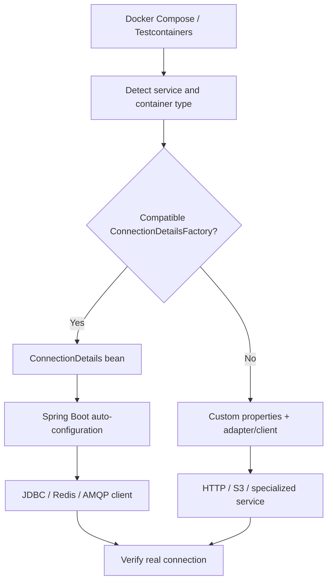
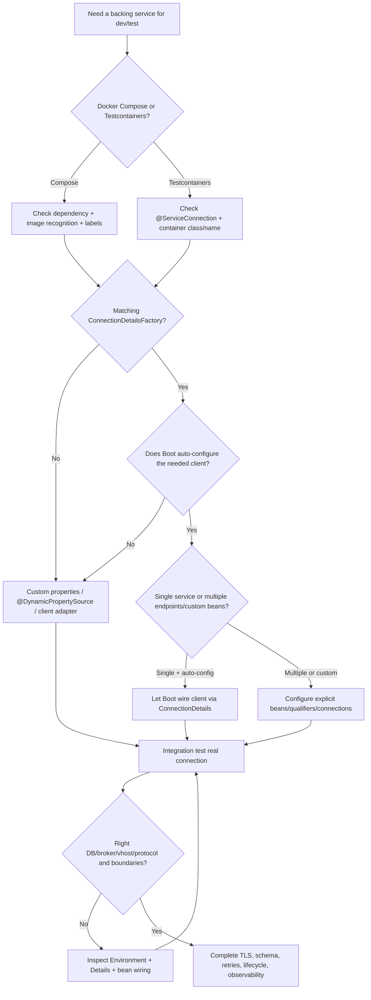
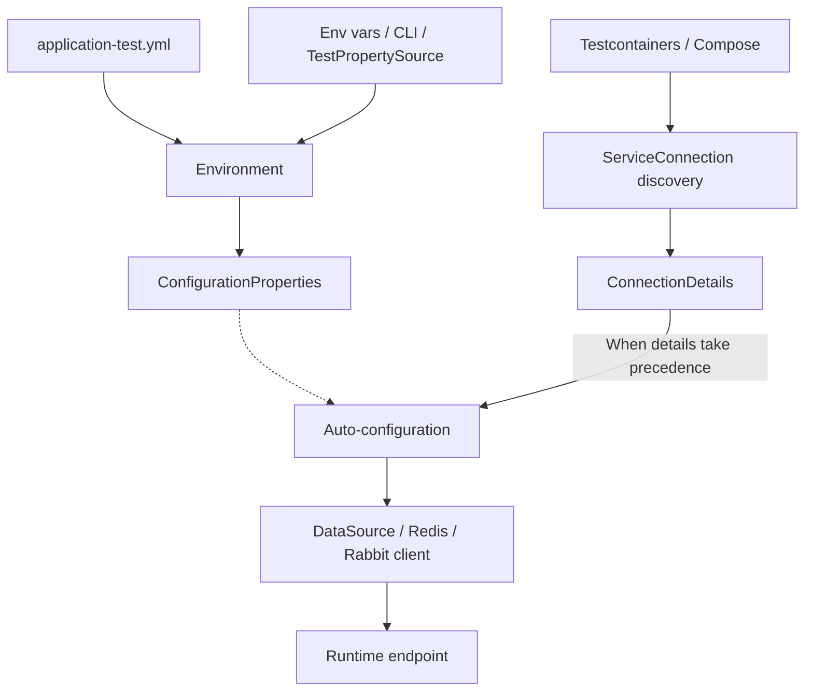

# Boot-Supported Service Recognition and Cases Requiring Custom Configuration

## 1. Real-World Problem: Running Backing Services Does Not Mean the App Is Connected

When developing a Spring Boot integration system, teams often need multiple external services: PostgreSQL for orders, Redis for caching, RabbitMQ for messaging, Kafka for events, an HTTP mock for the Inventory API, and sometimes S3-compatible object storage. Previously, developers had to spin up each container, look up mapped hosts/ports, create accounts, populate `spring.*` properties, and then troubleshoot when local and CI environments diverged.

Spring Boot provides **development-time services** supporting convenient connectivity to **certain known service types** via **Docker Compose** or **Testcontainers**. In compatible setups, Boot can discover the service/container, extract endpoints/credentials, and supply a **`ConnectionDetails`** bean so auto-configuration builds the client with the right address. Yet three things must never be equated:

1. **The container/service is running:** Docker has a process and a network port.
2. **Boot recognizes the service type and has a matching factory:** for instance, recognizing PostgreSQL to produce `JdbcConnectionDetails`.
3. **The application's client actually consumes connection details:** for example, a Boot auto-configured `DataSource` rather than a custom hardcoded `DataSource`.

Not every Docker image is recognized; not every client type has `ConnectionDetails`; and even when a property appears properly in `application.yml`, a bean built from `ConnectionDetails` may still use a different endpoint.

This lesson belongs to the **Development Services** chapter of the **SPRING_BOOT_INTEGRATION** module. The module structures Spring Boot system integration via HTTP clients, databases, caches, message brokers, and Spring Integration adapters, emphasizing **configuration, data contracts, transactions, errors, deduplication, testing, and observability**. Accordingly, exercises will not stop at "start containers and see green tests"—they verify supported services, decide when custom configuration is required, and prove real connectivity paths.

### 1.1. Learning Outcomes

After this lesson, you will be able to:

- Explain how **Docker Compose support**, **Testcontainers `@ServiceConnection`**, **`ConnectionDetails`**, and auto-configuration work together.
- Identify services commonly supported by Spring Boot and understand that **support depends on version/libraries**, rather than inferring support from Docker's ability to run an image.
- Distinguish recognition via **image name**, **Testcontainers container type**, and **explicitly specified service name**.
- Configure a local PostgreSQL–Redis–RabbitMQ stack with Compose and an equivalent integration test with Testcontainers.
- Choose `@DynamicPropertySource`, `@ConfigurationProperties`, custom `ConnectionDetails`, or custom clients when a service lacks automatic support.
- Diagnose cases where `spring.datasource.url`/`spring.data.redis.host` "have no effect" due to connection details or a higher-priority property source.
- Write tests guarding against wrong endpoints, tenants, databases, and broker vhosts; manage lifecycles, TLS/secrets, and local–CI–production boundaries.

> **Version scope:** Examples target Java 17+, Spring Boot 3.2+, and Spring Framework 6.x; `@ServiceConnection` was introduced in Spring Boot 3.1. **Image support, `ConnectionDetails` beans, labels, and auto-configurations can change across releases.** Always verify the exact reference documentation for your project's Spring Boot version before promoting a new service into CI/production. Java examples omit imports for brevity; illustrative code must be paired with the appropriate dependencies and test resources.

### 1.2. Running Scenario

Suppose Order Service has:

| Backing service | Integration path | Purpose |
|---|---|---|
| PostgreSQL | Spring Data JPA/JDBC | Order datastore and transactional outbox |
| Redis | `RedisTemplate` | Inventory cache with TTL, not source of truth |
| RabbitMQ | Spring AMQP / Spring Integration AMQP | Asynchronous event publishing and consumption |
| HTTP Inventory mock | `RestClient`/`WebClient` | Simulates an external system's HTTP contract |
| S3-compatible object storage | Provider-specific SDK/HTTP client | Stores invoice files before sending emails |

The first three services **can** be recognized by Spring Boot in common supported setups/versions. The last two **should not be assumed** to have auto-generated connection details for custom HTTP clients or arbitrary S3-compatible emulators: they typically require custom properties/client configuration unless a dedicated integration supports them.



**Core principle:** "Boot supports a service" means there is a matching **discovery integration + connection details type + consumer** for **a specific connection path**, not that the entire technology is auto-configured in every scenario.

## 2. The Spring Boot Development Services Model

### 2.1. What Is `ConnectionDetails`?

Spring Boot defines abstractions describing the information needed for a client type to connect to a service: host/port, JDBC URL, username/password, SSL/broker endpoints, etc., depending on type. Rather than forcing every source into string properties, auto-configurations can query the corresponding `ConnectionDetails` bean.

Common types in Spring Boot 3.x:

- `JdbcConnectionDetails` for JDBC `DataSource` auto-configuration.
- `R2dbcConnectionDetails` for reactive R2DBC connections.
- `RedisConnectionDetails` for supported Redis clients/factories.
- `RabbitConnectionDetails` for RabbitMQ AMQP.
- `KafkaConnectionDetails` for Kafka.
- Other services have corresponding connection details when supported by the Boot version/auto-configuration.

These abstractions are **not** `javax.sql.DataSource`, `org.springframework.data.redis.connection.RedisConnectionFactory`, or an HTTP client with open sockets. They are **connection-describing inputs**; auto-configuration/bean factories must still construct clients from them.

### 2.2. Separating Discovery Sources from Consumers

```text
Connection information sources
  +-- application.yml / environment / command line
  +-- Recognized Docker Compose service
  +-- Testcontainers @ServiceConnection
  +-- custom ConnectionDetails bean
          |
          v
Auto-configuration / custom adapter
          |
          v
DataSource, R2DBC ConnectionFactory, RedisConnectionFactory,
Rabbit connection factory, Kafka client, or custom SDK
          |
          v
TCP/TLS connection and real requests
```

**Two separate questions:**

1. Does Boot create a `JdbcConnectionDetails` bean or matching details bean?
2. Does the actual `DataSource`/repository/service consume that bean, or did the application define a separate client?

When answering the second question, inspect custom beans, `@Primary`, `@Qualifier`, multi-datasource setups, and auto-configuration conditions.

### 2.3. ConnectionDetails Precedence Differs from PropertySource Precedence

For example, `spring.datasource.url` in `application-test.yml` still holds a specific value, while `@ServiceConnection` supplies `JdbcConnectionDetails` from a Testcontainers PostgreSQL instance. The Boot-configured `DataSource` uses those details, whereas:

```java
environment.getProperty("spring.datasource.url");
```

still returns the YAML string. That **does not prove a PropertySource overrode YAML**. It shows **auto-configuration took a different path for connection information**.

Conversely, if `SPRING_DATASOURCE_URL` in environment variables overrides `spring.datasource.url` from a file, `Environment`'s value changes immediately via **property precedence**. The two mechanisms must be diagnosed separately.

### 2.4. Do Not Equate "Supported Service" with "Every Endpoint of That Service"

A PostgreSQL container can supply JDBC details, yet:

- It does not run Flyway/Liquibase migrations without matching dependencies and config.
- It does not guarantee JPA repositories scanned the right packages/entities.
- It does not create an HTTP API for the database.
- It does not prove the transaction manager uses the right datasource when two DB sources exist.
- It does not mean PostgreSQL has production-grade TLS/HA/ACLs.

Likewise, recognizing Redis does not guarantee `RedisTemplate` uses the intended serializer, namespace, TTL, or logical DB. Recognizing RabbitMQ does not declare exchanges/queues/bindings and does not solve consumer idempotency.

## 3. Docker Compose Integration: From Running Service to Boot Client

### 3.1. Dependency and Scope

Add Spring Boot's development-time Docker Compose support module:

```xml
<dependency>
    <groupId>org.springframework.boot</groupId>
    <artifactId>spring-boot-docker-compose</artifactId>
    <optional>true</optional>
</dependency>
```

With Gradle Kotlin DSL, place it in the development-only configuration organized by the project:

```kotlin
dependencies {
    developmentOnly("org.springframework.boot:spring-boot-docker-compose")
}
```

The intent is supporting the **developer workflow**, not shipping Docker lifecycle management to production by default. Maven/Gradle and Boot plugin packaging rules determine whether the dependency appears in the executable artifact; verify actual profiles/runtimes rather than only reading the POM.

Developer/CI machines using Compose must have Docker Engine or a compatible container runtime and a supported Docker Compose version. Adding the dependency **does not install Docker** and does not ensure services are running.

### 3.2. A Small Docker Compose Stack

Example `compose.yaml` in the application directory (illustrative, **not a file being created by this lesson**):

```yaml
services:
  postgres:
    image: postgres:16-alpine
    environment:
      POSTGRES_DB: orders
      POSTGRES_USER: orders_user
      POSTGRES_PASSWORD: local-only-password
    ports:
      - "127.0.0.1:5432:5432"
    healthcheck:
      test: ["CMD-SHELL", "pg_isready -U orders_user -d orders"]
      interval: 5s
      timeout: 3s
      retries: 10

  redis:
    image: redis:7.4-alpine
    ports:
      - "127.0.0.1:6379:6379"

  rabbitmq:
    image: rabbitmq:3.13-management-alpine
    ports:
      - "127.0.0.1:5672:5672"
      - "127.0.0.1:15672:15672"
```

**Port syntax note:** this example uses `127.0.0.1:5432:5432` to limit host binding to loopback and simplify manual tools. Fixed host ports can **collide** with an already-running database/Redis/broker or another project; in real projects you can use dynamic host ports with supported Compose syntax and let Boot read **mapped ports** from Docker instead of hardcoding `localhost:5432` in clients. Always confirm mappings with `docker compose ps`.

The password `local-only-password` is **strictly for isolated development**. Never copy it to production or let Compose services bind ports to the public Internet. Image tags should be pinned/reviewed per organizational policy; `postgres:16-alpine` is not itself immutable by digest.

When Spring Boot Compose integration recognizes supported images, it can use **Docker-mapped host ports** to generate connection details. Since an app running on the host sits outside the Docker network, do not assume the Compose hostname `postgres` resolves from a Java process on the host machine.

### 3.3. How Boot Finds Compose Files and Manages Lifecycle

In typical development-time configs, Boot looks for Compose files in default locations near the application working directory; when located elsewhere, configure `spring.docker.compose.file`. It can start Compose services and wait for readiness before connecting, with lifecycle behavior controlled by properties and pre-existing service states.

Example `application-local.yml`:

```yaml
spring:
  docker:
    compose:
      enabled: true
      file: ./compose.yaml
      lifecycle-management: start-and-stop
```

Common lifecycle values in Boot 3.x include `start-and-stop`, `start-only`, and `none`; check exact version docs for behavior when services **were already running before startup**, on shutdown, and in tests. Do not assume stopping Spring Boot always destroys volumes/database data or stops containers started by someone else.

### 3.4. Readiness: Container Running Does Not Mean Service Ready

A PostgreSQL container can be `running` while still creating the database. Spring Boot Compose support includes readiness checks that consider Docker healthchecks and TCP checks for supported services. Even so:

- An open TCP port does not prove schema migrations have run.
- A broker accepting TCP connections does not prove exchanges/queues exist.
- Redis returning `PONG` does not prove key permissions, TTLs, or serializers.
- Container healthchecks may verify only the process, not application-level dependencies.

Application readiness design must distinguish **backing service listening on a port**, **auto-configuration creating beans**, and **business integration paths working**. Do not start background jobs publishing messages or writing to DBs before migrations/queue setup satisfy the contract.

### 3.5. Service Discovery Depends on Image Type and Boot Support

Boot does not read every entry under `services:*` in Compose and generate clients for all of them. Discovery generally relies on **image names/service types** recognized by Boot's connection details factories. The same container might run a standard protocol yet appear unrecognized when served from a private registry like `registry.example.org/platform/my-postgres:custom`.

For custom images based on a supported service, Compose integration in supported versions allows declaring the **`org.springframework.boot.service-connection`** label with the matching service type, for instance:

```yaml
services:
  postgres:
    image: registry.example.org/platform/postgres-with-extensions:dev
    labels:
      org.springframework.boot.service-connection: postgres
    ports:
      - "127.0.0.1:15432:5432"
```

The label clarifies **the service type for recognition**, but does not install drivers/auto-configuration or turn a custom protocol into PostgreSQL. If the actual image is incompatible with PostgreSQL, adding the label will not make the client work. For specialized images/services without a factory, use custom configuration (Sections 7–9).

### 3.6. Ignored Services and Recognition Limits

Some Boot versions support a label to **exclude a container from connection details creation**, such as `org.springframework.boot.ignore: true` in Compose. Verify label syntax/behavior on your exact Boot version. Ignoring a service helps when you need it running yet want to configure the client manually; however, if you expect Boot to create Redis/JDBC details from that service, the ignore label will cause confusing errors.

Do not assume "no `ConnectionDetails` bean found" is automatically a Boot bug. Common causes include a missing Compose module, undiscovered file, unrecognized image, ignored service, missing client dependency, profile/test skipping Compose, or an unsupported service in your Boot version.

## 4. Testcontainers `@ServiceConnection`: Recognition in Test Environments

### 4.1. Two Dependencies with Distinct Roles

For a PostgreSQL integration test:

```xml
<dependencies>
    <dependency>
        <groupId>org.springframework.boot</groupId>
        <artifactId>spring-boot-starter-data-jpa</artifactId>
    </dependency>
    <dependency>
        <groupId>org.postgresql</groupId>
        <artifactId>postgresql</artifactId>
        <scope>runtime</scope>
    </dependency>
    <dependency>
        <groupId>org.springframework.boot</groupId>
        <artifactId>spring-boot-starter-test</artifactId>
        <scope>test</scope>
    </dependency>
    <dependency>
        <groupId>org.springframework.boot</groupId>
        <artifactId>spring-boot-testcontainers</artifactId>
        <scope>test</scope>
    </dependency>
    <dependency>
        <groupId>org.testcontainers</groupId>
        <artifactId>junit-jupiter</artifactId>
        <scope>test</scope>
    </dependency>
    <dependency>
        <groupId>org.testcontainers</groupId>
        <artifactId>postgresql</artifactId>
        <scope>test</scope>
    </dependency>
</dependencies>
```

- **`spring-boot-testcontainers`** provides Spring Boot integration, such as `@ServiceConnection` and connection-details factories.
- **`org.testcontainers:*`** handles launching/managing containers and classes like `PostgreSQLContainer`, `RabbitMQContainer`, and `GenericContainer`.
- **JDBC driver and Spring Data/JPA** are still required to build the `DataSource`/repositories; containers do not replace application dependencies.
- **`@Testcontainers`/`@Container`** from JUnit 5 manage test container lifecycles via the extension; `@ServiceConnection` is Spring Boot's annotation for supplying connection info.

Do not swap `spring-boot-testcontainers` for `spring-boot-docker-compose` assuming they are equivalent. One integrates containers **created/orchestrated by tests**, while the other supports **Compose services** in the dev workflow, even though both can produce `ConnectionDetails`.

### 4.2. Simple Test with PostgreSQLContainer

```java
// OrderRepositoryIT.java — imports omitted
@SpringBootTest(
        webEnvironment = SpringBootTest.WebEnvironment.NONE,
        properties = {
                "spring.jpa.open-in-view=false"
        }
)
@Testcontainers
class OrderRepositoryIT {

    @Container
    @ServiceConnection
    static PostgreSQLContainer<?> postgres =
            new PostgreSQLContainer<>("postgres:16-alpine");

    @Autowired
    DataSource dataSource;

    @Test
    void datasourceUsesContainer() throws SQLException {
        try (Connection connection =
                     dataSource.getConnection()) {
            assertNotNull(connection);
            assertEquals(
                    "PostgreSQL",
                    connection.getMetaData()
                            .getDatabaseProductName());
        }
    }
}
```

This assumes a `@SpringBootApplication` exists for Boot to bootstrap during the test, a suitable schema if repositories query tables, and a container runtime on the CI machine. `@ServiceConnection` lets Boot generate matching connection details from the recognized container; JDBC auto-configuration builds the `DataSource` using the **dynamic mapped host port**.

**You generally should not set `spring.datasource.url` in this test:** once `@ServiceConnection` and compatible auto-configuration are chosen, let Boot connect to the container via the intended source. Leaving another URL in YAML can mislead readers into checking `Environment` and assuming the app uses that URL.

### 4.3. Container Class Aids Recognition

For specialized Testcontainers classes like `PostgreSQLContainer` or `RabbitMQContainer`, Spring Boot can use the **container type**, image info, and built-in factories to infer the service type. However, **a `GenericContainer<?>` does not identify the technology** from its generic Java type alone; Boot typically needs to inspect the image name or an explicit `name`.

Redis example using `GenericContainer`:

```java
@Container
@ServiceConnection(name = "redis")
static GenericContainer<?> redis =
        new GenericContainer<>(
                DockerImageName.parse("redis:7.4-alpine"))
                .withExposedPorts(6379);
```

`name="redis"` is a **service recognition hint**, not an injectable bean name or container hostname. When using a custom Redis image from a private registry, this hint is especially helpful; you still need the matching port/protocol and a Redis connection-details factory in your Boot release.

### 4.4. Declaring Containers with `@Bean`

Testcontainers integration can be declared using container beans in a dedicated test/development configuration, for instance:

```java
@TestConfiguration(proxyBeanMethods = false)
public class ContainerTestConfiguration {

    @Bean
    @ServiceConnection
    PostgreSQLContainer<?> postgresContainer() {
        return new PostgreSQLContainer<>(
                "postgres:16-alpine");
    }

    @Bean
    @ServiceConnection(name = "redis")
    GenericContainer<?> redisContainer() {
        return new GenericContainer<>(
                DockerImageName.parse("redis:7.4-alpine"))
                .withExposedPorts(6379);
    }
}
```

A note on recognition: when `@ServiceConnection` sits on a **`@Bean` method**, Spring Boot can inspect the **return type** before bean instantiation, whereas it cannot always query the container's runtime Docker image name before creation. With `GenericContainer<?>`, an explicit `name` helps select the factory. With a dedicated subclass whose type is already known, the annotation does not strictly require `name`.

Bean containers have lifecycles managed by Spring Boot for test/dev contexts; do not confuse them with JUnit static `@Container` fields. Never mix both forms on the same container arbitrarily, as that easily leads to duplicate starts/stops or mismatched beans/ports.

### 4.5. Restricting Type When a Container Offers Multiple Connection Paths

A PostgreSQL container can support both JDBC and R2DBC connection details if matching factories/drivers are present. When an app only wants JDBC, you can restrict the details types produced **per your Spring Boot version's API**:

```java
@Container
@ServiceConnection(type = JdbcConnectionDetails.class)
static PostgreSQLContainer<?> postgres =
        new PostgreSQLContainer<>("postgres:16-alpine");
```

This helps when both JDBC and R2DBC sit on the classpath yet the test exercises only one path. Do not assume `@ServiceConnection` always creates both JDBC and R2DBC simultaneously, nor expect the JDBC driver to run R2DBC. For reactive queries, you need the `r2dbc-postgresql` starter/driver and must verify `R2dbcConnectionDetails`/`ConnectionFactory`.

### 4.6. Testcontainers Still Requires Docker

If CI lacks Docker or a compatible container runtime, tests fail before the Spring context is even built. This is a **test infrastructure** error and must never be handled by silently falling back to a production database. Integration tests require proper network access, resource quotas, image policies, and lifecycle cleanup; if a runtime is unsupported, separate unit vs. integration tests or supply dedicated test fixtures.

Never use `@ServiceConnection` to automatically point tests at a production database. It is meant for controlled dev/test resources. When targeting a fixed staging environment, use an explicit configuration profile with secure credentials and guards against touching live data.

## 5. Service Groups Boot Can Recognize: Conditional Reference Table

Support lists evolve across Spring Boot releases and dependencies. The following table lists **typical groups in the Spring Boot 3.x family**, **not an exhaustive commitment for every minor release**:

| Service group | Example image/container | Related connection details/client | What to verify |
|---|---|---|---|
| PostgreSQL | `postgres`, `PostgreSQLContainer` | `JdbcConnectionDetails`, possibly `R2dbcConnectionDetails` | Driver, DB name, user/password, schema |
| MySQL/MariaDB | `mysql`, `mariadb`, dedicated containers | JDBC/R2DBC per support/version | Dialect, port, init schema, TLS |
| SQL Server/Oracle & other DBs | Supported dedicated Testcontainers/images | JDBC details when factory exists | EULA, image support, driver, license |
| Redis | `redis`, `GenericContainer` with name hint | `RedisConnectionDetails`/Lettuce factory | URL vs. host, ACL/TLS, serializer, logical DB |
| RabbitMQ | `rabbitmq`, `RabbitMQContainer` | `RabbitConnectionDetails` | Vhost, exchange/queue/binding, credentials |
| Kafka | Compatible Kafka image, `KafkaContainer` | `KafkaConnectionDetails` | Advertised listeners and bootstrap endpoints |
| MongoDB | `mongo`, `MongoDBContainer` | Mongo connection details/client | Replica set, auth, codecs, DB |
| Elasticsearch | Known image/service | Elasticsearch connection details/client | HTTP vs. transport, TLS, index lifecycle |
| Neo4j | `neo4j`, dedicated container | Neo4j connection details/driver | Bolt URI, credentials, DB |
| Cassandra | Image/container with supported factory | Cassandra client details | Datacenter, keyspace, schema migrations |
| Other services | Pulsar, Couchbase, OpenSearch, Artemis, Zipkin... version-dependent | Each service may or may not have dedicated details | Check **the support matrix of your exact Boot version** |

**Distinguish "having an image" from "having a factory":** a vendor-distributed Kafka image may speak a compatible protocol yet go unrecognized by name; use a supported label/name hint or configure bootstrap servers manually. Conversely, recognizing a Kafka image does not configure consumer groups, serializers, or retries.

### 5.1. Evidence of a Supported Service Spans Three Layers

To conclude a service is Boot-supported **in a specific project**, verify:

1. **Discovery:** Boot sees the right Compose service/Testcontainers instance and recognizes its type.
2. **Details:** the context contains the `ConnectionDetails` bean expected by auto-configuration.
3. **Consumer:** the actual client/factory consumes that info; a real command/query/message against the test service confirms the real endpoint.

Checking only that an image name contains `postgres` or that Docker reports `healthy` is **insufficient**. Nor should you check only `Environment.getProperty("spring.datasource.url")`, because details can be consumed without altering that property.

### 5.2. A Service May Be Partially Supported

PostgreSQL is a clear example:

- Boot creates `JdbcConnectionDetails` so the JDBC `DataSource` connects to the container.
- A JPA `EntityManagerFactory` uses that `DataSource` when the right JPA starter is present.
- Flyway/Liquibase run migrations automatically only when dependencies, resources, and properties align.
- A custom reporting `DataSource` defined via its own `@Bean` may still point to a different URL.
- An `R2dbcConnectionFactory` requires separate conditions and drivers.

Hence, **connection bootstrap support does not imply complete support for every API or business path using that service**.

### 5.3. Spring Boot Does Not Auto-Support Arbitrary Custom APIs

Examples requiring analysis before attempting automation:

- An **internal REST API** running in a `mycompany/inventory-mock` container, called via `RestClient`.
- An **S3-compatible object storage** emulator with custom endpoint, region, and credentials.
- A **gRPC service** needing its own channel, TLS, authority, and service discovery.
- A **GraphQL gateway** or SaaS API requiring OAuth2 tokens.
- A **proprietary TCP service** with an internal protocol.

Unless the project provides an integration/auto-configuration for that exact type, Boot **cannot deduce how to build a client from an image name**. In those cases, use `@ConfigurationProperties` + a client adapter, `@DynamicPropertySource` in tests, or define a standard custom `ConnectionDetails`/factory when reuse justifies the maintenance.

### 5.4. Even Recognized Services Have Parts You Must Configure Yourself

`RabbitConnectionDetails` can supply endpoints and user/password. It **does not** know that the service needs:

```text
exchange = order.events.v1
queue = order.invoice.worker.v1
routingKey = order.confirmed
DLQ = order.invoice.worker.dlq
```

Similarly, `RedisConnectionDetails` does not define `inventory:v1:stock:{sku}`, 60-second TTLs, JSON serializers, circuit breakers, or idempotency policies. Those are **application contracts** that must be configured and tested independently even when Boot auto-wires connectivity.

## 6. Decision Process: Automatic or Manual Configuration?



### 6.1. When Auto-Discovery Makes Sense

- The app has only **one PostgreSQL datasource** for JPA/JDBC and uses Boot auto-configuration.
- Integration tests use **one `PostgreSQLContainer`** recognized by `@ServiceConnection`.
- Local development uses familiar Compose `redis` or `rabbitmq`, with clients built by matching Boot starters.
- No exotic protocol parameters are required outside properties Boot still honors alongside connection details.

Pros: minimal duplicate endpoint configuration, no hardcoded mapped ports, fast onboarding, tests independent of locally installed databases.

### 6.2. When Custom or Hybrid Configuration Is Needed

- Images sit in a private registry or use compatible protocols Boot does not recognize.
- There are **two PostgreSQL datasources**—one for orders, one for analytics—with separate `EntityManagerFactory` and transaction managers.
- There are two Redis clusters/instances, or one Redis requiring special TLS/ACL client options.
- Custom HTTP/S3/gRPC services lack a matching connection details factory.
- Clients are built manually with specialized endpoints/protocols without reading Boot's `spring.*` properties.
- The project needs **production-like TLS/mTLS**, proxies, certificate validation, broker vhosts, failover/clustering, or vendor-specific options.

Rule of thumb: **one configuration source with clear ownership per client**. Do not simultaneously configure an `@ServiceConnection`, a `@DynamicPropertySource`, a hardcoded URL, and a custom bean pointing to four different endpoints and expect Spring to infer your intent.

## 7. Custom Configuration for an HTTP Service Outside the Recognition List

### 7.1. Problem: Inventory API Running in a Custom Container

Suppose locally/in CI, the app needs an HTTP mock for this API:

```text
GET /api/v1/stock/SKU-42
Accept: application/json

200 OK
{
  "sku": "SKU-42",
  "available": 8,
  "revision": 17
}
```

The HTTP mock image can run normally via Docker Compose, yet **Boot has no default basis** to infer `integration.inventory.base-url` from that image name. `JdbcConnectionDetails`, `RedisConnectionDetails`, and `RabbitConnectionDetails` are meaningless for a REST Inventory API.

The simplest, clearest solution is **holding the HTTP endpoint under an application property** and constructing the client with `@ConfigurationProperties`. When the endpoint changes due to a Testcontainers mapped port, supply the property dynamically from the test container.

### 7.2. Defining and Validating the Configuration Contract

```yaml
# application-local.yml
integration:
  inventory:
    base-url: http://localhost:18080
    response-timeout: 3s
```

```java
// InventoryClientProperties.java — imports condensed
@ConfigurationProperties(prefix = "integration.inventory")
public record InventoryClientProperties(
        URI baseUrl,
        Duration responseTimeout
) {
    public InventoryClientProperties {
        if (baseUrl == null
                || baseUrl.getScheme() == null
                || baseUrl.getHost() == null) {
            throw new IllegalArgumentException(
                    "Invalid integration.inventory.base-url");
        }
        String scheme = baseUrl.getScheme();
        if (!"http".equalsIgnoreCase(scheme)
                && !"https".equalsIgnoreCase(scheme)) {
            throw new IllegalArgumentException(
                    "Only HTTP or HTTPS is supported");
        }
        if (responseTimeout == null
                || responseTimeout.isZero()
                || responseTimeout.isNegative()) {
            throw new IllegalArgumentException(
                    "response-timeout must be greater than 0");
        }
    }
}
```

`integration.inventory.*` are **application-defined properties**, not built-in Spring Boot properties. To bind them as a bean, use `@ConfigurationPropertiesScan` on the application class or register via `@EnableConfigurationProperties(InventoryClientProperties.class)`.

In production, add policy for **allowed connection destinations**: never accept `baseUrl` straight from user requests or compose arbitrary URLs. An HTTP client calling arbitrary endpoints risks **SSRF** into internal networks or cloud metadata services; endpoints must come from trusted configuration with proper allowlists, TLS, and authorization.

### 7.3. Building RestClient from Properties, Not Hardcoding

```java
// InventoryHttpConfiguration.java — imports condensed
@Configuration(proxyBeanMethods = false)
@EnableConfigurationProperties(InventoryClientProperties.class)
public class InventoryHttpConfiguration {

    @Bean("inventoryRestClient")
    RestClient inventoryRestClient(
            RestClient.Builder builder,
            InventoryClientProperties config
    ) {
        SimpleClientHttpRequestFactory requestFactory =
                new SimpleClientHttpRequestFactory();
        requestFactory.setConnectTimeout(2_000);
        requestFactory.setReadTimeout(
                Math.toIntExact(
                    config.responseTimeout().toMillis()));

        return builder
                .baseUrl(config.baseUrl().toString())
                .requestFactory(requestFactory)
                .build();
    }
}
```

This example uses `SimpleClientHttpRequestFactory` for **a simple synchronous client**, not as the sole recommendation for heavy workloads. With Apache HttpClient/Jetty/Reactor Netty, configure connection pools, TLS, per-request deadlines, and timeouts on the real client factory. Spring `RestClient` can select different `ClientHttpRequestFactory` implementations depending on classpath; **explicitly choosing** one keeps examples predictable.

When multiple `RestClient` beans exist, inject `@Qualifier("inventoryRestClient")` or wrap them inside a concrete `InventoryGateway` adapter. Never share a single default bean across all external services when each needs its own credentials, base URL, circuit breaker, and policies.

### 7.4. HTTP Adapter with an Explicit Contract

```java
// StockSnapshot.java
public record StockSnapshot(
        String sku,
        long available,
        long revision
) {}

// InventoryGateway.java
@Component
public class InventoryGateway {
    private final RestClient client;

    public InventoryGateway(
            @Qualifier("inventoryRestClient") RestClient client
    ) {
        this.client = client;
    }

    public StockSnapshot getStock(String sku) {
        if (sku == null
                || !sku.matches("[A-Za-z0-9_-]{1,80}")) {
            throw new IllegalArgumentException("Invalid SKU");
        }

        StockSnapshot stock = client.get()
                .uri("/api/v1/stock/{sku}", sku)
                .retrieve()
                .body(StockSnapshot.class);

        if (stock == null
                || !sku.equals(stock.sku())
                || stock.available() < 0
                || stock.revision() < 0) {
            throw new IllegalStateException(
                    "Inventory API returned invalid data");
        }
        return stock;
    }
}
```

This code intentionally **does not retry infinitely**. In production, define handling for `404`, `429`, `5xx`, and timeouts; enforce request/response validation, tracing, authentication, circuit breaking, and an overall retry budget. When Inventory API is advisory, you can fall back to cache; when it governs stock reservation, follow separate consistency and idempotency contracts.

### 7.5. In Tests: Use Mapped Ports Instead of Fixed Endpoints

An HTTP mock run via Testcontainers `GenericContainer` can supply its URL via `@DynamicPropertySource`:

```java
// InventoryHttpIT.java — imports condensed
@SpringBootTest(
        classes = InventoryHttpTestApplication.class,
        webEnvironment = SpringBootTest.WebEnvironment.NONE
)
@Testcontainers
class InventoryHttpIT {

    @Container
    static GenericContainer<?> fakeInventory =
            new GenericContainer<>(
                DockerImageName.parse("wiremock/wiremock:3.6.0"))
                .withExposedPorts(8080);

    @DynamicPropertySource
    static void inventoryProperties(
            DynamicPropertyRegistry registry
    ) {
        registry.add(
                "integration.inventory.base-url",
                () -> "http://" + fakeInventory.getHost()
                        + ":" + fakeInventory.getMappedPort(8080));
        registry.add(
                "integration.inventory.response-timeout",
                () -> "3s");
    }

    // Complete tests must configure WireMock stubs
    // or mount mappings/responses into the container,
    // then call InventoryGateway and assert path/body/status.
}
```

`InventoryHttpTestApplication` is a dedicated test bootstrap configuration that must be declared (e.g., `@SpringBootConfiguration`, `@EnableAutoConfiguration`, `@Import({InventoryHttpConfiguration.class, InventoryGateway.class})` per project). The image tag is illustrative and should be pinned/verified in your registry/CI; real tests must create **stub responses** before invoking the endpoint.

Do not add `@ServiceConnection(name="inventory")` hoping Boot automatically creates an Inventory `RestClient`: unless the project provides a custom connection details factory and auto-configuration, that annotation has no built-in mechanism for arbitrary HTTP images.

### 7.6. When an HTTP Endpoint Runs as Another Compose Service

If Spring Boot runs **on the host machine**, an HTTP mock can bind port `18080`:

```yaml
services:
  inventory-mock:
    image: wiremock/wiremock:3.6.0
    ports:
      - "127.0.0.1:18080:8080"
```

And `integration.inventory.base-url=http://localhost:18080` works in the host-app model. If Spring Boot **also runs inside the Docker network**, the endpoint likely needs `http://inventory-mock:8080` instead of host loopback. That is a **network topology** concern, not a `@ServiceConnection` recognition failure.

## 8. Cases Requiring Explicit Manual Connection Configuration

### 8.1. Multi-Datasource and Transaction Managers

If Order Service uses one PostgreSQL for orders/outbox and a second PostgreSQL for reporting, **a single** default `JdbcConnectionDetails` cannot describe two datasources with distinct ownership. Configure:

```text
ordersDataSource     -> ordersEntityManagerFactory     -> ordersTransactionManager
analyticsDataSource  -> analyticsEntityManagerFactory  -> analyticsTransactionManager
```

Each source gets its own URL/credentials/schema/transaction manager, matching repository scan/`@EnableJpaRepositories`, and independent tests. If two containers are both recognized and produce details beans of the same type, Spring may fail with **ambiguous beans** or pick the wrong one when custom config lacks qualifiers. Never solve that by slapping `@Primary` on arbitrarily.

In tests, you can run two `PostgreSQLContainer` instances and supply distinct URLs to two application prefixes via `@DynamicPropertySource`, or define two named connection-details/bean wirings explicitly where supported. Even inside one PostgreSQL process, two logical databases do not share atomic commits; cross-DB workflows require outbox/saga or XA transactions backed by real supporting infrastructure.

### 8.2. Two Redis Instances: Cache and Coordination

Example:

```yaml
app:
  redis:
    cache:
      host: cache.local.test
      port: 6379
    coordination:
      host: coordination.local.test
      port: 6380
```

If an app uses `spring.data.redis.*` for a default Redis, it will not automatically build **two** `LettuceConnectionFactory` beans just because two `app.redis.*` prefixes appear. You need two factory/template beans with `@Qualifier`, TLS/ACL/pool settings, and explicit ownership selection:

```java
// Component-level wiring sketch.
public record RedisEndpoint(
        String host, int port
) {}

// Bound from app.redis.cache and
// app.redis.coordination via @ConfigurationProperties.
@Bean("cacheRedisConnectionFactory")
RedisConnectionFactory cacheRedisConnectionFactory(
        RedisCacheProperties properties
) {
    RedisStandaloneConfiguration server =
            new RedisStandaloneConfiguration(
                    properties.host(), properties.port());
    return new LettuceConnectionFactory(server);
}
```

`RedisCacheProperties` is a record/properties class **you must define** in the project; this snippet is a skeleton omitting TLS, credentials, pooling, and the second factory, so **do not** use it as a complete production config. Clear bean sources and names prevent a `StringRedisTemplate` from accidentally writing cache entries to the coordination Redis.

If `@ServiceConnection` generates Redis details for one instance while code tries to create two separate factories, verify which endpoint each factory actually uses. Never assume "Boot automatically matches containers by bean name" unless the integration explicitly provides that mapping mechanism.

### 8.3. Redis Sentinel/Cluster, TLS, and Vendor-Specific Configuration

A recognized standalone Redis container does not simulate **Sentinel/Cluster**, TLS/mTLS, ACLs, or managed-service proxies. When production deploys:

- Redis Cluster topology/`MOVED`/`ASK`.
- Redis Sentinel failover.
- Truststore certificates or client certificates.
- ACL accounts and secret rotation.
- Connection pool sizing and command/read timeouts.

configure clients and test topologies accordingly. Never attach a Redis service label and claim failover/SSL was tested when the local container only ran plaintext on port `6379`.

### 8.4. RabbitMQ and Kafka: Recognizing the Connection Is Not Enough

`RabbitConnectionDetails` supplies broker endpoints/credentials, yet the application still must design:

- Exchanges, queues, bindings, routing keys, virtual hosts.
- Publisher confirms/returns, consumer acks, retries, DLQs.
- Message schemas/versions, deduplication, and transaction boundaries.

Kafka bootstrap details likewise do not configure topic ACLs, consumer groups, serializers/deserializers, offset policies, schema registries, or transactional producers. When a Kafka container reports a wrong host after connecting, the issue may involve **advertised listeners**, not Boot failing to recognize the image.

For specialized attributes, keep Boot connection details for **bootstrap transport** and configure application properties/adapters at the **contract layer**. Customize the entire connection factory only when auto-configuration cannot meet requirements.

### 8.5. Object Storage / S3-Compatible Emulator

An object-storage emulator image may expose an HTTP endpoint, access key/secret, region, path-style access, and dedicated buckets. If your project has no Boot integration recognizing that image, build the client with the SDK and explicit properties:

```yaml
integration:
  object-storage:
    endpoint: http://localhost:19000
    region: us-east-1
    bucket: integration-fixtures
    # Set credentials via secret env vars in appropriate config,
    # never hardcode in the repository.
```

SDKs typically need path-style policies, bucket creation, TLS, and separate tokens. `@DynamicPropertySource` in Testcontainers can inject the endpoint from the mapped port; regions/credentials/namespaces should come from controlled fixtures.

**Avoid equating "S3-compatible" with "every S3 feature behaves identically":** emulators may differ on bucket policies, multipart uploads, object versioning, and consistency; production-like tests must verify the exact behaviors relied upon.

### 8.6. When a Custom ConnectionDetails Bean Makes Sense

If multiple services/applications share **a custom protocol** and you want to avoid duplicating config parsers/client builders, you can design an abstraction:

```java
public interface InventoryConnectionDetails {
    URI baseUrl();
}

@Configuration(proxyBeanMethods = false)
class InventoryConnectionConfiguration {
    @Bean
    InventoryConnectionDetails inventoryConnectionDetails(
            InventoryClientProperties properties) {
        return properties::baseUrl;
    }
}
```

This is a **project-defined abstraction**, not a built-in Spring Boot `ConnectionDetails` type. A custom details bean **is not enough** without an auto-configuration or adapter consuming it. Deep container-recognition integration requires writing and registering a discovery factory compatible with your Spring Boot version, mapping image/port/auth and client consumers; this is worth doing only when many projects benefit and tests/maintenance are well organized.

In most small applications, `@ConfigurationProperties` plus a clean adapter is simpler than building a custom connection-details ecosystem.

## 9. Property Precedence and Why "I Edited YAML Yet the App Still Uses the Container"

### 9.1. Two Distinct Precedence Mechanisms

**Mechanism A — PropertySource precedence:** sources like `application.yml`, `application-local.yml`, environment variables, system properties, command-line arguments, and test properties provide the same key. `Environment` selects the effective value by precedence order.

**Mechanism B — ConnectionDetails:** Boot auto-configuration can consume a details bean instead of reading connection properties directly to construct clients. `Environment` does not necessarily change, even though the runtime connection changes.



Example:

```yaml
# application-test.yml
spring:
  datasource:
    url: jdbc:postgresql://localhost:5432/legacy_test
    username: legacy_user
    password: legacy_password
```

```java
@Container
@ServiceConnection
static PostgreSQLContainer<?> postgres =
        new PostgreSQLContainer<>("postgres:16-alpine");
```

In a context with compatible auto-configuration, `Environment.getProperty("spring.datasource.url")` **may still return** `jdbc:postgresql://localhost:5432/legacy_test`, while `DataSource` uses `postgres.getJdbcUrl()`. Repeatedly editing YAML will not alter the runtime JDBC path if container connection details are consumed.

**Diagnostic approach:** read effective properties, list `JdbcConnectionDetails` beans, identify the active `DataSource` bean, and open a connection to inspect JDBC metadata. Do not stop after seeing a single value in Actuator.

### 9.2. Inspecting Details Beans and Runtime Clients

Example in an integration test:

```java
@Autowired
ApplicationContext context;

@Autowired
ConfigurableEnvironment environment;

@Autowired
DataSource dataSource;

@Test
void inspectJdbcConnection() throws SQLException {
    Map<String, JdbcConnectionDetails> details =
            context.getBeansOfType(
                    JdbcConnectionDetails.class);
    assertFalse(details.isEmpty());

    String propertyUrl =
            environment.getProperty("spring.datasource.url");

    try (Connection connection =
                 dataSource.getConnection()) {
        String runtimeUrl =
                connection.getMetaData().getURL();
        assertNotNull(runtimeUrl);
        // In a test with @ServiceConnection from Postgres
        // you can assert runtimeUrl matches the container.
    }
}
```

This is a **conditional test inspection method**, not a rule that production must always have custom details beans or URL properties. With custom datasources/multi-datasource setups, check the exact bean/`@Qualifier` used by repositories.

Never leak passwords, JDBC URLs containing credentials, or private internal endpoints into public logs. `runtimeUrl` can reveal hosts/database names; emit it only in authorized diagnostic environments, or assert inside tests without printing the full string.

### 9.3. Properties Overridden at the Environment Layer

Suppose:

```yaml
# application-local.yml
spring:
  data:
    redis:
      host: localhost
      port: 6379
```

Yet the process runs with environment variable `SPRING_DATA_REDIS_HOST=redis-old.local`. Under supported binding rules, the env var beats the file. Without a `ServiceConnection`, Redis auto-config picks up that effective property.

Before concluding Compose overrode your config:

1. Check active profiles and which config files actually loaded.
2. Check `SPRING_DATA_REDIS_HOST`, `SPRING_DATA_REDIS_URL`, and other endpoint-controlling properties.
3. Check `@TestPropertySource`, `@DynamicPropertySource`, and `@SpringBootTest(properties=...)` in tests.
4. Check whether `RedisConnectionDetails` exists from Docker Compose/ServiceConnection.
5. Check whether a custom `RedisConnectionFactory` or `StringRedisTemplate` uses another bean.
6. Prove the endpoint by writing a namespaced/TTL test key on the Redis fixture.

### 9.4. Not Every Bean Uses Boot Properties

Example:

```java
@Bean
DataSource reportsDataSource() {
    HikariDataSource ds = new HikariDataSource();
    ds.setJdbcUrl(
            "jdbc:postgresql://reports.internal:5432/reporting");
    return ds;
}
```

This bean **hardcodes** the JDBC URL and can cause Boot's default `DataSource` configuration to back off. Neither `spring.datasource.url` nor PostgreSQL container connection details automatically apply to a custom bean. To fix it, modify the bean setup, remove hardcoding, bind properties cleanly, or consume details intentionally—do not pile on pointless environment override layers.

### 9.5. Actuator and the Condition Evaluation Report

In a **secured** diagnostic environment with Spring Boot Actuator, useful endpoints include:

```text
GET /actuator/env/spring.datasource.url
GET /actuator/env/spring.data.redis.host
GET /actuator/configprops
GET /actuator/conditions
```

- `env` helps trace effective values/origins of a property depending on version and visibility settings.
- `configprops` shows what properties beans bound.
- `conditions` explains whether auto-configuration matched or backed off due to beans/classes/conditions.

**These endpoints can expose internal structure or secrets.** Never expose them outside trusted networks, do not enable `show-values=always` carelessly, and never dump full responses into CI logs. Even `/actuator/conditions` reveals application internals and requires access control.

## 10. Choosing the Right Development Tool for Each Environment

### 10.1. Docker Compose for Reusable Local Environments

Compose works well when developers want a fairly stable backing stack across multiple app restarts:

- PostgreSQL and Redis can preserve data on local volumes if the team desires.
- RabbitMQ or Kafka can stay running to debug message flows.
- A Docker Compose file serves multiple developers and is easy to inspect via `docker compose ps`/`logs`.
- Spring Boot Compose integration cuts manual entry of endpoints/credentials for supported images.

Drawbacks: fixed ports can collide, stale volumes can skew tests, local credentials can be copied to other environments by mistake, and the app sees state from previous runs. Maintain clear reset/test-data rules and avoid shared volumes for parallel automated tests.

### 10.2. Testcontainers for Isolated Integration Tests

Testcontainers usually fits CI tests better:

- Containers follow test lifecycles with dynamic mapped ports.
- Clean test databases or migration/fixture-seeded state remain reproducible.
- You test against the real database engine (PostgreSQL instead of H2).
- `@ServiceConnection` cuts manual host/port configuration when types are supported.

Drawbacks: requires Docker/container runtime, startup overhead, image download/registry policies, memory, and parallel test orchestration. Avoid sharing static containers across tests if they retain unreset mutable state unless the suite enforces strict isolation.

### 10.3. Developing Locally with Testcontainers Instead of Compose

Spring Boot can use **Testcontainers during development** via a dedicated entry point loading test configuration, for example:

```java
// LocalDevelopmentApplication.java — in the appropriate dev/test source set
public class LocalDevelopmentApplication {
    public static void main(String[] args) {
        SpringApplication
                .from(OrderApplication::main)
                .with(ContainerTestConfiguration.class)
                .run(args);
    }
}
```

Here, `OrderApplication` is the main Spring Boot application and `ContainerTestConfiguration` is the `@TestConfiguration` holding container beans from Section 4.4. This lets the local app run with code-declared containers without executing a JUnit test. Ensure test/dev dependencies sit on **this entry point's** classpath and never leak into production packaging.

Running containers via this development path differs from JUnit 5 `@Container`: lifecycle is managed by Spring Boot/dev run and bean definitions. Monitor process/container cleanup and do not assume stopping the IDE wipes all Docker data/volumes.

### 10.4. Never Enable Development Services Implicitly in Production

Production should receive endpoints/credentials from secret managers, deployment configuration, or production service discovery, with managed network security, certificate policies, and rollouts.

A production app must never run Docker Compose/test fixtures to provision real databases; doing so demands unnecessary Docker daemon privileges, creates uncontrollable lifecycles, and risks starting the wrong database. Enforce separation via runtime classpaths, build profiles, deployment policies, and CI validation—**not solely by naming a file `application-prod.yml`**.

### 10.5. Comparing the Two Workflows

| Attribute | Docker Compose integration | Testcontainers ServiceConnection |
|---|---|---|
| Declaration source | `compose.yaml` and Docker services/images | Java container fields/beans |
| Recognition mechanism | Boot-supported images/service labels | Container class/image and `@ServiceConnection` hint |
| Primary target | Local dev | Integration tests; also usable for local dev |
| Lifecycle | Per Compose integration and app policy | JUnit extension or Boot-managed container bean |
| Ports | Compose host-mapped ports | Testcontainers mapped ports, typically dynamic |
| ConnectionDetails | When image/factory is recognized | When annotation/factory matches |
| State reuse | Can retain long-lived volumes | Can isolate per test lifecycle |
| Not handled automatically | Schemas, queues, business contracts, custom clients | Same; plus test data control |
| Major risks | State/profile/port drift and hitting wrong environment | Missing CI Docker, stale test state/cached contexts |

## 11. Testing Actual Connection Paths Instead of Relying on Image Names

### 11.1. Verifying Recognition Across Three Layers

A useful integration test should verify:

1. **Container/service readiness:** accepts valid commands.
2. **Properly auto-configured beans:** context has compatible client factories and connection details when designed to use them.
3. **Real business path works:** query test DB, read/write Redis key, publish/consume message, call HTTP stub per contract.

Checking only `contextLoads()`, `docker compose ps`, or `assertNotNull(dataSource)` is not enough to prove the service connects to the right destination.

### 11.2. PostgreSQL: Verifying DataSource Runtime

```java
@Autowired
DataSource dataSource;

@Test
void connectsToPostgresFixture() throws SQLException {
    try (Connection connection = dataSource.getConnection()) {
        assertEquals("PostgreSQL",
                connection.getMetaData()
                        .getDatabaseProductName());
        assertFalse(connection.isClosed());
    }
}
```

To verify **the exact container** rather than an arbitrary PostgreSQL instance, safely compare endpoint/schema/fixture markers against `postgres.getJdbcUrl()` or a unique test row. Since drivers normalize JDBC URLs, check database name/host/port by contract rather than brittle exact string equality.

With Flyway/Liquibase, add tests proving migrations ran and tables like `customer_order`/`outbox_event` exist. Connection success does not mean the schema is ready.

### 11.3. Redis: Verifying Template, Serializer, and TTL

```java
@Autowired
StringRedisTemplate redis;

@Test
void writesAndExpiresTestKey() {
    String key = "it:development-service:"
            + UUID.randomUUID();
    try {
        redis.opsForValue().set(
                key, "ok", Duration.ofSeconds(30));
        assertEquals("ok",
                redis.opsForValue().get(key));
        Long ttl = redis.getExpire(
                key, TimeUnit.SECONDS);
        assertNotNull(ttl);
        assertTrue(ttl > 0);
    } finally {
        redis.delete(key);
    }
}
```

This proves `StringRedisTemplate` can write/read a key with TTL on the injected factory. To prove the endpoint is **the exact Redis fixture**, verify the key in that container or inspect bean details/client configuration; never deduce target identity from a successful `PING`, which could come from another Redis instance.

Never use `FLUSHALL` to clean tests if Redis is shared with other apps; use test namespaces and delete the keys you created.

### 11.4. RabbitMQ: Verifying Routing, Not Just Connection

A `RabbitTemplate` can connect to the right broker while messages never reach queues due to wrong virtual hosts, exchanges, bindings, or routing keys. Integration tests should:

- Declare **test-specific** exchanges/queues/bindings.
- Publish messages with defined schemas/headers.
- Have a test consumer receive/ack per config, or verify the message arrives in the test queue before a deadline.
- Check publisher confirms/returns when required; never treat `convertAndSend` returning as proof the broker accepted the message.

Never test against production queues or let tests consume real messages belonging to another service.

### 11.5. HTTP Mock: Verifying Dynamic URLs and Real Paths

`@DynamicPropertySource` from an HTTP mock container can produce `http://127.0.0.1:<mappedPort>`. Yet tests must **actually invoke** `InventoryGateway.getStock("SKU-42")` and verify the request path, status, JSON response, and headers on the mock server. If a custom `RestClient` still hardcodes `http://localhost:18080`, having the right property value will not send requests to the mock container.

When the fake server returns 404 or 500, assert the adapter classifies errors per contract; never rely solely on tests that mock `getStock()` completely, as they leave wiring untested.

### 11.6. Testing the Difference Between YAML and ServiceConnection

A dedicated test can intentionally set:

```text
spring.datasource.url=jdbc:postgresql://127.0.0.1:1/unused
```

alongside a PostgreSQL `@ServiceConnection`. If Boot auto-configures the `DataSource` and consumes container details, queries still succeed. That proves **`ConnectionDetails` was consumed** without requiring the `Environment` URL to match the endpoint.

Keep this test separate from regular business tests. Never place bogus URLs in production or staging, and never allow them to silently fall back to a real database.

## 12. Diagnosing When Boot Fails to Recognize or Use a Service

### 12.1. Eight-Step Runbook

**Step 1 — Pinpoint the exact process.** Is the app running on the host, in an IDE, on a Docker network, on a CI runner, or in Kubernetes? Each has different DNS/port and dev-service activation rules.

**Step 2 — Check Spring Boot version and classpath.** Are `spring-boot-docker-compose` or `spring-boot-testcontainers` in the right scope? Are JDBC/Redis/RabbitMQ/Kafka starters and drivers present? A missing module stops discovery or prevents details consumption.

**Step 3 — Inspect the container source.** Check service name, image name, exposed/mapped ports, Docker healthcheck, and status. With Compose use `docker compose ps`/logs in dev; with Testcontainers inspect the container object in tests.

**Step 4 — Check recognition.** Does the image match a factory supported by your Boot version? Does `GenericContainer` need a `name`? Does a custom Compose image have the `org.springframework.boot.service-connection` label? Is the container ignored?

**Step 5 — Inspect details beans.** Do `JdbcConnectionDetails`, `RedisConnectionDetails`, or matching beans exist? If multiple beans of the same type exist, how does Boot choose? Check bean names/types and auto-configuration conditions.

**Step 6 — Inspect the real client.** Is there a custom `DataSource`/`RedisConnectionFactory`/`RabbitConnectionFactory`/`RestClient`? Does the injected bean have the right qualifier? Which host, port, TLS, and credentials does it actually use?

**Step 7 — Verify the integration path.** SQL test query, Redis key round-trip, publish/consume via test broker, HTTP stub hitting real path. Check schemas, queues, serializers, tenants, logical DBs/vhosts, and transaction boundaries too.

**Step 8 — Fix the right layer and add a regression test.** If the image is unsupported, use a valid name hint/label or custom configuration; if a factory recognized it yet a custom bean ignored it, fix the bean; if a test only needs dynamic ports, use dynamic properties. Afterward test disconnect/restart errors and guard against accidental production access.

### 12.2. Symptom and Cause Table

| Symptom | Likely cause | How to verify |
|---|---|---|
| Compose has service but Boot creates no details | Compose module missing at runtime, file undiscovered, unsupported image, ignored service | Classpath, startup logs, service labels, and conditions |
| `GenericContainer` runs but `@ServiceConnection` has no effect | Service type cannot be inferred or factory missing | `name` hint, image/type, Boot version |
| `PostgreSQLContainer` has details but no `DataSource` | Missing JDBC starter/driver, auto-config excluded, or custom wiring | Bean report, condition evaluation |
| `spring.datasource.url` does not control test | `JdbcConnectionDetails` takes precedence when building `DataSource` | Compare `Environment`, details, and JDBC metadata |
| Redis host in YAML has no effect | Compose/ServiceConnection, `spring.data.redis.url`, or custom factory | Inspect details, effective properties, and factory |
| RabbitMQ connects but consumer receives nothing | Vhost, binding, routing key, ack/listener setup | Test queue/exchange/binding and publish confirm |
| Kafka container starts but consumer cannot connect | Advertised listeners, bootstrap/client config, ACLs | Broker metadata, consumer config, and test topic |
| HTTP mock runs yet `RestClient` calls wrong URL | No factory for custom HTTP, hardcoded base URL, wrong qualifier | Custom properties, bean construction, fake server requests |
| Container healthy yet JPA reports relation missing | Schema migrations didn't run, wrong DB/schema | Flyway/Liquibase status, JDBC current schema |
| Passes locally, fails in CI | Docker runtime, image registry, profile, ports, context caching | Compare test runtime and dependencies |
| Two tests interfere with each other | Shared DB/Redis/broker or unisolated lifecycles | Fixture resets, namespaces, parallel test setup |
| Production app tries to start Docker | Dev dependency/runtime/activation mispackaged | Deploy classpath, Spring profiles, `compose.enabled` |
| TLS fails when moving to managed services | Local service lacked TLS; CA/SAN/port/ACL differ | SSL handshake and production-like client config |

### 12.3. Debug Across Three Layers to Avoid False Conclusions

Suppose application logs show:

```text
spring.data.redis.host=localhost
RedisConnectionFactory connected to 127.0.0.1:<dynamic-port>
```

That is not necessarily a bug; if Redis Testcontainers/Compose details supply the mapped port, it may be expected behavior. Conversely, if the dynamic port appears on the Testcontainers object while `StringRedisTemplate` uses a factory hardcoded to `localhost:6379`, the annotation may have generated details that **the real client did not consume**.

Three layers:

```text
[1] Effective properties
      spring.data.redis.host = ?
      spring.data.redis.url = ?
[2] Bean wiring
      RedisConnectionDetails = ?
      RedisConnectionFactory = ?
      Which factory does StringRedisTemplate use?
[3] Runtime behavior
      Which Redis container holds the actual test key?
```

Never look solely at `Environment` or solely at `docker ps`. Meaningful debugging identifies **the source of connection configuration** and verifies the data path.

### 12.4. Condition Report and Startup Logs

In dev/test, run Spring Boot with `--debug` to view the condition evaluation report or use a secured Actuator `/actuator/conditions`. Check:

- Which auto-configurations matched or did not match.
- Which custom bean caused an auto-configured client to back off.
- Which class/driver is missing from the classpath.
- Which property/profile disabled a component.
- Which connection details types were or were not created.

**Do not assume** the condition report prints every active port/credential. It explains **why beans do or do not exist**, while network tests confirm **where connections actually go**.

### 12.5. Checking Mapping When the App Runs in a Container

Compose service DNS names like `postgres` work **inside the Compose network**, while apps running on the host typically need `localhost:<published-port>`. If the app itself runs in a container, `localhost` is that app container—**neither** the Docker host nor the PostgreSQL container.

Testcontainers similarly adapts host/container networking per runtime. Never guess host/port combinations by intuition; use `container.getHost()` and `container.getMappedPort(port)` in dynamic properties, or let `@ServiceConnection`/details supply endpoints. In CI with remote Docker daemons or containerized runners, mappings may differ from `localhost`.

### 12.6. Handling "Boot Supports the Service, Yet a Newer Image Version Is Unrecognized"

Do not randomly switch images to `latest` or disable validation. Process:

1. Identify old and new image name/tag/digest.
2. Check whether your Boot version's factory recognizes the new image family.
3. If it is a compatible image in a private registry, test `@ServiceConnection(name=...)` or the Compose `service-connection` label per your version's docs.
4. Verify exposed ports, healthchecks, authentication, TLS, and actual protocol compatibility.
5. Write integration tests proving the client runs against the new image with real commands/queries.
6. If the factory does not support new features, use custom properties/clients instead of misusing a label.

**Labels/names are only service-type hints**, not protocol translators. If a new image alters protocol handshakes, drivers, or ports, the client must still be updated.

## 13. Upgrading Spring Boot and Controlling Compatibility

### 13.1. Service Support Is Part of the Compatibility Matrix

When upgrading Spring Boot from one minor release to another, evaluate together:

| Component | What to evaluate |
|---|---|
| Spring Boot version | `ConnectionDetails` factories, image matching, Compose lifecycle options |
| Spring Framework | Transaction/client/HTTP APIs and Jakarta namespaces |
| Testcontainers | Container classes, image compatibility, JDBC/R2DBC URLs |
| Docker Compose plugin | File format, port mappings, profiles, healthchecks |
| PostgreSQL/MySQL drivers | Auth, TLS, protocols, database server versions |
| Lettuce/Redis | Cluster/Sentinel/TLS/ACL and command options |
| RabbitMQ/Kafka clients | TLS, advertised endpoints, acknowledgment semantics |
| Dependency scopes | Dev-only/test-only modules stay out of production |
| Configuration metadata | Did property names or defaults change? |

Do not bundle a Spring Boot upgrade, all image bumps, a JDBC-to-R2DBC migration, and a broker switch into a single PR without tests isolating the impact of each change.

### 13.2. New Auto-Configuration Can Appear After an Upgrade

An image previously **unrecognized** may gain a matching factory in a newer Boot release. Then:

- Before the upgrade, the client used `spring.datasource.url` from YAML.
- After the upgrade, Compose may generate `JdbcConnectionDetails` from that image.
- The auto-configured `DataSource` begins targeting the container endpoint instead of the previously expected URL.

This is why you need **integration tests asserting endpoints** after upgrades, not merely asserting context startup. In environments with special requirements, use explicit configuration to eliminate ambiguity and document ownership.

### 13.3. Checking Changes in Property Names and Profiles

Spring Boot can move property namespaces or alter defaults across major/minor versions. For example, in Boot 3.x, Redis connection properties live under `spring.data.redis.*`; legacy `spring.redis.*` configs must be checked against metadata/migrations so they aren't silently ignored.

When old and new properties coexist, do not keep both long-term "just to be safe"—they can diverge across dev/test/prod. During upgrades, consult configuration metadata/changelogs for your target version, standardize on one canonical property format, and test **actual beans**.

### 13.4. Deliberate Version Matrix Testing

A minimal regression matrix:

```text
local:
  Boot version = target release
  Compose version = team-supported
  PostgreSQL/Redis/RabbitMQ images = pinned

CI integration:
  Testcontainers = valid BOM/versions
  PostgreSQL + Redis + RabbitMQ containers
  Dynamic-port assertions and real queries

staging:
  Managed endpoints/TLS/auth matching production
  No Docker Compose/Testcontainers fixtures running
```

Each environment needs a clear **testing objective**. Local/CI prove wiring/behavior against simulated containers; staging proves production networks, certificates, ACLs, failover, and policies. Never treat a plaintext Redis container on `localhost:6379` as proof that managed production Redis/TLS is tested.

### 13.5. Do Not Assume Docker Compose Is Enabled in Tests

Spring Boot has dedicated rules for Docker Compose support in test environments, typically avoiding unintended Compose startups during `@SpringBootTest` runs. Some releases expose a property to control **skipping in tests**, such as `spring.docker.compose.skip.in-tests`.

If integration tests use `@ServiceConnection`, do not force Compose to start duplicate services simply because `compose.yaml` exists in the repo. When intentionally testing against Compose services, verify the exact Boot version's behavior/properties and isolate fixture ownership so tests never collide with a Compose DB holding developer state.

### 13.6. Standardizing One Configuration Path per Environment

A manageable policy:

```text
Local profile:
  Compose service detection, dev-only images
  Custom HTTP base URL from application-local.yml

Integration test:
  @ServiceConnection for Postgres/Redis/RabbitMQ
  @DynamicPropertySource for custom HTTP mock

Staging/production:
  Explicit managed-service endpoints + secret manager
  Custom TLS/auth/authorization, no Docker dev runtime
```

This does not forbid using Compose in tests or Testcontainers locally, but it **establishes clear defaults and avoids mixing sources**. If the team changes policy, document why, add tests, and update fixture reset instructions.

## 14. Security, Performance, and Observability of Development Services

### 14.1. "Dev-Only" Containers Can Still Leak Data

A local database holding demo data can still be reached from external networks if ports are published on all interfaces. A RabbitMQ management UI with default credentials or an unauthenticated Redis must never be exposed to the Internet.

At a minimum:

- Bind service ports to `127.0.0.1` when only local host access is needed.
- Never copy production secrets into Compose/test fixtures; use dedicated test users/databases.
- Never use database dumps containing real personal data without anonymization/retention policies and access controls.
- Configure `.gitignore`, mounted volumes, logs, and artifacts to prevent committing credentials/DB snapshots.
- Restrict Docker socket access; overly privileged containers can compromise the host or sibling projects.
- Pin image tags/digests and scan them per CI policy; avoid surprises when `latest` shifts.
- Prevent Docker Compose support or dev-only Testcontainers runners from accidentally activating in production.

**Never treat "a local container" as a complete trust boundary.** An app with an SSRF flaw or an overly permissive remote Docker daemon can reach unauthenticated services. Apply proper network policies and credentials even in shared dev environments.

### 14.2. TLS and Authorization Differ Between Dev and Production

Local Redis typically disables TLS on port `6379`. Managed production Redis may enforce TLS/ACLs; production PostgreSQL may require CA validation/mTLS; RabbitMQ may enforce TLS/vhost-specific credentials; Kafka may enforce SASL/SSL.

Local container recognition only proves **one bootstrap connection form**, not these properties:

| Aspect | Local/Testcontainers | Production checks required |
|---|---|---|
| TLS | Often plaintext for simplicity | CA chain, hostname verification, mTLS if required |
| Credentials | Fixture user/password | Secret manager, rotation, least privilege |
| Network | Loopback/Docker bridge | Private subnet/VPC, firewall, egress policy |
| Persistence | Local volume or ephemeral container | Backup/restore, replication, retention |
| Availability | Single container | HA, clustering, failover, maintenance |
| Data separation | Test namespace | Tenant isolation and data permissions |
| Observability | Console logs | Metrics/tracing/alerts with redaction |

Never "fix" staging failures by disabling TLS verification or enabling anonymous access to mimic local setups. Create an integration environment with test TLS certificates/ACLs to validate beforehand.

### 14.3. Resource Budgeting When Running Multiple Services

A developer stack with PostgreSQL, Redis, RabbitMQ, Kafka, and an HTTP mock consumes significant RAM/CPU, slowing builds/tests and starving CI. Best practices:

1. Start only the services required by the module/use case under test.
2. Use Compose profiles to separate brokers/caches as needed; if Boot integrates Compose profiles, verify version property support before relying on it.
3. Pin image versions and leverage legitimate layer caches and approved registry mirrors.
4. Cap concurrency/connection pools: parallel replicas/tests × pool size can overwhelm DBs/brokers.
5. Keep data fixtures small and clean up by test ID; avoid bloating volumes over weeks.
6. Measure startup readiness/healthchecks and container restarts; replace arbitrary `Thread.sleep` calls with bounded ready conditions.
7. Distinguish OOM/Docker networking errors from auto-configuration errors, as both can manifest as `Connection refused`.

### 14.4. Signals to Monitor

| Signal | Where to observe | Meaning |
|---|---|---|
| Container started/healthy | Docker/Compose/Testcontainers logs | Service started and readiness checks ran |
| Connection details bean type | Spring context/condition report | Whether Boot created the right abstraction |
| Auto-configured client type | Bean inventory/Actuator conditions | Which client was created or overridden by a custom bean |
| Connection errors | Driver/HTTP client logs and metrics | Whether auth/TLS/ports/timeouts failed |
| JDBC pool usage | Hikari/Micrometer when enabled | Whether tests hold transactions/connections too long |
| Redis command latency | Lettuce/Redis metrics | Cache endpoints/timeouts, slow commands |
| RabbitMQ queue depth/consumer lag | Broker dashboard/test metrics | Whether queues/bindings/routing are right |
| HTTP downstream latency/4xx/5xx | `RestClient` instrumentation/fake server | Whether client hits the right host/path/contract |
| Outbox pending/duplicates | Application metrics | Whether business integration continues after commit |

Not every metric appears automatically simply because development services are present. `spring-boot-docker-compose` and `spring-boot-testcontainers` **do not build an entire integration observability dashboard**; instrument the application, drivers, and backends.

### 14.5. Keep Cardinality Bounded in Metric Labels and Logs

Use low-cardinality labels like `service_type=postgres/redis/rabbitmq`, `environment=local/test`, and `outcome=connect_ok/connect_error`. Never put Docker container IDs, random host ports, order IDs, tenant IDs, or raw JDBC URLs into metric labels—they explode cardinality and leak metadata.

When investigating a specific container, record correlation/fixture IDs in **controlled internal logs** if needed; never print full `Environment` dumps, secrets, SSL private keys, or database contents. Avoid pasting screenshots of Docker/Actuator containing credentials into public reports.

### 14.6. Lifecycle Cleanup and Avoiding Resource Leaks

- With Compose, understand `start-and-stop`/`start-only`/`none` policies and behavior when containers were already running beforehand.
- With JUnit Testcontainers, `@Container` scopes to the test class or instance depending on static/instance fields and the extension.
- With bean-managed containers in dev runners, Boot manages startup/shutdown per integration version; test stop/restart explicitly when needed.
- Never expect stopping a container to delete Docker volumes; `down -v` is a **destructive data operation**—never run it without checking volumes/paths.
- In parallel CI, avoid fixed host ports across concurrent jobs. Dynamic mapped ports and test namespaces ensure isolation.
- When tests abort abruptly, container cleanup depends on runtime/Ryuk/CI policies; monitor for resource leaks rather than assuming JUnit teardown always executes.

### 14.7. Do Not Mistake Development Services for a Transaction Manager

Boot can create `JdbcConnectionDetails` from a PostgreSQL container and Spring Data JPA can create `JpaTransactionManager`, yet the two are independent:

```text
ConnectionDetails: which database to connect to?
JpaTransactionManager: where commits/rollbacks are managed?
OrderApplicationService: which tables must the use case update atomically?
Outbox/consumer: how are broker messages published after commit?
```

An integration test proving a `DataSource` connects to PostgreSQL does not replace testing atomic Order+Outbox commits. RabbitMQ `@ServiceConnection` does not implement publisher confirms, retry/DLQ, or idempotency. Redis `@ServiceConnection` does not prevent stale caches or duplicate reservations.

## 15. Hands-On Practice: Designing Purposeful Integration Environments

### 15.1. Exercise A — Service Recognition and Connection Paths

Build a stack containing:

- PostgreSQL using `postgres:16-alpine`.
- Redis using `redis:7.4-alpine`.
- RabbitMQ using `rabbitmq:3.13-management-alpine`.
- HTTP mock using `wiremock/wiremock` returning valid JSON responses.

Create a table listing which connection details types Boot **can** produce for each service in your project's version, which starters/drivers are required, and what you must configure manually. Collect evidence from the running context rather than guessing from image names.

**Acceptance criteria:** JDBC query test passes against the Postgres fixture, Redis key round-trip succeeds with TTL, RabbitMQ test queue receives a message, and the HTTP Inventory adapter calls the stub. Each path includes a basic failure test and never touches production.

### 15.2. Exercise B — Custom Image in a Private Registry

Suppose the team swaps `postgres:16-alpine` for:

```text
registry.example.org/platform/postgres-with-extensions:dev
```

Explain why the Docker container still runs yet Boot may fail to recognize the image; then:

1. Check factory support for your exact Spring Boot version.
2. Test Compose service-connection label `postgres` or Testcontainers `@ServiceConnection(name="postgres")` where supported by the API.
3. Verify container ports, drivers, JDBC URL, authentication, and migrations.
4. If incompatible, use `@DynamicPropertySource` or a manual `DataSource` per contract without faking PostgreSQL behavior.

### 15.3. Exercise C — Two Redis Sources

Create a cache Redis and a coordination Redis using two Testcontainers instances. Define two `RedisConnectionFactory` beans with explicit names/qualifiers, separate TTLs, and separate serializers. Verify cache keys exist only in the cache Redis and coordination markers exist only in the coordination Redis. Explain why a single default `RedisConnectionDetails` or `StringRedisTemplate` cannot distinguish both use cases automatically.

### 15.4. Exercise D — Dynamic Ports for an HTTP Mock

A test starts a WireMock container on internal port 8080 with a Docker-chosen mapped port. `InventoryGateway` is built from `integration.inventory.base-url`. Perform the following:

1. Supply the base URL via `@DynamicPropertySource` using `getHost()/getMappedPort(8080)`.
2. Stub `GET /api/v1/stock/SKU-42`.
3. Assert `RestClient` calls the real mock and deserializes `StockSnapshot`.
4. Intentionally break the test by hardcoding `localhost:18080` to observe that a valid property does not ensure the client consumes it.
5. Ensure no `@TestPropertySource` overwrites the same key unless intentionally testing precedence.

### 15.5. Exercise E — Boot Upgrade Introducing New Image Recognition

In a controlled test, simulate a Boot upgrade where `JdbcConnectionDetails` starts being generated automatically. Previously the `DataSource` read `spring.datasource.url` from the test profile. Afterward:

- Verify whether the `Environment` property remains intact.
- Inspect runtime `JdbcConnectionDetails` and `DataSource`.
- Decide the intended behavior: Testcontainers or a fixed configured database.
- Establish a single clear configuration source and add an assertion/condition test.

**Never use a production database to test this scenario.**

### 15.6. Self-Check Questions

1. What is the difference between a running container, a recognized service, and an actually connected client?
2. How do `spring-boot-docker-compose` and `spring-boot-testcontainers` serve two different workflows?
3. Do `@Container`/`@Testcontainers` and `@ServiceConnection` share the same responsibility?
4. Is `ConnectionDetails` an open connection or metadata for auto-configuration to build connections?
5. Why can `@ServiceConnection` on a `GenericContainer<?>` need `name`?
6. When `@ServiceConnection` sits on a `@Bean` method, why do the return type and name hint matter?
7. When do you use the Compose label `org.springframework.boot.service-connection` on a custom image?
8. Does a recognized image imply client SDKs, JPA, or queue schemas are ready?
9. Why might editing `spring.datasource.url` have no effect when `JdbcConnectionDetails` exists?
10. How should custom HTTP services use `@ConfigurationProperties` and `@DynamicPropertySource`?
11. How does Testcontainers' mapped port differ from the container port?
12. Why is `localhost` inside one Docker container not another database container?
13. When you have two datasources or two Redis connections, what must you do to select the right client?
14. Does Spring Boot automatically guarantee TLS, ACLs, HA, and idempotency upon recognizing Redis/RabbitMQ?
15. Which two different questions do `/actuator/env` and `/actuator/conditions` help answer?
16. What are the signs that you should skip auto-recognition and use custom configuration?
17. During a Boot upgrade, how do you check whether a new image started getting recognized?
18. Why does a successful connection test still fail to prove transaction/outbox/broker routing correctness?

## 16. Pre-Implementation Selection Checklist

- [ ] Verified the Spring Boot version, starters/drivers, and Docker Compose/Testcontainers modules in the proper scopes.
- [ ] Confirmed the service **has** a matching recognition factory, rather than merely running as a Docker image.
- [ ] Identified the recognition source: Compose image/label or Testcontainers class/name/type.
- [ ] Confirmed the matching `ConnectionDetails` bean exists when designing around auto-configuration.
- [ ] Confirmed a compatible client/factory exists and **no custom bean bypasses** details.
- [ ] Verified real host/port/database/vhost/TLS via commands or test requests.
- [ ] Avoided overlapping properties/annotations with unclear precedence.
- [ ] Configured custom HTTP/S3/gRPC services with dedicated properties, client adapters, and security validation.
- [ ] Separated multi-datasource/Redis setups using qualifiers, transaction managers, namespaces, and ownership.
- [ ] Prevented Compose ports/dev credentials from being exposed on public networks.
- [ ] Ensured Testcontainers has a Docker/runtime, image pinning/version policy, and clean teardown.
- [ ] Prevented production from starting dev services or using test credentials.
- [ ] Verified schemas/migrations, queue bindings, serializers, TTLs, and event contracts.
- [ ] Added tests for restarts/errors/timeouts without silent fallback to production.
- [ ] Set up metrics/logs/alerts capable of distinguishing container health, client wiring, and business outcomes.
- [ ] After Boot/image/driver upgrades, ran three-layer regression tests: discovery → details → runtime connection.

**Key takeaway:** Spring Boot supports **certain development services** by recognizing Docker Compose/Testcontainers and generating **`ConnectionDetails`** for matching auto-configurations. **A runnable image may still go unrecognized; existing details may still go unused by clients; a connected client may still have a broken integration contract.** When an image/protocol/client lacks a supported factory, use `@ConfigurationProperties`, `@DynamicPropertySource`, or explicit bean wiring with clear ownership. Separate local–test–production, protect secrets/TLS, and test real endpoints, schemas, message flows, and transactions/outbox so development services accelerate learning and testing without creating false confidence.
