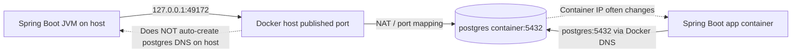
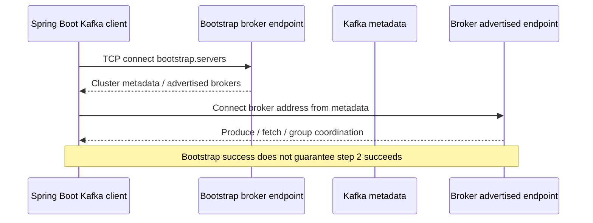
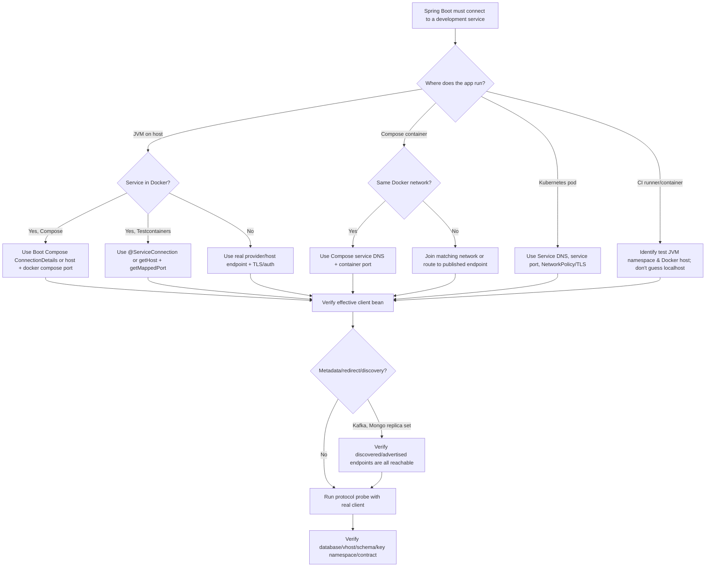

# Dynamic Ports, Container Addresses, and the Addresses the App Actually Uses

> **Chapter:** Development Services  
> **Module:** SPRING_BOOT_INTEGRATION — system integration in Spring Boot via HTTP clients, databases, caches, message brokers, and Spring Integration adapters. The focus is managing configuration, data contracts, transactions, errors, deduplication, testing, and observability for real integration flows.

## 1. Problem: Containers Run Fine Yet Spring Boot Still Cannot Connect

A development team runs PostgreSQL, Redis, MongoDB, RabbitMQ, and Kafka to operate a Spring Boot application locally, in Docker Compose, and in CI pipelines. As the team grows or runs multiple test suites in parallel, the system hits errors:

```text
Connection refused: localhost/127.0.0.1:5432
RedisConnectionFailureException: Unable to connect to localhost:6379
UnknownHostException: postgres
Failed to connect to node broker:9092
Communications link failure / connection timed out
```

Confusingly, `docker ps` shows the containers running, and healthchecks even report healthy. The cause usually lies not in SQL or JSON, but in **how network addresses are interpreted relative to where the calling process runs**.

For instance, a PostgreSQL container listens on port `5432` internally, which Docker maps to port `49172` on the host machine:

```text
Container:      postgres:5432 (internal)
Docker host:    127.0.0.1:49172 (published port)
Spring Boot IDE running on Docker host:
                jdbc:postgresql://127.0.0.1:49172/orders
Spring Boot container on the same Compose network:
                jdbc:postgresql://postgres:5432/orders
```

Both URLs can be valid—**for two different runtime locations**. Using `localhost:5432` in the IDE fails if port 5432 is not published on the host; using `postgres:5432` in the IDE also typically fails because `postgres` only resolves inside the Docker network.

### 1.1. Learning Objectives

After this lesson, you will be able to:

1. Distinguish **container ports**, **published host ports**, **container addresses**, **service DNS names**, and **the effective address a Spring Boot process must use**.
2. Explain why `localhost` in an app running on the host differs from `localhost` inside a container or CI job.
3. Configure Docker Compose with dynamic host ports and discover the actual port rather than guessing `5432/6379/27017` on the host.
4. Use Spring Boot Docker Compose support or Testcontainers `@ServiceConnection`/`@DynamicPropertySource` to supply accurate runtime addresses.
5. Distinguish raw address settings (URIs/properties) from `ConnectionDetails` provided by Spring Boot development services.
6. Verify real connections across JDBC/JPA/R2DBC, Redis, MongoDB, RabbitMQ, Kafka, and HTTP clients, including Kafka `advertised.listeners` nuances.
7. Design isolated tests without port collisions, accidental production connections, missing failure checks, or poor resource observability.

### 1.2. Core Diagnostic Questions Before Debugging

Always ask in order:

1. **Where is the Spring Boot app running?** Host IDE/JVM, inside a Docker container, Kubernetes pod, or CI runner?
2. **Where is the backing service running?** Compose service, Testcontainers container, remote server, or managed cloud?
3. **In which namespace is the target port published?** Port 5432 inside a container may become 49172 on the host.
4. **Does the app actually use that URL?** Is `ConnectionDetails` overriding properties, or is a custom client bean involved?
5. **Has the app verified a real connection?** A healthy container does not prove the JVM targets the right endpoint.

## 2. Three Address Spaces and the `localhost` Trap

### 2.1. Connection Path Diagram



Which address to use depends on the calling process's **network namespace**:

| Where does Spring Boot run? | Where does PostgreSQL run? | Typical address |
| --- | --- | --- |
| JVM on host machine | Docker container publishing port 49172→5432 | `127.0.0.1:49172` |
| Container on same Docker Compose network | Compose service named `postgres` | `postgres:5432` |
| Another container on same user-defined Docker network | Service/container with network alias `postgres` | `postgres:5432` |
| Container outside that network | Compose `postgres` | Cannot auto-resolve `postgres`; must join network or route to published endpoint |
| CI job directly on runner host | Testcontainers-managed PostgreSQL | `container.getHost():getMappedPort(5432)` or Spring `@ServiceConnection` |
| Spring Boot container inside CI | PostgreSQL as a CI service container on same network | CI-assigned hostname/alias, internal port `5432` |
| Kubernetes pod | PostgreSQL Kubernetes Service | `postgres.<namespace>.svc.cluster.local:5432` per actual service |
| Host JVM | Cloud PostgreSQL | Official provider DNS/port |

These values are **models**—never assume a Kubernetes service, Docker network, localhost DNS, or container name automatically exists. Verify where the application truly runs.

### 2.2. `localhost` Always Points to the Caller's Own Namespace

Inside a Docker container, `localhost`/`127.0.0.1` is **that container's loopback**, not your laptop. A Spring Boot container calling:

```text
jdbc:postgresql://localhost:5432/orders
```

is looking for PostgreSQL **inside the Spring Boot container itself**. If PostgreSQL runs in another container, use service DNS or a properly routed published endpoint.

Inside a Kubernetes pod, multiple containers can **share the same pod network namespace**, so `localhost` between a sidecar and an app container can be valid. That is a special case distinct from regular Docker Compose services and should not be generalized.

### 2.3. Service DNS Names Differ from Displayed Container Names

On a Docker Compose network, service names normally resolve via internal DNS:

```yaml
services:
  postgres:
    image: postgres:16-alpine
  app:
    image: example.invalid/orders:dev
    depends_on:
      - postgres
```

With both services on Compose's default network, `app` can reach `postgres:5432`. Here `postgres` is the **Compose service name**, not a hostname automatically added to the host OS DNS.

Never hardcode container IPs from `docker inspect`: Docker can assign new IPs on restart/recreate, or networks may back multiple containers/instances. Rely on service DNS/network aliases or runtime connection details.

### 2.4. The Host Is Not Necessarily Your Current Laptop

When the Docker daemon runs remotely or inside a VM, `container.getHost()` may return a routable Docker host address rather than `localhost`. On Docker Desktop, network translation differs from a native Linux daemon. Never blindly replace whatever host Testcontainers returns with `127.0.0.1` out of habit.

With remote Docker, for a host JVM to reach mapped ports you need:

- A host address actually routable from where the JVM executes.
- Port mappings/firewalls/network policies permitting traffic.
- TLS if traffic crosses trust boundaries between machines.
- Protection against auto-published ports opening uncontrollably on public interfaces.

## 3. Container Ports, Host Ports, and Runtime Addresses

### 3.1. Four Concepts to Keep Separate

| Concept | Example | Who uses it? |
| --- | --- | --- |
| **Container listening port** | PostgreSQL listens on TCP `5432` | Clients connecting **inside the same Docker network** |
| **Published host port** | Host `49172` → container `5432` | Clients running **on the host / outside the Docker network** |
| **Host interface/bind address** | `127.0.0.1` or `0.0.0.0` | Controls from where the published port is reachable |
| **Application effective endpoint** | `jdbc:postgresql://127.0.0.1:49172/orders` | Actual URL used by `DataSource`/driver after all config overrides |

`EXPOSE 5432` in a Dockerfile **does not publish** that port to the host; it only provides image metadata/documentation. Likewise, `expose:` in Compose does not substitute for `ports:` when a JVM outside the Docker network needs access.

### 3.2. Fixed Mapping vs. Dynamic Mapping

```yaml
services:
  postgres_fixed:
    image: postgres:16-alpine
    ports:
      - "15432:5432"

  postgres_dynamic:
    image: postgres:16-alpine
    ports:
      - "5432"
```

*This snippet only illustrates port syntax; do not run two databases sharing identical data/credentials without proper configuration.* Meaning:

- `"15432:5432"`: host port **15432**, container port **5432**; memorable, yet risks **port collisions** across projects.
- `"5432"`: specifies only the **target container port**; Docker Compose picks a **dynamic host port**, with no guarantee of host `5432`.
- `"5432:5432"`: fixes both; simple for a single project, yet collision-prone and unsuitable for parallel tests.

When the app runs on the same network, **do not use host ports 15432/49172** to call `postgres`: use the internal port `5432`.

### 3.3. Inspecting Dynamic Ports

```bash
docker compose ps
docker compose port postgres 5432
```

Sample output (illustrative only):

```text
127.0.0.1:49172
```

A JVM on the host can then use `127.0.0.1:49172`; a JVM inside Compose uses `postgres:5432`. If Docker maps `0.0.0.0:49172`, that is a host **bind interface**, not a hostname clients should connect to verbatim. Pick a concrete routable address and limit exposure.

### 3.4. Why Container Restarts Can Change Ports

Dynamic ports are allocated by Docker when publishing a container/service instance. If a container is **recreated**, a different host port can be assigned; never persist a printed dynamic port in a static config file meant to last for days.

Timeline:

```text
T0:  Docker Compose starts postgres, port 49172 → 5432
T1:  Spring Boot JVM uses localhost:49172
T2:  Container is removed/recreated
T3:  Docker publishes 49195 → 5432
T4:  Spring Boot still uses localhost:49172 → connection refused
```

The solution is not forcing every container onto `5432:5432`. Choose mechanisms that supply **fresh effective connection details** on dev/test startup, or restart/rebind clients when topology changes.

### 3.5. Container Healthy Differs from Endpoint Usable

A healthcheck like `pg_isready` running **inside the database container** can succeed while Spring Boot still fails to connect because:

- The JVM uses the wrong host port or network namespace.
- Username/password/database name are wrong.
- TLS, SASL, or certificates mismatch.
- The server listens on an interface other than the expected path.
- Firewalls/ACLs or network aliases are missing.
- Spring Boot picked a `ConnectionDetails` bean differing from the YAML URL.

Therefore, test workflows need **both service readiness** and **a real connection from the app JVM using actual runtime credentials and endpoints**.

## 4. Docker Compose for Development Services

Spring Boot supports local development with Docker Compose: when configured and a Compose file is discovered, Boot can manage supported service lifecycles and build **service connection details** from actual containers and ports. This spares developers from copying dynamic host ports out of terminals into `application-local.yml`.

### 4.1. Dependency and Scope

```groovy
// build.gradle — Spring Boot 3.2+ / 3.5.x example.
dependencies {
    developmentOnly 'org.springframework.boot:spring-boot-docker-compose'
    implementation 'org.springframework.boot:spring-boot-starter-jdbc'
    runtimeOnly 'org.postgresql:postgresql'
    implementation 'org.springframework.boot:spring-boot-starter-data-redis'
}
```

`developmentOnly` ensures Compose support runs only in development, not production packages. Check Gradle plugins/BOM, run tasks, packaging, and whether the dev-only dependency is actually on your launcher's classpath.

### 4.2. Compose with Two Dynamically Published Ports

```yaml
# compose.yaml — development only; never put real secrets in source.
services:
  postgres:
    image: postgres:16-alpine
    environment:
      POSTGRES_DB: orders_dev
      POSTGRES_USER: orders_dev
      POSTGRES_PASSWORD: ${DEV_POSTGRES_PASSWORD:?set DEV_POSTGRES_PASSWORD}
    ports:
      - "5432"        # dynamic HOST port -> container 5432
    healthcheck:
      test: ["CMD-SHELL", "pg_isready -U orders_dev -d orders_dev"]
      interval: 5s
      timeout: 3s
      retries: 10

  redis:
    image: redis:7-alpine
    ports:
      - "6379"        # dynamic HOST port -> container 6379
    healthcheck:
      test: ["CMD", "redis-cli", "ping"]
      interval: 5s
      timeout: 3s
      retries: 10
```

When Boot auto-recognizes supported container images and matching connection details exist, an app **running on the host** connects via the **host + mapped port** created by Compose. Do not assume `spring.datasource.url=jdbc:postgresql://localhost:5432/...` in YAML remains the actual endpoint.

**Development port security:** declaring `ports: ["5432"]` can publish on interfaces broader than loopback depending on Docker/Compose/environment. On untrusted hosts or public Wi‑Fi, restrict host IP bindings via your Compose version's supported publish syntax (e.g., loopback binding), firewalls, or skip publishing ports if the app runs inside the Docker network too. Never assume dynamic ports are private by default.

### 4.3. Startup Order Does Not Replace Readiness Checks

`depends_on` coordinates container creation/startup ordering. A **running** service is not necessarily ready to serve queries. Where needed, combine healthchecks and dependency conditions per your Compose version while keeping bounded startup retries in clients/drivers.

Spring Boot Docker Compose support also waits for service readiness/connection details on supported services. Yet a DB ready for connections may still lack **completed schema migrations**; services requiring schemas still need separate readiness checks.

### 4.4. Docker Compose Is Not Kubernetes Service Discovery

Compose service DNS like `postgres` typically exists only inside the Compose project's network. In Kubernetes production, DNS follows Service names/namespaces; with managed cloud databases, endpoints come from providers. Never carry literal `postgres:5432` from Compose into production without redefining hosts, credentials, TLS, and routing.

## 5. Spring Boot Docker Compose Support: Who Decides the JDBC URL?

Spring Boot can recognize several Compose service types such as PostgreSQL, Redis, MongoDB, RabbitMQ, and Kafka (depending on Boot version, images, and supported labels). When matched, Boot registers connection-details beans for the matching auto-configurations.

### 5.1. Effective Endpoints Can Differ from application.yml

Suppose a developer leaves fallback values:

```yaml
# application-dev.yml — illustrative; not guaranteed to take effect.
spring:
  datasource:
    url: jdbc:postgresql://localhost:5432/orders_dev
  data:
    redis:
      host: localhost
      port: 6379
```

Meanwhile Compose publishes PostgreSQL `49501→5432` and Redis `49502→6379`. When Docker Compose integration creates `ConnectionDetails` used by auto-configuration, actual driver endpoints become:

```text
DataSource effective JDBC endpoint:
  jdbc:postgresql://127.0.0.1:49501/orders_dev

Redis connection effective endpoint:
  127.0.0.1:49502

spring.datasource.url in Environment:
  jdbc:postgresql://localhost:5432/orders_dev  (may still appear!)
```

Core insight: **the property value in Spring `Environment`** is not always **the address used by configured client beans**. `JdbcConnectionDetails` or `RedisConnectionDetails` can supersede connection properties when building clients.

### 5.2. What Is ConnectionDetails?

In Spring Boot, many auto-configurations read from a **service connection details bean**, for example:

| Resource | Typical connection details type | Actual consumer client |
| --- | --- | --- |
| PostgreSQL JDBC/JPA | `JdbcConnectionDetails` | `DataSource`, HikariCP, JDBC/JPA stack |
| PostgreSQL R2DBC | `R2dbcConnectionDetails` | R2DBC `ConnectionFactory` |
| Redis | `RedisConnectionDetails` | Lettuce/Jedis connection factory |
| MongoDB | `MongoConnectionDetails` | MongoDB driver `MongoClient` |
| RabbitMQ | `RabbitConnectionDetails` | Spring AMQP `ConnectionFactory` |
| Kafka | `KafkaConnectionDetails` | Kafka producer/consumer/admin bootstrap config |

Supported beans/type factories depend on the **Spring Boot version** and classpath modules. `ConnectionDetails` beans created by Compose or Testcontainers typically take precedence for **auto-configured clients** over connection properties; manually created beans that hardcode hosts may **ignore** them.

### 5.3. Configuring Docker Compose Lifecycle Intentionally

A development configuration:

```yaml
spring:
  docker:
    compose:
      enabled: true
      file: compose.yaml
      lifecycle-management: start-and-stop
```

This example uses properties supported in Spring Boot 3.x. When multiple apps share one Compose project, lifecycle policy is critical: stopping one app **should not accidentally stop services** another app still uses. Spring Boot offers different lifecycle modes (such as start-and-stop vs. start-only); pick per version and team workflow rather than copying defaults blindly.

When running Compose independently via CLI (or running the app inside another container), consider **disabling Boot Compose lifecycle** for that process and supplying explicit endpoints. Avoid two mechanisms fighting over startup/shutdown ordering.

### 5.4. Spring Boot Needs to Recognize the Image/Service Properly

If a service uses a custom image like `mycompany/postgres-hardened:dev`, Boot may not infer PostgreSQL from the image name. Some Boot releases allow specifying `service-connection` via Docker Compose labels:

```yaml
services:
  postgres:
    image: mycompany/postgres-hardened:dev
    labels:
      org.springframework.boot.service-connection: postgres
    ports:
      - "5432"
```

This **depends on Boot version and supported service types**; verify label values/registries against docs for your version. Never mislabel a service so an app connects to the wrong backend type. Never assume any container exposing port 5432 is a ready PostgreSQL server.

### 5.5. Never Conclude Connections Are Right from One Startup Log

Logs saying "Compose containers are running" and "Application started" do not guarantee:

- Flyway/Liquibase ran against the **intended database**.
- JPA `EntityManager` shares the same datasource as `JdbcTemplate`.
- R2DBC has the right connection factory rather than mixing with JDBC.
- `RedisTemplate` hits the same Redis database/credentials.
- Broker management UI shows the exact vhost/cluster the app connects to.
- Custom client beans used `ConnectionDetails` instead of a stale URI.

Add a controlled smoke check: from **real client beans**, query the database name and server version or send a lightweight ping, log endpoints with **redacted credentials**, and compare against the expected environment.

## 6. Testcontainers: Dynamic Ports Are a Feature, Not a Bug

Testcontainers starts real services in containers per suite/class/context. To let multiple integration tests run concurrently without collisions, it publishes container ports to **dynamically assigned host ports**.

### 6.1. Container Port vs. Mapped Port

```java
import org.testcontainers.containers.PostgreSQLContainer;

PostgreSQLContainer<?> postgres =
        new PostgreSQLContainer<>("postgres:16-alpine");

postgres.start();

String dockerHost = postgres.getHost();
int hostPort = postgres.getMappedPort(5432);
String jdbcUrl = postgres.getJdbcUrl();

// getMappedPort(5432) is ONLY valid AFTER the container has started.
// jdbcUrl already contains the host/port/database known to Testcontainers.
```

This is a **lifecycle fragment**; in JUnit use `@Testcontainers + @Container` or Spring-managed Testcontainers for reliable start/stop rather than calling `start()` manually and forgetting `stop()`.

`getHost()` returns the Docker host address reachable by the test JVM—not necessarily `localhost`. `getMappedPort(5432)` returns the host port mapped to internal port 5432. `PostgreSQLContainer.getJdbcUrl()` is usually less error-prone than concatenating JDBC strings yourself.

### 6.2. Why Avoid Container IPs?

```java
// Anti-pattern:
String wrong = "jdbc:postgresql://"
        + postgres.getContainerInfo()
                .getNetworkSettings()
                .getIpAddress()
        + ":5432/orders";
```

Container IPs can sit on networks unreachable from the host JVM, change across recreations, and behave inconsistently across Docker Desktop vs. remote daemons. Testcontainers purposefully provides `getHost()` and `getMappedPort(...)` so the test JVM routes via **the host-published endpoint**.

### 6.3. `@ServiceConnection` in Spring Boot Integration Tests

```groovy
dependencies {
    implementation 'org.springframework.boot:spring-boot-starter-jdbc'
    runtimeOnly 'org.postgresql:postgresql'

    testImplementation 'org.springframework.boot:spring-boot-starter-test'
    testImplementation 'org.springframework.boot:spring-boot-testcontainers'
    testImplementation 'org.testcontainers:junit-jupiter'
    testImplementation 'org.testcontainers:postgresql'
}
```

```java
// RealPostgresConnectionTest.java
import org.junit.jupiter.api.Test;
import org.springframework.beans.factory.annotation.Autowired;
import org.springframework.boot.test.context.SpringBootTest;
import org.springframework.boot.testcontainers.service.connection.ServiceConnection;
import org.springframework.jdbc.core.JdbcTemplate;
import org.testcontainers.containers.PostgreSQLContainer;
import org.testcontainers.junit.jupiter.Container;
import org.testcontainers.junit.jupiter.Testcontainers;

import static org.assertj.core.api.Assertions.assertThat;

@SpringBootTest
@Testcontainers
class RealPostgresConnectionTest {

    @Container
    @ServiceConnection
    static final PostgreSQLContainer<?> postgres =
            new PostgreSQLContainer<>("postgres:16-alpine")
                    .withDatabaseName("orders_it")
                    .withUsername("it_user")
                    .withPassword("it_password");

    @Autowired JdbcTemplate jdbc;

    @Test
    void jdbcClientReallyConnectsToThisContainer() {
        String database = jdbc.queryForObject(
                "SELECT current_database()", String.class);

        assertThat(database).isEqualTo("orders_it");
        assertThat(postgres.isRunning()).isTrue();
    }
}
```

This example targets **Spring Boot 3.2–3.5 and compatible Testcontainers APIs**. The Spring context needs bootstrap configuration for `@SpringBootTest`; the test does not merely check `postgres.isRunning()`—it uses **the injected `JdbcTemplate`** to query the real server.

With `@ServiceConnection` on the test container, Boot generates connection details and supplies them to the auto-configured datasource. No hardcoding `spring.datasource.url` to an unknown host port. If the project defines multiple custom datasources, specify which datasource receives service connection details; manual beans can skip them.

### 6.4. `@DynamicPropertySource` When Explicit Control Is Needed

When Testcontainers runs a generic image or Boot lacks a recognition factory, supply properties from the runtime container:

```java
import org.springframework.test.context.DynamicPropertyRegistry;
import org.springframework.test.context.DynamicPropertySource;
import org.testcontainers.containers.GenericContainer;
import org.testcontainers.junit.jupiter.Container;
import org.testcontainers.junit.jupiter.Testcontainers;
import org.testcontainers.utility.DockerImageName;

@Testcontainers
class RedisConnectionTest {
    @Container
    static final GenericContainer<?> redis =
            new GenericContainer<>(
                    DockerImageName.parse("redis:7-alpine"))
                    .withExposedPorts(6379);

    @DynamicPropertySource
    static void redisProperties(
            DynamicPropertyRegistry registry) {
        registry.add("spring.data.redis.host", redis::getHost);
        registry.add("spring.data.redis.port",
                () -> redis.getMappedPort(6379));
    }

    // With @SpringBootTest or appropriate @DataRedisTest,
    // inject StringRedisTemplate and execute a real command.
}
```

To complete this skeleton, add `@SpringBootTest`/`@DataRedisTest`, Redis starter, and test methods. The static `@Container` is started by the JUnit extension before Spring evaluates dynamic property suppliers.

**Note:** never call `redis.getMappedPort(6379)` in a static initializer before container startup; the snippet passes **suppliers** so Spring resolves them at the right moment. When Boot supports `@ServiceConnection`, prefer it to reduce repetitive, scattered wiring.

### 6.5. Two Instances with the Same Container Port Still Run in Parallel

```text
Test class A:
  postgres container:5432 -> host:49181

Test class B:
  postgres container:5432 -> host:49193

Both containers listen internally on 5432.
Their published host ports are DIFFERENT.
```

This is **expected behavior** preventing test collisions. If test code builds `jdbc:postgresql://localhost:5432/...`, both tests might accidentally hit a local PostgreSQL installed on the laptop or fail with connection refused, even while both containers sit healthy.

### 6.6. Container Lifetimes vs. Spring Context Caching

A Testcontainers `static @Container` is normally managed by JUnit Jupiter per **test class**. Spring `TestContext` caches `ApplicationContext` instances across **multiple test classes**; if a cached context stays alive after the previous class's container stops, datasource/cache beans may point to a closed port.

Solutions:

- Use appropriate lifecycles when sharing containers across classes (e.g., Spring-managed Testcontainers configuration) and verify framework versions.
- Or isolate contexts/resources per class with strict data isolation.
- Never use a global singleton container started in one test and stopped arbitrarily while other contexts still depend on it.
- Never blindly turn on Testcontainers reusable mode in shared CI to "patch" lifecycle bugs.
- Never bake a random port from an earlier run into test resource files.

For critical test suites, assert **against real beans** inside each context rather than merely checking `container.isRunning()`.

## 7. Address Matrix by Application Execution Location

### 7.1. Five Typical Environments

| Environment | Right target | Common mistake |
| --- | --- | --- |
| IDE/Gradle on host, Compose DB | Host address + **published host port**; Boot Compose connection details if used | Using `postgres:5432` from host |
| IDE/Gradle on host, Testcontainers DB | `getHost()` + `getMappedPort()` or `@ServiceConnection` | Hardcoding `localhost:5432` |
| Spring Boot container, Compose DB on same network | Compose service DNS + **container port** | Using `localhost:49172` inside app container |
| Spring Boot in Kubernetes, DB service | Cluster Service DNS + service port | Using Docker Compose service names directly |
| Spring Boot on cloud VM, managed DB | Provider endpoint + credentials/TLS/network allowlist | Mixing up container IPs or internal network clients |

### 7.2. One Configuration Cannot Fit Every Execution Environment

```yaml
# application.yml: values can be overridden by profile/env.
integration:
  postgres:
    host: ${APP_POSTGRES_HOST:localhost}
    port: ${APP_POSTGRES_PORT:5432}

spring:
  datasource:
    url: jdbc:postgresql://${APP_POSTGRES_HOST:localhost}:${APP_POSTGRES_PORT:5432}/orders
    username: ${APP_POSTGRES_USERNAME:orders}
    password: ${APP_POSTGRES_PASSWORD}
```

Example using **one connection string** without `ConnectionDetails` overrides, configured via environment-specific values:

```text
# JVM running on host, Compose exposes dynamic port:
APP_POSTGRES_HOST=127.0.0.1
APP_POSTGRES_PORT=49172

# JVM running inside same Compose network:
APP_POSTGRES_HOST=postgres
APP_POSTGRES_PORT=5432

# JVM running in Kubernetes:
APP_POSTGRES_HOST=postgres.orders.svc.cluster.local
APP_POSTGRES_PORT=5432
```

**Never commit hardcoded `49172` to git**, and never commit passwords. With Boot Compose service connections, you can drop manual URLs in the dev profile and let Boot supply endpoints; in production, use proper secret/config providers.

### 7.3. `host.docker.internal` Is Not a Universal Answer

`host.docker.internal` is supported in some Docker Desktop setups for containers reaching the host. On Linux Docker Engine or other runtimes, that hostname may not exist without extra configuration. It is **not a service DNS name** for one Compose container calling a PostgreSQL container.

If app and DB share a Docker network, use `postgres:5432` instead of hairpinning out to a host published port and back down to the DB container. Only use a host gateway when genuinely calling a host-resident service, and verify platform/security rules.

### 7.4. Docker Host Mapping Differs from Kubernetes NodePort

A dynamic Docker/Compose host port maps straight from the Docker host to a container port. A Kubernetes `Service` has ClusterIP/NodePort/LoadBalancer semantics that load-balance across pod endpoints; never expect `getMappedPort(5432)` or `docker compose port` to apply in Kubernetes.

In Kubernetes, apps usually call ClusterIP services via DNS; controllers configure service discovery, network policies, TLS, and credentials differently. NodePort/Ingress only enters the picture when external cluster access is designed.

## 8. PostgreSQL: Which Addresses Do JDBC, JPA, and R2DBC Use?

### 8.1. Same PostgreSQL, Two Client Protocols

PostgreSQL normally listens on TCP **5432**. Both JDBC and R2DBC connect to that server, yet use **different drivers and connection configurations**:

```text
PostgreSQL container: internal port 5432
Host mapped port: 49237

JDBC:
  jdbc:postgresql://127.0.0.1:49237/orders_dev

R2DBC:
  r2dbc:postgresql://127.0.0.1:49237/orders_dev

Inside same Compose network:
  jdbc:postgresql://postgres:5432/orders_dev
  r2dbc:postgresql://postgres:5432/orders_dev
```

Never put `jdbc:postgresql://...` into `spring.r2dbc.url` or `r2dbc:postgresql://...` into `spring.datasource.url`. Both drivers hit the same host/port, yet have **distinct URL schemes and transaction managers**.

### 8.2. Host-Side JDBC Config Without Auto Service Connection

```yaml
spring:
  datasource:
    url: jdbc:postgresql://${PG_HOST:127.0.0.1}:${PG_PORT:5432}/orders_dev
    username: ${PG_USER:orders_dev}
    password: ${PG_PASSWORD}
    hikari:
      maximum-pool-size: 8
      connection-timeout: 5000
```

`PG_PORT` must be the **host published port** when the JVM runs on the host; it must be **5432** if running inside a container on the same Compose network with `PG_HOST=postgres`. Avoid letting a default `5432` hide whether tests actually read dynamic ports; in integration tests prefer `@ServiceConnection`.

```java
// Smoke test from the Spring-injected DataSource itself.
import javax.sql.DataSource;
import java.sql.Connection;

void verifyJdbcTarget(DataSource ds) throws Exception {
    try (Connection connection = ds.getConnection()) {
        var meta = connection.getMetaData();
        String product = meta.getDatabaseProductName();
        String url = meta.getURL(); // Display only after sanitizing.
        if (!product.equalsIgnoreCase("PostgreSQL")) {
            throw new IllegalStateException(
                    "Expected PostgreSQL, got " + product);
        }
        // Never print usernames/passwords or sensitive query parameters.
    }
}
```

This helper only illustrates checking product metadata—not proof of the **right database name/schema**. A trustworthy smoke test also runs `SELECT current_database(), current_schema()` and checks migration/schema versions; multiple PostgreSQL servers share the same product name.

### 8.3. R2DBC Must Verify a Real Reactive Connection

```yaml
spring:
  r2dbc:
    url: r2dbc:postgresql://${PG_HOST:127.0.0.1}:${PG_PORT:5432}/orders_dev
    username: ${PG_USER:orders_dev}
    password: ${PG_PASSWORD}
```

```java
// Test fragment in an R2DBC @SpringBootTest.
import org.springframework.r2dbc.core.DatabaseClient;
import reactor.test.StepVerifier;

StepVerifier.create(
        databaseClient.sql("SELECT current_database() AS database_name")
                .map((row, metadata) ->
                        row.get("database_name", String.class))
                .one())
        .expectNext("orders_dev")
        .verifyComplete();
```

`databaseClient` is the injected real `DatabaseClient` bean. The test needs the R2DBC driver, valid container/`ConnectionDetails`, and `reactor-test`. An unsubscribed reactive publisher **proves zero connectivity**; `StepVerifier` triggers execution and awaits the result.

### 8.4. An Application with Both JDBC and R2DBC

A Spring Boot app can use both JDBC/JPA and R2DBC against PostgreSQL or **two separate databases**. Never assume:

- A `JdbcConnectionDetails` bean auto-configures `R2dbcConnectionDetails` in custom setups.
- JDBC `@Transactional` participates in R2DBC transactions.
- Flyway/Liquibase picks the right datasource when multiple beans/custom connections exist.
- `spring.datasource.url` always controls reactive repositories.

When maintaining two resource clients, verify **each real bean**: `DataSource`, `ConnectionFactory`, managers, database names, and schemas. If transactions only guard JDBC while R2DBC uses a separate connection, design consistency/recovery explicitly.

### 8.5. Error When Container URL Is Right Yet SQL Still Fails

When a JDBC query connects and reports:

```text
ERROR: relation "orders" does not exist
```

the network is likely **already working**, while schema/migrations/`search_path`/database name is wrong. Separate error layers:

| Clue | Typical layer |
| --- | --- |
| Connection refused / timeout | Network/port/listener/readiness |
| `UnknownHostException` | DNS/namespace/service name |
| Password authentication failed | Credentials/`pg_hba`/TLS auth |
| Database `"orders_dev"` does not exist | Database provisioning |
| Relation/column does not exist | Migrations/schema/`search_path` |
| Hikari pool exhausted | Pool leak/load, not necessarily wrong host |
| Lock wait timeout / deadlock | Transactions/concurrency |

Do not try to fix `relation does not exist` by swapping ports arbitrarily; inspect `current_database()` and migrations on **the actual connection** first.

## 9. Redis: Port 6379, Authentication, and Cache Namespaces

### 9.1. Redis Host/Container URL

For a standard Redis server:

```text
Redis container listens: 6379
Host publishes:       49301 → 6379

Spring Boot JVM on host:
  spring.data.redis.host=127.0.0.1
  spring.data.redis.port=49301

Spring Boot app container on same network:
  spring.data.redis.host=redis
  spring.data.redis.port=6379
```

`SpringDataRedis` can use Lettuce or Jedis depending on classpath/config. With Spring Boot Docker Compose/Testcontainers service connections, `RedisConnectionDetails` supplies endpoints instead of host/port properties to the auto-configured connection factory.

### 9.2. Reading Real Redis via StringRedisTemplate

```java
// Test fragment against real Redis, writing only test-prefixed keys.
import java.time.Duration;
import java.util.UUID;
import org.springframework.data.redis.core.StringRedisTemplate;

String key = "it:connectivity:" + UUID.randomUUID();
redisTemplate.opsForValue()
        .set(key, "connected", Duration.ofSeconds(45));

String value = redisTemplate.opsForValue().get(key);
if (!"connected".equals(value)) {
    throw new AssertionError("Redis read-back mismatch");
}
redisTemplate.delete(key);
```

`redisTemplate` must be the **real bean** injected from the Spring context, not a mock. This verifies writing/reading Redis across the real serializer and remote endpoint. With multi-DB Redis or Redis Cluster, verify DB index/cluster topology and key prefixes too; merely pinging a server does not prove you hit the right namespace.

### 9.3. Redis TLS and ACLs

Deployments may use:

```text
redis://host:6379        (unencrypted when server permits)
rediss://host:6380       (TLS, provider-dependent)
```

Port `6380` is merely a common convention at certain providers, **not a mandatory TLS port for every Redis setup**. Do not flip 6379→6380 blindly on timeouts. Verify provider endpoints, TLS certificate validation, and ACLs/passwords. In URIs containing passwords/special characters, encode properly or supply credentials via separate config/secrets; never log raw URIs with passwords.

### 9.4. Port Is Right Yet Data "Disappears"

Possibilities:

- The app connects to a different Redis instance/cluster.
- Different Redis logical database index; Redis Cluster behaves differently from single-node multi-DB indexes.
- Key prefixes or serializers differ between producer and consumer.
- TTL expired, keys were evicted, or the app invalidated them.
- Two test suites write the same unnamespaced key.
- Redis auth uses a different ACL user with restricted key patterns/permissions.

Separate **address errors** from **data/cache semantics errors**. When Redis acts as an idempotency gate, hitting the wrong database/key prefix can cause duplicate side effects despite successful connectivity.

### 9.5. Never Use FLUSHALL to "Verify the Right Redis"

`FLUSHALL` wipes all data on the server and can destroy other environments if host/port is wrong. Tests should write a namespaced key and delete **only that key**. If wiping Redis completely is truly required, do so only on an ephemeral container created specifically for that test with proof it is unshared.

## 10. MongoDB: Connection Strings Also Carry Topology and authSource

### 10.1. MongoDB Endpoints Are More Than host:port

Common case:

```text
mongod container port: 27017
Host published port:  49322

Host-side JVM:
  mongodb://127.0.0.1:49322/orders_dev

Same Compose network:
  mongodb://mongo:27017/orders_dev
```

With authentication enabled, URIs can contain username/password/`authSource`, TLS, `replicaSet`, `readPreference`, and options. Copying host/port while preserving options blindly without understanding topology causes unpredictable errors.

### 10.2. Spring Boot MongoDB Configuration

```yaml
spring:
  data:
    mongodb:
      uri: ${MONGODB_URI}
```

Without Boot service connections, `MONGODB_URI` should come from deployment config with appropriate database/auth options. With Testcontainers MongoDB, use the container-provided URI or matching `MongoConnectionDetails`, **never guess host ports**.

### 10.3. MongoDB Replica Sets Advertise Additional Addresses

In a **replica set**, the driver connects to the seed URI and then discovers member hosts advertised by MongoDB. If those advertised hosts resolve only **inside the Docker network**, a JVM on the host may hit:

```text
MongoSocketOpenException / MongoTimeoutException
Client initially connects to mapped port,
then discovered replica set member address is unreachable.
```

This mirrors Kafka `advertised.listeners`: reaching the seed is not reaching every discovered member. Testcontainers `MongoDBContainer` builds replica-set/test URIs suitable for common use cases, e.g., `getReplicaSetUrl()` in supported releases. **Do not naively swap `localhost:port` for `mongo:27017` in a URI** while ignoring discovered hostnames and replica-set config.

### 10.4. Verifying Data via MongoTemplate

```java
// Test fragment with real MongoTemplate.
import org.bson.Document;
import org.springframework.data.mongodb.core.MongoTemplate;

String serverVersion = mongoTemplate.executeCommand(
        new Document("buildInfo", 1))
        .getString("version");

if (serverVersion == null || serverVersion.isBlank()) {
    throw new AssertionError("MongoDB buildInfo unavailable");
}
```

`buildInfo` may be restricted by user privileges/server policies; under least-privilege setups, use an authorized probe command/query or read a namespaced test collection. What matters is probing through the **application's real `MongoTemplate`**, not a side client built from a separate URL.

### 10.5. MongoDB Can Connect While Indexes/Transactions Still Fail

A working `MongoTemplate.find(...)` does not prove:

- Unique indexes on business keys were created.
- The client targets the right database/collection.
- Multi-document transactions are supported (typically requiring a replica set/sharded cluster and transaction manager).
- Read preference/write concern satisfy consistency SLAs.
- TLS/`authSource`/roles allow all operations rather than just ping.

When testing integrated order projections, check **unique indexes, write/read round-trips, transaction semantics, and duplicate event IDs**, not just hostnames.

## 11. RabbitMQ: AMQP 5672 Differs from Management UI 15672

### 11.1. One Container, Two Ports with Distinct Purposes

RabbitMQ can expose:

- **AMQP listener**, typically TCP `5672`, for `RabbitTemplate`, `@RabbitListener`, and AMQP clients.
- **Management HTTP UI/API**, typically TCP `15672` when the management plugin is enabled, for dashboards, monitoring, and admin.
- **AMQPS TLS**, typically TCP `5671` when configured, not enabled by default on all images/instances.

```text
RabbitMQ container:
  AMQP:          5672
  Management:   15672

Docker publishes:
  host:49401 -> container:5672
  host:49402 -> container:15672

Spring Boot JVM on host (AMQP):
  spring.rabbitmq.host=127.0.0.1
  spring.rabbitmq.port=49401

Browser on host (management):
  http://127.0.0.1:49402

Spring Boot container on same Compose network:
  spring.rabbitmq.host=rabbitmq
  spring.rabbitmq.port=5672
```

An active RabbitMQ dashboard on the management port **does not prove** the app can connect via AMQP with the right credentials/vhost. Never set `spring.rabbitmq.port=15672` just because the UI loads there.

### 11.2. Spring AMQP Configuration with Env Properties

```yaml
spring:
  rabbitmq:
    host: ${RABBITMQ_HOST:localhost}
    port: ${RABBITMQ_PORT:5672}
    username: ${RABBITMQ_USER}
    password: ${RABBITMQ_PASSWORD}
    virtual-host: ${RABBITMQ_VHOST:/}
    publisher-confirm-type: correlated
    publisher-returns: true
    template:
      mandatory: true
```

`publisher-confirm-type`, `publisher-returns`, and `mandatory` govern **delivery reliability**, not host/port resolution. An open AMQP connection publishing into the **wrong vhost** may miss expected exchanges/bindings, resulting in `NOT_FOUND` or unroutable messages.

### 11.3. Vhosts and URI Encoding

RabbitMQ's default virtual host is `/`. In an AMQP URI, the vhost sits in the path component, so `/` requires proper percent-encoding depending on libraries/parsers; never build URIs by string concatenation if username/password/vhost contain special characters.

Prefer:

1. Separate Spring Boot properties `host/port/username/password/virtual-host` or connection details.
2. Letting libraries/URI builders encode AMQP URIs safely if URIs are used.
3. Checking the exact vhost, exchanges, and queues used by the app rather than inspecting another vhost in the UI.

### 11.4. Readiness and Topology Are Two Layers

A running RabbitMQ process, open TCP port, and successful AMQP login still do not mean:

- Exchanges exist.
- Queues have the expected durability/type/arguments.
- Bindings match routing keys.
- Publisher mandatory/returns/confirms are enabled.
- Consumers registered listeners with sufficient read permissions.

An integration smoke test should verify topology safely, publish a test event with a unique ID, and observe publisher confirms/returns or queue delivery. Never delete queues holding real data just to "refresh" topology.

### 11.5. RabbitMQ Container for Integration Tests

```java
import org.springframework.boot.testcontainers.service.connection.ServiceConnection;
import org.testcontainers.containers.RabbitMQContainer;
import org.testcontainers.junit.jupiter.Container;
import org.testcontainers.junit.jupiter.Testcontainers;

@Testcontainers
class RabbitConnectionFragment {
    @Container
    @ServiceConnection
    static final RabbitMQContainer rabbit =
            new RabbitMQContainer("rabbitmq:4.1-management");
}
```

This is a skeleton: it needs a Spring Boot context, `spring-boot-testcontainers`, `org.testcontainers:rabbitmq`, and `spring-boot-starter-amqp` to inject `RabbitTemplate`/connection factories. Boot supplies AMQP connection details appropriately; never extract the management mapped port and feed it to `RabbitTemplate`.

## 12. Kafka: Bootstrap Port Is Not Enough; `advertised.listeners` Must Be Reachable

Kafka is subtler than many databases because clients **do not use the bootstrap address just once**. A client bootstraps, fetches cluster metadata, and then connects to **the broker addresses returned inside that metadata**.

### 12.1. Two-Step Kafka Connection



Suppose:

```text
Kafka broker container internal address:
  kafka:9092

Host published bootstrap port:
  127.0.0.1:49551

Spring Boot JVM runs on Docker host:
  spring.kafka.bootstrap-servers=127.0.0.1:49551

But broker advertises:
  kafka:9092  (resolvable only within Docker network)
```

The client opens the bootstrap connection and then drops during metadata resolution:

```text
UnknownHostException: kafka
Connection to node -1 ... disconnected
Bootstrap broker disconnected
Timed out waiting for a node assignment
```

Exact error strings vary by Kafka client version, yet the root cause is the same: **the broker's advertised address is not routable from the client's network namespace**.

### 12.2. Bootstrap vs. Advertised Listeners

| Component | Meaning | Why it matters |
| --- | --- | --- |
| `bootstrap.servers` | Initial entrypoint(s) used by the client | Only for cluster discovery and fetching metadata |
| `listeners` | Addresses/ports the broker binds locally | Governs broker-side sockets |
| `advertised.listeners` | `host:port` published to clients in metadata | Must be routable from each target client's network |
| Listener name/security protocol | E.g., INTERNAL/EXTERNAL, PLAINTEXT/SSL/SASL | Clients must match listener and security settings |
| Broker ID/node ID and metadata | Used post-bootstrap to reach partition leaders/coordinators | Cannot rely on NATting bootstrap alone if metadata is wrong |

In development Compose setups, **two listener types** are typically required:

- **INTERNAL:** advertises `kafka:9092` for containers inside the same network.
- **EXTERNAL:** advertises a routable host/mapped port, e.g., `127.0.0.1:49551`, for JVMs on the host.

Exact environment variables, ports, and security protocols vary across Kafka distributions (Apache Kafka image, Confluent, Bitnami), KRaft controller/broker roles, and versions. **Never** copy a Compose snippet from image A onto image B blindly; listener environment configs differ completely.

### 12.3. Why Kafka Testcontainers Provides `getBootstrapServers`

Testcontainers Kafka containers auto-configure broker/listeners so the test JVM can call via mapped host ports and valid metadata:

```java
// Fragment for Testcontainers 1.x / compatible KafkaContainer.
import org.testcontainers.containers.KafkaContainer;
import org.testcontainers.utility.DockerImageName;

KafkaContainer kafka = new KafkaContainer(
        DockerImageName.parse("confluentinc/cp-kafka:7.7.1"));
kafka.start();

String bootstrap = kafka.getBootstrapServers();
// Use this value instead of assembling localhost:9092 manually.
```

This is a fragment; manage lifecycles cleanly rather than starting in static blocks without stopping. Other Testcontainers versions may offer different container classes/packages (such as specialized Kafka modules); match APIs to your BOM. Testcontainers handles not only **the host port**—it configures **advertised brokers** compatible with test access.

With Spring Boot:

```java
@Container
@ServiceConnection
static final KafkaContainer kafka = new KafkaContainer(
        DockerImageName.parse("confluentinc/cp-kafka:7.7.1"));
```

In a test context with matching integration support, Boot supplies Kafka connection details to producers, consumers, and admins. If you manually instantiate `new KafkaConsumer(props)`, it **will not automatically read `ConnectionDetails`** unless you explicitly feed `bootstrap.servers` from the container or injected config.

### 12.4. Verifying Real Kafka Connectivity

Tests require more than a TCP connect:

1. Use a real **`KafkaAdmin`/`AdminClient`** from the same bootstrap configuration to describe the cluster/topics.
2. Create or locate a test topic with replication factor matching the test broker.
3. Send a record with a test `eventId` via the real `KafkaTemplate`/producer.
4. Consume the record in a test consumer group or via controlled end-offset inspection.
5. Confirm broker addresses in metadata are routable and the producer future completes—not just that bootstrap resolves.

```java
// Fragment — real KafkaTemplate<String,String> and provisioned topic.
import java.util.concurrent.TimeUnit;

var result = kafkaTemplate
        .send("connectivity.it", "order-42", "probe-event")
        .get(15, TimeUnit.SECONDS);

int actualPartition = result.getRecordMetadata().partition();
long actualOffset = result.getRecordMetadata().offset();
```

With test topics, avoid treating a broker ACK alone as proof that a consumer processed business logic. A sent record does not verify group offsets, database commits, or data contracts.

### 12.5. Kafka Compose Integration and Two Client Types

A Docker Compose project may run **both Kafka and the Spring Boot app in Docker**, while developers on the host use CLIs/Kafka UI. Both client groups need separate access paths:

```text
Spring Boot IDE host:
  bootstrap = host:published-external-port
  metadata = externally reachable advertised host:port

Spring Boot service inside Compose:
  bootstrap = kafka:internal-listener-port
  metadata = network-resolvable advertised host:port

Kafka UI inside Compose:
  same internal network listener
```

Never assume `ports: ["9092"]` on a Kafka image makes it usable from a host Spring Boot client: verify **broker advertised listeners and metadata**, not merely Docker port mapping. If Spring Boot Docker Compose support provides a Kafka service connection for your image, use it per supported version and test real produce/consume.

### 12.6. Confluent/Apache Kafka/KRaft and Versions

The Kafka ecosystem spans multiple image families and group protocols, especially after moving to KRaft. Dedicated controller ports are not client bootstrap ports. Newer images change listener setups compared to older ZooKeeper docs; never point an application producer at `9093`/controller listeners just because TCP connects.

In production SASL_SSL/mTLS setups, verify certificate SANs/hostnames against **advertised DNS**. A valid TLS connection to the bootstrap DNS can fail on the second broker if advertised hostnames mismatch certificates.

## 13. HTTP Clients and Callbacks: Dynamic Ports Also Affect Integration Adapters

### 13.1. External HTTP Stub Running on a Dynamic Host Port

WireMock/MockWebServer or a Testcontainers service may expose internal HTTP port `8080` mapped to host `49601`. A Spring Boot JVM on the host must call `http://127.0.0.1:49601`, not `http://wiremock:8080` unless inside the same Docker network.

```java
// Testcontainers GenericContainer fragment for HTTP stub.
import org.testcontainers.containers.GenericContainer;
import org.testcontainers.utility.DockerImageName;

GenericContainer<?> stub =
        new GenericContainer<>(
                DockerImageName.parse("wiremock/wiremock:3.10.0"))
                .withExposedPorts(8080);

stub.start();
String baseUrl = "http://" + stub.getHost()
        + ":" + stub.getMappedPort(8080);
```

In Spring Boot integration tests, supply `baseUrl` via `@DynamicPropertySource` instead of hardcoding. Image tags and container ports depend on your WireMock version; align with your project. For MockWebServer running directly inside the test JVM, use `server.url("/")` without Docker port mapping.

### 13.2. Spring HTTP Interfaces Must Receive the Right Base URL

```java
import org.springframework.web.client.RestClient;
import org.springframework.web.client.support.RestClientAdapter;
import org.springframework.web.service.invoker.HttpServiceProxyFactory;

RestClient client = RestClient.builder()
        .baseUrl(runtimeBaseUrl)
        .build();

var proxy = HttpServiceProxyFactory
        .builderFor(RestClientAdapter.create(client))
        .build()
        .createClient(PartnerOrdersApi.class);
```

`PartnerOrdersApi` is an `@HttpExchange` interface defined by the app, and `runtimeBaseUrl` comes from verified test/connection config. Building the proxy before Testcontainers starts and freezing a static `localhost:8080` will aim tests at the wrong server.

### 13.3. Callback/Webhook URLs Flow in the Opposite Direction

When the app calls an HTTP stub that must send a callback back to the app:

```text
App → Partner stub:
  baseUrl = http://host:49601

Partner stub → App callback:
  callbackUrl = http://<address reachable from stub>:<app-port>/callbacks
```

The callback address **does not automatically equal** `localhost:server.port` of Spring Boot:

- If the stub runs in a container, `localhost` inside the stub points to **the stub container itself**.
- If the app runs on the host, the stub container needs a host gateway/name/port routable from the Docker network.
- If the app runs on the same Compose network, callbacks can use `app:8080` via service DNS.
- If the app runs on a remote CI runner, exposing host ports may be blocked by firewalls.

Callback tests must verify **both directions**. Never expose arbitrary public webhook URLs or open wide ports just "to make tests pass"; use sandboxes and strict network policies.

### 13.4. Spring Integration Inbound/Outbound Adapters

Spring Integration flows use HTTP outbound gateways, AMQP outbound adapters, Kafka handlers, or JDBC/R2DBC adapters. These adapters **share the application's clients, connection factories, and network namespace**—the framework creates no secret separate network path.

If an outbound HTTP gateway takes a URI from static config, Spring Boot Docker Compose will not rewrite it to a new host port unless wired via matching dynamic properties or connection details. Likewise, Kafka/RabbitMQ adapters may inject **custom beans** bypassing Boot service connections. Always verify dependency injection and effective beans.

### 13.5. Dynamic URLs Must Not Be Persisted in Durable Business Contracts

Host port `49601` from a WireMock test must never be persisted into a PostgreSQL outbox for a worker to replay tomorrow: by then the container may be gone or that port reassigned to something else. Distinguish:

- **Logical destination:** partner name, route template, tenant/service ID.
- **Runtime endpoint:** actual `host:port`, DNS/TLS/proxy.
- **Durable business intent:** operation/event ID and payload, decoupled from ephemeral test ports if replayable.

An outbox worker resolves logical destinations to fresh connection config at dispatch time while keeping a stable idempotency key across retries.

## 14. Diagnosing from Inside the Application: Which Endpoint Is Truly Used?

A YAML file may list one address, environment variables a second, and Spring Boot auto-configuration a third via `ConnectionDetails`. To avoid wrong conclusions, inspect **three layers**:

1. **Configuration input:** active profiles, env vars, loaded properties.
2. **Effective client bean:** URL/host/port actually used by `DataSource` or Redis/Mongo/RabbitMQ/Kafka clients.
3. **Network + service behavior:** real connect/ping/query/publish succeeding from the target process.

### 14.1. Properties Are Not the Final Proof

```java
// Fragment inside a diagnostic/test bean.
import org.springframework.core.env.Environment;

String configuredJdbcUrl =
        environment.getProperty("spring.datasource.url");

// Only inspects the property source.
// The JDBC client may have been built from JdbcConnectionDetails instead.
```

`environment` is the injected Spring `Environment`. If a test prints `spring.datasource.url=localhost:5432` while actual queries hit the container on mapped port 49491, there is no contradiction: auto-configuration can consume `ConnectionDetails`. **Never log property passwords or full URIs containing secrets.**

### 14.2. Inspecting ConnectionDetails and DataSource Together

```java
// Test fragment: uses the exact beans created by Spring Boot.
import java.sql.Connection;
import javax.sql.DataSource;
import org.junit.jupiter.api.Test;
import org.springframework.beans.factory.annotation.Autowired;
import org.springframework.boot.autoconfigure.jdbc.JdbcConnectionDetails;

import static org.assertj.core.api.Assertions.assertThat;

@Autowired DataSource dataSource;
@Autowired JdbcConnectionDetails jdbcConnectionDetails;

@Test
void effectiveJdbcConnectionMatchesContainer() throws Exception {
    assertThat(jdbcConnectionDetails.getJdbcUrl())
            .startsWith("jdbc:postgresql:");

    try (Connection connection = dataSource.getConnection()) {
        assertThat(connection.getMetaData().getDatabaseProductName())
                .isEqualTo("PostgreSQL");
        assertThat(connection.getCatalog()).isNotBlank();
    }
}
```

This is a **test method + fields to place inside a `@SpringBootTest` class** with a PostgreSQL container, not a standalone Java file. Some custom contexts do not register `JdbcConnectionDetails` as assumed here; inspect the exact configuration source and bean rather than instantiating a replacement datasource.

### 14.3. Checking the Real Server Port Without Leaking Credentials

For PostgreSQL, query:

```sql
SELECT
    current_database() AS database_name,
    current_user AS db_user,
    inet_server_port() AS postgres_listening_port;
```

If `postgres_listening_port=5432` while the JVM calls host port 49172, **that is normal**: the SQL runs **on the PostgreSQL server inside the container** and reports its internal listening port. It does not reflect the NAT-mapped host port.

To inspect the mapping, check `docker compose port` or `getMappedPort(5432)` on the test JVM side. To confirm the client hit **the right database**, check `current_database()`, schemas, and fixture rows on that exact connection.

### 14.4. Viewing Spring Boot Logs Without Exposing Sensitive Data

In dev/test you can selectively adjust logging:

```yaml
logging:
  level:
    org.springframework.boot.autoconfigure: INFO
    org.testcontainers: INFO
    org.springframework.jdbc: INFO
    org.springframework.kafka: INFO
```

When debugging auto-configuration specifically, Spring Boot offers the condition evaluation report (e.g., `--debug` in dev) and controlled Actuator diagnostics. These can emit configuration details or metadata, so **never turn on global DEBUG logs in production** or share startup logs containing passwords/URIs.

**Driver logs** should mask usernames/passwords, auth tokens, and sensitive private hostnames; many JDBC/Mongo/AMQP exceptions include full connection URIs.

### 14.5. Never Build a Separate Client as a Smoke Test

This pattern easily creates a "false pass":

```java
// Does NOT verify the application's real JDBC bean:
Connection testConnection = DriverManager.getConnection(
        "jdbc:postgresql://localhost:5432/orders",
        "orders",
        "password");
```

If the app's `DataSource` uses mapped port 49172 while the test opens its own connection to local PostgreSQL 5432, the test passes while business repositories talk elsewhere.

Always inject **the exact client bean** the application uses. In Spring Integration, verify adapters inject the intended `DataSource`/`RabbitTemplate`/`KafkaTemplate`/`WebClient`. With multiple clients, test **each qualified bean** and namespace separately.

### 14.6. Why Port Checks Are Insufficient

A tool like `nc -z host port` or `Test-NetConnection` only proves a TCP socket accepts connections; it **does not prove**:

- Database authentication succeeds.
- TLS handshakes/certificates are trusted.
- Database name and schema are valid.
- Kafka metadata advertised endpoints are routable.
- RabbitMQ vhost/exchange/queue bindings exist.
- Redis ACLs and key prefixes match.
- MongoDB replica set members are reachable.

**Connectivity conclusions** should rely on small, safe protocol operations from **the real client**, not mere port pings.

## 15. Runbook for Address and Dynamic Port Errors

### 15.1. Symptom → Likely Cause → Verification & Fix

| Symptom | Likely cause | Check and fix |
| --- | --- | --- |
| `localhost:5432` refused in IDE | Dynamic Docker host port, not 5432 | `docker compose port postgres 5432` or Boot connection details |
| `UnknownHostException: postgres` in IDE | Compose service name absent from host DNS | Use host + published port; don't hardcode container DNS |
| `localhost:5432` refused from app container | `localhost` points to app container itself | Use `postgres:5432` on the same Docker network |
| `postgres:5432` refused inside Compose | DB not ready or wrong listener/network | Healthcheck, network, credentials, logs |
| Right port before restart, broken after | Container recreated, host port changed | Read new mapping; restart/rebind client |
| Host port already in use | Fixed mapping `5432:5432`/`6379:6379` | Use dynamic ports or unique project ports |
| Client hits local DB installed on laptop | Hardcoded localhost default, bypassing Testcontainers | Assert database name/server identity via real bean |
| PostgreSQL connects yet tables are missing | Wrong DB/schema or migrations didn't run | `current_database()`, `current_schema()`, migration history |
| Redis ping OK yet cache misses | Different Redis DB/key prefix/TTL/serializer | Read actual test key; check DB/codec |
| MongoDB seed connects then times out | Replica set advertises unroutable hosts | Use container-provided URI; inspect topology/discovery |
| RabbitMQ UI loads, AMQP fails | Confused 15672 with 5672 or wrong vhost | Verify AMQP port, user/vhost, and bindings |
| Kafka bootstrap OK, producer times out | `advertised.listeners` returns unroutable hostname | Inspect broker metadata; use namespace-appropriate listener |
| Kafka SSL handshake fails on second broker | Advertised hostname mismatches certificate | SANs, listener security mapping, TLS config |
| WireMock stub runs, HTTP client hits wrong URL | Hardcoded 8080 instead of mapped port | Inject dynamic base URL/port supplier |
| Webhook callback never reaches app | Stub container calls its own `localhost` | Expose callback reachable from stub's network; verify reverse path |
| Compose fails to create JDBC details bean | Missing Compose support dep or unsupported image | Check classpath, image/labels, auto-config conditions |
| `@ServiceConnection` has no effect | Context misses annotation/container lifecycle | Boot test dependency, static field, driver, scope |
| `@DynamicPropertySource` returns wrong port | Port queried before container started | Use suppliers and Testcontainers lifecycle |
| Green locally, red on CI runner | Remote Docker host/network/firewall, image pull | Avoid hardcoding `localhost`; inspect CI runtime |
| Tests fail intermittently in suite | Fixed ports or colliding container/context lifecycles | Dynamic ports, isolated test data, context management |
| Cannot connect over TLS | Server expects TLS, wrong CA/SAN | Configure driver/connector TLS; don't disable verification |

### 15.2. Standard Investigation Sequence

1. **Locate the process:** Is Spring Boot in the host IDE, Compose container, Kubernetes pod, or CI job?
2. **Locate the service:** Is the DB/broker a container, VM, cloud instance, or pod? Gather image/instance info without exposing credentials.
3. **Verify port mappings:** Check container listening port, Docker published host port, and bind interface.
4. **Check DNS/networking:** Compose service names work only in the matching network. Check firewalls and TLS.
5. **Inspect the effective client:** Which `ConnectionDetails`, properties, or custom bean overrides does the real client use?
6. **Run a protocol probe:** Real DB query, Redis key, Rabbit publish, Kafka metadata/record, HTTP request.
7. **Separate connectivity from contract:** Even with the right port, schema, auth, transactions, queue bindings, or event contracts can fail.
8. **Fix and add a regression test:** Don't merely swap `localhost` to pass; verify across recreates and in CI.

### 15.3. Non-Destructive Inspection Command Set

```bash
# Docker Compose — list services and published ports:
docker compose ps
docker compose port postgres 5432
docker compose port redis 6379
docker compose port rabbitmq 5672

# Inspect rendered/env-interpolated Compose config:
docker compose config

# Inspect logs per service:
docker compose logs --tail=100 postgres
docker compose logs --tail=100 rabbitmq
```

**Security warning:** `docker compose config` prints interpolated environment variables/passwords. Never paste raw output into public tickets/chats or store it in uncontrolled CI artifacts. These commands are for authorized dev environments—never run against production.

When the app runs inside Compose:

```bash
# Run a shell inside the app container if the image includes shell/network tools:
docker compose exec app sh
# From inside: verify hostname postgres resolves and port accepts connections.
```

Minimal distroless/Alpine containers often lack `bash`, `curl`, `nc`, or `getent`. Do not casually install debug tools into production images; use an authorized ephemeral debug container on the right network when needed.

### 15.4. Never Make Things "Work" by Turning Off Security

Anti-patterns to avoid:

- Opening `0.0.0.0:5432` or `0.0.0.0:6379` on a laptop/cloud VM without firewalls/auth just because `localhost` failed.
- Disabling PostgreSQL auth, Redis ACLs, or RabbitMQ vhost auth to avoid fixing URIs.
- Disabling TLS hostname verification when Kafka/Mongo returns a different hostname.
- Printing Docker Compose credentials into GitHub Actions logs.
- Putting full JDBC/Redis/Mongo URIs containing passwords into metric labels.
- Setting all Kafka broker `advertised.listeners` to `localhost` when clients also run inside the Docker network.
- Running `docker network prune` or `docker compose down -v` on shared projects without checking affected data/volumes.

A **random** host port prevents collisions—it is **not authentication or a firewall**. Restrict bind interfaces, enforce credentials, and configure TLS per environment.

## 16. Testing Multiple Development Services Together

A realistic integration workflow writes PostgreSQL, invalidates a Redis cache, and publishes to RabbitMQ or Kafka. Proper tests verify **each bean connects to the service provisioned for that test**, rather than merely checking that containers are running.

### 16.1. Starting PostgreSQL and Redis with Two Independent Port Mappings

Example using typed PostgreSQL and a generic Redis container:

```java
// DevelopmentServicesConnectivityTest.java
import java.time.Duration;
import java.util.UUID;
import org.junit.jupiter.api.Test;
import org.springframework.beans.factory.annotation.Autowired;
import org.springframework.boot.test.context.SpringBootTest;
import org.springframework.boot.testcontainers.service.connection.ServiceConnection;
import org.springframework.data.redis.core.StringRedisTemplate;
import org.springframework.jdbc.core.JdbcTemplate;
import org.springframework.test.context.DynamicPropertyRegistry;
import org.springframework.test.context.DynamicPropertySource;
import org.testcontainers.containers.GenericContainer;
import org.testcontainers.containers.PostgreSQLContainer;
import org.testcontainers.junit.jupiter.Container;
import org.testcontainers.junit.jupiter.Testcontainers;
import org.testcontainers.utility.DockerImageName;

import static org.assertj.core.api.Assertions.assertThat;

@SpringBootTest
@Testcontainers
class DevelopmentServicesConnectivityTest {

    @Container
    @ServiceConnection
    static final PostgreSQLContainer<?> postgres =
            new PostgreSQLContainer<>("postgres:16-alpine")
                    .withDatabaseName("orders_it")
                    .withUsername("orders_it")
                    .withPassword("local_test_only");

    @Container
    static final GenericContainer<?> redis =
            new GenericContainer<>(
                    DockerImageName.parse("redis:7-alpine"))
                    .withExposedPorts(6379);

    @DynamicPropertySource
    static void configureRedis(DynamicPropertyRegistry props) {
        props.add("spring.data.redis.host", redis::getHost);
        props.add("spring.data.redis.port",
                () -> redis.getMappedPort(6379));
    }

    @Autowired JdbcTemplate jdbc;
    @Autowired StringRedisTemplate redisTemplate;

    @Test
    void bothSpringClientsUseRealEphemeralServices() {
        assertThat(jdbc.queryForObject(
                "SELECT current_database()", String.class))
                .isEqualTo("orders_it");

        String key = "it:connectivity:" + UUID.randomUUID();
        redisTemplate.opsForValue().set(
                key, "OK", Duration.ofSeconds(30));

        assertThat(redisTemplate.opsForValue().get(key))
                .isEqualTo("OK");
        redisTemplate.delete(key);
    }
}
```

This is a **complete integration test class at the connection smoke-test level**, assuming:

- Spring Boot test finds the main configuration/application to boot the context.
- JDBC starter, PostgreSQL driver, Redis starter, Spring Boot Testcontainers support, and matching test dependencies exist.
- The Redis Docker image runs without a password inside an **isolated test container**, not reflecting production security config.
- The test imports no custom `DataSource`/Redis connection factory bypassing Boot auto-configuration.
- No separate Docker Compose service connection is active simultaneously in the same context causing endpoint ambiguity.

Connectivity tests alone **are insufficient for full workflows**. Add transaction/idempotency/retry tests separately, yet this step guarantees business assertions aren't silently hitting another database/cache.

### 16.2. Proving Two Containers Are Independent via Data

When two test classes start PostgreSQL containers with the same database name `orders_it`:

1. Insert a row with a test-only UUID in class A.
2. Class B must not see class A's row by default.
3. Verify the distinct host/ports assigned by Testcontainers per container, without using port numbers as business keys.
4. Never rely on another class's cleanup.
5. If a suite intentionally shares one container across classes for speed, enforce separate schemas/tenant namespaces or transaction cleanup.

Two containers both reporting `current_database()="orders_it"` are still **two independent instances**; verify strongly via unique fixture data or server identity on the exact resource.

### 16.3. Controlled "Port Recreation" Test

A resilience test can verify:

```text
1. Start ephemeral PostgreSQL container A.
2. Spring client connects using A's mapped host port.
3. Stop/recreate test service deliberately in isolated environment.
4. Discover a new effective endpoint B.
5. Restart/recreate the Spring context or connection factory
   according to application recovery contract.
6. Verify client reconnects to B and migrations/queries work.
```

Never assume HikariCP or Kafka/Redis clients automatically **switch hostnames/ports** when a fresh container publishes on a different port. Pools typically recover when **the same endpoint** returns; switching to **a brand-new endpoint** generally requires config reload, bean rebuild, service discovery, or process restart.

Especially in Testcontainers unit/integration tests, **avoid restarting containers mid-suite between tests** normally. Reserve that third test pattern strictly for purposefully designed reconnect/reconfiguration logic so shared resources aren't broken for sibling tests.

### 16.4. `@DynamicPropertySource` and Custom Factories/Beans

```java
@DynamicPropertySource
static void customPartnerProperties(
        DynamicPropertyRegistry registry) {
    registry.add("integration.partner.base-url",
            () -> stubBaseUrlProvidedByContainer());
}
```

This is a **fragment**, assuming helper `stubBaseUrlProvidedByContainer()` reads host/port after stub startup. When the app builds `RestClient` manually:

```java
@Bean
PartnerApi partnerApi(
        RestClient.Builder builder,
        @Value("${integration.partner.base-url}")
                String baseUrl) {
    RestClient client = builder.baseUrl(baseUrl).build();
    return HttpServiceProxyFactory
            .builderFor(RestClientAdapter.create(client))
            .build()
            .createClient(PartnerApi.class);
}
```

`PartnerApi` is the application's `@HttpExchange` interface, requiring imports for `RestClient`, `RestClientAdapter`, `HttpServiceProxyFactory`, `@Bean`, and `@Value`. For custom HTTP clients, Boot cannot guess which container owns `integration.partner.base-url`, so explicit dynamic property wiring is required.

### 16.5. Catching "Accidental Connection to Local Service"

A dangerous failure mode:

```text
Developer laptop:
  Local PostgreSQL installed on localhost:5432

Integration test:
  Testcontainers PostgreSQL at localhost:49525

Bug:
  App DataSource accidentally uses localhost:5432

Symptoms:
  SELECT 1 succeeds
  App context starts
  Tests may insert/drop data in local developer database
```

**Never** rely solely on `SELECT 1` to conclude the endpoint is right. Use a database name unique to test containers, controlled schemas/fixtures, consistent connection details, and conditional cleanup verifying disposable resources. Never let tests drop tables in an unverified database.

### 16.6. Testcontainers Resources Should Not Fix Host Ports

In regular tests, **avoid**:

```java
// Anti-pattern:
postgres.setPortBindings(
        java.util.List.of("5432:5432"));
```

Forcing fixed host ports causes races across suites, clashes with local apps, and ties tests to runner state. Testcontainers supplies runtime endpoints precisely to avoid this. If an external client genuinely cannot accept dynamic ports, fix the client/config adapter or use internal network aliases between containers instead of locking host ports.

## 17. CI, Remote Docker, and Reproducibility

### 17.1. Where Does the CI Job Execute?

Pipelines generally take one of these shapes:

```text
Architecture A:
  Test JVM runs on CI host
  Docker daemon starts PostgreSQL container
  JVM connects via Docker host + published dynamic port

Architecture B:
  Test JVM runs inside a CI container
  Docker daemon may be remote / Docker-in-Docker
  Published port may not be localhost inside test container

Architecture C:
  CI system provides PostgreSQL service container
  Test job connects via service alias over CI network
  No local Testcontainers mapping is involved
```

Never apply Architecture A's `localhost` assumptions to Architecture B/C without verifying networking. With remote Docker, `getHost()`/runtime connection settings depend on the Docker environment and routing from the JVM to published ports.

### 17.2. Pipeline Running Multiple Test Resources

CI must ensure:

- A compatible Docker/container runtime accessible from the test JVM.
- Ability to pull pinned image versions from registries or mirrors.
- Enough CPU/RAM/disk for PostgreSQL, Redis, MongoDB, RabbitMQ, and Kafka together.
- No hardcoded host ports so parallel jobs/runners don't collide.
- Test resources blocked from Internet or production access unless explicitly authorized and isolated.
- Container cleanup on job cancel/timeout to prevent leaked volumes/ports.
- Test-only credentials and env vars, never real accounts.
- If Docker is unavailable, integration tests **fail due to missing prerequisites**—never silently fall back to H2/in-memory Map fakes and claim integration passed.

### 17.3. Reuse/Restart Strategy

| Approach | Pros | Risks |
| --- | --- | --- |
| One container per test class | Strong isolation, clean teardown | Startup time overhead |
| Static container in class | Shared across test methods, faster | Requires data cleanup |
| Spring-managed container bean | Lifecycle tied to `ApplicationContext` | Must verify Boot/Testcontainers version and context reuse |
| Reusable container on dev machine | Cuts local startup time | Data leaks/inter-test coupling; unsuitable for shared CI |
| Long-running Docker Compose in dev | Convenient, persists data in volumes | Host port changes on recreate; schema/state drift |
| Managed/shared staging | Close to production | Test races, credential/data-wipe risk, poor reproducibility |

A long-running container is not automatically "more stable"; if an old PostgreSQL schema sits in a volume after migration code changed, developer A sees different errors from developer B. For reproducibility, pin image versions and manage schema migrations and test data lifecycles explicitly.

### 17.4. Docker Desktop, Linux Engine, Rootless Podman

Runtimes can differ in:

- Host/gateway addresses and `localhost` NAT behavior.
- Docker API compatibility and container networking features.
- Rootless port forwarding and firewall handling.
- IPv4/IPv6 DNS resolution.
- Volume/file permissions and SELinux/AppArmor.
- Support for privileged containers or multi-port brokers.

Never assume Testcontainers, Mongo replica sets, or Kafka listeners behave identically across every runtime. When switching environments, run **connectivity smoke tests** and compare effective endpoints instead of hardcoding fixes in source.

### 17.5. Kubernetes Does Not Use Docker Compose Port Mapping

In Kubernetes:

- Application pods call `Service DNS`, not `docker compose port`.
- Pod IPs change across restarts; rely on Services and readiness/liveness probes.
- A ClusterIP service port can differ from container `targetPort`; verify selectors/endpoints.
- `NetworkPolicy`, mTLS/service meshes, and certificates affect connectivity.
- External managed Kafka/RabbitMQ require routable advertised endpoints and TLS.

Docker Compose integration tests catch code/config bugs effectively, yet do not replace verifying Kubernetes service discovery, IAM, and network policies at deployment time.

## 18. Observing Runtime Addresses and Alerting Properly

### 18.1. Useful Metrics When Debugging Connectivity

| Signal | What state does it distinguish? | Caveat |
| --- | --- | --- |
| Connection attempts/success/failures per client type | Did the endpoint connect? | Distinguish startup vs. runtime reconnects |
| Connection establishment latency | Are DNS, TCP, TLS/auth slow? | Keep separate from SQL query latency |
| JDBC Hikari active/idle/pending | Is the client bottlenecked on pool connections? | Host may be right while pool is exhausted |
| R2DBC pending acquisitions/errors | Reactive connection factory slow or failing | Don't substitute JDBC pool metrics |
| Redis command latency/timeouts | Are commands/key ops slow? | TTL/key misses differ from connectivity |
| MongoDB server selection timeouts | Are URI/discovered hosts reachable? | Inspect replica set/topology |
| RabbitMQ connection recovery/channel errors | AMQP login/vhost/broker connectivity | Management UI up is insufficient |
| Kafka metadata/connection failures | Bootstrap vs. advertised listeners | Must distinguish broker node endpoints |
| HTTP client connection pool/timeouts | Are dynamic URL/proxy/TLS valid? | 4xx is a business/contract error, not a port issue |
| Testcontainers startup time + port mapping | Container readiness and startup cost | Never emit container secrets |
| Development service restart count | Could dynamic ports shift on recreate? | Does the client have a rebind/restart policy? |

Never use **dynamic host ports** as metric labels—every run generates new time series with zero long-term value. Use bounded-cardinality labels: logical service name, environment, client type, outcome, and version.

### 18.2. Concise, Useful Startup Logs

Sanitized log example:

```text
environment=local
service=orders-api
dependency=postgresql
endpointKind=compose-connection-details
logicalTarget=orders_dev
hostBinding=loopback
connectivity=OK
migrationState=VALID

dependency=redis
endpointKind=testcontainers-dynamic-property
connectivity=OK
redisTestKeyReadBack=OK

dependency=kafka
bootstrapConnectivity=OK
metadataBrokerConnectivity=OK
```

This is an **illustrative format**, not automatically emitted by Spring Boot. Never log `password`, tokens, full MongoDB connection strings, sensitive RabbitMQ virtual hosts, or internal production DNS publicly. When exact IP/port info is needed for debugging, restrict it to authorized environments and redact before exporting reports.

### 18.3. Tracing Proves Real Flows, Not Connectivity Tests

A trace spanning HTTP request → JDBC query → Redis command → Kafka publish confirms the business path once operations **actually execute**. Yet a missing trace could mean:

- The request never reached the app.
- Instrumentation was disabled.
- Sampling dropped the trace.
- Lazy reactive publishers never subscribed.
- Connection failed before a span was created.

Therefore combine **connectivity probes**, driver metrics, traces, and persisted state; never rely on a single signal to diagnose every failure mode.

## 19. Decision Tree for Selecting Development Service Addresses



### 19.1. Endpoint Selection Summary Table

| Resource | Internal service endpoint | Host endpoint when dynamically published | What else to verify |
| --- | --- | --- | --- |
| PostgreSQL | `postgres:5432` | `host:mappedPort(5432)` | Database, credentials, migrations, SSL |
| PostgreSQL R2DBC | `postgres:5432` | `host:mappedPort(5432)` | R2DBC URL, reactive manager, subscription |
| Redis | `redis:6379` | `host:mappedPort(6379)` | Auth/ACL, DB, serializer, TTL |
| MongoDB | `mongo:27017` | `host:mappedPort(27017)` | Replica discovery, `authSource`, indexes |
| RabbitMQ AMQP | `rabbitmq:5672` | `host:mappedPort(5672)` | Vhost, exchanges, queues/bindings, confirms |
| RabbitMQ UI | `rabbitmq:15672` | `host:mappedPort(15672)` | Dedicated UI/API; does **not** replace AMQP |
| Kafka | `kafka:internalListener` | Container-supplied bootstrap endpoint | Advertised listeners/metadata/SSL |
| HTTP stub | `stub:8080` | `http://host:mappedPort(8080)` | URL path, response contract, callback direction |

`host:mappedPort(...)` is **conceptual notation**, not a literal hostname or runnable code. In Testcontainers, obtain host via `getHost()` and mapped port via `getMappedPort(internalPort)`; in Docker Compose, use `docker compose port` or Spring Boot service connection details.

## 20. Practical Exercise: Dynamic Ports Yet Reliable Connections

### 20.1. Context

A team develops a Spring Boot app using:

- PostgreSQL for orders and transactional outbox.
- Redis for cache and idempotency markers.
- RabbitMQ for event publishing with confirms/returns.
- Kafka for an event consumer group.
- An HTTP stub representing a shipping system.

The team wants three developers and CI jobs to run concurrently without fighting over ports 5432, 6379, 5672, 9092, or 8080.

### 20.2. Implementation Requirements

1. Write `compose.yaml` with PostgreSQL and Redis using **dynamic** host published ports; internal service ports stay 5432 and 6379.
2. For Spring Boot running in a host IDE, add Boot Docker Compose support for your version to receive service connections, or pass env host/mapped port when integration isn't used.
3. Use `docker compose port postgres 5432` and `docker compose port redis 6379` to inspect published host ports in the dev terminal without committing them to source.
4. Write a smoke test using **injected `JdbcTemplate`** to read `current_database()` and a test key via **injected `StringRedisTemplate`**.
5. Run the app in a container on the same Compose network, switching targets to `postgres:5432` and `redis:6379`; explain why `localhost:<mapped port>` is a bad default inside containers.
6. Run two PostgreSQL Testcontainers instances concurrently and verify each receives a distinct mapped host port; never use `setPortBindings("5432:5432")`.
7. Write a `@SpringBootTest` using `@ServiceConnection` for PostgreSQL and `@DynamicPropertySource` for Redis; avoid duplicate datasources.
8. Add a MongoDB container and verify a document round-trip; for replica sets, use a discovery-supporting URI/container setup.
9. Add a RabbitMQ container and verify the two port types: AMQP for publishing, management for inspection; verify vhost/bindings.
10. Add a Kafka container and send/receive an event via `getBootstrapServers()` or Boot connection details; verify advertised endpoints, not merely TCP bootstrap.
11. Add an HTTP stub container, inject the runtime base URL into `RestClient`/HTTP interface; test HTTP 201 + `Location` and 503.
12. Have the HTTP stub send a callback back to the app; prove `localhost` on the stub side does **not** reach the host app.
13. Recreate Compose PostgreSQL so the host port changes; define how tests/apps receive the fresh endpoint.
14. Run the suite on a CI agent whose Docker network differs from local machines; avoid hardcoding `localhost` or exposed ports.
15. Write a runbook for `UnknownHostException`, `Connection refused`, Kafka metadata timeouts, Mongo server selection timeouts, and RabbitMQ vhost mismatches.

### 20.3. Three Simulated Scenarios to Explain

**Scenario A:**

```text
docker compose port postgres 5432
  127.0.0.1:49233

Spring Boot runs from IntelliJ on host
spring.datasource.url =
  jdbc:postgresql://postgres:5432/orders

Result: UnknownHostException: postgres
```

**Explanation:** The host IDE JVM is outside the Docker Compose network. Use Boot Compose connection details or host + published port 49233.

**Scenario B:**

```text
Spring Boot runs as Compose service "app"
PostgreSQL runs as Compose service "postgres"

app JDBC URL:
  jdbc:postgresql://localhost:49233/orders

Result: Connection refused
```

**Explanation:** `localhost` inside the app container points to the app container itself; use service DNS `postgres:5432`. Port 49233 is the host mapping, not PostgreSQL's internal listening port.

**Scenario C:**

```text
Kafka client in IDE:
  bootstrap.servers=127.0.0.1:49551

Bootstrap succeeds.
Kafka metadata advertises: kafka:9092

Producer send times out.
```

**Explanation:** The client cannot route to the broker's advertised hostname. Configure an external listener with routable metadata, or use a properly configured Testcontainers Kafka endpoint—never just swap the bootstrap port.

### 20.4. Acceptance Criteria

| Criterion | Evidence |
| --- | --- |
| Zero port collisions across projects/tests | Two instances share internal ports yet map to distinct host ports |
| Host-side app hits right service | Query/command from real Spring bean hits right DB/test key |
| Container-side app hits right service | Compose DNS + internal ports, no hardcoded `localhost` |
| Accurate Spring Boot config | Understands properties vs. `ConnectionDetails`, no custom client bypass |
| Kafka works end-to-end | Bootstrap + metadata broker + real send/receive |
| RabbitMQ uses right protocol | AMQP publishes on internal/mapped 5672; never management port |
| MongoDB matches topology | URI/replica discovery connects and reads/writes documents |
| Bidirectional HTTP callbacks | Stub → app routes cleanly with network/auth protections |
| CI reproducibility | Independent of local ports or preinstalled servers; ephemeral test resources |
| Security | Secrets kept out of git; DB/Redis never exposed publicly by accident |

## 21. Production Checklist and Self-Check Questions

### 21.1. Docker Compose / Testcontainers Review Checklist

- [ ] Verified where the **Spring Boot process** runs instead of assuming it shares the container network?
- [ ] Clearly separated internal service ports from published host ports?
- [ ] Understood that `localhost` on host, app container, sidecar pod, and CI job refer to distinct loopbacks?
- [ ] Avoided hardcoding container IPs or dynamic mapped host ports in source?
- [ ] Avoided using `postgres`/`redis`/`kafka` service DNS from the host without matching routing/DNS?
- [ ] For Docker Compose, know when to use Boot service connections vs. explicit URIs?
- [ ] Checked dependencies/versions and lifecycle of `spring-boot-docker-compose`?
- [ ] Verified Boot recognizes images/labels as the right service types?
- [ ] Never assumed `Environment` properties always match client bean endpoints when `ConnectionDetails` exists?
- [ ] For Testcontainers, used `@ServiceConnection` or `@DynamicPropertySource` matching your version and container lifecycle?
- [ ] Never called `getMappedPort()` before container startup?
- [ ] Used `getHost()` rather than forcing all Docker hosts to `localhost`?
- [ ] Avoided fixed `5432:5432` bindings across concurrent tests?
- [ ] Ensured static container lifecycles and Spring `TestContext` caching never target stopped containers?
- [ ] Added smoke tests through real injected JDBC/Redis/Mongo/RabbitMQ/Kafka/HTTP clients?
- [ ] Verified PostgreSQL targets the right database/schema/migrations, not just `SELECT 1`?
- [ ] Verified Redis uses the right DB/prefix/codec and never runs `FLUSHALL` on shared servers?
- [ ] Verified MongoDB replica members/URI/`authSource` are discovered and reachable by the driver?
- [ ] Verified RabbitMQ clients use the AMQP port and right vhost, not the Management UI port?
- [ ] Verified Kafka `advertised.listeners` are routable from the client namespace post-bootstrap?
- [ ] Supplied HTTP stub runtime URLs via dynamic config and tested reverse callbacks?
- [ ] Ensured dev/CI/prod profiles cannot hit production during destructive tests?
- [ ] Constrained port publishing via host interfaces/firewalls/TLS/credentials?
- [ ] Scrubbed full URIs, passwords, tokens, and PII from logs/metrics?
- [ ] Tested container recreates/endpoint shifts if the app must support hot-reconnect?
- [ ] Provided runbooks distinguishing connection, auth, schema, consumer contract, and business transaction failures?

### 21.2. Self-Check Questions

1. A Docker container listens for PostgreSQL on port 5432 while the host publishes 49172: which port does an app running in the IDE use?
2. For that same container, which hostname/port does a Spring Boot app inside the same Docker Compose network use?
3. Why is `localhost` inside an app container not the same as `localhost` on your laptop?
4. Is a Compose service name always resolved by the host OS DNS?
5. Does `EXPOSE 5432` in a Dockerfile mean the host opens port 5432?
6. How does Compose `ports: ["5432"]` differ from `ports: ["5432:5432"]`?
7. Why can two PostgreSQL Testcontainers both use internal port 5432 without colliding?
8. When a Docker container is recreated, can its mapped host port change?
9. Which two parts of an address do `getHost()` and `getMappedPort(5432)` resolve?
10. Why should you avoid container IPs in JDBC URLs from a test JVM?
11. How do `@ServiceConnection` and `@DynamicPropertySource` differ in how Spring Boot receives endpoints?
12. Why can `Environment.getProperty("spring.datasource.url")` differ from the `DataSource` effective URL?
13. Does a `SELECT 1` test prove the application connected to **the right database**?
14. In an app using both JDBC and R2DBC, can a JDBC URL be passed straight to R2DBC?
15. Redis port 6379 is reachable yet the app keeps cache-missing: which hypotheses should you check?
16. Why can running `FLUSHALL` to clean up integration tests be dangerous?
17. What extra requirement does a MongoDB replica set impose on clients beyond the seed `host:port`?
18. How do RabbitMQ ports 15672 and 5672 differ in purpose?
19. Why can a Kafka producer time out **after** a successful bootstrap connection?
20. How do `listeners` and `advertised.listeners` differ?
21. Why is a Kafka advertised hostname `kafka` valid inside Docker yet broken in the IDE?
22. Why can't an HTTP callback from a stub container reach a host-side Spring Boot app at `localhost` by default?
23. How can Testcontainers `static @Container` and Spring `TestContext` caching mismatch lifecycles?
24. In CI Docker-in-Docker or remote Docker, why shouldn't you hardcode `127.0.0.1`?
25. Does a dynamic host port make a service secure enough to omit auth/TLS?
26. When JDBC connects yet fails with `relation does not exist`, should you debug networking or migrations/schemas first?
27. Why separate logical destinations from ephemeral runtime endpoints in a transactional outbox?
28. How do you prove a custom `RabbitTemplate`/`KafkaTemplate`/`RestClient` actually uses the endpoint supplied by a development service?

**Key takeaway:** internal container ports are **not published host ports**; `localhost` is always evaluated in **the calling process's network namespace**; Compose service names only resolve automatically on the proper network. In Spring Boot, the endpoint an application **actually uses** can come from `ConnectionDetails` via Docker Compose/Testcontainers rather than the string displayed in `application.yml`. For Kafka and MongoDB replica sets, also verify **addresses discovered or advertised after the initial connection**. Use real client beans to run queries/publishes/probes, manage lifecycles and dynamic ports carefully, and maintain strict security and test isolation.

### References

- [Spring Boot — Development-time Services](https://docs.spring.io/spring-boot/3.5/reference/features/dev-services.html)
- [Spring Boot — Docker Compose Support](https://docs.spring.io/spring-boot/3.5/reference/features/dev-services.html#features.dev-services.docker-compose)
- [Spring Boot — Testcontainers](https://docs.spring.io/spring-boot/3.5/reference/testing/testcontainers.html)
- [Spring Boot — SQL Databases](https://docs.spring.io/spring-boot/3.5/reference/data/sql.html)
- [Spring Boot — Redis](https://docs.spring.io/spring-boot/3.5/reference/data/nosql.html)
- [Spring Boot — Kafka](https://docs.spring.io/spring-boot/3.5/reference/messaging/kafka.html)
- [Docker Docs — Compose Networking](https://docs.docker.com/compose/how-tos/networking/)
- [Docker Docs — Publishing and Exposing Ports](https://docs.docker.com/get-started/docker-concepts/running-containers/publishing-ports/)
- [Docker Docs — Compose File Ports](https://docs.docker.com/reference/compose-file/services/#ports)
- [Testcontainers Java — Networking](https://java.testcontainers.org/features/networking/)
- [Testcontainers Java — PostgreSQL](https://java.testcontainers.org/modules/databases/postgres/)
- [Testcontainers Java — Kafka](https://java.testcontainers.org/modules/kafka/)
- [PostgreSQL JDBC Driver — Connecting](https://jdbc.postgresql.org/documentation/use/)
- [Spring Data Redis — Reference](https://docs.spring.io/spring-data/redis/reference/)
- [Spring Data MongoDB — Reference](https://docs.spring.io/spring-data/mongodb/reference/)
- [MongoDB — Connection String URI Format](https://www.mongodb.com/docs/manual/reference/connection-string/)
- [RabbitMQ — Networking](https://www.rabbitmq.com/docs/networking)
- [Apache Kafka — Documentation](https://kafka.apache.org/documentation/)
- [Spring Integration — Reference](https://docs.spring.io/spring-integration/reference/)
