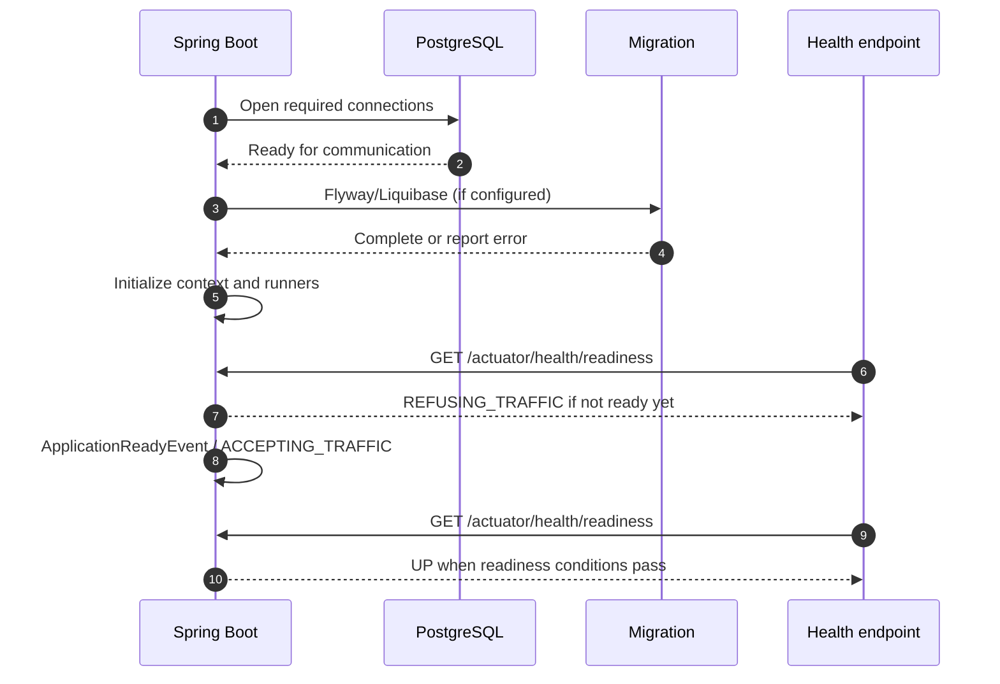
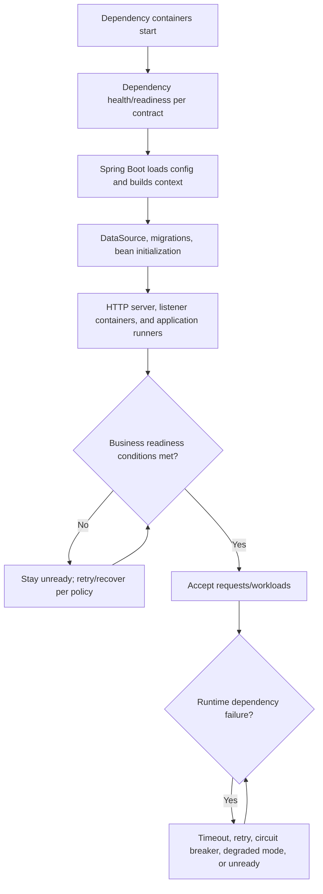

# Health Checks, Service Readiness Timing, and Connection Ordering

A Spring Boot application can start while PostgreSQL is still creating its database, Redis has opened its port but is not yet accepting commands, a Kafka broker is running yet listeners cannot retrieve metadata, or a REST API returns HTTP 200 on its health endpoint while business features remain unusable. In development environments, these situations cause first-run failures, flaky integration tests, and hard-to-maintain `sleep(30)` calls.

This lesson belongs to the **Development Services** chapter of the **SPRING_BOOT_INTEGRATION** module. The goal is to organize Spring Boot connectivity with HTTP clients, databases, caches, message brokers, and integration adapters so startup timing, readiness state, transactions, retries, errors, and testing remain explainable and observable.

Two ideas must always go together:

1. **Startup ordering** avoids connecting too early during initial steps.
2. **Runtime self-recovery** handles lost connections after all services were already ready once.

Health checks cannot completely replace either of these two mechanisms.

## 1. Learning Objectives

After this lesson, you will be able to:

- Distinguish between a running process, an open port, a responsive protocol, a usable dependency, and an application ready to serve business workloads.
- Distinguish **liveness**, **readiness**, **startup**, and health checks in Docker Compose, Spring Boot Actuator, and Testcontainers.
- Explain the limitations of `depends_on`, `service_healthy`, `sleep`, and TCP port checks.
- Design startup ordering for PostgreSQL, Redis, Kafka, RabbitMQ, and HTTP services.
- Use Spring Boot Docker Compose support, service connections, and Testcontainers within their proper scopes.
- Choose boundaries among fail fast, bounded retries, degraded mode, and blocking readiness.
- Write tests introducing delays, errors, restarts, and dropped connections to confirm system recovery.

## 2. Defining "Service Is Ready" Accurately

There is no single "ready" moment that means the same thing across every service type. Distinguish these levels:

| Level | Signal | What is **not** yet guaranteed |
|---|---|---|
| **Process started** | Process/container is running | Port may not be listening yet |
| **Port listening** | TCP connect succeeds | TLS, authentication, protocol, and business logic can still fail |
| **Protocol responsive** | Responds to `PING`, `SELECT 1`, or matching request | Schemas/topics/queues/permissions may not be ready |
| **Dependency usable** | App accesses required features with real credentials | Whole multi-dependency workflow may still be incomplete |
| **Application ready** | App decides it can accept workload per contract | Dependency can break right after the health check |
| **Business workflow complete** | An end-to-end transaction executes accurately and durably | Cannot be inferred from TCP or a simple health endpoint |

Example with PostgreSQL:

```text
T0  Docker reports container RUNNING
T1  PostgreSQL creates cluster and initializes
T2  TCP 5432 accepts connections
T3  pg_isready reports server accepting connections
T4  App authenticates successfully using its own account
T5  Flyway/Liquibase finishes migrations
T6  Business queries access the right tables/columns
T7  Spring Boot finishes startup and switches readiness to ACCEPTING_TRAFFIC
```

Milestones are not necessarily evenly spaced. A health check at `T3` only proves the condition it tested; you cannot treat it as proof of `T5` or `T6`.

Therefore, before writing a health check, answer:

> **Who consumes this health check result, and what evidence do they need to decide an action?**

Docker Compose needs to know whether dependent services may start. Kubernetes needs to know whether to route traffic to a Pod or restart a container. A test needs to know whether it can send requests/records yet. An operator needs to distinguish process failure from backing-service failure.

## 3. Liveness, Readiness, and Startup Do Not Ask the Same Question

### 3.1. Liveness: Can the Process Still Make Progress?

Liveness answers: **Must this instance be restarted to recover?**

For instance, liveness fails when an application enters an unrecoverable state, deadlocks threads halting progress, or suffers severe runtime corruption. Liveness should reflect the health of **the process itself**.

Never tie liveness to PostgreSQL connections or a shared REST API. If a database goes down briefly, restarting every application instance simultaneously usually worsens the outage and can trigger restart loops.

### 3.2. Readiness: Should Additional Workload Be Routed to This Instance?

Readiness answers: **Can new requests or work be sent to this instance right now?**

An application running while waiting for migrations, initial cache population, or synchronizing a key precondition is *alive but not ready*. Failed readiness tells the orchestrator to pause routing traffic to that instance—**not to restart it**.

Whether to include a dependency in readiness is a business decision:

- If orders cannot be saved without the database, marking unready may make sense.
- If only a derived cache is lost and the system can fall back to the database, it can stay ready while reporting degraded status via metrics/auxiliary health.
- If a shared partner API is failing, marking every replica unready could take down unrelated features that do not depend on that API.
- If a process is purely a Kafka consumer serving no HTTP traffic, interpret readiness through how the worker deployment platform gates work consumption.

### 3.3. Startup: Is It Still Within a Valid Startup Window?

A startup probe, when supported by the platform (such as Kubernetes), grants an app an extended startup window for loading data, opening connections, or warming up without liveness probes restarting it prematurely. Once the startup probe passes, liveness/readiness take over under normal lifecycle rules.

### 3.4. Docker Health Status Is a Separate Mechanism

A Docker `healthcheck` runs a command **inside the container** and reports `starting`, `healthy`, or `unhealthy`. It is not automatically synonymous with Spring Boot or Kubernetes liveness/readiness. Docker Engine does not restart containers by default merely because health status is `unhealthy`; understand the monitoring and orchestration policies in use.

| Check type | Observer | Main question | Typical action |
|---|---|---|---|
| Docker `healthcheck` | Docker/Compose | Has this container passed its defined check? | Unblocks `service_healthy`; displays health status |
| Spring Boot Actuator `/health/liveness` | Platform/operator | Is the process still operational? | Restarts when orchestrator is configured |
| Spring Boot Actuator `/health/readiness` | Router/orchestrator/operator | Should the instance receive new workloads? | Shifts or stops routing traffic |
| Kubernetes `startupProbe` | Kubelet | Has the container cleared startup yet? | Delays liveness/readiness until startup finishes |
| Testcontainers wait strategy | Test framework | Has the dependency met conditions for tests to begin? | Waits or fails test setup |

A passing health check at time `t` does not guarantee the service remains healthy at `t+1`. Every client still needs timeouts and error handling on every call.

## 4. Docker Compose: Starting Containers Differs from Starting a Safe Workflow

Docker Compose has two common ways to declare dependencies:

```yaml
# Short form: only describes basic start/stop ordering.
services:
  api:
    depends_on:
      - postgres
  postgres:
    image: postgres:16-alpine
```

With the short form, Compose has no signal confirming PostgreSQL can execute queries when `api` starts. Container start ordering can be right while app connections still fail.

The long form allows specifying a condition:

```yaml
services:
  api:
    depends_on:
      postgres:
        condition: service_healthy
  postgres:
    image: postgres:16-alpine
    healthcheck:
      test: ["CMD-SHELL", "pg_isready -U postgres"]
      interval: 3s
      timeout: 3s
      retries: 20
```

With `condition: service_healthy`, Compose waits until the dependency health check reaches `healthy` before starting the dependent service. This condition **only coordinates startup**: if PostgreSQL drops later, container `api` is neither automatically blocked from requests nor reconnected on its behalf.

Compose also supports `condition: service_completed_successfully` for one-shot tasks, such as a migration job packaged as its own service that must exit with code 0 before the app starts. Use this only for jobs that actually terminate; a long-running broker will never "complete successfully" in that sense.

### 4.1. Reading Healthcheck Parameters Accurately

| Attribute | Meaning |
|---|---|
| `test` | Command checking status; exit code 0 means success |
| `interval` | Period between consecutive health check runs |
| `timeout` | Maximum duration for a single check |
| `retries` | Consecutive failures required before marking unhealthy |
| `start_period` | Initialization window where check failures do not count toward the failure threshold per Docker rules; a passing check can end the grace period early |

`start_period` does not replace the overall system timeout and does not mean Docker stops the container when it expires. The `test` command must exist inside **the running image**; do not invoke `curl` or `wget` in a minimal image's healthcheck if that binary is absent.

### 4.2. Local Development Example with PostgreSQL and Redis

A `compose.yaml` file for two Spring Boot dependencies:

```yaml
services:
  postgres:
    image: postgres:16-alpine
    environment:
      POSTGRES_DB: orders
      POSTGRES_USER: orders
      POSTGRES_PASSWORD: orders_dev
    ports:
      - "127.0.0.1:55432:5432"
    healthcheck:
      test:
        - CMD-SHELL
        - "pg_isready -U $$POSTGRES_USER -d $$POSTGRES_DB"
      interval: 3s
      timeout: 3s
      retries: 20
      start_period: 15s

  redis:
    image: redis:7-alpine
    ports:
      - "127.0.0.1:56379:6379"
    healthcheck:
      test: ["CMD", "redis-cli", "PING"]
      interval: 3s
      timeout: 2s
      retries: 20
      start_period: 5s
```

Here:

- `127.0.0.1:55432` and `127.0.0.1:56379` are ports published on **the host running Compose** so host-side apps can connect.
- `postgres:5432` and `redis:6379` are the addresses normally used when the app runs as a container **inside the same Compose network**.
- `$$POSTGRES_USER` and `$$POSTGRES_DB` preserve the `$` sign so the shell **inside the container** expands the environment variables; using a single `$` makes Compose interpolate them on the host.
- `pg_isready` confirms PostgreSQL reports accepting connections; it is **insufficient** to prove app credentials are valid, migrations ran, or tables exist.
- `redis-cli PING` proves connectivity and `PING` under the healthcheck's execution context; environments with ACLs, TLS, or separate credentials need a probe matching the app's auth path.

You can observe:

```bash
docker compose up -d
docker compose ps
docker compose logs postgres
docker compose logs redis
```

On supported Docker Compose versions, `docker compose up --wait` waits until services reach running/healthy states per Compose definitions. Yet that wait still does not prove SQL logic, Kafka flows, or business APIs are ready.

### 4.3. If the Application Also Runs in Compose

Adding the application service (assuming the project has a Dockerfile):

```yaml
  api:
    build: .
    depends_on:
      postgres:
        condition: service_healthy
      redis:
        condition: service_healthy
    environment:
      SPRING_DOCKER_COMPOSE_ENABLED: "false"
      SPRING_DATASOURCE_URL: jdbc:postgresql://postgres:5432/orders
      SPRING_DATASOURCE_USERNAME: orders
      SPRING_DATASOURCE_PASSWORD: orders_dev
      SPRING_DATA_REDIS_HOST: redis
      SPRING_DATA_REDIS_PORT: "6379"
```

This is a **snippet added under `services:`** in the prior file, not standalone YAML. `SPRING_DOCKER_COMPOSE_ENABLED=false` fits when the app container simply consumes dependencies already orchestrated externally by Compose rather than asking Spring Boot to launch Compose again.

Do not use `localhost:55432` from inside the `api` container: there, `localhost` points to the app container itself. Do not use `postgres:5432` when running directly on the host unless the host resolves `postgres`; host apps should use published ports or Spring Boot service connection details.

## 5. Spring Boot Docker Compose Support: Coordinating Dependencies on the Host

Spring Boot integrates Docker Compose for local development ergonomics. When added to the classpath properly and a Compose file is discovered, Spring Boot can:

1. Start Compose services according to configured lifecycle.
2. Wait for service readiness via healthchecks or TCP probes when no healthcheck exists.
3. Generate **service connection details** for supported service types using published ports so the app connects automatically.
4. Manage Compose shutdown along lifecycle, if the app initiated startup and config permits.

With Gradle:

```groovy
dependencies {
    developmentOnly("org.springframework.boot:spring-boot-docker-compose")
}
```

Illustrative configuration options:

```yaml
spring:
  docker:
    compose:
      enabled: true
      file: compose.yaml
      readiness:
        timeout: 2m
```

Properties and service connection support depend on your Spring Boot version; verify your version when choosing broker, database, or custom container images. `readiness.timeout` is **the startup container-readiness wait budget**, not a timeout for every SQL or HTTP call over the app's lifetime.

### 5.1. Service Connection vs. Hardcoding Host/Port

Suppose PostgreSQL publishes on `55432` instead of `5432`. When Spring Boot recognizes the Compose dependency and builds `JdbcConnectionDetails`, the app receives host, port, and credentials from the service connection without needing a fixed local JDBC URL.

If you intentionally manage dependencies via `docker compose up -d` **without** Spring Boot Docker Compose integration, a host-side app configures explicitly:

```yaml
spring:
  datasource:
    url: jdbc:postgresql://localhost:55432/orders
    username: orders
    password: orders_dev
  data:
    redis:
      host: localhost
      port: 56379
```

These are two different **connection strategies**. Do not mix automatic connection details with hardcoded URLs and guess which takes effect; inspect active configs and runtime logs. In Spring Boot, when a matching `ConnectionDetails` exists, it generally takes precedence when building the client over auto-configuration's direct connection properties.

### 5.2. Never Treat Boot Compose Readiness as Business Testing

For example, PostgreSQL's healthcheck passes and Boot Compose initializes `DataSource`, yet the app can still encounter:

- App credentials lacking required permissions.
- Broken SQL migrations or lock contention.
- Kafka broker port open yet `advertised.listeners` returning unreachable addresses.
- Redis ACL allowing `PING` while blocking writes required by the workflow.
- HTTP dependency accepting TCP while functional endpoints still return 503.

Handle these through proper config, migrations, retries, and application-layer readiness.

### 5.3. In Integration Tests

Spring Boot's Docker Compose support has dedicated rules during tests and is normally disabled by default in test contexts. If tests rely on Docker Compose, test setup and container lifecycles must be explicit. For most integration tests requiring isolation, Testcontainers with service connections provides a cleaner reproducible environment.

## 6. Testcontainers: Waiting for Services in Integration Tests

Testcontainers launches test containers and applies wait strategies tailored to each container type. Specialized containers like `PostgreSQLContainer` normally apply far more accurate wait strategies than checking an arbitrary TCP port.

Spring Boot integration test example:

```java
import org.junit.jupiter.api.Test;
import org.springframework.boot.test.context.SpringBootTest;
import org.springframework.boot.testcontainers.service.connection.ServiceConnection;
import org.testcontainers.containers.PostgreSQLContainer;
import org.testcontainers.junit.jupiter.Container;
import org.testcontainers.junit.jupiter.Testcontainers;

@Testcontainers
@SpringBootTest
class OrderRepositoryIntegrationTest {

    @Container
    @ServiceConnection
    static PostgreSQLContainer<?> postgres =
        new PostgreSQLContainer<>("postgres:16-alpine")
            .withDatabaseName("orders")
            .withUsername("orders")
            .withPassword("test_only");

    @Test
    void canPersistOrder() {
        // Verify repositories, transactions, and migrated schemas.
    }
}
```

This assumes matching test dependencies such as Testcontainers JUnit Jupiter, the PostgreSQL module, Spring Boot Testcontainers, and the JDBC driver. `@ServiceConnection` supplies connection details to Spring Boot in supported releases, avoiding manual wiring of random Testcontainers hosts/ports.

### 6.1. Common Wait Strategies

| Strategy | What it proves | Limitations |
|---|---|---|
| Listening port | A process listens on the port | Does not prove protocol/auth/schema |
| HTTP endpoint | Endpoint returns expected status/response | Quality depends on endpoint semantics |
| Docker healthcheck | Container reports `healthy` | Image's built-in healthcheck may be too shallow |
| Log message | Log matches an expected string | Log strings can change; doesn't prove ongoing health |
| SQL/custom init | Query or init step succeeds | Only proves the check passed at that moment |

For a team-owned HTTP service, you can wait on its readiness endpoint:

```java
import java.time.Duration;
import org.testcontainers.containers.GenericContainer;
import org.testcontainers.containers.wait.strategy.Wait;

GenericContainer<?> partner = new GenericContainer<>("example/partner-api:dev")
    .withExposedPorts(8080)
    .waitingFor(
        Wait.forHttp("/actuator/health/readiness")
            .forPort(8080)
            .forStatusCode(200)
            .withStartupTimeout(Duration.ofMinutes(2))
    );
```

`example/partner-api:dev` is an **illustrative image name**; replace it with a real image exposing that endpoint. A `200 OK` endpoint is helpful only when the service defines `200` as truly ready for tests to start.

### 6.2. Database Ready Is Not Application Ready

Testcontainers can confirm PostgreSQL accepts connections, yet Spring Boot's Flyway/Liquibase migrations still must complete before repositories work. Let the Spring context initialize and test real repository or API behavior. Never use a Testcontainers wait strategy as proof that business schemas are valid.

## 7. Spring Boot Actuator and ApplicationAvailability

Spring Boot Actuator exposes health endpoints; in versions supporting availability probes, dedicated health groups exist for **liveness** and **readiness**. Add the dependency:

```groovy
dependencies {
    implementation("org.springframework.boot:spring-boot-starter-actuator")
}
```

Illustrative configuration:

```yaml
management:
  endpoint:
    health:
      probes:
        enabled: true
  endpoints:
    web:
      exposure:
        include: health,info
```

Typical URLs if the app uses the default HTTP port:

```text
GET http://localhost:8080/actuator/health
GET http://localhost:8080/actuator/health/liveness
GET http://localhost:8080/actuator/health/readiness
```

Under default health endpoint HTTP status mapping, `UP` typically returns `200`, while `DOWN` or `OUT_OF_SERVICE` typically returns `503`. Check status mapping if the project customized it.

### 7.1. Spring Boot Readiness State

Spring Boot tracks availability state via types such as:

- `LivenessState.CORRECT` and `LivenessState.BROKEN`.
- `ReadinessState.REFUSING_TRAFFIC` and `ReadinessState.ACCEPTING_TRAFFIC`.

During normal startup, readiness begins by refusing traffic and transitions to accepting once startup and application runners finish. The web server opening its port earlier **does not** mean the application has achieved readiness.



This diagram illustrates a typical flow. Some beans/clients open connections lazily, or Kafka listeners receive partition assignments asynchronously, so `ApplicationReadyEvent` **does not prove** every external path has finished initializing.

### 7.2. Readiness and Essential Dependencies

The default readiness group primarily relies on `readinessState`, rather than automatically folding every health indicator into readiness. If business requirements demand DB connectivity before accepting requests, you can include `db`:

```yaml
management:
  endpoint:
    health:
      probes:
        enabled: true
      group:
        readiness:
          include: readinessState,db
```

This example requires an actual `db` health indicator registered via Actuator/`DataSource`. For optional dependencies or environments lacking that indicator, adjust membership; Spring Boot validates health group member names to catch misconfiguration.

**Choosing readiness group members is an architectural decision**, not "add `db,redis,kafka,rabbit` everywhere for extra safety." Adding a shared dependency to readiness can pull every replica out of rotation simultaneously when that dependency blips; that may be right for critical DB-backed endpoints, or it may needlessly take down healthy features that do not rely on it.

### 7.3. Health Probes on the Main Server Port

If the Actuator management port differs from the API port, management health endpoints might respond while the primary HTTP port has trouble. On Spring Boot versions supporting this property, you can expose probe paths on the main server port:

```yaml
management:
  endpoint:
    health:
      probes:
        enabled: true
        add-additional-paths: true
```

Common additional paths on the application port are `/livez` and `/readyz`. Use those paths only after confirming they are enabled in your running version and configuration.

### 7.4. Custom Health Indicator When "Ready" Has Business Meaning

Suppose a worker must load a ruleset before processing orders. Expose a health indicator reflecting that state:

```java
import java.util.concurrent.atomic.AtomicBoolean;
import org.springframework.boot.actuate.health.Health;
import org.springframework.boot.actuate.health.HealthIndicator;
import org.springframework.stereotype.Component;

@Component("rulesReady")
public class RulesReadyHealthIndicator implements HealthIndicator {

    private final AtomicBoolean initialized = new AtomicBoolean(false);

    public void markReady() {
        initialized.set(true);
    }

    public void markNotReady() {
        initialized.set(false);
    }

    @Override
    public Health health() {
        return initialized.get()
            ? Health.up().build()
            : Health.outOfService()
                .withDetail("reason", "rules not loaded")
                .build();
    }
}
```

The application must call `markReady()` once the ruleset loads and validates, and `markNotReady()` when essential conditions cease to hold. Merely declaring the bean does not make the ruleset ready.

Add the indicator to readiness:

```yaml
management:
  endpoint:
    health:
      probes:
        enabled: true
      group:
        readiness:
          include: readinessState,rulesReady
```

Never run heavy batch queries or unbounded network calls inside every health check invocation. If querying a dependency is necessary, enforce short timeouts and bounded frequency, or refresh cached internal state in a controlled manner. Hanging probes exhaust threads and worsen outages.

## 8. Spring Boot Startup: Common Connection Ordering

Spring Boot enforces no single universal network connection sequence across all starters. Beans may initialize eagerly or lazily; a Kafka consumer can receive partition assignments after context creation; HTTP clients often connect only on the first request.

A reference sequence:



Exact ordering per component depends on auto-configuration and lifecycle. Do not treat this diagram as a guarantee that every network client connects prior to `ApplicationReadyEvent`.

### 8.1. Three Key Milestones in the Application Lifecycle

| Milestone | Meaning | What may still be pending |
|---|---|---|
| Spring context refresh | Core beans instantiated and context wired | Async workers not fully synchronized yet |
| `ApplicationRunner` / `CommandLineRunner` completion | Synchronous startup steps finished | Work launched onto other threads may still be running |
| `ApplicationReadyEvent` & readiness accepting | Spring Boot marks standard startup complete | Optional dependencies or async workflows may not be usable yet |

For a step that must finish before serving traffic, implement it as a synchronous startup task, controlled bean initialization, or an explicit readiness gate. If a task can take a long time, account for startup probe timeouts and status reporting for operators.

### 8.2. Kafka/RabbitMQ Adapters Need More Than Port Checks

For example, with Kafka:

1. Bootstrap server accepts TCP.
2. TLS and SASL (if enabled) authenticate.
3. Broker metadata returns advertised addresses reachable by the app.
4. Topics/partitions/ACLs satisfy requirements.
5. Producers send records cleanly or consumers join groups and receive assignments.

A TCP check at step 1 does not prove steps 3, 4, or 5. Especially with Kafka in Docker, `advertised.listeners=localhost:...` works from the host yet fails from other containers; match network topology to the client.

With RabbitMQ, a node passing healthcheck does not guarantee vhosts, exchanges, queues, bindings, and business account permissions are ready. With Redis, `PING` does not guarantee allowed keys/commands and ACLs. With HTTP clients, distinguish `/health`, `/ready`, and business endpoints per the partner system's contract.

## 9. Designing Right-Sized Health Checks per Service

| Service | Initial check | Stronger check when required |
|---|---|---|
| PostgreSQL | `pg_isready` or TCP | Connect with app credentials, `SELECT 1`, migration/schema version |
| MySQL/MariaDB | Client ping | Login, schema/table access, and app permissions |
| Redis | `redis-cli PING` | Auth/ACL, safe test-key round-trip |
| Kafka | Broker TCP/metadata | Advertised listener metadata, topics, ACLs, producer send, consumer assignment |
| RabbitMQ | Diagnostics/node health | Vhost, queues, exchanges, bindings, publish/consume permissions |
| MongoDB | `ping` command | Auth, replica-set/read-write state, required collections/indexes |
| HTTP service | TCP or HTTP `/ready` | Specific endpoint contract, TLS/auth, appropriate timeouts |
| Spring Boot app | Actuator readiness | Business-specific conditions, API or message flow tests |

Never write directly to real business records inside a continuous health probe. If write/read verification is needed, use dedicated health resources, TTLs, restricted permissions, and sensible intervals; keep expensive end-to-end checks separate from high-frequency probes.

## 10. Retries, Timeouts, Backoff, and Fail Fast

Even when Compose or Testcontainers waits for a dependency to turn healthy, an initial request can still fail due to race conditions, stale pooled connections, or transient network errors. **Readiness checks lower the chance of connecting too early; controlled retries handle real runtime failures.**

Connection policies must classify errors:

| Error | Usually appropriate handling |
|---|---|
| `Connection refused` while service is starting | Retry with backoff within startup budget |
| Brief transient timeout | Bounded retry if the operation is safe to repeat |
| HTTP 429 or 503 | Backoff per contract and `Retry-After` when present |
| Wrong credentials, bad certificates, incompatible schema | Fail fast and report config error; infinite retries won't help |
| Invalid payload, validation error | Do not retry blindly; route to business error handling |
| Kafka producer unsure if broker persisted | Check idempotence and delivery contract; avoid duplicate side effects |
| Database dropped mid-transaction | Roll back and retry the entire idempotent transaction unit per design |

### 10.1. Retry Budgets and Backoff

For example, an HTTP call might use:

```text
attempt 1: t = 0 ms
attempt 2: t ≈ 300 ms + jitter
attempt 3: t ≈ 900 ms + jitter
attempt 4: t ≈ 2100 ms + jitter
overall deadline: 6 seconds
```

Timings are illustrative. Jitter prevents multiple instances from retrying in lockstep. Single-call timeouts must fit inside the overall deadline budget, and retries apply only to classified transient faults. If multiple layers (HTTP client, service, gateway, broker listener) each retry independently, total attempts multiply dramatically; assign retry ownership to one clear layer.

### 10.2. Idempotency Is a Prerequisite for Retrying Side Effects

Retrying a safe `GET` per contract is simpler than retrying a `POST` that initiates payment or places an order. If a `POST` times out, the server may have succeeded while the response was lost. Retrying without an idempotency key creates duplicate transactions.

In Kafka consumers, retrying after DB commit but before offset commit likewise redelivers events. You need deduplication, clear transaction boundaries, or idempotent processing. Passing healthchecks does not eliminate those risks.

### 10.3. Fail Fast and Degraded Mode

Choose one of three reasoned behaviors:

- **Mandatory:** Without the dependency, the app cannot fulfill its core role. Startup may fail fast after a bounded retry window, or remain alive in an unready state.
- **Optional:** Dependency is down yet primary functionality works. Stay ready per contract, emit metrics/logs, and apply fallback/degraded mode.
- **Asynchronous:** The app accepts work and durably writes to a queue/outbox before an external dependency recovers. Readiness may only need to prove **durable ingestion capability**, while workers complete downstream delivery later.

Request acceptance criteria must align with the API's actual guarantees. Never return success and silently drop work because a broker is down.

## 11. Ordering Flyway/Liquibase, Schemas, and Message Brokers

The gap between **dependency ready** and **application ready** is sharpest when migrations or resource provisioning are involved.

One model:

```text
PostgreSQL container healthy
        |
        v
App authenticates and obtains DB connection
        |
        v
Flyway/Liquibase completes schema migrations
        |
        v
Repositories/consumer handlers can read/write exact schema version
        |
        v
App publishes readiness ACCEPTING_TRAFFIC
```

Clarify who owns migrations:

1. **Migrations during Spring Boot startup:** App migrates before serving traffic; convenient for local dev, yet requires locking/coordination when multiple replicas start together.
2. **Dedicated migration job:** CI/CD or Compose job runs before the app; can use `service_completed_successfully` in local Compose, while production needs proper job orchestration.
3. **Pre-managed schema before deployment:** App checks compatibility/version and fails fast on mismatch.

Do not run both a separate migration job and per-replica startup migrations without a clear compatibility policy and migration locking. When schema changes break older code, migration ordering directly governs zero-downtime rollouts.

For Kafka/RabbitMQ, decide who creates topics/queues/bindings. A healthy broker does not mean business topology exists. Provision resources via controlled startup provisioning or infrastructure tooling, then verify outcomes and permissions before exposing consumers/producers to workloads.

## 12. Using Readiness Correctly in Kubernetes

When deploying a Spring Boot app to Kubernetes, probes do not enforce `depends_on`-style startup ordering across Pods. Kubernetes schedules Pods independently; each instance must wait for dependencies or recover in a distributed environment.

With Spring Boot having `management.endpoint.health.probes.add-additional-paths=true`, an illustrative container spec:

```yaml
containers:
  - name: orders-api
    image: example/orders-api:1.0
    ports:
      - containerPort: 8080
    startupProbe:
      httpGet:
        path: /livez
        port: 8080
      periodSeconds: 2
      failureThreshold: 30
    livenessProbe:
      httpGet:
        path: /livez
        port: 8080
      periodSeconds: 10
      failureThreshold: 3
    readinessProbe:
      httpGet:
        path: /readyz
        port: 8080
      periodSeconds: 5
      failureThreshold: 2
```

This is a **`containers:` snippet**, requiring a valid Pod template with real images and ports. Numbers illustrate detection windows, not universal defaults. If using `/actuator/health/liveness` and `/actuator/health/readiness` instead of `/livez`/`/readyz`, verify the paths sit on a port reachable by kubelet.

### 12.1. Why Not Put the DB in Liveness?

Suppose 10 replicas share PostgreSQL:

```text
DB loses connectivity for 20 seconds
  -> all replicas' liveness goes DOWN
  -> kubelet restarts replicas one by one
  -> Hikari pools, cache warm-ups, migrations/checks generate extra load
  -> DB recovers while clients are busy mass-restarting
```

If the app is alive and can reconnect, liveness should stay `UP`. Readiness can transition `DOWN` for routes that genuinely cannot operate. With shared dependencies, weigh the blast radius of making **every** replica unready: the service could have zero endpoints left even for DB-independent features.

### 12.2. Graceful Shutdown

During rollouts or scale-downs, readiness should transition smoothly so new traffic stops arriving before the process terminates. With in-flight HTTP requests, Kafka consumers, or active transactions, configure graceful shutdown, timeouts, and uncommitted work handling.

Never equate HTTP readiness transitioning down with Kafka consumers stopping polls or committing offsets; message listener lifecycles must be designed and tested independently.

## 13. With Spring Integration Adapters: "Connected" Is Not "Finished"

The SPRING_BOOT_INTEGRATION module includes adapter flows such as inbound Kafka/RabbitMQ, JDBC polling, HTTP outbound, and caches. Each adapter has distinct startup boundaries:

| Adapter/flow | Observable startup milestone | Critical business prerequisite |
|---|---|---|
| JDBC inbound poller | Scheduler/poller enabled | DB has schema, credentials, readable query |
| Kafka inbound adapter | Listener container `running` | Consumer joined group, assignments, matching topics/ACLs |
| AMQP inbound adapter | Listener container started | Broker/vhost/queues/bindings and consumer active |
| HTTP outbound gateway | Bean/client built | DNS/TLS/auth and target endpoint callable |
| Redis cache adapter | Connection factory built | Cache commands, TTL, serializer/ACLs work |
| File/SFTP adapter | Poller or session factory initialized | Directory/permissions/file format match |

**Do not enable message ingestion before handlers have essential dependencies** if received events would be acked/committed/recorded prematurely. Keep listener auto-startup policy-driven and activate once dependencies are ready, or pair listeners with proper error handlers, retries, and idempotency. Which fits depends on whether brief downtime may leave messages queued in the broker and how the adapter commits/acks.

With Spring Integration `SmartLifecycle`, phases control component startup order. However, phases **do not check network readiness**, and bean startup ordering does not replace client timeouts/retries. If an adapter waits on a dependency, model that condition explicitly in readiness.

### 13.1. Distinguishing Consumer Ready from Handler Ready

A Kafka listener may subscribe before receiving partition assignments. Conversely, an instance in a consumer group can legitimately have **no** assigned partitions when instance count exceeds partition count. Never mark an instance unready merely for lacking assignments if that matches its valid group role.

If a use case strictly requires a partition assignment before work begins, specify that requirement explicitly and test rebalance scenarios. Never blindly enforce "at least one partition" across every consumer.

## 14. Common Anti-Patterns

### 14.1. Using `sleep(30)` Before Calling a Service

```java
Thread.sleep(30_000);
connection.open();
```

After 30 seconds, the dependency **might** be ready or **still not** ready. Fast environments waste time; slow ones still fail. Use readiness checks with bounded timeouts and retries, avoiding silent startup delays without status visibility.

### 14.2. Checking Only the TCP Port

A TCP port check proves a network path and listening process—not DB authentication, TLS certificates, Kafka advertised listeners, queue permissions, or schemas. Use it only as a baseline when a dependency supports nothing deeper, never calling it "business ready."

### 14.3. Stuffing Every Dependency into Liveness

When one external service blips, every replica restarts needlessly. Liveness should measure process health; readiness or dedicated metrics should reflect dependencies.

### 14.4. Assuming `depends_on: service_healthy` Handles Runtime Drops

`service_healthy` governs Compose startup ordering. When the DB restarts mid-run, clients still must detect connection errors, retry/reconnect, roll back transactions, or report degraded readiness.

### 14.5. Health Endpoints Running Heavy SQL Every Few Seconds

Hundreds of instances polling concurrently can overload a struggling DB. Keep probes lightweight with short timeouts, sensible caching, or separate deep synthetic checks from high-frequency liveness/readiness probes.

### 14.6. Reporting Ready Before Migrations Finish

Early traffic hits missing tables/columns. Run migrations synchronously at startup or block readiness until the schema contract is satisfied.

### 14.7. Waiting for a Healthy Broker and Ignoring Publish/Consume Errors

Brokers can change leaders or suffer network glitches after healthchecks pass. Producers must still handle send failures; consumers need error handlers, commit strategies, and deduplication.

### 14.8. Using One Health Check for Every Context

Overall `/actuator/health` may turn red for an optional component, whereas `/health/liveness` and `/health/readiness` need separate rules. Tailor health groups to the action each observer takes.

## 15. Observing and Diagnosing Startup Failures

When "works on my machine but fails in CI" happens, first assemble a **timeline**. Record:

1. Dependency containers created/started.
2. First healthcheck pass or failure; `retries` and `start_period` settings.
3. Spring Boot creating connection pools, consumers, or HTTP clients.
4. SQL migrations starting/finishing.
5. Kafka/RabbitMQ listeners starting, joining/subscribing, and reaching expected state.
6. Readiness switching to accepting; first request/message succeeding.
7. Reconnects/retries/rebalances after faults.

Useful commands in Compose environments:

```bash
docker compose ps
docker compose logs --timestamps postgres
docker compose logs --timestamps redis
docker compose logs --timestamps api

curl -i http://localhost:8080/actuator/health/liveness
curl -i http://localhost:8080/actuator/health/readiness
```

`api` applies only if the Compose file actually defines an application service. `curl` runs from the host in this example and must exist on the host machine; Docker healthchecks inside containers require their own binaries.

In Kubernetes, inspect:

```bash
kubectl get pods
kubectl describe pod orders-api-xxxxx
kubectl logs orders-api-xxxxx
```

Pod names are illustrative. Kubernetes events and logs separate `startupProbe failed`, `readinessProbe failed`, image errors, OOM/restarts, and dependency connection failures.

### 15.1. Metrics Worth Monitoring

| Metric | Helps detect |
|---|---|
| Time until dependencies are healthy | Slow startups, abnormal container initialization |
| Time from process start to `ApplicationReadyEvent` | Slow migrations or application runners |
| Readiness transitions over time | Flapping caused by dependencies or business gates |
| Connection timeouts/refusals and auth failures | Wrong ports, unready dependencies, bad credentials |
| Hikari pool acquisition time/connection failures | DB pool contention or DB interruptions |
| Kafka consumer assignment/rebalances, producer errors | Broker reachable yet message flow unstable |
| RabbitMQ reconnects, consumer cancels, failed publishes | Queue/broker/permission shifts |
| Retry counts, exhausted retries, circuit breaker state | Continuously degraded dependencies |
| Synthetic workflow success/latency | Whether business logic actually completes |

Carry correlation IDs across startup logs, request/message logs, and traces. Never log plaintext passwords, tokens, or DSNs containing secrets when reporting config errors.

## 16. Deliberately Testing Readiness Timing

Testing only the "everything starts fast" happy path misses race conditions. A sound integration test suite exercises **not ready yet**, **just became ready**, and **lost readiness after operating**.

| Scenario | How to simulate | Expected result |
|---|---|---|
| DB not accepting connections yet | Delay PostgreSQL startup | App stays unready/retries or fails fast per policy |
| DB TCP open yet schema missing | Skip or delay migrations | API rejects/holds schema-dependent work with clear error |
| Redis paused | Block Redis connectivity | If cache optional, app continues with fallback; if required, readiness reflects it |
| Kafka port open yet bad metadata | Configure unreachable advertised listener | Producer/consumer report clear error; broker not treated as ready |
| RabbitMQ healthy yet missing queue | Omit queue provisioning or ACLs | Adapter refuses broken contract; alert/failure raised |
| Dependent HTTP returns 503 | Stub endpoint returns transient failure | Bounded retries, timeouts, and proper fallback |
| Dependency breaks after app ready | Stop/restart dependency container | Client reconnects or turns unready and recovers |
| Broken container healthcheck | Probe binary absent from image | Unhealthy state caught cleanly without inflating sleeps |
| Broken migration | DB script throws exception | Startup fails or stays unready; zero traffic accepted |
| Liveness stays UP on brief DB outage | Stop DB while process stays healthy | Application is not pointlessly restarted |
| Testcontainers random port | Test runs with auto-mapped port | App connects via `@ServiceConnection`, no hardcoding |

### 16.1. Polling Conditions Instead of Fixed Sleeps

In tests, await **conditions** using bounded polling:

```java
import static org.assertj.core.api.Assertions.assertThat;
import static org.awaitility.Awaitility.await;

import java.time.Duration;

await()
    .atMost(Duration.ofSeconds(30))
    .pollInterval(Duration.ofMillis(250))
    .untilAsserted(() ->
        assertThat(readReadinessStatusFromApp()).isEqualTo("UP")
    );
```

`readReadinessStatusFromApp()` is a **hypothetical helper implemented by the test** to call the health endpoint and extract status; this example uses Awaitility. Tests should still run a business request/query after readiness turns `UP` when verifying end-to-end processing.

### 16.2. A Dependency Restart Recovery Test

```text
Given:
  PostgreSQL and the Spring Boot app are both ready.
  Send OrderCreatedEvent A -> persisted to database cleanly.

When:
  Interrupt database connectivity via Testcontainers/Toxiproxy.
  Send OrderCreatedEvent B while DB is unavailable.
  Restore database connectivity.

Then:
  Process liveness remains valid if the app can self-recover.
  Readiness/metrics reflect state per contract.
  B is retried/replayed or durably stored for later processing.
  No records are lost and no duplicate side effects occur.
  Post-recovery, readiness returns to normal.
```

For Kafka, verify message offsets, commits, and idempotency. For HTTP, verify HTTP status/deadlines and business state. "The test finished within timeout without throwing" is not proof of proper handling.

## 17. Scenario Analysis

**Scenario A — `depends_on` Yet Still `Connection refused`**

Compose lists `api depends_on postgres` as a plain list. The PostgreSQL container runs, yet the app throws `Connection refused` during the first few seconds.

*Explanation:* Compose started PostgreSQL first without waiting for the database protocol to become ready. Add an appropriate healthcheck with `condition: service_healthy`, plus bounded fail-fast/retry behavior for subsequent runtime drops.

**Scenario B — Docker Healthy Yet Spring Boot Not Ready**

`pg_isready` succeeds; the app keeps returning `503` on `/actuator/health/readiness` and logs show Flyway lacks table creation permissions.

*Explanation:* PostgreSQL is healthy at the server level, while schema migrations fail due to permissions/SQL. Fix migrations/credentials; extending `start_period` will never fix a business/permission error.

**Scenario C — Kafka Bootstrap TCP Succeeds, Producer Still Times Out**

An app inside a container reaches the bootstrap broker yet metadata returns `localhost`, which only the broker itself can reach.

*Explanation:* Configure `advertised.listeners` for the client's network; TCP bootstrap checks are too shallow.

**Scenario D — DB Outage Triggers Mass Pod Restarts**

Liveness was configured to include the `db` indicator. The database drops for a few dozen seconds, and kubelet restarts every Pod.

*Explanation:* A dependency outage was misdiagnosed as a dead process. Remove DB from liveness; use readiness/metrics for DB reachability and let clients reconnect per policy.

**Scenario E — Testcontainers Healthy Yet Repository Test Fails**

`PostgreSQLContainer` starts cleanly, yet a test querying `orders` fails because the table does not exist.

*Explanation:* Container readiness only proves the dependency can accept connections. Verify migrations inside the Spring test context and schema initialization ordering.

**Scenario F — Already Ready Yet RabbitMQ Restarts**

`orders-api` became ready at startup, then RabbitMQ restarted mid-run. Listeners dropped; the API kept returning "message sent" even though publishes were unconfirmed.

*Explanation:* Startup readiness does not replace runtime error handling. Add publisher confirms/returns or outbox transactions per contract, reconnect logic, and messaging error observability; adjust degraded readiness per API guarantees.

## 18. Implementation Checklist

- [ ] Clearly define what `started`, `healthy`, `ready`, and `business usable` mean for each service.
- [ ] Docker healthchecks execute **inside the image** with sensible `timeout`/`interval`/`retries`/`start_period`.
- [ ] When Compose startup dependencies are needed, use `service_healthy` or `service_completed_successfully` appropriately.
- [ ] Distinguish apps running on **host** vs. inside the **Compose network** to pick the right host/port.
- [ ] Never hardcode Testcontainers ports; use service connections or container-provided host/mapped ports.
- [ ] Plan migrations, topic/queue provisioning, and permissions before accepting workloads.
- [ ] Liveness checks process health; readiness checks workload preconditions; startup probes grant initialization budget.
- [ ] Never treat HTTP 200 or open TCP as end-to-end proof when contracts demand more.
- [ ] Clients enforce connect/request timeouts, bounded retries, and jitter; config errors fail fast without infinite retries.
- [ ] Operations with side effects enforce idempotency/deduplication before permitting retries/replays.
- [ ] Test losing dependencies **after** the application has already become ready.
- [ ] Put logs, metrics, traces, and runbooks in place for startup delays, unhealthy/unready states, reconnects, and migration failures.

## 19. Key Takeaways

**"Running" does not mean "ready."** Container `running`, TCP port open, Docker `healthy`, Spring Boot `readiness UP`, and a passing business workflow are distinct assertions with differing guarantees. A health check is only valuable when what it measures matches the decision the system makes from it.

In Spring Boot Integration development, use Docker Compose or Testcontainers to provision and await dependencies; use service connections to prevent host/port errors; place migrations and provisioning at the right milestones; use Actuator readiness/liveness to express app state; and always design timeouts, retries, idempotency, and observability for failures occurring **after startup**.
