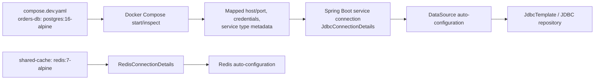
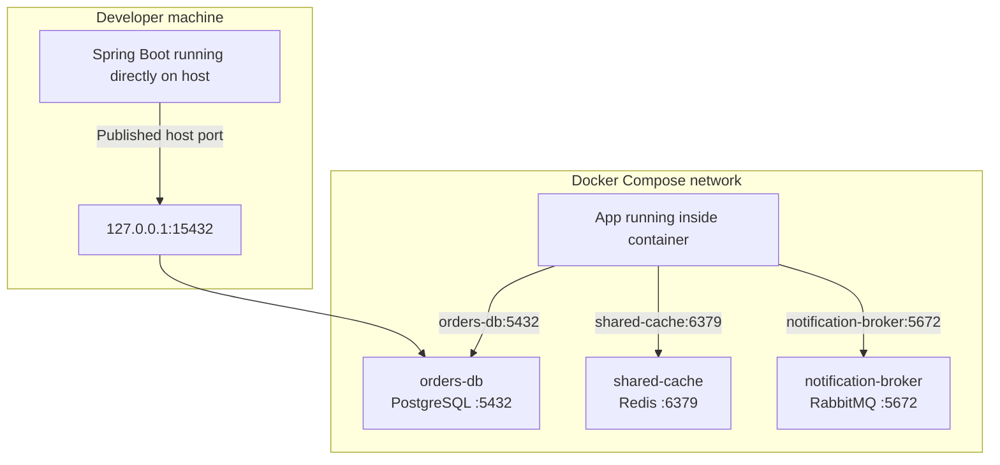
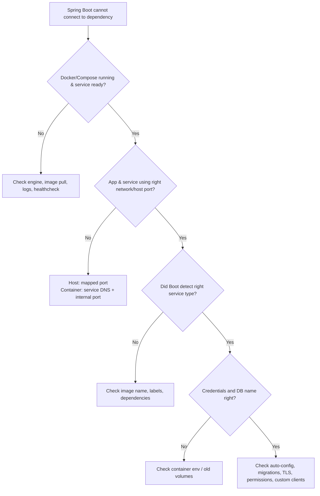

# Customizing Image Names, Service Mapping, and Environment Configuration

## 1. Problems to Solve When Developing Integration Flows

A Spring Boot application integrating multiple systems often needs PostgreSQL for transactions, Redis for caching or temporary locks, RabbitMQ/Kafka for messaging, and an HTTP service mocking a partner. For local development and testing, teams want these dependencies to start quickly, stay consistent across machines, and avoid manually entering hosts/ports on every run.

Spring Boot provides **development-time services** via Docker Compose and Testcontainers support. They can automatically create **service connection details**—beans describing connection parameters consumed by Spring Boot auto-configuration for `DataSource`, Redis, brokers, and supported services.

Complications arise when a project uses:

- Standard images like `postgres:16`, `redis:7`, `rabbitmq:3-management`.
- Internal images like `registry.example.com/team/postgres-custom:16` or images mirrored through a private registry.
- Business-meaningful Compose service names like `orders-db`, `shared-cache`, `notification-broker`.
- Multiple profiles (`local`, `test`, `staging`, `production`) with different configurations or access levels.
- Some services recognized automatically by Spring Boot and others requiring manual configuration.

**Lesson goal:** configure images, map services to the right connection types, and separate environment configs in a way that is reproducible, testable, and prevents development apps from accidentally targeting production databases or brokers.

This lesson belongs to the **Development Services** group of the `SPRING_BOOT_INTEGRATION` module. Examples target testing Spring Boot integration flows across HTTP clients, databases, caches, brokers, and adapters, supporting configuration control, contracts, errors, transactions, deduplication, and observability.

## 2. Distinguishing Image Name, Service Name, Container Name, and Connection Type

Many configuration bugs stem from mixing up four concepts:

| Concept | Example | Function |
| --- | --- | --- |
| **Docker image name** | `postgres:16-alpine` | Identifies the software and version the container runs |
| **Docker Compose service name** | `orders-db` | Key identifying the service in Compose; also typically the DNS name between containers on the same network |
| **Container name/ID** | Compose-generated instance name/ID | Identifies a specific container process; applications should not depend on it to connect |
| **Service connection type** | `postgres`, `redis`, `rabbitmq` | Tells Spring Boot which `ConnectionDetails` type to create |

Example:

```yaml
services:
  orders-db:
    image: postgres:16-alpine
```

`orders-db` is the **service name**; `postgres:16-alpine` is the **image name**. Spring Boot Docker Compose support recognizes many services via **image name**. Naming a service `orders-db` does not make it type `postgres` if a custom image goes unrecognized.

Similarly, Spring Boot can only generate config for services supported by the module with matching auto-configuration. A valid label identifies **the service type**, yet neither installs JDBC drivers, creates schemas, nor converts a different-protocol container into PostgreSQL.

For apps running **on the host machine**, Spring Boot uses ports published from containers to the host. For **apps also running inside Docker Compose**, connections typically use internal service DNS names and container ports, e.g., `orders-db:5432`. Those two paths are not interchangeable.

## 3. Two Common Development Mechanisms in Spring Boot

| Criterion | Docker Compose support | Testcontainers support |
| --- | --- | --- |
| Starting point | `compose.yaml` or specified Compose file | Containers defined in Java/test configuration |
| Common purpose | Running app locally with backing dependencies | Integration tests launching dependencies with clear lifecycles |
| Service type detection | Image name or `org.springframework.boot.service-connection` label | Container type, image metadata, and `@ServiceConnection` |
| Connection wiring | Spring Boot creates `ConnectionDetails` from recognized Compose services | Spring Boot creates `ConnectionDetails` for `@ServiceConnection` containers |
| Host ports | Depends on Docker Compose mapping | Testcontainers typically allocates dynamic host ports |
| Activation | `spring-boot-docker-compose` dependency and config | `spring-boot-testcontainers` dependency plus Testcontainers |
| Isolation | Can share local services across multiple runs | Usually creates dedicated environments per suite/test lifecycle |

Both mechanisms aid development without altering business requirements: databases still need formal migrations, consumers still need idempotency, brokers still involve retries/acks, and HTTP clients still need timeouts and data protection.

In CI, Testcontainers reduces dependence on pre-running service state. Locally, Compose shines when inspecting containers, volumes, and ports with external tools.

## 4. Preparing Spring Boot Docker Compose Support

With Maven and Spring Boot dependency management:

```xml
<dependency>
    <groupId>org.springframework.boot</groupId>
    <artifactId>spring-boot-docker-compose</artifactId>
    <scope>runtime</scope>
    <optional>true</optional>
</dependency>
```

Illustrative starters for an integration app:

```xml
<dependency>
    <groupId>org.springframework.boot</groupId>
    <artifactId>spring-boot-starter-jdbc</artifactId>
</dependency>
<dependency>
    <groupId>org.springframework.boot</groupId>
    <artifactId>spring-boot-starter-data-redis</artifactId>
</dependency>
<dependency>
    <groupId>org.springframework.boot</groupId>
    <artifactId>spring-boot-starter-amqp</artifactId>
</dependency>
<dependency>
    <groupId>org.postgresql</groupId>
    <artifactId>postgresql</artifactId>
    <scope>runtime</scope>
</dependency>
```

Include only the starters the application actually uses; do not add all three just because an example runs three containers. With the Compose dependency present, Docker/Compose CLI ready, and a supported Compose file in the project, Spring Boot can coordinate development service lifecycles at app runtime.

Prerequisites to check:

1. Docker Engine and Docker Compose CLI work on the machine.
2. Images can be pulled/built under current registry permissions.
3. Published ports are reachable from the host app.
4. App connection dependencies and drivers are complete.
5. Spring Boot recognizes the right service type and builds the client beans the app consumes.
6. Profiles are configured properly to avoid starting Compose in unintended deployments.

Spring Boot Compose support is primarily for development. Never make production apps start databases/brokers via Docker Compose your default operational architecture.

## 5. Complete Compose Example with PostgreSQL, Redis, and RabbitMQ

File `compose.dev.yaml` in the project working directory:

```yaml
services:
  orders-db:
    image: postgres:16-alpine
    environment:
      POSTGRES_DB: orders_dev
      POSTGRES_USER: orders_dev
      POSTGRES_PASSWORD: ${DEV_DB_PASSWORD:-dev_only_change_me}
    ports:
      - "127.0.0.1:15432:5432"
    volumes:
      - orders-db-data:/var/lib/postgresql/data
    healthcheck:
      test: ["CMD-SHELL", "pg_isready -U $$POSTGRES_USER -d $$POSTGRES_DB"]
      interval: 5s
      timeout: 3s
      retries: 10

  shared-cache:
    image: redis:7-alpine
    ports:
      - "127.0.0.1:16379:6379"

  notification-broker:
    image: rabbitmq:3-management
    environment:
      RABBITMQ_DEFAULT_USER: orders_dev
      RABBITMQ_DEFAULT_PASS: ${DEV_MQ_PASSWORD:-dev_only_change_me}
    ports:
      - "127.0.0.1:15672:5672"
      - "127.0.0.1:15673:15672"

volumes:
  orders-db-data:
```

Meaning:

- `image` specifies the software version to run. In real projects, pin tested versions, review updates, and pin digests if strict reproducibility is required.
- `ports` follows `host-ip:host-port:container-port`. Apps on the host reach PostgreSQL via `127.0.0.1:15432`, Redis via `127.0.0.1:16379`, and RabbitMQ via `127.0.0.1:15672`.
- `127.0.0.1` restricts port publishing to the developer machine's loopback interface; this is deliberate for services needing no external network access.
- `POSTGRES_DB`, `POSTGRES_USER`, and `POSTGRES_PASSWORD` pass **into the container** so the PostgreSQL image initializes the database/account when the data directory is empty. They do not automatically become `spring.datasource.*` properties in the host Java process.
- `healthcheck` verifies PostgreSQL accepts connections. `$$POSTGRES_USER` prevents premature Compose interpolation, deferring expansion to the container shell.
- Volume `orders-db-data` keeps data across container stop/starts. Deleting volumes wipes local dev data; run only when you truly intend to reset.

Use the placeholder passwords above strictly in isolated local environments. In real projects, generate per-environment dev values outside Git, use managed env files, and never copy production credentials.

### 5.1. Configuring Spring Boot's Local Profile

File `application-local.yml`:

```yaml
spring:
  config:
    activate:
      on-profile: local

  docker:
    compose:
      file: ./compose.dev.yaml
      enabled: true
      lifecycle-management: start-and-stop

logging:
  level:
    org.springframework.boot.docker.compose: INFO
```

Starting locally:

```bash
java -jar build/libs/integration-service.jar --spring.profiles.active=local
```

This example uses the project's built JAR; JAR paths vary for Maven or custom build configs. When using Docker Compose support, Spring Boot starts needed services and picks up published ports.

If Compose services were already running beforehand, note that Spring Boot may reuse them and **not automatically stop** them on app exit. Never assume every container disappears when the Java process stops.

### 5.2. How Is ConnectionDetails Generated?

With standard images recognized by Spring Boot, connections conceptually flow like this:



Auto-configuration can prefer `ConnectionDetails` over connection properties like `spring.datasource.url` or `spring.data.redis.host`. Hence, once a dev service is recognized, you need not hardcode `localhost:15432` in `application-local.yml` just to wire Boot's `DataSource`. However, **hand-built custom clients** will not automatically use `ConnectionDetails` if your code only reads `@Value` or a custom `host` property.

Verify actual generated types per service: PostgreSQL can contribute JDBC/R2DBC details depending on dependencies and auto-configuration; Redis and RabbitMQ likewise require matching starters/connection factories. Never expect a connection details bean to create JDBC schemas automatically or make an app without Redis dependencies talk to Redis.

## 6. Customizing Image Names: When Does Spring Boot Fail to Recognize Them?

Internal images often carry names differing from standard ones:

```yaml
services:
  orders-db:
    image: registry.example.com/platform/postgres-hardened:16
```

The container may run valid PostgreSQL, yet Spring Boot Docker Compose support **does not automatically deduce the service type from a custom image name**. As a result, the container runs while `DataSource` falls back to old config, or auto-configuration fails reporting a missing URL/driver depending on app state.

The explicit declaration is adding a label:

```yaml
services:
  orders-db:
    image: registry.example.com/platform/postgres-hardened:16
    labels:
      org.springframework.boot.service-connection: postgres
    environment:
      POSTGRES_DB: orders_dev
      POSTGRES_USER: orders_dev
      POSTGRES_PASSWORD: ${DEV_DB_PASSWORD}
    ports:
      - "127.0.0.1:15432:5432"
```

The `org.springframework.boot.service-connection` label tells Spring Boot the intended service connection type. Here `postgres` states the container serves compatible PostgreSQL; the image name may come from a private registry, while the container must expose the protocol, environment variables, and ports Boot expects.

**The label is not a DNS alias.** It neither renames Compose service `orders-db`, nor alters Docker networking, nor injects `POSTGRES_DB` into the Spring Boot process. It is metadata telling Spring Boot which service connection factory to pick.

Likewise, when a private image runs Redis:

```yaml
services:
  shared-cache:
    image: registry.example.com/platform/redis-internal:7
    labels:
      org.springframework.boot.service-connection: redis
    ports:
      - "127.0.0.1:16379:6379"
```

If an image is an HTTP mock API outside technologies with service connection factories, never slap `postgres` or `redis` labels on it just to silence errors. Configure mock endpoints via dedicated properties or write a custom `ConnectionDetails` integration if your project truly supports it.

### 6.1. Distinguishing a Registry Mirror from a New Service

Suppose you swap images:

```text
postgres:16-alpine
    → registry.company.example/internal/postgres:16-alpine
```

This may simply change the registry host, yet to Spring Boot the image name has changed. Verify recognition and add the service connection label if needed. Also verify:

- Does PostgreSQL still listen on port 5432?
- Is how the image reads username/password/database compatible?
- Do entrypoints, healthchecks, and persistent data behave as expected?
- Did TLS certificates, authentication, CPU architectures, or image policies change?
- If an existing volume already holds data, do DB-init environment variables still apply?

Never judge a custom image safe and compatible by its label alone.

### 6.2. Ignoring Containers That Are Not Application Dependencies

Some Compose containers exist only for observability, data seeding, or admin tools and need no `ConnectionDetails`. Spring Boot Docker Compose supports a label to skip processing that service, for instance:

```yaml
services:
  tools-dashboard:
    image: registry.example.com/dev/tools-dashboard:1
    labels:
      org.springframework.boot.ignore: "true"
```

Ignoring **service connection** creation does not stop Docker Compose from starting the container; it only controls Spring Boot's handling of that service. To skip starting containers conditionally, use Docker Compose profiles or separate Compose files.

## 7. Service Mapping: Compose Names and Network Addresses

The diagram below contrasts two scenarios:



| Where does the app run? | PostgreSQL address to use | Why? |
| --- | --- | --- |
| Spring Boot on host machine | `127.0.0.1:15432`, or Boot `ConnectionDetails` using mapped port | Host reaches containers via published ports |
| Spring Boot inside same Compose network | `orders-db:5432` | Service DNS name resolves across containers |
| Spring Boot in separate container/network | Do not assume `orders-db` works | Requires explicit network joining/routing |
| Spring Boot CI test via Testcontainers | Host + mapped port returned by Testcontainers | Host port typically changes per run |

**Common mistake:** setting `spring.datasource.url=jdbc:postgresql://orders-db:5432/orders_dev` when running in an IDE on the host. Compose DNS `orders-db` normally exists only inside the Docker network; on the host, use Boot's service connection or `localhost:15432`.

Conversely, inside an application container, `localhost` is **that application container**, not PostgreSQL. Without matching service discovery or port mapping, `localhost:5432` always fails with connection refused.

## 8. Environment Configuration: Compose, Spring Profiles, and Secrets

### 8.1. Three Configuration Sources Serving Three Audiences

| Source | Who reads it? | Example | Effect |
| --- | --- | --- | --- |
| `compose.dev.yaml`, `environment` | Docker Compose passes into containers | `POSTGRES_DB=orders_dev` | Configures PostgreSQL server inside container |
| `.env` or shell env running Compose | Docker Compose uses for variable interpolation | `DEV_DB_PASSWORD=...` | Supplies `${DEV_DB_PASSWORD}` values inside Compose |
| `application-local.yml` and Java process env | Spring Boot `Environment` | `spring.docker.compose.enabled=true` | Configures Compose lifecycle, HTTP clients, datasources, or app properties |

Compose's `.env` file **does not automatically export variables** to the Spring Boot process. It serves Docker Compose interpolation per Compose CLI rules; if Spring Boot must read a variable directly, pass it to the Java process or put it in a Spring property source.

Illustrative environment file (**do not commit real secrets**):

```dotenv
DEV_DB_PASSWORD=local_db_password_only
DEV_MQ_PASSWORD=local_mq_password_only
PARTNER_BASE_URL=http://localhost:18080
```

In Compose, `${DEV_DB_PASSWORD:-dev_only_change_me}` supplies a fallback when the variable is unset per interpolation rules. For stricter password control, omit the default, require callers to set variables beforehand, or use secret management. Never put production info into committed local files.

### 8.2. Transparent Profile Organization

`application.yml` holds shared defaults:

```yaml
spring:
  application:
    name: order-integration

integration:
  partner:
    connect-timeout: 3s
    read-timeout: 10s
```

`application-local.yml`:

```yaml
spring:
  docker:
    compose:
      enabled: true
      file: ./compose.dev.yaml
      lifecycle-management: start-and-stop

integration:
  partner:
    base-url: ${PARTNER_BASE_URL:http://localhost:18080}
```

`application-prod.yml`:

```yaml
spring:
  docker:
    compose:
      enabled: false

integration:
  partner:
    base-url: ${PARTNER_BASE_URL}
```

In production, PostgreSQL, Redis, and brokers receive endpoints via managed secrets/configs or real service discovery; **never rely on local Compose services**. Even if the Compose dependency is absent from production packaging, keep intent explicit and verify pipelines so environments never cross.

Properties for timeouts, HTTP contracts, retries/circuit breakers, and idempotency should apply consistently across profiles; changing URLs or accounts must never relax data validation.

### 8.3. Configuration Sources and Precedence

Spring Boot applies precedence across config files, profile-specific files, environment variables, and command-line arguments. Simultaneously, when a `ConnectionDetails` bean exists, auto-configuration can consume it instead of host/port properties.

Thus **separate two questions**:

1. Where does the final `spring.datasource.url` in Spring `Environment` come from?
2. Does `DataSource` auto-configuration **actually consume `ConnectionDetails` or that property**?

Printing the property alone does not prove `DataSource` uses that URL if a service connection exists. When unsure, inspect the auto-configuration report/logs and test the actual datasource/connection factory.

Never log passwords, tokens, or full environment dumps while debugging. Protect Actuator configuration endpoints and redact sensitive values.

## 9. Not Every Service Has Automatic Mapping

For Spring Boot-supported databases, caches, and brokers, standard images or matching labels produce `ConnectionDetails`. However, an HTTP mock server, test SFTP server, or proprietary service typically lacks a recognition factory.

Example partner HTTP mock:

```yaml
services:
  partner-mock:
    image: mockserver/mockserver:5.15.0
    ports:
      - "127.0.0.1:18080:1080"
```

`application-local.yml`:

```yaml
integration:
  partner:
    base-url: http://localhost:18080
```

For an app running inside the same Compose network, the URL differs:

```yaml
integration:
  partner:
    base-url: http://partner-mock:1080
```

This illustrates mapping only, omitting MockServer rules/expectations. This is an **app-configured endpoint**; there is zero reason to label it `postgres` or `redis`.

In Spring Boot, create `@ConfigurationProperties` for the client:

```java
import java.net.URI;
import org.springframework.boot.context.properties.ConfigurationProperties;

@ConfigurationProperties(prefix = "integration.partner")
public record PartnerClientProperties(URI baseUrl) {}
```

The service/HTTP client reads that property to configure its base URL alongside timeouts and retry policies. Switching endpoints across local/staging/production stays centralized instead of scattering URL strings across controllers and adapters.

If a real service warrants custom `ConnectionDetails`, implement your own details interface and configuration per framework APIs. For external HTTP URLs lacking built-in Spring Boot support, `@ConfigurationProperties` is usually simpler and clearer.

## 10. Testcontainers: Customizing Image Names via @ServiceConnection

Docker Compose fits when developers want long-lived dependencies to inspect. In integration tests, Testcontainers provides isolated containers, dynamic host ports, and test-scoped lifecycles.

Illustrative Maven dependencies:

```xml
<dependency>
    <groupId>org.springframework.boot</groupId>
    <artifactId>spring-boot-testcontainers</artifactId>
    <scope>test</scope>
</dependency>
<dependency>
    <groupId>org.testcontainers</groupId>
    <artifactId>junit-jupiter</artifactId>
    <scope>test</scope>
</dependency>
<dependency>
    <groupId>org.testcontainers</groupId>
    <artifactId>postgresql</artifactId>
    <scope>test</scope>
</dependency>
```

Test declaration using PostgreSQL:

```java
import org.junit.jupiter.api.Test;
import org.springframework.boot.test.context.SpringBootTest;
import org.springframework.boot.testcontainers.service.connection.ServiceConnection;
import org.testcontainers.containers.PostgreSQLContainer;
import org.testcontainers.junit.jupiter.Container;
import org.testcontainers.junit.jupiter.Testcontainers;

@Testcontainers
@SpringBootTest
class OrderRepositoryIntegrationTest {

    @Container
    @ServiceConnection
    static PostgreSQLContainer<?> postgres =
            new PostgreSQLContainer<>("postgres:16-alpine")
                    .withDatabaseName("orders_test")
                    .withUsername("orders_test")
                    .withPassword("test_only_password");

    @Test
    void writesAndReadsOrders() {
        // Real repository/JdbcTemplate tests after migrations.
    }
}
```

`@ServiceConnection` declares that Spring Boot can generate connection details from this container. Because Testcontainers publishes dynamic host ports, tests must never hardcode `localhost:5432`. Real tests also require schema migrations, fixtures, data assertions, and transaction checks; the snippet above is a **configuration skeleton**.

### 10.1. GenericContainer Requires Specifying the Connection Type

When using `@Bean` returning `GenericContainer<?>`, at the moment Spring Boot resolves connection details, image metadata may not be inferable from the return type. Specify the service connection name explicitly:

```java
import org.springframework.boot.test.context.TestConfiguration;
import org.springframework.boot.testcontainers.service.connection.ServiceConnection;
import org.springframework.context.annotation.Bean;
import org.testcontainers.containers.GenericContainer;
import org.testcontainers.utility.DockerImageName;

@TestConfiguration(proxyBeanMethods = false)
public class RedisTestContainersConfiguration {

    @Bean
    @ServiceConnection(name = "redis")
    GenericContainer<?> redisContainer() {
        return new GenericContainer<>(
                DockerImageName.parse("redis:7-alpine"))
                .withExposedPorts(6379);
    }
}
```

Import this configuration into a test context:

```java
@SpringBootTest
@Import(RedisTestContainersConfiguration.class)
class RedisIntegrationTest {
    // Test real RedisTemplate and cache operations.
}
```

Import `org.springframework.context.annotation.Import` in your project. Bean-declared containers can have their lifecycle managed by Spring Boot in matching test contexts. Verify compatibility and startup behavior on your exact Boot version.

### 10.2. Custom Image Names in Testcontainers

A compatible internal PostgreSQL image can use:

```java
DockerImageName image = DockerImageName
        .parse("registry.example.com/team/postgresql-custom:16")
        .asCompatibleSubstituteFor("postgres");

PostgreSQLContainer<?> postgres =
        new PostgreSQLContainer<>(image)
                .withDatabaseName("orders_test");
```

`asCompatibleSubstituteFor("postgres")` tells Testcontainers that the custom image is compatible with the official image expected by the PostgreSQL module. This is a **Testcontainers** mechanism, distinct from Docker Compose's `org.springframework.boot.service-connection` label.

When a test container has no specialized subtype, `@ServiceConnection(name = "redis")` helps Spring Boot select the intended connection type. Yet neither mechanism **automatically fixes protocols, ports, readiness, or credentials** if the custom image diverges from standard behavior.

## 11. Compose Profiles and Selecting Service Sets per Environment

A project does not always need database, cache, broker, and mock API on every run. Docker Compose supports **profiles** to activate services selectively.

Example:

```yaml
services:
  orders-db:
    image: postgres:16-alpine
    environment:
      POSTGRES_DB: orders_dev
      POSTGRES_USER: orders_dev
      POSTGRES_PASSWORD: ${DEV_DB_PASSWORD:-dev_only_change_me}
    ports:
      - "127.0.0.1:15432:5432"

  shared-cache:
    image: redis:7-alpine
    ports:
      - "127.0.0.1:16379:6379"

  notification-broker:
    image: rabbitmq:3-management
    profiles: ["messaging"]
    ports:
      - "127.0.0.1:15672:5672"
      - "127.0.0.1:15673:15672"
```

With Spring Boot Docker Compose, activate matching Compose profiles using supported properties:

```yaml
spring:
  docker:
    compose:
      file: ./compose.dev.yaml
      profiles:
        active: messaging
```

When the `messaging` profile is inactive, `notification-broker` does not start merely because it sits in the Compose file. If the app still tries to instantiate a required RabbitMQ connection factory and consumer, startup or broker operations will fail. Align Spring app profiles with Compose profiles purposefully instead of relying on unclear fallbacks.

For CI cases needing separate data or software versions, create a dedicated test Compose file or switch to Testcontainers. Avoid cramming every variant into one branched Compose file where nobody knows which config actually runs.

## 12. Service Lifecycles, Readiness, and the Reality of "Running"

Spring Boot Docker Compose support offers lifecycle options; example local config:

```yaml
spring:
  docker:
    compose:
      enabled: true
      file: ./compose.dev.yaml
      lifecycle-management: start-and-stop
```

Common modes:

| Mode | Operational meaning |
| --- | --- |
| `start-and-stop` | When Spring Boot started the services, it stops them when the app exits |
| `start-only` | Focuses on starting; leaves services running when the app closes |
| `none` | Does not orchestrate start/stop; relies on pre-started Compose services |

If containers were started externally prior to app startup, Spring Boot reuses them without stopping them on shutdown. Verify status using `docker compose ps` and real operational tooling rather than guessing from closing the IDE.

**Running does not equal ready.** A PostgreSQL container has a running process before accepting connections; RabbitMQ may still be loading definitions; Redis may still be initializing. Readiness needs matching health/connection checks and sensible timeouts. Spring Boot checks readiness for supported Compose services, whereas custom services should never be treated as ready just because Docker reports `running`.

Do not mask readiness issues with a hardcoded `Thread.sleep(10000)` at startup. Inspect healthchecks, error logs, and bounded retries instead.

## 13. Tying Names, Configuration, and Versions to Integration Contracts

Development services are infrastructure supporting development; they do not replace contract testing. Image changes can impact applications:

- **Database:** changing PostgreSQL versions affects data types, SQL syntax, JDBC behavior, migrations, transaction isolation, and indexes.
- **Redis:** changing images/configs affects auth, persistence, TTLs, command compatibility, and cache serialization.
- **RabbitMQ/Kafka:** changing broker versions affects protocols, acknowledgments, topology, retry/DLQ, routing, or headers.
- **Mock HTTP services:** drifting paths/contracts can let integration tests pass while real endpoints fail.

Specify image versions cleanly, pinning tested major/minor tags or digests when strict reproducibility is needed. For custom images, never silently overwrite tags in registries so two developers don't pull different contents under the same tag.

An image upgrade workflow:

1. Update the image/tag and service connection labels if needed.
2. Verify the Compose file renders variables and port mappings cleanly.
3. Start services, verify health and Spring Boot connection details.
4. Run schema migrations with your chosen tool; never use Hibernate `update` to hide mismatches.
5. Run integration tests across JDBC/Redis/broker/API mocks.
6. Verify error handling, retries, idempotency, and transactions against real dependencies.
7. If old volume data is incompatible, follow a clearly communicated **dev-only** backup/reset plan.

## 14. Inspecting Dynamic Ports and Avoiding Port Conflicts

The earlier example used fixed host ports for convenient connection from IDEs or admin tools. Yet two projects on the same machine both publishing `15432` will collide.

Docker Compose can publish a container port and let Docker pick a dynamic host port:

```yaml
services:
  orders-db:
    image: postgres:16-alpine
    ports:
      - "5432"
```

Then inspect the **actual published host port** instead of assuming 5432:

```bash
docker compose -f compose.dev.yaml ps
docker compose -f compose.dev.yaml port orders-db 5432
```

When Spring Boot Docker Compose support recognizes the container, `ConnectionDetails` supplies the right host port to the app automatically. However, for external admin tools or custom clients not using `ConnectionDetails`, you still retrieve the actual port from Docker Compose.

Automatic port publishing depends on Docker's host-binding config. For sensitive local data or shared-network machines, ensure ports bind only on permitted interfaces or use proxies/tunnels per policy. Fixed ports bound to `127.0.0.1` are easier to constrain at the cost of cross-project conflicts.

## 15. When Multiple Services of the Same Type Exist

An integration system may need two independent PostgreSQL databases—`orders-db` and `audit-db`—or two Redis instances for caching and locking. If both generate the same `ConnectionDetails` type for the same auto-configuration, Spring Boot cannot guess which is the primary business datasource.

Example:

```yaml
services:
  orders-db:
    image: postgres:16
    ports:
      - "127.0.0.1:15432:5432"

  audit-db:
    image: postgres:16
    ports:
      - "127.0.0.1:25432:5432"
```

Establish **explicit ownership**:

- Only one database gets auto-configured as the default `DataSource`; configure the second `DataSource` explicitly via `@ConfigurationProperties` or a deliberate connection-details distinction.
- If one container serves only internal tooling, attach the ignore label so unneeded connection details aren't created.
- With multiple datasources, declare dedicated beans and transaction managers, use qualifiers, and configure which repositories bind to which datasource.
- In tests, avoid two `@ServiceConnection`s of the same type expecting the framework to infer roles from Java variable names.
- Verify migrations and DDL privileges per schema; prevent one dev connection from mutating the other database.

A service name like `audit-db` is a hint for human readers; it **does not map to a bean named `auditDataSource`**. Business mapping must live explicitly in application config/code.

## 16. Configuration Troubleshooting Workflow When Connections Fail

When the app fails to connect, avoid randomly editing hosts or credentials. Check systematically:



Common failures:

| Symptom | Likely cause | Check / resolution |
| --- | --- | --- |
| Container runs yet app demands `spring.datasource.url` | Internal image unrecognized or missing dependency/auto-config | Add matching label; inspect `ConnectionDetails` |
| `UnknownHostException: orders-db` in IDE | Using Compose service DNS from host | Connect to mapped host port or use Boot Compose support |
| `Connection refused localhost:5432` | Real host port is 15432 or dynamic | Run `docker compose port`; check effective URL |
| Authentication failed | Container env password or stale volume differs from expectation | Check image credential initialization and existing volumes |
| Two `DataSource`/`ConnectionDetails` ambiguous | Multiple same-type services unmapped | Separate ownership/qualifiers; ignore unrelated services |
| App still hits localhost when targeting staging | Wrong profile or Compose accidentally enabled | Check active profiles, config precedence, actual endpoint |
| HTTP mock runs yet app calls real partner | Client base URL hardcoded or wrong profile | Bind via `@ConfigurationProperties` and test |
| Compose not triggered during integration tests | Spring Boot skips Compose in tests by default | Use Testcontainers or configure test policy explicitly |
| Mirror image runs yet no Redis connection | Missing Redis label or unsupported connection provider | Check image/label and starter |
| Healthcheck green yet processing fails | "Ready" service doesn't guarantee valid schema/permissions/contract | Run migrations, integration tests, inspect logs |

Basic inspection commands:

```bash
docker compose -f compose.dev.yaml config
docker compose -f compose.dev.yaml ps
docker compose -f compose.dev.yaml logs --tail 100 orders-db
docker compose -f compose.dev.yaml port orders-db 5432
```

`config` outputs interpolated content, including credentials or sensitive data. Never paste raw output into public issues; always redact secrets before sharing.

## 17. Testing Configurations Across Environments

A useful test matrix:

| Scenario | What to verify |
| --- | --- |
| Local, standard PostgreSQL image | Container ready, `DataSource` hits right DB/port, queries pass |
| Local, internal PostgreSQL image | Label `service-connection: postgres` works; driver & credentials valid |
| Local, internal Redis image | `RedisConnectionDetails` uses right port; cache read/write passes |
| Local, custom HTTP mock service | Client reads `integration.partner.base-url` properly |
| Local with changed host port | Spring Boot picks up new mapped port without hardcoding `localhost:5432` |
| Local Compose profile enabling DB only | App requires only enabled dependencies or fails cleanly |
| Integration test with Testcontainers | Container auto-starts, dynamic host port, migrations & business logic pass |
| Test with custom Testcontainers image | Image compatibility declared and `@ServiceConnection` works |
| Multiple PostgreSQL/Redis instances | Beans/datasources target distinct sources without cross-writes |
| CI when Docker is unavailable | Tests fail with clear diagnostic message, never falling back to production |
| Production profile | Does not start local Compose, uses no dev credentials |
| Service already running before app | Stop/start lifecycle and data retention behave as designed |
| Major image version change | Data contracts, migrations, retries, and transactions still hold |

With `@SpringBootTest`, Spring Boot normally disables Docker Compose support in tests; `spring.docker.compose.skip.in-tests` controls this per supported version. Prefer Testcontainers for isolated integration tests, enabling Compose in tests only intentionally with clear lifecycle/state management.

For broker-backed applications, tests should cover duplicate messages, retries, DLQs, and observability; merely "connecting to RabbitMQ" does not mean consumption semantics are right.

## 18. Capstone Scenario: Migrating an Order System to Internal Images

Suppose `order-integration` develops locally using:

- PostgreSQL holding orders and outbox tables.
- Redis caching transient status.
- RabbitMQ receiving order update messages.
- A mock HTTP service standing in for a payment partner.

Initially the team used standard images. Later the organization mandates pulling PostgreSQL and Redis through a private registry with custom security hardening. Simply swapping `image:` can stop Spring Boot from recognizing the services, even while Docker Compose reports containers running.

Controlled rollout:

1. Swap to the exact organization-provided image/tag; verify true PostgreSQL/Redis protocol compatibility.
2. Add `org.springframework.boot.service-connection: postgres` and `...: redis` where automatic recognition no longer matches.
3. Keep service names `orders-db`, `shared-cache` unless a change is needed; containerized services inside the Docker network keep using these names.
4. Reconcile DB-init env vars, old volumes, healthchecks, users/passwords, and mapped host ports with the new images.
5. For the HTTP mock, keep `integration.partner.base-url`; never force it into an unrelated service connection type.
6. Run the app under the `local` profile and verify JDBC/Redis/AMQP beans connect to the intended containers.
7. Run migrations and integration tests creating orders, writing outbox rows, publishing to RabbitMQ, reading cache, and testing retries/idempotency.
8. Verify the production profile carries no local Compose configs or dev credentials; document image/label decisions in technical docs.

By separating image names, service names, and connection details, the team can swap image sources while keeping connection contracts, tests, and operations consistent.

## 19. Common Misconceptions

| Misconception | Reality |
| --- | --- |
| "Naming the Compose service `postgres` is enough." | Spring Boot typically recognizes by image name or label; service name is separate |
| "Adding `service-connection: postgres` turns any container into PostgreSQL." | The container must genuinely speak PostgreSQL on the expected port |
| "`POSTGRES_PASSWORD` in Compose is a Java process variable." | It is container-side environment; the Java process has its own config sources |
| "An app in the IDE can use URL `orders-db:5432`." | Compose DNS is normally scoped to containers on the same network |
| "Spring Boot always uses `spring.datasource.url` if I filled it in." | Auto-config can prefer a `ConnectionDetails` bean if one exists |
| "Every HTTP service gets an automatic service connection." | Only framework-supported types do; others require properties/custom config |
| "Changing `image:` doesn't affect connection setup." | Custom images can break auto-recognition and alter runtime behavior |
| "Having Testcontainers removes the need for migrations." | Fresh databases still need proper schemas for meaningful integration tests |
| "`docker compose ps` showing running means ready." | Readiness also requires health/connection/schema checks |
| "Stopping the app makes Docker delete containers/volumes." | Lifecycle depends on who started them and config modes; volumes can persist |
| "With two PostgreSQL services, Boot knows which is audit." | Ownership and bean/datasource wiring must be explicit |
| "Production profile only differs from local by filename." | Verify endpoints, secrets, Compose enabled flags, permissions, and real dependencies |

## 20. Development Service Configuration Checklist

- [ ] Determined whether the app runs on the host or inside the Docker network, with matching host/port.
- [ ] Pinned appropriate image versions with trusted registry sources and authentication.
- [ ] Mapped custom images to the right `service-connection` types where Spring Boot supports them.
- [ ] Avoided mislabeling unrelated protocols with service connection labels.
- [ ] Scoped `spring-boot-docker-compose` strictly to intended development environments.
- [ ] Clearly separated Docker Compose service name, container port, and published host port.
- [ ] Managed container environments, Compose interpolation, and Spring Boot `Environment` independently.
- [ ] Kept secrets out of commits and public logs/config dumps.
- [ ] Configured explicit properties and profiles for services lacking automatic support.
- [ ] Added readiness/healthchecks, timeouts, retries, and load limits.
- [ ] Assigned clear ownership and bean/connection wiring when multiple DBs/brokers of one type exist.
- [ ] Verified migrations, data, caching, brokers, HTTP, and failure modes in integration tests.
- [ ] Ensured production never targets localhost/dev containers or pulls in local credentials.
- [ ] Maintained an image upgrade checklist re-verifying data contracts and integration semantics.

**Desired outcome:** the team can switch from standard images to internal images, choose business-meaningful service names, and move across local/test/production without hardcoding URLs in code or losing Spring Boot's auto-configuration. Mapping images to service connections is only one piece; configuring the right execution targets, restricting permissions, running migrations, and testing end-to-end flows are what make development services trustworthy.
