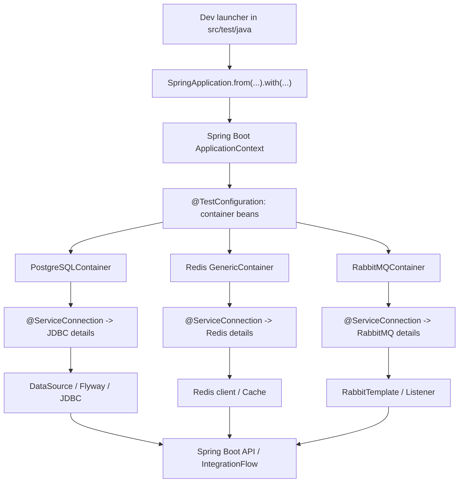
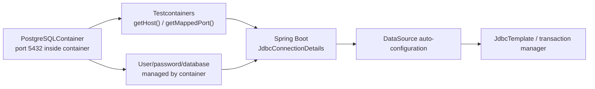

# Running Testcontainers Alongside the Application in Development Mode

## 1. Context: Running Spring Boot with Real Integration Services While Coding

A Spring Boot integration application cannot operate meaningfully by starting the JVM alone. It also needs PostgreSQL to store orders and the outbox, Redis for caching or ephemeral state, RabbitMQ/Kafka to send and receive messages, and sometimes an HTTP partner mock. If each developer installs these components directly on their machine, versions and data state quickly diverge: one uses PostgreSQL 14, another 16; manually created passwords, ports, and exchanges fail to match.

**Testcontainers** is a Java library using a Docker-compatible runtime to launch dependent containers programmatically. Although most often mentioned for integration tests, since Spring Boot 3.1, Spring Boot supports **development-time Testcontainers**: keeping container configuration in the test source set while launching it **alongside a running application for local development**, without requiring a JUnit test execution.

For example, a developer needs to launch the `order-integration` API inside their IDE and call `POST /orders`. Testcontainers can provision PostgreSQL, Redis, and RabbitMQ for that exact Spring Boot process. Connections flow into auto-configuration via `@ServiceConnection`, eliminating hardcoded dynamic Docker ports.

The lesson **"Running Testcontainers Alongside the Application in Development Mode"** belongs to the **Development Services** chapter of the `SPRING_BOOT_INTEGRATION` module. Within this module, containers help exercise HTTP clients, databases, caches, brokers, and Spring Integration adapters alongside real-world requirements for configuration, schema migrations, transactions, retries, idempotency, testing, and observability.

**Objective:** organize Testcontainers config outside production code, build a dev launcher, apply `@ServiceConnection` to the right service types, manage lifecycles and data, and recognize limits across environments.

## 2. Understanding "Running Alongside the Application"

Distinguish three models:

| Model | Where does the app run? | Who manages containers? | Purpose |
| --- | --- | --- | --- |
| **Integration test** | Test `ApplicationContext` or process during test run | Testcontainers/JUnit/Spring test context | Verify business behavior then end test |
| **Development-time Testcontainers** | Spring Boot runs as a live application for coding, debugging, and calling APIs | Testcontainers via dev configuration loaded by Spring Boot | Keep real databases/brokers running throughout a dev session |
| **Docker Compose development services** | Typically Spring Boot on host, Compose running dependencies | Docker Compose with Spring Boot support | Use a single Compose file declaring local services |

What distinguishes development-time Testcontainers is that developers launch **a dedicated main class for development** that registers container beans into the application context before the app uses datasources, caches, or brokers. With compatible Spring Boot support, containers start, connection parameters are supplied, and the application runs normally.



This remains **a real Spring Boot application**; it does not magically become production. Real controllers, services, message listeners, transaction managers, and `IntegrationFlow`s execute inside the main application context. Only the container definitions and development entry point are kept separate.

## 3. Prerequisites and Version Scope

The pattern here targets Spring Boot 3.x with `spring-boot-testcontainers` and compatible Testcontainers support. Certain classes, packages, Maven/Gradle artifacts, or lifecycle behaviors may change across major versions; verify versions managed by your project's Spring Boot dependency management before adopting.

Prerequisites:

1. JDK and Spring Boot version supported by the project.
2. Running Docker Engine or compatible container runtime with CLI/daemon permissions ready.
3. Testcontainers Java and container modules for each dependency type.
4. `spring-boot-testcontainers` for `@ServiceConnection` integration.
5. Application dependencies such as JDBC driver, Spring Data Redis, Spring AMQP, or Spring Kafka depending on services actually used.
6. Registry pull permissions, network connectivity to registries, and enough machine resources for containers.
7. A dev configuration isolated from production, keeping real secrets out of test images.

Never treat Testcontainers as a way to bypass authentication or security models. Even locally, containers still need appropriate ports, accounts, data hygiene, and load limits suited for developer machines.

## 4. Project Structure: Keeping Dev Configuration in the Test Source Set

A clean layout:

```text
order-integration/
├── pom.xml
├── src/
│   ├── main/
│   │   ├── java/com/example/integration/
│   │   │   ├── OrderIntegrationApplication.java
│   │   │   ├── order/...
│   │   │   └── messaging/...
│   │   └── resources/
│   │       ├── application.yml
│   │       └── application-local.yml
│   └── test/
│       └── java/com/example/integration/
│           ├── LocalContainersConfiguration.java
│           ├── LocalOrderIntegrationApplication.java
│           └── OrderRepositoryIntegrationTest.java
```

In this layout:

- `OrderIntegrationApplication` is the **primary main class** built/deployed to production.
- `LocalContainersConfiguration` defines development containers.
- `LocalOrderIntegrationApplication` is the **dev main class** launching the real application together with Testcontainers beans.
- Integration tests can reuse/import container configuration when appropriate, without assuming identical lifecycles or shared state.
- Classes in the test source set and test-scoped dependencies are normally **excluded from production artifacts**. This creates a crucial boundary so production never depends on a Docker daemon.

Never put `LocalOrderIntegrationApplication` under `src/main/java` if your goal is keeping development dependencies and behavior out of production. Likewise, ensure a dev `@TestConfiguration` holding passwords and internal registry names cannot accidentally be scanned/imported into production.

## 5. Declaring Dependencies: Separating Application and Development Tools

### 5.1. Maven with Spring Boot Dependency Management

Assuming the app genuinely uses PostgreSQL, Redis, and RabbitMQ:

```xml
<!-- Business dependencies required at application runtime -->
<dependency>
    <groupId>org.springframework.boot</groupId>
    <artifactId>spring-boot-starter-jdbc</artifactId>
</dependency>
<dependency>
    <groupId>org.postgresql</groupId>
    <artifactId>postgresql</artifactId>
    <scope>runtime</scope>
</dependency>
<dependency>
    <groupId>org.springframework.boot</groupId>
    <artifactId>spring-boot-starter-data-redis</artifactId>
</dependency>
<dependency>
    <groupId>org.springframework.boot</groupId>
    <artifactId>spring-boot-starter-amqp</artifactId>
</dependency>

<!-- Strictly for dev/test classpath -->
<dependency>
    <groupId>org.springframework.boot</groupId>
    <artifactId>spring-boot-testcontainers</artifactId>
    <scope>test</scope>
</dependency>
<dependency>
    <groupId>org.testcontainers</groupId>
    <artifactId>postgresql</artifactId>
    <scope>test</scope>
</dependency>
<dependency>
    <groupId>org.testcontainers</groupId>
    <artifactId>rabbitmq</artifactId>
    <scope>test</scope>
</dependency>
<dependency>
    <groupId>org.testcontainers</groupId>
    <artifactId>junit-jupiter</artifactId>
    <scope>test</scope>
</dependency>
```

This example targets Spring Boot/Testcontainers releases compatible with these module coordinates. On newer Testcontainers major releases, artifact names may change; never mix modules from mismatched major versions. Let Boot dependency management or the project-approved BOM manage versions and inspect the dependency tree if issues arise.

For Redis using `GenericContainer`, the core Testcontainers module arrives transitively via appropriate dependencies. Never add RabbitMQ, PostgreSQL, or Redis starters if the app does not actually use those technologies.

### 5.2. Gradle

Equivalent setup with Gradle Kotlin DSL:

```kotlin
dependencies {
    implementation("org.springframework.boot:spring-boot-starter-jdbc")
    runtimeOnly("org.postgresql:postgresql")
    implementation("org.springframework.boot:spring-boot-starter-data-redis")
    implementation("org.springframework.boot:spring-boot-starter-amqp")

    testImplementation("org.springframework.boot:spring-boot-testcontainers")
    testImplementation("org.testcontainers:postgresql")
    testImplementation("org.testcontainers:rabbitmq")
    testImplementation("org.testcontainers:junit-jupiter")
    testImplementation("org.springframework.boot:spring-boot-starter-test")
}
```

This assumes the Gradle project applies the Spring Boot plugin and proper version management. With `testImplementation`, the dev main class must execute on the **test runtime classpath**, not a classpath containing only `src/main`.

## 6. Creating Testcontainers Configuration for Three Integration Dependencies

A `@TestConfiguration` class supplies containers as Spring beans.

```java
package com.example.integration;

import org.springframework.boot.test.context.TestConfiguration;
import org.springframework.boot.testcontainers.service.connection.ServiceConnection;
import org.springframework.context.annotation.Bean;
import org.testcontainers.containers.GenericContainer;
import org.testcontainers.containers.PostgreSQLContainer;
import org.testcontainers.containers.RabbitMQContainer;
import org.testcontainers.utility.DockerImageName;

@TestConfiguration(proxyBeanMethods = false)
public class LocalContainersConfiguration {

    @Bean
    @ServiceConnection
    PostgreSQLContainer<?> postgresContainer() {
        return new PostgreSQLContainer<>("postgres:16-alpine")
                .withDatabaseName("orders_dev")
                .withUsername("orders_dev")
                .withPassword("local_only_password");
    }

    @Bean
    @ServiceConnection(name = "redis")
    GenericContainer<?> redisContainer() {
        return new GenericContainer<>(
                DockerImageName.parse("redis:7-alpine"))
                .withExposedPorts(6379);
    }

    @Bean
    @ServiceConnection
    RabbitMQContainer rabbitContainer() {
        return new RabbitMQContainer("rabbitmq:3-management");
    }
}
```

Three key aspects:

1. `@Bean`: each container is a bean managed by Spring Boot in matching dev/test contexts, enabling startup and shutdown alongside the app lifecycle.
2. `@ServiceConnection`: Spring Boot locates the matching `ContainerConnectionDetailsFactory` to supply connection parameters to auto-configuration.
3. **Container type and image name:** `PostgreSQLContainer`/`RabbitMQContainer` carry explicit type metadata; `GenericContainer<?>` does not say it runs Redis, hence `name = "redis"` is needed.

`withExposedPorts(6379)` makes Testcontainers publish Redis's port to a dynamically allocated host port. Never hardcode `localhost:6379` in app config unless explicitly controlling host ports.

In production, accounts/passwords must never be hardcoded as shown. For dev containers, simple dummy values keep examples clear; if a project handles sensitive datasets or runs on shared machines, use dedicated credentials and protect data without copying from production.

### 6.1. Why Not Put `@Container` on Each `@Bean`?

`@Container` is an annotation for lifecycle integration with the **JUnit Jupiter Testcontainers extension** when placed on test fields. In the **bean-based** model above, Spring Boot handles container beans while `@ServiceConnection` declares connectivity. Do not put `@Container` on `@Bean` methods.

Contrast with a test like:

```java
@Testcontainers
@SpringBootTest
class SomeIntegrationTest {
    @Container
    @ServiceConnection
    static PostgreSQLContainer<?> database =
            new PostgreSQLContainer<>("postgres:16-alpine");
}
```

Both models are valuable yet carry different lifecycle owners. Never mix annotations carelessly so two frameworks try to start/stop the same container with unclear ownership.

## 7. Creating a Dev Launcher Running the Real App with Container Beans

In `src/test/java/com/example/integration/LocalOrderIntegrationApplication.java`:

```java
package com.example.integration;

import org.springframework.boot.SpringApplication;

public class LocalOrderIntegrationApplication {

    public static void main(String[] args) {
        SpringApplication.from(OrderIntegrationApplication::main)
                .with(LocalContainersConfiguration.class)
                .run(args);
    }
}
```

`OrderIntegrationApplication` is the production main class:

```java
package com.example.integration;

import org.springframework.boot.SpringApplication;
import org.springframework.boot.autoconfigure.SpringBootApplication;

@SpringBootApplication
public class OrderIntegrationApplication {

    public static void main(String[] args) {
        SpringApplication.run(OrderIntegrationApplication.class, args);
    }
}
```

The key mechanism is `SpringApplication.from(...).with(...).run(args)`, which **attaches Testcontainers configuration to the live application** when launched through the dev entry point.

`@TestConfiguration` is skipped by ordinary production component scanning. Calling `with(LocalContainersConfiguration.class)` brings the container config into the application context intentionally, lowering the risk of accidentally triggering Docker when running the production main class.

This pattern **does not execute a JUnit test**: developers can keep the app running, call REST APIs, set breakpoints inside services or listeners, and inspect databases/brokers until ending the session.

## 8. Running via IDE, Maven, and Gradle

### 8.1. IDE: The Most Direct Path

Common steps:

1. Start Docker Engine or a configured Testcontainers runtime.
2. Ensure the project resolves test dependencies and compiles `src/test/java`.
3. Create a Run Configuration for `LocalOrderIntegrationApplication` using the module's **test classpath**.
4. Set active profile `local`, e.g., program argument `--spring.profiles.active=local`.
5. Run and inspect Testcontainers/Spring Boot logs to confirm containers started and `ApplicationContext` became ready.
6. Call APIs or publish messages from local tools, setting breakpoints to inspect transactions, retries, and `IntegrationFlow`.
7. Stop the app cleanly via normal shutdown; confirm container lifecycles and data cleanup/retention match expectations.

If the IDE reports `org.testcontainers...` or `@ServiceConnection` missing, the run configuration likely lacks the **test runtime classpath** or dependencies failed to import cleanly.

### 8.2. Maven: `test-run` Support Where Provided by the Plugin

In Spring Boot Maven plugin versions supporting dev-time Testcontainers, the `spring-boot:test-run` goal runs using the test classpath and matching main class. Example:

```bash
./mvnw spring-boot:test-run -Dspring-boot.run.profiles=local
```

If multiple main classes exist, configure the dev main class via your plugin version's main-class setting. Never assume the plugin picks `LocalOrderIntegrationApplication` automatically just because it lives under `src/test`.

The standard `spring-boot:run` goal builds a different classpath than `test-run`; without test scope present, container configuration will not be found.

### 8.3. Gradle: Task Running with the Test Classpath

Spring Boot Gradle plugin releases supporting dev-time Testcontainers provide the `bootTestRun` task. Example:

```bash
./gradlew bootTestRun --args='--spring.profiles.active=local'
```

As with Maven, configure the dev main class explicitly on the task if multiple entry points exist and the plugin doesn't resolve it automatically. If your project lacks that task, inspect plugin versions and available tasks rather than assuming task names apply universally across all Boot releases.

**Golden rule:** run the Testcontainers entry point **on the test classpath**. Never move container dependencies to `implementation` just to make a launcher run from the production JAR.

## 9. ServiceConnection: How Connection Parameters Reach Spring Boot

Started containers usually receive **dynamic host ports**. For example, PostgreSQL listens on 5432 inside the container while Docker publishes port 32791 on the developer machine—and that number changes every run.

Avoid hardcoding:

```yaml
spring:
  datasource:
    url: jdbc:postgresql://localhost:5432/orders_dev
```

and instead let the `@ServiceConnection`-annotated container supply connection details to `DataSource`.

### 9.1. Information Flow



For supported services, Spring Boot consumes container-supplied `ConnectionDetails` instead of asking developers to copy host, mapped port, username, and password into YAML. Those connection details beans still require matching **starters/drivers and auto-configuration**; they do not automatically create business schemas or tables.

Beyond `JdbcConnectionDetails`, integrations can generate connection details for Redis, RabbitMQ, Kafka, or matching drivers when your Boot/extension version includes supporting factories. Factory lists evolve across releases; verify in your actual environment and never assume every `GenericContainer` is auto-recognized.

### 9.2. Precedence of ConnectionDetails Over Traditional Properties

When auto-configuration receives a `ConnectionDetails` bean, it can use those values instead of `spring.datasource.url`, `spring.data.redis.host`, or matching properties.

Therefore separate two questions:

- What property value does Spring `Environment` currently hold?
- Which `ConnectionDetails` does `DataSource`/`RedisConnectionFactory`/`RabbitConnectionFactory` **actually consume**?

When both config sources exist, printing a property value is insufficient to tell which server the app connects to. Check the auto-configuration report, redacted logs, and execute a verification query/command over the real connection.

### 9.3. Why Does GenericContainer Need a Name?

Example:

```java
@Bean
@ServiceConnection(name = "redis")
GenericContainer<?> redisContainer() {
    return new GenericContainer<>("redis:7-alpine")
            .withExposedPorts(6379);
}
```

The method return type is `GenericContainer<?>`, so Spring Boot cannot tell which service it represents from the type alone. `name = "redis"` is metadata helping the factory select compatible wiring. It **does not alter container DNS, ports, or protocols**. The container must still run genuine Redis on the port and auth expected by the connection factory.

If a container is an HTTP mock server lacking a matching `ConnectionDetailsFactory`, slapping a bogus `redis` or `postgres` name on it is wrong. Configure a dedicated base URL property or controlled custom integration instead.

## 10. Custom Images and Differences Between Testcontainers and Compose

An organization may require developers to pull PostgreSQL images from a private registry:

```text
registry.example.com/team/postgres-internal:16
```

With `PostgreSQLContainer`, Testcontainers may need to be told that the image is compatible with the module's standard image:

```java
import org.testcontainers.containers.PostgreSQLContainer;
import org.testcontainers.utility.DockerImageName;

DockerImageName image = DockerImageName
        .parse("registry.example.com/team/postgres-internal:16")
        .asCompatibleSubstituteFor("postgres");

PostgreSQLContainer<?> postgres =
        new PostgreSQLContainer<>(image)
                .withDatabaseName("orders_dev");
```

`asCompatibleSubstituteFor("postgres")` is a compatibility declaration **for Testcontainers**. It does not prove identical entrypoints, healthchecks, or protocol versions; verify actual startup and JDBC queries.

Contrast with Docker Compose:

| Mechanism | How declared |
| --- | --- |
| Testcontainers with `PostgreSQLContainer` subclass | `DockerImageName.asCompatibleSubstituteFor("postgres")` when needed |
| Spring Boot Testcontainers with `GenericContainer` | `@ServiceConnection(name = "redis")` to indicate service type |
| Spring Boot Docker Compose support | Label `org.springframework.boot.service-connection: postgres` on custom-image services |

These three mechanisms operate at **three different points**: image acceptance in Testcontainers modules, container type recognition for connection details, and Compose service recognition. They are not interchangeable.

## 11. Separating Dev Profiles from Production Configuration

Placing containers under `src/test` is one layer of defense, yet insufficient on its own. Running locally also involves HTTP endpoints, mock API keys, topic names, schedulers, and message-publishing flags that must be configured explicitly.

Example `application-local.yml`:

```yaml
spring:
  config:
    activate:
      on-profile: local

  docker:
    compose:
      enabled: false

  flyway:
    enabled: true

integration:
  partner:
    base-url: http://localhost:18080
    connect-timeout: 2s
    read-timeout: 5s
  messaging:
    enabled: true
```

Here `spring.docker.compose.enabled=false` prevents Boot from simultaneously managing Compose services while the dev launcher uses Testcontainers. Using both is not always wrong, yet **never launch duplicate PostgreSQL or Redis instances with unclear `ConnectionDetails` selection**.

`application-prod.yml`:

```yaml
spring:
  docker:
    compose:
      enabled: false

integration:
  partner:
    base-url: ${PARTNER_BASE_URL}
```

Production must use endpoints and credentials provisioned by production infrastructure—never dev containers, localhost, mock partner endpoints, or sample passwords. Validate hosts, HTTPS schemes, namespaces, broker auth, and TLS at startup so mismatched profiles fail fast.

**Never** rely on `@TestConfiguration` to override a real partner URL if the app still loads `application-prod.yml` due to the wrong active profile. The dev launcher should activate the dev profile explicitly and verify against stub/localhost endpoints.

## 12. PostgreSQL: Migrations, Transactions, and Sample Data

`PostgreSQLContainer` gives you a **running PostgreSQL server**, not pre-built business tables. When the application uses Flyway/Liquibase, migrations must execute against the Testcontainers `DataSource` before repositories or listeners operate.

Reference local configuration:

```yaml
spring:
  flyway:
    enabled: true

  sql:
    init:
      mode: never

  jpa:
    hibernate:
      ddl-auto: validate
```

The `jpa` section applies only if the project uses JPA; omit it for plain JDBC apps. If the team chooses Liquibase, make Liquibase the sole migration source; avoid running both Flyway and Liquibase against the same schema without strict coordination.

Goals to verify when the dev app starts:

1. `DataSource` connects to the fresh container, not a host-installed database.
2. Migrations create `orders`, `outbox_event`, `processed_event`, or matching schema.
3. DB transactions and row-level constraints match production behavior on critical paths.
4. Duplicate event IDs are rejected via unique constraints/idempotency.
5. Transactions roll back cleanly when a processing step fails.
6. Database reset/data persistence has clear policy; never assume restarting the app always preserves data.

Example idempotency guard table:

```sql
CREATE TABLE processed_event (
    consumer_name VARCHAR(120) NOT NULL,
    event_id VARCHAR(120) NOT NULL,
    processed_at TIMESTAMPTZ NOT NULL DEFAULT CURRENT_TIMESTAMP,
    PRIMARY KEY (consumer_name, event_id)
);
```

When a consumer updates business tables and inserts into `processed_event`, both operations must share the same transaction. Testcontainers supplies a real DB environment; it does not enforce cross-system consistency across DB, HTTP, and brokers.

### 12.1. Seeding Dev Data

Seed data via dev-specific migrations, scripts, APIs, or a dev-profile bean. Keep seeding **idempotent** so restarts do not insert duplicate orders unintentionally.

Some teams want a clean scenario on every run; others need to retain DB state for a few hours while debugging. Choose explicitly:

- **Ephemeral data:** each container lifecycle starts fresh, ideal for testing and baseline verification.
- **Intentionally retained data:** use well-understood volume/reuse mechanisms with dev-only reset/backup policies.

Never enable container reuse by default in CI, as stale test data can skew subsequent runs.

## 13. Redis: Dynamic Port Mapping and Cache Testing

Redis can use `GenericContainer` with `@ServiceConnection(name = "redis")` when supported by your Spring Boot factory. Verify in practice that `RedisConnectionFactory` connects to the right host/mapped port.

A local verification probe:

```java
import org.springframework.data.redis.core.StringRedisTemplate;

@Service
public class CacheProbeService {
    private final StringRedisTemplate redis;

    public CacheProbeService(StringRedisTemplate redis) {
        this.redis = redis;
    }

    public void verifyLocalCache() {
        redis.opsForValue().set("dev:healthcheck", "ok");
        String value = redis.opsForValue().get("dev:healthcheck");
        if (!"ok".equals(value)) {
            throw new IllegalStateException("Redis round-trip failed");
        }
    }
}
```

This snippet requires importing `org.springframework.stereotype.Service`. In production, never run unbounded write probes on every health request; use appropriate readiness/health endpoints.

When the app uses Redis for TTL caches, distributed locks, or idempotency, do not stop at asserting "`PING` succeeds." Verify TTLs, serialization, key namespaces, and behavior when Redis is unavailable. Local Redis containers often lack production auth/TLS; track and test those differences separately.

## 14. RabbitMQ: Topology, Consumers, and Real Failure Cases

`RabbitMQContainer` provides a compatible broker for `RabbitTemplate`, `@RabbitListener`, or Spring Integration AMQP adapters. However:

- Queues, exchanges, routing keys, and bindings must be declared by the app or provisioning scripts per contract.
- Dead-letter exchanges/queues and retry topology do not appear just because `RabbitMQContainer` started.
- Consumer counts, prefetch, acknowledgment mode, requeueing, and retries remain application responsibilities.
- Consumers can begin pulling messages as soon as the app starts; coordinate seed/test messages with migrations and readiness.
- Messages published during debugging create real side effects in the dev database; maintain idempotency and safe dev-data cleanup.

Example topology:

```text
orders.exchange -- routingKey=orders.created --> orders.created.queue
                                                 |
                                                 +--> @RabbitListener
                                                       |
                                                       +--> DB update/outbox
                                                       +--> ack after handling
                                                 |
                                                 +--> DLX when rejected per policy
```

A valuable local verification flow:

1. Publish an `OrderCreated(eventId=evt-101)` event.
2. Confirm the consumer writes the DB and acks.
3. Republish the same event ID; verify no duplicate DB writes occur.
4. Simulate a handler failure before commit; verify retry/DLQ per config.
5. Simulate a handler committing then losing broker connectivity before ack; verify redelivery is harmless thanks to idempotency.

One local dev launcher can run both the REST API and listeners. While convenient for debugging, remember listeners stay active continuously even when you are not calling APIs.

## 15. Kafka or Other Brokers: Using Specialized Containers When Needed

You do not always need RabbitMQ. For Kafka-integrated apps, use the matching container module to obtain valid bootstrap servers and apply `@ServiceConnection`.

Configuration sketch for a specialized Kafka container depending on version:

```java
// Exact Kafka container type depends on Testcontainers version.
// Example using KafkaContainer on Testcontainers releases supporting it.

@Bean
@ServiceConnection
KafkaContainer kafkaContainer() {
    return new KafkaContainer(
            DockerImageName.parse("confluentinc/cp-kafka:<compatible-version>"));
}
```

This is a **sketch with a version placeholder**, not copy-paste runnable code. Major Testcontainers releases may alter packages/classes and supported images; for instance, some versions provide `org.testcontainers.kafka.ConfluentKafkaContainer` or other Kafka container types. Align class, image, and artifact to one release and ensure broker listeners are configured properly by Testcontainers.

Never point Kafka at `localhost:9092` when containers use dynamic ports or different advertised listeners. Service connections on specialized container types normally handle supplying valid host-reachable bootstrap servers.

For JMS, other PostgreSQL-compatible DBs, MongoDB, or Pulsar, look up container modules and connection-details factories supported by your project's Spring Boot version. When automatic support is absent, configure connections manually with clear control; never slap the wrong `@ServiceConnection` name on a container to force Spring into building a factory.

## 16. HTTP Mock Services: Not Every Container Generates ConnectionDetails

An app may need a partner HTTP mock to avoid calling live external services from developer laptops. For example, running a mock server via Testcontainers:

```java
@Bean
GenericContainer<?> partnerMockContainer() {
    return new GenericContainer<>(
            DockerImageName.parse("mockserver/mockserver:5.15.0"))
            .withExposedPorts(1080);
}
```

Declaring this container bean **does not mean Spring Boot auto-supplies** a `PartnerHttpConnectionDetails` bean. For custom services, decide how to obtain host/mapped port and populate `integration.partner.base-url`:

- For dynamic URLs, provide a client config bean or custom connection details reading from the container **after startup**, then inject it into the HTTP adapter.
- When testing APIs against a fixed local stub, configure a dedicated property and manage that endpoint under a controlled profile.
- When using WireMock/MockServer in tests, use their dedicated extensions/APIs to fetch endpoints; avoid mixing test extensions carelessly with bean-based dev containers.
- Never read `getMappedPort(1080)` before the container has started; Testcontainers has no mapped port yet.

An interface can model the partner endpoint:

```java
public interface PartnerEndpointProvider {
    URI baseUri();
}
```

In the dev context, an implementation reads `GenericContainer.getHost()` and `getMappedPort(1080)` once running; in production, an implementation reads validated configuration. Extracting an interface keeps Testcontainers dependencies out of `src/main`.

Note `URI` refers to `java.net.URI`; the snippet shows only the interface contract without bean implementations so it does not assume any single startup/initialization order.

## 17. Container Lifecycle, Data, and Stop/Start Behavior

A key point when running Testcontainers alongside the app is **lifecycle**.

```text
IDE starts dev launcher
    -> Spring Boot creates context and container beans
    -> Testcontainers starts PostgreSQL/Redis/RabbitMQ
    -> Spring Boot receives ConnectionDetails
    -> DB migrations, message listeners, REST API ready
    -> Developer debugs and interacts
IDE stops / application shuts down
    -> Context shutdown
    -> Container beans stopped/cleaned up per integrated lifecycle
```

Exact timing depends on container bean lifecycles and Spring Boot versions; if developers start/stop containers outside Boot's mechanism, verify resource cleanup manually.

### 17.1. Restarting the App Often Does Not Preserve Data

In default Testcontainers setups, containers are created fresh and destroyed when the lifecycle ends, so the database starts empty on the next run. Never rely on prior state without an intentionally controlled persistence/reuse setup.

Ephemerality benefits debugging and testing:

- Easy to reproduce bugs against clean data.
- Each developer avoids colliding with another's local database.
- Migrations are exercised regularly from an empty schema.
- Bugs that "only hide behind a DB installed last year" surface quickly.

When tracking a transaction across multiple restarts, create repeatable fixtures/seeds or a local-only retention policy instead of haphazardly reusing containers with unknown state.

### 17.2. Container Reuse: Choose Very Cautiously

Testcontainers supports container reuse in certain versions/configs. Enabling reuse typically requires explicit opt-in on developer machines and leaves state intact beyond regular test lifecycles.

**Never enable reuse by default in CI or isolation-critical tests.** If the team permits reuse for local debugging, document how to reset data, consequences of schema migrations changing, volume access controls, and cleaning up stale containers. Never allow production apps to accidentally connect to a reused container on a developer laptop.

### 17.3. Testcontainers Resource Cleanup

Testcontainers uses Docker resource tracking/cleanup mechanisms depending on version and config, sometimes launching auxiliary cleanup helpers. Do not disable cleanup blindly just because you spot an extra helper container without understanding the impact. If an IDE is force-killed or power drops, inspect for leftover containers and clean up your local environment safely.

## 18. Comparing Development-Time Testcontainers and Docker Compose

| Criterion | Dev-time Testcontainers | Docker Compose support |
| --- | --- | --- |
| Where defined | Java container beans in `src/test` | `compose.yaml` file |
| How launched | Dev launcher on test classpath | Spring Boot/Compose CLI with matching dependency |
| Image versions | Java `DockerImageName` and modules | `image:` in Compose |
| Host ports | Typically allocated dynamically | Fixed or dynamic per `ports` |
| Service connection | `@ServiceConnection` and container factories | Image name or `org.springframework.boot.service-connection` label |
| Lifecycle | Coordinated by Boot and Testcontainers bean lifecycle | Compose start/stop/`lifecycle-management` config |
| Isolation | Easy fresh environments per session/test | Convenient for keeping long-lived local services |
| Reusing config in tests | Import `@TestConfiguration` | Requires deliberate choice to allow Compose in tests |
| Inspection via Docker CLI | Yes | Yes |
| Complex topology authoring | Depends on Java code/fixtures | Often concise inside Compose YAML |
| Main risks | Missing Docker, dynamic ports, slow startup, stale lifecycle state | Port collisions, local data drift, unclear profiles/volumes |

Some projects use Compose locally and Testcontainers for integration tests; others use Testcontainers for both to share container config. **Avoid running both simultaneously in the same dev session** unless explicitly required with unambiguous service connection ownership.

## 19. Networking, Ports, and Local Environment Security

### 19.1. Dynamic Host Ports

With Testcontainers, a PostgreSQL container listening on 5432 inside its network gets published on an arbitrary host port. Testcontainers exposes:

```java
String host = postgresContainer.getHost();
int hostPort = postgresContainer.getMappedPort(5432);
```

Call these only after the container has started. `host` is not always `localhost`, particularly with remote Docker or CI setups. JDBC service connections know how to resolve the right host/port, so never replace them with fixed values in YAML.

### 19.2. Never Grant Excessive Docker Privileges

The Docker daemon is a high-privilege surface. Granting developers or CI access to the Docker socket must follow organizational security policy. Never mount `/var/run/docker.sock` or run privileged application containers just to run Testcontainers without a thorough risk review.

When running on shared hosts or remote dev environments, inspect networking, port exposure, and image registry access. Testcontainers is not a complete security boundary for real sensitive data.

### 19.3. Keeping Dev Credentials Out of Production

Hardcoded passwords in this lesson are strictly for isolated dev examples. In real codebases:

- Never put production secrets in `src/test` or Git.
- Never print raw connection strings containing passwords to logs.
- Never mount directories holding real tokens/certs into untrusted containers.
- Never allow dev launchers to call live production payment or email endpoints.
- If mTLS/credentials are needed for testing, use short-lived, low-privilege test certificates and accounts.
- Never feed real customer payloads into unprotected dev topics, queues, or databases.

## 20. Reusing Configuration in `@SpringBootTest`

One benefit of `@TestConfiguration` is importing the same container definitions into tests, provided you understand test lifecycles:

```java
package com.example.integration;

import org.junit.jupiter.api.Test;
import org.springframework.beans.factory.annotation.Autowired;
import org.springframework.boot.test.context.SpringBootTest;
import org.springframework.context.annotation.Import;
import org.springframework.jdbc.core.JdbcTemplate;

@SpringBootTest
@Import(LocalContainersConfiguration.class)
class OrderRepositoryIntegrationTest {

    @Autowired
    JdbcTemplate jdbcTemplate;

    @Test
    void databaseIsReadyAndMigrated() {
        Integer count = jdbcTemplate.queryForObject(
                "SELECT COUNT(*) FROM processed_event", Integer.class);
        if (count == null) {
            throw new AssertionError("Expected a count from database");
        }
    }
}
```

Here, `processed_event` must already be created by migrations. That query only checks basic JDBC connectivity and schema presence; meaningful integration tests also insert data and verify unique constraints and transactions.

**Important distinction:** running the dev launcher keeps the app alive for manual interaction; `@SpringBootTest` executes automated assertions within test context lifecycles. You can import the same `@TestConfiguration`, yet never assume DB state from a test persists into a dev session or vice versa.

To speed up test suites, design valid context caching/container lifecycle strategies; container reuse or singletons must never introduce test-order dependencies or stale-data leaks.

### 20.1. How `@ServiceConnection` on Fields vs. Beans Differs

Two common patterns:

```java
// Fits test classes using the JUnit extension:
@Container
@ServiceConnection
static PostgreSQLContainer<?> postgres =
        new PostgreSQLContainer<>("postgres:16-alpine");
```

and:

```java
// Fits dev-time config imported into a Spring context:
@Bean
@ServiceConnection
PostgreSQLContainer<?> postgresContainer() {
    return new PostgreSQLContainer<>("postgres:16-alpine");
}
```

The field pattern delegates lifecycle to the JUnit/Testcontainers extension in tests; the bean pattern is managed by Spring Boot. Pick one primary lifecycle owner per container to avoid launching duplicate PostgreSQL containers where the app connects to the unintended one.

## 21. Troubleshooting: Application Cannot Connect When Running Dev Launcher

| Symptom | Common cause | What to check |
| --- | --- | --- |
| `Could not find a valid Docker environment` | Docker Engine stopped, daemon permissions, or incompatible runtime | Check Docker/daemon, permissions, and Testcontainers config |
| `NoClassDefFoundError: ...Testcontainers` | Dev main launched on main classpath | Select test classpath or matching `test-run` goal/task |
| App starts without starting containers | Dev main didn't load `LocalContainersConfiguration` | Check `SpringApplication.from(...).with(...)`, classpath, and beans |
| Container starts yet `DataSource` is missing | Missing JDBC starter/driver or `@ServiceConnection` lacks matching factory | Check auto-configuration, container type, and dependencies |
| Redis wrongly uses `localhost:6379` | Hardcoded host/port instead of consuming connection details | Check `@ServiceConnection(name="redis")` and connection factory |
| PostgreSQL auth fails | Container user/password or stale volume mismatches expectation | Inspect container config and initialization logs |
| Migrations run on wrong DB | Conflicting connection property or multiple connection details | Inspect actual `DataSource`, active profile, bean types, and migration setup |
| Rabbit listener receives no messages | Queues/exchanges/bindings undeclared | Check topology and consumer startup |
| Cannot pull Docker image | Private registry auth, network, bad tag, or rate limits | Check image reference and registry credentials |
| HTTP mock still calls live partner | `integration.partner.base-url` still holds production value | Check active profile and HTTP client endpoint |
| Unusually slow startup | Image pulls, DB/broker startup, migrations, and healthchecks | Analyze timestamped logs per stage |
| Restart loses data | Ephemeral containers | Re-seed or configure intentional reuse/persistence policy |
| Both Compose and Testcontainers active | Two connection details sources / duplicate services | Disable one mechanism or separate ownership cleanly |
| CI runs on agent without Docker | Testcontainers cannot start containers | Provide supported runtime or skip per policy; never fall back to prod |

Short diagnostic workflow:

1. Identify **which main class runs**: production main or local dev launcher?
2. Check active profiles and endpoint configuration sources.
3. Verify Docker daemon, image pulls, and container logs.
4. Confirm container beans and `@ServiceConnection` were loaded by Spring.
5. Verify required starters/drivers and auto-configuration are present.
6. Read host/mapped ports after container start and compare against real connections.
7. Verify migrations, broker topology, and seed data.
8. Trigger a verifiable end-to-end business action.
9. When needed, stop the dev session, clean up test containers, and restart from a clean state.

Never hide connection errors by pasting production usernames/passwords or shared DB URLs into `application-local.yml`.

## 22. Observability: What to Measure Beyond "Container Running"?

In real integration flows, running containers alone do not prove application health. Monitor:

- **Startup timings:** image pulls, container startup, readiness, migrations, and `ApplicationContext` ready.
- **Connection health:** `DataSource` queries, Redis round-trips, broker connections, and listener readiness.
- **Business flow:** orders persisted, outbox pending publish, messages consumed/acked, retries, and DLQs.
- **Latency & load:** HTTP client latency to mock partner, active connection pool usage, queue depth.
- **Error classification:** distinguish Docker startup failures, schema migration errors, protocol faults, and business errors.
- **Resource usage:** JVM heap, container CPU/RAM, leftover container count, disk/volume consumption.
- **Correlation:** request ID/event ID spanning REST → DB → broker → consumer → HTTP adapter.

Spring Boot Actuator and Micrometer enrich app-level telemetry, yet do not replace checking container health, broker topology, or transaction correctness. Never put raw sensitive payloads or high-cardinality event IDs into metric labels.

Docker tooling helps inspect container resources and logs **within authorized dev environments**, yet docs and CI reports must avoid exposing connection strings and secrets.

## 23. Capstone Scenario: Debugging an Order Flow on a Developer Machine

Suppose `order-integration` exposes `POST /orders`, an `IntegrationFlow` handles commands, PostgreSQL stores orders and outbox rows, RabbitMQ publishes `OrderCreated`, Redis caches status, and an outbound HTTP client calls a mock payment system.

### 23.1. Setup

1. Developer launches `LocalOrderIntegrationApplication` from the IDE on the test classpath with profile `local`.
2. `LocalContainersConfiguration` starts PostgreSQL, Redis, and RabbitMQ.
3. `@ServiceConnection` supplies connection details from containers; Spring Boot auto-configures JDBC/Redis/AMQP.
4. Flyway creates schemas and seed rows in the dev database.
5. RabbitMQ queues/exchanges/bindings are declared per project configuration.
6. The HTTP partner client points to the mock endpoint, never production.

### 23.2. Running a Fault-Injection Scenario

Simulate a request with `requestId=req-4711`:

```text
POST /orders
  -> validate order contract
  -> transaction insert orders + outbox
  -> outbox publishes OrderCreated to RabbitMQ
  -> consumer receives event
  -> Redis cache update
  -> HTTP mock partner returns 503 once, then 200
  -> retry policy applies
  -> idempotent consumer prevents duplicate DB side effects
```

Observations:

- Database holds exactly one order and the event ID is recorded in the dedupe table.
- Broker message is acked after durable processing or routed to recovery on failure.
- Retries avoid duplicating business operations when HTTP times out after the mock received the request.
- Cache reflects final state with contract-compliant TTL.
- Correlation ID links logs/traces end-to-end.
- Stopping and restarting the dev launcher re-verifies migrations/idempotency on a fresh DB (unless reuse is enabled).

### 23.3. What Testcontainers Does Not Solve Automatically

Testcontainers gives you **real backing services for development**, yet does not guarantee:

- Distributed transactions across PostgreSQL, broker, and HTTP.
- End-to-end exactly-once processing.
- Proper retries/DLQs without configuring listeners and broker topology.
- Schema compatibility against real external partners.
- Sample data covering every edge case.
- Production-identical authentication and networking.
- Turning manual debugging into automated integration tests with assertions.

Those guarantees still demand targeted tests, database constraints, outbox, idempotency keys, contract validation, resilience policies, and observability.

## 24. Common Mistakes

| Misconception/mistake | Consequence | Right understanding |
| --- | --- | --- |
| "Testcontainers only works inside `@Test`." | Misses convenient debuggable dev launchers | Can run alongside the app via Spring Boot dev-time setup |
| Putting container config in `src/main` | Risks pulling Docker dependencies into prod runtime | Keep under `src/test` and run on test classpath |
| Running prod main from IDE expecting Testcontainers | No containers get loaded | Run dev main using `with(LocalContainersConfiguration.class)` |
| Using `localhost:5432` in app config | Misses dynamic host port | Use `@ServiceConnection` or post-start mapped ports |
| Putting `@Container` on `@Bean` methods | Mixes JUnit and Spring lifecycles | Use bean-based lifecycle for dev-time runs |
| Putting `@ServiceConnection` on an HTTP mock lacking a factory | Fails to set base URL automatically | Provide dedicated property or endpoint provider |
| Forgetting `name = "redis"` on `GenericContainer` | Spring Boot cannot recognize the service | Explicitly specify a supported service type |
| Running both Compose and Testcontainers for the same DB | Creates conflicting details/DBs | Choose one clear owner per service |
| Using dev passwords identical to production | Credential leak risk | Separate secrets and profiles |
| Expecting DB state to survive every restart | Data wiped when container is ephemeral | Re-seed or configure intentional reuse |
| Turning on reuse by default in CI | Tests depend on stale state; flaky results | Prefer isolation and clean teardown |
| Checking only container healthy | Misses contract/transaction/retry bugs | Run end-to-end integration scenarios |
| Ignoring custom image compatibility | Container/module rejects image | Verify `DockerImageName` and actual runtime |
| Too many containers in one dev launcher | Slow, resource-heavy startup | Launch only services needed for the active workflow |

## 25. Checklist for Adopting Development-Time Testcontainers

- [ ] Spring Boot, JDK, Testcontainers modules, and Docker runtime versions are compatible.
- [ ] Container classes and dev launcher reside in test source set, excluded from production artifacts.
- [ ] Dev launcher loads the right `@TestConfiguration` via `SpringApplication.from(...).with(...)`.
- [ ] IDE/Maven/Gradle launches the right entry point on the **test runtime classpath**.
- [ ] Every service has a matching container type or `@ServiceConnection(name=...)`.
- [ ] No hardcoded host ports; values come from `ConnectionDetails` or real mapped ports.
- [ ] Custom images and private registry pull permissions are verified.
- [ ] Docker Compose and Testcontainers never ambiguously co-own the same dependency.
- [ ] Local profile carries no production endpoints/secrets; HTTP mocks are explicitly configured.
- [ ] DB migrations/seeds, Redis TTLs, broker topology, and auth are prepared accurately.
- [ ] CPU/RAM/container count budgets and cleanup/reuse rules are documented.
- [ ] Tests cover transactions, duplicates, retries/DLQs, and HTTP/DB/broker failures.
- [ ] Metrics/logs cover startup, readiness, connections, retries, and business outcomes.
- [ ] CI uses authorized Docker environments without relying on leftover dev state.
- [ ] A runbook explains resetting local data without harming unrelated databases/volumes.

**Conclusion:** development-time Testcontainers lets Spring Boot run against real PostgreSQL, Redis, RabbitMQ/Kafka, and dependencies the moment a developer starts the app in the IDE. Combining `@TestConfiguration`, `@ServiceConnection`, and a test-classpath dev launcher minimizes machine drift and makes debugging real integration flows practical. Still, you must deliberately manage versions, environments, lifecycles, migrations, data, permissions, and business verification—a running container is only the starting condition for a reliable integration.
