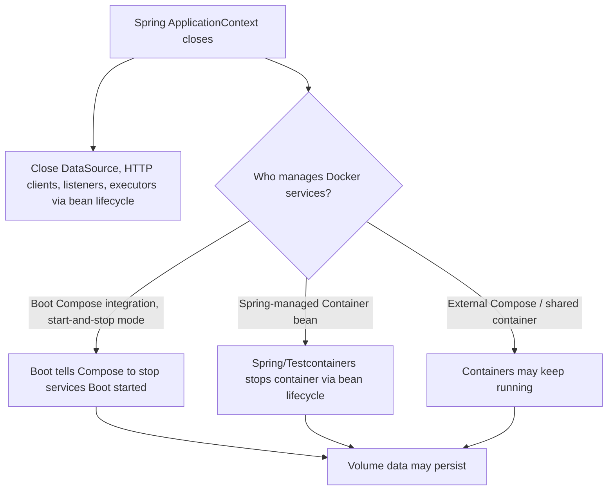
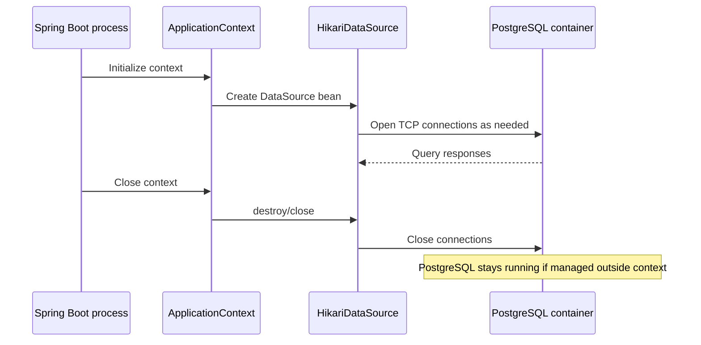
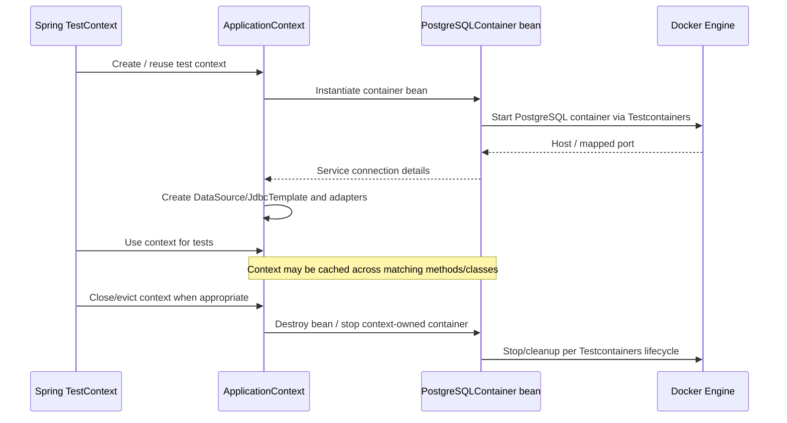
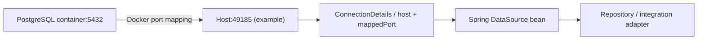
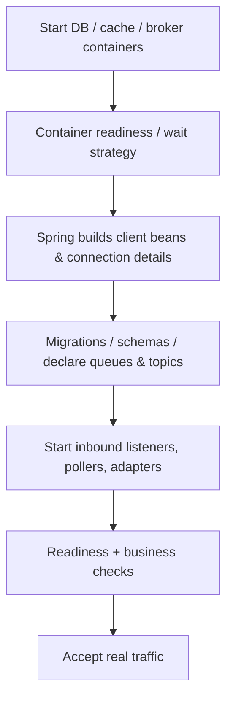

# Distinguishing Container Lifecycles from ApplicationContext Lifecycles

## 1. Why Are These Two Lifecycles Commonly Confused?

When developing a **Spring Boot** application, we frequently run PostgreSQL, Redis, RabbitMQ, Kafka, or a NoSQL store in Docker. The app connects to them via `DataSource`, HTTP clients, connection factories, or Spring Integration adapters. Everything can spin up from a single command, creating the illusion that **the Docker container** and **Spring's `ApplicationContext`** are one entity sharing a single lifecycle.

In reality, they manage completely different objects and resources:

- **A container** is a runtime unit managed by Docker/the container engine. It has its own OS process, network, filesystem, volumes, health status, and stop/remove policy.
- **`ApplicationContext`** is **Spring's** bean container: instantiating configuration, dependency injection, HTTP clients, `DataSource`, listeners, schedulers, adapters, and destroy callbacks on context close. The word "container" in Spring IoC is **not** a Docker container.
- **Data and out-of-process resources** can outlive both: Docker volumes, database schemas, broker topics, queues, object storage, and unprocessed messages.

This lesson belongs to the **Development Services** chapter of the **SPRING_BOOT_INTEGRATION** module, focusing on HTTP clients, databases, caches, brokers, and Spring Integration adapters. Separating these lifecycles prevents stale connection states, containers shutting down under active contexts, test data leaking across runs, and false conclusions about transactions, deduplication, or integration health.

After this lesson, you will be able to:

1. Identify who owns **starting/stopping** containers: the user, Boot's Docker Compose integration, Testcontainers/JUnit, or Spring's bean lifecycle.
2. Explain why `ApplicationContext` starting or closing **does not** always start or stop containers across every setup.
3. Use `@ServiceConnection` to pass development-service connection info into Spring Boot while keeping lifecycle ownership clear.
4. Recognize the effects of Spring `TestContext` caching, `@DirtiesContext`, DevTools restarts, and Testcontainers reuse.
5. Design clean testing, resource cleanup, and observability for HTTP → database/cache → broker flows.

## 2. Three Lifecycle Scopes to Separate

| Scope | Objects and owner | Common state transitions | What can survive after closing? |
|---|---|---|---|
| **Docker container** | Docker Engine, Compose project, Testcontainers, or ops script. | Created → Running → Stopped/Exited → Removed. | Images, volumes, and volume data; containers may still remain in `stopped` state. |
| **Spring `ApplicationContext`** | Spring Boot/Spring Framework and app or test context lifecycle. | Created → Refresh/Started → Ready → Closing/Closed. | Data committed in external services; emitted logs/traces; external containers not stopped by their owner. |
| **Integration state** | Database/broker/cache/adapters and business logic. | Accepted → Pending → Committed/Published/Failed per design. | Queues, durable records, dedupe keys, pending outbox entries, or downstream side effects. |

Example when a Spring Boot process exits:



The diagram depicts **specific configurations**; not every `@Bean` declaration or `docker compose up` invocation ties start/stop lifecycles to Spring.

## 3. What Does `ApplicationContext` Create and Destroy?

When Spring Boot starts, it builds `ApplicationContext`, loads config, registers beans, performs dependency injection, initializes conditional integrations, and starts lifecycle-aware components. An integration app may hold:

- `DataSource` and connection pools (e.g., HikariCP) pointing to PostgreSQL in Docker.
- `RedisConnectionFactory` and Redis clients pointing to a Redis container.
- `RabbitConnectionFactory` or Kafka clients pointing to broker containers.
- `RestClient`, `WebClient`, or HTTP adapters calling external services.
- `IntegrationFlow`, inbound adapters, message listener containers, pollers, schedulers, executors, and transaction managers.

When the context closes cleanly, Spring invokes matching lifecycle callbacks (such as `stop()` on lifecycle beans, `@PreDestroy`, or bean destroy methods). It closes **sockets, threads, consumers, and client pools**, yet does not automatically ask out-of-process PostgreSQL, Redis, or Kafka servers to shut down.

Example:



**Core insight:** "closing database connections" and "stopping the database container" are two separate events. A fresh context can reconnect to the same existing container/data, or to a brand-new container with different ports/credentials, depending on service management.

### A Managed Bean Does Not Equal a Managed Docker Container

A `@Bean RedisConnectionFactory` builds **a client connecting to Redis**; destroying that bean stops the client/resources. The Redis server inside Docker is not owned by that bean. Conversely, a bean typed `PostgreSQLContainer<?>` managed by Spring Boot's Testcontainers integration can directly trigger starting/stopping **a real container**, because that bean represents the Testcontainers container itself.

Never infer lifecycle behavior from the word "container" alone without checking whether the bean is a **client, adapter, listener**, or **Testcontainers container**.

## 4. Who Owns Start/Stop in Each Model?

| Model | Who starts the container? | Who usually stops the container? | Relationship to `ApplicationContext` |
|---|---|---|---|
| `docker run` or `docker compose up -d` run manually by dev | Developer/CI/infra script. | Developer/CI/infra script. | Context only connects; can restart multiple times while container runs continuously. |
| Spring Boot **Docker Compose support**, `start-and-stop` mode | Boot calls Compose at startup if services aren't already running per support rules. | Boot calls Compose stop on shutdown for services Boot started. | Compose lifecycle tracks **app lifecycle**, yet remains independent Docker processes. |
| Spring Boot Docker Compose `start-only` | Boot can start services when needed. | Boot does not stop them on exit. | Helpful for preserving services across multiple app restarts. |
| Spring Boot Docker Compose `none` | Boot does not manage start/stop. | External owner. | Can still leverage connection details without Boot controlling lifecycle; expects running services. |
| Testcontainers with JUnit `@Testcontainers` + `@Container` | JUnit Testcontainers extension. | Follows test class/instance lifecycle managed by the extension. | Test context has its own cache; container may stop while a cached context stays alive. |
| Testcontainers declared as `@Bean` in test config and Boot-managed | Spring Boot/Testcontainers lifecycle integration. | Tied to the matching bean/context lifecycle. | Ideal when the container should live as long as the test context. |
| Testcontainers started manually via `start()` | Code calling `start()` or another process. | Code calling `stop()`/cleanup per design. | No automatic tie to context unless wired explicitly. |

**Remember:** Docker Compose may find services already running **before** Boot starts. Under standard support rules, Boot does not take ownership to stop pre-existing services. Inspect logs, Compose projects, and Boot version docs instead of assuming every related service stops when the app exits.

When evaluating any setup, always answer: **Who creates? Who starts? Who stops? Who removes? Who keeps volumes?** Those five questions frequently have five different answers.

## 5. Example A — Spring Boot Docker Compose Support

With Spring Boot 3.1+ and compatible Docker Compose, add development-service discovery:

```kotlin
dependencies {
    implementation("org.springframework.boot:spring-boot-starter-data-jpa")
    implementation("org.springframework.boot:spring-boot-starter-data-redis")
    runtimeOnly("org.postgresql:postgresql")
    developmentOnly("org.springframework.boot:spring-boot-docker-compose")
}
```

Example `compose.yaml` in the project directory:

```yaml
services:
  postgres:
    image: postgres:16-alpine
    environment:
      POSTGRES_DB: integration_dev
      POSTGRES_USER: integration
      POSTGRES_PASSWORD: dev_only_change_me
    ports:
      - "5432"
    volumes:
      - pg_dev_data:/var/lib/postgresql/data
    healthcheck:
      test: ["CMD-SHELL", "pg_isready -U integration -d integration_dev"]
      interval: 5s
      timeout: 3s
      retries: 10

  redis:
    image: redis:7-alpine
    ports:
      - "6379"

volumes:
  pg_dev_data:
```

In Docker Compose, `"5432"` or `"6379"` under `ports` publishes **the container port to a chosen host port**, rather than fixing `"5432:5432"`; inspect real mappings with `docker compose ps`. Redis in this example is strictly for isolated developer machines with no authentication and must never be exposed to the Internet.

The app can specify lifecycle explicitly:

```yaml
spring:
  docker:
    compose:
      enabled: true
      file: ./compose.yaml
      lifecycle-management: start-and-stop
```

When Compose integration recognizes supported service images and containers expose matching ports, Spring Boot builds **`ConnectionDetails`** for PostgreSQL and Redis from Docker's published host/port metadata. DataSource/Redis auto-configurations consume those details, avoiding hardcoding random host ports.

Several key limits:

1. **Boot only supports recognized service types/labels** in your running version. Custom images or proprietary adapters do not automatically get service connections.
2. **Connection details are not data or migrations.** Building a `DataSource` does not populate PostgreSQL schemas or Redis keys.
3. **`ConnectionDetails` precedence rules** can cause static config URLs not to be the client's actual target. Check injected hosts/ports and connection-detail sources.
4. **Healthy containers** do not prove business readiness. A PostgreSQL passing healthchecks can still lack schemas or write privileges.
5. **Volumes survive** `docker compose stop`. With `pg_dev_data` here, data persists into the next run; stopping containers does not wipe volume data.

### When Compose Was Already Running Beforehand

Suppose a developer runs `docker compose up -d` manually before starting Spring Boot. Finding services already active, Boot connects to existing services without starting/stopping them. After Spring Boot exits:

- `ApplicationContext` closes, stopping client pools and app-side adapters.
- Pre-existing Compose services **continue running**.
- PostgreSQL keeps its data on the named volume.

This is not a resource leak when lifecycle ownership belongs to **the developer or environment**. Conversely, if CI requires a clean slate, CI scripts must own explicit cleanup.

### Distinguishing `stop` from `down`

`docker compose stop` halts running containers while keeping them ready to restart. `docker compose down` stops and **removes project containers and networks**; named volumes survive `down` unless volume deletion is requested. Never run `down -v` carelessly over dev data you still want.

Spring Boot Docker Compose lifecycle runs commands per its configuration; never assume "closing context" equals `docker compose down -v`.

## 6. Example B — Testcontainers Scoped to Spring Test Context Lifecycle

Spring Boot integrates **Testcontainers** for testing against real PostgreSQL, Redis, or brokers in containers. When containers are declared as beans in test configuration, container lifecycles align cleanly with `ApplicationContext`.

Illustrative dependencies for Spring Boot 3.1+:

```kotlin
dependencies {
    testImplementation("org.springframework.boot:spring-boot-starter-test")
    testImplementation("org.springframework.boot:spring-boot-testcontainers")
    testImplementation("org.testcontainers:junit-jupiter")
    testImplementation("org.testcontainers:postgresql")
}
```

Declaring the container as a bean in test sources:

```java
import org.springframework.boot.test.context.TestConfiguration;
import org.springframework.boot.testcontainers.service.connection.ServiceConnection;
import org.springframework.context.annotation.Bean;
import org.testcontainers.containers.PostgreSQLContainer;

@TestConfiguration(proxyBeanMethods = false)
class IntegrationContainersConfiguration {

    @Bean
    @ServiceConnection
    PostgreSQLContainer<?> postgresContainer() {
        return new PostgreSQLContainer<>("postgres:16-alpine")
                .withDatabaseName("integration_test")
                .withUsername("integration")
                .withPassword("test_password");
    }
}
```

Using it in an integration test:

```java
import org.junit.jupiter.api.Test;
import org.springframework.beans.factory.annotation.Autowired;
import org.springframework.boot.test.context.SpringBootTest;
import org.springframework.context.annotation.Import;
import org.springframework.jdbc.core.JdbcTemplate;

import static org.assertj.core.api.Assertions.assertThat;

@SpringBootTest
@Import(IntegrationContainersConfiguration.class)
class OrderRepositoryIntegrationTest {

    @Autowired
    JdbcTemplate jdbcTemplate;

    @Test
    void databaseIsReachable() {
        Integer one = jdbcTemplate.queryForObject("select 1", Integer.class);
        assertThat(one).isEqualTo(1);
    }
}
```

This assumes matching JDBC/JPA starters and schemas managed by migrations or test setup. The `PostgreSQLContainer<?>` bean represents **the Testcontainers container**, while `JdbcTemplate` and `DataSource` are **client beans** using that service. Under supported Boot behavior, `@ServiceConnection` supplies connection details for PostgreSQL auto-configuration; it **neither generates schemas** nor makes tests data-independent.

**Lifecycle in this design** works as follows:



With container beans Boot-managed alongside `ApplicationContext`, context creation and destruction align with container start and stop. Exact ordering depends on Boot/Testcontainers version. Never equate "test method finished" with "context closed": Spring `TestContext` **caches contexts**, so containers can stay running across tests sharing the same context.

### What Does `@ServiceConnection` Solve?

`@ServiceConnection` lets Spring Boot infer connection details for supported container types, such as JDBC URLs, usernames, passwords, or client settings; it **does not** provide distributed transactions, migrations, broker topics, business permissions, or test data cleanup.

With `GenericContainer<?>`, Boot cannot guess the service type from the Java type and may require an explicit service name (e.g., `@ServiceConnection(name = "redis")`), depending on image/connection type and Boot version. Without a matching `ConnectionDetails` factory, wire clients/adapters manually from the container's host and mapped port.

## 7. Example C — JUnit `@Container` and the Context Cache Trap

Another Testcontainers style uses the JUnit Jupiter extension:

```java
import org.junit.jupiter.api.Test;
import org.springframework.boot.test.context.SpringBootTest;
import org.springframework.boot.testcontainers.service.connection.ServiceConnection;
import org.testcontainers.containers.PostgreSQLContainer;
import org.testcontainers.junit.jupiter.Container;
import org.testcontainers.junit.jupiter.Testcontainers;

@Testcontainers
@SpringBootTest
class PaymentRepositoryTest {

    @Container
    @ServiceConnection
    static PostgreSQLContainer<?> postgres =
            new PostgreSQLContainer<>("postgres:16-alpine");

    @Test
    void testRepositoryBehavior() {
        // Test app repositories/transactions.
    }
}
```

Here the **JUnit extension** manages the static `@Container` along the **test class** lifecycle. Meanwhile `ApplicationContext` is cached by Spring `TestContext` for reuse across test classes sharing the same cache key.

Typical hazard:

1. Test class A runs: JUnit starts class A's PostgreSQL container; Spring builds a context connected to its mapped port.
2. Class A finishes: JUnit stops class A's static container.
3. Test class B runs: Spring reuses the cached context, whose `DataSource` still points to the host/port of the stopped container.
4. Class B fails with connection refused or timeouts—only when running the full suite, while passing when run alone.

This is not a JDBC or Docker bug; it is **two mismatched lifecycle owners**.

To share one context across multiple test classes, use **context-bound container beans** or redesign context/container scoping. `@DirtiesContext` forces context eviction to isolate state, yet overusing it slows suites, recreates containers repeatedly, and is no substitute for proper test data management.

### When to Choose Each Approach?

| Need | Sensible approach | What to verify |
|---|---|---|
| Single test class needs a temporary service | `@Testcontainers` + `@Container`. | Container outlives context/tests; cleanup after class. |
| Multiple test classes reuse a Spring context | `@Bean` container in `@TestConfiguration` with Boot integration. | Container/context sharing, DB data isolation, parallelism. |
| Local app dev with persistent DB | External Compose or Spring Boot Compose `start-only`. | How containers/volumes survive app restarts. |
| CI requiring isolated job environments | Test containers or job-scoped Compose with owned cleanup. | No unintended shared ports/schemas/volumes across jobs. |
| Tests needing clean state per method | Controlled truncate/reset, transaction rollbacks where valid, or fresh environments. | Order independence and no broken async flows. |

## 8. Spring DevTools Restarts and the Truth About "Restarting"

In development, DevTools triggers an **application restart**, reloading application classes and rebuilding the context inside the same JVM. This **does not automatically restart Docker containers**, and differs from exiting and relaunching the JVM.

Separate these events:

| Action | Spring context | Docker/container service |
|---|---|---|
| `ApplicationContext.close()` or normal process exit | Beans destroyed via context lifecycle. | Depends on owner: external Compose keeps running; context-managed Testcontainers beans stop; Boot Compose `start-and-stop` stops Boot-started services. |
| DevTools restart on code edit | App context replaced/restarted; client beans recreated. | Containers can outlive restarts if scoped appropriately; never assume every container restarts with the context. |
| `docker restart service` while app runs | Spring context stays alive. | Container restarts; old connections drop; mapped ports or service state may change. |
| `@DirtiesContext` in tests | Context closed and evicted from cache per config. | Context-managed container beans may stop; JUnit/external containers follow separate lifecycles. |
| Testcontainers reuse or external Compose | Contexts close and reopen freely. | Containers persist; test/dev data is not wiped automatically. |

When combining **dev-time Testcontainers** with DevTools, Spring Boot provides mechanisms like `@RestartScope` (in supported releases) so selected container beans survive dev restarts. Use it only after verifying real lifecycles via logs/container IDs and behavior in your exact Boot version. When containers outlive the context, client beans in the new context must still reconnect to the current address/port.

**Business consequence:** if a database container survives a DevTools restart, stale data stays behind. A message adapter may redeliver an unacked event or an outbox worker may pick up pending jobs after restart. Thus idempotency must rely on durable keys and storage, never `static` variables or in-memory caches from the prior context.

## 9. Testcontainers Reuse Does Not Reset Data

Testcontainers offers container reuse mechanisms in dev when explicitly enabled under supported versions/configurations. Distinguish:

- **Context caching:** Spring `TestContext` keeps `ApplicationContext` in test-process memory to avoid rebuilding beans.
- **Container reuse:** Testcontainers/Docker preserves an existing container per reuse settings; that does not mean the old Spring context stays alive.
- **Named volume persistence:** data survives container stop/removal depending on mounts and cleanup.
- **Docker image caching:** layers stay cached on the Docker host without holding runtime transactions unless explicitly committed into an image/volume.

Never enable reuse casually in CI or strict-isolation suites. Reusing a PostgreSQL container holding yesterday's `orders` can produce false passes or duplicate-key failures. Likewise, unconsumed RabbitMQ queues or unexpired Redis TTLs can trigger unpredictable duplicate flows.

Every test must establish clean initial state via migrations/fixtures/resets. **A running container** is an infrastructure prerequisite; **clean, valid business state** is a separate testing condition.

## 10. ConnectionDetails, Mapped Ports, and Reconnect Behavior

Development containers typically expose **dynamically mapped host ports**. PostgreSQL listening on `5432` internally may publish as `localhost:49185` on the dev machine. If a fresh Spring context still points at a hardcoded `localhost:5432`, it connects to the wrong target or fails.



Checkpoints:

1. **Source of connection details:** Spring Boot Docker Compose, `@ServiceConnection`, `@DynamicPropertySource`, env/properties, or manual bean?
2. **Resolution timing:** Has the container started and received its mapped port before clients connect?
3. **Stability:** Does recreating/restarting the container alter mapped ports, credentials, or endpoints? Must existing client pools be rebuilt?
4. **Multiple contexts:** Does each context/test connect to its own intended instance/container?
5. **Security:** Wiring via URI does not guarantee TLS, auth, or proper permissions exist.

With Testcontainers, never extract internal container IPs/ports as if host apps lived on the Docker network. Use `getHost()` and `getMappedPort(...)` when wiring manually, or Spring Boot-supported `ConnectionDetails`.

When a container restarts externally while the app runs, JDBC pools, Redis clients, and broker consumers can retain broken sockets. Configure timeouts, client-specific reconnect/retry policies, and ensure retried operations are **idempotent**. Spring does not automatically repair partial downstream side effects merely because an endpoint returned.

## 11. Startup Sequence and Readiness to Serve

An integration flow requires multiple readiness stages: database accepting connections, schemas valid, broker topics/queues declared, adapters registered, and HTTP readiness enabled.

| Milestone | Example | Why insufficient alone |
|---|---|---|
| Container `running` | Docker process exists. | Server inside may still be bootstrapping or erroring. |
| Docker healthcheck `healthy` | PostgreSQL `pg_isready` returns OK. | Does not prove schema, permissions, migrations, or real transactions work. |
| Client bean built | `DataSource`/`RabbitTemplate` exists in Spring. | Connections may be lazy; downstream fails on first request. |
| `ApplicationContext` refreshed | Spring created non-failing beans. | Listeners may not have caught up or infrastructure may lack business setup. |
| Actuator readiness accepting | App reports ready per probe/health config. | Guarantees depend on configured indicators; does not prove end-to-end flows. |
| End-to-end integration test passes | Request → DB/cache/broker matches expectations. | Covers tested scenarios only; still verify errors, redelivery, and load. |

Spring Boot Compose support waits for containers per supported readiness rules before configuring clients; Testcontainers applies its own **wait strategies**. A wait strategy like "port open" never replaces schema setup or migration execution.

Sensible design sequence:



This is a **target sequence to design**, not a guarantee Boot executes every step in that order automatically. In some apps, listeners start during context refresh; configure startup dependencies, retries, or paused traffic acceptance accordingly.

## 12. How Container Lifecycles Affect Transactions and Messages

A container outliving a context preserves business side effects. Consider an order flow:

```text
HTTP request
    -> write order in PostgreSQL
    -> write outbox event in same DB transaction
    -> worker publishes to RabbitMQ
    -> consumer updates read model/Redis cache
```

If the Spring context stops after PostgreSQL commits yet before RabbitMQ publishes:

- The database container stays alive with the transaction **committed**; closing the context never rolls back committed work.
- The outbox record survives for a restarted worker to pick up, **when stored durably and designed properly**.
- The broker container may be running or stopped; a running broker does not prove the event published.
- A restarted worker may re-read unacked messages; idempotency keys and deduplicating consumers are essential.
- Redis cache can hold stale values across app restarts if the Redis container persisted; invalidation/reconciliation is required.

If the database container itself stops, data survival depends on volumes and removal commands. A test DB on an ephemeral container filesystem loses data on removal; a DB on a named volume keeps it.

**Thus "restarting the app," "restarting containers," and "resetting business state" are three independent actions.** For repeatable tests, define exact starting state and data/queue/cache cleanup explicitly.

## 13. Intentional Lifecycle Testing

### Minimal Scenario Set

| Scenario | Action | What must be proven |
|---|---|---|
| **A. Context closes, external container remains** | Run Compose externally; start/close Spring context. | Client pools close; container and data persist; fresh context reconnects cleanly. |
| **B. Context-managed Testcontainers** | Create context with `@Bean` container, query DB, close/evict context. | Container bean starts with context and cleans up on context close per config. |
| **C. JUnit class lifecycle vs. cache** | Use static `@Container` across multiple context-reusing classes. | Catch or prevent cached contexts pointing to stopped containers. |
| **D. Container restarts mid-run** | Restart a dev service in an isolated test. | Clients surface clear errors and reconnect per design without faking success. |
| **E. DevTools restart** | Edit code, let DevTools restart context. | Verify whether container ID persists, new clients use valid endpoints, and data stays intact. |
| **F. Persistence/volumes** | Stop/start Compose and query; repeat in a clean environment. | Distinguish volume-retained state from fresh migration/fixture state. |
| **G. In-flight messages** | Close context mid-outbox/consumer handling. | Pending events reprocess safely with zero duplicate side effects after restart. |

When tests share contexts, verify both **container state** and **Spring bean state**:

```java
import static org.assertj.core.api.Assertions.assertThat;

import org.junit.jupiter.api.Test;
import org.springframework.beans.factory.annotation.Autowired;
import org.springframework.boot.test.context.SpringBootTest;
import org.springframework.context.annotation.Import;
import org.testcontainers.containers.PostgreSQLContainer;

@SpringBootTest
@Import(IntegrationContainersConfiguration.class)
class ContainerConnectionLifecycleTest {

    @Autowired
    PostgreSQLContainer<?> postgresContainer;

    @Test
    void springContextUsesRunningContainer() {
        assertThat(postgresContainer.isRunning()).isTrue();
        assertThat(postgresContainer.getMappedPort(5432)).isPositive();
    }
}
```

This checks state **during test execution**, not cleanup after context close. To prove containers stop on context eviction, use a dedicated lifecycle-controlling harness checking before/after close; never call `ApplicationContext.close()` inside a shared cached-context test and break sibling tests. There is no need for tests checking only `isRunning()` when real tests already query the DB; this sample simply illustrates separating lifecycle assertions.

### Avoiding Order-Dependent Tests

A test inserting `order-001` into PostgreSQL without cleanup can trigger unique violations in the next test. With queues/brokers, leftover messages can be picked up by the next context's listeners. Use per-test keys, rollbacks/cleanups where appropriate, controlled queue purges, or isolated environments. `@Transactional` on a test method never rolls back async work on background threads.

## 14. Observability and Incident Handling

To identify which lifecycle layer caused an error, collect signals across all three scopes:

| Where to measure | Helpful signals | Questions |
|---|---|---|
| **Docker/Compose/Testcontainers** | Container ID, state, health, restart count, logs, mapped ports, image tags, volumes, Compose project. | Is the service running? Was it recreated or did its port change? |
| **Spring `ApplicationContext`** | Startup/close events, bean creation/destruction, active profiles, connection details, Actuator health/readiness, listener lifecycles. | Which context exists? Where do client beans connect? |
| **Integration flow** | HTTP error rates, DB pool active/idle/pending, Redis timeouts, broker lag, retries/DLQs, outbox age, duplicate/conflict counts. | Is business work completing or stuck? |

For example, when logs report `Connection refused` right after a DevTools restart:

1. Check whether the old container ID is still running and what its current host/mapped port is.
2. Check whether the new Spring context created fresh client beans and where URLs/credentials came from.
3. Check whether the container was stopped/recreated by Compose integration, JUnit extension, or external scripts.
4. Verify the server inside is healthy and required schemas/topics are ready.
5. Run a harmless probe query/round-trip, then check adapter retries/backlogs and idempotency.

If Docker containers are running while app health reports `DOWN`, do not blame Docker prematurely. `DataSource` may hold an old port, credentials may mismatch, pools may be exhausted, or migrations may have failed. Conversely, a refreshed `ApplicationContext` does not prove brokers or caches can handle load.

### Spring Events Useful for Diagnostics

Observe context shutdown timing without touching Docker directly:

```java
import org.springframework.context.event.ContextClosedEvent;
import org.springframework.context.event.EventListener;
import org.springframework.stereotype.Component;

@Component
class ContextShutdownLogger {

    @EventListener(ContextClosedEvent.class)
    public void onClosed(ContextClosedEvent event) {
        log.info("Spring ApplicationContext closing: id={}",
                event.getApplicationContext().getId());
    }
}
```

This event signals the Spring context is closing; **it does not prove Docker containers stopped**. To verify container shutdown, check Docker/Testcontainers/Compose or matching monitoring tools. Never log secrets, JDBC passwords, or full connection URLs containing credentials.

## 15. Common Misconceptions

| Misconception | Actual issue | Right understanding and action |
|---|---|---|
| "Closing Spring `ApplicationContext` stops every Docker container." | User/CI-started containers stay alive. | Check start/stop ownership; Spring destroys client beans by default rather than controlling all external services. |
| "`@ServiceConnection` manages every Docker lifecycle." | Annotation primarily supplies connection details for supported integrations. | Distinguish Boot beans, JUnit extensions, and external processes. |
| "Spring context closes after every `@Test`." | Spring `TestContext` caches beans/containers across tests. | Understand context cache keys and `@DirtiesContext` where needed. |
| "Static `@Container` shares the exact lifecycle of cached contexts." | JUnit can stop the container after class A while class B reuses the cached context. | Use context-managed containers or align context/container scoping. |
| "Container `running` means ready for transactions." | DB lacks migrations, broker lacks topics/queues, permissions missing. | Verify readiness and real business operations. |
| "`docker compose stop` wipes data." | Named volumes retain data. | Check volumes and stop/down/reset semantics. |
| "DevTools restart clears Redis, queues, and DB." | Out-of-process services keep their state. | Actively manage test data and idempotency. |
| "Container restarts don't affect existing beans." | Pools keep dead sockets; mapped ports can shift. | Re-establish client/connection details and test reconnects. |
| "HTTP 200 proves the whole flow's lifecycle works." | Brokers may remain unacked, outbox pending, cache out of sync. | Assert final state and failure/restart paths. |
| "Testcontainers reuse guarantees clean tests." | Stale data and queues persist from prior runs. | Seed/reset explicitly or isolate environments. |

## 16. Pre-Implementation Checklist for Dev Workflows

- [ ] Identified **start, stop, remove, and volume owners** for every PostgreSQL/Redis/broker container.
- [ ] Know which context builds `DataSource`, clients, listeners, and pollers, and when they close.
- [ ] Selected one clear lifecycle model: external Compose, Boot Docker Compose support, JUnit Testcontainers, or Boot-managed Testcontainers beans.
- [ ] Verified `@ServiceConnection`/`ConnectionDetails`, supported service types, and actual host/mapped ports.
- [ ] Avoided hardcoding dynamic ports or relying on internal container IPs from host apps.
- [ ] Defined readiness from container health through migrations/topics/queues and business checks.
- [ ] Aligned Spring `TestContext` caching, `@DirtiesContext`, static `@Container`, and bean containers to prevent lifetime mismatches.
- [ ] Verified DevTools restarts, container retention/restarts, and client reconnection behavior.
- [ ] Designed test data isolation, volume lifecycles, queue cleanup, and Testcontainers reuse rules if enabled.
- [ ] Tested container stop/restart while the context stays alive, confirming timeouts/retries and error mapping.
- [ ] Applied idempotency, outbox, and ack semantics for in-flight messages during context shutdown/restart.
- [ ] Monitored Docker state, Spring context lifecycles, and business metrics together instead of treating one signal as complete.

**Key takeaway:** Docker containers provide **running services**; Spring `ApplicationContext` provides **beans and adapters consuming them**. They share direct start/stop coupling only when your chosen integration configures it. Database records, queues, and side effects outlive both, so real integration flows must manage configuration, connections, state, failures, and recovery along exact lifecycle boundaries.
