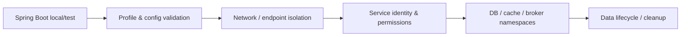
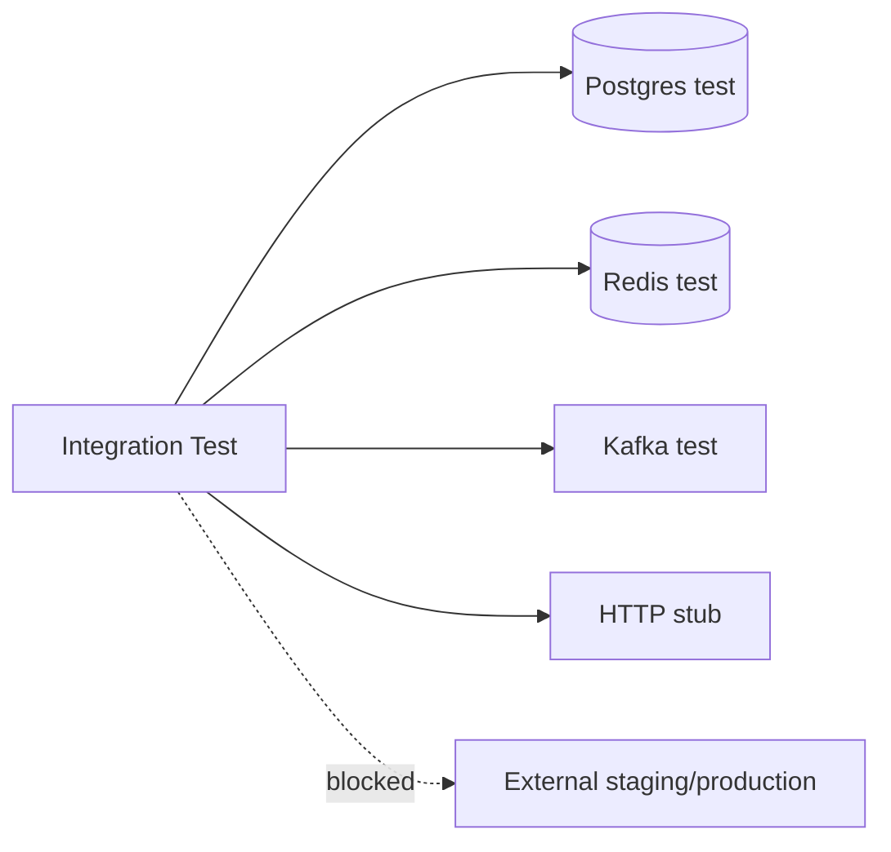

# Isolating Data, Volumes, and Secrets Across Environments

## 1. Problem: Development Services Can Touch Real Data

In the **SPRING_BOOT_INTEGRATION** module, Spring Boot typically connects simultaneously to multiple systems: HTTP APIs, databases, Redis, Kafka/RabbitMQ, and Spring Integration adapters. During development, these components may run via Docker Compose, Testcontainers, or team-shared resources. A misconfiguration does not always cause startup to fail; it can **successfully connect to the wrong environment** and begin reading, modifying, or deleting real data.

For example, a developer starts `order-service` on a laptop, while `SPRING_DATASOURCE_URL` still points to the staging database. A `@Scheduled` job scans the outbox and pushes events to staging Kafka; downstream consumers process those test events as real business traffic. Even though every connection uses valid TLS and credentials, environment boundaries have been breached.

A sound development setup must isolate all four dimensions together:

1. **Data and business side effects:** never let test data flow into production, nor feed raw production data straight into tests.
2. **Storage spaces:** volumes, databases, schemas, buckets, topics, queues, and key namespaces must never be shared unintentionally.
3. **Identities and secrets:** credentials, tokens, certificates, and service accounts belong strictly to one environment with least privilege.
4. **Connection paths and lifecycles:** DNS, networks, URLs, profiles, container lifecycles, and cleanup mechanisms have explicit boundaries.

The goal is ensuring that if a development component fails, gets wiped, or is compromised, its blast radius stays strictly inside the permitted development scope.

## 2. Understanding Isolation Levels Properly

### 2.1. Environment Breakdown

| Environment | Data | Backing services | Credentials | Lifecycle |
| --- | --- | --- | --- | --- |
| Local development | Synthetic/sanitized data, safely resettable | Compose, local services, or mocks | Local-only secrets, narrow scope | Dev volumes may persist, with controlled resets |
| Automated integration test | Test data created fresh per run | Testcontainers or isolated test services | Single-use/short-lived credentials | Created and torn down to avoid cross-test bleed |
| Shared development | Team test data; separated by person/branch if shared | Clusters/sandboxes partitioned by namespace | Per-app/team identity | Enforces quotas, TTLs, and cleanup policies |
| Staging/UAT | Synthetic or policy-compliant anonymized datasets | Production-like infrastructure | Staging secrets and accounts; never prod | Controlled deployments and restores |
| Production | Real data | Live operational infrastructure | Dedicated production identities, centrally managed | Strict backups/retention/audits and change controls |

**Splitting environment names does not equal real isolation.** Two distinct Spring profiles sharing the same JDBC URL, Kafka cluster, and password still corrupt the same data. Likewise, prefixing tables with `test_` is useless if the test account still holds permissions on production tables.

### 2.2. Defense-in-Depth Model



Each layer serves a distinct role:

- **Spring profiles** pick configurations; they create neither network barriers nor permission checks.
- **Docker Compose projects** namespace Compose-managed container names, networks, and volumes; they are not security boundaries across tenants on the same Docker daemon.
- **Testcontainers** provisions test services with managed lifecycles; it does not prove tests cannot reach production if external config still points to production.
- **IAM/ACLs/GRANTs** bound account privileges; they must be enforced by the target system itself.
- **Network policies/egress rules** block out-of-scope traffic; pair them with identity and resource verification.

## 3. Common Risks by Resource Type

| Resource | Dangerous sharing pattern | Isolation measure |
| --- | --- | --- |
| PostgreSQL/MySQL | Same database/user for local and staging | Separate instances/databases, dedicated roles, verify endpoints & identities |
| Redis | Different key prefixes yet credential allows `FLUSHALL` / all keys | ACL-enforced instances or namespaces; prefer dedicated instances for sensitive data |
| Kafka | Different topic prefixes yet shared admin account | Separate clusters or topic/group namespaces, per-principal ACLs, offset isolation |
| RabbitMQ | Shared vhost, queues, and users | Dedicated vhosts/queues/exchanges, least-privilege `configure/write/read` permissions |
| Object storage/SFTP | Same bucket/directory where tests delete files | Dedicated buckets/prefixes and identities; validate paths and delete policies |
| HTTP API | Test token hitting live URL, or production token used locally | Sandbox endpoints, audience/scope-bound tokens, host allowlists, and TLS |
| Docker volumes | `external: true` or machine-wide fixed volume names | Project/test-scoped named volumes; never attach volumes holding real data |
| Secret manager | Single workload allowed to read secrets across all environments | Per-environment namespaces/projects/policies, workload-scoped secret injection and audits |

**Specifically for Redis:** switching logical database numbers (`SELECT 0`, `SELECT 1`) creates no strong security boundary, and cluster modes do not support logical DB selection that way. For true environment isolation, use separate instances/ACLs/credentials rather than relying solely on DB index.

## 4. Docker Compose: Separating Projects, Networks, and Volumes

### 4.1. A Sample Isolated Local Compose Project

This example starts PostgreSQL with a dedicated volume and Redis strictly for dummy data on a developer machine. PostgreSQL reads its password from a local secret file so no real password sits in YAML.

```yaml
# compose.yaml, example strictly for local development
services:
  postgres:
    image: postgres:17
    environment:
      POSTGRES_DB: integration_dev
      POSTGRES_USER: integration_dev
      POSTGRES_PASSWORD_FILE: /run/secrets/pg_password
    secrets:
      - pg_password
    volumes:
      - postgres_data:/var/lib/postgresql/data
    ports:
      - "127.0.0.1:15432:5432"
    healthcheck:
      test: ["CMD-SHELL", "pg_isready -U integration_dev -d integration_dev"]
      interval: 5s
      timeout: 3s
      retries: 12

  redis:
    image: redis:7-alpine
    # Dummy data only; persistence disabled for local Redis example.
    command: ["redis-server", "--save", "", "--appendonly", "no"]
    ports:
      - "127.0.0.1:16379:6379"

volumes:
  postgres_data:

secrets:
  pg_password:
    file: ./.local-secrets/postgres-password.txt
```

Before starting, create `.local-secrets/postgres-password.txt` with a **local-only** password, restrict file permissions, and add `.local-secrets/` to version control ignores and secret scanners. The example omits an explicit password value to discourage copying defaults into real environments.

Run an isolated project under an explicit name:

```bash
docker compose -p integration-dev up -d
docker compose -p integration-dev ps
```

When running multiple projects concurrently from the same Compose file:

- Compose normally creates a project-scoped default network, e.g., `integration-dev_default`.
- Named volume `postgres_data` normally receives a project prefix, e.g., `integration-dev_postgres_data`.
- Service DNS `postgres` applies **inside the Compose network**. Apps running directly on the host use `127.0.0.1:15432` here, not `postgres`, unless custom DNS resolves it.
- Ports bind to `127.0.0.1` to prevent exposing services to external machines. This limits host interface exposure without blocking other containers on the same Docker network.
- Two different projects both binding host port `15432` will collide; use distinct ports/profiles, dynamic host ports, or skip publishing ports for internal-only services.

The project name forms part of **resource identifiers**, so adopt clear conventions like `integration-dev-alice`, `integration-dev-bob`, `integration-ci-1234`. Still, anyone with Docker daemon/socket access can reach across projects; for strong isolation between untrusted groups, use separate daemons/VMs/runners and infrastructure-level access controls.

### 4.2. Configurations That Easily Share Volumes by Accident

```yaml
volumes:
  postgres_data:
    external: true
    name: shared_pg_data
```

This is a **hazard example**—avoid it in local Compose if `shared_pg_data` could point to another project's volume. `external: true` attaches a pre-existing resource, and an explicit `name: shared_pg_data` bypasses project-level volume scoping. Likewise, bind-mounting an absolute host path containing another environment's data lets two containers mutate the same files.

Verify volume and project identifiers **before cleanup**. Commands like:

```bash
# Illustrative example strictly for the named test project.
docker compose -p integration-dev down --volumes
```

**permanently delete project-managed named volumes and anonymous volumes**, wiping local data. Never run volume-deletion commands out of habit on projects holding data you need; inspect project names, mounts, backups, and intent first. External volumes usually survive `down --volumes`, yet using them still risks reading/writing the wrong dataset.

### 4.3. Compose Secrets Do Not Become a Production Secret Manager

Compose `secrets` mounts secret files into designated containers. Yet the source file `.local-secrets/...` still lives on the host: anyone able to read that file, access the Docker daemon, or exec into the container can read it. This fits **narrowly scoped local secrets** and offers none of the auditing, rotation, or workload identity of a secret manager.

The DB secret file and Spring Boot client credentials must **match**, yet should come through protected channels. Never copy passwords into committed shell scripts to "sync" both sides. In team or CI environments, use a secret store or CI runner secrets instead of Git-tracked files.

## 5. Spring Boot Profiles and Connection Configuration

### 5.1. Default Configuration Holds Only Shared Settings

`application.yml` should define environment-neutral behavior without production URLs or default secrets:

```yaml
spring:
  application:
    name: order-integration
  jpa:
    hibernate:
      ddl-auto: validate

integration:
  jobs:
    outbox-polling-enabled: false
```

When integration data carries real impact, `ddl-auto: validate` as the default prevents unintended schema modifications; migrations run via Flyway/Liquibase or dedicated deployment tooling. Non-JPA apps omit that block; the sample highlights schema policy. `integration.jobs.outbox-polling-enabled` is a **custom property** that application code must read and honor—Spring Boot does not interpret it automatically.

`application-local.yml` applies when the app runs **on the host** and Docker Compose publishes ports as above:

```yaml
spring:
  config:
    activate:
      on-profile: local
  datasource:
    url: jdbc:postgresql://127.0.0.1:15432/integration_dev
    username: integration_dev
    password: ${LOCAL_DB_PASSWORD}
  data:
    redis:
      host: 127.0.0.1
      port: 16379
  docker:
    compose:
      enabled: false

integration:
  environment: local
  jobs:
    outbox-polling-enabled: false
```

`spring.docker.compose.enabled: false` here indicates **Compose is managed manually via CLI**, so Spring Boot should not manage container lifecycles itself. When opting into Spring Boot's Docker Compose integration, configure and test lifecycles for your Spring Boot version; Boot can detect service connections and supersede configured URLs. Never assume a profile URL is the effective runtime endpoint if another auto-configuration takes precedence.

Key points:

- `LOCAL_DB_PASSWORD` is supplied at runtime from a protected local source matching Postgres's secret file. Never commit real values to Git.
- Apps running **inside** the Compose network normally use `jdbc:postgresql://postgres:5432/integration_dev` and `redis:6379`; never put `127.0.0.1:15432` inside a container where `localhost` means the container itself.
- `application-staging.yml` and `application-prod.yml` must define distinct connections/identities without copying local secrets. Checked-in files may reference env var names or secret keys, never raw credential values.
- Never let the default profile silently pick production. When required environment config is missing, **failing at startup** is far safer than quietly hitting a default endpoint.

### 5.2. Property Precedence Can Diverge from the File You Are Looking At

Spring Boot loads properties from YAML files, env vars, system properties, CLI flags, test properties, and imported config trees. Higher-precedence sources can override `application-local.yml`; for example, a leftover `SPRING_DATASOURCE_URL` env var can silently swap out your local JDBC URL.

Hence the operational question is not "**what does YAML say?**" but "**where does the effective runtime configuration actually point?**" Verify effective endpoints/identities via controlled diagnostics—never dump raw `Environment` or `DataSource` configs into logs where passwords/tokens can leak.

For automated integrations, build a **startup guard** accepting only approved targets for the active profile, paired with network egress rules and non-production identities. Guards should verify a trusted environment marker, cluster identifier, or service identity; checking a hostname substring alone is not a complete security boundary.

### 5.3. A Cross-Checking Pattern for DB and Environment

Suppose PostgreSQL has a pre-provisioned `integration_control.environment_marker` table holding a single row identifying the environment, with `SELECT` granted to the runtime role. Sample guard:

```java
import java.sql.Connection;
import java.sql.ResultSet;
import java.sql.Statement;
import javax.sql.DataSource;
import org.springframework.beans.factory.annotation.Value;
import org.springframework.boot.ApplicationArguments;
import org.springframework.boot.ApplicationRunner;
import org.springframework.context.annotation.Profile;
import org.springframework.stereotype.Component;

@Profile({"local", "staging", "prod"})
@Component
class DatabaseEnvironmentGuard implements ApplicationRunner {
    private final DataSource dataSource;
    private final String expectedEnvironment;

    DatabaseEnvironmentGuard(
        DataSource dataSource,
        @Value("${integration.environment}") String expectedEnvironment
    ) {
        this.dataSource = dataSource;
        this.expectedEnvironment = expectedEnvironment;
    }

    @Override
    public void run(ApplicationArguments args) throws Exception {
        try (Connection connection = dataSource.getConnection();
             Statement stmt = connection.createStatement();
             ResultSet rs = stmt.executeQuery(
                "SELECT environment FROM integration_control.environment_marker"
             )) {
            if (!rs.next()
                || !expectedEnvironment.equals(rs.getString(1))
                || rs.next()) {
                throw new IllegalStateException("Database environment mismatch");
            }
        }
    }
}
```

This is an **illustrative guard** enabled via `@Profile` for local/staging/prod; the `test` profile in the Testcontainers example below excludes this bean. Where enabled, migrations/provisioners must populate the marker table, deny writes from the runtime role, and grant read access. If the table or permission is missing, startup must fail deliberately—never "disable the guard" just to get running. Every guarded environment must set `integration.environment` explicitly rather than relying on a default profile. To catch a staging DB mislabeled `prod`, include unique instance identities/markers plus network and credential isolation. **A guard never replaces IAM, ACLs, or network isolation.**

If an app has multiple `DataSource`s, check **each** connection; checking only the primary DB does not prevent a secondary DB, Redis, broker, or HTTP adapter from hitting the wrong environment.

## 6. Testcontainers: Ephemeral Test Resources with Dedicated Lifecycles

For integration tests, the goal is launching realistic infrastructure (DB, cache, broker) without inheriting data from previous runs. **Testcontainers** provisions test-driven containers via JUnit when Docker or a compatible runtime is available on the laptop or CI runner.

### 6.1. Dedicated PostgreSQL Example for a Test Suite

```java
import org.junit.jupiter.api.Test;
import org.springframework.boot.test.context.SpringBootTest;
import org.springframework.test.context.ActiveProfiles;
import org.springframework.test.context.DynamicPropertyRegistry;
import org.springframework.test.context.DynamicPropertySource;
import org.testcontainers.containers.PostgreSQLContainer;
import org.testcontainers.junit.jupiter.Container;
import org.testcontainers.junit.jupiter.Testcontainers;

@Testcontainers
@SpringBootTest(properties = {
    "spring.docker.compose.enabled=false",
    "integration.jobs.outbox-polling-enabled=false"
})
@ActiveProfiles("test")
class OutboxRepositoryIntegrationTest {

    @Container
    static final PostgreSQLContainer<?> postgres =
        new PostgreSQLContainer<>("postgres:17");

    @DynamicPropertySource
    static void setDatabaseProperties(DynamicPropertyRegistry registry) {
        registry.add("spring.datasource.url", postgres::getJdbcUrl);
        registry.add("spring.datasource.username", postgres::getUsername);
        registry.add("spring.datasource.password", postgres::getPassword);
    }

    @Test
    void savesOutboxRecord() {
        // Call real repository/service and assert records per test contract.
    }
}
```

This is a **test skeleton**: add Spring Boot Test, Testcontainers JUnit 5/PostgreSQL, JDBC driver, test migrations/schemas, and real assertions; the empty method marks where business assertions belong. `@DynamicPropertySource` injects container JDBC URL/user/password into the Spring test context. `@ActiveProfiles("test")` and disabling Docker Compose reduce the chance of pulling in other dev services.

Across multi-class suites, test context caching and static container lifecycles affect connection reuse; align test configuration with framework lifecycles so reused contexts never point at stopped containers. For strict isolation, disable container reuse (`withReuse(true)` or global reuse settings) and isolate test data per suite or via controlled cleanup.

### 6.2. Not All Forms of Reuse Are Safe

| Approach | Pros | Risks |
| --- | --- | --- |
| Fresh container per suite/integration test | Isolated lifecycle and endpoint | Startup cost; must manage context/test data |
| Container reused within one test suite | Faster | State can bleed between tests |
| Reusable container kept alive across runs | Speeds up local loops | Leftover data/credentials from prior runs; order-dependent tests |
| Shared staging DB for automated tests | Zero container startup time | Parallel test interference; cleanup can wipe another team's data |

Never pass production DB accounts into Testcontainers just because env vars exist. When launching test containers, **only the container-injected address** is an allowed target. Still verify no higher-priority configuration source overrides it.

### 6.3. Coordinating Test DB, Redis, Kafka, and Brokers

A full integration test may require PostgreSQL, Redis, Kafka/RabbitMQ, and an HTTP stub. Launch **an isolated test resource set** sharing lifecycles or test-injected endpoints, wiring all connection settings into the Spring context. HTTP mocks must also point to test-only endpoints—never real partner APIs just because a token happens to exist.

Exercise the end-to-end event flow: HTTP stub → DB/outbox write → Kafka test topic publish → test consumer group → test cache update; assert persisted data and verify zero events escape to external brokers.

## 7. Data Isolation Through Business Contracts

### 7.1. Seeding, Migrations, and Data Masking

Test data is useful when it mirrors real schemas and constraints—unique keys, foreign keys, idempotency keys, TTLs, partitions, and message formats. Even so, never copy raw production dumps to laptops or CI.

Pick the lightest suitable approach:

- **Synthetic fixtures:** generate realistic fake data unrelated to real customers; fits almost all unit/integration tests.
- **Anonymized/pseudonymized datasets:** only when complex distributions/relations must be reproduced; assess re-identification risks, strip secrets, and enforce access policies.
- **Sanitized snapshots:** produced by controlled pipelines, stored in scoped, expiring buckets/volumes; never commit dumps to repos.

Run test migrations with migration tools using dedicated migration accounts. Application runtime accounts need only DML rights per contract—never full DDL privileges to create/drop arbitrary tables. In staging and production, avoid Hibernate `create`/`create-drop` against databases holding persistent data.

### 7.2. Data Isolation Fails If Outbound Side Effects Still Escape

A test using Testcontainers DB while leaving an HTTP webhook pointed at production can trigger real orders. Similarly, a job using local Redis yet publishing Kafka events to staging pollutes downstream flows. Audit **every outbound adapter**:



In integration tests, combine explicit test endpoints with network egress blocks so out-of-scope calls fail loudly. Keep tests free of production credentials and free of fallback production URLs/tokens when test variables are absent.

## 8. Isolating Kafka, RabbitMQ, Redis, and Storage

### 8.1. Kafka: Clusters, Topics, Groups, and Offsets

Running dedicated Kafka for test/local (Testcontainers or isolated cluster) gives the cleanest separation. When teams must share a Kafka cluster, isolate all of these together:

- Topic namespaces, e.g., `dev.alice.orders.events` and `dev.bob.orders.events`.
- Consumer group IDs; sharing a group ID on the same cluster lets two environments steal partitions or overwrite offsets.
- Producer/consumer principals and per-topic/group ACLs; changing prefixes while using an `ALL`-topic admin account is unsafe.
- Schema Registry subjects, Kafka Connect connectors, DLQs/DLTs, compacted topics, and replay datasets where used.
- Retention, cleanup policies, TTLs, and quotas; never push sensitive data into shared topics.

Kafka `client.id` is for client identification/metrics, **not ACLs or group IDs**. If a test reuses staging's group ID and topic, it will consume/commit offsets and make staging skip or misprocess live events.

### 8.2. RabbitMQ: Vhosts and Queues

RabbitMQ vhosts provide clean resource boundaries. Use `/integration-dev-alice` for Alice and `/integration-dev-bob` for Bob, while still managing queue, exchange, DLX, and routing key names cleanly.

Local accounts should have access limited to their assigned vhost with narrow `configure/write/read` regex permissions. Test consumers must never use admin credentials that could delete external queues/streams. When Spring AMQP/Integration auto-declares topology, explicitly decide whether the app gets `configure` rights or topology is pre-provisioned.

### 8.3. Redis: Key Namespaces Are Not Security

On shared Redis, prefixes like `dev:alice:orders:*` organize keys logically, yet require Redis ACLs restricting key patterns and commands—or preferably dedicated instances when isolating data/tenants. Restrict `FLUSHDB`, `FLUSHALL`, `KEYS`, and dangerous commands outside legitimate needs.

For Spring Cache, configure environment-prefixed cache names/key generators to prevent logical collisions. Verify serializers, TTLs, and eviction policies: tests can wipe another environment's cache if sharing namespaces or broad-privilege accounts.

### 8.4. Object Storage, Files, and External APIs

- Use separate buckets or namespaces per environment; when sharing buckets via prefixes, IAM policies must enforce prefix scoping.
- Never allow tests to overwrite production files; separate input, processing, processed, and quarantine directories.
- SFTP/HTTP secrets must target sandbox endpoints with host allowlists enforced.
- Email/SMS/webhook flows must use fake transports, sink endpoints, or sandboxes during tests. Swapping databases does not stop notifications from hitting real people.
- Enforce TTLs/cleanup and storage quotas so test artifacts don't accumulate indefinitely on shared storage.

## 9. Managing Secrets by Lifecycle and Environment Boundary

### 9.1. Which Secrets Must Be Separated?

| Secret | Isolation per environment | Permissions and storage |
| --- | --- | --- |
| JDBC password / DB IAM token | Separate local, test, staging, prod users/roles | Secret manager or protected runtime file; never commit |
| Redis password / ACL user | Dedicated identity and key namespace | Minimum required commands/key patterns |
| Kafka SASL/SCRAM password, cert/key | Per-environment principal/ACL and certificates | Never log `sasl.jaas.config` or private keys |
| RabbitMQ user | Dedicated user/vhost | Scoped queue/exchange rights |
| OAuth2 client secret, access token | Distinct client registration/audience/scope | Token service, secret manager, HTTPS |
| Partner API keys | Sandbox keys separate from live keys | Host allowlists, rotate/revoke |
| Storage/SFTP credentials | Per-bucket/path accounts | Prefix-scoped ACL/IAM per environment |

A local password must never authenticate against staging or production. If a credential leaks, its blast radius should stay confined to its single environment and resource.

### 9.2. Injection Principles

1. Keep secrets out of source code, test fixtures, Dockerfiles, image layers, and CI artifacts.
2. Inject at runtime via secret stores, mounted files, or workload identities readable only by the target process.
3. Never log secrets via `Environment`, Actuator, Kafka client configs, stack traces, HTTP wiretaps, or CLI arguments.
4. Enforce server TLS verification and egress rules; a secret can be exfiltrated to an unexpected host if destinations aren't restricted.
5. Maintain creation, rotation, revocation, audit, and permission review lifecycles; staging/prod secrets need owners, expiration, and clear policies.
6. Upon suspected exposure, rotate/revoke **the actual credential**; deleting it from current Git HEAD leaves copies intact in history, logs, and backups.

**Environment variables are not an impenetrable vault:** anyone able to inspect processes, capture dumps, read diagnostics, or tamper with CI config can read them. Even with env vars, restrict access, suppress config printing, and rotate secrets regularly.

### 9.3. Separating Migration, Runtime, and Provisioning Roles

Migration accounts create/alter schemas, runtime accounts perform DML only, provisioning accounts create Kafka topics/RabbitMQ queues/ACLs, and observability accounts read metrics/logs. Never share an admin password across tests "for convenience"—that hides missing-permission bugs and risks accidentally deleting critical resources.

In production, even with workload identities replacing static passwords, each workload needs scoped policies. One shared cloud role allowed to read every secret violates least privilege even with zero password files.

## 10. Background Tasks Can Corrupt Data Immediately at Startup

Integration apps often run `@Scheduled` jobs, Spring Integration pollers, `@KafkaListener`, `@RabbitListener`, Quartz jobs, or startup hooks. Splitting the database alone while letting listeners/pollers connect to an out-of-scope broker lets local runs trigger real side effects before anyone notices.

Design safeguards:

- Default high-impact jobs to disabled in dev/test, enabling them intentionally via app-enforced properties.
- Use dedicated consumer groups, topics/queues, and credentials; never let local listeners read or commit offsets on production groups.
- For outbound APIs, lock down sandbox endpoints, mock transports, sandbox tokens, and host allowlists before enabling flows.
- Gate Spring Integration inbound poller/adapter `autoStartup` and start/stop controls; enable only after verifying target connections.
- Attach event IDs/idempotency keys and deduplication to every write so replayed test events never double-charge downstream.
- Disable auto-initialization/auto-migration on unverified environments; run DDL only against confirmed test resources.

### 10.1. Separating "Disabled" from "Unauthorized"

A flag like `integration.jobs.outbox-polling-enabled=false` stops a job only if application code obeys it. It **does not replace** network policies, ACLs, or separate credentials: another flow might still reuse the same connector. Enforcing local-only credentials prevents damage even if a job flag is flipped by mistake.

### 10.2. Retries and Transactions Must Not Cross Boundaries

HTTP retries, Kafka producer retries, RabbitMQ redeliveries, and scheduler backfills can replay calls against partially processed downstreams. Test those flows thoroughly—never against live endpoints to "prove idempotency." For DB–Kafka coordination, use outbox or matching transactional patterns instead of expecting a DB rollback to unpublish broker events.

## 11. Testing Boundaries and Catching Misconfigurations

A test that merely connects cleanly to a local DB **is insufficient**. Verify that out-of-environment resources *cannot* be reached with active identities/configs.

| Scenario | Setup | What to assert |
| --- | --- | --- |
| JDBC URL overridden | High-priority config points to a simulated staging DB | Startup guard rejects or network/identity blocks it |
| Wrong DB environment marker | DB marker says `staging`, app declares `local` | Startup fails before any business side effect |
| Different Compose projects | Start two projects using logical volume `postgres_data` | Underlying volumes are distinct; writes in A do not appear in B |
| Shared external volume | Test setup referencing a pre-existing volume | Config check warns/detects and avoids unintended writes |
| Testcontainers isolation | Two independent test runs | Second run sees no records from first unless reuse was intentional |
| Kafka topics/groups | Two environments share a test cluster with separate ACLs | Consumer cannot read/commit offsets or publish to the other's topic |
| Redis namespace | Local account attempts `prod:*` read or `FLUSHALL` on ACL-secured test Redis | Rejected by Redis ACL |
| Secret access | Local workload attempts to read staging secret | IAM denies; zero secret leakage in logs |
| Outbound HTTP | API redirects to an unapproved host | Bearer token and payload are never forwarded there |
| Startup jobs | Test environment boots app without enabling job flags | Zero events, emails, webhooks, or live API calls emitted |
| Cleanup | Tear down named test project | Only that project's volumes/resources are removed; others untouched |
| Recovery | Restart container or job mid-processing | Checkpoints, retries, and idempotency never pollute other environments |

### 11.1. Verifying Effective Endpoints and Identities

Before running state-mutating integration tests, safely verify:

- Active profile and **expected environment name** from controlled config.
- Server-verified database/marker, cluster ID, or identity.
- Actual DNS/host, port, and protocol across all adapters, including Kafka bootstrap and metadata broker addresses.
- Real principal permissions on the DB/broker/server, not just client-configured usernames.
- Whether background jobs and listeners are active or paused.

Never print raw JDBC URLs with credentials, tokens, connection factories, sensitive secret paths, or full config dumps for debugging. Log **logical names** (`postgres-local`, `kafka-test`), non-sensitive role names, and approved identifiers instead.

### 11.2. Coordinating Unit, Integration, and Failure Tests

- **Unit:** verify profile/config selection, window IDs, environment-based adapter routing, and fail-fast validation.
- **Integration:** launch test Postgres/Redis/Kafka, seed synthetic data, verify permissions and message paths.
- **Failure:** test bad secrets, bad CAs/hostnames, broker timeouts, container restarts, job retries, and cleanup.
- **Isolation:** run two projects/suites concurrently; confirm zero unintended volume, topic/group, key, or credential sharing.

Never run table-dropping, volume-wiping, or cache-flushing tests on staging/production "to verify the real thing." Use isolated sandboxes with clear test resources and accounts.

## 12. Observing and Responding to Boundary Leaks

Signals to monitor:

| Metric/alert | Purpose |
| --- | --- |
| Local/test connections reaching prod endpoints | Detect misconfiguration or out-of-scope credential usage |
| `authorization_denied` counts per environment | Confirm ACLs/IAM policies are enforced |
| Unusual shared topic/group or bucket access | Spot namespace collisions |
| Secret access from unrelated workloads | Catch leaked or overly broad permissions |
| Test data retention / volume growth | Prevent stale test data accumulation or disk exhaustion |
| Outbound events/webhooks triggered after test startup | Detect out-of-scope side effects |
| Test consumer offsets, retries, DLQs | Prevent test messages from entering production flows |

Observability tags should use environment and logical resource IDs—never access tokens, passwords, PII, raw URLs, or full payloads. Logs across environments also need access controls and retention limits; staging logs can still contain sensitive data even after scrubbing headers.

### 12.1. When You Discover Local/Test Connected to Production by Mistake

1. **Sever connections and stop side-effect-producing jobs/consumers/pollers** through authorized operational controls.
2. **Scope the impact:** endpoints, identities, time window, queries/commands, event IDs, topics/groups, volumes, or keys touched.
3. **Revoke/rotate credentials** if production credentials may have reached local/CI; audit identity permissions.
4. **Reconcile data and events:** inspect audit logs, DB history, outbox/consumer offsets, broker logs, and partners to measure impact.
5. **Recover cleanly per business rules** (reconciliation, compensation, deduplication); never delete production records by guesswork.
6. **Prevent recurrence:** fix config/secret policies, add startup guards, restrict egress, and write negative boundary tests.

Changing one URL in `application-local.yml` is never enough: trace override sources, exposed secrets, sibling workloads sharing that config, and downstream data impact.

## 13. Pre-Sharing Checklist for Development Environments

- [ ] Every environment has dedicated endpoints, credentials, identities, networks, and data; zero shared production accounts.
- [ ] Compose projects use unique names, keeping volumes and networks scoped inside boundaries.
- [ ] Inspected bind mounts, `external: true`, and `name:` before starting or deleting volumes.
- [ ] Published only necessary local ports on restricted host interfaces; never treated Docker networks as a complete security perimeter.
- [ ] Kept local secrets out of VCS; CI uses protected secret stores; production secrets never enter laptops/tests.
- [ ] Spring profiles contain no default production URLs/credentials; missing config fails fast.
- [ ] Verified property precedence and effective endpoints without logging raw configs/secrets.
- [ ] Integration tests inject Testcontainers or dedicated sandbox endpoints with no unintended leftover state.
- [ ] DB seeds use synthetic/policy-compliant data; migrations, DDL, and cleanup run strictly on confirmed resources.
- [ ] Kafka topics/groups/ACLs, RabbitMQ vhosts/queues, Redis namespaces/ACLs, and storage buckets/paths are separated.
- [ ] Side-effect-producing jobs, listeners, and webhooks default to disabled in dev/test until configured.
- [ ] Added tests for wrong-environment connections, denied secrets, shared resources, and safe cleanup.
- [ ] Established backups/retention, quotas, audits, metrics, and response playbooks for cross-environment incidents.

### Self-Check Questions

1. Two Compose projects have different project names yet both use a volume marked `external: true`. What can happen to the data?
2. Why isn't changing Redis or Kafka topic prefixes sufficient for security isolation if admin accounts remain shared?
3. An app uses `application-local.yml` while `SPRING_DATASOURCE_URL` points to staging. Which runtime values should you inspect before starting a job?
4. Testcontainers spins up a dedicated PostgreSQL; why can an HTTP webhook or `@KafkaListener` still impact production?
5. When a Spring Boot app runs inside a Compose network, how do JDBC hostnames `postgres` and `127.0.0.1` differ?
6. Why should production passwords never sit in a local Compose secret file even when excluded from Git?
7. If an integration test replays the same Kafka event after an error, what mechanism prevents duplicate database writes?
8. What identifiers and guardrails must a volume cleanup procedure verify before executing?

**Key takeaway:** Environment isolation protects **connection targets + data + storage + identities + task lifecycles** simultaneously. Docker Compose, Testcontainers, and Spring profiles make development convenient, yet real boundaries must be enforced with dedicated endpoints/ACLs/secrets, negative tests, and safe operational procedures.
