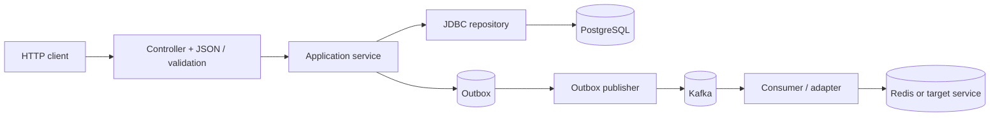

# Distinguishing Unit Tests, Integration Tests, and End-to-End Tests

In **SPRING_BOOT_INTEGRATION**, a request can pass through an HTTP controller, DTOs and validation, business services, JDBC, a Redis cache, a message broker, an HTTP client calling a partner, and Spring Integration adapters. A single function that is tested correctly does not guarantee the entire flow works: SQL can have the wrong dialect, JSON can mismatch the contract, a consumer can receive duplicate messages, and a broker send can fail after the database transaction has already committed.

Therefore, the **Integration Testing** chapter must clearly distinguish **unit tests**, **integration tests**, and **end-to-end (E2E) tests** by the *boundaries and behaviors being verified*, rather than relying solely on annotations or test class names. The goal is to verify configuration, data contracts, transactions, failures, idempotency, and observability of real flows at a reasonable testing cost.

## 1. Learning Objectives

After this lesson, you will be able to:

- Identify which level a test belongs to based on which components run for real and which are replaced.
- Choose the appropriate test for pure logic, HTTP adapters, SQL repositories, caches, brokers, and a complete business journey.
- Write unit tests with JUnit/Mockito, integration tests using Spring Test/Testcontainers, and E2E tests that go through real HTTP.
- Explain why `@SpringBootTest`, `MockMvc`, mocks, embedded databases, or Testcontainers **do not automatically** make a test E2E.
- Verify transaction rollback, retry, redelivery, duplicate handling, and eventual consistency without relying on arbitrary wait times.
- Build a strategy for running fast tests in the development loop while keeping critical checks before release.

## 2. Distinguishing the Three Levels by Tested Boundary

| Criterion | Unit test | Integration test | End-to-end test |
| --- | --- | --- | --- |
| Primary question | Is a unit of logic correct? | Do components honor their contract when wired together? | Does a real user journey work from the entry point to an observable outcome? |
| Scope | A function, class, or small independent group of logic | One or a few boundaries: service–DB, controller–JSON, producer–broker, client–HTTP | An application flow spanning multiple layers and the real dependencies required within the declared scope |
| Replaced components | Out-of-scope dependencies are usually fakes/mocks/stubs | Keep the integrated component real; systems outside scope may be simulated | Keep the main path and meaningful interactions real; only simulate systems outside the defined E2E scope |
| Starting Spring context | Usually not needed | Can use a test slice or full context depending on the goal | Usually runs the full application, receiving requests over real HTTP/ports or a real operational entrypoint |
| Speed and failure diagnosis | Usually fast, localized failure | Moderate; depends on environment and real resources | Usually slower; failures can originate from multiple layers |
| Example | Service rejects a negative amount | Repository writes to PostgreSQL and rolls back properly | `POST /payments` → DB/outbox → broker → consumer observes the event |

**Decisive classification point:** A test that calls a service directly from Java and mocks all repositories/brokers is a unit test even if it is named `PaymentIntegrationTest`. A test with `@SpringBootTest` where every external connection is mocked primarily verifies in-memory wiring/service flow. A test that runs the application against real PostgreSQL and sends real HTTP requests can be E2E for the **HTTP → database** segment, yet not E2E for the **HTTP → database → Kafka → receiving system** flow if Kafka does not participate.

There is no single industry-wide dividing line for every project. Naming conventions may vary across teams, but every test must declare its **scope**, **real dependencies**, and **what remains unverified**.



Along this same flow, we can use unit tests for service decisions, integration tests for JDBC/PostgreSQL or producer/Kafka, and E2E tests for the journey from request to the outcome in the target system.

## 3. Running Scenario: Ingesting Payments from Another System

Suppose the `POST /api/payments` API receives a request containing `eventId`, `orderId`, and `amountCents`. When processed for the first time, the system writes the payment into PostgreSQL while creating an **outbox** record within the same transaction. A publisher sends the `PaymentAcceptedV1` event from the outbox to Kafka; a downstream consumer updates a cache or target system. If the same `eventId` is sent again, no additional payment may be created.

Illustrative input contract:

```json
{
  "eventId": "evt-123",
  "orderId": "ord-456",
  "amountCents": 125000
}
```

Key testing requirements:

1. Malformed data or invalid amounts are explicitly rejected.
2. A new `eventId` creates exactly one payment and one outbox row.
3. Resending the same event does not duplicate side effects; if the same ID has conflicting content, the system must have an explicit conflict policy.
4. Failure on the second write rolls back the entire transaction.
5. The publisher can retry after a network error without losing events; the consumer must tolerate duplicate deliveries.
6. The flow emits enough observability signals to explain which events succeeded, failed, or are pending.

These requirements distribute across **multiple testing levels**: no single giant test replaces them all.

## 4. Unit Tests: Verifying Business Decisions with Isolated Dependencies

Unit tests verify the behavior of a unit of logic, deliberately replacing repositories/HTTP clients/brokers with mocks or fakes. They answer questions such as: which parameters are valid, which branch is taken, what the service returns when the store reports "already processed", and whether dependencies are invoked on rejection.

The core example below uses **Java 17+**, JUnit Jupiter, and Mockito. Top-level `public` types should be placed in separate Java files when used in a project; placing them together here is for presentation purposes.

```java
public record PaymentCommand(
        String eventId,
        String orderId,
        long amountCents
) {}

public enum Acceptance { ACCEPTED, DUPLICATE }

public interface PaymentStore {
    // true on first write; false when the same event has already been processed.
    boolean recordOnce(PaymentCommand command);
}

public final class PaymentService {
    private final PaymentStore store;

    public PaymentService(PaymentStore store) {
        this.store = store;
    }

    public Acceptance accept(PaymentCommand command) {
        if (command == null
                || command.eventId() == null || command.eventId().isBlank()
                || command.orderId() == null || command.orderId().isBlank()
                || command.amountCents() <= 0) {
            throw new IllegalArgumentException("Invalid payment command");
        }
        return store.recordOnce(command)
                ? Acceptance.ACCEPTED : Acceptance.DUPLICATE;
    }
}
```

Unit test:

```java
import static org.junit.jupiter.api.Assertions.*;
import static org.mockito.Mockito.*;

import org.junit.jupiter.api.BeforeEach;
import org.junit.jupiter.api.Test;

class PaymentServiceTest {
    private PaymentStore store;
    private PaymentService service;

    @BeforeEach
    void setUp() {
        store = mock(PaymentStore.class);
        service = new PaymentService(store);
    }

    @Test
    void rejectsInvalidAmountBeforeWriting() {
        var command = new PaymentCommand("evt-1", "ord-1", -100);

        assertThrows(IllegalArgumentException.class,
                () -> service.accept(command));
        verifyNoInteractions(store);
    }

    @Test
    void returnsAcceptedWhenStoreRecordsFirstDelivery() {
        var command = new PaymentCommand("evt-2", "ord-2", 5000);
        when(store.recordOnce(command)).thenReturn(true);

        assertEquals(Acceptance.ACCEPTED, service.accept(command));
        verify(store).recordOnce(command);
    }

    @Test
    void reportsDuplicateWhenStoreAlreadyRecordedEvent() {
        var command = new PaymentCommand("evt-3", "ord-3", 5000);
        when(store.recordOnce(command)).thenReturn(false);

        assertEquals(Acceptance.DUPLICATE, service.accept(command));
    }
}
```

**What is proven:** input validation logic, how the service interprets the result from `PaymentStore`, and that no write occurs when the command is invalid. **What is not proven:** that the SQL is valid, unique constraints work, transactions roll back, Jackson deserializes properly, HTTP status codes are right, the outbox is published, or the broker acknowledges messages.

Do not use mocks to verify implementation details unrelated to behavior, such as counting every private helper invocation or snapshotting internal call order. Prefer testing outputs, errors, and meaningful effects across interfaces. If pure logic is very simple, you do not need many unit tests repeating implementation lines; focus on high-risk rules.

> **Example limitation:** `PaymentStore.recordOnce` assumes the same `eventId` always represents the same content. In a real application, you need to compare a fingerprint or stored data and return a conflict error if two different payloads share the same ID. Unit tests must cover this policy wherever it is implemented.

## 5. Integration Tests: Testing a Real Boundary

An integration test wires **at least two components** together in a meaningful way and uses a real implementation for the boundary under test. You might test a repository against PostgreSQL, a controller with Spring MVC JSON conversion/validation, an HTTP client against a mock HTTP server, or a Kafka adapter against a real broker.

Choose a **test slice** when only part of the context is needed; choose `@SpringBootTest` when wiring across multiple configurations or real transactions/services is required. The criterion is the degree of integration that needs to be proven, not which annotation looks more "complete".

### 5.1. Repository and Transaction with PostgreSQL

To verify idempotency and outbox behavior, you need a database with the same **dialect, constraints, and transactions** as production. Example PostgreSQL schema:

```sql
CREATE TABLE processed_event (
    event_id      VARCHAR(120) PRIMARY KEY,
    processed_at  TIMESTAMPTZ NOT NULL DEFAULT NOW()
);

CREATE TABLE payment (
    event_id      VARCHAR(120) PRIMARY KEY
                  REFERENCES processed_event(event_id),
    order_id      VARCHAR(120) NOT NULL,
    amount_cents  BIGINT NOT NULL CHECK (amount_cents > 0)
);

CREATE TABLE outbox (
    event_id      VARCHAR(120) PRIMARY KEY
                  REFERENCES processed_event(event_id),
    event_type    VARCHAR(80) NOT NULL,
    created_at    TIMESTAMPTZ NOT NULL DEFAULT NOW(),
    published_at  TIMESTAMPTZ
);
```

The application must implement the corresponding JDBC/transaction adapter, for example:

```java
import org.springframework.jdbc.core.namedparam.MapSqlParameterSource;
import org.springframework.jdbc.core.namedparam.NamedParameterJdbcTemplate;
import org.springframework.stereotype.Repository;
import org.springframework.transaction.annotation.Transactional;

@Repository
public class JdbcPaymentStore implements PaymentStore {
    private final NamedParameterJdbcTemplate jdbc;

    public JdbcPaymentStore(NamedParameterJdbcTemplate jdbc) {
        this.jdbc = jdbc;
    }

    @Override
    @Transactional
    public boolean recordOnce(PaymentCommand command) {
        var params = new MapSqlParameterSource()
                .addValue("eventId", command.eventId())
                .addValue("orderId", command.orderId())
                .addValue("amount", command.amountCents());

        int claimed = jdbc.update("""
                INSERT INTO processed_event (event_id)
                VALUES (:eventId)
                ON CONFLICT (event_id) DO NOTHING
                """, params);
        if (claimed == 0) {
            return false;
        }

        jdbc.update("""
                INSERT INTO payment (event_id, order_id, amount_cents)
                VALUES (:eventId, :orderId, :amount)
                """, params);
        jdbc.update("""
                INSERT INTO outbox (event_id, event_type)
                VALUES (:eventId, 'PaymentAcceptedV1')
                """, params);
        return true;
    }
}
```

`@Transactional` requires the method to be called through a Spring-managed bean/proxy and JDBC to use a `DataSource` managed by the transaction manager. Because all three writes share the same transaction, a failure when inserting into `payment` or `outbox` must roll back the `processed_event` row as well. `ON CONFLICT` in the example is PostgreSQL syntax; you must test against the real dialect rather than assuming H2 behaves identically. In production idempotency implementations, add a payload comparison against the stored record to detect the same ID with different data.

### 5.2. Running a Real Database in Testcontainers

Suppose the project already includes Spring Boot JDBC, the PostgreSQL driver, migrations creating the tables above, `spring-boot-starter-test`, `org.testcontainers:junit-jupiter`, and `org.testcontainers:postgresql`. Example test:

```java
import static org.junit.jupiter.api.Assertions.*;

import java.util.UUID;
import org.junit.jupiter.api.Test;
import org.springframework.beans.factory.annotation.Autowired;
import org.springframework.boot.test.context.SpringBootTest;
import org.springframework.jdbc.core.JdbcTemplate;
import org.springframework.test.context.DynamicPropertyRegistry;
import org.springframework.test.context.DynamicPropertySource;
import org.testcontainers.containers.PostgreSQLContainer;
import org.testcontainers.junit.jupiter.Container;
import org.testcontainers.junit.jupiter.Testcontainers;

@SpringBootTest
@Testcontainers
class JdbcPaymentStoreIT {
    @Container
    static final PostgreSQLContainer<?> db =
            new PostgreSQLContainer<>("postgres:16-alpine");

    @DynamicPropertySource
    static void databaseProperties(DynamicPropertyRegistry registry) {
        registry.add("spring.datasource.url", db::getJdbcUrl);
        registry.add("spring.datasource.username", db::getUsername);
        registry.add("spring.datasource.password", db::getPassword);
    }

    @Autowired PaymentStore store;
    @Autowired JdbcTemplate jdbc;

    @Test
    void duplicateEventDoesNotCreateSecondPaymentOrOutboxRow() {
        String eventId = UUID.randomUUID().toString();
        var command = new PaymentCommand(eventId, "ord-123", 125000);

        assertTrue(store.recordOnce(command));
        assertFalse(store.recordOnce(command));

        Integer payments = jdbc.queryForObject(
                "SELECT COUNT(*) FROM payment WHERE event_id = ?",
                Integer.class, eventId);
        Integer events = jdbc.queryForObject(
                "SELECT COUNT(*) FROM outbox WHERE event_id = ?",
                Integer.class, eventId);

        assertEquals(1, payments);
        assertEquals(1, events);
    }

    @Test
    void failedPaymentInsertRollsBackClaimedEventId() {
        String eventId = UUID.randomUUID().toString();
        var invalid = new PaymentCommand(eventId, "ord-err", -1);

        assertThrows(org.springframework.dao.DataIntegrityViolationException.class,
                () -> store.recordOnce(invalid));

        Integer claimed = jdbc.queryForObject(
                "SELECT COUNT(*) FROM processed_event WHERE event_id = ?",
                Integer.class, eventId);
        assertEquals(0, claimed);
    }
}
```

This is a **repository + database integration test**, even though it uses `@SpringBootTest` for simple wiring. It checks real SQL, `CHECK`/unique constraints, row counts, and rollback. The test uses unique IDs to reduce data collisions across runs; in larger projects you need clean database management via migrations/fixtures or controlled cleanup.

**Be careful with `@Transactional` on the test method itself:** A test transaction usually rolls back when finished, which is convenient for cleaning up data. However, it can mask bugs around commit timing or listener `ack` behavior, and prevent asynchronous checks from observing committed data. For scenarios that must prove commit/rollback across a transaction boundary, keep the transaction in application code and inspect state after the method returns.

### 5.3. Web Slice: Testing the HTTP Contract, Not Yet E2E

With Spring MVC, `@WebMvcTest(PaymentController.class)` typically initializes the controller, JSON binding, validation, and necessary web components; the underlying service can be replaced with a mock. Example request interface:

```java
import jakarta.validation.constraints.NotBlank;
import jakarta.validation.constraints.NotNull;
import jakarta.validation.constraints.Positive;

public record PaymentRequest(
        @NotBlank String eventId,
        @NotBlank String orderId,
        @NotNull @Positive Long amountCents
) {}
```

Illustrative controller:

```java
import jakarta.validation.Valid;
import org.springframework.http.ResponseEntity;
import org.springframework.web.bind.annotation.*;

@RestController
@RequestMapping("/api/payments")
public class PaymentController {
    private final PaymentService service;

    public PaymentController(PaymentService service) {
        this.service = service;
    }

    @PostMapping
    ResponseEntity<Void> accept(@Valid @RequestBody PaymentRequest request) {
        var outcome = service.accept(new PaymentCommand(
                request.eventId(), request.orderId(), request.amountCents()));
        return outcome == Acceptance.ACCEPTED
                ? ResponseEntity.accepted().build()
                : ResponseEntity.ok().build();
    }
}
```

The `@WebMvcTest` snippet below uses a mock bean explicitly declared by the test, avoiding dependence on mock registration annotation names that change across Spring Boot versions:

```java
import static org.mockito.ArgumentMatchers.any;
import static org.mockito.Mockito.when;
import static org.springframework.test.web.servlet.request.MockMvcRequestBuilders.post;
import static org.springframework.test.web.servlet.result.MockMvcResultMatchers.status;

import org.junit.jupiter.api.Test;
import org.springframework.beans.factory.annotation.Autowired;
import org.springframework.boot.test.autoconfigure.web.servlet.WebMvcTest;
import org.springframework.boot.test.context.TestConfiguration;
import org.springframework.context.annotation.Bean;
import org.springframework.context.annotation.Import;
import org.springframework.http.MediaType;
import org.springframework.test.web.servlet.MockMvc;

@WebMvcTest(PaymentController.class)
@Import(PaymentControllerWebTest.MockServiceConfig.class)
class PaymentControllerWebTest {
    @TestConfiguration
    static class MockServiceConfig {
        @Bean
        PaymentService paymentService() {
            return org.mockito.Mockito.mock(PaymentService.class);
        }
    }

    @Autowired MockMvc mvc;
    @Autowired PaymentService service;

    @Test
    void validJsonIsAccepted() throws Exception {
        when(service.accept(any(PaymentCommand.class)))
                .thenReturn(Acceptance.ACCEPTED);

        mvc.perform(post("/api/payments")
                .contentType(MediaType.APPLICATION_JSON)
                .content("""
                        {"eventId":"evt-1","orderId":"ord-1","amountCents":5000}
                        """))
                .andExpect(status().isAccepted());
    }

    @Test
    void rejectsInvalidRequestBeforeInvokingService() throws Exception {
        mvc.perform(post("/api/payments")
                .contentType(MediaType.APPLICATION_JSON)
                .content("""
                        {"eventId":"evt-1","orderId":"ord-1","amountCents":-1}
                        """))
                .andExpect(status().isBadRequest());

        org.mockito.Mockito.verifyNoInteractions(service);
    }
}
```

For validation to work, the application needs a Bean Validation provider, typically via `spring-boot-starter-validation`. If Spring Security is present, slice tests may also apply security filters: you must provide an appropriate identity/authority rather than disabling security entirely and claiming the test proves authorization.

This test verifies the **HTTP adapter** and JSON/validation; it does not open a real HTTP server, connect to a database, or prove the broker works. If a project calls this a **Spring MVC slice** integration test, that terminology is reasonable as long as the scope is accurately described.

### 5.4. HTTP Client, Broker, Cache, and Spring Integration Adapters

Not every integration test needs the entire application:

| Boundary to test | Typical resource/test fit | What to assert |
| --- | --- | --- |
| Outbound HTTP to a partner | Real `RestClient`/`WebClient` + WireMock/MockWebServer | URL, method, headers, JSON DTO, status/error mapping, timeout, retry, and idempotency key. |
| JDBC/jOOQ | DB with matching dialect via Testcontainers | SQL, mapping, constraints, transactions, locking, and retries. |
| Kafka/AMQP/JMS | Real broker in a container or isolated test environment | Serialization, topic/queue, consumer group, ack/offset, redelivery, DLQ. |
| Redis cache | Real Redis in Testcontainers | TTL, key namespace, serialization, invalidation, and tenant isolation. |
| Spring Integration flow | `IntegrationFlow`, channels, endpoints, and in-scope sources/targets | Wiring, routing, filters, pollers, error channels, timeouts, and lifecycle. |
| File/SFTP adapter | Controlled temp directory or test SFTP server | Filters, file-completion detection, duplicate handling, archive/quarantine, restart. |

WireMock is an **HTTP interaction stub server**, different from mocking a Java interface. It checks that the real client sends an HTTP request matching the contract, but does not prove the real partner system will respond like the fixture. You can supplement it with **consumer-driven contract tests** or a partner sandbox environment when the contract needs two-sided verification.

Testcontainers brings real databases, Redis, or brokers into the test environment. However, using containers is not enough to call a test E2E if you only invoke one repository without running the rest of the journey's layers.

## 6. End-to-End Tests: Verifying a Journey Through a Real Entrypoint

An E2E test starts from a **realistic point of contact** (an HTTP request, a command/event entering a broker, a UI action, a file arriving in an inbound directory) and observes **meaningful outcomes** after the required steps complete. The name and extent of "end" must be stated explicitly: E2E for an HTTP–DB API differs from E2E for the entire HTTP–Kafka–consumer–cache pipeline.

The example below tests from **real HTTP to real PostgreSQL/outbox**. The `PaymentController`, `PaymentService`, and `JdbcPaymentStore` beans are declared by the application; `PaymentService` must be registered as a Spring bean, for example with `@Service` or `@Bean`. Assume migrations have created the schema and Testcontainers is configured as in the previous section.

```java
import static org.junit.jupiter.api.Assertions.assertEquals;

import java.util.UUID;
import org.junit.jupiter.api.Test;
import org.springframework.beans.factory.annotation.Autowired;
import org.springframework.boot.test.context.SpringBootTest;
import org.springframework.boot.test.web.client.TestRestTemplate;
import org.springframework.http.HttpStatus;
import org.springframework.http.ResponseEntity;
import org.springframework.jdbc.core.JdbcTemplate;
import org.springframework.test.context.DynamicPropertyRegistry;
import org.springframework.test.context.DynamicPropertySource;
import org.testcontainers.containers.PostgreSQLContainer;
import org.testcontainers.junit.jupiter.Container;
import org.testcontainers.junit.jupiter.Testcontainers;

@SpringBootTest(webEnvironment = SpringBootTest.WebEnvironment.RANDOM_PORT)
@Testcontainers
class PaymentHttpToDatabaseE2ETest {
    @Container
    static final PostgreSQLContainer<?> db =
            new PostgreSQLContainer<>("postgres:16-alpine");

    @DynamicPropertySource
    static void databaseProperties(DynamicPropertyRegistry registry) {
        registry.add("spring.datasource.url", db::getJdbcUrl);
        registry.add("spring.datasource.username", db::getUsername);
        registry.add("spring.datasource.password", db::getPassword);
    }

    @Autowired TestRestTemplate http;
    @Autowired JdbcTemplate jdbc;

    @Test
    void acceptsRequestAndStoresOutboxExactlyOncePerEventId() {
        String eventId = UUID.randomUUID().toString();
        var request = new PaymentRequest(eventId, "ord-101", 9900L);

        ResponseEntity<Void> first =
                http.postForEntity("/api/payments", request, Void.class);
        ResponseEntity<Void> duplicate =
                http.postForEntity("/api/payments", request, Void.class);

        assertEquals(HttpStatus.ACCEPTED, first.getStatusCode());
        assertEquals(HttpStatus.OK, duplicate.getStatusCode());
        assertEquals(1, countFor("payment", eventId));
        assertEquals(1, countFor("outbox", eventId));
    }

    private int countFor(String table, String eventId) {
        // Table name is a controlled internal constant, never taken from input.
        return jdbc.queryForObject(
                "SELECT COUNT(*) FROM " + table + " WHERE event_id = ?",
                Integer.class, eventId);
    }
}
```

`RANDOM_PORT` starts a real HTTP server; `TestRestTemplate` sends requests over the application's local network port. Because the test does not open an outer transaction around the two HTTP requests, the repository commit occurs inside the request-handling flow and the DB result is observable after the response. This illustrates E2E **within the HTTP → PostgreSQL/outbox scope**. It **does not yet prove** that the outbox publisher sends to Kafka or that the consumer updates the cache.

To verify the full pipeline, extend the fixture as follows:

1. Start isolated PostgreSQL, Kafka, and Redis with Testcontainers (or a managed staging environment).
2. Start the application with the **real** publisher and consumer, using test-specific topics, groups, and key prefixes.
3. Send an HTTP request from outside the application process/port or through a real client as in the example above.
4. Wait for an **observable condition**: for example, the consumer records event receipt or the expected value appears in the cache. Use a conditional wait library such as Awaitility with a deadline, not `Thread.sleep(5000)`.
5. Verify that the outbox record is marked, the message is processed once in terms of **business impact**, and duplicate deliveries do not create additional impact.
6. Intentionally break the publisher or consumer in a separate test to verify retry and recovery behavior.

If you replace Kafka with a mock in step 1, the test can still be E2E for the **HTTP → outbox** portion, but it cannot draw conclusions about Kafka serializers/consumer groups/acks or redelivery. If staging uses real third-party services, use dedicated test data and cleanup compatible with that system; never trigger irreversible business effects just to run a test.

## 7. Reliability Testing: Failures, Retries, Transactions, and Duplicates

In system integration, many severe bugs only surface at **timing boundaries**. For example, the database commits but the HTTP response is lost; the broker receives the message but the producer times out; the consumer finishes the DB write and crashes before acknowledging. A test passing once on the happy path does not prove resilience against these scenarios.

| Failure scenario | What unit tests can verify | What integration/E2E tests must verify |
| --- | --- | --- |
| Missing field, wrong type, or negative amount | Pure service/validator rules | Jackson, Bean Validation, and real HTTP response status (`400`). |
| Same `eventId` sent again | `DUPLICATE` result branch, no extra side effect calls | DB unique constraint; two concurrent requests; only one payment/outbox state. |
| Same `eventId` with different payload | Conflict decision rule based on fingerprint | Store reads prior payload and returns `409` per contract, rather than silently treating it as an identical duplicate. |
| Payment insert succeeds, outbox write fails | Service chooses appropriate error behavior | Transaction rolls back both the data table and the processed marker. |
| Publisher sends successfully but misses ack | Retry/idempotency policy on mocks | Broker may receive multiple copies; consumer applies the effect once. |
| Consumer writes DB then crashes before ack | Handler logic determines event key | Redelivery after restart, real transaction/ack, and unique constraint. |
| Partner HTTP times out after processing | Retry choice based on status/exception | HTTP mock server simulating timeout; idempotency key preserved; no unintended duplicate side effects. |
| Redis cache not yet updated after commit | Fallback/invalidation rules | Real TTL and invalidation, eventual consistency with a clear deadline. |

### Deduplication Is a Property of Business Impact

A consumer receiving a message twice can still be valid under **at-least-once delivery**. What must be verified is that the final state is not duplicated: do not create two payments, do not increment a balance twice, and do not send two emails if the contract requires only one. `eventId` must remain stable across retries; store it in a datastore with a unique constraint or equivalent mechanism, in the same transaction as the effect whenever possible.

A JDBC transaction **does not automatically span** the broker, HTTP, Redis, or the filesystem. A transactional outbox writes business data and the intended event in one DB transaction; the producer can replay, so the consumer still needs idempotency. Tests must simulate crashes on both sides of commit/publish/ack to verify the designed behavior, never claiming "exactly once" for the entire system simply because a happy-path test passed once.

### Testing Asynchronous Behavior Without Lucky Timing

Replace checks like:

```java
Thread.sleep(5000);
assertEquals(1, readConsumedMessages());
```

with waiting for an **observable condition** with a timeout:

```java
import static org.awaitility.Awaitility.await;
import java.time.Duration;

await()
    .atMost(Duration.ofSeconds(10))
    .pollInterval(Duration.ofMillis(100))
    .untilAsserted(() ->
        assertEquals(1, readConsumedMessages()));
```

Here `readConsumedMessages()` is a test helper reading the state the consumer wrote; it must observe the result without causing side effects itself. Awaitility is a separate dependency (for example `org.awaitility:awaitility`, often included in test dependency sets depending on the starter/version). Choose a deadline sufficient to detect system failures and stop the test; do not extend it indefinitely to mask bugs. For CI runs, check container and endpoint readiness before sending messages instead of arbitrarily increasing `sleep`.

## 8. Strategy for Fakes, Mocks, Stubs, Containers, and Staging Environments

Test resources should be chosen based on the **contract you want to prove**:

| Tool | Where it excels | What it cannot prove on its own |
| --- | --- | --- |
| Java interface mock (Mockito) | Logic and interactions at a single class boundary | Real SQL/HTTP drivers, network, broker, transactions. |
| In-memory fake repository | Fast, controllable stateful business flow checks | SQL dialect, transaction isolation, production DB unique constraints. |
| HTTP stub server (WireMock/MockWebServer) | JSON, status codes, timeouts, and real HTTP client retries | That the real partner fully obeys the contract, production load, and real security. |
| H2 or embedded database | Fast JDBC tests for simple SQL or demos | PostgreSQL/MySQL-specific behavior such as `ON CONFLICT`, locks, timestamp types, and transactions. |
| Testcontainers PostgreSQL/Kafka/Redis | Real engine protocols and behavior in an isolated environment | Full production network configuration, permissions, or load. |
| Staging with real services | Cross-service journeys, config, and near-production deployment | Coverage of every rare scenario, production volume, and failures unless actively simulated. |

For instance, if an adapter uses PostgreSQL `ON CONFLICT` SQL, H2 may not support it or may behave differently. When critical rules depend on constraints/locking, real PostgreSQL is a more reliable choice. If you need to test JSON deserialization from an HTTP partner, a fake `PartnerClient` class is insufficient; test the HTTP client against a stub server with deterministic requests and responses.

**Contract testing** is a complementary perspective, not necessarily a fourth tier between unit and E2E. It checks compatibility between **producer/consumer** or **client/server** on schema and semantics. JSON/OpenAPI/Avro/Protobuf contracts can be checked in small tests or integration environments; what matters is that both sides share verified commitments, especially when deployed independently.

## 9. Spring Boot Test Slices vs. Full Context

Common annotations are tools for selecting **which parts of the Spring context are loaded**:

| Test configuration | Primary scope | When to use |
| --- | --- | --- |
| Plain JUnit 5 + Mockito | Does not boot a Spring context | Testing standalone rules and transformations. |
| `@WebMvcTest` | Spring MVC slice, controller, JSON, validation, related filters | Testing an HTTP adapter with a mocked service. |
| `@JsonTest` | JSON serialization/deserialization and Jackson configuration | Checking DTO, enum, `Instant`, and nullable field contracts. |
| `@JdbcTest` | JDBC slice with conditional `DataSource`/JDBC support | Testing SQL, `RowMapper`, and imported repositories/adapters. |
| `@DataJpaTest` | JPA slice and entities/repositories | Testing JPA mapping, queries, and constraints with an appropriate DB. |
| `@SpringBootTest` | Full Spring application context per test configuration | Testing service/adapter coordination, transactions, or broad app wiring. |
| `@SpringBootTest(webEnvironment = RANDOM_PORT)` | Full app with a real embedded HTTP server | Testing over an HTTP network port; combined with real resources to test journeys. |

`@JdbcTest` and `@DataJpaTest` may automatically replace `DataSource` with an embedded database depending on dependencies and configuration. If you need a real engine, use Testcontainers and specify the appropriate database replacement policy (for example `@AutoConfigureTestDatabase(replace = NONE)` on supported Boot versions). Slice tests can also automatically roll back transactions after each test; that is convenient for isolation, but does not replace testing **commit and post-commit side effects**.

`@AutoConfigureMockMvc` on `@SpringBootTest` lets you send requests via `MockMvc` when a full context is needed **without opening a real HTTP port**; therefore it does not test network connectivity. `@SpringBootTest(webEnvironment = RANDOM_PORT)` with `TestRestTemplate` (Spring MVC) or an appropriate HTTP client actually goes through the application's HTTP server. Even then, E2E must always specify which broker, database, and external services are genuinely present.

With Spring Integration, a test that uses a fake channel to invoke a handler may only be a unit/integration test of an **internal flow**. If you want to prove a real Kafka adapter or file poller works, you must feed messages/files through an **external source** and verify that the endpoint receives, transforms, emits errors, and operates properly after a restart.

## 10. Fixture Design and State Management for Repeatable Tests

Integration tests become flaky easily when sharing a database, topic, queue, cache key, or directory. A good test suite needs:

1. **Independent data:** generate random/clear identifiers for each test run, with no dependency on execution order or leftover data.
2. **Reproducible schema:** run the same migrations as the application, rather than hand-crafting a test-only schema that diverges from production logic.
3. **Isolated resources:** separate topics/groups, Redis prefixes, temporary directories, and separate databases/schemas when possible.
4. **Controlled clock:** inject `Clock` for time-based logic to avoid tests depending on machine time and timezones.
5. **Defined deadlines:** retries, backoff, and eventual consistency waits have limits; assert the final condition rather than using fixed sleeps.
6. **Intentional faults:** use fault injection/mock servers/container network controls when needed; reset faults after each test.
7. **Ordered cleanup:** clean up records, outbox rows, messages, and test resources without accidentally deleting data from other environments.
8. **Secret protection:** use test credentials and fake payloads; never log real tokens or personal data just to debug tests.

Container-based tests may require an available Docker/container engine. CI must have the engine ready, cache images sensibly, and allocate adequate resources. If tests depend on external networks outside the team's control, stability drops; keep that kind of dependency only in intentional staging/certification tests.

## 11. Dividing Testing Responsibilities by Component in Spring Boot Integration

| Component | What unit tests should prove | What integration tests should prove | What E2E tests should prove |
| --- | --- | --- | --- |
| HTTP inbound | Pure DTO/domain validation and error mapping | JSON binding, `@Valid`, auth, routing, status via MVC | Real HTTP client sends requests and receives the right result. |
| HTTP outbound | URL/header selection, retry policy, error classification | Client calls stub server with right format/timeouts | Flow with real partner or declared sandbox, per test scope. |
| JDBC/jOOQ | Mapping and result-handling branches | SQL, constraints, isolation, transactions with matching DB dialect | Entrypoint action updates DB according to business rules. |
| Cache | Key rules, TTL/invalidation logic | Real Redis, serialization, key/tenant isolation | User-visible value updates after source data changes. |
| Kafka/AMQP/JMS | Handlers and duplicate/retry policies | Broker, producer/consumer, ack, DLQ, serializers | Event travels through broker to consumer and yields observable outcome. |
| Spring Integration | Pure transformers/filters/routers | Channels, gateways, pollers, endpoints, error channels | Message from real source flows through adapters to target as expected. |

Test levels have **intentional overlap**. For example, amount validation can be checked in a unit test to pinpoint exact causes, in an MVC slice for HTTP `400`, and in one representative E2E test to catch missing Bean Validation configuration. There is no need to duplicate every combination at all three levels; select key scenarios for E2E and let smaller tests cover most logic branches.

## 12. CI/CD Execution Strategy and Reading Failure Results

A practical allocation for many Spring Boot services:

| When | Priority test set | Purpose |
| --- | --- | --- |
| During coding and on every commit | Unit tests + fast DTO/mapper tests | Early feedback, localizing logic bugs. |
| On pull request | Unit + web slice + critical repository/broker integration tests | Catch contract, SQL, config, and adapter bugs before merge. |
| Before release / after staging deploy | Representative E2E for core flows + smoke tests | Catch wiring, dependency, secret/network, and deployment issues. |
| Scheduled or when modifying reliability paths | Rare failures, restarts, concurrency, redelivery, and controlled chaos tests | Verify resilience at higher execution cost. |

This is a suggested strategy, not a rigid rule: applications with strict safety or financial invariants may need more integration and E2E tests. The measure of value is **risk reduced and speed of defect detection**, not matching a pretty pyramid shape or a standalone code coverage percentage.

When a test fails, read evidence in order: the test's behavior name and assumptions; request/message and correlation IDs; container/dependency status; the first error/stack trace; DB/outbox/topic/cache state; and the retry/ack and event timeline. Never fix flaky tests by raising every timeout. Determine whether it failed due to logic, a real race condition, unready environment, shared resources, or an incorrect wait condition.

**Observability in tests** should use stable request/event IDs to link logs across controllers, services, publishers, and consumers. Metrics on outbox backlog, retry counts, DLQ, processing latency, and connection pools help pinpoint where an E2E test failed. Never replace behavior assertions with simply checking for a "success" log line.

## 13. Common Misconceptions

**"Having `@SpringBootTest` makes it E2E."** No. That annotation only describes how the application context is built. Check whether requests go through a real endpoint and which dependencies are mocked.

**"Since repository and Kafka are mocked, transactions are definitely fine."** No. Mocks lack unique constraints, locks, isolation levels, or broker ack behavior. You must have tests with real resources for those risks.

**"H2 passing means PostgreSQL will work."** Not always. SQL dialects, data types, and concurrency differ. Use the real engine whenever DB behavior is part of the contract.

**"E2E must not mock anything."** Not necessarily. E2E is defined by the **target boundary**; an external payment service may be stubbed to avoid real charges, provided you document that boundary and verify the partner contract elsewhere.

**"Every async test should wait a few seconds."** No. Wait on a condition with a deadline and verify state. Fixed `sleep` makes tests both slow and unstable under high CI load.

**"Checking HTTP `200` is enough."** No. An integration flow can return a success status while the outbox has not published or the cache has not updated. Assert the meaningful final effect within the test's scope.

**"One successful retry test proves exactly once."** No. Retries can deliver duplicate messages; you must test idempotency and transaction/ack boundaries to prove business state is not duplicated.

## 14. Checklist for Choosing a Test Level for an Integration Change

Before writing a test, answer these questions:

1. **What behavior/risk changed?** Pure logic, JSON contract, SQL, Spring configuration, broker communication, cache, or the entire journey?
2. **Which dependencies need proving?** Mock port, HTTP stub server, real PostgreSQL, Redis, Kafka, or staging system?
3. **What is the observation boundary?** Return value, HTTP status code, DB row count, outbox, received message, refreshed cache, or final business state?
4. **Which failure scenarios matter?** Timeouts, invalid data, transaction rollback, concurrent duplicates, lost acks, restarts, eventual consistency?
5. **Can it re-run independently?** Isolated fixtures, real migrations, cleanup, dedicated topics/groups, deadlines, and controlled clocks?
6. **When will the test run?** Every commit, pull request, pre-release, or scheduled? Is the execution cost proportional to the risk?
7. **Is it diagnosable on failure?** Correlation IDs, sufficiently specific assertions, logs/metrics from the right adapter, and enough root-cause information?

**Remember:** **Unit tests** prove the decisions of a small component under isolation; **integration tests** prove real components cooperate properly across one or a few boundaries; **E2E tests** prove a journey from input to observable outcome within a defined scope. With Spring Boot integrating HTTP, JDBC, cache, brokers, and Spring Integration, combining all three levels with contract tests and intentional failure testing builds real confidence in data, transactions, retries, and duplicate handling.
