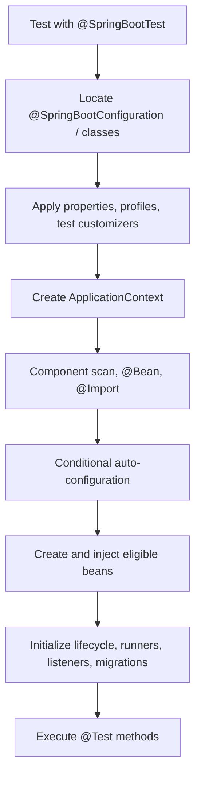
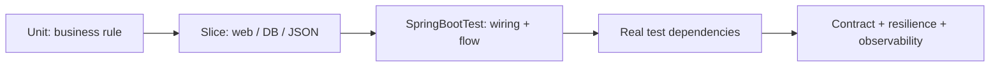

# `@SpringBootTest` and the Scope of Initialized Components

## 1. Lesson Objectives

A Spring Boot application can pass tests for individual services yet still fail when booting for real: beans are not scanned, database configuration is missing, security filters behave unexpectedly, or listeners start consuming messages before test data is ready. Conversely, if every test boots the entire application, the test suite can become slow, hard to isolate, and dependent on a database, cache, or broker even when unnecessary.

**`@SpringBootTest` boots an `ApplicationContext` using Spring Boot's startup mechanism in a test environment.** You must distinguish between the *scope of loaded beans* and *which integration boundaries were actually exercised*. Having an HTTP client bean in the context does not mean an HTTP request was sent; having a repository bean does not mean the database passed all transaction checks.

This lesson belongs to the **Integration Testing** chapter of the **SPRING_BOOT_INTEGRATION** module. The module focuses on structuring system integration in Spring Boot via HTTP clients, databases, caches, brokers, and Spring Integration adapters; emphasizing **configuration management, data contracts, transactions, failures, duplicate handling, testing, and observability** of real-world flows.

After this lesson, you will be able to:

- Explain how `@SpringBootTest` locates the root configuration, loads profiles, creates beans, and runs lifecycle callbacks.
- Choose the right `webEnvironment`: `MOCK`, `RANDOM_PORT`, `DEFINED_PORT`, or `NONE`.
- Distinguish full-context tests from unit tests and test slices (`@WebMvcTest`, `@DataJpaTest`, `@DataR2dbcTest`).
- Use mocks, fakes, `@TestConfiguration`, test properties, and Testcontainers to control dependencies.
- Avoid pitfalls involving transaction rollback, listeners, migrations, context caching, dirty data, and overclaiming beyond test scope.

> **Version note:** Examples target Java 17+, Spring Boot 3.2+, and JUnit 5. Examples use Spring MVC with `MockMvc`/`TestRestTemplate`; WebFlux applications use `WebTestClient` and appropriate reactive APIs. `@MockBean` is compatible with Spring Boot 3.2–3.3; starting with Spring Boot 3.4/Spring Framework 6.2, `@MockitoBean` is available as a replacement depending on the version.

## 2. What Does `@SpringBootTest` Initialize?

### 2.1. Bootstrapping from Application Configuration

Spring Boot Test uses `SpringApplication` to create the context. If `classes` is omitted, the test framework searches for `@SpringBootConfiguration` in the test's package and its parent packages; typically this is the class annotated with `@SpringBootApplication`.

```java
// src/main/java/com/example/order/OrderApplication.java
@SpringBootApplication
public class OrderApplication {
    public static void main(String[] args) {
        SpringApplication.run(OrderApplication.class, args);
    }
}
```

```java
// src/test/java/com/example/order/OrderContextIT.java
@SpringBootTest
class OrderContextIT {
    @Autowired
    ApplicationContext context;

    @Test
    void contextStarts() {
        assertNotNull(context);
    }
}
```

If the test resides outside the package tree containing the root configuration or the project has multiple configurations, you can specify it explicitly:

```java
@SpringBootTest(classes = OrderApplication.class)
class ExplicitConfigurationIT {
    @Test
    void startsWithOrderApplication() {}
}
```

The `classes` parameter determines the **configuration source used to build the context**. Passing a very small `@Configuration` class can produce a narrow context and omit real production beans; when you only need to test a single layer, a test slice or unit test usually expresses the intent more accurately.



**A full application context does not mean every class becomes a bean.** A component must be scanned, imported, declared via `@Bean`, or auto-configured, and satisfy `@Profile`, `@ConditionalOn...`, classpath, and property conditions. Non-lazy singletons are typically instantiated during context refresh; lazy or prototype beans may only be created when requested.

### 2.2. Commonly Present Component Groups

| Group | Example beans/infrastructure | When present and risks |
|---|---|---|
| Business | `@Service`, mappers, validators | Scanned/imported and matching active profile |
| HTTP inbound | `@RestController`, MVC mappings, Jackson, security filters | Web starter and suitable web environment present |
| HTTP outbound | `RestClient`, `WebClient`, interceptors, gateways | Bean presence does not mean network calls occur |
| Database | `DataSource`, JPA repositories, transaction managers | May open connections or run schema migrations on startup |
| Reactive data | `ConnectionFactory`, R2DBC repositories | Requires valid reactive driver and configuration |
| Cache | `CacheManager`, Redis connections | May connect/verify at startup or upon use |
| Message broker | JMS/Kafka/RabbitMQ listeners, connection factories | Listeners may automatically consume messages |
| Infrastructure | Actuator, observation, schedulers, runners | Depends on dependencies, profiles, and lifecycle |

When the context creates a `RestClient` bean while the test mocks `InventoryGateway`, we are testing application-side wiring/logic but **not testing the outbound HTTP contract**. Similarly, a JMS listener bean may exist while auto-start is disabled; a dedicated broker test is still needed to verify delivery and redelivery.

Several mechanisms can trigger side effects right at startup: `ApplicationRunner`, `CommandLineRunner`, `@PostConstruct`, `SmartLifecycle`, Flyway/Liquibase, `@Scheduled`, and listener containers. `@SpringBootTest` does not automatically shield production resources; select a test profile and isolate them before initializing the context.

### 2.3. Comparing Against a Plain Unit Test Without Spring

```java
class AvailabilityServiceUnitTest {
    @Test
    void positiveStockIsAvailable() {
        InventoryGateway gateway = sku -> new StockView(sku, 8);
        AvailabilityService service = new AvailabilityService(gateway);

        AvailabilityResponse response = service.check("SKU-42");

        assertTrue(response.available());
    }
}
```

This test simply instantiates Java objects and a fake gateway. It verifies logic but does not verify Spring dependency injection, MVC routing, serialization, security filters, or auto-configuration.

## 3. The Four `webEnvironment` Modes

`@SpringBootTest` defaults to `SpringBootTest.WebEnvironment.MOCK`. The name `MOCK` refers only to the **web environment**; it does not mean every service/repository is a Mockito mock.

| Mode | Created environment | Typical purpose |
|---|---|---|
| `MOCK` (default) | Mock servlet environment or matching reactive web context; **does not open an HTTP port** | Testing MVC/filters/JSON using `MockMvc` or WebFlux test clients |
| `RANDOM_PORT` | Real embedded web server on a random port | Sending real HTTP requests to application endpoints |
| `DEFINED_PORT` | Embedded web server on the configured `server.port` | Niche scenarios needing a fixed port; prone to conflicts during parallel runs |
| `NONE` | Context without a web environment | Testing persistence, jobs, messaging, or services that do not need a web server |

```java
@SpringBootTest(webEnvironment = SpringBootTest.WebEnvironment.MOCK)
class MockWebIT {}

@SpringBootTest(webEnvironment = SpringBootTest.WebEnvironment.RANDOM_PORT)
class LiveHttpIT {}

@SpringBootTest(webEnvironment = SpringBootTest.WebEnvironment.NONE)
class NonWebIT {}
```

**`@SpringBootTest` does not automatically inject `MockMvc`.** For Spring MVC applications, add `@AutoConfigureMockMvc` to register that test client. For WebFlux, you can use `@AutoConfigureWebTestClient` and `WebTestClient` when test dependencies match. `RANDOM_PORT` and `DEFINED_PORT` start a real HTTP server, yet an outbound adapter can still be replaced with a mock by the test configuration.

## 4. Sample Application: Controller → Service → Inventory HTTP Gateway

Suppose Order Service exposes `GET /api/availability/{sku}`. The controller delegates to a service; the service calls a gateway to query stock from Inventory Service. This is a classic case where you must decide exactly which layers run for real.

### 4.1. Shared Classes in the Example

```java
// StockView.java
public record StockView(String sku, long available) {}

// AvailabilityResponse.java
public record AvailabilityResponse(
        String sku, boolean available, long count
) {}

// InventoryGateway.java
public interface InventoryGateway {
    StockView getStock(String sku);
}
```

```java
// RestInventoryGateway.java
@Component
public class RestInventoryGateway implements InventoryGateway {
    private final RestClient client;

    public RestInventoryGateway(
            RestClient.Builder builder,
            @Value("${integration.inventory.base-url}") String baseUrl
    ) {
        this.client = builder.baseUrl(baseUrl).build();
    }

    @Override
    public StockView getStock(String sku) {
        return client.get()
                .uri("/v1/stocks/{sku}", sku)
                .retrieve()
                .body(StockView.class);
    }
}
```

```java
// AvailabilityService.java
@Service
public class AvailabilityService {
    private final InventoryGateway gateway;

    public AvailabilityService(InventoryGateway gateway) {
        this.gateway = gateway;
    }

    public AvailabilityResponse check(String sku) {
        StockView stock = gateway.getStock(sku);
        if (stock == null || stock.available() < 0) {
            throw new IllegalStateException(
                    "Inventory returned invalid stock");
        }
        return new AvailabilityResponse(
                stock.sku(), stock.available() > 0, stock.available()
        );
    }
}
```

```java
// AvailabilityController.java
@RestController
@RequestMapping("/api/availability")
public class AvailabilityController {
    private final AvailabilityService service;

    public AvailabilityController(AvailabilityService service) {
        this.service = service;
    }

    @GetMapping("/{sku}")
    public AvailabilityResponse get(@PathVariable String sku) {
        return service.check(sku);
    }
}
```

`RestInventoryGateway` is simplified here to keep the focus on test scope. In production, you must configure the URL, timeouts, TLS, auth, and proper error mapping; this example is not a complete transport implementation.

### 4.2. Full Context + `MockMvc` + Mocked Outbound Gateway

```java
// AvailabilityFlowIT.java — imports/static imports omitted
@SpringBootTest(
    webEnvironment = SpringBootTest.WebEnvironment.MOCK,
    properties = "integration.inventory.base-url=http://localhost:9999"
)
@AutoConfigureMockMvc
class AvailabilityFlowIT {
    @Autowired
    MockMvc mockMvc;

    @MockBean
    InventoryGateway gateway;

    @Test
    void controllerAndServiceWorkTogether() throws Exception {
        when(gateway.getStock("SKU-42"))
                .thenReturn(new StockView("SKU-42", 8));

        mockMvc.perform(get("/api/availability/{sku}", "SKU-42"))
                .andExpect(status().isOk())
                .andExpect(jsonPath("$.sku").value("SKU-42"))
                .andExpect(jsonPath("$.available").value(true))
                .andExpect(jsonPath("$.count").value(8));

        verify(gateway).getStock("SKU-42");
    }
}
```

In this test:

- **Real:** Spring application context, `AvailabilityController`, `AvailabilityService`, MVC request mapping, JSON serialization, and configured web filters.
- **Simulated:** `InventoryGateway` is replaced by a Mockito mock, so no real outbound HTTP request occurs.
- **No listening HTTP port:** `MockMvc` calls through the MVC test infrastructure.
- **Potentially still present:** database, cache, broker, and other auto-configured beans if classpath/properties allow.

`@MockBean` adds a mock to the test context and replaces the matching bean by type/name. On Boot 3.4+, check `@MockitoBean`. The value `localhost:9999` is only a placeholder to satisfy configuration in the example; because the gateway is replaced, the test **does not verify** any real service at that address.

### 4.3. Full Context with a Real HTTP Server

```java
// AvailabilityHttpIT.java
@SpringBootTest(
    webEnvironment = SpringBootTest.WebEnvironment.RANDOM_PORT,
    properties = "integration.inventory.base-url=http://localhost:9999"
)
class AvailabilityHttpIT {
    @Autowired
    TestRestTemplate client;

    @MockBean
    InventoryGateway gateway;

    @Test
    void acceptsRequestOnEmbeddedServer() {
        when(gateway.getStock("SKU-42"))
                .thenReturn(new StockView("SKU-42", 8));

        ResponseEntity<AvailabilityResponse> response =
                client.getForEntity(
                        "/api/availability/SKU-42",
                        AvailabilityResponse.class
                );

        assertEquals(HttpStatus.OK, response.getStatusCode());
        assertNotNull(response.getBody());
        assertTrue(response.getBody().available());
    }
}
```

With Spring MVC and the corresponding Spring Boot test starter, `TestRestTemplate` resolves relative paths against the test server's URL/port. If you need the port number, inject `@LocalServerPort int port` (package `org.springframework.boot.test.web.server`). The test sends **real inbound HTTP** to the embedded server, while the Inventory outbound call remains mocked. This is still not an HTTP contract test between Order and Inventory.

## 5. Comparing Full Context and Test Slices

You do not always need to load the entire context.

| Testing approach | Typical scope | Suitable when |
|---|---|---|
| Plain JUnit/Mockito | Explicitly instantiated objects | Business rules, pure functions |
| `@WebMvcTest(Controller.class)` | Controller and relevant web MVC infrastructure, without loading all services | Mapping, validation, JSON, web layer |
| `@JsonTest` | JSON serialization/deserialization | DTOs and Jackson configuration |
| `@DataJpaTest` | JPA infrastructure, entities/repositories, test datasource | SQL/JPA mapping and repositories |
| `@DataR2dbcTest` | Spring Data R2DBC infrastructure | Repositories and reactive queries |
| `@SpringBootTest` | Application context per root configuration | Wiring and multi-layer flows |

A web slice typically does not automatically load `AvailabilityService`; you must mock it or provide a test bean:

```java
@WebMvcTest(AvailabilityController.class)
class AvailabilityControllerSliceTest {
    @Autowired
    MockMvc mvc;

    @MockBean
    AvailabilityService service;

    @Test
    void serializesAvailability() throws Exception {
        when(service.check("SKU-42"))
                .thenReturn(
                        new AvailabilityResponse("SKU-42", true, 8));

        mvc.perform(get("/api/availability/SKU-42"))
                .andExpect(status().isOk())
                .andExpect(jsonPath("$.available").value(true));
    }
}
```

In this slice, `AvailabilityService` **does not run real logic**. The MVC + mocked gateway test in section 4 goes deeper because it checks the controller calling the real service. `@WebMvcTest` may load Spring Security filters and result in `401/403` if authentication is not configured; decide whether you want to test security or only MVC serialization before adjusting the test.

**Quick rule of thumb:** single unit of logic → unit test; single-layer mapping → test slice; combining service, transaction, and repository → `@SpringBootTest` with a test DB; network/queue communication and failover → `@SpringBootTest` combined with HTTP stubs, Testcontainers, or a real broker. Loading many beans in a test does not mean all systems have been tested end to end.

## 6. Controlling Configuration and Beans in Tests

### 6.1. Profiles, Test Properties, and Configuration Sources

```java
@SpringBootTest(
    webEnvironment = SpringBootTest.WebEnvironment.NONE,
    properties = {
        "integration.inventory.base-url=http://localhost:9999",
        "spring.jms.listener.auto-startup=false"
    }
)
@ActiveProfiles("test")
class NonWebIntegrationIT {
    @Test
    void loadsWithTestProfile() {}
}
```

`@ActiveProfiles("test")` activates test profile configuration, such as `src/test/resources/application-test.yml`. `@SpringBootTest(properties=...)` sets test-specific properties; `@TestPropertySource` and `@DynamicPropertySource` are other mechanisms in Spring Test. When multiple property sources define the same key, precedence rules apply; inspect the **effective value** in `Environment` if behavior differs from expectations.

Example test configuration isolating external resources:

```yaml
# src/test/resources/application-test.yml
integration:
  inventory:
    base-url: http://localhost:9999
spring:
  jms:
    listener:
      auto-startup: false
```

In real environments, you also need test URLs/credentials for the DB, Redis, and broker if those beans are created. Never put production credentials into test properties. The property `spring.jms.listener.auto-startup=false` only affects JMS listeners configured appropriately by Boot; it **does not automatically disable** `@Scheduled` jobs, Kafka listeners, Spring Integration flows, or custom startup runners.

### 6.2. Replacing Dependencies with Mocks, Fakes, or Test Beans

| Approach | Benefit | Limitation to remember |
|---|---|---|
| `@MockBean` / `@MockitoBean` | Replaces a bean in `ApplicationContext` with a Mockito mock | Does not execute the real implementation of the replaced bean |
| `@TestConfiguration` + `@Import` | Creates fake/test-specific beans, overriding logic at an intentional boundary | Risk of duplicate beans without qualifiers/primary or exclusion config |
| HTTP fake server | Sends requests over real HTTP, returns controlled responses | Does not prove the production provider accepts the contract |
| Test database/broker | Verifies drivers, transactions, listeners, persistence, and delivery | Slower startup, requires data and resource isolation |

Example fake bean provided by the test:

```java
@TestConfiguration(proxyBeanMethods = false)
class FakeInventoryConfiguration {
    @Bean
    @Primary
    InventoryGateway fakeInventoryGateway() {
        return sku -> new StockView(sku, 8);
    }
}

@SpringBootTest(
    properties = "integration.inventory.base-url=http://localhost:9999"
)
@Import(FakeInventoryConfiguration.class)
class AvailabilityWithFakeIT {
    @Autowired
    AvailabilityService service;

    @Test
    void acceptsFakeData() {
        assertTrue(service.check("SKU-42").available());
    }
}
```

`@Primary` gives preference to the fake when injecting into the service, yet **does not necessarily prevent the real adapter bean from being instantiated**. If the real adapter opens a connection in its constructor, side effects may still occur. To replace the bean completely, choose an appropriate mock/override mechanism or conditional configuration so the production adapter is not created under the test profile.

### 6.3. Side Effects That Can Occur Before `@Test`

A full application context can start:

1. `CommandLineRunner` and `ApplicationRunner`; these may issue HTTP calls or publish messages.
2. Flyway/Liquibase or SQL initializers; the schema may be modified during context boot.
3. JMS/Kafka/RabbitMQ listener containers; consumers may receive and acknowledge messages.
4. `@Scheduled` schedulers, Spring Integration pollers, or `SmartLifecycle` beans.
5. Custom `@PostConstruct`/factory beans using Redis, a database, or a secret manager.

Therefore, if your goal is only to test bean wiring, isolate startup tasks and declare explicit profiles and enable/disable conditions. Do not configure huge timeouts hoping production dependencies become available; tests must have controlled test resources actively provisioned.

### 6.4. Identifying Which Beans Are Real vs. Mocked

When you need to verify scope, you can inject `ApplicationContext` and check that key beans are present; avoid turning a test into a checklist asserting hundreds of framework-internal beans.

```java
@SpringBootTest(
    properties = "integration.inventory.base-url=http://localhost:9999"
)
class ComponentWiringIT {
    @Autowired
    ApplicationContext context;

    @Test
    void expectedApplicationBeansExist() {
        assertNotNull(context.getBean(AvailabilityService.class));
        assertNotNull(context.getBean(AvailabilityController.class));
        assertNotNull(context.getBean(InventoryGateway.class));
    }
}
```

This test confirms dependency injection and bean creation conditions under the **current configuration**. It does not verify that endpoints return the right status codes or that the HTTP gateway works with Inventory. If you only want to see why auto-configuration beans were or were not created, enable the condition evaluation report in a debug/test environment rather than guessing from starter names.

## 7. Combining `@SpringBootTest` with Testcontainers

### 7.1. Why Use Real Databases/Brokers in Some Tests?

A mocked repository cannot test SQL, mapping, transaction isolation, database constraints, or migrations. H2 does not guarantee parity with PostgreSQL for `JSONB`, locking, and dialect. A mocked JMS listener does not reveal ActiveMQ/Artemis redelivery or DLQ behavior. Therefore, tests at this boundary should run against test dependencies of the **same engine family** as production.

With Spring Boot 3.2+, Testcontainers can provision a test database and Boot's `@ServiceConnection` automatically configures connection details. Dedicated test dependencies are required, for example:

```xml
<dependency>
    <groupId>org.springframework.boot</groupId>
    <artifactId>spring-boot-testcontainers</artifactId>
    <scope>test</scope>
</dependency>
<dependency>
    <groupId>org.testcontainers</groupId>
    <artifactId>junit-jupiter</artifactId>
    <scope>test</scope>
</dependency>
<dependency>
    <groupId>org.testcontainers</groupId>
    <artifactId>postgresql</artifactId>
    <scope>test</scope>
</dependency>
```

The following example is for an application **already configured with JDBC/JPA and `JdbcTemplate`**, using test PostgreSQL (with the PostgreSQL JDBC driver also on the classpath):

```java
// DatabaseContextIT.java — imports omitted
@SpringBootTest(
    webEnvironment = SpringBootTest.WebEnvironment.NONE,
    properties = "integration.inventory.base-url=http://localhost:9999"
)
@Testcontainers
class DatabaseContextIT {
    @Container
    @ServiceConnection
    static PostgreSQLContainer<?> postgres =
            new PostgreSQLContainer<>("postgres:16-alpine");

    @Autowired
    JdbcTemplate jdbc;

    @Test
    void connectionUsesTestPostgresql() {
        Integer result = jdbc.queryForObject(
                "SELECT 1", Integer.class);
        assertEquals(1, result);
    }
}
```

With `@ServiceConnection` and the proper dependencies, Spring Boot can produce `JdbcConnectionDetails` from the PostgreSQL container. **This is not yet a business schema test:** it only proves connectivity and a minimal query. To test repositories/transactions, run migrations, set up fixtures, and assert database state.

You can also supply container properties via `@DynamicPropertySource` (an alternative when not using `@ServiceConnection`):

```java
@DynamicPropertySource
static void databaseProperties(DynamicPropertyRegistry registry) {
    registry.add("spring.datasource.url", postgres::getJdbcUrl);
    registry.add("spring.datasource.username", postgres::getUsername);
    registry.add("spring.datasource.password", postgres::getPassword);
}
```

Both configurations above apply only when `postgres` is a container declared in that test class. There is no need to declare both if one mechanism already supplies the right connection details. Testcontainers requires a container runtime (Docker or a compatible runtime); the code in this lesson is illustrative and does not imply Docker or an external broker has been executed here.

### 7.2. Matrix for Choosing Real vs. Simulated Dependencies by Goal

| Goal | What should be real | What can be simulated |
|---|---|---|
| Controller + service | Spring MVC, service, JSON mapping | Outbound Inventory gateway |
| Persistence | Repository, transaction manager, test PostgreSQL, migrations | HTTP client, unrelated brokers |
| Outbound HTTP client | `RestClient`/`WebClient`, serialization, HTTP transport | Downstream via WireMock/MockWebServer |
| JMS consumer and deduplication | Listener container, test broker, test database | Notification services outside the flow |
| Controlled end-to-end flow | Inbound HTTP, service, DB, outbox, broker, and consumers under test | Systems outside the target boundary |

In outbound HTTP tests, `MockRestServiceServer` can assert URI/headers/body and HTTP status with `RestClient`. However, it does not perform TCP/TLS; to verify certificates, hostname verification, or network timeouts, you need a real test HTTP server. With JMS, mocking `JmsTemplate` does not prove broker durability, redelivery, or dead-letter policies.

## 8. Transactions and Test Data

### 8.1. Test-Level `@Transactional` Does Not Cover Every Request

Spring Test can open a transaction for a test method when a suitable transaction manager is present:

```java
@SpringBootTest
@Transactional
class RepositoryIntegrationIT {
    // DB operations participate in the test-managed transaction
    // and can be rolled back after the test method finishes.
}
```

However, with `@SpringBootTest(webEnvironment=RANDOM_PORT)`, the HTTP client in the test and the server handling the request typically run **on different threads**. A transaction bound to the test method does not propagate to the server's transaction. Consequently, annotating the test with `@Transactional` **does not roll back data committed by an HTTP handler**. With `MockMvc` executing synchronously on the same thread, the situation may differ; always verify the exact transaction boundary rather than relying on intuition.

A database `@Transactional` also does not roll back messages sent to a broker, Redis writes, or HTTP calls to other systems. For those operations, use isolated test resources, cleanup/reconciliation, outbox, or corresponding idempotency mechanisms.

### 8.2. Data Isolation and Parallel Testing Strategies

- **SQL:** versioned migrations/fixtures and isolated data; test transactions, truncate, or reset schema per the test model.
- **Redis/cache:** test namespaces, TTLs, and key cleanup; avoid reading stale keys from other tests.
- **Broker:** dedicated queues/topics or consumer groups; controlled cleanup/replay, never production queues.
- **HTTP stubs:** reset expectations and request journals between tests.
- **Clocks and IDs:** inject a clock when business logic depends on time; pick reproducible operation IDs/fixtures that do not collide across parallel tests.

`@Sql` is a common utility for loading/cleaning SQL data in Spring Test with appropriate JDBC support. With R2DBC, check whether your data initialization tool supports reactive execution or still requires a separate JDBC step; do not assume JDBC and R2DBC test transactions share the same transaction.

## 9. Context Caching, Performance, and Startup Failures

Spring Test **caches `ApplicationContext` instances** with equivalent configurations for reuse across tests. One test booting a broad context can save time for other tests sharing the exact same setup; conversely, frequently changing profiles, properties, mock beans, imports, or web environments causes many separate contexts to be created.

Factors that commonly affect the cache key include configuration sources, active profiles, test properties, mock/test context customizers, and web configuration. `@DirtiesContext` forces Spring to evict the cached context when truly needed. **Do not put `@DirtiesContext` on every test** merely to solve dirty data; scoped DB/cache/message cleanup is cheaper and clarifies the root cause.

| Failure phase | Symptom | What to check |
|---|---|---|
| Finding root config | `@SpringBootConfiguration` not found | Test package, `classes`, and root configuration |
| Bean creation/injection | `UnsatisfiedDependencyException`, missing or non-unique bean | Component scan, `@Profile`, conditionals, mocks/fakes, and qualifiers |
| Auto-configuration | Missing driver, URL, credentials, or module | Starters, dependency tree, properties, custom beans |
| Initialization | Migration failure, broker/DB not up, runner throws exception | Test resources, startup side effects, schema |
| During test execution | Wrong HTTP status, message not arriving, transaction not rolling back | Real boundary, handlers, broker policy, thread/transaction |
| After test | Dirty data, connection leaks, order dependency | Fixtures, cleanup, lifecycle, context reuse |

A green `contextLoads()` test only indicates that **the context booted successfully under that configuration**. It does not prove HTTP contracts, business outcomes, JMS redelivery, or timeouts/TLS work.

## 10. Designing Tests at the Right Integration Boundaries

### 10.1. HTTP, Data Contracts, and Network Failures

When testing outbound HTTP, verify request methods, URL templates, headers, JSON DTOs, `4xx/5xx` responses, and exception mapping. Mocking the gateway at the service layer keeps tests fast, but you must have a **dedicated test** for the real adapter. When testing retries, timeouts, and TLS, use a fake server over real networking with slow responses or invalid certificates, while bounding retry counts and time budgets.

### 10.2. Database, Cache, and Transactions

Test repositories with a database of the same family as production to catch schema, constraint, locking, and transaction isolation differences. Caches need hit/miss, TTL, and invalidation tests: a cache hit can bypass the repository completely. When a single request updates the database and emits an event, test outbox/consistency at the SQL/broker boundary rather than asserting only a successful response.

### 10.3. Brokers, Redelivery, DLQ, and Idempotency

If a consumer receives a message again due to a crash between database commit and JMS ack, it must recognize the existing `operationId` and avoid deducting inventory twice. Test with a real broker and database, deliberately redeliver the same command, and verify state is not duplicated. Poison messages must go through the broker's real retry/DLQ policy; `@SpringBootTest` creates the listener bean but does not guarantee a correct DLQ configuration.

### 10.4. Spring Integration Adapters and Flows

With Spring Integration, test transformers/routers/filters/channels with component-level tests when possible. When proving a real flow, use `@SpringBootTest` with the corresponding input channel and adapters alongside appropriate broker/HTTP stubs. Having Spring Integration beans in the context **does not mean messages actually traverse the flow**.



Testing layers complement one another. Not every test needs to run the entire system; what matters is having sufficient coverage to verify critical contracts and failure points.

## 11. Test Acceptance Checklist

| Question | What to verify |
|---|---|
| Is a full context needed? | List participating services/beans; consider a slice if only one layer is tested |
| Is `webEnvironment` appropriate? | `MOCK` uses MVC tests, `RANDOM_PORT` uses a real server, `NONE` for non-web |
| Which beans will be created? | Component scan, profiles, conditional auto-config, test customizers |
| Which downstreams are real? | Specify DB, Redis, broker, HTTP server; note which adapters are mocked |
| Are there startup side effects? | Runners, schedulers, listeners, migrations, connection initializers |
| Is test data isolated? | Schema/containers, queues, cache namespaces, fixtures, and cleanup |
| Is transaction scope accurate? | Test thread, HTTP server thread, separate DB and broker transactions |
| Are failure paths tested? | Timeouts, `4xx/5xx`, malformed JSON, duplicate messages, DLQ, and rollback |
| Is it reproducible? | No reliance on test order, fixed ports, or shared data |
| Are conclusions overstated? | Distinguish context startup, integration flow, contract, and end-to-end |

### Self-Check Questions

1. How does `@SpringBootTest` locate `@SpringBootConfiguration`, and when is `classes` needed?
2. Does a full context mean all external beans have actually connected or been invoked?
3. How do `MOCK` and `RANDOM_PORT` differ? What does `@AutoConfigureMockMvc` do?
4. If `InventoryGateway` is mocked, which parts of Controller → Service → Gateway are still verified?
5. Why does a `@WebMvcTest` usually require mocking the service whereas `@SpringBootTest` can load the real service?
6. When do you need PostgreSQL Testcontainers, and when is a mocked repository sufficient?
7. Why does `@Transactional` on a `RANDOM_PORT` test fail to roll back data written by server-side requests?
8. Which components can execute before a `@Test` method runs?
9. Why does overusing `@DirtiesContext` slow down a test suite?
10. What must be verified to confirm a JMS consumer handles duplicate messages safely?

**Key takeaway:** `@SpringBootTest` constructs an **ApplicationContext according to test configuration**, typically with broad bean scope. Choose the right `webEnvironment`, know which beans are real and which are replaced, isolate startup side effects, manage transactions and test data properly, and pair it with appropriate slices, contracts, and test infrastructure. A context booting successfully is only the starting point; integration reliability is proven when **real flows and failure cases actually execute across the exact boundaries under test**.
