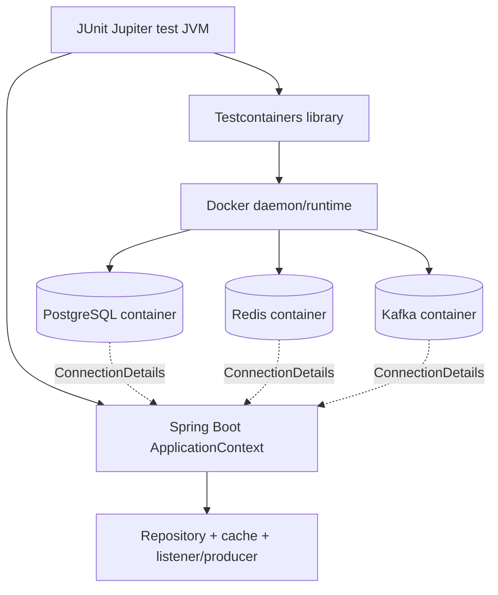
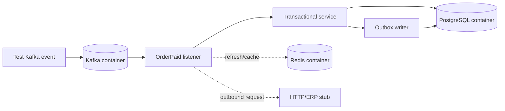

# Testcontainers, `@Container`, and `@ServiceConnection`

## 1. Why Does Integration Testing Need Real Services, Not Just Mocks?

In the **SPRING_BOOT_INTEGRATION** module, a Spring Boot application connects to multiple systems via HTTP clients, databases, caches, message brokers, and Spring Integration adapters. An example flow: a consumer receives `OrderPaid` from Kafka, writes order state and an outbox record into PostgreSQL, reads Redis to return fast results, and then calls an ERP system over HTTP/SOAP. Unit tests with mocks help verify business branches, yet struggle to catch bugs that only appear when **drivers, transactions, networking, schemas, and brokers actually execute**.

Bugs that commonly slip past mocks:

- PostgreSQL handles `ON CONFLICT`, JSONB, row locks, isolation, or unique constraints differently than H2.
- Flyway migrations run out of order, miss an index, or fail to initialize the schema like production.
- Redis serializers fail to deserialize DTOs, TTLs do not expire as intended, or key prefixes are wrong.
- Kafka bootstrap servers/advertised listeners are unreachable from the test JVM; consumers commit offsets too early.
- A DB write commits while message publishing fails, causing retries to produce duplicate side effects.
- Spring Boot misconfigures `DataSource`, `RedisConnectionFactory`, or broker properties inside the test context.

**Testcontainers** lets tests launch isolated services inside Docker containers: a real PostgreSQL database, a real Redis instance, a test Kafka broker, and then stop and clean them up after tests finish. **`@Container`** belongs to Testcontainers' JUnit Jupiter integration, while **`@ServiceConnection`** belongs to Spring Boot to wire auto-configuration to the container without manually copying host/port/credentials.

Lesson objectives:

1. Understand the role, lifecycle, and limitations of Testcontainers, `@Testcontainers`, and `@Container`.
2. Build Spring Boot integration tests with PostgreSQL and `@ServiceConnection`, knowing how to verify real migrations and transactions.
3. Know when to choose `@DynamicPropertySource` instead of or alongside `@ServiceConnection`.
4. Connect Redis/Kafka and coordinate integration testing across multi-dependency flows.
5. Manage repeatability, cleanup, test data, CI speed, stability, and security.
6. Distinguish what container tests prove from contract/production behaviors that still require separate tests.

## 2. Choosing the Test Type by the Boundary to Verify

| Test type | Components actually running | What it proves well | Limitations |
|---|---|---|---|
| Unit test | Domain/service + mocks/fakes | Business rules, mapping, error branches. | Does not test real SQL drivers/brokers/networking. |
| Slice test such as `@DataJdbcTest`/`@DataJpaTest` | Partial Spring context, repositories, and configured dependencies. | Mapping, queries, persistence-layer transactions. | Does not traverse the full application flow. |
| Integration test with Testcontainers | Spring context + real PostgreSQL/Redis/Kafka in containers. | Connectivity, serialization, migrations, transactions, and broker interaction. | Does not prove the production environment is identical. |
| HTTP/SOAP contract test | Client/server stubs verifying requests/responses against a contract. | Headers, URIs, JSON/XML, SOAP Faults, backward compatibility. | Stubs may not reflect real partner state. |
| End-to-end/staging test | Multiple services deployed together. | Routing, credentials, network policies, deployment compatibility. | Slow, costly, dependent on data/environment. |

**Do not replace every unit test with a container test.** A fast, reliable suite uses unit tests for most business decisions and focuses Testcontainers on boundaries that mocks cannot represent: dialect-specific JDBC SQL, Flyway, Redis serialization, Kafka acknowledgment, or database-level idempotency.

Conversely, swapping PostgreSQL for H2 just to make tests fast can hide bugs. If production runs PostgreSQL, queries relying on `INSERT ... ON CONFLICT`, `FOR UPDATE SKIP LOCKED`, or `JSONB` types should be tested against real PostgreSQL.

## 3. High-Level Testcontainers Architecture

Testcontainers is a library that controls a container runtime (typically Docker) from the test JVM. It starts containers, waits for readiness via an appropriate strategy, exposes host-mapped addresses/ports, and provides APIs to retrieve JDBC URLs or bootstrap servers.



Three mechanism layers should be kept distinct:

- **Container lifecycle:** who starts it, who stops it, and does it run once per class or per test method?
- **Connection information:** how are the URL, host, mapped port, and username/password retrieved from the container?
- **Spring auto-configuration:** how is that information fed into `DataSource`, `RedisConnectionFactory`, Kafka clients, and related beans?

`@Container` solves the first layer via JUnit Jupiter. `@ServiceConnection` solves the third layer via Spring Boot's **ConnectionDetails**. Neither annotation automatically ensures business workflows roll back or clean up properly; that responsibility belongs to test and system design.

## 4. Dependencies and Environment Requirements

Example with Gradle Kotlin DSL for a Spring Boot application using PostgreSQL:

```kotlin
dependencies {
    implementation("org.springframework.boot:spring-boot-starter-jdbc")
    implementation("org.springframework.boot:spring-boot-starter-actuator")

    runtimeOnly("org.postgresql:postgresql")

    testImplementation("org.springframework.boot:spring-boot-starter-test")
    testImplementation("org.springframework.boot:spring-boot-testcontainers")
    testImplementation("org.testcontainers:junit-jupiter")
    testImplementation("org.testcontainers:postgresql")
}
```

If testing Redis/Kafka, add the corresponding application starters and Testcontainers modules as needed. For example:

```kotlin
dependencies {
    implementation("org.springframework.boot:spring-boot-starter-data-redis")
    implementation("org.springframework.kafka:spring-kafka")

    testImplementation("org.springframework.kafka:spring-kafka-test")
    testImplementation("org.testcontainers:kafka")
}
```

The snippet above assumes the application uses **compatible Spring Boot dependency management/BOM** to manage versions. Do not pin Spring Boot, Testcontainers, PostgreSQL drivers, and Spring Kafka independently without verifying compatibility. Some Testcontainers versions change Kafka package or module names; verify imports and modules against your actual dependencies.

With Maven, the primary dependencies can be declared in `test` scope:

```xml
<dependency>
    <groupId>org.springframework.boot</groupId>
    <artifactId>spring-boot-starter-test</artifactId>
    <scope>test</scope>
</dependency>
<dependency>
    <groupId>org.springframework.boot</groupId>
    <artifactId>spring-boot-testcontainers</artifactId>
    <scope>test</scope>
</dependency>
<dependency>
    <groupId>org.testcontainers</groupId>
    <artifactId>junit-jupiter</artifactId>
    <scope>test</scope>
</dependency>
<dependency>
    <groupId>org.testcontainers</groupId>
    <artifactId>postgresql</artifactId>
    <scope>test</scope>
</dependency>
```

**`@ServiceConnection` is available from Spring Boot 3.1+** in the mechanism described by Boot's documentation; the examples use APIs from that generation. Newer Boot releases may support additional service connection types, container images, or bean mechanisms. Check your project's metadata/version rather than assuming snippets from another generation drop in unchanged.

### 4.1. Docker/Runtime Is a Prerequisite

The machine running tests must have access to a Docker daemon or compatible container runtime supported by Testcontainers, with permissions to pull images, create containers/networks, map ports, and perform cleanup. This is not the same as simply having the Docker CLI installed.

Common issues include: Docker Desktop not running, CI runners not mounting or permitting the Docker socket, rootless runtime restrictions, proxies blocking image pulls, untrusted registry certificates, or policies blocking cleanup sidecar containers. Tests should fail fast with clear diagnostics rather than silently turning the entire integration suite into skipped tests.

## 5. What Do `@Testcontainers` and `@Container` Do?

**JUnit Jupiter** integration lives in `org.testcontainers:junit-jupiter`:

```java
import org.junit.jupiter.api.Test;
import org.testcontainers.containers.PostgreSQLContainer;
import org.testcontainers.junit.jupiter.Container;
import org.testcontainers.junit.jupiter.Testcontainers;

@Testcontainers
class PostgresLifecycleTest {

    @Container
    static PostgreSQLContainer<?> postgres =
            new PostgreSQLContainer<>("postgres:16-alpine");

    @Test
    void containerIsRunning() {
        org.junit.jupiter.api.Assertions.assertTrue(postgres.isRunning());
    }
}
```

`@Testcontainers` enables the JUnit extension to manage fields annotated with `@Container`. When using a **static field**, the container is typically started **once for the test class** and stopped when the class finishes. When using an **instance field**, the container is typically started/stopped **for each test method**. Exact lifecycle details and parallel execution follow your JUnit/Testcontainers versions.

| Declaration | Typical scope | Benefits | Risks |
|---|---|---|---|
| `static @Container` | Shared across methods in one class. | Saves startup time; convenient for `@SpringBootTest`. | Test data can leak between methods. |
| Instance `@Container` | Separate container per method. | Stronger state isolation. | High startup/migration cost; requires checking Spring context timing. |
| Manually created and started container | Owned by test code/utilities. | Custom lifecycle control. | Easy to leak if not stopped; easily conflicts with Spring context cache. |
| Spring Boot-managed container bean | Tied to ApplicationContext when supported. | Fits development/test configuration. | Do not mix JUnit `@Container` and bean lifecycle without understanding ownership. |

**Common mistake:** a static container stops after its test class, yet a cached/reused Spring `ApplicationContext` for another test class still holds a connection URL/bean pointing to the old container. Keep base test/lifecycle/context caching consistent or isolate contexts across classes rather than assuming a static field automatically acts as a suite-wide singleton.

### 5.1. `@Container` vs. `@ServiceConnection`

- `@Container` belongs to **Testcontainers JUnit Jupiter**: starts/stops the container according to test lifecycle.
- `@ServiceConnection` belongs to **Spring Boot**: discovers matching `ConnectionDetails` for the container bean/field so Spring auto-configuration can consume it.
- `@Testcontainers` belongs to **JUnit extension**: enables management of `@Container`-annotated fields.
- `@SpringBootTest` belongs to **Spring Boot Test**: loads the application context for integration testing.

These annotations complement rather than replace each other. Putting `@ServiceConnection` alone on an arbitrary object without a mechanism to start the container does not mean the container will start at the right time in every setup.

## 6. `@ServiceConnection`: How Boot Receives Connections from Containers

Before Spring Boot supported service connections, tests commonly extracted `postgres.getJdbcUrl()`, `getUsername()`, and `getPassword()` and assigned them to `spring.datasource.*`. `@ServiceConnection` reduces boilerplate by letting Boot inspect the container and produce the corresponding **ConnectionDetails** beans.

Path:

```mermaid
flowchart LR
    C[PostgreSQLContainer] --> A[@ServiceConnection]
    A --> F[Boot ConnectionDetails factory]
    F --> J[JdbcConnectionDetails]
    J --> B[DataSource auto-configuration]
    B --> D[(PostgreSQL test container)]
    B --> M[JDBC/JPA repositories]
```

For example, with `PostgreSQLContainer`, Boot can supply `JdbcConnectionDetails` and, when the corresponding infrastructure is present, R2DBC connection details depending on classpath/supported factories. If multiple factories match a single container, you can narrow them using the `type` attribute on `@ServiceConnection` when needed.

**Key point:** `ConnectionDetails` is a connection information source for **auto-configuration**. It does not validate migrations, create tables, set isolation levels, or turn PostgreSQL, Kafka, and Redis into a single shared transaction.

### 6.1. PostgreSQL Test with `@Container` and `@ServiceConnection`

```java
import org.junit.jupiter.api.Test;
import org.springframework.beans.factory.annotation.Autowired;
import org.springframework.boot.test.context.SpringBootTest;
import org.springframework.boot.testcontainers.service.connection.ServiceConnection;
import org.springframework.jdbc.core.JdbcTemplate;
import org.testcontainers.containers.PostgreSQLContainer;
import org.testcontainers.junit.jupiter.Container;
import org.testcontainers.junit.jupiter.Testcontainers;

import static org.junit.jupiter.api.Assertions.assertEquals;

@SpringBootTest
@Testcontainers
class JdbcServiceConnectionIT {

    @Container
    @ServiceConnection
    static PostgreSQLContainer<?> postgres =
            new PostgreSQLContainer<>("postgres:16-alpine")
                .withDatabaseName("orders_it")
                .withUsername("test")
                .withPassword("test");

    @Autowired
    JdbcTemplate jdbc;

    @Test
    void usesRealPostgreSQL() {
        Integer answer = jdbc.queryForObject(
                "SELECT 1", Integer.class);
        assertEquals(1, answer);
    }
}
```

When dependencies and configuration match, the test does not need to declare `spring.datasource.url`, username, or password for the test PostgreSQL instance; Boot uses connection details from the container. A `SELECT 1` test only proves connectivity works, **not** that migrations and business repositories are accurate. Later sections expand to schema and transactions.

### 6.2. Container Image Tags and Compatibility

`postgres:16-alpine` is an example of a specific image. In real projects, choose a version compatible with production (major version, extensions, collation where queries are affected), and pin tags/digests according to your reproducibility policy. Avoid always using `latest`, which causes CI to change server versions unexpectedly.

Never put production passwords, service tokens, or real customer data into test containers. Credentials like `test/test` are strictly for ephemeral test instances.

## 7. Conditions for `@ServiceConnection` to Work

Four requirements must all hold:

1. **`spring-boot-testcontainers`** is present on the test classpath.
2. The container bean/field is visible to Boot in a form supported by that version.
3. The container type or image/service name is recognized by a **`ConnectionDetails` factory**.
4. Auto-configuration for the target dependency (JDBC/JPA/Redis/Kafka...) actually consumes those connection details.

If you use a `GenericContainer` without a hint name, Boot may not know whether it is Redis or another service. If a new library lacks a factory, the annotation does not magically generate support for it.

### 7.1. Recognition by Container Type and Image Name

With specialized containers like `PostgreSQLContainer`, Boot usually knows the connection from the type. With `GenericContainer<?>`, add **`@ServiceConnection(name = "redis")`** (in Boot versions with a Redis service connection factory) to state the service explicitly.

```java
import org.springframework.boot.testcontainers.service.connection.ServiceConnection;
import org.testcontainers.containers.GenericContainer;
import org.testcontainers.junit.jupiter.Container;
import org.testcontainers.utility.DockerImageName;

@Container
@ServiceConnection(name = "redis")
static GenericContainer<?> redis =
        new GenericContainer<>(DockerImageName.parse("redis:7-alpine"))
            .withExposedPorts(6379);
```

This field belongs inside a test class annotated with `@Testcontainers` and `@SpringBootTest`. You must have Spring Data Redis/Redis auto-configuration for Boot to create a Redis connection; `@ServiceConnection` does not turn `GenericContainer` into a Redis client.

### 7.2. When Declaring Containers as `@Bean`

In some Boot versions, you can declare containers as `@Bean` methods in a test configuration and annotate the method with `@ServiceConnection`. Unlike a static field, Boot may **not yet be able to invoke the bean method to inspect the full Docker image name** when selecting a `ConnectionDetails` factory; therefore, with `GenericContainer`, specify `name` explicitly:

```java
@TestConfiguration(proxyBeanMethods = false)
class TestServicesConfiguration {

    @Bean
    @ServiceConnection(name = "redis")
    GenericContainer<?> redisContainer() {
        return new GenericContainer<>(
                DockerImageName.parse("redis:7-alpine"))
                .withExposedPorts(6379);
    }
}
```

This is an **alternative approach** where Spring manages the container bean, not advice to attach JUnit `@Container` to the exact same object. With a `@Container` field, JUnit Jupiter owns the lifecycle; with a Spring Boot-managed `@Bean`, the test/application context owns the lifecycle per version support. Never mix two owners, which causes duplicate starts/stops or leaves the context pointing to a dead container.

## 8. `@DynamicPropertySource`: An Alternative and Complement

Spring Test's `@DynamicPropertySource` lets tests supply dynamic properties from containers through `DynamicPropertyRegistry`. It is useful when:

- The project runs a Spring Boot version prior to `@ServiceConnection`.
- The container uses a custom protocol/client without a `ConnectionDetails` factory.
- You need to bind an **application-specific property** such as `integration.partner.base-url`.
- You need to configure a parameter not covered by the service connection abstraction.

Equivalent PostgreSQL example:

```java
import org.springframework.test.context.DynamicPropertyRegistry;
import org.springframework.test.context.DynamicPropertySource;

@Container
static PostgreSQLContainer<?> postgres =
        new PostgreSQLContainer<>("postgres:16-alpine");

@DynamicPropertySource
static void registerProperties(DynamicPropertyRegistry registry) {
    registry.add("spring.datasource.url", postgres::getJdbcUrl);
    registry.add("spring.datasource.username", postgres::getUsername);
    registry.add("spring.datasource.password", postgres::getPassword);
}
```

With `@ServiceConnection`, many of the service-specific properties above are unnecessary. **Avoid mixing both approaches for the same datasource** without a clear reason, because precedence rules between connection details and URL properties can make configuration debugging harder.

| Aspect | `@ServiceConnection` | `@DynamicPropertySource` |
|---|---|---|
| Binding mechanism | Boot inspects container and creates `ConnectionDetails`. | Test registers properties with suppliers. |
| Conciseness for common DB/Redis/Kafka | Usually less boilerplate. | Must manually register URL, user, port, bootstrap. |
| Custom services without a factory | May require writing a custom factory. | Usually easy to use immediately. |
| Setting app-specific properties | Does not replace all custom properties. | Very well suited. |
| Depends on `spring-boot-testcontainers` module | Yes. | Not needed solely to register properties. |
| Depends on container lifecycle | Yes, must start appropriately. | Yes, supplier is evaluated when the property is read. |

### 8.1. Avoid Hardcoded Ports

Wrong:

```properties
spring.datasource.url=jdbc:postgresql://localhost:5432/orders_it
```

Right with Testcontainers:

```java
registry.add("spring.datasource.url", postgres::getJdbcUrl);
```

A container port like 5432 **inside** the container is typically mapped to a random host port. Values from `getJdbcUrl()`/`getMappedPort(5432)` already reflect the host and port the test JVM must connect to. Never hardcode 5432 to avoid colliding with a locally installed database or failing parallel CI runs.

## 9. Testing PostgreSQL: Schemas, Migrations, and Real Constraints

A worthwhile repository test should not stop at `SELECT 1`. Let Spring Boot execute Flyway/Liquibase migrations just like at application startup, then verify real data behavior.

Example tables created by the project's migrations:

```sql
CREATE TABLE orders (
    id BIGINT PRIMARY KEY,
    status VARCHAR(30) NOT NULL,
    version BIGINT NOT NULL DEFAULT 0
);

CREATE TABLE consumed_events (
    event_id VARCHAR(100) PRIMARY KEY,
    payload_hash VARCHAR(64) NOT NULL
);

CREATE TABLE outbox_events (
    id BIGSERIAL PRIMARY KEY,
    aggregate_id BIGINT NOT NULL,
    event_type VARCHAR(100) NOT NULL,
    payload TEXT NOT NULL,
    published_at TIMESTAMPTZ
);
```

**Do not run ad-hoc DDL inside every test while forgetting production migrations.** Prefer running the actual migrations packaged with the application to catch schema drift, migration ordering issues, or missing indexes/constraints early.

Example test using `JdbcClient` (Spring Framework 6.1+):

```java
@SpringBootTest
@Testcontainers
class OrderRepositoryIT {

    @Container
    @ServiceConnection
    static PostgreSQLContainer<?> postgres =
            new PostgreSQLContainer<>("postgres:16-alpine");

    @Autowired JdbcClient jdbc;

    @Test
    void uniqueEventIdPreventsDuplicateProcessing() {
        String eventId = "event-" + java.util.UUID.randomUUID();

        int first = jdbc.sql("""
                INSERT INTO consumed_events(event_id, payload_hash)
                VALUES (:id, :hash)
                ON CONFLICT(event_id) DO NOTHING
                """)
            .param("id", eventId)
            .param("hash", "same-payload")
            .update();

        int second = jdbc.sql("""
                INSERT INTO consumed_events(event_id, payload_hash)
                VALUES (:id, :hash)
                ON CONFLICT(event_id) DO NOTHING
                """)
            .param("id", eventId)
            .param("hash", "same-payload")
            .update();

        assertEquals(1, first);
        assertEquals(0, second);
    }
}
```

This example assumes migrations have already created `consumed_events` as shown above and the class imports Testcontainers, Spring Boot, `JdbcClient`, `@Test`, and assertions. It verifies a **real PostgreSQL constraint**: two writes with the same business ID do not create two rows. In a complete business test, also verify that payload hash, order status, and outbox records commit or roll back together.

### 9.1. Testing Real Transactions

If a handler writes an order and an outbox row inside one `@Transactional`, create a failure that causes the outbox insert to fail, then verify **neither the order update nor the consumed event remains after transaction rollback**. Mocking a repository and asserting `verify(repository).save(...)` does not prove atomicity.

Note that `@Transactional` **on a test method** usually makes the framework roll back the test transaction at the end, which helps clean up data but can hide post-commit behavior. To verify `AFTER_COMMIT`, outbox dispatchers, and real commits, **omit `@Transactional` from the test**, or use Spring Test's `TestTransaction` when you need explicit control over ending the test transaction.

## 10. Redis: Verifying TTL, Serializers, and Real Caching

Mocking `CacheManager` can verify that `@Cacheable` is intercepted, but cannot detect serialization bugs, TTL issues, or Redis connectivity failures. With Spring Boot versions that have a Redis service connection factory, use `GenericContainer` with `name="redis"`:

```java
import org.junit.jupiter.api.Test;
import org.springframework.beans.factory.annotation.Autowired;
import org.springframework.boot.test.context.SpringBootTest;
import org.springframework.boot.testcontainers.service.connection.ServiceConnection;
import org.springframework.data.redis.core.StringRedisTemplate;
import org.testcontainers.containers.GenericContainer;
import org.testcontainers.junit.jupiter.Container;
import org.testcontainers.junit.jupiter.Testcontainers;
import org.testcontainers.utility.DockerImageName;

import static org.junit.jupiter.api.Assertions.assertEquals;

@SpringBootTest
@Testcontainers
class RedisServiceConnectionIT {

    @Container
    @ServiceConnection(name = "redis")
    static GenericContainer<?> redis =
            new GenericContainer<>(DockerImageName.parse("redis:7-alpine"))
                .withExposedPorts(6379);

    @Autowired StringRedisTemplate template;

    @Test
    void readsValueWrittenToRedis() {
        String key = "it:order:" + java.util.UUID.randomUUID();

        try {
            template.opsForValue().set(key, "PAID");
            assertEquals("PAID", template.opsForValue().get(key));
        } finally {
            template.delete(key);
        }
    }
}
```

This is a simple connectivity/round-trip test. In a real application, test with **the application's actual `RedisCacheManager` and serializers** to verify:

- DTOs serialize and deserialize accurately, including across schema changes.
- TTL/expiration matches requirements, without overly long negative caching.
- Prefixes isolate tenants and environments.
- `@CacheEvict` executes after database commit, never writing uncommitted values.
- On Redis failure, fail-open/fail-closed policies align with business rules.

Avoid testing TTL with `Thread.sleep(5000)` when you can control a business-layer clock or design dedicated short-TTL tests with bounded waiting. Redis expiration runs on wall-clock time; when verifying it directly, allow tolerance and poll with a deadline.

## 11. Kafka: Bootstrap, Producers, Consumers, and Message Reprocessing

For Kafka, `@ServiceConnection` can provide bootstrap servers to Spring Kafka auto-configuration when the Kafka container type is recognized by your Boot version. Class/package names and compatible images vary across Testcontainers releases; the snippet below illustrates the **concept** using one API generation with a specialized Kafka container:

```java
// Illustrative snippet: choose KafkaContainer/ConfluentKafkaContainer
// and an image compatible with your project's Testcontainers version.
@Container
@ServiceConnection
static KafkaContainer kafka = new KafkaContainer(
        DockerImageName.parse("confluentinc/cp-kafka:7.6.1"));
```

If your project uses a different Kafka container package or class, update imports and APIs to match your Testcontainers BOM; never mix `org.testcontainers.containers.KafkaContainer` and `org.testcontainers.kafka.KafkaContainer` arbitrarily. With `@DynamicPropertySource`, you can register bootstrap servers from the container:

```java
@DynamicPropertySource
static void kafkaProperties(DynamicPropertyRegistry registry) {
    registry.add("spring.kafka.bootstrap-servers",
                 kafka::getBootstrapServers);
}
```

Use only one approach for the same connection source unless you have a specific reason. A Kafka container does not guarantee listeners, topics, or consumer groups are configured properly; each test must manage topics, group IDs, producer/consumer lifecycles, and processing confirmation points.

### 11.1. Testing Message-Driven Workflows

A meaningful test for `OrderPaid`:

1. Set up the required database/test data and an isolated consumer group.
2. Ensure the listener is ready/assigned partitions before sending events, or use a valid wait mechanism.
3. Producer sends `OrderPaid(eventId, orderId)` to the test topic.
4. Wait for an **observable business condition**: the DB shows order status `PAID` and a matching outbox record exists.
5. Resend the same `eventId` and verify no duplicate side effects occur.
6. Cause the handler to fail in a controlled way and verify retries/DLQ and acknowledgment follow the design.

Never use `Thread.sleep(...)` assuming "the broker finishes in 2 seconds". Use bounded polling (such as Awaitility if included in the project) to await the final state, and fail with a clear assertion on timeout.

### 11.2. Containers Do Not Automatically Grant Exactly-Once

Testcontainers provides a Kafka broker with **real communication semantics**, not a distributed transaction spanning database commit and Kafka offset commit. A reliable test suite should simulate **DB committed before ack/offset commit completed**, then verify that re-delivery processes the message without creating duplicate commands.

For RabbitMQ, the same principle applies: a real RabbitMQ Testcontainer lets you test queue/exchange bindings, ack/nack, DLQ, redelivery, and durability. Use the container/module and `ConnectionDetails` supported by your Boot version, or `@DynamicPropertySource` if no factory exists.

## 12. Multiple Containers in One Test: What Scope Is Needed?

An end-to-end-style integration test may require PostgreSQL, Redis, and Kafka together. However, not every test should start all dependencies when the target is just one SQL query.



Split into test layers:

- Persistence tests: PostgreSQL, migrations, SQL, isolation, rollback.
- Cache tests: Redis, serializers, TTL, and cache invalidation.
- Messaging tests: Kafka/RabbitMQ, producers/listeners, ack/retry/DLQ.
- Contract tests: HTTP stub/WireMock or SOAP `MockWebServiceServer`.
- Workflow integration: combine enough dependencies to verify a critical flow while keeping environment and fixtures minimal.

This structure shortens test duration, pinpoints root causes on failure, and keeps CI stable.

## 13. HTTP/SOAP Clients: Testcontainers Does Not Replace Contract Tests

For outbound REST/SOAP, using an **HTTP stub** (WireMock, MockWebServer, or Spring's test server) is usually simpler than booting a container for every scenario. Verify:

- HTTP method, URL, headers, content type, status codes, timeouts/retries.
- JSON schemas, nullable fields, versioning, and error bodies.
- SOAP Envelope namespaces, `SOAPAction`, WSDL/XSD, XML marshalling, and Faults.
- **Uncertain** outcomes when the client times out after a write: the partner may have already processed the request.

If an upstream depends on a specific server product and you must verify real network/protocol/extension behavior, a test server container can be appropriate. But for an external API contract you do not own, Testcontainers does not magically replicate production behavior; you need partner contracts, sandboxes, or staging.

### 13.1. Combining an HTTP Stub with a DB Container

A strong scenario: the service calls an ERP HTTP stub returning `503`, then you verify PostgreSQL still holds a retryable outbox record and no duplicate occurs on retry. When the stub returns `200`, verify the transaction updates to `SUCCEEDED` and the dispatcher does not republish. The **DB container** enforces real write constraints; the **HTTP stub** controls error timing and payloads.

## 14. Startup Order, Readiness, and Wait Strategies

A started container process does not mean the service inside is **ready for connections**. Testcontainers includes readiness/wait strategies for database/broker modules; for a custom `GenericContainer`, you may need an explicit wait strategy.

Example Redis waiting for listening port (illustrative; avoid brittle log-text matching across versions):

```java
GenericContainer<?> redis =
    new GenericContainer<>(DockerImageName.parse("redis:7-alpine"))
        .withExposedPorts(6379)
        .waitingFor(
            org.testcontainers.containers.wait.strategy.Wait
                .forListeningPort());
```

Waiting for an open port is an initial technical condition; it **does not prove** schemas, consumers, topics, or business readiness are complete. PostgreSQL must accept queries; Kafka listeners need partition assignment; the application must finish migrations before receiving requests.

Signals to rely on:

| Component | Appropriate readiness signal |
|---|---|
| PostgreSQL | Container-specific readiness, followed by a `SELECT 1`/migration check. |
| Redis | Ping/port/connection command via a properly configured client. |
| Kafka | Successful bootstrap, topic created/metadata ready, listener assigned. |
| HTTP stub | Health/test response endpoint ready. |
| Integration flow | Consumer/subscriber registered, resources active. |

If you find yourself increasing `startupTimeout`, investigate image pulls, networking, and real readiness; raising timeouts indefinitely slows CI and masks outages.

## 15. Hosts, Mapped Ports, and Networking: Avoiding `localhost` Pitfalls

Testcontainers containers distinguish **internal ports** from **Docker host-mapped ports**:

```text
Test JVM on host:
  postgres.getHost() + postgres.getMappedPort(5432)
      -> random host port mapped to 5432 inside the container

Another container on the Docker network:
  uses network alias and container port per container-to-container topology
```

Do not hardcode `localhost:5432`. In CI or Docker-in-Docker/remote Docker daemon setups, the host may not be `localhost`, but rather the address provided by Testcontainers via `getHost()`.

When the test JVM runs on the host, use `getJdbcUrl()`/`getBootstrapServers()` or connection details. When **container A needs to call container B**, use a shared Testcontainers `Network` and network aliases or appropriate host-port exposure, rather than assuming host-mapped ports/`localhost` resolve identically inside every container.

A test that passes on a laptop but fails on remote Docker CI can be caused by **advertised broker listeners, mapped ports, or network DNS**, not Kafka business logic.

## 16. Test Data Management and Independence

With a static `@Container`, test methods share the same database. If test A inserts order `id=1` and test B also uses `id=1`, execution order can make test B fail randomly.

Techniques:

- Use unique UUIDs/business keys per test instead of suite-wide fixed IDs.
- `@Sql` scripts or repository fixtures for appropriate setup/cleanup.
- Transaction rollback for pure DB tests when **not** verifying real commits.
- Controlled `TRUNCATE`/delete when testing real commits; watch foreign keys and baseline data.
- Create unique topic/group IDs for messaging tests so consumers do not pick up messages from prior tests.
- Use isolated Redis namespaces/key prefixes and clean up in `finally` or teardown.
- Avoid `FLUSHALL` on a shared Redis instance if there is any chance of touching non-test data.
- When running in parallel, isolate resources or disable parallel execution for tests sharing resources.

### 16.1. Spring Context Caching Can Cross-Contaminate Tests

`@SpringBootTest` caches `ApplicationContext` instances to speed up execution. If two classes share the same Spring configuration but each starts a new static container, the cached context may be reused with a connection factory pointing to the stopped container. The result is `Connection refused` in the second class or a datasource hitting the wrong instance.

Prevention strategies:

1. Align container lifetime with the cached context if sharing is intended.
2. Design a stable base class/fixture/test configuration for test groups sharing a source.
3. Use `@DirtiesContext` when you truly need a fresh context, understanding the added startup cost.
4. Never rely on test class execution order to keep a container alive.
5. Consider Spring-managed container beans when that fits your version and lifecycle.

Do not treat Testcontainers `reuse` as a fix for context caching issues: reusing containers across test runs can leak state and configuration across executions.

## 17. Transactions, Rollback, and After-Commit in Tests

When a `@Transactional` method participates in a test transaction, behavior differs from production:

```java
@SpringBootTest
@Transactional
class MisleadingTransactionIT {

    @Test
    void mayHideAfterCommitBehavior() {
        // Calls service that updates DB and publishes @TransactionalEventListener.
        // Test transaction typically rolls back when finished.
        // AFTER_COMMIT callback may never run as in production.
    }
}
```

This illustrates an anti-pattern, not a useful test. To test after-commit handlers, use a **real transaction and let it commit**. When using `TestTransaction` inside a `@Transactional` test:

```java
// Illustrative code inside a test transaction opened by Spring Test:
org.springframework.test.context.transaction.TestTransaction.flagForCommit();
org.springframework.test.context.transaction.TestTransaction.end();

// From here, assert committed state and AFTER_COMMIT events,
// then start a new transaction with TestTransaction.start() if the test needs to continue.
```

A simpler approach in many integration tests: **do not annotate the test method with `@Transactional`**, let the application service own its transaction, and assert DB/outbox state after the call returns. Clean up afterwards using unique business keys.

### 17.1. Testing Propagation and Concurrency

If you are testing `REQUIRES_NEW`, `NESTED`, or `READ_COMMITTED`/`SERIALIZABLE` isolation, you need a real database and multiple independent connections/transactions. H2 and fakes behave differently from PostgreSQL. Use `CountDownLatch`/barriers to enforce deterministic interleaving instead of `Thread.sleep()`, and bound wait times so CI never hangs.

## 18. Repeatability: Image Versions, Time, and Environment

A solid test produces identical results on a laptop, in CI, and when run in isolation. Pin and control:

| Factor | Why it matters |
|---|---|
| Image tag/digest | PostgreSQL/Redis/Kafka version upgrades can alter protocol or query behavior. |
| DB extensions/locale/timezone | Sorting, decimal/date formatting, and timestamps can differ. |
| Application/test profiles | Pool sizes, migrations, security, and serializers may change. |
| Data creation timing | TTL/time-based assertions and races easily become flaky. |
| Random ports | Dynamically read host/mapped ports; never hardcode. |
| Test concurrency | Classes sharing containers/contexts can interfere with each other. |
| Image pulls/proxies/network | Slow CI is not always caused by application logic. |
| CPU/memory quotas | Kafka/PostgreSQL startup and timing fluctuate across runners. |

Never store production data snapshots in test images. When tests need representative data, generate synthetic fixtures containing no PII or real tokens. If using `withCopyFileToContainer` or init SQL, keep files in test resources, version them clearly, and keep secrets out.

### 18.1. `withInitScript` and Migrations

`withInitScript("...")` can seed schema/data when a container starts, but should not replace production migrations with test-only DDL without good reason. When the application uses Flyway/Liquibase, let the application run migrations; use `@Sql`/fixtures for test data. When startup needs a specific DB role or extension, init scripts can provision that baseline environment under controlled policy.

## 19. CI Speed: Keeping Tests Valuable Without Being Slow

Testcontainers requires image pulls and startup. Starting a brand-new PostgreSQL for every test method across hundreds of tests is very slow. Conversely, sharing one container across all tests without a cleanup strategy produces flakiness.

Balanced strategy:

1. Group repository tests by shared database configuration, using a static container at an appropriate class/fixture scope.
2. Leverage Spring `ApplicationContext` caching when container lifecycles align.
3. Start **only the dependencies needed**; do not spin up Kafka for a SQL-only test.
4. Keep images relatively small and pinned; use CI layer caching where allowed.
5. Keep long E2E tests targeted, while retaining key flows across real DB + broker.
6. Enable container reuse only in local development when state-leakage risks are understood; **never rely on reuse as a CI requirement**.
7. Never disable tests when Docker is missing in CI while still reporting a green build; check and fail loudly on missing infrastructure.

Testcontainers includes helper cleanup mechanisms; do not disable cleanup sidecars or enable arbitrary reuse to "go faster" without reviewing safety. On shared CI, safeguard the Docker socket and registry credentials: access to the Docker daemon typically grants very high privileges on the runner.

## 20. Diagnosing Container or Spring Context Startup Failures

| Symptom | Causes to check | Resolution |
|---|---|---|
| "Could not find a valid Docker environment" | Docker daemon not running/unauthorized or runner policy. | Verify Docker access and CI runner configuration. |
| Image pull timeout/unauthorized | Registry, proxy, credentials, network, or wrong tag. | Verify image/tag and registry access. |
| Container starts but test cannot connect | Wrong mapped port/host; incomplete readiness; firewall. | Use `getHost()`, `getMappedPort(...)`, connection details, and wait strategies. |
| `@ServiceConnection` does not replace datasource | Missing `spring-boot-testcontainers`, unrecognized container, custom bean using separate URL. | Check Boot version, factories, and Condition Evaluation Report. |
| `GenericContainer Redis` lacks connection details | Missing `name="redis"` or missing Redis factory/dependencies. | Add the name hint and required starter/auto-config. |
| `@Container` present but container does not start | Missing `@Testcontainers` JUnit extension or lifecycle managed elsewhere. | Check annotation imports and test engine. |
| Port 5432 conflict | Test hardcodes host port or uses a fixed bind. | Use dynamic mapped ports. |
| Second class throws `Connection refused` | Spring context cache holds connection to a stopped static container. | Align lifetimes, fixtures, or use `@DirtiesContext` when needed. |
| Migration failed | Different DB schema/privileges/version, wrong migration order. | Read Flyway/Liquibase logs and fix migrations. |
| Kafka client fails to connect to broker | Incompatible advertised listeners, bootstrap servers, or image/module. | Use the specialized Kafka container and its bootstrap properties. |
| Messaging tests fail intermittently | Listener readiness race or leftover group offsets/state from another test. | Wait for assignment, isolate groups/topics, use polling assertions. |
| Redis test misses cached value | Wrong serializer/cache manager/TTL/key prefix. | Inspect real client, keyspace, and test config. |
| CI passes without Docker | Tests silently skipped by environment condition. | Separate Docker-requiring integration job and fail if missing. |

### 20.1. Collecting Logs to Fix the Real Root Cause

Example with a PostgreSQL container:

```java
System.out.println(postgres.getLogs());
```

Print container logs to CI only during diagnosis or controlled collection; logs may contain usernames, SQL, tokens, or fixture payloads. Beyond logs, inspect lifecycle events, redacted datasource URLs, migration status, consumer assignments, retry counts, and timeout exceptions.

When a test times out, separate **container pull/start time** from **business test execution time**. Raising the timeout for the whole suite can hide consumer deadlocks or broken connections.

## 21. Failure Scenarios Worth Testing in Integration Systems

Testcontainers is not just for happy paths. When building fault-tolerant systems, verify these scenarios:

| Failure injection | Expected outcome |
|---|---|
| PostgreSQL unique constraint rejects duplicate event | Consumer avoids duplicate side effects and acknowledges per policy. |
| Transaction writing order + outbox throws mid-way | Both changes roll back. |
| DB commits then Kafka ack fails to complete | Idempotent redelivery with no duplicate business writes. |
| Kafka temporarily unavailable after DB commit | Outbox retains unpublished record and dispatcher retries. |
| Redis disconnects on cache miss | Fallback or fail-closed per contract without causing a DB thundering herd. |
| ERP HTTP returns 429/503 | Proper backoff and retry budget without load amplification. |
| SOAP Fault with business error code | No blind retry; error mapping matches contract. |
| HTTP read timeout after ERP write | Record `UNKNOWN` state and reconcile by request ID. |
| Message published twice | Idempotent consumer with unique business key protecting data. |
| Out-of-order event arrival | Version/conditional update prevents backward state regression. |
| Worker restart mid-operation | Durable work recovers; no reliance on in-memory queues. |

To simulate network loss, pause/stop containers or add a proxy/fault injector when supported; ensure tests use bounded timeouts, cleanup, and clean restarts. Never stop a shared container in one test while another concurrent class relies on it.

## 22. Observability and Tracing in Integration Tests

When bugs span multiple dependencies, metrics/logs/traces help locate root causes. However, tests should not export telemetry to production backends.

Signals worth observing:

- Container startup, image, mapped ports (without leaking secrets), and readiness duration.
- JDBC connection acquisition, transaction commits/rollbacks, Flyway migration status.
- Redis timeouts/hits/misses/serializer errors if instrumentation is enabled.
- Kafka producer send failures, consumer lag/assignment/offset commits, redelivery counts.
- HTTP/SOAP request counts, timeouts, retries, and error classification.
- Correlation ID for a test workflow to link logs within the same run.
- Outbox backlog, event states, and idempotency hit counts.

**Metric labels must not contain `eventId`/`orderId` or test UUIDs** due to high cardinality; those IDs belong in controlled logs and traces. In Spring Boot integration tests, observability export may be reduced or disabled by default; when asserting metrics/tracing, enable test observability in a Boot-compatible way using in-memory/test registries.

A passing `SELECT 1` test does not prove tracing context propagates across Kafka listener → database → HTTP client. Add dedicated propagation tests across async/executor boundaries if required by the system.

## 23. Common Anti-Patterns

1. **Using H2 instead of PostgreSQL when production relies on PostgreSQL SQL.** Tests fail to reflect real behavior.
2. **Adding `@Container` and assuming Spring Boot auto-discovers the URL.** You need `@ServiceConnection` or appropriate dynamic properties.
3. **Adding `@ServiceConnection` without Boot's testcontainers module.** There is no infrastructure to recognize the container.
4. **Creating a `GenericContainer` without a service name hint.** Boot cannot always infer the service from a generic type.
5. **Hardcoding `localhost:5432` or `localhost:9092`.** Mapped ports and hosts change dynamically.
6. **Putting `@Transactional` on every integration test.** Can mask commit and after-commit behavior.
7. **Sharing containers without resetting data.** Tests become order-dependent and fail intermittently.
8. **Creating a new container per test method across the whole suite.** Startup/migration overhead dwarfs testing value.
9. **Using `Thread.sleep` to wait for Kafka events.** Flaky under CI load and consumer readiness races.
10. **Assuming container tests guarantee exactly-once.** Commit/ack gaps still exist between DB and broker.
11. **Putting `@DirtiesContext` on every test to avoid proper setup.** Severely slows execution and hides lifecycle design flaws.
12. **Disabling Docker-dependent tests in CI without a replacement job.** Builds stay green while integration goes untested.
13. **Pulling `latest` on every run.** Server versions shift uncontrollably.
14. **Putting production credentials or sensitive data into fixtures.** Security and data-breach risk.
15. **Expecting `@ServiceConnection` to manage every external service.** Only supported factories/types are wired automatically.

## 24. Testcontainers Implementation Checklist for Spring Boot Integration

- [ ] Confirm Spring Boot, Testcontainers, JUnit Jupiter, Docker runtime, and dependencies/BOM align.
- [ ] Include `spring-boot-testcontainers` when using `@ServiceConnection`.
- [ ] Use `@Testcontainers` and `@Container` with accurate imports and clear lifecycle.
- [ ] Choose static vs. instance containers according to scope/data isolation without mixing ownership.
- [ ] Use `@ServiceConnection` for Boot-supported containers; use `@DynamicPropertySource` for custom properties/services when needed.
- [ ] For `GenericContainer`, specify an appropriate name hint such as `@ServiceConnection(name="redis")`.
- [ ] Database tests use a driver/server version matching production and run real migrations.
- [ ] Transaction tests verify real commits/rollbacks without being masked by test-level `@Transactional`.
- [ ] Tests use unique business keys/topics/group IDs and deterministic cleanup.
- [ ] Never hardcode host ports; use URLs/bootstrap servers exposed by containers.
- [ ] Wait on the right readiness layer: DB queries, migrations, topic/listener assignment, HTTP stubs.
- [ ] Include tests for idempotency, outbox, redelivery, Redis serialization, and transport errors.
- [ ] Have a mandatory Testcontainers CI job with Docker access; never silently skip.
- [ ] Pin image tags and keep secrets/real data out of containers.
- [ ] Parallel tests and context reuse never hold connections to stopped containers.
- [ ] Startup/timeouts and polling assertions are bounded, without guessed sleeps.
- [ ] Test observability does not export telemetry to production; logs redact secrets.
- [ ] Distinguish container integration tests from contract/E2E tests and supply missing layers.

## 25. Summary

**Testcontainers runs real dependencies inside containers to verify interactions that mocks cannot faithfully reproduce. `@Container` coordinates container lifecycle under JUnit Jupiter; `@ServiceConnection` connects Spring Boot auto-configuration to containers via `ConnectionDetails` without manually assigning URLs/credentials for supported services.** `@DynamicPropertySource` remains valuable for application-specific properties or custom services.

In **SPRING_BOOT_INTEGRATION**, Testcontainers delivers the greatest value when validating **data contracts, transactions, cache serialization, broker acknowledgments, idempotency, outbox flows, and resilience** on near-production engines. A strong test does more than "start PostgreSQL/Kafka/Redis"—it verifies final state and failure behavior. Keeping container lifecycles, context caching, fixtures, readiness, and CI stable makes the test suite an early integration-bug detector rather than a new source of flakiness.
