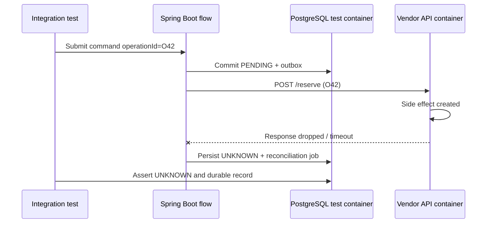

# `@DynamicPropertySource` for Services Without Service Connection Support

## 1. The Problem: The Container Started, But the App Doesn't Know Where to Connect

A Spring Boot system commonly integrates PostgreSQL, Redis, Kafka, or RabbitMQ while also calling organization-specific services: an ERP HTTP API, an SFTP server, a SOAP gateway, an internal gRPC service, or a partner API simulator. For popular stacks, Spring Boot can support **`@ServiceConnection`** to supply `ConnectionDetails` to auto-configuration. However, when a service **lacks a matching `ConnectionDetails` factory** or its endpoint is configured through a custom property such as `integration.vendor.base-url`, Spring Boot cannot infer that address automatically.

In a Testcontainers environment, the host port is typically **dynamically mapped by Docker**:

```text
Container inside Docker:
  HTTP API listening on port 80

Test JVM on runner machine:
  http://<container.getHost()>:<container.getMappedPort(80)>

Spring Boot application in test:
  needs integration.vendor.base-url pointing to that exact host:port
```

Hardcoding `http://localhost:8080` in `application-test.yml` is unreliable: the port can differ on a laptop, in CI, or with a remote Docker daemon. **`@DynamicPropertySource`** lets tests inject connection values **computed from the container at runtime** into Spring's `Environment` before the beans that need them are instantiated.

This lesson belongs to the **Integration Testing** chapter of **SPRING_BOOT_INTEGRATION**: building HTTP client, database, cache, broker, and Spring Integration adapter flows with sound configuration, consistent data contracts, transactions, failures, deduplication, testing, and verifiable observability.

This lesson focuses on the question: **when no service connection support exists for a dependency, how do you use `@DynamicPropertySource` so the test genuinely hits the right service without creating flakiness or accidentally calling production?**

After this lesson, you will be able to:

- Distinguish the responsibilities of `@Container`, `@ServiceConnection`, `@DynamicPropertySource`, and `DynamicPropertyRegistry`.
- Wire an HTTP `GenericContainer` to an application bean via a custom property without hardcoding ports.
- Apply the same pattern to host/port/URL settings for SFTP, internal APIs, or databases when `ConnectionDetails` does not apply.
- Understand when suppliers are evaluated, property precedence, container lifecycle, and `ApplicationContext` caching.
- Combine supported service connections with dynamic properties for **unsupported** services.
- Test connection failures, timeouts, contracts, CI behavior, security, and observability at the right boundary.

## 2. What Does `@DynamicPropertySource` Actually Do?

`@DynamicPropertySource` lives in Spring Test (`org.springframework.test.context.DynamicPropertySource`). A `static` method annotated with it receives a **`DynamicPropertyRegistry`**. The method registers a property name paired with a **`Supplier<?>`** that Spring Test adds to the dynamic property source of the test `ApplicationContext`.

Minimal example:

```java
import org.springframework.test.context.DynamicPropertyRegistry;
import org.springframework.test.context.DynamicPropertySource;

@DynamicPropertySource
static void registerEndpoint(DynamicPropertyRegistry registry) {
    registry.add("integration.vendor.base-url",
            () -> "http://127.0.0.1:18080");
}
```

The value above is hardcoded solely to illustrate the API and **does not use a container yet**. In real tests, the supplier reads the host and port assigned by Testcontainers.

Essential characteristics:

1. A method annotated with `@DynamicPropertySource` **must be `static`** in standard Spring Test usage, accepts a single `DynamicPropertyRegistry` parameter, and does not execute business tests itself.
2. `registry.add(name, supplier)` registers how to obtain the value; **the supplier is evaluated when the property is queried**, not necessarily at registration time.
3. The value can be consumed by `@Value`, `@ConfigurationProperties`, and auto-configurations that read properties from `Environment`.
4. This is a **test configuration mechanism**; it does not create HTTP clients, start Docker containers, generate credentials, or define transactions.
5. Lazy property resolution **does not** cause an already-initialized client bean to rebind automatically if the value changes after `ApplicationContext.refresh()`.

### 2.1. Three Roles to Keep Separate

| Tool | What responsibility does it own? | What does it not do automatically? |
|---|---|---|
| **Testcontainers `@Container`** | Lets JUnit Jupiter manage starting/stopping a container field when `@Testcontainers` is present. | Does not know application properties like `integration.vendor.base-url`. |
| **`@ServiceConnection`** | Asks Spring Boot to create `ConnectionDetails` from a container with a supported factory. | Does not generate arbitrary properties for every SDK or partner. |
| **`@DynamicPropertySource`** | Registers runtime properties via suppliers inside Spring's test context. | Does not create containers or auto-map properties to non-framework clients. |
| **`@ConfigurationProperties`** | Binds values into a strongly typed configuration bean. | Does not discover Docker host/port unless supplied. |
| **`RestClient.Builder`/SDK builder** | Builds the client/transport from bound configuration. | Does not read custom properties unless the application configures it. |

```mermaid
flowchart LR
    A[JUnit Jupiter] --> B[Testcontainers @Container]
    B --> C[Container runtime + random mapped port]
    C --> D[@DynamicPropertySource supplier]
    D --> E[Spring Test Environment]
    E --> F[ConfigurationProperties / @Value]
    F --> G[Client bean / gateway]
    G --> H[HTTP / SFTP / custom service container]
```

A common confusion: seeing the container running and assuming Spring connects automatically; without the steps of **exposing the endpoint into `Environment`** and **having the real bean read that endpoint**, the test may still hit another destination.

## 3. Choosing `@ServiceConnection` vs. `@DynamicPropertySource`

Spring Boot 3.1+ introduced service connections for supported container types and auto-configurations. Prefer `@ServiceConnection` when it covers the exact protocol/client you use—for example `PostgreSQLContainer` with JDBC auto-configuration in a compatible setup.

However, `@DynamicPropertySource` is an ideal fit when:

- The dependency is a **custom API/SDK** without a `ConnectionDetails` factory provided by Boot or the library.
- The service runs via `GenericContainer<?>` and the endpoint is configured by a **custom application property** rather than a standard datasource/Redis factory.
- The test needs to supply a custom base URL, host, port, bucket, namespace, test timeout, or feature switch.
- The application uses a Spring Framework/Spring Boot version lacking service connection support for that resource.
- The test uses an HTTP stub, SFTP server, or custom simulator and must map its address into the real adapter.
- You need a custom property **alongside** `@ServiceConnection` for PostgreSQL, Redis, or Kafka.

| Criterion | `@ServiceConnection` | `@DynamicPropertySource` |
|---|---|---|
| Connection mechanism | Boot finds a `ConnectionDetails` factory and wires auto-configuration. | Test registers property names and suppliers explicitly. |
| Target scope | Container/type/service name recognized by a factory. | Almost any `Environment`-configurable property. |
| Custom SDK endpoints | Insufficient without a factory. | Natural fit for `integration.vendor.*`. |
| Boilerplate for supported PostgreSQL | Less code. | Requires registering URL, username, and password manually. |
| Dynamic host and mapped port | Handled by the factory when supported. | Explicitly reads `getHost()`/`getMappedPort()`. |
| Business correctness | Not guaranteed automatically. | Not guaranteed automatically. |
| Version compatibility | Depends on Boot factory/module support. | Supported by Spring Test; still check exact API/version. |

**Do not slap `@ServiceConnection` onto an unsupported service type expecting it to invent a factory.** If you need reuse across many projects, you can build a custom `ConnectionDetails` abstraction/factory; for a test needing an internal API URL, `@DynamicPropertySource` is usually clearer and simpler.

### 3.1. Do Not Arbitrarily Declare Competing Sources for the Same Resource

A `PostgreSQLContainer` with `@ServiceConnection` supplies `JdbcConnectionDetails`, which Boot may prioritize over `spring.datasource.url` in `Environment`. Therefore, **never put `@ServiceConnection` on one PostgreSQL container while registering a different PostgreSQL URL in `@DynamicPropertySource`** without understanding how auto-configuration selects its connection source.

When combining multiple dependencies, ensure each resource has **one unambiguous connection source**.

## 4. Dependencies and Environment Requirements

A Gradle Kotlin DSL example for Spring Boot 3.2+ using outbound `RestClient` and Testcontainers:

```kotlin
dependencies {
    implementation("org.springframework.boot:spring-boot-starter-web")
    // Real application integration dependencies may also include JDBC, Redis, Kafka...

    testImplementation("org.springframework.boot:spring-boot-starter-test")
    testImplementation("org.testcontainers:junit-jupiter")
    testImplementation("org.testcontainers:testcontainers")

    // Only needed when the test also uses Boot's service connections:
    testImplementation("org.springframework.boot:spring-boot-testcontainers")
}
```

If the build manages versions via the Spring Boot BOM/Gradle dependency management, use compatible Testcontainers modules. In newer Testcontainers generations, module/artifact coordinates may change with the BOM; inspect the project's dependency graph if the build cannot resolve module names.

With Maven, primary test dependencies look like:

```xml
<dependency>
    <groupId>org.springframework.boot</groupId>
    <artifactId>spring-boot-starter-test</artifactId>
    <scope>test</scope>
</dependency>
<dependency>
    <groupId>org.testcontainers</groupId>
    <artifactId>junit-jupiter</artifactId>
    <scope>test</scope>
</dependency>
<dependency>
    <groupId>org.testcontainers</groupId>
    <artifactId>testcontainers</artifactId>
    <scope>test</scope>
</dependency>
```

`@DynamicPropertySource` belongs to **Spring Test**, which is usually already included via `spring-boot-starter-test`; it **does not require `spring-boot-testcontainers` just to register dynamic properties**. The `spring-boot-testcontainers` module is needed when using `@ServiceConnection` and Boot's Testcontainers integrations.

Beyond dependencies, the machine running tests must be able to reach Docker or a compatible container runtime, with permissions to pull images, create networks, map ports, start/stop, and clean up. Never turn a suite green by silently skipping when CI lacks Docker if the integration suite is expected to run.

## 5. Complete Example: An HTTP API Without a Service Connection Factory

To avoid external SDK dependencies, we use an `nginx:1.27-alpine` container as an **HTTP endpoint simulator**. It returns HTTP 200 at `/` out of the box. The goal of this example is not to verify an ERP contract, but to demonstrate dynamic configuration flowing from a container into a Spring-managed client.

### 5.1. Application Client Bean

Create a Spring gateway bean using the Spring Boot-managed `RestClient.Builder`:

```java
package com.example.integration.vendor;

import org.springframework.beans.factory.annotation.Value;
import org.springframework.stereotype.Component;
import org.springframework.web.client.RestClient;

@Component
public class VendorHealthClient {

    private final RestClient client;

    public VendorHealthClient(
            RestClient.Builder bootBuilder,
            @Value("${integration.vendor.base-url}") String baseUrl) {

        this.client = bootBuilder.baseUrl(baseUrl).build();
    }

    public boolean isReachable() {
        return client.get()
                .uri("/")
                .retrieve()
                .toBodilessEntity()
                .getStatusCode()
                .is2xxSuccessful();
    }
}
```

`integration.vendor.base-url` is an **application property**, not a standard property Boot auto-wires for external HTTP APIs. The test will supply it using `@DynamicPropertySource`.

Because the goal is to test real wiring, invoke the **production bean** `VendorHealthClient` in the test rather than calling `RestClient.create(...)` in the test and assuming the real client was tested.

### 5.2. Integration Test Using `GenericContainer`

```java
package com.example.integration.vendor;

import org.junit.jupiter.api.Test;
import org.springframework.beans.factory.annotation.Autowired;
import org.springframework.boot.test.context.SpringBootTest;
import org.springframework.test.context.DynamicPropertyRegistry;
import org.springframework.test.context.DynamicPropertySource;
import org.testcontainers.containers.GenericContainer;
import org.testcontainers.containers.wait.strategy.Wait;
import org.testcontainers.junit.jupiter.Container;
import org.testcontainers.junit.jupiter.Testcontainers;
import org.testcontainers.utility.DockerImageName;

import static org.junit.jupiter.api.Assertions.assertTrue;

@SpringBootTest
@Testcontainers
class VendorHealthClientIT {

    @Container
    static GenericContainer<?> vendor =
            new GenericContainer<>(
                    DockerImageName.parse("nginx:1.27-alpine"))
                .withExposedPorts(80)
                .waitingFor(Wait.forHttp("/").forStatusCode(200));

    @DynamicPropertySource
    static void registerVendor(DynamicPropertyRegistry registry) {
        registry.add(
                "integration.vendor.base-url",
                () -> "http://" + vendor.getHost()
                    + ":" + vendor.getMappedPort(80));
    }

    @Autowired
    VendorHealthClient client;

    @Test
    void reachesVendorOnContainerMappedPort() {
        assertTrue(client.isReachable());
    }
}
```

To run this example, the Spring Boot application must scan `VendorHealthClient`, have `spring-boot-starter-web`/`RestClient.Builder`, and satisfy any other beans in the application context. The classes in both snippets can reside in the same application package; this test is a **connectivity and wiring test**, not a full ERP API contract test.

Actual execution sequence:

1. JUnit Jupiter activates the `@Testcontainers` extension.
2. The `static @Container` field starts during the test class lifecycle.
3. Docker maps internal port `80` to a potentially random host port.
4. Spring Test registers the `integration.vendor.base-url` supplier via `@DynamicPropertySource`.
5. When instantiating `VendorHealthClient`, Spring resolves `@Value`; the supplier returns the mapped host/port.
6. The gateway builds from the Boot-injected `RestClient.Builder` and calls the endpoint inside the container.
7. The assertion checks a real HTTP response, not a mocked Java method.

**Do not add `@ServiceConnection` to this example.** This is a custom HTTP endpoint with a custom property and does not use a Boot service connection factory.

### 5.3. Purpose and Limitations of the Example

A passing test proves the bean was configured with the container's runtime address and can communicate over HTTP. It does not prove a real ERP matches JSON schemas, authentication, retries, timeouts, or headers. Use a controlled HTTP stub (WireMock/MockServer) or another sandbox/contract test when verifying payloads and error mapping.

## 6. Why Must the Supplier Compute Host/Port at the Right Time?

An anti-pattern:

```java
// DO NOT do this if the container has not started yet:
static String fixedUrl = "http://" + vendor.getHost()
        + ":" + vendor.getMappedPort(80);
```

A static field initializer can run before Testcontainers starts the container; `getMappedPort(80)` can fail because the port is not mapped yet. In most tests, registering a supplier prevents querying host/port prematurely:

```java
@DynamicPropertySource
static void register(DynamicPropertyRegistry registry) {
    registry.add(
        "integration.vendor.base-url",
        () -> "http://" + vendor.getHost()
            + ":" + vendor.getMappedPort(80));
}
```

**Distinguish registration from evaluation:**

- Calling `registry.add(...)` happens while Spring Test constructs `Environment`.
- The lambda `() -> ...` may run later, when a bean requests the property value.
- This is not a guarantee that "the container starts automatically when the supplier runs." Container lifecycle must still be properly managed.
- If a bean initializes after the container has stopped because an `ApplicationContext` was mis-cached or reused, the supplier or client will still fail despite valid registration.

### 6.1. Never Write Suppliers with Side Effects

A good supplier should simply **read an already-ready endpoint**:

```java
registry.add("integration.vendor.port", () -> vendor.getMappedPort(80));
```

Do not write a supplier that calls `vendor.start()`, mutates container configuration, or generates fresh credentials on every call. A property can be resolved more than once; suppliers with side effects make the test environment non-deterministic.

## 7. Property Binding: Dynamic Values Must Reach the Right Bean

Another pitfall: the test registers the right property, yet the gateway **ignores it**, for example when application code writes:

```java
RestClient client = RestClient.create(
        "https://vendor.production.example");
```

Tests may miss broken wiring if they only test repositories or never invoke the gateway. Prefer typed properties for custom services with multiple parameters.

### 7.1. `@ConfigurationProperties` for Custom Endpoints

```java
package com.example.integration.vendor;

import java.net.URI;
import java.time.Duration;
import org.springframework.boot.context.properties.ConfigurationProperties;

@ConfigurationProperties(prefix = "integration.vendor")
public record VendorProperties(
        URI baseUrl,
        Duration responseTimeout) {}
```

Registration:

```java
import org.springframework.boot.context.properties.EnableConfigurationProperties;
import org.springframework.context.annotation.Configuration;

@Configuration(proxyBeanMethods = false)
@EnableConfigurationProperties(VendorProperties.class)
class VendorPropertiesConfiguration {}
```

In the test:

```java
@DynamicPropertySource
static void vendorProperties(DynamicPropertyRegistry registry) {
    registry.add(
        "integration.vendor.base-url",
        () -> "http://" + vendor.getHost()
                + ":" + vendor.getMappedPort(80));
    registry.add(
        "integration.vendor.response-timeout",
        () -> "1500ms");
}
```

Spring Boot's binder can convert `URI` and `Duration` accordingly. **The `responseTimeout` field does not automatically enforce timeouts on `RestClient`**; the adapter must apply it to the transport/request factory or request policy appropriate for the real HTTP client. With `URI`, you can pass `baseUrl().toString()` when building the client.

Validate required properties at startup (scheme/host/port, positive timeout) instead of letting the app silently fall back to a production endpoint. If using Jakarta Bean Validation, include the required dependency and annotations; validation must be configured and does not activate merely because a record is declared.

### 7.2. When Multiple Properties Come from One Container

```java
@DynamicPropertySource
static void registerSftp(DynamicPropertyRegistry registry) {
    // Assumes sftpContainer is already created and its lifecycle is properly owned.
    registry.add("integration.sftp.host", sftpContainer::getHost);
    registry.add("integration.sftp.port",
            () -> sftpContainer.getMappedPort(22));
    registry.add("integration.sftp.username", () -> "test-user");
    registry.add("integration.sftp.password", () -> "test-secret");
}
```

This is an **illustrative extension snippet**, not a standalone runnable SFTP test: you still need proper image, user, authentication, and server startup configuration. Credentials are for the test container only—never use production accounts or print raw secrets into logs/metrics.

If an SFTP adapter or SDK expects `vendor.sftp.remote-host` rather than the key in the example, register **the exact key bound by the application's configuration**. `@DynamicPropertySource` does not convert custom keys into a connection factory unless a bean consumes them.

## 8. Supported `@ServiceConnection` and Dynamic Properties Can Coexist

An integration flow test might need PostgreSQL **and** an HTTP ERP stub. PostgreSQL has a `ConnectionDetails` factory, while the HTTP stub uses a custom property:

```java
import org.springframework.boot.testcontainers.service.connection.ServiceConnection;
import org.testcontainers.containers.PostgreSQLContainer;

@SpringBootTest
@Testcontainers
class OrderFlowIntegrationIT {

    @Container
    @ServiceConnection
    static PostgreSQLContainer<?> postgres =
            new PostgreSQLContainer<>("postgres:16-alpine");

    @Container
    static GenericContainer<?> erpStub =
            new GenericContainer<>(
                    DockerImageName.parse("nginx:1.27-alpine"))
                .withExposedPorts(80)
                .waitingFor(Wait.forHttp("/"));

    @DynamicPropertySource
    static void setExternalApiUrl(DynamicPropertyRegistry registry) {
        registry.add("integration.erp.base-url",
                () -> "http://" + erpStub.getHost()
                    + ":" + erpStub.getMappedPort(80));
    }

    // @Autowired repository + application gateway;
    // @Test verifies DB state and outbound HTTP flow.
}
```

This is an **architectural skeleton**: additional imports, repositories/gateways, test fixtures, and assertions depend on your project. When using `@ServiceConnection`, the test requires `spring-boot-testcontainers` and JDBC support; for the custom HTTP property, `@DynamicPropertySource` supplies the URL.

Benefits of combining them: you avoid `spring.datasource.url` boilerplate where Boot supports PostgreSQL while retaining flexibility for internal services without factories. It also reduces the risk of two sources competing over one datasource.

### 8.1. When No Service Connection Exists for a Database

If a project uses an older Spring Boot release or a database/SDK lacking a factory, declare datasource properties explicitly from the specialized Testcontainers class:

```java
@Container
static PostgreSQLContainer<?> postgres =
        new PostgreSQLContainer<>("postgres:16-alpine");

@DynamicPropertySource
static void jdbcProperties(DynamicPropertyRegistry registry) {
    registry.add("spring.datasource.url", postgres::getJdbcUrl);
    registry.add("spring.datasource.username", postgres::getUsername);
    registry.add("spring.datasource.password", postgres::getPassword);
}
```

This example is an **alternative** when JDBC auto-configuration uses `spring.datasource.*` without `JdbcConnectionDetails`. In projects where `@ServiceConnection` works, prefer it and **do not duplicate declarations for the same PostgreSQL instance**.

## 9. Property Names, Placeholders, and Precedence

In Spring Test, dynamic properties registered via `@DynamicPropertySource` have **higher precedence** than many standard sources such as `@TestPropertySource`, system environment/properties, and `@PropertySource`. This allows container endpoints to override placeholder values in a test profile.

Example `application-test.yml`:

```yaml
integration:
  vendor:
    base-url: http://127.0.0.1:9999
```

If the test registers:

```java
registry.add("integration.vendor.base-url",
    () -> "http://" + vendor.getHost()
        + ":" + vendor.getMappedPort(80));
```

then beans reading `integration.vendor.base-url` from the test `Environment` will normally receive the dynamic value. Still, distinguish **`PropertySource` precedence** from **how an auto-configuration chooses `ConnectionDetails` vs. properties**; the two mechanisms are not identical.

### 9.1. When the Environment Value Appears Unchanged

Possible causes:

- The bean/client hardcodes the endpoint.
- The property name is wrong, e.g., `vendor.base-url` instead of `integration.vendor.base-url`.
- The test loads a different context or uses a bean from another profile.
- The client/SDK is instantiated manually before Spring binds properties.
- A custom `@Bean`/`ConnectionDetails` overrides the configuration source.
- The value was bound once at startup, and the test later mutated a static field expecting the client to update itself.
- Multiple dynamic-property registrars register the same key, obscuring the effective source.

**Do not just print `Environment.getProperty(...)` and assume the client is using it.** Verify both that requests reach the right container and how the bean is configured.

## 10. Host, Container Port, and Mapped Port

Clearly separate the address **inside Docker** from the address **the test JVM uses**:

| Testcontainers member | Meaning | When to use |
|---|---|---|
| `withExposedPorts(80)` | Requests publishing container port 80 to the host. | When constructing the container. |
| `getMappedPort(80)` | Host port mapped to container port 80. | After the container is running. |
| `getHost()` | Host for the **test JVM** to reach the container per runtime. | Combined with the mapped port. |
| `getFirstMappedPort()` | First host port when only one port is exposed. | Avoid on multi-port containers, as it is error-prone. |
| `withNetworkAliases("vendor")` | Hostname to reach the container inside a shared Docker network. | When **another container** calls this container. |

**Wrong when tests run against a remote Docker environment:**

```java
registry.add("integration.vendor.base-url",
    () -> "http://localhost:" + vendor.getMappedPort(80));
```

Right:

```java
registry.add("integration.vendor.base-url",
    () -> "http://" + vendor.getHost()
        + ":" + vendor.getMappedPort(80));
```

The JVM's `localhost` may differ from the Docker daemon host on CI. Testcontainers provides the reachable host for the test process via `getHost()`.

### 10.1. Container-to-Container Calls Are Different

If the Spring Boot application itself also runs **inside a container** on the same Docker network, do not take `getHost() + getMappedPort()` for container-to-container traffic. Instead, you may need **network alias + internal port**, such as `http://vendor:80`. The `@DynamicPropertySource` pattern here assumes **Spring Boot runs inside the test JVM outside the container**.

### 10.2. URL Encoding and IPv6

If the host is an IPv6 literal or the URL has specific path/base prefixes, manual string concatenation easily breaks brackets or encoding. Prefer a proper `URI` builder or canonical URL APIs exposed by the container (such as `PostgreSQLContainer.getJdbcUrl()`). Never prepend `http://` for a protocol requiring `https://` or mTLS.

## 11. Readiness: Container Started Does Not Mean Service Ready

`@Container` manages start/stop, but the application can crash if a `Client bean` attempts to connect before the service is protocol-ready. Testcontainers provides wait strategies for ports, logs, or HTTP endpoints.

Custom HTTP example:

```java
static GenericContainer<?> vendor = new GenericContainer<>(
        DockerImageName.parse("nginx:1.27-alpine"))
    .withExposedPorts(80)
    .waitingFor(
        Wait.forHttp("/")
            .forStatusCode(200)
            .withStartupTimeout(java.time.Duration.ofSeconds(60)));
```

For services with complex startup, waiting on an open port may not suffice: a health endpoint should confirm migrations, service discovery, or internal dependencies are active. At the same time, do not wait on a business endpoint that only succeeds **after the Spring app starts**, as that creates a circular dependency.

### 11.1. Do Not Equate Readiness with Contract Correctness

Nginx returning `200` proves it listens over HTTP, not that the ERP API is ready for `POST /orders` or matches the JSON schema. To test contracts, use an HTTP mock server with preconfigured endpoints or a dedicated fake service. When an external protocol cannot be modeled faithfully, document the integration test's limitation.

## 12. Lifecycle of `static @Container` and `ApplicationContext`

This is a frequent source of baffling flaky failures.

With JUnit Jupiter `@Testcontainers`:

- `static @Container` typically starts **once per test class** and stops after the test class.
- Instance-field `@Container` typically starts/stops **for each test method**, which does not fit when a Spring context must hold a fixed URL across multiple test methods.
- Spring Test **caches `ApplicationContext` instances** for reuse across test classes with equivalent configurations.
- A cached context may hold a `DataSource`, HTTP client, or SDK bound to the endpoint of an **older container that has already stopped**.

Result: test class A passes, test class B reuses the cached context, calls the port of stopped container A, and gets `Connection refused`. The `@DynamicPropertySource` line in class B may look fine, yet the cached client bean from the previous context was never recreated.

### 12.1. Remedies by Complexity

| Approach | When to use | Trade-off |
|---|---|---|
| Each test class owns its context and static container; use `@DirtiesContext` when needed. | Small test groups, distinct fixtures. | Repeated Spring context initialization. |
| Share containers across the test suite and keep them alive longer than cached contexts. | Many test classes sharing one dependency. | Must control data state and cleanup. |
| Spring-managed container beans when Boot version supports them. | Want lifecycle tied to `ApplicationContext` rather than JUnit fields. | Must understand Boot Testcontainers mechanics and avoid mixing owners. |
| Define genuinely distinct test configs when endpoints differ. | Classes needing different URLs/configs. | More contexts, longer startup time. |
| Clean DB/topic/Redis state per test. | Shared container where tests must remain independent. | Requires careful fixtures and transaction/cleanup discipline. |

If subclasses inherit the same `@DynamicPropertySource` from a base class yet require **different dynamic values**, Spring Test recommends considering `@DirtiesContext` so the context does not reuse stale configuration. What matters is matching **container lifetime and context lifetime**, not blindly adding annotations to mask symptoms.

### 12.2. `@DirtiesContext` When You Must Bust the Context Cache

```java
import org.springframework.test.annotation.DirtiesContext;

@DirtiesContext(classMode =
        DirtiesContext.ClassMode.AFTER_CLASS)
@SpringBootTest
@Testcontainers
class VendorSpecificIT {
    // Dedicated static @Container + @DynamicPropertySource.
}
```

This ensures the test class marks the context to be closed upon completion. It does not make tests independent if they share a database without cleanup; nor should it be applied to every class when container/context lifetimes can be aligned cleanly.

## 13. Test Class Inheritance and `@DynamicPropertySource`

Spring Test can discover `@DynamicPropertySource` methods inherited from a test superclass or interface as supported by the Framework version. A base-class pattern is used to avoid repeating setup:

```java
abstract class AbstractVendorContainerIT {

    @Container
    static final GenericContainer<?> vendor =
            new GenericContainer<>(
                    DockerImageName.parse("nginx:1.27-alpine"))
                .withExposedPorts(80)
                .waitingFor(Wait.forHttp("/"));

    @DynamicPropertySource
    static void vendorProperty(DynamicPropertyRegistry registry) {
        registry.add("integration.vendor.base-url",
                () -> "http://" + vendor.getHost()
                    + ":" + vendor.getMappedPort(80));
    }
}

@SpringBootTest
@Testcontainers
class VendorOrderIT extends AbstractVendorContainerIT {
    // ...
}
```

**Lifecycle warning:** verify how your JUnit extension version/configuration manages inherited `@Container` fields. If multiple subclasses share **one static container on the base class**, the JUnit extension may stop the container between test classes while a cached context or another class still needs it; do not assume it stays alive as a suite-wide singleton. Design ownership/lifetime deliberately, or separate test groups/contexts when needed.

Do not mutate a static field to hold a new container instance across subclasses expecting `@DynamicPropertySource` to make already-initialized beans reconnect automatically.

## 14. Test Context Caching and Dynamic Property Changes

`DynamicPropertyRegistry` registers a supplier. When Spring constructs `VendorHealthClient`, it reads the base URL **once** and builds `RestClient`. If you later change the address returned by the supplier or restart the container on a different port, the existing `RestClient` bean does not update its `baseUrl`.

```text
Test context build:
  Dynamic property = http://host:49123
  RestClient created with baseUrl 49123

Container stop/restart:
  New mapped port = 49175

Existing RestClient bean:
  Still uses 49123 -> Connection refused
```

Therefore, never restart the same `@Container` between test methods sharing a context. If changing endpoints is mandatory, design explicit client rebuild/reconfiguration or create a fresh context. In most integration tests, **keep the container stable for the lifetime of the context** and reset test data instead.

## 15. Dynamic Properties for Services with Multiple Endpoints

A custom server may expose multiple ports: HTTP API, management, and event callbacks. Register them separately:

```java
@DynamicPropertySource
static void endpointProperties(DynamicPropertyRegistry registry) {
    registry.add("integration.vendor.api-base-url",
        () -> "http://" + vendor.getHost()
            + ":" + vendor.getMappedPort(8080));

    registry.add("integration.vendor.admin-base-url",
        () -> "http://" + vendor.getHost()
            + ":" + vendor.getMappedPort(9090));
}
```

This snippet **assumes the container has declared and exposed both 8080 and 9090** with a real service listening on each port. Otherwise, `getMappedPort(9090)` will fail. Separate the admin endpoint from the public API and avoid accidentally sending business tokens to the admin port. Names like `integration.vendor.*` are illustrative; each adapter must bind the exact properties it expects.

### 15.1. TLS, mTLS, and Test Secrets

If a service uses TLS, the URL must be `https://` and the client must trust the test certificate. `@DynamicPropertySource` can supply the URL or path to a test truststore, but it **does not** configure the SDK's SSL context on its own. Manage dedicated test certificates, use the appropriate SSL bundle/transport mechanism, and enforce hostname verification.

Never disable TLS verification in production code just to pass a container test. Use a test CA/certificate matching the host and a dedicated test setup. Never log passwords, private keys, or access tokens, even in CI.

## 16. When Multiple Properties Share One Source of Truth

Use a **pure** helper to prevent two suppliers from building inconsistent URIs:

```java
private static String vendorBaseUrl() {
    return "http://" + vendor.getHost()
            + ":" + vendor.getMappedPort(80);
}

@DynamicPropertySource
static void register(DynamicPropertyRegistry registry) {
    registry.add("integration.vendor.base-url",
            VendorHealthClientIT::vendorBaseUrl);
}
```

Do not build a `String BASE_URL` eagerly in a static initializer. Under parallel runs, containers may stop or contexts may change; helpers should still read addresses from a container whose lifecycle is properly managed.

When multiple services need that URL, a typed `VendorProperties` bean distributes it consistently rather than having each adapter inspect Docker APIs or accept a `GenericContainer` in production code.

## 17. Custom Services via Spring Integration Adapters

A Spring Integration flow may call SFTP, FTP, SMTP, MQTT, TCP, or HTTP outbound adapters. Many are configured via **application bean factories/SDK settings** without built-in `@ServiceConnection` support.

Conceptual flow:

```mermaid
flowchart LR
    A[HTTP / Kafka inbound] --> B[Validate command]
    B --> C[Spring Integration flow]
    C --> D[Vendor outbound adapter]
    E[@DynamicPropertySource test property] --> F[Vendor adapter config bean]
    F --> D
    D --> G[GenericContainer: custom protocol]
    C --> H[(PostgreSQL state/outbox)]
```

For SFTP, required properties typically include host, port, username, key/`known_hosts` or test password, remote directory, and timeouts. Tests should verify:

1. The adapter actually reads `integration.sftp.host/port` through the application's configuration beans.
2. Consumers/inbound messages route to the adapter on the right channel.
3. File uploads/downloads succeed and verify **content**, not just connectivity.
4. Timeout/permission errors are classified and retries are bounded.
5. Repeated side effects do not create duplicate files or unintended overwrites when idempotency is required.

`@DynamicPropertySource` is a **configuration bridge**; the Spring Integration flow still owns retries, transactions, error channels, state, and acknowledgments. If a channel is in-memory, enqueueing a task through the adapter does not make it durable.

## 18. Contract Testing for HTTP Services Without a Factory

The nginx example in section 5 only verifies connectivity. When testing REST/SOAP contracts, run a mock server where the test can **define response scenarios**:

- `GET /orders/O-42` → JSON matching schema.
- `POST /orders` → 201 + Location on success.
- HTTP 429/503 → bounded retry/backoff.
- Response delay → timeout and deadline handling.
- HTTP 200 with a business error → classified from payload.
- SOAP Fault XML with proper namespace → error mapping.
- Connection drop after request body → write outcome may be `UNKNOWN`.

Application tests must invoke the **production gateway bean** configured with the mock server's dynamic base URL. Never build a separate client with `RestClient.create(...)` in the test, bypassing production builders, headers, observation, and authentication.

### 18.1. Effective Test Flow

```text
Container HTTP stub started + ready
  -> DynamicPropertySource sets integration.erp.base-url
  -> Spring Boot builds ERP gateway using configured builder
  -> Test invokes application service / flow
  -> Stub records actual requests
  -> Assert URL, headers, payload and retry attempts
  -> Assert DB/outbox business state and observability
```

If the HTTP mock server runs in-process in Java without Docker, `@DynamicPropertySource` still works to inject its dynamically chosen port. The annotation's value is **delivering runtime endpoints into Spring Test `Environment`**, not solely working with Testcontainers.

## 19. Brokers and Databases: Use Dynamic Properties Only Where Needed

For PostgreSQL, Redis, and Kafka with compatible `@ServiceConnection` support, prefer it to avoid misconfiguring host/port/user properties manually. However, for a custom broker client, an app-defined Kafka admin URL, or a service lacking a factory, dynamic properties remain necessary.

Example custom configuration:

```java
@DynamicPropertySource
static void customBrokerProperties(DynamicPropertyRegistry registry) {
    registry.add("integration.partner-bus.host",
            partnerBus::getHost);
    registry.add("integration.partner-bus.port",
            () -> partnerBus.getMappedPort(7001));
}
```

This assumes `partnerBus` is a running container exposing port 7001 and the application has a bean reading `integration.partner-bus.*`. This is a **fragment for a custom SDK**, not standard `spring.kafka.*` or `spring.rabbitmq.*` properties.

Do not confuse `Spring Boot auto-configure KafkaTemplate` with how a custom `VendorBusClient` reads properties. When Kafka uses `spring.kafka.bootstrap-servers`, the test must supply a **usable bootstrap address**, and specialized Kafka containers typically provide `getBootstrapServers()`, which is safer than manually concatenating host/port because of advertised listeners.

## 20. Transactions, Idempotency, and Unknown Outcomes in Integration Tests

Registering a runtime URL is necessary to connect, yet **does not** prove correctness when the DB commits and a remote HTTP/FTP side effect fails or its response is lost.

Example:



With a configurable stub, tests can deliberately trigger timeouts and assert:

- The application does not conclude "definitely failed" when the outcome may have succeeded.
- The idempotency key remains stable across retries, redelivery, and replay.
- Error/`UNKNOWN` records commit before acknowledging broker messages if required by the contract.
- DB transactions and outbox records commit/roll back properly.
- The flow does not hold a JDBC transaction open across remote calls or long backoffs.

`@DynamicPropertySource` does not manage transactions or idempotency; it simply lets the test reach **the right dependencies** to verify those behaviors.

### 20.1. Do Not Mask After-Commit Behavior with Test Transactions

Putting `@Transactional` on a test method makes the test transaction roll back at the end; `@TransactionalEventListener(AFTER_COMMIT)` listeners and outbox dispatchers may **not run** as in production. To verify after-commit behavior, run transactions inside application services and assert real commits, or use `TestTransaction` to control commit boundaries in appropriate tests.

## 21. Test Data: Durable Enough, Isolated Across Runs

Container tests must never use production secrets or real customer data. When multiple test methods or classes share a container:

- Assign unique business IDs/test keys, e.g., using UUIDs.
- Clean up only test-scoped DB tables/Redis keys without wiping other tests' data.
- For brokers, use isolated topics/queues/consumer groups when needed.
- Configure stub requests/mappings per test and reset at the proper lifecycle stage.
- When running tests in parallel, avoid shared mutable server state or enforce safe locking/resets.
- Never rely on test class execution order to keep a container alive.

### 21.1. Sharing Context While Isolating Data

You can keep **the same container and Spring context** across multiple tests for speed while resetting **business data** between tests. Conversely, restarting a container on a new port between test methods without rebuilding the context easily causes flaky failures. Separate **infrastructure lifecycle** from **fixture lifecycle**.

## 22. CI and Remote Docker: Assumptions to Verify

A test that passes on a laptop can fail in CI due to:

| Symptom | Likely root cause | Resolution |
|---|---|---|
| Testcontainers cannot find Docker | Daemon/socket missing or insufficient permissions. | Fix runner and Docker access; never silently skip. |
| Image pull failure | Registry/proxy/network/tag/credentials. | Pin valid images and grant CI registry access. |
| `Connection refused` while container runs | Hardcoded `localhost` or internal port instead of mapped port. | Use `getHost()` + `getMappedPort()`. |
| `IllegalStateException` reading mapped port | Supplier called before container start or port not exposed. | Fix lifecycle, wait for container, register lazy supplier. |
| Test class B fails after class A | Cached context points to stopped container from class A. | Align lifetimes or use `@DirtiesContext`. |
| HTTP 404 instead of 200 | Stub missing mapping or different test path. | Inspect actual request, contract, and readiness. |
| Correct host/port yet app hits production | Bean does not read dynamic property, has hardcode, or wrong profile. | Verify bean wiring and actual requests. |
| `@ServiceConnection` does not apply | No factory, missing Boot testcontainers module, unrecognized class. | Use dynamic properties or add a custom factory as needed. |
| Slow and flaky tests | Container restarted repeatedly, weak wait strategy, shared state. | Optimize scope and readiness; use bounded polling assertions. |
| Tests stay green without Docker | Integration tests silently skipped. | Make the CI integration suite mandatory. |

On shared CI, the Docker socket is a high-privilege resource. Never run untrusted container images or pass production secrets into container environments. Restrict image pulls and manage caching/pinning and cleanup per organizational policy.

### 22.1. Verifying the Effective Property

In a test, you can inject `Environment` and assert:

```java
@Autowired
org.springframework.core.env.Environment environment;

@Test
void endpointWasRegistered() {
    String configured =
            environment.getRequiredProperty(
                    "integration.vendor.base-url");

    String expected = "http://" + vendor.getHost()
            + ":" + vendor.getMappedPort(80);

    org.junit.jupiter.api.Assertions.assertEquals(
            expected, configured);
}
```

This test diagnoses the **property layer**; you still need a test calling the real client to prove the **bean/SDK layer** uses that property. Never dump all `Environment` keys or config values to CI logs if passwords/tokens may be present.

## 23. Security and Endpoint Access Control in Tests

`@DynamicPropertySource` can set any property, including URLs and credentials; that capability requires guardrails:

1. **Fail closed when test endpoint is missing:** never configure production endpoints as defaults/fallbacks in test profiles.
2. **Never use real tokens:** provision dedicated credentials and certificates for test containers.
3. **Never log credentials** during Spring binding failures; filter/redact sensitive keys.
4. **Prevent SSRF and arbitrary URLs:** derive endpoints from test-controlled containers, never from untrusted user payloads in application code.
5. **Restrict broker/database access:** keep test containers isolated so tests cannot modify production data.
6. **Enforce TLS accurately when contracts require it:** never disable certificate verification in production code.
7. **Protect the Docker daemon:** isolate CI jobs with container privileges from untrusted code.

Never point dynamic properties at production addresses to "test against real data" when tests perform writes or mutate state. Any sandbox/staging usage must follow explicit policies.

## 24. Observability to Confirm Tests Hit the Right Service

An HTTP test asserting only `200` can pass via a wrong mock without noticing the gateway bypassed `ObservationRegistry` or trace context. Signals to verify:

| Component | Signals to verify |
|---|---|
| Dynamic properties | Endpoint matches runtime container, not hardcoded. |
| HTTP client | Request/response, timeouts, retries, status codes, and URI templates. |
| JDBC | Connection to test DB, transaction commit/rollback. |
| Redis | Real serializer/TTL/invalidation, not just cache mocks. |
| Broker | Publish/consumer ack, DLQ, event ordering/idempotency. |
| Spring Integration | Channels, handler attempts, error channels, and durable recovery. |
| End-to-end | Business outcome, correlation ID, outbox/operation state. |

Micrometer/Actuator export may be reduced or disabled in test contexts. If tests assert telemetry, use in-memory/test registries and Boot-compatible observability configuration without exporting to production. Never add `eventId`/`orderId` as metric tags; use only low-cardinality tags like `dependency=vendor`, `operation=ping`, `outcome=success|timeout`.

### 24.1. Readiness Is Not Uptime or SLO

An HTTP stub returning `200` at `/` only checks liveness; business-flow SLOs depend on operation latency, retries, queue wait, and transaction state. For APIs that create side effects, a response timeout does not mean the command failed.

## 25. Common Design Mistakes

1. **Putting `@ServiceConnection` on a custom service expecting Boot to know SDK properties.** Without a matching factory/auto-config, no wiring occurs.
2. **Hardcoding `localhost` or ports 5432/6379/8080 for the host JVM.** Testcontainers maps ports dynamically.
3. **Reading mapped ports in a static initializer before container startup.** Causes startup errors.
4. **Calling `container.start()` inside a property supplier.** Suppliers can be invoked multiple times, complicating lifecycle.
5. **Annotating an instance method or constructor with `@DynamicPropertySource`.** Violates standard Spring Test discovery rules.
6. **Registering a property key different from what the bean reads.** Tests miss wiring errors if they do not exercise the client.
7. **Using both `@ServiceConnection` and a dynamic JDBC URL for two different databases.** Competing connection sources.
8. **Restarting a container every test method while cached contexts/clients still hold the old port.**
9. **Sharing a static container across subclasses without accounting for JUnit extension and context lifetimes.**
10. **Believing a lazy supplier makes existing clients rebind when ports change.** Initialized beans do not reconfigure themselves.
11. **Testing only `Environment.getProperty` without verifying which endpoint the client actually calls.**
12. **Using an nginx 200 health response to claim ERP contract coverage.**
13. **Using test-level `@Transactional` and assuming after-commit handlers ran.**
14. **Putting production credentials or disabling TLS in integration tests.**
15. **Omitting readiness checks and data cleanup**, leading to slow or flaky CI.
16. **Treating dynamic properties as a substitute for retry, transaction, or idempotency design.** They only handle configuration injection.

## 26. Pre-Adoption Checklist

- [ ] Confirmed the service truly **lacks a `ConnectionDetails` factory** or uses custom endpoint properties.
- [ ] Spring Test, Testcontainers/JUnit Jupiter, and compatible Docker runtime are available.
- [ ] Uses `@Testcontainers` + `static @Container` with a lifecycle matching the integration context.
- [ ] Container exposes the right internal ports and configures a readiness/wait strategy.
- [ ] `@DynamicPropertySource` is a `static` method accepting `DynamicPropertyRegistry`.
- [ ] `registry.add` uses suppliers reading host/mapped ports **after container startup**.
- [ ] URLs use `getHost()` and `getMappedPort(...)`, without hardcoding `localhost` or host ports.
- [ ] Application typed properties/`@Value` bind the exact dynamic keys.
- [ ] The **production bean** client/gateway uses that endpoint; tests invoke the real bean.
- [ ] Boot-supported services such as PostgreSQL use `@ServiceConnection` when appropriate.
- [ ] No competing sources declared for the same datasource or broker.
- [ ] If multiple classes share context caching, container lifetimes align or `@DirtiesContext` is used intentionally.
- [ ] Fixtures, broker topics, Redis keys, and DB rows are reset/isolated.
- [ ] Schema/contract, timeouts, retries, error mapping, and side effects are covered in appropriate tests.
- [ ] Write operations test idempotency and `UNKNOWN` state when responses drop.
- [ ] Message flows test DB commit/ack/outbox/retry/DLQ, not just message send success.
- [ ] CI does not silently skip when Docker is absent; image/registry and cleanup are controlled.
- [ ] No production secrets or PII enter containers or test logs.
- [ ] Telemetry/test assertions sufficiently prove routing, error handling, and business outcomes.

## 27. Summary

**`@DynamicPropertySource` injects runtime-resolved configuration values into Spring's test `Environment` via `DynamicPropertyRegistry` and suppliers.** When a `GenericContainer` or custom service lacks `@ServiceConnection` support, this lets application beans use **the real dynamic host/port** without altering production code or hardcoding ports in CI.

In **SPRING_BOOT_INTEGRATION**, separate three responsibilities clearly: **Testcontainers manages dependency lifecycles; `@DynamicPropertySource` supplies connection details; application beans/adapters actually consume them**. Align container lifecycles with Spring's context cache, keep each service's configuration unambiguous, and verify data contracts, transactions, retries, idempotency, and observability through real calls. Doing so ensures tests do more than "boot a Docker container"—they prove an integration flow runs and fails properly in a reproducible environment.
