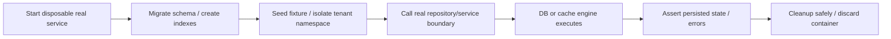
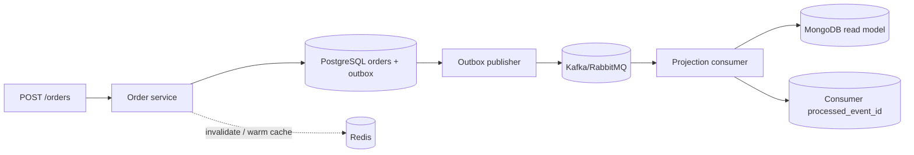

# Testing JDBC, JPA, R2DBC, Redis, or MongoDB Against Real Services

> **Chapter:** Integration Testing  
> **Module:** SPRING_BOOT_INTEGRATION — structuring Spring Boot system integration across HTTP clients, databases, caches, message brokers, and Spring Integration adapters. This lesson focuses on configuration, data contracts, transactions, failures, duplicate handling, testing, and observing real-world integration flows.

## 1. Why Test Against Real Databases and Caches?

A unit test can mock `JdbcTemplate.update(...)` to return `1`, mock `JpaRepository.save(...)` to return an entity, or mock `StringRedisTemplate.opsForValue()` to return a preset value. These tests check **API invocation logic**, but do not verify how PostgreSQL, Redis, or MongoDB behave when the system actually runs:

- Is the SQL valid PostgreSQL syntax and compatible with `NUMERIC/JSONB/TIMESTAMPTZ` column types?
- Does the unique constraint prevent two concurrent requests from creating the same order?
- Does JDBC/JPA transaction rollback cover all SQL operations inside the service?
- Does Hibernate's `@Version` detect concurrent updates upon flush?
- Does the R2DBC publisher participate in the transaction inside **Reactor Context** upon subscription?
- Do Redis `SET NX EX`, TTL, and serializers behave properly against a real server?
- Does MongoDB create the unique index, and are `ObjectId`/document mappings queried properly?
- Does the application actually read the right host/port/credentials from Spring Boot configuration?

**Integration testing against real services** here means running **a real, isolated, reproducible instance of the database/cache/broker** (for example via Testcontainers), never connecting tests to production PostgreSQL/Redis/MongoDB.

### 1.1. An Example Bug That Mocks Miss

```java
// Mock-style unit test: no real database.
when(repository.save(any(OrderEntity.class)))
        .thenAnswer(invocation -> invocation.getArgument(0));

OrderEntity saved = service.createOrder(command);
assertThat(saved.getId()).isEqualTo("order-42");
```

This test can pass even when:

1. The database table is missing a column or migrations have not run.
2. PostgreSQL lacks a unique index on `request_key`.
3. The `@Column(name = "request_key")` entity mapping is wrong.
4. The transaction manager points to a different datasource.
5. A transaction partially committed before an exception occurred between two operations.

Mocks still hold value for **business rules** and hard-to-build edge cases, yet should not replace testing against the real engine the application depends on.

### 1.2. Learning Objectives

After this lesson, you will be able to:

1. Choose the right testing level for JDBC, JPA, R2DBC, Redis, and MongoDB.
2. Start real services with Testcontainers and supply connection properties to Spring Boot via `@ServiceConnection` or `@DynamicPropertySource`.
3. Verify SQL schemas, constraints, transactions/rollback, JPA flushing, optimistic locking, and reactive subscriptions.
4. Verify Redis TTL/atomic operations and MongoDB mapping/unique indexes without relying on semantics-free fakes.
5. Manage migrations, test fixtures, isolated data, parallel tests, and container lifecycles.
6. Simulate connection/timeout/ambiguous-commit failures and test idempotency/outbox across multiple resources.
7. Build a reliable CI test suite with diagnostics/logs that never touches production.

## 2. Choosing Tools by Goal, Not Preference

| Goal | Unit test/mock | Slice test + real engine | `@SpringBootTest` + real engine | Multi-service end-to-end |
| --- | --- | --- | --- | --- |
| DTO → entity mapping rules | Ideal | Unnecessary | Possible, but expensive | Unnecessary |
| PostgreSQL SQL, constraints, JDBC mappers | Insufficient | **Ideal** with `@JdbcTest` | Suitable | Depends on workflow |
| JPA entity mapping, queries, `@Version` | Insufficient | **`@DataJpaTest`** | Suitable | Rarely needed |
| R2DBC SQL and reactive transactions | Insufficient | `@DataR2dbcTest` with real server | **Ideal** for service boundaries | When events/outbox are involved |
| Redis serializer, key TTL, atomic SET NX | Insufficient | `@DataRedisTest` + real Redis | Suitable | When DB + Redis interact |
| MongoDB document mapping, indexes | Insufficient | `@DataMongoTest` + real mongod | Suitable | When DB + Mongo interact |
| HTTP → DB → broker end-to-end | Mocks help isolate | Insufficient | Partial | **Requires** multiple resources |

**Slice tests** instantiate only beans relevant to one technology, running faster than a full context. However, `@Service` business beans are normally **not auto-scanned into a slice**. To test an application service's transaction boundary, use `@SpringBootTest` or import the specific service intentionally while verifying the right manager and proxy are active.

### 2.1. "H2 Passed" Does Not Prove "PostgreSQL Passes"

An embedded H2 database is useful for quick checks, yet differs from PostgreSQL in:

- Data types such as `JSONB`, arrays, timezones, collations, and generated columns.
- SQL dialect, `ON CONFLICT` syntax, locks, indexes, and constraints.
- Locking, isolation, and deadlock/concurrency phenomena.
- Transactional DDL, sequences, optimistic locking, and driver behavior.
- `NULL` handling, date/numeric casting, or length limits.

If production uses PostgreSQL, **tests that govern SQL and transaction correctness should run against real PostgreSQL**. Enabling "PostgreSQL mode" in H2 does not guarantee parity.

### 2.2. "Real Service" Does Not Mean Calling Shared Staging

Use **ephemeral** environments: Testcontainers launches an isolated PostgreSQL/Redis/MongoDB instance, applies schemas, seeds per-test data, and destroys it afterward. A shared staging database causes flaky tests due to shifting data, dependency downtime, shared credentials, and the risk of deleting someone else's data.

Never run `TRUNCATE`, `DROP DATABASE`, `FLUSHALL`, or collection deletes against a **shared service** just to "clean test data." Every cleanup command must target **verified ephemeral test resources**.

## 3. Testcontainers and Spring Boot 3.x: Baseline Configuration

Examples target **Java 17+, Spring Boot 3.2–3.5, Spring Framework 6.x, and BOM-compatible Testcontainers**. On Boot 4.x/Testcontainers 2.x, re-check module coordinates, container APIs, service connection factories, and test slice annotations against that release line's documentation.

### 3.1. Add Dependencies Only for the Stack Under Test

```groovy
// build.gradle — example dependency management via Spring Boot BOM.
dependencies {
    testImplementation 'org.springframework.boot:spring-boot-starter-test'
    testImplementation 'org.springframework.boot:spring-boot-testcontainers'
    testImplementation 'org.testcontainers:junit-jupiter'
    testImplementation 'org.testcontainers:postgresql'
    testImplementation 'org.testcontainers:mongodb'

    // Choose only the starters / drivers your application actually uses:
    implementation 'org.springframework.boot:spring-boot-starter-jdbc'
    runtimeOnly 'org.postgresql:postgresql'

    // If this is a JPA project, swap/add as appropriate:
    // implementation 'org.springframework.boot:spring-boot-starter-data-jpa'

    // If this is an R2DBC project:
    // implementation 'org.springframework.boot:spring-boot-starter-data-r2dbc'
    // runtimeOnly 'org.postgresql:r2dbc-postgresql'

    // If this is a Redis or MongoDB project:
    // implementation 'org.springframework.boot:spring-boot-starter-data-redis'
    // implementation 'org.springframework.boot:spring-boot-starter-data-mongodb'
}
```

Commented options after `//` **do not all belong in a single application**. A JPA-only project needs the JPA starter + JDBC driver; a reactive SQL project using only R2DBC needs the R2DBC driver; Redis and MongoDB require their respective starters. In a hybrid app with both JDBC and R2DBC, conditional auto-configuration gets more complex; explicitly define `DataSource`, `ConnectionFactory`, and transaction managers rather than assuming Boot auto-configures both completely.

### 3.2. Three Ways to Connect Tests to Containers

| Approach | When to use | Key consideration |
| --- | --- | --- |
| `@Container` + `@ServiceConnection` | Boot supports `ConnectionDetails` for the container type, e.g. PostgreSQL/MongoDB | Boot automatically extracts connection details for matching beans |
| `@Container` + `@DynamicPropertySource` | Generic containers/custom services or granular configuration | Declare accurate, dedicated host/mapped-port suppliers |
| Container as a Spring `@Bean` + `@ServiceConnection` | Lifecycle managed via `ApplicationContext`/Boot test config | Test configuration must be imported properly; watch reuse |

**Never hardcode `localhost:5432` or `localhost:6379`** in Testcontainers tests: Docker host ports are typically assigned **dynamically**. Use `container.getHost()`, `getMappedPort(...)`, `getJdbcUrl()`, or Boot-provided service connections.

### 3.3. PostgreSQL Container at the Test Class Level

```java
import org.junit.jupiter.api.Test;
import org.springframework.boot.testcontainers.service.connection.ServiceConnection;
import org.testcontainers.containers.PostgreSQLContainer;
import org.testcontainers.junit.jupiter.Container;
import org.testcontainers.junit.jupiter.Testcontainers;

@Testcontainers
class PostgreSQLContainerSmokeTest {
    @Container
    @ServiceConnection
    static final PostgreSQLContainer<?> postgres =
            new PostgreSQLContainer<>("postgres:16-alpine");

    @Test
    void containerStarts() {
        // With @SpringBootTest / @JdbcTest / @DataJpaTest
        // in subsequent examples, Boot provides connection details.
    }
}
```

This is a **skeleton**; it does not boot a Spring `ApplicationContext`, so `@ServiceConnection` alone does not verify a datasource. `@Testcontainers` delegates `@Container` lifecycle management to the JUnit Jupiter extension. A static container is normally reused **within the class** instead of restarting for every test method.

### 3.4. What Does `@ServiceConnection` Do and Not Do?

For container types recognized by Spring Boot, the annotation produces connection details from the container so `spring.datasource.*`, `spring.r2dbc.*`, or `spring.data.mongodb.*` are configured without manually reading ports.

It **does not**:

- Create business schemas or valid migrations.
- Turn the database into an in-memory fake.
- Automatically roll back a service that lacks a transaction boundary.
- Create unique indexes or guarantee concurrency safety.
- Start a container when no Docker runtime exists.
- Guarantee the test hits the intended datasource if the app declares multiple custom datasources.

In full-context tests, you can log the **database product name/version, secret-masked connection URL**, or execute a SQL query confirming data in the container. Avoid asserting only `contextLoads` and assuming migrations and repositories are sound.

### 3.5. `@DynamicPropertySource` for Services Without a Specialized Container Type

```java
import org.springframework.test.context.DynamicPropertyRegistry;
import org.springframework.test.context.DynamicPropertySource;
import org.testcontainers.containers.GenericContainer;
import org.testcontainers.utility.DockerImageName;

// Static fields/method fragment inside a @SpringBootTest class:
static final GenericContainer<?> redis =
        new GenericContainer<>(DockerImageName.parse("redis:7.4-alpine"))
                .withExposedPorts(6379);

@DynamicPropertySource
static void redisProperties(DynamicPropertyRegistry registry) {
    registry.add("spring.data.redis.host", redis::getHost);
    registry.add("spring.data.redis.port",
            () -> redis.getMappedPort(6379));
}
```

When placing this fragment into a real class, annotate the class with `@Testcontainers` and the static `redis` field with `@Container`, ensuring Testcontainers starts Redis before Spring evaluates dynamic properties. Without the JUnit extension, you must call `start()/stop()` at the right lifecycle hooks.

In Spring Boot 3.x, Redis properties live under the `spring.data.redis.*` namespace. On other versions or frameworks, verify the exact property and client configuration; avoid mixing legacy `spring.redis.*` with newer `spring.data.redis.*`.

## 4. Workflow for Writing a Reliable Integration Test

### 4.1. Arrange → Act → Assert on Durable State



A strong test does more than assert a method's return value; it **reads back from the real resource** or checks constraints/transactions after the call. For rollback failures, inspect state using a **new transaction**, not the same JPA persistence context cache.

### 4.2. Choosing Independent Test Data

Give each test its own business IDs:

```java
String orderId = "it-" + UUID.randomUUID();
String requestKey = "request-" + UUID.randomUUID();
```

Random identifiers help prevent collisions during parallel test runs, yet do not replace cleanup, unique constraints, or test isolation. When reproducibility is required, fix payloads/seeds and use isolated schemas, databases, Redis prefixes, or containers per test group.

### 4.3. Do Not Let the Test Framework Hide Transaction Bugs

Annotations such as `@DataJpaTest` or `@JdbcTest` can run each test inside a **test-managed transaction that rolls back at the end** by default. While convenient for repository tests, this does not prove the service opens its own transactions properly.

To verify two SQL operations commit or roll back across a **service boundary**:

1. Invoke the Spring-managed service bean through its proxy.
2. Do not put `@Transactional` on the test method itself.
3. Call the service, triggering an intentional failure mid-way.
4. After the service returns or throws, query the DB on a separate connection/transaction.
5. Assert that records committed or rolled back per contract.

### 4.4. Classifying Test Failure Sources

| Failure category | Example | Where to fix |
| --- | --- | --- |
| Infrastructure/test environment | Docker not running, image pull failure | CI agent / test runtime |
| Schema/migration | Missing table or index | Flyway/Liquibase/migrations |
| Mapping/serialization | Wrong column name, JSON codec failure | Repository/DTO/codec |
| Transaction | One operation commits even though service throws | Proxy/transaction manager/resource |
| Contract | Missing contract field, wrong enum/currency | Adapter/validation |
| Concurrency/idempotency | Two requests create duplicates for the same business key | Unique constraint + business logic |
| Performance/flakiness | Time-based sleeps make tests flaky | Condition-based waits/clock/test isolation |

Never "fix" an integration test failure by mocking the broken component: that merely **hides the defect** you needed the real engine to expose.

## 5. Real JDBC + PostgreSQL: SQL, Unique Constraints, and Rollback

With `JdbcTemplate`, verify **real SQL** and post-commit/post-rollback outcomes. In particular, a unit test mocking `jdbc.update(...)` cannot tell whether `UPDATE ... WHERE balance >= ?` has the right semantics on PostgreSQL.

### 5.1. Sample Schema

```sql
-- Sample BUSINESS schema, not Spring Batch metadata tables.
CREATE TABLE account_balance (
    account_id VARCHAR(80) PRIMARY KEY,
    balance NUMERIC(19, 2) NOT NULL CHECK (balance >= 0)
);

CREATE TABLE transfer_audit (
    transfer_id VARCHAR(100) PRIMARY KEY,
    from_account VARCHAR(80) NOT NULL,
    to_account VARCHAR(80) NOT NULL,
    amount NUMERIC(19, 2) NOT NULL CHECK (amount > 0)
);
```

In production and full suites, create tables via **Flyway/Liquibase migrations** matching production. The DDL above defines the example's contract; never generate tables with `hibernate.hbm2ddl.auto=update` and treat migrations as tested.

### 5.2. JDBC Service Performing Three Operations in One Transaction

```java
// JdbcTransferService.java
import java.math.BigDecimal;
import org.springframework.jdbc.core.JdbcTemplate;
import org.springframework.stereotype.Service;
import org.springframework.transaction.annotation.Transactional;

@Service
public class JdbcTransferService {
    private final JdbcTemplate jdbc;

    public JdbcTransferService(JdbcTemplate jdbc) {
        this.jdbc = jdbc;
    }

    @Transactional
    public void transfer(
            String transferId, String from, String to,
            BigDecimal amount) {
        if (from.equals(to) || amount == null
                || amount.signum() <= 0) {
            throw new IllegalArgumentException(
                    "Invalid transfer request");
        }

        int debited = jdbc.update("""
                UPDATE account_balance
                   SET balance = balance - ?
                 WHERE account_id = ? AND balance >= ?
                """, amount, from, amount);
        if (debited != 1) {
            throw new IllegalStateException(
                    "Source account missing or insufficient funds");
        }

        int credited = jdbc.update("""
                UPDATE account_balance
                   SET balance = balance + ?
                 WHERE account_id = ?
                """, amount, to);
        if (credited != 1) {
            throw new IllegalStateException(
                    "Destination account missing");
        }

        jdbc.update("""
                INSERT INTO transfer_audit
                    (transfer_id, from_account, to_account, amount)
                VALUES (?, ?, ?, ?)
                """, transferId, from, to, amount);
    }
}
```

All three `jdbc.update(...)` calls participate in one transaction when the Spring proxy activates `@Transactional`, the manager points to the right datasource, and JDBC uses Spring-managed connections. A failure in crediting must roll back the debit, and no audit row may be inserted. This is a transaction-boundary exercise, **not** a complete banking transfer design: production also needs `transferId` idempotency, concurrency control, authorization, and reconciliation.

### 5.3. `@SpringBootTest` + `PostgreSQLContainer`

```java
// JdbcTransferIntegrationTest.java
import java.math.BigDecimal;
import org.junit.jupiter.api.BeforeEach;
import org.junit.jupiter.api.Test;
import org.springframework.beans.factory.annotation.Autowired;
import org.springframework.boot.test.context.SpringBootTest;
import org.springframework.boot.testcontainers.service.connection.ServiceConnection;
import org.springframework.dao.DataIntegrityViolationException;
import org.springframework.jdbc.core.JdbcTemplate;
import org.testcontainers.containers.PostgreSQLContainer;
import org.testcontainers.junit.jupiter.Container;
import org.testcontainers.junit.jupiter.Testcontainers;

import static org.assertj.core.api.Assertions.assertThat;
import static org.assertj.core.api.Assertions.assertThatThrownBy;

@Testcontainers
@SpringBootTest
class JdbcTransferIntegrationTest {
    @Container
    @ServiceConnection
    static final PostgreSQLContainer<?> postgres =
            new PostgreSQLContainer<>("postgres:16-alpine");

    @Autowired JdbcTransferService service;
    @Autowired JdbcTemplate jdbc;

    @BeforeEach
    void prepare() {
        // Illustrative only for a migration-independent test;
        // production must use official migrations.
        jdbc.execute("""
                CREATE TABLE IF NOT EXISTS account_balance (
                    account_id VARCHAR(80) PRIMARY KEY,
                    balance NUMERIC(19,2) NOT NULL
                )
                """);
        jdbc.execute("""
                CREATE TABLE IF NOT EXISTS transfer_audit (
                    transfer_id VARCHAR(100) PRIMARY KEY,
                    from_account VARCHAR(80) NOT NULL,
                    to_account VARCHAR(80) NOT NULL,
                    amount NUMERIC(19,2) NOT NULL
                )
                """);
        jdbc.update("DELETE FROM transfer_audit");
        jdbc.update("DELETE FROM account_balance");
        jdbc.update(
                "INSERT INTO account_balance VALUES (?, ?)",
                "A", new BigDecimal("100.00"));
    }

    @Test
    void rollsBackDebitWhenCreditFails() {
        assertThatThrownBy(() -> service.transfer(
                "tx-rollback", "A", "missing",
                new BigDecimal("20.00")))
                .isInstanceOf(IllegalStateException.class);

        BigDecimal balance = jdbc.queryForObject(
                "SELECT balance FROM account_balance WHERE account_id = ?",
                BigDecimal.class, "A");
        assertThat(balance).isEqualByComparingTo("100.00");
        assertThat(jdbc.queryForObject(
                "SELECT COUNT(*) FROM transfer_audit", Long.class))
                .isZero();
    }

    @Test
    void rejectsDuplicateTransferId() {
        jdbc.update(
                "INSERT INTO account_balance VALUES (?, ?)",
                "B", new BigDecimal("0.00"));

        service.transfer(
                "tx-same", "A", "B", new BigDecimal("10.00"));

        assertThatThrownBy(() -> service.transfer(
                "tx-same", "A", "B", new BigDecimal("10.00")))
                .isInstanceOf(DataIntegrityViolationException.class);

        assertThat(jdbc.queryForObject(
                "SELECT balance FROM account_balance WHERE account_id = ?",
                BigDecimal.class, "A"))
                .isEqualByComparingTo("90.00");
        assertThat(jdbc.queryForObject(
                "SELECT balance FROM account_balance WHERE account_id = ?",
                BigDecimal.class, "B"))
                .isEqualByComparingTo("10.00");
    }
}
```

**Prerequisites to run:** the Spring Boot test context scans `JdbcTransferService`, has the right JDBC `DataSource`/`PlatformTransactionManager` pointing to the PostgreSQL container, and the test class **has no `@Transactional`**. In projects with multiple managers, declare the manager qualifier explicitly; if the service uses a different datasource, the rollback assertion will expose the mismatch.

The second test verifies a real PostgreSQL **PRIMARY KEY**: the second transaction must roll back both debit and credit when inserting a duplicate `transferId` into audit. It demonstrates constraint enforcement and atomicity, **without yet implementing idempotent replay returning prior results**. A production workflow must distinguish a valid same-payload retry from a new transfer or a `requestKey` reused with a different payload.

In real codebases, prefer migrations over `CREATE TABLE IF NOT EXISTS` in `@BeforeEach`; use isolated schemas, separate databases, or controlled cleanup so two classes sharing table names do not race under parallel execution.

### 5.4. When Only `JdbcTemplate`/`RowMapper` Needs Testing

```java
import org.springframework.boot.test.autoconfigure.jdbc.JdbcTest;
import org.springframework.boot.test.autoconfigure.jdbc.AutoConfigureTestDatabase;

@JdbcTest
@AutoConfigureTestDatabase(replace =
        AutoConfigureTestDatabase.Replace.NONE)
class OrderJdbcMapperTest {
    // Declare @Container @ServiceConnection PostgreSQL as above.
    // @Autowired JdbcTemplate jdbc;
    // Test SQL, row mapping, and unique constraints against real DB.
}
```

`@JdbcTest` is a **slice test**: it creates only the JDBC-related context and typically enables test-managed rollback. It fits well when you only want to prove SQL/mappers/constraints without loading the entire application. When using `@ServiceConnection`, keep `Replace.NONE` to state clearly **not to replace the PostgreSQL container with embedded H2**.

## 6. JPA/Hibernate + PostgreSQL: Mapping, Flush, and Optimistic Locking

JPA does not behave like `JdbcTemplate`: entities sitting in the **persistence context** may not emit SQL immediately upon calling setters or `save(...)`. Therefore, tests must observe `flush`, `clear`, transaction commits, and optimistic locking properly.

### 6.1. Entity and Repository

```java
// PurchaseOrder.java
import jakarta.persistence.Column;
import jakarta.persistence.Entity;
import jakarta.persistence.Id;
import jakarta.persistence.Table;
import jakarta.persistence.Version;
import java.math.BigDecimal;

@Entity
@Table(name = "purchase_orders")
public class PurchaseOrder {
    @Id
    private String id;

    @Column(nullable = false)
    private String state;

    @Column(nullable = false)
    private BigDecimal amount;

    @Version
    private Long version;

    protected PurchaseOrder() {}

    public PurchaseOrder(
            String id, String state, BigDecimal amount) {
        this.id = id;
        this.state = state;
        this.amount = amount;
    }

    public String getId() { return id; }
    public String getState() { return state; }
    public Long getVersion() { return version; }
    public void setState(String state) { this.state = state; }
}
```

```java
// PurchaseOrderRepository.java
import org.springframework.data.jpa.repository.JpaRepository;

public interface PurchaseOrderRepository
        extends JpaRepository<PurchaseOrder, String> {
}
```

Corresponding migration:

```sql
CREATE TABLE purchase_orders (
    id VARCHAR(80) PRIMARY KEY,
    state VARCHAR(40) NOT NULL,
    amount NUMERIC(19, 2) NOT NULL,
    version BIGINT
);
```

In JPA/Hibernate, `@Version` supports optimistic locking: when two transactions rely on the same old version, the second update fails rather than silently overwriting. Actually verifying this requires two independent persistence contexts; a unit test presetting version on a mock repository **does not prove optimistic locking**.

### 6.2. `@DataJpaTest` Must Not Silently Fall Back to H2

```java
import java.math.BigDecimal;
import org.junit.jupiter.api.Test;
import org.springframework.beans.factory.annotation.Autowired;
import org.springframework.boot.test.autoconfigure.jdbc.AutoConfigureTestDatabase;
import org.springframework.boot.test.autoconfigure.orm.jpa.DataJpaTest;
import org.springframework.boot.testcontainers.service.connection.ServiceConnection;
import org.springframework.boot.test.autoconfigure.orm.jpa.TestEntityManager;
import org.testcontainers.containers.PostgreSQLContainer;
import org.testcontainers.junit.jupiter.Container;
import org.testcontainers.junit.jupiter.Testcontainers;

import static org.assertj.core.api.Assertions.assertThat;

@DataJpaTest(properties = "spring.jpa.hibernate.ddl-auto=validate")
@AutoConfigureTestDatabase(replace =
        AutoConfigureTestDatabase.Replace.NONE)
@Testcontainers
class PurchaseOrderRepositoryTest {
    @Container
    @ServiceConnection
    static final PostgreSQLContainer<?> postgres =
            new PostgreSQLContainer<>("postgres:16-alpine");

    @Autowired PurchaseOrderRepository orders;
    @Autowired TestEntityManager entityManager;

    @Test
    void persistsThenReloadsAfterClearingPersistenceContext() {
        orders.saveAndFlush(new PurchaseOrder(
                "jpa-order-1", "NEW", new BigDecimal("19.90")));

        entityManager.clear();

        PurchaseOrder loaded =
                orders.findById("jpa-order-1").orElseThrow();
        assertThat(loaded.getState()).isEqualTo("NEW");
        assertThat(loaded.getVersion()).isNotNull();
    }
}
```

**Important:** with `ddl-auto=validate`, the table must be created **before the test** via Flyway/Liquibase migrations (or a dedicated test SQL script); this is a **prerequisite for the skeleton to run**, not an example of automatic schema creation. If migrations are missing, failing the test is useful pipeline feedback.

`@DataJpaTest` runs with Spring-managed transactions and rolls back after each test by default. Calling `entityManager.clear()` before re-reading rules out assertions merely reading the first-level persistence cache. Still, this test **does not prove durable commit** because the test transaction rolls back at completion. To verify a service's transaction, write a test that does not wrap the service in a test-managed transaction.

### 6.3. Failure After JPA Flush Still Rolls Back

```java
import jakarta.persistence.EntityManager;
import org.springframework.stereotype.Service;
import org.springframework.transaction.annotation.Transactional;

@Service
public class JpaOrderWorkflow {
    private final PurchaseOrderRepository repository;
    private final EntityManager entityManager;

    public JpaOrderWorkflow(
            PurchaseOrderRepository repository,
            EntityManager entityManager) {
        this.repository = repository;
        this.entityManager = entityManager;
    }

    @Transactional
    public void changeThenFail(String id) {
        PurchaseOrder order =
                repository.findById(id).orElseThrow();
        order.setState("CONFIRMED");
        entityManager.flush(); // Emits UPDATE, NOT committed yet.
        throw new IllegalStateException(
                "Failure after JPA flush");
    }
}
```

In a `@SpringBootTest` without `@Transactional` on the test method, insert an order first, call `changeThenFail(...)` via the Spring proxy, assert the exception, then read back in a **separate transaction** and verify `state` is still `NEW`. Calling `this.changeThenFail(...)` inside the same bean bypasses proxy advice—tests of service boundaries must invoke beans obtained from `ApplicationContext`.

### 6.4. Testing Optimistic Locking Truly Requires Two Transactions

Exact scenario:

```text
T1: load order(id=42, version=0)
T2: load order(id=42, version=0)
T1: set CONFIRMED; flush/commit -> version=1
T2: set CANCELLED; flush/commit
Expected: optimistic lock conflict on T2
DB after: state CONFIRMED, version=1
```

To create two independent transactions in a test, use two separate service invocations or `TransactionTemplate` with explicit boundaries; avoid calling two repository saves inside **the same test transaction** thinking that models concurrency. Depending on Hibernate/DB, the error surfaces at `flush()` or `commit()`; assert the Spring optimistic locking/concurrency exception category and inspect post-commit DB state.

### 6.5. JPA Pitfalls to Test Against a Real Engine

- `LazyInitializationException` when DTO mappers access associations after the transaction closes.
- N+1 queries or overly broad EAGER fetches during page loads; enable SQL statistics in a bounded test/profile.
- `saveAndFlush()` **does not** mean the transaction committed.
- `@Version` conflicts, unique constraints, and isolation behavior in PostgreSQL.
- Database-generated defaults, timezones, and numeric precision on entity fields.
- Native query/JPQL dialects, pagination/sort stability while data mutates.
- Applications using `spring.jpa.open-in-view` in the web layer can mask lazy-loading bugs; service-boundary tests should verify behavior with transactions closed.

## 7. Real R2DBC + PostgreSQL: Publishers, Reactor Context, and Transactions

R2DBC accesses the database **reactively**. A method returning `Mono` usually only describes the operation; SQL executes only upon subscription. Spring attaches R2DBC transactions to the **subscription's Reactor Context**, rather than passing a JDBC `ThreadLocal` across threads.

### 7.1. R2DBC Test Environment Setup

```groovy
dependencies {
    implementation 'org.springframework.boot:spring-boot-starter-data-r2dbc'
    runtimeOnly 'org.postgresql:r2dbc-postgresql'

    testImplementation 'org.springframework.boot:spring-boot-starter-test'
    testImplementation 'org.springframework.boot:spring-boot-testcontainers'
    testImplementation 'org.testcontainers:junit-jupiter'
    testImplementation 'org.testcontainers:postgresql'
    testImplementation 'io.projectreactor:reactor-test'
}
```

When Spring Boot/Testcontainers supplies **`R2dbcConnectionDetails`** from `PostgreSQLContainer` and the application has the R2DBC driver on the classpath, `DatabaseClient` connects via R2DBC to a **real PostgreSQL server**, not a JDBC mock. If JDBC/JPA dependencies are also present, check auto-configuration and the active managers; the examples below assume an **R2DBC-focused** application/test context.

### 7.2. `TransactionalOperator` Wrapping the Entire Reactive Pipeline

```java
// ReactiveTransferService.java
import java.math.BigDecimal;
import org.springframework.r2dbc.core.DatabaseClient;
import org.springframework.stereotype.Service;
import org.springframework.transaction.reactive.TransactionalOperator;
import reactor.core.publisher.Mono;

@Service
public class ReactiveTransferService {
    private final DatabaseClient db;
    private final TransactionalOperator tx;

    public ReactiveTransferService(
            DatabaseClient db, TransactionalOperator tx) {
        this.db = db;
        this.tx = tx;
    }

    public Mono<Void> transfer(
            String from, String to, BigDecimal amount) {
        if (amount == null || amount.signum() <= 0) {
            return Mono.error(
                    new IllegalArgumentException("Invalid amount"));
        }

        Mono<Long> debit = db.sql("""
                UPDATE account_balance
                   SET balance = balance - :amount
                 WHERE account_id = :source
                   AND balance >= :amount
                """)
                .bind("amount", amount)
                .bind("source", from)
                .fetch().rowsUpdated();

        Mono<Long> credit = db.sql("""
                UPDATE account_balance
                   SET balance = balance + :amount
                 WHERE account_id = :destination
                """)
                .bind("amount", amount)
                .bind("destination", to)
                .fetch().rowsUpdated();

        return debit
                .flatMap(n -> n == 1
                        ? Mono.just(n)
                        : Mono.error(new IllegalStateException(
                                "Source account invalid")))
                .then(credit)
                .flatMap(n -> n == 1
                        ? Mono.just(n)
                        : Mono.error(new IllegalStateException(
                                "Destination account invalid")))
                .then()
                .as(tx::transactional);
    }
}
```

Both SQL statements chain **sequentially**, without calling `subscribe()` or `block()` inside the service. If `credit` updates 0 rows, the pipeline emits `onError` and `TransactionalOperator` rolls back the debit. Merely calling `transfer(...)` to construct a `Mono<Void>` **does not start a transaction**.

An operator bean must be built from a **reactive manager**:

```java
import org.springframework.context.annotation.Bean;
import org.springframework.context.annotation.Configuration;
import org.springframework.transaction.ReactiveTransactionManager;
import org.springframework.transaction.reactive.TransactionalOperator;

@Configuration(proxyBeanMethods = false)
class ReactiveTxConfig {
    @Bean
    TransactionalOperator transactionalOperator(
            ReactiveTransactionManager manager) {
        return TransactionalOperator.create(manager);
    }
}
```

The example assumes Spring Boot has auto-configured an appropriate `R2dbcTransactionManager` from `ConnectionFactory`. If multiple reactive managers exist, use a qualifier instead of relying on chance. **Never** pass a `JdbcTransactionManager`/`JpaTransactionManager` to this operator: those belong to imperative transaction infrastructure.

### 7.3. Integration Test with `StepVerifier`

```java
// ReactiveTransferIntegrationTest.java
import java.math.BigDecimal;
import org.junit.jupiter.api.BeforeEach;
import org.junit.jupiter.api.Test;
import org.springframework.beans.factory.annotation.Autowired;
import org.springframework.boot.test.context.SpringBootTest;
import org.springframework.boot.testcontainers.service.connection.ServiceConnection;
import org.springframework.r2dbc.core.DatabaseClient;
import org.testcontainers.containers.PostgreSQLContainer;
import org.testcontainers.junit.jupiter.Container;
import org.testcontainers.junit.jupiter.Testcontainers;
import reactor.core.publisher.Mono;
import reactor.test.StepVerifier;

import static org.assertj.core.api.Assertions.assertThat;

@Testcontainers
@SpringBootTest
class ReactiveTransferIntegrationTest {
    @Container
    @ServiceConnection
    static final PostgreSQLContainer<?> postgres =
            new PostgreSQLContainer<>("postgres:16-alpine");

    @Autowired DatabaseClient db;
    @Autowired ReactiveTransferService service;

    @BeforeEach
    void prepare() {
        Mono<Void> setup = db.sql("""
                CREATE TABLE IF NOT EXISTS account_balance (
                    account_id VARCHAR(80) PRIMARY KEY,
                    balance NUMERIC(19,2) NOT NULL
                )
                """).then()
                .then(db.sql("TRUNCATE TABLE account_balance").then())
                .then(db.sql("""
                        INSERT INTO account_balance
                            (account_id, balance)
                        VALUES (:id, :balance)
                        """)
                        .bind("id", "A")
                        .bind("balance", new BigDecimal("100.00"))
                        .then());

        StepVerifier.create(setup).verifyComplete();
    }

    @Test
    void rollsBackReactiveDebitOnError() {
        StepVerifier.create(service.transfer(
                "A", "missing", new BigDecimal("20.00")))
                .expectError(IllegalStateException.class)
                .verify();

        StepVerifier.create(db.sql("""
                SELECT balance FROM account_balance
                 WHERE account_id = :id
                """)
                .bind("id", "A")
                .map((row, meta) ->
                        row.get("balance", BigDecimal.class))
                .one())
                .assertNext(balance -> assertThat(balance)
                        .isEqualByComparingTo("100.00"))
                .verifyComplete();
    }

    @Test
    void commitsReactiveTransferWhenBothAccountsExist() {
        StepVerifier.create(db.sql("""
                INSERT INTO account_balance
                    (account_id, balance)
                VALUES (:id, :balance)
                """)
                .bind("id", "B")
                .bind("balance", new BigDecimal("0.00"))
                .then()).verifyComplete();

        StepVerifier.create(service.transfer(
                "A", "B", new BigDecimal("20.00")))
                .verifyComplete();

        StepVerifier.create(db.sql("""
                SELECT balance FROM account_balance
                 WHERE account_id = :id
                """)
                .bind("id", "B")
                .map((row, meta) ->
                        row.get("balance", BigDecimal.class))
                .one())
                .assertNext(balance -> assertThat(balance)
                        .isEqualByComparingTo("20.00"))
                .verifyComplete();
    }
}
```

This is an integration test using the **real R2DBC API**. `StepVerifier` acts as the subscriber triggering execution and awaiting terminal signals; the test queries the database again with a separate subscription after the transaction finishes. SQL DDL in `@BeforeEach` keeps the example self-contained on the test container; with Flyway/Liquibase, run the real migrations instead.

**Do not put imperative `@Transactional` on a JUnit method expecting it to guard reactive SQL**: thread-bound test transactions do not automatically follow reactive subscriptions. Use `TransactionalOperator` or `@Transactional` backed by a reactive manager on reactive services, and inspect real DB data post-commit/post-rollback.

### 7.4. R2DBC Slice Test

```java
import org.springframework.boot.test.autoconfigure.data.r2dbc.DataR2dbcTest;

@DataR2dbcTest
class ReactiveOrderRepositorySliceTest {
    // @Container @ServiceConnection PostgreSQL + R2DBC driver.
    // Verify reactive repositories, mapping, and SQL on a real server.
}
```

This slice does not replace `@SpringBootTest` when testing service transactions, publisher subscriptions, security, or HTTP/Kafka workflows. Verify the Spring Boot version, reactive datasource, and `ConnectionFactory` inside the slice context.

### 7.5. Cancellation, Timeouts, and Event Loops

Beyond `onError`, reactive application tests should evaluate:

- Client cancels subscription when an HTTP request is cancelled; which database operations already ran/committed?
- `timeout(...)` cancels the pipeline; are external side effects left in an ambiguous state?
- Does code using `publishOn(...)` preserve Reactor Context within **the same subscription**?
- Is blocking `JdbcTemplate`/JPA accidentally invoked on the Reactor Netty event loop?
- Does calling `.subscribe()` inside a service detach work from the transaction operator?

For real infrastructure failures, do not rely on `Thread.sleep(...)` for accidental timing. Use Toxiproxy/controlled faults when testing deadlines/cancellation, and always distinguish **transaction rollback** from HTTP/Kafka side effects that cannot roll back.

## 8. Real Redis: Serialization, TTL, and Atomic Operations

Redis is commonly used as a cache, idempotency marker, rate limiter, or ephemeral coordinator. A fake `Map<String,String>` does not simulate TTL, Redis command atomicity, key expiration, serialization, or connection failures.

### 8.1. `GenericContainer` for Redis

Testcontainers can run Redis via `GenericContainer`; do not assume an official `RedisContainer` always exists in the Testcontainers core module:

```java
// RedisIdempotencyIntegrationTest.java — skeleton.
import org.springframework.boot.test.autoconfigure.data.redis.DataRedisTest;
import org.springframework.context.annotation.Import;
import org.springframework.test.context.DynamicPropertyRegistry;
import org.springframework.test.context.DynamicPropertySource;
import org.testcontainers.containers.GenericContainer;
import org.testcontainers.junit.jupiter.Container;
import org.testcontainers.junit.jupiter.Testcontainers;
import org.testcontainers.utility.DockerImageName;

@Testcontainers
@DataRedisTest
@Import(RedisIdempotencyGate.class)
class RedisIdempotencyIntegrationTest {
    @Container
    static final GenericContainer<?> redis =
            new GenericContainer<>(
                    DockerImageName.parse("redis:7.4-alpine"))
                    .withExposedPorts(6379);

    @DynamicPropertySource
    static void configureRedis(
            DynamicPropertyRegistry properties) {
        properties.add("spring.data.redis.host",
                redis::getHost);
        properties.add("spring.data.redis.port",
                () -> redis.getMappedPort(6379));
    }

    // Test methods in the next section belong to this class.
}
```

`@DataRedisTest` boots the Redis-related slice instead of the entire app; `@Import(RedisIdempotencyGate.class)` brings the target business component into the context. For apps with Spring Security or custom Redis setups, full-context `@SpringBootTest` may be needed.

### 8.2. An Idempotency Marker Built on `SET NX` and TTL

```java
// RedisIdempotencyGate.java
import java.time.Duration;
import org.springframework.data.redis.core.StringRedisTemplate;
import org.springframework.stereotype.Component;

@Component
public class RedisIdempotencyGate {
    private final StringRedisTemplate redis;

    public RedisIdempotencyGate(StringRedisTemplate redis) {
        this.redis = redis;
    }

    public boolean tryClaim(
            String requestKey, String owner, Duration lease) {
        if (lease == null || lease.isNegative()
                || lease.isZero()) {
            throw new IllegalArgumentException(
                    "lease must be positive");
        }
        String redisKey = "itest:idem:" + requestKey;
        Boolean inserted = redis.opsForValue()
                .setIfAbsent(redisKey, owner, lease);
        return Boolean.TRUE.equals(inserted);
    }
}
```

`setIfAbsent(key, value, timeout)` maps to the Redis semantics of **create only if absent, with TTL set atomically in the same command** when supported by the driver/library. This forms a building block for temporary locks/claims, yet **does not guarantee end-to-end exactly-once** alongside PostgreSQL/HTTP payments.

### 8.3. Testing Two Claims and TTL

Insert these test methods **into the class from section 8.1**:

```java
import java.time.Duration;
import java.util.UUID;
import java.util.concurrent.TimeUnit;
import org.junit.jupiter.api.Test;
import org.springframework.beans.factory.annotation.Autowired;
import org.springframework.data.redis.core.StringRedisTemplate;

import static org.assertj.core.api.Assertions.assertThat;

@Autowired RedisIdempotencyGate gate;
@Autowired StringRedisTemplate redisTemplate;

@Test
void onlyFirstClaimWinsAndTtlIsPresent() {
    String key = "order-" + UUID.randomUUID();
    String redisKey = "itest:idem:" + key;

    assertThat(gate.tryClaim(
            key, "worker-A", Duration.ofSeconds(60)))
            .isTrue();
    assertThat(gate.tryClaim(
            key, "worker-B", Duration.ofSeconds(60)))
            .isFalse();
    assertThat(redisTemplate.opsForValue()
            .get(redisKey)).isEqualTo("worker-A");

    Long ttl = redisTemplate.getExpire(
            redisKey, TimeUnit.SECONDS);
    assertThat(ttl).isNotNull().isBetween(1L, 60L);

    redisTemplate.delete(redisKey);
}
```

The test avoids `Thread.sleep(60_000)` waiting for expiration: that is slow and flaky under scheduler/CI load. Assert that TTL is set within a valid range; when you must verify actual expiration semantics, use a short duration and **await the condition with a timeout** via Awaitility or equivalent synchronization, never blind sleeps.

The test deletes **only its own key**, avoiding `FLUSHALL` on any Redis instance not proven ephemeral. With an isolated Testcontainers Redis, per-test namespaces/prefixes are safer than wiping the whole DB.

### 8.4. Testing Serializers and Key/Value Structure

If the application stores JSON objects via `RedisTemplate<String, OrderCacheDto>`:

1. Use the exact production serializer/configuration (e.g., Jackson JSON, string keys).
2. Write the object using the real repository/cache adapter.
3. Read the object back through the same adapter, checking types and fields.
4. Verify TTL, key version, and ability to read older entries across deployments.
5. If Redis is shared across services, avoid Java native serialization containing class names and tight version coupling unless justified.

A mocked `RedisTemplate` will not catch "tests write with `StringRedisTemplate` while production reads with JDK serialization." Integration tests must run with **the same codec and key prefix configuration** as the target deployment.

### 8.5. Redis Claims Do Not Replace Database Unique Constraints

```text
T0   worker-A SET NX idem:42 = owner-A (TTL=60s)
T1   worker-A starts HTTP call to partner (takes 70s)
T60  Redis key TTL expires
T61  worker-B SET NX idem:42 = owner-B -> succeeds
T70  worker-A is still executing the side effect

Result: both A and B can process the logical request simultaneously.
```

When using Redis as a lock/lease, you need lease renewal/fencing tokens and deduplication at the **target resource**. For payments/orders, a database unique business key or provider idempotency key is the decisive barrier; a Redis marker only sheds load or coordinates temporarily.

### 8.6. Redis Failures Worth Testing

- Key expires before the worker finishes.
- Redis connection drops during `SET NX`: the application cannot tell whether the command took effect.
- Redis eviction/memory pressure drops cached data.
- Encoding mismatches or schema evolution failures during serialization/deserialization.
- Concurrent writers on the same key and ownership/fencing during release.
- Accidental TTL resets on `SET`, or update commands dropping TTL depending on Redis semantics.

Never treat a Redis outage as a harmless "cache miss" when Redis holds **idempotency decisions or access permissions**. Choose fail-open vs. fail-closed based on business risk, with explicit tests.

## 9. Real MongoDB: Document Mapping, Unique Indexes, and Transaction Assumptions

MongoDB is a document database. Testing with a fake `Map<String,Document>` misses many MongoDB behaviors:

- Mapping `@Id` to `_id` and converting `ObjectId`/`String`.
- `unique` indexes, compound indexes, TTL indexes, and query criteria.
- Monetary `Decimal128` types, nested arrays/documents.
- **Single-document** atomicity vs. **multi-document** transactions.
- Retryable writes, write concerns, read preferences, and replication behavior.
- Prerequisites for sessions, transactions, and change streams.

### 9.1. Document Model with a Unique Business Key

```java
// PaymentDocument.java
import java.math.BigDecimal;
import org.springframework.data.annotation.Id;
import org.springframework.data.mongodb.core.mapping.Document;
import org.springframework.data.mongodb.core.mapping.Field;
import org.springframework.data.mongodb.core.mapping.FieldType;
import org.springframework.data.mongodb.core.index.Indexed;

@Document(collection = "payment_receipts")
public class PaymentDocument {
    @Id
    private String id;

    @Indexed(unique = true)
    private String requestKey;

    private String state;

    @Field(targetType = FieldType.DECIMAL128)
    private BigDecimal amount;

    protected PaymentDocument() {}

    public PaymentDocument(
            String requestKey, String state,
            BigDecimal amount) {
        this.requestKey = requestKey;
        this.state = state;
        this.amount = amount;
    }

    public String getId() { return id; }
    public String getRequestKey() { return requestKey; }
    public String getState() { return state; }
    public BigDecimal getAmount() { return amount; }
}
```

```java
// PaymentDocumentRepository.java
import java.util.Optional;
import org.springframework.data.mongodb.repository.MongoRepository;

public interface PaymentDocumentRepository
        extends MongoRepository<PaymentDocument, String> {
    Optional<PaymentDocument> findByRequestKey(String requestKey);
}
```

**Understand `@Indexed(unique = true)`:** the annotation is **declarative**; it does not prove MongoDB created the index. In many modern Spring Data MongoDB setups, **auto-index creation is disabled by default**; production should provision indexes through controlled migrations. Tests must also verify the index exists before claiming duplicate prevention.

`Decimal128` stores exact decimal values within MongoDB `Decimal128` limits; you still need business validation for currency, scale, rounding, and range. Do not assume every arbitrary Java `BigDecimal` serializes into `Decimal128` without bounds issues.

### 9.2. `MongoDBContainer` + `@DataMongoTest`

```java
// PaymentDocumentRepositoryTest.java
import java.math.BigDecimal;
import java.util.UUID;
import org.junit.jupiter.api.BeforeEach;
import org.junit.jupiter.api.Test;
import org.springframework.beans.factory.annotation.Autowired;
import org.springframework.boot.test.autoconfigure.data.mongo.DataMongoTest;
import org.springframework.boot.testcontainers.service.connection.ServiceConnection;
import org.springframework.dao.DuplicateKeyException;
import org.springframework.data.domain.Sort;
import org.springframework.data.mongodb.core.MongoTemplate;
import org.springframework.data.mongodb.core.index.Index;
import org.testcontainers.containers.MongoDBContainer;
import org.testcontainers.junit.jupiter.Container;
import org.testcontainers.junit.jupiter.Testcontainers;

import static org.assertj.core.api.Assertions.assertThat;
import static org.assertj.core.api.Assertions.assertThatThrownBy;

@Testcontainers
@DataMongoTest
class PaymentDocumentRepositoryTest {
    @Container
    @ServiceConnection
    static final MongoDBContainer mongo =
            new MongoDBContainer("mongo:7.0");

    @Autowired PaymentDocumentRepository repository;
    @Autowired MongoTemplate mongoTemplate;

    @BeforeEach
    void ensureUniqueIndex() {
        mongoTemplate.indexOps(PaymentDocument.class)
                .ensureIndex(new Index()
                        .on("requestKey", Sort.Direction.ASC)
                        .unique());
    }

    @Test
    void mapsDecimal128AndPersistsDocument() {
        String key = "pay-" + UUID.randomUUID();
        repository.save(new PaymentDocument(
                key, "SETTLED", new BigDecimal("125.50")));

        PaymentDocument loaded =
                repository.findByRequestKey(key).orElseThrow();
        assertThat(loaded.getState()).isEqualTo("SETTLED");
        assertThat(loaded.getAmount())
                .isEqualByComparingTo("125.50");
    }

    @Test
    void rejectsTwoDocumentsWithSameBusinessKey() {
        String key = "request-" + UUID.randomUUID();
        repository.save(new PaymentDocument(
                key, "PENDING", new BigDecimal("10.00")));

        assertThatThrownBy(() -> repository.save(
                new PaymentDocument(
                        key, "SETTLED", new BigDecimal("20.00"))))
                .isInstanceOf(DuplicateKeyException.class);

        assertThat(repository.findByRequestKey(key))
                .isPresent()
                .get()
                .extracting(PaymentDocument::getState)
                .isEqualTo("PENDING");
    }
}
```

The test uses a **real `mongod`** via Testcontainers, not a MongoDB fake. Ensure the test slice receives connection details from `@ServiceConnection` and that the index is created before testing. If a custom `MongoClient` bean exists, check whether Boot auto-configuration was suppressed.

**Note on JUnit transaction semantics:** `@DataMongoTest` does not automatically roll back MongoDB like `@DataJpaTest` does for JPA. For isolation, generate unique ID namespaces as shown, clear only the test collection inside a disposable container, or use a dedicated DB per suite. Never assume Mongo resets itself after each `@Test`.

### 9.3. Single-Document Atomicity Is Not Multi-Document Transaction

MongoDB guarantees atomic updates at the **single-document** level. When logic must update two documents atomically, you need a real MongoDB transaction and supporting deployment topology:

- A replica set or sharded cluster configured for transactions.
- `MongoTransactionManager` or reactive transaction manager if using Reactive MongoDB.
- Appropriate session/transaction options and write concerns.
- Failure tests between two writes verifying rollback under a real transaction context.

Never conclude Mongo transactions work just because two `mongoTemplate.save(...)` calls succeeded. A standalone MongoDB server supports single-document atomic writes but lacks full multi-document transaction semantics. Use a MongoDB Testcontainer configured as a replica set when testing transactions or change streams.

### 9.4. Testing Indexes, Projections, and Query Semantics

Beyond duplicate-key tests:

1. Verify existing indexes via `mongoTemplate.indexOps(PaymentDocument.class).getIndexInfo()`.
2. Verify compound indexes for `tenant + requestKey` in multi-tenant designs.
3. Verify stable query sorting and pagination on larger collections.
4. Verify Java field name ↔ Mongo document field name mappings.
5. Verify documents with new enums/statuses, missing/null fields, and schema evolution.
6. Verify `Decimal128`/timestamps/timezones and nested documents on real data.
7. When using TTL indexes, never assert a document disappears **immediately** at TTL expiration: MongoDB's TTL background monitor runs asynchronously.

### 9.5. Do Not Conflate MongoDB Server and Redis Behavior

Redis mainly runs key/value operations, TTLs, and data structures in an event loop; MongoDB provides document collections, index planners, sessions, and document queries. Both offer TTLs, yet **deletion timing, query visibility, atomicity, and transaction semantics differ**. Testing TTL on a fake cache or Mongo document does not prove Redis behavior, and vice versa.

## 10. Migrations, Indexes, Seeds, and Verifying the Test Environment

When we say "test against real services," starting the database is only step one. **The schema must match the deployment contract.**

### 10.1. SQL: Prefer Running Migrations Like Production

For PostgreSQL JDBC/JPA, run the application's Flyway/Liquibase migrations:

```text
Application starts:
  1. Testcontainers PostgreSQL server ready
  2. Spring Boot obtains JDBC connection details
  3. Migration tool validates/applies SQL migrations
  4. Spring context creates repositories/services
  5. Integration tests read/write actual tables
```

If Flyway/Liquibase is part of production, **never disable migrations in integration tests** just to boot the context faster. Tests without migrations miss missing columns, missing indexes, dialect bugs, invalid DDL, or migration ordering errors.

With `spring.jpa.hibernate.ddl-auto=validate`, Hibernate checks entity mappings against the existing schema rather than generating tables silently. When pairing Spring Boot 3.x with newer Flyway releases, PostgreSQL may require a database-specific Flyway module; let your BOM and migration tooling manage compatible versions.

### 10.2. MongoDB: Indexes Are Part of the Schema Contract

Mongo does not require a fixed table before saving documents, yet production still relies on a **logical schema**:

- Unique indexes, compound indexes, sparse/partial indexes.
- TTL indexes for retention.
- Collection validators when configured.
- Collation and case-sensitive/case-insensitive query semantics.
- Shard keys/tenant isolation and read/write concerns.

Do not enable Mongo auto-index-creation in tests while disabling it in production and assuming unique constraints exist. Maintain a provisioning/migration step that creates indexes in both environments, and verify real indexes in tests.

### 10.3. Redis: Key Schemas and Serializers Are Contracts

Redis lacks SQL migrations, yet still depends on compatibility conventions:

```text
Key:   idem:payments:v2:{tenant}:{requestKey}
Value: {"owner":"worker-7","state":"IN_PROGRESS"}
TTL:   5 minutes
Codec: UTF-8 keys, JSON values
```

If a deployment changes key schema, TTL, or serializer, older consumers or versions may fail to read entries. Tests should verify **key prefixes, TTLs, encodings, and backward compatibility**, without assuming `FLUSHALL` on deploy.

### 10.4. Test Data Lifecycle

| Fixture type | Recommendation | What to avoid |
| --- | --- | --- |
| SQL rows | Migration seeds or `JdbcTemplate` in a test-specific schema | Sharing business IDs across parallel tests |
| JPA entities | Repository/EntityManager + `flush/clear` | Asserting from the persistence cache instead of DB |
| R2DBC rows | `DatabaseClient` + `StepVerifier` in setup | Tests passing without subscribing to the publisher |
| Redis keys | Unique prefixes/UUIDs, controlled short TTLs | Global `FLUSHALL` on unverified ephemeral servers |
| Mongo documents | Unique request keys/tenant IDs; ensure indexes | Assuming automatic rollback like JPA |
| CSV/JSON files | `@TempDir` and versioned fixtures | Shared files mutated after checkpoints |
| Message events | Stable business `eventId`/unique `attemptId` | Generating a new UUID per retry so dedup never triggers |

**Data rule:** every test must own the data it creates or read from an explicitly defined fixture. A test must never depend on an earlier test leaving database state behind.

## 11. Testing Across Multiple Resources: PostgreSQL + Redis/Mongo Do Not Share a Transaction

An integration application often uses PostgreSQL as the system of record, Redis as a cache/idempotency gate, and MongoDB as a read model. Here, unit tests where "every mock succeeds" easily hide data consistency bugs.

### 11.1. Diagram of a Real Integration Flow



In this diagram:

- A PostgreSQL transaction guarantees atomicity only for records **within the same SQL database and manager**.
- Redis writes do not automatically roll back when PostgreSQL rolls back.
- The Mongo read model updates asynchronously via the broker, with no automatic distributed transaction.
- Consumers can receive duplicate events on publisher retries or broker redelivery.
- Tests must inspect state **before/after commit, after consumer processing, and under retries/crashes**.

### 11.2. A Full-Context Test Using Two Containers

```java
// OrdersAndCacheIntegrationTest.java — Spring Boot skeleton.
import org.springframework.boot.test.context.SpringBootTest;
import org.springframework.boot.testcontainers.service.connection.ServiceConnection;
import org.springframework.test.context.DynamicPropertyRegistry;
import org.springframework.test.context.DynamicPropertySource;
import org.testcontainers.containers.GenericContainer;
import org.testcontainers.containers.PostgreSQLContainer;
import org.testcontainers.junit.jupiter.Container;
import org.testcontainers.junit.jupiter.Testcontainers;
import org.testcontainers.utility.DockerImageName;

@Testcontainers
@SpringBootTest
class OrdersAndCacheIntegrationTest {
    @Container
    @ServiceConnection
    static final PostgreSQLContainer<?> postgres =
            new PostgreSQLContainer<>("postgres:16-alpine");

    @Container
    static final GenericContainer<?> redis =
            new GenericContainer<>(
                    DockerImageName.parse("redis:7.4-alpine"))
                    .withExposedPorts(6379);

    @DynamicPropertySource
    static void configureRedis(DynamicPropertyRegistry properties) {
        properties.add("spring.data.redis.host",
                redis::getHost);
        properties.add("spring.data.redis.port",
                () -> redis.getMappedPort(6379));
    }

    // @Autowired OrderService orderService;
    // @Autowired JdbcTemplate jdbc;
    // @Autowired StringRedisTemplate redisTemplate;
    // Test atomic SQL commit, cache invalidation/rebuild,
    // Redis outage, and outbox recovery against the real domain service.
}
```

This skeleton illustrates **multi-service wiring**, not a complete business test, since `OrderService` and assertions depend on your application. To build a real test, wire a concrete service and exercise failure points: DB commit succeeds/cache invalidation fails; Redis claim succeeds/DB rolls back; broker ACK lost; Mongo consumer receives a duplicate event.

### 11.3. Invariants to Test Between PostgreSQL and Redis

| Failure point | Possible outcome | What tests should assert |
| --- | --- | --- |
| Redis claim succeeds, DB insert fails | Redis retains marker while order does not exist | TTL/release policy and recovery exist; order is not permanently blocked |
| DB commits, Redis delete/invalidation fails | Cache holds stale data | Cache TTL/version/rebuild avoids using stale state for payments |
| Redis key expires early | Two workers execute concurrently | PostgreSQL unique key prevents duplicate business rows |
| Redis disconnects | Cache/idempotency gate cannot respond | Fail-open/fail-closed behavior matches business contract |
| DB commits, yet cache updates pre-commit | Cache exposes uncommitted data | Invalidate after commit or repair via events |

**No single `@Transactional` protects both JDBC and Redis** out of the box. Even enabling Redis transactions does not combine them into an XA transaction with PostgreSQL. Tests must surface and verify **recovery semantics**.

### 11.4. PostgreSQL → MongoDB Projection and Duplicate Events

When an `OrderCreated(eventId="evt-42")` event is written to Mongo by a consumer:

1. The consumer may write the document and crash before broker ACK.
2. The broker redelivers the same event.
3. If the consumer blindly calls `insert` with a random `_id`, two read models can appear.
4. If the consumer uses the aggregate ID/version and a unique event inbox/upsert semantics, the duplicate produces no extra side effect.

An end-to-end test should send **the same `eventId` twice**, wait for the consumer to finish (with a timeout), and assert MongoDB holds only the single valid state. When inbox and read model must commit together atomically, they must share a MongoDB transaction on a replica set—never write the inbox in PostgreSQL and expect atomic commit with Mongo.

### 11.5. Transactional Outbox Must Be Verified via Intentional Failures

Critical test:

```text
1. PostgreSQL BEGIN
2. INSERT orders(id=order-42)
3. INSERT outbox(eventId=evt-42, state=PENDING)
4. COMMIT
5. Worker publishes to broker, receives ACK
6. Worker crashes BEFORE marking outbox SENT
7. Worker restarts and republishes SAME eventId
8. Consumer dedup rejects duplicate business effect
```

An integration test asserting only `orders.count()==1` is insufficient. Assert **outbox row, retry attempts, invariant event ID, consumer inbox, and business read model**. That tests cross-boundary consistency rather than just the driver.

## 12. Fault Injection: Testing Failures That Production Really Encounters

An integration test running only the happy path creates false confidence. Far more important is **where the system fails, what already committed, and whether outcomes remain determinable**.

### 12.1. Failure Matrix by Technology

| Resource | Failure to simulate | Invariant to protect |
| --- | --- | --- |
| JDBC/PostgreSQL | Exception between two SQL updates | Transaction rolls back all writes on that resource |
| JDBC/PostgreSQL | Two concurrent inserts with same business key | Unique constraint allows only one logical record |
| JPA/Hibernate | Exception after flush | Uncommitted SQL rolls back |
| JPA/Hibernate | Two transactions updating same stale version | Optimistic locking prevents lost updates |
| R2DBC/PostgreSQL | `onError` between two reactive updates | Transaction rolls back via Reactor Context |
| R2DBC/PostgreSQL | Publisher never subscribed | No queries or transactions execute |
| Redis | `SET NX` when key already exists | Only one winner; existing TTL and owner untouched |
| Redis | Key TTL expires while worker is still running | Redis lock is never treated as an exactly-once guarantee |
| MongoDB | Duplicate `requestKey` | Real server's unique index rejects it |
| MongoDB | Incompatible schema field/`Decimal128` | Mapping/validation rejects or converts per contract |
| Multi-resource | DB commits while Redis/broker unavailable | Recovery/repair preserves business state without loss |
| Multi-resource | Broker ACK lost after publish | Replay with same `eventId`, consumer deduplicates |

### 12.2. Distinguishing Connection Loss Before vs. After Commit

For PostgreSQL:

```text
CASE A
  SQL UPDATE fails before COMMIT
  transaction manager rolls back
  client sees failure
  DB state should remain unchanged

CASE B
  COMMIT succeeds on server
  connection fails before client receives success
  client sees I/O/transaction exception
  commit outcome may be UNKNOWN to client
```

Never write a test asserting "connection lost after commit ⇒ guaranteed rollback." In Case B, **query back by business key/transaction ID** before retrying; retrying with a fresh ID can create duplicates. This is why idempotency and reconciliation remain vital even with an ACID database.

### 12.3. Using Toxiproxy or Proxy Fault Injection Properly

When realistic network simulation is required:

- Place Toxiproxy or a dedicated network proxy between the application and database/cache containers.
- Inject controlled faults: latency, connection resets, network cuts, or bandwidth limits.
- Specify fault timing explicitly: before query, after insert, before `COMMIT`, after `COMMIT`, or during response.
- Collect logs/traces to confirm outcomes rather than guessing from exception class names alone.
- Restore the proxy and verify reconnect/pool recovery rather than merely asserting "an exception occurred."

Toxiproxy is an **optional testing tool**; it does not run automatically when you add `spring-boot-testcontainers`. Never kill Docker networks or restart real production brokers to test resilience.

### 12.4. Distinguish Transactions from Business Errors

A domain validation exception may be thrown **before** a transaction starts; a unique constraint violation happens when JDBC/JPA flushes/commits; a network timeout may arrive after the server already processed the command. A test asserting only `assertThrows(Exception.class)` fails to tell you:

1. Whether the error matched the expected cause.
2. Whether the transaction rolled back or left partial data.
3. Whether retries caused a secondary failure.
4. Whether the outcome is actually unknown due to a lost ACK/response.

Assert both the **exception category and persisted state**. For errors needing reconciliation, assert that `UNKNOWN/PENDING_RECONCILIATION` state persisted durably instead of returning a fake success.

## 13. Testing Concurrency and Idempotency Without `Thread.sleep`

### 13.1. Race Conditions Invisible in Sequential Tests

Consider:

```java
if (!repository.existsByRequestKey(requestKey)) {
    repository.save(new OrderEntity(requestKey, payload));
}
```

Two parallel requests can both observe `exists=false` and both attempt to insert. A sequential test **does not prove** thread safety. A database unique constraint is the final safeguard; if logic must return idempotent results, code must handle the duplicate-key error, reload the existing record, and compare payload hashes.

### 13.2. Constructing Repeatable Concurrency

For JDBC/JPA:

1. Create two independent connections/transactions via Spring-managed managers.
2. Use `CountDownLatch`/`CyclicBarrier` so both reach the point right before insert/update.
3. Let both workers race to commit.
4. Read back from a separate transaction.
5. Assert only one logical business record exists or optimistic lock conflict triggers as designed.

```java
// Concurrency test fragment, not a complete service.
import java.util.concurrent.CountDownLatch;
import java.util.concurrent.TimeUnit;

CountDownLatch ready = new CountDownLatch(2);
CountDownLatch release = new CountDownLatch(1);

Runnable worker = () -> {
    ready.countDown();
    try {
        if (!release.await(5, TimeUnit.SECONDS)) {
            throw new AssertionError("Workers not released");
        }
        // Invoke another Spring service bean to start a separate transaction.
        // Do not call a @Transactional method via this.selfInvocation().
    } catch (InterruptedException interrupted) {
        Thread.currentThread().interrupt();
        throw new RuntimeException(interrupted);
    }
};
```

A real test must spawn/start two threads (or use an `ExecutorService`), wait on `ready.await(...)` with a timeout, call `release.countDown()`, join the futures, and assert outcomes. This fragment merely illustrates **synchronization primitives**; avoid `Thread.sleep(50)` hoping two transactions overlap at the right moment.

### 13.3. Testing Timeouts/TTLs with Conditions and Clocks

For Java code computing retry/lease deadlines, inject `Clock` and use a fixed clock in unit tests; real servers are unnecessary for pure time math.

For **Redis/MongoDB TTLs**, the server governs expiration:

- Redis: assert `TTL > 0` and within the configured ceiling; when testing actual expiration, use bounded waiting.
- MongoDB TTL indexes: the background monitor does not necessarily delete documents the instant TTL elapses; use eventual assertions with a sufficient deadline, or verify the index definition when testing schema.
- SQL transaction deadlines: test driver/database timeouts directly rather than inferring from Java `Clock`.

Avoid tight timeouts tuned solely to a fast dev machine; CI exhibits CPU, disk, and scheduling variance.

### 13.4. Testing Idempotency Across Restarts

```text
Attempt 1:
  requestKey=order-42
  PostgreSQL inserts order, commits
  application crashes before HTTP response

Attempt 2:
  requestKey=order-42 (same payload)
  database unique index rejects duplicate insert
  application reloads existing order and returns prior result

Attempt 3:
  requestKey=order-42 (different payload)
  application returns business conflict, not old result as if accepted
```

Tests should assert both **same-payload replay** and **different-payload conflict**. An integration test that only checks `records == 1` misses bugs where code swallows every duplicate-key error and returns `200` for mismatched data.

## 14. Test Data, Parallelism, and Container Lifecycles

### 14.1. Static Containers and JUnit Test Classes

A `static @Container` is managed by the JUnit Jupiter extension and typically reused across test methods **within the same class**. This lowers startup cost while allowing state from earlier methods to persist into later ones.

| Isolation approach | Advantages | Disadvantages |
| --- | --- | --- |
| One container per test method | Strong isolation | Slow startup, high CPU/RAM usage |
| Static container + cleanup | Faster within a class | Cleanup must be safe and parallel-friendly |
| Dedicated schema/database per test | Avoids data collisions | More complex migration/config management |
| Unique ID / tenant namespace | Parallel-friendly and traceable | Must delete test data or dispose container |
| `@Transactional` test rollback (JDBC/JPA slice) | Simple for repository tests | Can mask service transaction bugs; does not roll back Redis/Mongo/HTTP |

**Do not assume a static `@Container` is automatically safe across Spring context caching**: if an `ApplicationContext` is cached across classes while the JUnit extension stops the container after the first class, cached contexts may retain datasources pointing to a dead container. When sharing contexts across classes, align container lifecycles consistently or use Spring-managed Testcontainers configuration.

### 14.2. `@DirtiesContext` Is a Heavy Hammer

`@DirtiesContext` forces Spring TestContext to discard the cached `ApplicationContext`. It is helpful when a test genuinely mutates bean state or context configuration, yet is not a default tool for deleting:

- PostgreSQL rows.
- Redis keys.
- MongoDB documents.
- Messages in broker queues.

Rebuilding the Spring context **does not guarantee** external databases are cleaned. Use scoped data cleanup, isolated namespaces/schemas, or disposable containers.

### 14.3. Do Not Break Other Tests via Global State

Anti-patterns:

- Sharing one `lock:test` Redis key across all tests.
- Running MongoDB `deleteAll()` on a collection shared with concurrent classes.
- Running PostgreSQL `TRUNCATE orders CASCADE` while other tests are writing.
- Mutating global `System.setProperty(...)` without restoring it.
- Sharing a single broker queue across tests with competing consumers.
- Relying on `@TestMethodOrder` so test B "inherits data" from test A.

If tests must run sequentially due to a shared resource, document the constraint and disable parallelism at that exact scope. The more durable solution remains **each test owning its own data and namespace**.

### 14.4. Test Fixtures Must Represent Contracts, Not Arbitrary Data

Useful CSV/JSON/SQL fixtures cover:

- Required fields, nulls, Unicode, timezones, and decimal scales.
- Column/field name mappings and sort orders.
- Duplicate business IDs with conflicting payloads.
- Old and new schema versions.
- TTL/expiration policies.
- Concurrency conflicts.
- Rollback of one operation after an earlier write.

When API/DB schemas change, review fixtures alongside code and migrations. Never tweak fixtures arbitrarily just to pass tests while breaking backward compatibility.

## 15. CI and Integration Suite Performance

### 15.1. Test Execution Environment

CI agents require:

1. A properly configured and accessible Docker/compatible container runtime.
2. Permissions to pull images from selected registries, with proxy/mirror support in restricted networks.
3. Sufficient CPU, RAM, and disk to run PostgreSQL + Redis + MongoDB concurrently.
4. Cleanup mechanisms for containers/volumes if a job is cancelled.
5. Network isolation preventing test networks from reaching production.
6. Reasonable runner timeouts, capturing diagnostic logs when container startup fails.

Do not disable Testcontainers cleanup or enable unconditional container reuse on shared CI agents. Reusable containers belong strictly to **local development** optimization when lifecycle and data-isolation trade-offs are accepted.

### 15.2. Pinning Service Versions to Match Production

```text
PostgreSQL 16.x -> test image postgres:16-alpine (or pinned digest)
Redis      7.x  -> test image redis:7.4-alpine (or pinned digest)
MongoDB    7.x  -> test image mongo:7.0 (or pinned digest)
```

These tags are illustrative; pick the **actual major/minor versions used in production** with a clear patch/pinning process. Avoid `latest` when reproducible builds are desired. When upgrading servers/drivers, re-run the integration suite and migration compatibility tests.

### 15.3. Optimizing Without Sacrificing Semantics

| Strategy | Benefit | Caveat |
| --- | --- | --- |
| Slice tests for JDBC/JPA/Redis/Mongo | Smaller, faster contexts | Does not prove full service orchestration |
| Static container per class | Fewer startups | Requires disciplined cleanup/data isolation |
| Run migrations once per context | Lower overhead | Never skip migration correctness |
| Tag `integration` tests | Separates fast local loop from CI verification | Never drop real tests from the release pipeline |
| Unique fixtures + controlled parallelism | Higher throughput | Watch DB locks and collection cleanup |
| Save container logs only on failure | Less noise | Keep enough evidence for root-cause analysis |
| Isolate network failure tests in a dedicated suite | Protects timing stability | Do not let chaos tests destabilize the main pipeline |

**Never build a "fast integration test" by swapping PostgreSQL for H2, Redis for a `Map`, and MongoDB for a fake while keeping the integration label.** Instead, classify tests honestly: unit, slice-with-real-service, full integration, and end-to-end/chaos.

### 15.4. Pipeline Grouping

A practical strategy:

```text
Pull request:
  - Unit tests
  - JDBC/JPA/R2DBC/Redis/Mongo focused integration tests
  - Schema migration validation

Main branch / pre-release:
  - Full SpringBootTest workflows
  - Outbox/inbox and broker recovery
  - HTTP partner contract tests

Nightly / dedicated environment:
  - Concurrency stress
  - Network fault injection
  - Replica-set / failover tests
  - Performance and restart behavior
```

This schedule is a cost-based suggestion; for critical transactional systems, key end-to-end recovery tests may need to be **mandatory release gates**. Never trade away correctness for shorter CI times without explicit risk sign-off.

## 16. Observability and Runbooks When Integration Tests Fail

An integration test failing because PostgreSQL was not ready differs completely from one failing because a service failed to roll back. The suite should clearly report **which environment ran, which operation failed, and what state persisted**, without leaking credentials.

### 16.1. What Information to Capture

| Signal | Diagnostic value | What must not be logged |
| --- | --- | --- |
| Container image/tag | Identifies engine major version and compatibility | Registry tokens |
| Container health/startup result | Separates Docker failures from application bugs | Docker daemon secrets |
| Masked JDBC URL, DB product/version | Confirms real PostgreSQL was targeted | Full usernames/passwords |
| SQLSTATE/constraint name | Distinguishes unique violations, deadlocks, serialization failures | SQL bind values containing PII |
| JPA flush/transaction outcome | Spots stale context/rollback bugs | Full entities containing PII |
| R2DBC `onComplete`/`onError`/`Cancel` | Clarifies subscriber lifecycle | Raw reactive payloads containing secrets |
| Redis command/TTL/prefix | Catches serializer or timeout issues | Tokens/keys containing raw customer IDs |
| MongoDB index list/error code | Verifies unique/TTL indexes | Full documents containing PII |
| Correlation/event ID in audit store | Traces replays/duplicates | `eventId` as high-cardinality metric labels |
| Retry count and deadline | Identifies retry amplification | Excessively repeated full stack traces |

Enable verbose SQL statement logging only when sensitive bind parameters are not exposed; enforce retention controls on CI artifacts and container logs. Database logs can include SQL text, table names, or values from errors; never publish raw logs publicly if they could expose sensitive data.

### 16.2. Quick Diagnosis Matrix

| Symptom | Common cause | Investigation/fix |
| --- | --- | --- |
| Docker unavailable | CI runner lacks container runtime/permissions | Fix Docker daemon/network; never switch to mocks to hide it |
| PostgreSQL container ready yet app hits H2 | Test DB replacement or custom datasource | Check `@ServiceConnection`, `@AutoConfigureTestDatabase(replace=NONE)`, JDBC URL |
| JDBC SQL fails on `ON CONFLICT` | H2/dialect/schema mismatch | Run against real PostgreSQL and valid migrations |
| JPA test passes even though service lacks `@Transactional` | Test-managed transaction is masking the bug | Call service via Spring proxy without `@Transactional` on the test |
| JPA sees stale data after native update | Persistence context cache | Use `flush/clear/refresh` as needed across boundaries |
| `@Version` fails to detect conflict | Both writes in one transaction or bad version mapping | Test two independent transactions + flush/commit |
| R2DBC test emits no SQL | Publisher was never subscribed | Use `StepVerifier.create(...).verify...` and inspect test data |
| R2DBC rollback does not occur | Wrong reactive manager, detached `subscribe()` | Use `TransactionalOperator` with matching connection factory/context |
| Redis connection refused | Hardcoded port 6379 instead of mapped port | Use `getHost()/getMappedPort(6379)` or proper service connection |
| Redis key never expires | `SET` overwrote TTL, serializer/TTL config bug | Check Redis TTL command and exact test key |
| Duplicate Redis lock on timeout | Lease expired before worker finished | Add fencing/renewal + DB unique business key |
| Mongo still stores duplicates | Unique index was never created | Check `getIndexInfo()`, ensure index/migration |
| Mongo `Decimal128` wrong type | Codec/`@Field(targetType=DECIMAL128)`/scale | Verify BSON type and round-trip |
| Mongo transaction fails | Standalone topology, missing transaction manager | Use replica set, session, manager, and transaction tests |
| Intermittent CI failures | Shared fixtures, parallel races, sleep timing | Improve isolation, latches/await conditions, resource limits |
| Test service hits staging DB | Profile/config property overridden | Verify network target before running destructive setup |
| DB commits yet cache/broker lags | No distributed transaction | Use outbox, eventual consistency, retry/reconciliation |

### 16.3. Minimal Runbook for a Failing Test

1. **Identify the layer:** container startup, Spring context, schema migration, test setup, code under test, or assertion.
2. **Verify the real endpoint:** DB engine/version, mapped host/port, database/schema name, and active Spring profile.
3. **Verify migrations:** confirm tables/indexes exist, migration ordering is valid, and JPA DDL mode did not unexpectedly alter the schema.
4. **Re-run in isolation:** check whether failure depends on test ordering or parallel execution.
5. **Read persisted state from the real resource:** SQL queries, Redis TTL/values, Mongo documents/indexes—do not rely on mock verification.
6. **Separate business rules from infrastructure faults:** a unique violation may be intentional policy; a timeout after `COMMIT` may be an `UNKNOWN` outcome.
7. **Trace transaction boundaries:** thread-bound JDBC/JPA, Reactor Context R2DBC, Mongo sessions, and non-DB side effects.
8. **Collect sanitized logs:** SQLSTATE, container logs, trace correlation IDs, and retry counts.
9. **Fix the root cause in code/config/migrations:** never just raise timeouts or insert `Thread.sleep(...)` to make the test green.
10. **Add regression tests:** covering happy path, failure path, duplicates/retries, and post-restart behavior.

### 16.4. Why Observe Tests Like a System?

When a group of tests gradually slows down:

- PostgreSQL connection pools may be leaking unclosed resources.
- MongoDB or Redis may be accumulating leftover fixtures from prior methods.
- Container image pulls and database initialization may dominate CI time.
- `TestContext` caching may be starting/stopping containers out of sync with lifecycles.
- An integration test with unbounded network retries may be stalling the suite.

Track **startup duration, execution duration per class, retry/flaky rates, container resource usage, and skipped test counts**. A build that is green because all integration tests were skipped due to missing Docker does not give the same quality signal as a build where they actually ran.

## 17. Capstone Exercise: Testing an Order Workflow

### 17.1. Context

A Spring Boot application uses:

- PostgreSQL to store orders, transfers/audits, and a transactional outbox.
- JPA to manage order entities with optimistic locking.
- R2DBC inside an independent reactive integration adapter.
- Redis to cache order status and back TTL-bounded idempotency markers.
- MongoDB to maintain a query/search read model.
- An HTTP client to receive/reconcile events with a partner system.
- A broker to deliver `OrderCreated` to a projection consumer.

You do not have to cram JDBC, JPA, R2DBC, Redis, and MongoDB into a single Spring context; split test slices and application contexts cleanly while keeping each resource's manager and contract unambiguous.

### 17.2. Implementation Requirements

1. Use Testcontainers to launch PostgreSQL, Redis, and MongoDB in dedicated test suites; never use shared servers.
2. PostgreSQL JDBC: run a transaction with two SQL updates, force a failure on the second update, and assert rollback.
3. PostgreSQL JDBC: send two requests with the same business key and verify the unique constraint prevents duplicates.
4. JPA: persist an entity, `flush/clear`, and reload; verify `@Version` conflict across two concurrent transactions.
5. R2DBC: use `TransactionalOperator`, `StepVerifier`, and real PostgreSQL; test commit when both updates succeed and rollback on `onError`.
6. Redis: use `GenericContainer` to verify `SET NX`, TTL, serializers, and key prefixes. Never call `FLUSHALL` on an unverified server.
7. MongoDB: ensure the unique index exists, verify duplicate `requestKey` is rejected, and test `Decimal128` round-trip.
8. Create SQL schemas via production-equivalent migrations; run JPA with `ddl-auto=validate` so schema drift is never hidden.
9. Use deterministic fixtures, unique test IDs, and parallel-safe test isolation.
10. Simulate DB commit succeeding while Redis invalidation fails; verify the cache recovery strategy.
11. Simulate lost broker ACK after outbox publish; retry with the same `eventId` and assert the consumer applies only one effect.
12. For the Mongo read model, deliver duplicate `eventId` messages to verify idempotent projection.
13. Use fault injection to test connection resets without relying on arbitrary sleep timings.
14. Tag CI suites and retain container logs on failure, alerting if missing Docker causes tests to skip.

### 17.3. Acceptance Criteria

| Criterion | Reviewable evidence |
| --- | --- |
| Tests connect to real databases/caches | Container startup, connection details, and real read/write queries |
| Accurate migrations | Schema/indexes created and validated with production tools |
| Atomic JDBC transactions | No partial debit/audit rows after failure |
| JPA correctness | `flush/clear` checks, optimistic conflict across two transactions |
| Reactive correctness | `StepVerifier` subscription, `onError` rollback, and post-transaction DB state |
| Redis semantics | `SET NX` produces a single winner, TTL present, right codec |
| Mongo correctness | Real unique index, duplicate key rejected, `Decimal128` mapping |
| Multi-resource recovery | DB/outbox, cache repair, duplicate event consumer dedup |
| CI reproducibility | Pinned image versions, data isolation, no shared servers |
| Observability | Safe logs, counts, trace/operation IDs, failure runbook |

### 17.4. Code Review Checklist

- [ ] Image and engine versions for PostgreSQL, Redis, and MongoDB match production?
- [ ] `@ServiceConnection` or `@DynamicPropertySource` configured accurately with no hardcoded host ports?
- [ ] Tests never connect to or clean up production/shared staging data?
- [ ] JDBC/JPA tests use production-equivalent migrations/schemas and constraints?
- [ ] `@JdbcTest`/`@DataJpaTest` does not accidentally fall back to an H2 datasource?
- [ ] When verifying service rollback, test methods do not use test-managed transactions that mask bugs?
- [ ] JPA tests use `flush/clear`/new transactions when verifying real database state?
- [ ] R2DBC tests actually subscribe to publishers and use the reactive transaction manager?
- [ ] Blocking JDBC/JPA never executes on the Reactor Netty event loop?
- [ ] Redis tests verify TTL, codecs, and atomic commands instead of relying on in-memory fakes?
- [ ] Redis locks/idempotency markers are not treated as the sole duplicate-prevention barrier?
- [ ] MongoDB tests create and verify real indexes rather than relying on annotations when auto-index is off?
- [ ] Mongo multi-document transactions are only tested when topology and managers support them?
- [ ] Tests cover duplicate business keys, payload conflicts, transaction rollbacks, and unknown commit outcomes?
- [ ] Each test owns its data/namespace without execution-order dependencies?
- [ ] Workflows with brokers test crash/restart/retry, outbox/inbox, and consumer dedup?
- [ ] Uses bounded timeouts/latches instead of `Thread.sleep(...)` causing flaky concurrency tests?
- [ ] Test suite logs engine versions, schema failures, SQLSTATE, and sanitized diagnostics?
- [ ] CI fails loudly when essential infrastructure is missing instead of silently skipping integration tests?

### 17.5. Self-Check Questions

1. Why does mocking `JdbcTemplate.update()` fail to prove SQL runs properly on PostgreSQL?
2. `@ServiceConnection` connects Testcontainers to Spring Boot, but what does it **not** create automatically?
3. When should you use `@JdbcTest` instead of `@SpringBootTest`?
4. Why can `@DataJpaTest` post-test rollback hide a missing `@Transactional` on a service?
5. Does `entityManager.flush()` mean the JPA transaction has committed?
6. What conditions are required to genuinely test `@Version` optimistic locking?
7. Why does calling `Mono<Void> transfer(...)` not mean R2DBC has opened a transaction?
8. How does `TransactionalOperator` maintaining transactions in Reactor Context differ from thread-bound JDBC?
9. Do Redis `SET NX` and TTL guarantee two workers can never process the same request? Why or why not?
10. Why should `FLUSHALL` not be used to clean up Redis tests on a server not verified as ephemeral?
11. Does `@Indexed(unique=true)` always create a unique index in production MongoDB automatically?
12. How does MongoDB single-document atomicity differ from multi-document transactions?
13. Why might a MongoDB TTL document remain present right after its TTL elapses?
14. When the DB commits and the connection drops before the response arrives, does the application know for sure the commit failed?
15. If PostgreSQL commits successfully but Redis cache invalidation fails, can `@Transactional` roll back Redis?
16. When a broker redelivers an event to a Mongo projection, what prevents creating duplicate documents?
17. Why can static Testcontainers in an earlier class cause errors when `ApplicationContext` is cached across later classes?
18. Should you replace PostgreSQL with H2 for speed and still call it a production-parity integration test?
19. Which semantics can Testcontainers verify that mocked repositories cannot?
20. Can a green CI pipeline that skipped all container tests because Docker was absent be considered verified for integration?

**Remember:** reliable integration testing requires running **real engines** with near-production **schemas, indexes, serialization, transactions, and topology**, verifying **persisted state after commit/rollback** rather than only method-call verification. JDBC/JPA, R2DBC, Redis, and MongoDB differ in lifecycle, atomicity, transaction context, and TTL behavior. When they coordinate across HTTP/brokers, test **unique keys, idempotency, outbox/inbox, retries, reconciliation, and failure windows**; a single `@Transactional` annotation does not turn multiple resources into a distributed transaction.

### References

- [Spring Boot 3.5 — Testcontainers](https://docs.spring.io/spring-boot/3.5/reference/testing/testcontainers.html)
- [Spring Boot 3.5 — Testing Spring Boot Applications](https://docs.spring.io/spring-boot/3.5/reference/testing/spring-boot-applications.html)
- [Spring Boot 3.5 — SQL Databases](https://docs.spring.io/spring-boot/3.5/reference/data/sql.html)
- [Spring Framework — Testing](https://docs.spring.io/spring-framework/reference/testing.html)
- [Spring Framework — JDBC](https://docs.spring.io/spring-framework/reference/data-access/jdbc.html)
- [Spring Framework — Transaction Management](https://docs.spring.io/spring-framework/reference/data-access/transaction.html)
- [Spring Framework — R2DBC](https://docs.spring.io/spring-framework/reference/data-access/r2dbc.html)
- [Spring Data JPA — Reference](https://docs.spring.io/spring-data/jpa/reference/)
- [Spring Data R2DBC — Reference](https://docs.spring.io/spring-data/relational/reference/r2dbc.html)
- [Spring Data Redis — Reference](https://docs.spring.io/spring-data/redis/reference/)
- [Spring Data MongoDB — Reference](https://docs.spring.io/spring-data/mongodb/reference/)
- [Testcontainers Java — Documentation](https://java.testcontainers.org/)
- [Testcontainers Java — JUnit 5](https://java.testcontainers.org/test_framework_integration/junit_5/)
- [MongoDB — Transactions](https://www.mongodb.com/docs/manual/core/transactions/)
- [Redis — SET Command (NX and EX)](https://redis.io/docs/latest/commands/set/)
