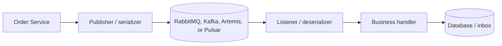
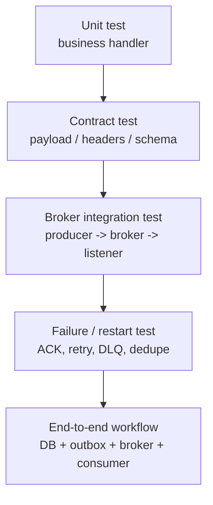
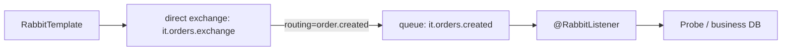
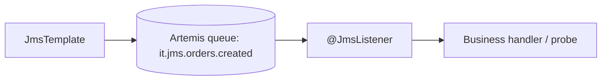
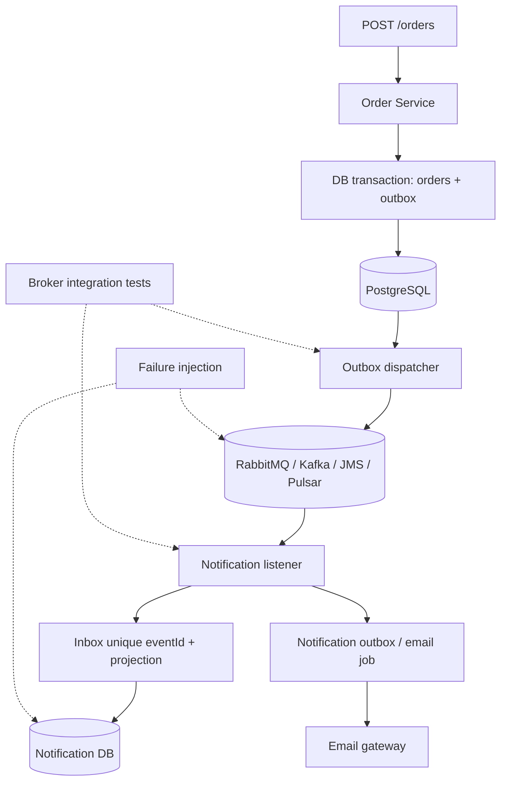

# Testing RabbitMQ, Kafka, JMS, or Pulsar via Test Brokers

## 1. Why Must Integration Tests Go Through a Broker?

In the **SPRING_BOOT_INTEGRATION** module, a Spring Boot service connects HTTP clients, databases, Redis caches, message brokers, and Spring Integration adapters. With RabbitMQ, Apache Kafka, JMS/ActiveMQ Artemis, or Apache Pulsar, events and commands are commonly transmitted **asynchronously** across processes.

Suppose Order Service saves an order and emits `OrderCreated`, while Notification Service consumes the event and writes the outcome to a database:



A unit test calling `handler.handle(event)` directly can verify a business rule, yet **fails to catch** bugs such as:

- Wrong exchange, routing key, queue binding, or topic/subscription.
- Producer sends JSON while consumer expects a String or a DTO with untrusted type headers.
- Consumer group misses messages because offsets, subscriptions, or listener containers are not ready.
- Publisher receives an ACK even though no message reaches the intended queue.
- An error causes infinite listener retries, broker redelivery loops, or misrouting to a DLQ.
- Consumer updates the database successfully then crashes before ACK, causing duplicate processing.
- Broker restart drops messages because delivery mode or durable queue settings are wrong.
- Mock tests pass while production connection factories, credentials, TLS, or broker topologies fail.

Therefore, the lesson **"Testing RabbitMQ, Kafka, JMS, or Pulsar via Test Brokers"** in the **Integration Testing** chapter focuses on *testing a system through a broker with real transport semantics*, while keeping tests isolated, repeatable, and fast enough for CI.



**Example scope:** Java 17+, Spring Boot 3.x, JUnit Jupiter, Spring AMQP, Spring Kafka, Spring JMS using **Jakarta JMS**, Spring for Apache Pulsar, and Testcontainers 1.20/1.21.x. Testcontainers 2.x renamed several Maven modules/packages; check your project's BOM and APIs before copying imports verbatim. Do not assume Boot 4/Testcontainers 2.x examples map identically onto Boot 3.x.

## 2. Four Technologies Do Not Share the Same Delivery Model

| Technology | Routing unit | Consumer mechanism | Completion signal | Characteristics to test |
| --- | --- | --- | --- | --- |
| **RabbitMQ/AMQP 0-9-1** | Exchange, routing key, queue, binding | `@RabbitListener` | Consumer ACK/NACK, broker redelivery | Routing, publisher confirms/returns, DLX |
| **Apache Kafka** | Topic, partition, record key, consumer group | `@KafkaListener` | Offset commit per listener policy | Partition ordering, lag, retries, rebalances |
| **JMS/Artemis** | Queue or Topic, selector, JMS headers | `@JmsListener` | Session acknowledge/transaction | Jakarta JMS semantics, redelivery, selectors, DLQ |
| **Apache Pulsar** | Topic, subscription, key | `@PulsarListener` | Individual/cumulative ACK per subscription | Subscription modes, schema, redelivery, DLQ |

Never write one test assuming every broker shares the same `ACK` semantics. For instance, Kafka does not delete records when a consumer group commits an offset; RabbitMQ typically removes a message from a queue upon ACK; Pulsar depends on subscription mode, retention, and acknowledgment. JMS is an **API/standard** whereas Artemis is **one broker implementation**: testing JMS against Artemis does not prove ActiveMQ Classic or IBM MQ share every vendor extension.

### 2.1. Confirming at Three Distinct Layers

1. **Producer API completes:** the send method/`Future` returns success.
2. **Broker receives/stores/routes:** publisher confirm, Kafka send result, Pulsar message ID, or JMS send return per protocol semantics.
3. **Consumer business effect completes:** listener decodes and commits its local database/outbox/inbox.

A test like `assertDoesNotThrow(() -> template.send(...))` only checks a very shallow layer. To verify business outcomes, observe **results after the consumer**, not merely publish counts.

### 2.2. At-Least-Once Is Not Exactly-Once

A broker can redeliver after a consumer crash or timeout. Producer retries can also introduce transport duplicates. Even though Kafka offers idempotent producers and transactions and Pulsar offers deduplication features, **business side effects across HTTP/SQL/email are not automatically executed exactly once**. Integration tests must verify consumer idempotency, or outbox/inbox/unique constraints when reliability is required.

## 3. Choosing Mocks, Embedded Brokers, or Broker Containers

| Option | What it verifies well | What it cannot verify | When to use |
| --- | --- | --- | --- |
| Mock `RabbitTemplate`/`KafkaTemplate` | Producer calls expected API/arguments | Networking, routing, real serializers, broker ACK | Fast unit tests |
| `TestRabbitTemplate` | Invokes Spring AMQP listener logic without a broker | Queue/exchange bindings, broker persistence/redelivery | Listener slice tests |
| `@EmbeddedKafka` | Kafka producer/consumer against an embedded broker | Docker/network/production cluster issues | Fast Spring Kafka tests |
| Embedded Artemis | In-JVM JMS broker (when configured) | External TCP/TLS/network topology | Lightweight JMS smoke tests |
| **Testcontainers** | Real broker in a container, real TCP ports, client codecs/listeners | Multi-node clusters/security/upgrades when running 1 container | Standard integration tests |
| Shared staging broker | Near-production ACLs/TLS/topology | Test isolation, reproducibility | Staging/contract/system tests |
| Fault-injected/cluster tests | Failover, split-brain, partitions/rebalances | High time and resource cost | Selective reliability suites |

**General recommendation:** use unit/contract tests for most logic; use Testcontainers to verify connectivity and real delivery behavior; dedicate a specialized suite to broker clusters, auth/TLS, schema registries, and chaos. Do not try to turn every unit test into a container test.

### 3.1. A Real Container Is Still Only a Test Topology

A single-node `RabbitMQContainer` does not simulate quorum queues or cluster failover. A single-broker `KafkaContainer` with replication factor 1 does not prove durability on a production cluster. Pulsar standalone does not replace BookKeeper/broker cluster failover. In-JVM Artemis does not validate high-availability replication or shared stores.

**What a test can claim must match the topology it actually ran.**

## 4. Preparing Maven, Docker, and the Version Matrix

An application usually needs only **one** of these four brokers; do not add all four starters if the system does not use them.

Shared test dependencies:

```xml
<dependency>
  <groupId>org.springframework.boot</groupId>
  <artifactId>spring-boot-starter-test</artifactId>
  <scope>test</scope>
</dependency>
<dependency>
  <groupId>org.springframework.boot</groupId>
  <artifactId>spring-boot-testcontainers</artifactId>
  <scope>test</scope>
</dependency>
<dependency>
  <groupId>org.testcontainers</groupId>
  <artifactId>junit-jupiter</artifactId>
  <scope>test</scope>
</dependency>
<dependency>
  <groupId>org.awaitility</groupId>
  <artifactId>awaitility</artifactId>
  <scope>test</scope>
</dependency>
```

These are **Testcontainers 1.x** coordinates; in 2.x, artifact names such as `testcontainers-junit-jupiter` and module-prefixed artifacts change. Pick one BOM supported by Spring Boot/your project and keep all Testcontainers dependencies aligned on the same version. Never arbitrarily mix `junit-jupiter:1.x` with `testcontainers-kafka:2.x` just from copying online snippets.

Broker-specific starter:

```xml
<!-- Choose the starter matching the broker actually used. -->
<dependency>
  <groupId>org.springframework.boot</groupId>
  <artifactId>spring-boot-starter-amqp</artifactId>
</dependency>
<!-- or -->
<dependency>
  <groupId>org.springframework.kafka</groupId>
  <artifactId>spring-kafka</artifactId>
</dependency>
<!-- or -->
<dependency>
  <groupId>org.springframework.boot</groupId>
  <artifactId>spring-boot-starter-artemis</artifactId>
</dependency>
<!-- or -->
<dependency>
  <groupId>org.springframework.boot</groupId>
  <artifactId>spring-boot-starter-pulsar</artifactId>
</dependency>
```

Testcontainers 1.x modules (include only the matching module):

```xml
<dependency>
  <groupId>org.testcontainers</groupId>
  <artifactId>rabbitmq</artifactId>
  <scope>test</scope>
</dependency>
<dependency>
  <groupId>org.testcontainers</groupId>
  <artifactId>kafka</artifactId>
  <scope>test</scope>
</dependency>
<dependency>
  <groupId>org.testcontainers</groupId>
  <artifactId>activemq</artifactId>
  <scope>test</scope>
</dependency>
<dependency>
  <groupId>org.testcontainers</groupId>
  <artifactId>pulsar</artifactId>
  <scope>test</scope>
</dependency>
```

Verify compatibility across the Spring Boot BOM, Spring AMQP/Kafka/Pulsar, and broker images rather than bumping a single package independently and mismatching drivers. Specific container images in these examples are **illustrative version pins**, not recommendations of the latest release.

### 4.1. CI Prerequisites

- Docker Engine or a Docker-compatible runtime supported by Testcontainers.
- Image pulls from internal/public registries per policy; watch rate limits and network access.
- Permissions to create containers, map ports, and clean up; not every runner supports Docker-in-Docker.
- Never hardcode host ports 5672/9092/61616/6650 when using mapped ports.
- Adequate time/CPU/RAM for broker startup, especially Pulsar and Kafka.
- Never disable Docker resource cleanup recklessly just to make tests "faster."

### 4.2. `@ServiceConnection` and `@DynamicPropertySource`

Spring Boot 3.1+ supports `@ServiceConnection` for recognized Testcontainers types. For example:

```java
@Container
@ServiceConnection
static RabbitMQContainer rabbit =
    new RabbitMQContainer("rabbitmq:3.13-management");
```

Spring Boot automatically creates `ConnectionDetails` for RabbitMQ when `spring-boot-testcontainers` is on the test classpath. For unrecognized containers/custom images or when specifying properties manually, use `@DynamicPropertySource`:

```java
@DynamicPropertySource
static void rabbitProperties(DynamicPropertyRegistry properties) {
    properties.add("spring.rabbitmq.host", rabbit::getHost);
    properties.add("spring.rabbitmq.port", rabbit::getAmqpPort);
    properties.add("spring.rabbitmq.username",
        rabbit::getAdminUsername);
    properties.add("spring.rabbitmq.password",
        rabbit::getAdminPassword);
}
```

Use these two options as **alternatives**, never configuring both in conflicting ways. When using `@ServiceConnection` across multiple broker types, confirm each bean connects to its intended container and no other profile overrides it.

## 5. A Simple Event Contract Reusable Across Tests

To focus on the broker, initial examples send JSON **as a `String`**. An event:

```json
{
  "eventId": "evt-test-001",
  "eventType": "OrderCreated",
  "schemaVersion": 1,
  "occurredAt": "2026-11-21T04:00:00Z",
  "data": {
    "orderId": "ord-test-001",
    "tenantId": "tenant-17"
  }
}
```

Using a `String` payload avoids conflating Spring message conversion with transport, yet **does not replace testing real JSON serialization**. Once connectivity/routing smoke tests pass, add DTO → `byte[]`/JSON → DTO tests using your production converters/schema registry.

### 5.1. Identities in Tests

| ID | Used to verify |
| --- | --- |
| `eventId` | Logical event deduplication, invariant across retries |
| `orderId` | Business entity correlation |
| `tenantId` | Scope enforcement and absence of cross-tenant leakage |
| `correlationId` | Tracing/log queries, does not replace event ID |
| Kafka key / Pulsar key | Ordering and partition-routing semantics |
| `JMSCorrelationID` | Header for request/reply correlation |
| RabbitMQ `messageId` | AMQP metadata; verify producer sets it |

In parallel tests, generate per-run `UUID.randomUUID()` payloads or isolated topic/queue namespaces so stale messages from prior tests do not trigger false positives. However, **when testing retries of the same logical operation**, preserve the same event ID to verify idempotency.

## 6. Assertion Patterns for Asynchronous Messages

Never send a message and immediately run `assertThat(database.count()).isEqualTo(1)` because listeners execute on another thread. Two common patterns:

1. **`BlockingQueue` test probe:** the listener pushes outcomes onto a thread-safe queue, and the test polls with a timeout.
2. **Awaitility:** polls a **durable business outcome** in DB/inbox/outbox until satisfied, with a finite deadline.

Simple probe:

```java
package example.integration.testing;

import java.util.concurrent.BlockingQueue;
import java.util.concurrent.LinkedBlockingQueue;

public final class EventProbe {

    private final BlockingQueue<String> received =
        new LinkedBlockingQueue<>();

    public void record(String payload) {
        received.offer(payload);
    }

    public BlockingQueue<String> received() {
        return received;
    }
}
```

Usage in a test:

```java
String payload = probe.received()
    .poll(10, java.util.concurrent.TimeUnit.SECONDS);

assertThat(payload).contains("evt-test-001");
```

**Do not use `Thread.sleep(500)` hoping the consumer has run:** JVM scheduling, broker startup, and CI load have no fixed small upper bound. `poll(timeout)` waits up to the deadline; `Awaitility` retries the assertion condition cleanly.

### 6.1. Using Awaitility for Business Effects

```java
import static org.awaitility.Awaitility.await;
import static org.assertj.core.api.Assertions.assertThat;
import java.time.Duration;

await()
    .atMost(Duration.ofSeconds(15))
    .pollInterval(Duration.ofMillis(100))
    .untilAsserted(() ->
        assertThat(orderProjectionRepository
            .countByLastEventId(eventId))
            .isEqualTo(1)
    );
```

`orderProjectionRepository` is an illustrative application repository, not a built-in class. A test can see `assertThat` pass prematurely if an uncommitted transaction leaks? Always read from an isolated connection post-commit under proper isolation rather than relying only on an in-memory probe.

### 6.2. Receiving Once Does Not Prove "No Duplicates"

A test aiming to prove deduplication cannot assert a single delivery and stop. It must publish/replay the same logical event **multiple times**, wait long enough or check a durable unique inbox/side-effect count, and optionally inject ACK loss. Waiting 500 ms and seeing no duplicate **is not mathematical proof of exactly-once**.

## 7. Test Isolation: Broker State, Listener Lifecycle, and Parallel Execution

A broker is a **stateful** system. Common causes of flaky tests:

- Queues/topics retained from prior tests.
- Kafka consumer groups that already committed later offsets.
- A RabbitMQ listener in another test stealing messages from a shared queue.
- A JMS listener starting before the test installs its probe, consuming the message early.
- A Pulsar subscription cursor initialized at an unexpected position.
- Container alive while the listener lacks partition assignment or active subscription.
- Spring context cache reusing beans with stale test state.
- Parallel tests sharing topics, queues, groups, or subscriptions and contending for records.

Strategies:

| Target | Test policy |
| --- | --- |
| RabbitMQ/JMS queue | Unique name per test class, or verified purge when no other consumers exist |
| Kafka topic | Unique topic per suite/class, unique keys/`eventId` |
| Kafka group | Dedicated group ID or controlled offset reset |
| Pulsar topic/subscription | Dedicated namespace/subscription per test |
| Event payload | Unique event ID for independent tests |
| Listener probe | Clear before each test; never use arbitrary shared static collections |
| Docker container | Lifecycle managed by JUnit/Testcontainers aligned with context caching |
| Parallel tests | Separate broker state or disable parallelism for suites lacking isolation |
| Cleanup | Never delete resources shared by concurrent tests |
| Readiness | Wait for listener assignment/subscription when needed, not just an open broker port |

### 7.1. Startup Readiness Has Multiple Layers

`container.isRunning()` means the container process started; it does not prove queue bindings are declared, Kafka groups have partition assignments, Pulsar subscriptions are active, or JMS listeners are connected. For race-sensitive tests, wait for listener containers to run and/or send a "ready/handshake" probe before sending business events.

### 7.2. Do Not Assume Every Test Gets a Fresh Broker

A `static @Container` typically shares one broker across the test class. Testcontainers reuse and Spring context caching have separate policies. If a Spring context is cached while the previous container stopped, connection beans become stale. Manage test class lifecycles carefully and apply `@DirtiesContext` only when truly needed; never scatter `@DirtiesContext` on every test, as it slows the suite down.

## 8. RabbitMQ: Designing Broker Tests with Spring AMQP

RabbitMQ flows as **producer → exchange → binding → queue → consumer**. Tests should verify at least two contracts:

- **Routing:** published to which exchange/routing key, and does the expected queue have the matching binding?
- **Conversion:** are payload, headers, and message properties decoded properly by the listener?



### 8.1. Topology Declared by Spring

```java
package example.integration.rabbit;

import org.springframework.amqp.core.Binding;
import org.springframework.amqp.core.BindingBuilder;
import org.springframework.amqp.core.DirectExchange;
import org.springframework.amqp.core.Queue;
import org.springframework.context.annotation.Bean;
import org.springframework.context.annotation.Configuration;

@Configuration
public class RabbitTopology {

    public static final String EXCHANGE = "it.orders.exchange";
    public static final String QUEUE = "it.orders.created";
    public static final String KEY = "order.created";

    @Bean
    DirectExchange ordersExchange() {
        return new DirectExchange(EXCHANGE, true, false);
    }

    @Bean
    Queue ordersQueue() {
        return new Queue(QUEUE, true);
    }

    @Bean
    Binding orderCreatedBinding(
            Queue ordersQueue,
            DirectExchange ordersExchange) {
        return BindingBuilder.bind(ordersQueue)
            .to(ordersExchange)
            .with(KEY);
    }
}
```

This is a simple happy-path topology. Durable queues/exchanges do not automatically mean every message is persistent, nor do they replace publisher confirms, returns, quorum queue policies, or consumer idempotency. On a shared development RabbitMQ, use unique names so you do not alter another app's topology.

## 9. RabbitMQ Testcontainers: Publishing Through an Exchange and Consuming via `@RabbitListener`

This is a true **broker integration test**: the Java test sends via `RabbitTemplate`, the real broker routes according to bindings, and Spring's listener receives the message.

With Testcontainers **1.x**, use `org.testcontainers.containers.RabbitMQContainer`.

### 9.1. Listener Probe

```java
package example.integration.rabbit;

import java.util.concurrent.BlockingQueue;
import java.util.concurrent.LinkedBlockingQueue;

import org.springframework.amqp.rabbit.annotation.RabbitListener;

public class RabbitProbe {

    private final BlockingQueue<String> events =
        new LinkedBlockingQueue<>();

    @RabbitListener(queues = RabbitTopology.QUEUE)
    public void onOrderCreated(String json) {
        events.offer(json);
    }

    public BlockingQueue<String> events() {
        return events;
    }
}
```

Use `BlockingQueue` rather than an unsynchronized `ArrayList` because the listener runs on another thread. This test only proves the listener received the message; to prove business state commits, replace the probe with DB assertions.

### 9.2. `@SpringBootTest`, Container, and Producer

```java
package example.integration.rabbit;

import static org.assertj.core.api.Assertions.assertThat;

import java.util.UUID;
import java.util.concurrent.TimeUnit;

import org.junit.jupiter.api.Test;
import org.springframework.amqp.rabbit.annotation.EnableRabbit;
import org.springframework.amqp.rabbit.core.RabbitTemplate;
import org.springframework.beans.factory.annotation.Autowired;
import org.springframework.boot.SpringBootConfiguration;
import org.springframework.boot.autoconfigure.EnableAutoConfiguration;
import org.springframework.boot.test.context.SpringBootTest;
import org.springframework.boot.testcontainers.service.connection.ServiceConnection;
import org.springframework.context.annotation.Bean;
import org.springframework.context.annotation.Import;
import org.testcontainers.containers.RabbitMQContainer;
import org.testcontainers.junit.jupiter.Container;
import org.testcontainers.junit.jupiter.Testcontainers;

@SpringBootTest(classes = RabbitBrokerIT.TestApplication.class)
@Testcontainers
class RabbitBrokerIT {

    @Container
    @ServiceConnection
    static RabbitMQContainer rabbit =
        new RabbitMQContainer("rabbitmq:3.13-management");

    @SpringBootConfiguration
    @EnableAutoConfiguration
    @EnableRabbit
    @Import(RabbitTopology.class)
    static class TestApplication {

        @Bean
        RabbitProbe rabbitProbe() {
            return new RabbitProbe();
        }
    }

    @Autowired RabbitTemplate rabbitTemplate;
    @Autowired RabbitProbe probe;

    @Test
    void routesMessageThroughRealExchangeAndQueue()
            throws Exception {

        String eventId = UUID.randomUUID().toString();
        String json = """
            {"eventId":"%s","eventType":"OrderCreated"}
            """.formatted(eventId).trim();

        rabbitTemplate.convertAndSend(
            RabbitTopology.EXCHANGE,
            RabbitTopology.KEY,
            json
        );

        String received =
            probe.events().poll(10, TimeUnit.SECONDS);

        assertThat(received).isNotNull();
        assertThat(received).contains(eventId);
        assertThat(received).contains("OrderCreated");
    }
}
```

Prerequisites: Maven includes `spring-boot-starter-amqp`, `spring-boot-starter-test`, `spring-boot-testcontainers`, `org.testcontainers:rabbitmq`, `junit-jupiter`, and a Docker runtime. `RabbitTopology` is from section 8, `RabbitProbe` from section 9.1.

What this test verifies:

1. The broker started via Testcontainers.
2. `@ServiceConnection` supplied RabbitMQ connection details to Boot.
3. Spring AMQP declared the exchange, queue, and binding.
4. `RabbitTemplate` sent the message over TCP to the broker.
5. The broker routed by exchange + key.
6. `@RabbitListener` consumed, converted, and invoked the method.
7. The probe received the payload within the deadline.

**Limitations:** the test does not prove DLQ behavior, publisher confirms, persistence across restarts, manual ACK, or consumer DB commits. Those are covered by dedicated tests below.

### 9.3. Why Not Call `RabbitProbe.onOrderCreated` Directly?

`probe.onOrderCreated(json)` only tests a Java method. It bypasses conversion, routing, queue topology, connections, listener containers, and broker ACKs. An integration test must go through `RabbitTemplate`/the broker if the goal is transport verification.

### 9.4. Never Call `receive()` on the Same Queue as a Listener

Some tests call:

```java
rabbitTemplate.receiveAndConvert(RabbitTopology.QUEUE);
```

while `@RabbitListener` is actively consuming that exact queue. Test code and the listener become **two competing consumers**, making the test flaky: the listener can grab the message first so `receiveAndConvert` returns `null`. Pick one clear strategy:

- Test the listener → assert probe/DB effect.
- Test raw queue routing → **do not run a competing listener** on that queue.
- Test DLQ → `receiveAndConvert(DLQ, timeout)` works cleanly when no separate listener reads from the DLQ.

## 10. RabbitMQ: Publisher Confirms, Returns, and Unroutable Messages

A broker ACK to the producer does not guarantee the message reached a business queue:

- **Publisher confirm ACK:** broker received/processed the publish per broker semantics.
- **Publisher return:** when `mandatory` is enabled and routing finds no queue, the broker can return the message to the publisher.
- **Consumer ACK:** the listener finished processing according to ack mode and container policy.

When testing routing failures, configure your `application-test` profile:

```yaml
spring:
  rabbitmq:
    publisher-confirm-type: correlated
    publisher-returns: true
    template:
      mandatory: true
```

Example verifying the confirm callback on a publish (with correlated confirms configured):

```java
import java.util.concurrent.TimeUnit;
import org.springframework.amqp.rabbit.connection.CorrelationData;

CorrelationData correlation =
    new CorrelationData("publish-attempt-1");

rabbitTemplate.convertAndSend(
    RabbitTopology.EXCHANGE,
    RabbitTopology.KEY,
    "{\"eventId\":\"evt-confirm\"}",
    correlation
);

CorrelationData.Confirm confirm =
    correlation.getFuture().get(10, TimeUnit.SECONDS);

assertThat(confirm.isAck()).isTrue();
```

When testing a publish with an unbound routing key, **do not simply** expect a confirm NACK. The broker can ACK the publish to the exchange yet **return** the message because it is unroutable. Register `RabbitTemplate.ReturnsCallback` to verify `replyCode`/`replyText`/`exchange`/`routingKey`; template-bound callbacks can race under parallel tests, so isolate or correlate by `messageId`/attempt ID and reset properly across lifecycles.

### 10.1. Test Topology Instead of Just Asserting Send Doesn't Throw

| Test | Expected |
| --- | --- |
| Existing exchange + valid binding | Message reaches the queue |
| Existing exchange with wrong key, mandatory true | Publisher return is recorded |
| Non-existent exchange | Publish yields appropriate channel/exception/confirm outcome |
| Durable queue + persistent message | Survives broker restart per configuration and environment |
| Listener throws transient exception | Retry/redelivery per container policy |
| Listener throws permanent exception | Reject/quarantine/DLQ rather than retrying forever |

A single broker container does not model full quorum queue replication or production policies, so durability tests must state the exact environment used.

## 11. RabbitMQ: Retries, Dead-Letter Exchanges, and Conversion Errors

A meaningful failure test verifies both **error handling** and **where the message goes afterward**.

Example simple DLQ topology:

```java
package example.integration.rabbit;

import org.springframework.amqp.core.*;
import org.springframework.context.annotation.Bean;
import org.springframework.context.annotation.Configuration;

@Configuration
class RabbitDlqTopology {

    static final String MAIN = "it.orders.process";
    static final String DLX = "it.orders.dlx";
    static final String DEAD = "it.orders.dead";

    @Bean
    DirectExchange deadExchange() {
        return new DirectExchange(DLX);
    }

    @Bean
    Queue mainQueue() {
        return QueueBuilder.durable(MAIN)
            .deadLetterExchange(DLX)
            .deadLetterRoutingKey("order.failed")
            .build();
    }

    @Bean
    Queue deadQueue() {
        return QueueBuilder.durable(DEAD).build();
    }

    @Bean
    Binding deadBinding(
            Queue deadQueue, DirectExchange deadExchange) {
        return BindingBuilder.bind(deadQueue)
            .to(deadExchange)
            .with("order.failed");
    }
}
```

Listener throwing a non-requeueing exception:

```java
import org.springframework.amqp.AmqpRejectAndDontRequeueException;
import org.springframework.amqp.rabbit.annotation.RabbitListener;

@RabbitListener(queues = RabbitDlqTopology.MAIN)
public void process(String payload) {
    if (payload.contains("poison")) {
        throw new AmqpRejectAndDontRequeueException(
            "Permanent invalid event"
        );
    }

    businessHandler(payload);
}
```

`businessHandler` is an assumed application method. When a message is rejected without requeueing—given proper DLX bindings and broker policy—the message is dead-lettered. You can inspect `DEAD` **if no competing DLQ listener is active**:

```java
rabbitTemplate.convertAndSend(
    "",
    RabbitDlqTopology.MAIN,
    "{\"eventId\":\"evt-poison\",\"type\":\"poison\"}"
);

Object dead = rabbitTemplate.receiveAndConvert(
    RabbitDlqTopology.DEAD,
    10_000
);

assertThat(dead).isNotNull();
assertThat(dead.toString()).contains("evt-poison");
```

**Prerequisites:** the test context imports both `RabbitDlqTopology` and the test listener. Do not enable a `RetryInterceptor` with another policy and still expect immediate dead-lettering; if retries use backoff, the test deadline must cover that retry budget.

### 11.1. Pre-Listener Failures Must Be Tested Separately

If a JSON deserializer/converter throws **before** `@RabbitListener` is invoked, a `try/catch` inside the handler never runs. Test malformed schemas, untrusted type headers, container error handlers, DLX routing, and poison-message behavior at the listener container level—not merely by throwing from a mocked service.

### 11.2. Never Requeue Poison Messages Forever

With `defaultRequeueRejected=true` and no bounded retries or error classification, a poison message loops infinitely. Tests must enforce timeouts, attempt/counter bounds, and DLQ/quarantine policies. Never rely on "waiting long enough and seeing the listener stop" as proof; inspect queue state and the DLQ message ID.

## 12. Kafka: Differences Between Embedded Broker and Testcontainers

Spring Kafka provides `spring-kafka-test` and `@EmbeddedKafka`, whereas Testcontainers runs real Apache Kafka/Confluent Kafka images. Choose by need:

| Criterion | `@EmbeddedKafka` | `KafkaContainer` |
| --- | --- | --- |
| Docker | Not required | Required |
| Broker startup | Usually faster | Pays image pull/startup cost |
| Client networking | Embedded broker in test environment | Connects over mapped TCP listener |
| Offset/partition behavior | Testable | Testable |
| External parity with production | Limited | Closer |
| Cluster failover/multi-broker | Requires specialized config | Requires explicit multi-node setup |
| Best fit | Kafka listener/serializer integration | End-to-end broker/network/CI verification |

Embedded test Maven dependency:

```xml
<dependency>
  <groupId>org.springframework.kafka</groupId>
  <artifactId>spring-kafka-test</artifactId>
  <scope>test</scope>
</dependency>
```

Very concise example:

```java
import org.springframework.boot.test.context.SpringBootTest;
import org.springframework.kafka.test.context.EmbeddedKafka;

@SpringBootTest
@EmbeddedKafka(
    topics = "it.embedded.orders",
    partitions = 1,
    bootstrapServersProperty = "spring.kafka.bootstrap-servers"
)
class EmbeddedKafkaOrdersIT {
    // @Autowired KafkaTemplate<String,String>
    // @KafkaListener or matching test Consumer
}
```

Spring Kafka 3.0.10+ typically maps the bootstrap property for Spring Boot automatically, yet declaring it explicitly improves clarity and avoids version surprises. Avoid mixing a **global embedded Kafka** and per-test `@EmbeddedKafka` writing the same system properties; context caching and lifecycle mismatches can cause races where the broker stops while an app context reuses the old connection.

## 13. Kafka Testcontainers: Producers, Brokers, and Consumer Groups

With Testcontainers 1.20/1.21.x, `KafkaContainer` for `apache/kafka` lives in `org.testcontainers.kafka.KafkaContainer`.

### 13.1. Probe Listener and Topic Configuration

```java
package example.integration.kafka;

import java.util.concurrent.BlockingQueue;
import java.util.concurrent.LinkedBlockingQueue;

import org.springframework.kafka.annotation.KafkaListener;

public class KafkaProbe {

    private final BlockingQueue<String> events =
        new LinkedBlockingQueue<>();

    @KafkaListener(
        topics = "it.kafka.orders.created",
        groupId = "it-kafka-order-consumer"
    )
    public void onOrder(String payload) {
        events.offer(payload);
    }

    public BlockingQueue<String> events() {
        return events;
    }
}
```

Topic bean (appropriate for single-broker tests with replication factor 1):

```java
package example.integration.kafka;

import org.apache.kafka.clients.admin.NewTopic;
import org.springframework.context.annotation.Bean;
import org.springframework.context.annotation.Configuration;
import org.springframework.kafka.config.TopicBuilder;

@Configuration
class KafkaTestTopology {

    static final String TOPIC = "it.kafka.orders.created";

    @Bean
    NewTopic ordersTopic() {
        return TopicBuilder.name(TOPIC)
            .partitions(1)
            .replicas(1)
            .build();
    }
}
```

In production brokers, replication factors are typically greater than 1 and availability requirements are stricter. **Do not request replication factor 3 on a single-broker container** and blame integration code when topic creation fails.

### 13.2. Testing `KafkaTemplate` Publishing and `@KafkaListener` Consumption

```java
package example.integration.kafka;

import static org.assertj.core.api.Assertions.assertThat;

import java.util.UUID;
import java.util.concurrent.TimeUnit;

import org.junit.jupiter.api.Test;
import org.springframework.beans.factory.annotation.Autowired;
import org.springframework.boot.SpringBootConfiguration;
import org.springframework.boot.autoconfigure.EnableAutoConfiguration;
import org.springframework.boot.test.context.SpringBootTest;
import org.springframework.boot.testcontainers.service.connection.ServiceConnection;
import org.springframework.context.annotation.Bean;
import org.springframework.context.annotation.Import;
import org.springframework.kafka.annotation.EnableKafka;
import org.springframework.kafka.core.KafkaTemplate;
import org.testcontainers.junit.jupiter.Container;
import org.testcontainers.junit.jupiter.Testcontainers;
import org.testcontainers.kafka.KafkaContainer;

@SpringBootTest(
    classes = KafkaBrokerIT.TestApplication.class,
    properties = {
      "spring.kafka.producer.key-serializer="
        + "org.apache.kafka.common.serialization.StringSerializer",
      "spring.kafka.producer.value-serializer="
        + "org.apache.kafka.common.serialization.StringSerializer",
      "spring.kafka.consumer.key-deserializer="
        + "org.apache.kafka.common.serialization.StringDeserializer",
      "spring.kafka.consumer.value-deserializer="
        + "org.apache.kafka.common.serialization.StringDeserializer",
      "spring.kafka.consumer.auto-offset-reset=earliest"
    }
)
@Testcontainers
class KafkaBrokerIT {

    @Container
    @ServiceConnection
    static KafkaContainer kafka =
        new KafkaContainer("apache/kafka:3.8.1");

    @SpringBootConfiguration
    @EnableAutoConfiguration
    @EnableKafka
    @Import(KafkaTestTopology.class)
    static class TestApplication {

        @Bean
        KafkaProbe kafkaProbe() {
            return new KafkaProbe();
        }
    }

    @Autowired KafkaTemplate<String, String> template;
    @Autowired KafkaProbe probe;

    @Test
    void sendsRecordAndConsumerProcessesIt()
            throws Exception {

        String eventId = UUID.randomUUID().toString();
        String body = """
            {"eventId":"%s","type":"OrderCreated"}
            """.formatted(eventId).trim();

        var sent = template.send(
            KafkaTestTopology.TOPIC,
            "ord-1024",
            body
        ).get(10, TimeUnit.SECONDS);

        assertThat(sent.getRecordMetadata().topic())
            .isEqualTo(KafkaTestTopology.TOPIC);

        String received =
            probe.events().poll(15, TimeUnit.SECONDS);

        assertThat(received).isNotNull();
        assertThat(received).contains(eventId);
    }
}
```

This test exercises the producer serializer, topic, broker, consumer deserializer, group listener, and payload end to end. `send(...).get(...)` proves the broker send result/ack per producer config, **not** that a consumer DB transaction committed. The probe `poll` adds an assertion on listener reception.

### 13.3. Testing Listener Assignment and Readiness

In some setups, a consumer group has not received partition assignments yet when the producer sends an event. With `auto.offset.reset=earliest` on a fresh group, the consumer still reads earlier records. However, if the group already has committed offsets or production uses `latest`, startup races can make the test listener miss messages.

For critical tests, retrieve the listener container from `KafkaListenerEndpointRegistry` and wait for partition assignment via `ContainerTestUtils.waitForAssignment(...)` from `spring-kafka-test`, or check consumer readiness via an appropriate signal. Avoid relying on `Thread.sleep(2000)`.

### 13.4. Testing Keys, Partitions, and Headers

Assertions go beyond payload content:

- Does the Kafka record **key** equal `orderId`?
- Do two events with the same key land on the same partition in a partitioned topic?
- Do `headers` carry `schemaVersion`/`eventId` per converter contract?
- When ordering matters, does the listener process in partition order or introduce concurrency that scrambles completion order?
- Does offset commit actually happen **after** the business DB commit per container ack mode?
- When the app restarts with the same group ID, are committed-offset records skipped per contract?

Kafka guarantees record ordering only **within a single partition** under proper producer/consumer settings, never globally across partitions. Testing a single-partition topic cannot catch ordering bugs on a 12-partition production topic.

## 14. Kafka: Testing Retries, Dead-Letter Topics, Offsets, and Replay

Kafka retains records in a log. When a listener fails, Spring Kafka's `DefaultErrorHandler` and listener container govern seek/retry/skip/recovery per configuration; exceptions do **not** automatically route to a DLT or retry indefinitely by default.

### 14.1. Error Handler with a Retry Budget

Example creating a handler that routes to a dead-letter topic after retries:

```java
package example.integration.kafka;

import org.springframework.context.annotation.Bean;
import org.springframework.context.annotation.Configuration;
import org.springframework.kafka.core.KafkaTemplate;
import org.springframework.kafka.listener.DefaultErrorHandler;
import org.springframework.kafka.listener.DeadLetterPublishingRecoverer;
import org.springframework.util.backoff.FixedBackOff;

@Configuration
class KafkaErrorConfiguration {

    @Bean
    DefaultErrorHandler defaultErrorHandler(
            KafkaTemplate<String, String> recoveryTemplate) {

        DeadLetterPublishingRecoverer recoverer =
            new DeadLetterPublishingRecoverer(
                recoveryTemplate
            );

        // Initial delivery + 2 retries, then recover.
        return new DefaultErrorHandler(
            recoverer,
            new FixedBackOff(100L, 2L)
        );
    }
}
```

**This illustrates a listener using a `String` payload:** `recoveryTemplate` needs a serializer compatible with DLT records—potentially raw `byte[]` or `String`/JSON depending on whether errors occur before or after deserialization. How a `DefaultErrorHandler` bean wires into listener factories depends on Boot/Spring Kafka configuration; tests must confirm the container actually uses the error handler. For conversion errors before the listener runs, configure `ErrorHandlingDeserializer` and converter/recoverer policies rather than trying to throw from inside the handler.

By default, `DeadLetterPublishingRecoverer` typically routes to the original topic name suffixed with `.DLT` and the same partition; the DLT must exist with **at least as many partitions** or use custom routing to avoid publish errors.

### 14.2. Kafka Failure Test Matrix

| Failure | What to assert |
| --- | --- |
| Handler throws transient error then succeeds | Bounded attempts, eventual business commit |
| Permanent validation error | No infinite retries; record routed to DLT/quarantine |
| Deserializer error | Error handler preserves raw bytes/exception headers cleanly |
| DLT publish fails | Does not silently commit/skip and drop the record |
| Consumer dies after DB commit before offset commit | Redelivery may occur; inbox prevents duplicate effect |
| Offset commits while external API hasn't finished | Test catches potential lost business effect |
| Consumer group rebalance | Reprocesses safely per retry/idempotency policy |
| Multiple partitions | Ordered by key/partition; no false global-order claim |
| Producer retries publish | Does not duplicate logical order/event side effects |
| Tombstone/`null` payload | Does not crash the consumer endlessly via decoder/NPE |

### 14.3. Kafka Offsets Are Not a Business Transaction

`KafkaTemplate.send(...).get(...)` returns topic/partition/offset metadata upon broker ACK. `@KafkaListener` processes the record, and offset commits occur later per `AckMode`/error handler configuration. This is distinct from a PostgreSQL transaction.

Scenario to test:

```text
Kafka record offset 51 delivered
consumer INSERT order_projection + inbox, COMMIT DB
consumer crashes before offset commit
Kafka delivers offset 51 again
inbox unique(event_id) => no second business effect applied
consumer commits offset per policy
```

Kafka transactions can coordinate **Kafka offsets and Kafka outputs** within their scope; they do not turn an HTTP partner call or JDBC database write into an exactly-once side effect. When combining DB, broker, and consumer, use idempotency/outbox/inbox or transaction synchronization with carefully tested failure windows.

### 14.4. Manual ACK Tests Have Specific Requirements

When using manual ack:

```java
@KafkaListener(
    topics = "it.kafka.orders.created",
    containerFactory = "manualAckKafkaFactory"
)
public void listen(
        org.apache.kafka.clients.consumer.ConsumerRecord<String, String>
            record,
        org.springframework.kafka.support.Acknowledgment ack) {

    applicationService.process(record.value());
    ack.acknowledge();
}
```

This is sound only when `manualAckKafkaFactory` configures `ContainerProperties.AckMode.MANUAL`/`MANUAL_IMMEDIATE` per desired semantics and `process` **completes durably** before `ack.acknowledge()`. If `process` returns a `Mono<Void>`, invoking it without subscribing/waiting does not mean it committed; use proper reactive integration and test real broker-to-DB execution.

Never call `ack.acknowledge()` inside a `finally` block when business writes fail, as that can skip unprocessed records.

## 15. JMS: Testing ActiveMQ Artemis with a Broker Container

**JMS** is Jakarta's standard messaging API; Spring Boot 3.x uses `jakarta.jms.*` (not legacy Java EE `javax.jms.*`). This lesson uses **ActiveMQ Artemis** as the JMS provider to test `JmsTemplate`/`@JmsListener` over a real TCP broker.



### 15.1. Connecting Spring Boot to the Broker

Manual configuration without `@ServiceConnection`:

```yaml
spring:
  artemis:
    mode: native
    broker-url: ${ARTEMIS_BROKER_URL:tcp://localhost:61616}
    user: ${ARTEMIS_USER:artemis}
    password: ${ARTEMIS_PASSWORD:artemis}
```

In container tests, ports are **dynamically mapped**; never hardcode `localhost:61616` across parallel tests/CI. Use the typed `ArtemisContainer` with `@ServiceConnection` (Boot supplies `ArtemisConnectionDetails`), or `@DynamicPropertySource` providing the URL/user/password from the container.

In Testcontainers 1.x, `ArtemisContainer` is in `org.testcontainers.containers`; Testcontainers 2.x moves typed container classes into modules/packages such as `org.testcontainers.activemq`. Use the imports matching your version.

### 15.2. JMS Listener Probe

```java
package example.integration.jms;

import java.util.concurrent.BlockingQueue;
import java.util.concurrent.LinkedBlockingQueue;

import org.springframework.jms.annotation.JmsListener;

public class JmsProbe {

    private final BlockingQueue<String> messages =
        new LinkedBlockingQueue<>();

    @JmsListener(destination = "it.jms.orders.created")
    public void onMessage(String text) {
        messages.offer(text);
    }

    public BlockingQueue<String> messages() {
        return messages;
    }
}
```

### 15.3. `ArtemisContainer` Test

```java
package example.integration.jms;

import static org.assertj.core.api.Assertions.assertThat;

import java.util.UUID;
import java.util.concurrent.TimeUnit;

import org.junit.jupiter.api.Test;
import org.springframework.beans.factory.annotation.Autowired;
import org.springframework.boot.SpringBootConfiguration;
import org.springframework.boot.autoconfigure.EnableAutoConfiguration;
import org.springframework.boot.test.context.SpringBootTest;
import org.springframework.boot.testcontainers.service.connection.ServiceConnection;
import org.springframework.context.annotation.Bean;
import org.springframework.jms.annotation.EnableJms;
import org.springframework.jms.core.JmsTemplate;
import org.testcontainers.containers.ArtemisContainer;
import org.testcontainers.junit.jupiter.Container;
import org.testcontainers.junit.jupiter.Testcontainers;

@SpringBootTest(
    classes = ArtemisJmsIT.TestApplication.class,
    properties = "spring.artemis.mode=native"
)
@Testcontainers
class ArtemisJmsIT {

    @Container
    @ServiceConnection
    static ArtemisContainer artemis =
        new ArtemisContainer(
            "apache/activemq-artemis:2.32.0-alpine"
        );

    @SpringBootConfiguration
    @EnableAutoConfiguration
    @EnableJms
    static class TestApplication {

        @Bean
        JmsProbe jmsProbe() {
            return new JmsProbe();
        }
    }

    @Autowired JmsTemplate jmsTemplate;
    @Autowired JmsProbe probe;

    @Test
    void sendsJmsTextMessageAndListenerReceives()
            throws Exception {

        String eventId = UUID.randomUUID().toString();
        String text = """
            {"eventId":"%s","eventType":"OrderCreated"}
            """.formatted(eventId).trim();

        jmsTemplate.convertAndSend(
            "it.jms.orders.created",
            text
        );

        String received =
            probe.messages().poll(15, TimeUnit.SECONDS);

        assertThat(received).isNotNull();
        assertThat(received).contains(eventId);
    }
}
```

This test uses **a JMS queue** with default point-to-point semantics. If switching to a **JMS Topic**, configure `pubSubDomain`/listener factories and subscription types accordingly; do not assume `@JmsListener(destination="...")` selects a Topic automatically just because producer and consumer share the name.

### 15.4. JMS-Specific Assertions Worth Checking

JMS carries message headers and properties such as:

- `JMSMessageID`: assigned by the provider/JMS API, not a substitute for a business event ID.
- `JMSCorrelationID`: ties request/reply flows per contract.
- `JMSRedelivered` and `JMSXDeliveryCount` (when supported by the provider): redelivery indicators.
- `JMSPriority`/`JMSExpiration`: governed by producer flags, server settings, and TTL.
- Custom string/int properties and selector filters.

Example inspecting `jakarta.jms.Message` in a listener:

```java
@JmsListener(destination = "it.jms.inspect")
public void inspect(jakarta.jms.Message message)
        throws jakarta.jms.JMSException {

    String correlationId = message.getJMSCorrelationID();
    boolean redelivered = message.getJMSRedelivered();

    // Record test probe/audit metadata; never log raw PII.
}
```

To test correlation, the producer must set `JMSCorrelationID`—for example with a `JmsTemplate` `MessagePostProcessor`—and the listener asserts that exact ID. Testing selectors or delivery modes requires configuring queues/topics and provider policies to mirror production.

### 15.5. JMS Transactions and ACK

A listener may run with session-transacted, client-acknowledge, or auto-acknowledge modes. Returning from `@JmsListener` does not automatically commit a DB transaction together with the broker session. When a listener fails:

- If the JMS session transaction rolls back, the broker may redeliver.
- If the listener ACKs before the database commits, side effects can be lost.
- Under broker redelivery, a durable inbox/business operation key prevents duplicate processing.
- Poison messages need attempt limits and Artemis/consumer DLQ policies.

Write an integration test that throws a controlled error, counts delivery attempts, reads the DLQ, and verifies database state; do not wrap only producer send in `assertThrows`, because listener exceptions occur on the listener thread.

### 15.6. Embedded Artemis Differs from Container Artemis

Spring Boot can launch an embedded Artemis broker when classpath/config allows. While handy for slice tests, this can make tests "pass by accident" by connecting to an embedded broker instead of an external broker container. When testing networked JMS, set `spring.artemis.mode=native` and verify the broker URL actually comes from Testcontainers. If a test runner lacks Docker, embedded mode is a fallback, yet does not verify TLS/port/network behavior matching production.

## 16. Pulsar: Testing Topics and Subscriptions with `PulsarContainer`

Spring for Apache Pulsar integrates `PulsarTemplate` and `@PulsarListener`. A Pulsar topic can have multiple subscriptions, each using `Exclusive`, `Shared`, `Failover`, or `Key_Shared` semantics.

### 16.1. Probe Listener

```java
package example.integration.pulsar;

import java.util.concurrent.BlockingQueue;
import java.util.concurrent.LinkedBlockingQueue;

import org.springframework.pulsar.annotation.PulsarListener;

public class PulsarProbe {

    private final BlockingQueue<String> events =
        new LinkedBlockingQueue<>();

    @PulsarListener(
        topics = "persistent://public/default/it-pulsar-orders",
        subscriptionName = "it-pulsar-orders-sub"
    )
    public void onMessage(String text) {
        events.offer(text);
    }

    public BlockingQueue<String> events() {
        return events;
    }
}
```

A `String` payload uses standard schema inference. With Avro/JSON DTOs/Protobuf/`KeyValue`, explicitly test schema types, serializers, and consumer compatibility; never assume every Java DTO shares an identical wire format.

### 16.2. Pulsar Testcontainers Test

```java
package example.integration.pulsar;

import static org.assertj.core.api.Assertions.assertThat;

import java.util.UUID;
import java.util.concurrent.TimeUnit;

import org.junit.jupiter.api.Test;
import org.springframework.beans.factory.annotation.Autowired;
import org.springframework.boot.SpringBootConfiguration;
import org.springframework.boot.autoconfigure.EnableAutoConfiguration;
import org.springframework.boot.test.context.SpringBootTest;
import org.springframework.boot.testcontainers.service.connection.ServiceConnection;
import org.springframework.context.annotation.Bean;
import org.springframework.pulsar.core.PulsarTemplate;
import org.testcontainers.containers.PulsarContainer;
import org.testcontainers.junit.jupiter.Container;
import org.testcontainers.junit.jupiter.Testcontainers;

@SpringBootTest(classes = PulsarBrokerIT.TestApplication.class)
@Testcontainers
class PulsarBrokerIT {

    static final String TOPIC =
        "persistent://public/default/it-pulsar-orders";

    @Container
    @ServiceConnection
    static PulsarContainer pulsar =
        new PulsarContainer("apachepulsar/pulsar:3.0.0");

    @SpringBootConfiguration
    @EnableAutoConfiguration
    static class TestApplication {

        @Bean
        PulsarProbe pulsarProbe() {
            return new PulsarProbe();
        }
    }

    @Autowired PulsarTemplate<String> template;
    @Autowired PulsarProbe probe;

    @Test
    void publishesAndConsumesStringMessage()
            throws Exception {

        String eventId = UUID.randomUUID().toString();
        String body = """
            {"eventId":"%s","eventType":"OrderCreated"}
            """.formatted(eventId).trim();

        var publishedMessageId =
            template.send(TOPIC, body);

        assertThat(publishedMessageId).isNotNull();

        String received =
            probe.events().poll(20, TimeUnit.SECONDS);

        assertThat(received).isNotNull();
        assertThat(received).contains(eventId);
    }
}
```

With Spring Boot 3.x and a matching `spring-boot-starter-pulsar`, auto-configuration provides `PulsarClient`/`PulsarTemplate`/listener infrastructure; `@ServiceConnection` on the typed container supplies connection details. If a project does not use service connections or needs a custom admin API URL, configure:

```java
@DynamicPropertySource
static void pulsarProperties(DynamicPropertyRegistry registry) {
    registry.add(
        "spring.pulsar.client.service-url",
        pulsar::getPulsarBrokerUrl
    );
    registry.add(
        "spring.pulsar.admin.service-url",
        pulsar::getHttpServiceUrl
    );
}
```

This `@DynamicPropertySource` setup is an **alternative** to service connection if you want explicit properties. Do not configure two conflicting sources. Standalone Pulsar in a container may enable automatic topic creation depending on image/config; if tests require topic admin/setup, create topics via `PulsarAdministration` or a test fixture with an explicit admin URL before publishing.

### 16.3. Testing Pulsar Subscriptions

Unlike Kafka consumer groups, Pulsar uses **subscription cursors** and subscription types:

| Subscription | Semantics to test |
| --- | --- |
| Exclusive | Single active consumer on the subscription |
| Shared | Consumers distribute messages with no global ordering |
| Failover | Active/standby consumers with takeover on failure |
| Key_Shared | Messages sharing a key route consistently per constraints |
| Durable | Subscription/cursor persists state per broker policy |
| Non-durable | Delivery lifecycle differs from durable subscriptions |

With `Shared`, never assert that global order is preserved. With `Key_Shared`, test key-ordering semantics along with batching and producer configuration. When relying on **message keys** to preserve per-order sequence, test against a multi-partition topic and multiple consumers rather than a single consumer.

### 16.4. ACK, Redelivery, and Negative Acknowledgment

Spring Pulsar listeners configure ack modes and error/negative-acknowledgment/redelivery policies. To test poison messages:

1. Configure a subscription/consumer retry policy with a clear attempt count.
2. Publish a message failing conversion or business validation.
3. Verify the listener is invoked the expected number of times (potentially across attempts).
4. Verify eventual DLQ/quarantine routing or durable failure state.
5. Ensure `OrderCompleted` is never emitted if the business effect failed to commit.

Pulsar's `MessageId` is a broker identifier, **not a stable business event ID**; republishing a logical event generates a new `MessageId`. When testing duplicates, rely on `eventId` in payload/metadata to verify idempotency.

### 16.5. Pulsar Transactions Do Not Span Databases

Pulsar supports transactions when enabled on the server, client, and Spring integration, yet they do not cover PostgreSQL, HTTP payments, or Redis. Just like Kafka and RabbitMQ, when business state commits to SQL, use outbox/inbox or a recoverable orchestration policy; never infer from `PulsarTemplate.send(...)` returning a `MessageId` that downstream consumer effects are done.

## 17. One Shared Event Contract Across All Four Brokers

You can reuse the same **event contract** regardless of transport:

```java
package example.integration.contracts;

import java.time.Instant;

public record OrderCreatedV1(
    String eventId,
    int schemaVersion,
    String orderId,
    String tenantId,
    Instant occurredAt
) {
    public OrderCreatedV1 {
        if (eventId == null || eventId.isBlank()
                || schemaVersion != 1
                || orderId == null || orderId.isBlank()
                || tenantId == null || tenantId.isBlank()
                || occurredAt == null) {
            throw new IllegalArgumentException(
                "Invalid OrderCreatedV1 contract"
            );
        }
    }
}
```

**Never pass persistence entities directly** into broker converters. HTTP/DB/Jackson mappings can diverge: JPA proxies, MongoDB `ObjectId`, Jackson Java time modules, enum renames, and JSON number precision can all alter wire contracts.

Schema test matrix:

| Case | Expectation |
| --- | --- |
| Valid v1 event | Serializer/consumer round-trip succeeds |
| Missing `eventId` | Rejected/quarantined |
| `schemaVersion=2` when consumer only knows v1 | Explicit versioning policy enforced |
| Added optional field | v1 consumer handles per compatibility policy |
| Unknown enum | Fails or maps to `UNKNOWN` per contract |
| ISO-8601/UTC timestamp | Round-trips without timezone drift |
| Decimal monetary amount | Zero precision loss |
| Unicode customer name | Valid UTF-8 |
| Payload exceeds broker limit | Producer/transport reports error instead of silently truncating |
| Header outside allowlist | Secrets are never forwarded |
| Same `eventId`, different payload | Business conflict detected |
| Same `eventId` republished | Consumer deduplicates stable logical event |

### 17.1. Testing Wire Bytes, Not Just Object Equality

An `objectMapper.writeValueAsString(dto)` test can pass while the real producer uses `SimpleMessageConverter` or an Avro serializer. Read **raw messages** from the queue/topic using a dedicated test consumer, assert `contentType`, headers, key, schema registry ID, and decoded bytes, then run end-to-end listener tests.

### 17.2. Never Point Schema Registry Tests at Production

Kafka/Pulsar setups may use a schema registry or metadata service. During integration tests, all external schema endpoints must be test-local or **intentionally** mocked—never pull production URLs or credentials. When testing schema compatibility, create isolated subject/topic schema versions and verify "v1 reading after v2 producer deploy."

## 18. Retries, DLQ, and Pre-Listener Errors: Cross-Technology Matrix

| Failure type | RabbitMQ | Kafka | JMS/Artemis | Pulsar |
| --- | --- | --- | --- | --- |
| Invalid JSON | Converter/container error | Deserializer/error handler | Message converter error | Schema/consumer conversion error |
| Retry | Listener container/requeue/interceptor | `DefaultErrorHandler`/backoff | Session rollback/provider redelivery | Negative ACK/redelivery |
| Parking place | Dead-letter queue | DLT topic | Broker DLQ | DLQ topic |
| Acknowledgment | ACK/NACK delivery | Offset commit | JMS session ACK/transaction | Subscription ACK |
| Producer confirmation | Publisher confirm/return | Send result/acks | Provider send return/transaction | `MessageId`/send result |
| Duplicate test key | `eventId` in body/header | Business `eventId`, not offset | Business `eventId`, not `JMSMessageID` | Business `eventId`, not Pulsar `MessageId` |
| Ordering scope | Queue/consumer configuration | Partition/key | Queue/topic/provider semantics | Subscription type/key/partition |

Write at least three independent failure tests:

1. **Permanent poison message** (invalid schema): does not retry endlessly and lands in quarantine.
2. **Transient downstream error** (DB unavailable): bounded/backoff retry or durable retry job eventually succeeds when the dependency recovers.
3. **Crash window** (business commit before ACK): redelivery occurs, yet durable side effects are not duplicated.

**Conversion errors occur before the listener method executes**, so a `try/catch` inside `@RabbitListener`/`@KafkaListener`/`@JmsListener`/`@PulsarListener` will not catch them. Test the container's **real error handler and dead-letter path**.

## 19. Testing Idempotency Across Database and Broker Together

A consumer "processing a message" may trigger multiple side effects: writing to a DB, updating Redis, and emitting a new event/email. Unit tests do not prove **transactional/duplicate behavior** through a broker.

### 19.1. Inbox Unique Key

Suppose the consumer maintains an inbox table:

```sql
CREATE TABLE integration_inbox (
    consumer_name VARCHAR(80) NOT NULL,
    event_id VARCHAR(80) NOT NULL,
    processed_at TIMESTAMP WITH TIME ZONE NOT NULL,
    PRIMARY KEY (consumer_name, event_id)
);
```

Perform the business update and inbox insert in the **same local DB transaction** when atomic deduplication is required. An integration test:

```text
Given:
  eventId = evt-dup-42
  broker topic/queue configured
When:
  publish the same logical event twice
Then:
  raw broker may deliver twice
  durable inbox holds only 1 row
  business projection updates only once
  consumer ACK/offset commits properly after DB commit
```

If a test observes listener invocation count = 2 while business row count = 1, that is often **correct behavior** under at-least-once delivery. Not every duplicate delivery is a test failure; duplicate business effects are what must be prevented.

### 19.2. Never Treat Consumer ACK as Proof of External API Execution

If a consumer calls a Payment Provider after inserting into the inbox and that API times out, an inbox row may exist even though payment capture is uncertain. Use provider idempotency keys, durable saga/job state, and reconciliation. Integration tests should simulate the provider "committing then dropping the response" and retrying with the **same** business operation key.

### 19.3. Broker + Postgres Testcontainers

An end-to-end test commonly runs **two containers**: a broker and Postgres. Example structure:

```text
@Testcontainers / @SpringBootTest
  RabbitMQContainer/KafkaContainer/ArtemisContainer/PulsarContainer
  PostgreSQLContainer
  Spring Boot listener + repository + transaction manager
  Input event -> real broker -> listener -> real DB
  Awaitility -> assert projection/inbox/outbox
```

When asserting DB side effects, do not attach a competing probe-only listener to the same topic/queue as the business consumer: **assert database state** after the consumer runs. On Kafka, you can observe independently using a second consumer in a different group; on RabbitMQ/JMS queues, adding a competing consumer alters delivery distribution.

## 20. Outbox, Publish Acknowledgments, and Hard-to-Test Failure Windows

Suppose Order Service runs a transaction:

```text
BEGIN PostgreSQL transaction
  INSERT orders
  INSERT integration_outbox(eventId, payload, status='PENDING')
COMMIT

Outbox dispatcher
  read PENDING event
  publish to broker
  receive broker confirmation
  mark event SENT
```

A test that only calls `RabbitTemplate`/`KafkaTemplate` directly **skips the outbox**, bypassing the database commit and dispatcher. Write workflow-level tests exercising both resources.

### 20.1. Fault Injection Matrix

| Failure moment | Possible state | Critical assertion |
| --- | --- | --- |
| Before Order DB commit | No order or outbox row | No "phantom" event emitted |
| After Order commit, before dispatcher | Order + `PENDING` outbox | Restarting dispatcher still publishes |
| Broker down during dispatch | Outbox `PENDING`/`RETRY` | Not falsely marked `SENT` |
| Broker accepts publish, confirmation lost | Publish may be retried | Same `eventId`, consumer deduplicates |
| Outbox marked `SENT`, consumer hasn't processed yet | Event pending in broker | Consumer eventually processes or alerts |
| Consumer business DB commits, ACK lost | Broker redelivers | Unique inbox, single business effect |
| Consumer schema error | Poison message | Routed to DLQ/quarantine with metadata |
| DB update succeeds, Redis update fails | Stale cache | TTL/version-aware invalidation/retry |
| Outbox worker crashes mid-batch | Some events remain claimed | Lease expiration/recovery |

### 20.2. Retry Tests Must Preserve the Event ID

Wrong:

```java
// Wrong if each retry builds a brand-new business event:
retry(() -> publish(
    new OrderCreatedEvent(UUID.randomUUID(), orderId)
));
```

Right in concept:

```java
String stableEventId = storedOutbox.eventId();
String storedPayload = storedOutbox.payloadJson();

retry(() -> publish(stableEventId, storedPayload));
```

In production, `retry` above represents an illustrative helper/policy, not a built-in Java/Spring API. Publishers must preserve payload/schema version and logical event ID from the outbox record, enforcing backoff, attempt budgets, and error classification.

### 20.3. Broker ACK Does Not Prove Consumer Completion

With RabbitMQ publisher confirms or Kafka send futures, the broker confirms receipt according to its semantics. The consumer may still not have processed the event. End-to-end tests should wait until:

1. The source DB order has committed.
2. The outbox record has been dispatched per policy.
3. The consumer business DB/inbox has committed.
4. Eventual business state matches expectations.
5. Replay causes no unexpected side effects.

Define SLOs around **business completion latency**, not merely broker publish time.

### 20.4. Toxiproxy or Container Pause/Kill

To simulate network partitions or broker outages, use Toxiproxy Testcontainers, stop the broker, or make the container unavailable—while keeping the test isolated:

- Do not disrupt other tests sharing a broker.
- Do not assume clients always throw the exact same exception class.
- Never use arbitrary sleeps; wait for readiness/unavailability with a deadline.
- When restarting a broker, check volume/persistence policies; a fresh container may not retain old state.
- Cluster failover tests need multiple nodes—never call `container.stop()` on one node and extrapolate to production clustering.

## 21. Organizing the Test Suite to Prevent False Positives

A practical layout:

```text
src/test/java
  .../unit/
    EventValidationTest
    OrderHandlerTest
  .../contract/
    OrderCreatedJsonContractTest
    MessageHeaderContractTest
  .../broker/
    RabbitBrokerIT
    KafkaBrokerIT
    ArtemisJmsIT
    PulsarBrokerIT
  .../workflow/
    OrderOutboxToNotificationIT
    DuplicateEventIdempotencyIT
  .../resilience/
    BrokerOutageRecoveryIT
    ConsumerAckLossIT
```

This layout is *illustrative*—not every service uses all four brokers. Each application includes only the connectors it actually runs.

### 21.1. Test Data Setup and Cleanup

Maintain fixture ownership:

- Give queues/topics/bindings versioned prefixes or dedicated names that never collide with production.
- Delete inbox/outbox rows by test ID in the test DB rather than running full-table `DELETE` if tests run in parallel.
- When sharing a broker at class/suite level, filter outputs using unique event IDs.
- No queue purge is needed when each test owns its own queue/topic and the container is disposed after the suite.
- With Kafka/Pulsar, topics and subscriptions hold cursors, making cleanup trickier than clearing a Java collection.
- Configure retention and topic/queue deletion so long suites do not accumulate unbounded data.

### 21.2. Never Consume the Same Queue with Both a Probe and Business Listener

RabbitMQ/JMS queues distribute each message to one competing consumer per transport policy. Adding a second test consumer to inspect raw payloads on the same queue can **starve the business listener**. Separate concerns clearly:

- Listener tests: send and wait for the listener's **effect**.
- Raw contract tests: run without another listener competing on that queue.
- Monitoring/test taps: use a dedicated topic/fanout/binding or broker tap mechanism.
- Kafka/Pulsar: assign a distinct consumer group/subscription when observing independently.

### 21.3. Test Context Caching and Lifecycle

`@SpringBootTest` context startup takes time, as does Testcontainers initialization. Controlled context sharing speeds up runs, provided containers never stop while cached contexts remain live. Watch JUnit test instance lifecycles, static container fields, `@DirtiesContext`, and parallel runners. When changing container images or properties between classes, do not assume Spring's context cache recognizes them as different brokers automatically.

### 21.4. Pin Images and Dependency Versions

Maintain a **version matrix** documenting:

| Component | Baseline to pin |
| --- | --- |
| Java | 17 or 21 matching app runtime |
| Spring Boot | Specific 3.x version of the project |
| Spring Kafka/AMQP/Pulsar | Versions managed by Boot BOM |
| Testcontainers | 1.20/1.21 or 2.x per BOM, never mixed |
| RabbitMQ image | Production-compatible RabbitMQ version |
| Kafka image | Matching Apache/Confluent Kafka image |
| Artemis image | Artemis version with Jakarta JMS support |
| Pulsar image | Pulsar image compatible with client |
| PostgreSQL/MySQL/MongoDB | Matching schema/transaction version |

**Never use `latest` for container images in CI**, because the same commit can pass today and fail next week after an upstream broker release. Upgrade images in dedicated PRs with changelogs and compatibility checks.

## 22. Running in CI: Performance and Repeatability

Slow or flaky integration suites tempt developers to bypass vital checks. To keep tests trustworthy:

1. **Split pipelines:** fast unit/contract tests on every change; broker integration tests on PR/release; chaos/failover suites scheduled or pre-deploy.
2. **Controlled reuse:** start one broker per class/fixture when tests share topology safely; never reuse random state across jobs.
3. **Resources:** provision enough RAM/CPU for Kafka/Pulsar, disk for container layers, and host ephemeral ports.
4. **Readiness:** an open broker port is not enough; create topics/queues and wait for listener assignment/subscriptions.
5. **Bounded timeouts:** every async assertion has a max duration; never allow infinite hangs when a broker is unavailable.
6. **Failure logs:** collect container logs, Spring listener errors, queue/topic names, event IDs (no secrets), and DB state.
7. **No runtime Internet dependencies:** cache/mirror images per policy; tests must never call external production brokers or schema registries.
8. **Parallel isolation:** when running multiple test classes concurrently, isolate topics/queues/group IDs and DB schemas.
9. **Deterministic retries:** when testing redelivery, trigger failures via controlled fixtures instead of lucky timing.
10. **Fail fast on infrastructure:** never swallow `DockerUnavailableException` into a pass; report explicit skip/blocker status per CI policy.

### 22.1. Maven Surefire and Failsafe

A common convention:

- `*Test.java`: unit tests executed by Surefire during `test`.
- `*IT.java`: broker integration tests executed by Failsafe during `integration-test`/`verify`.

You do not have to follow this naming strictly, but teams should classify tests clearly so local and CI runs target the right scope. Never put container tests inside `mvn test` without ensuring Docker exists on CI, or builds will fail unpredictably.

### 22.2. Flaky Tests Are Usually Contract/Timing Bugs—Not Reasons to Raise Sleeps

Example:

```text
Expected: listener receives event within 10s
Actual: timed out 1 out of 30 runs in CI
```

Instead of increasing `Thread.sleep(1000)` to `Thread.sleep(5000)`, check:

- Did the Kafka group receive partition assignments before publishing?
- Was the Pulsar subscription created in time?
- Did Spring declare the queue binding successfully?
- Did Kafka `auto-offset-reset=latest` drop the record for a brand-new group?
- Were broker startup readiness/health checks accurate?
- Did the consumer fail deserialization and enter a retry loop?
- Was a stale context/test state reused?
- Was another listener competing on the same queue?
- Was the outbox dispatcher delayed, meaning the test should wait on business state rather than publish callbacks?

**An unreproducible test failure often signals a real race condition in the system.**

## 23. Broker Troubleshooting Runbook

| Symptom | Likely cause | What to check |
| --- | --- | --- |
| Rabbit producer sends without error, yet listener receives nothing | Wrong exchange/routing/binding, unroutable message | `RabbitAdmin` topology, mandatory returns |
| Rabbit DLQ stays empty even though listener throws | Requeue policy or different retry interceptor | Container config, DLX binding |
| Rabbit `receiveAndConvert` returns `null` | Competing consumer took the message | Separate raw probe queues from listeners |
| Kafka send future returns metadata, yet listener receives nothing | Group offset, topic mismatch, subscription/assignment | Group ID, `auto-offset-reset`, topic name |
| Kafka DLT has no record | Wrong recovery serializer/topic/partition count | Error handler, DLT topology |
| Kafka test passes locally but fails in CI | Startup race, parallel tests sharing group/topic | Assignment readiness, isolation |
| JMS test hits wrong provider | Embedded Artemis auto-enabled | `spring.artemis.mode=native`, broker URL |
| JMS message never reaches listener | Topic vs. queue mismatch, selector | `pubSubDomain`, destination, selector |
| JMS duplicate handling broken | Session transaction/ACK policy | `JMSRedelivered`, inbox, DLQ |
| Pulsar publish succeeds, yet listener receives nothing | Subscription not ready, topic/schema mismatch | `subscriptionName`, admin/topic setup |
| Pulsar receives out of order | Shared subscription or partitions | Keys and subscription type |
| Pulsar test fails to start | Image/resource/admin endpoint issues | Container logs, mapped URLs |
| All four broker tests connect to `localhost` | Test properties not injected | `@ServiceConnection`/`@DynamicPropertySource` |
| Tests hang for a long time | Unbounded await, infinite broker retries | Timeouts, backoff, error handlers |
| Tests pass without a broker | Mocks/test binders still active | Verify real container + real socket |
| Failures appear only after long suites | Context cache, stale listeners, uncleaned state | Lifecycles, topic/queue uniqueness |
| Duplicate events produce duplicate DB rows | Missing business inbox/unique constraint | Stable `eventId` + transactional dedup |
| Old event schema fails post-deploy | Consumer lacks backward compatibility | Contract fixtures, serializer versions |

### 23.1. How to Verify a Test Truly Uses a Broker

For a test to qualify as **broker integration**:

1. The test starts a container broker or connects to a controlled test broker.
2. Spring's client connection factory points to the **test broker address**, never production or an in-memory stub.
3. The producer sends via the Spring client/transport—never invoking listener methods directly.
4. Assertions check consumer effects or real broker deliveries.
5. Disconnecting the broker triggers expected recovery behavior.
6. Failures report event/topic/queue/group IDs alongside diagnosable logs and DB state.

You can deliberately stop the broker in an isolated resilience test; it should visibly impact the send/consume/retry path. Never do that on a shared broker serving other tests.

## 24. Case Study: `OrderCreated`, Outbox, and Notification Consumer

Suppose the system must publish an `OrderCreated` event from Order Service's PostgreSQL database to a broker, while Notification Service writes a read model and avoids sending duplicate emails on broker redelivery.



### 24.1. Contract

```json
{
  "eventId": "evt-20261121-001",
  "eventType": "OrderCreated",
  "schemaVersion": 1,
  "occurredAt": "2026-11-21T04:00:00Z",
  "data": {
    "orderId": "ord-1024",
    "tenantId": "tenant-17",
    "customerId": "cus-51"
  }
}
```

Keep the event ID constant across outbox retries. The Notification consumer maintains a unique inbox (`consumerName`, `eventId`). The consumer must **not** send emails directly before committing inbox/job state hoping redelivery never happens; use an email outbox/job with idempotency or provider-specific send deduplication when needed.

### 24.2. Minimum Recommended Tests

| Test | Trigger / execution | Expected |
| --- | --- | --- |
| Producer→broker→listener | Publish valid event | Listener/DB state matches |
| Schema v1 contract | Serialize and deserialize real bytes | Event ID/version/payload accurate |
| Routing/topic | Send to valid and invalid destinations | Correct binding/topic, wrong routes caught |
| Business duplicate | Send same `eventId` twice | Inbox 1 row, email job 1 |
| Poison JSON | Send malformed payload | DLT/DLQ routed, no corrupt DB writes |
| Transient DB failure | Brief consumer DB outage | Bounded retries, eventual commit |
| Crash after DB commit | Lost ACK/offset | Redelivery occurs without duplicate effects |
| Outbox recovery | Broker unavailable at publish | DB stays `PENDING`, publishes after recovery |
| Consumer restart | Restart listener with same subscription/group | Offset/cursor/queue state preserved |
| Late event replay | Reprocess older event version | Schema/version/unique behavior holds |
| Mixed tenants | Same `orderId` across two tenants | No data mixing or wrong deduplication |
| Deadline exceeded | Prolonged broker lag | Alerting/reconciliation, no silent success |

### 24.3. Choosing Meaningful Assertions

Insufficient:

```java
verify(notificationHandler).handle(any());
```

Better in a full integration test:

```java
await().atMost(Duration.ofSeconds(20))
    .untilAsserted(() -> {
        assertThat(inboxRepository.countByEventId(eventId))
            .isEqualTo(1);
        assertThat(notificationJobRepository
                .countByOrderId(orderId))
            .isEqualTo(1);
    });
```

`inboxRepository` and `notificationJobRepository` are assumed application interfaces. If an email gateway is invoked after the DB job state, test it against a separate HTTP mock server so **no real emails are sent**, while keeping the real broker and database in the test.

### 24.4. Do Not Judge Business Completion by Broker Metrics Alone

Kafka consumer lag = 0, RabbitMQ ready = 0, or Pulsar backlog = 0 does not guarantee Notification persisted to DB or sent the email. If the outbox publisher is stuck, the broker looks empty while business work piles up. Measure **oldest outbox age, consumer DB completion, inbox duplicate counts, and job error statuses**, and assert those in tests where applicable.

## 25. Checklist, Exercises, and Official References

### 25.1. Pre-Merge Checklist for Broker Integration Tests

- [ ] Clearly identified which broker belongs to the service: RabbitMQ, Kafka, JMS/Artemis, or Pulsar?
- [ ] Includes tests with a real/container broker rather than mocked producers alone?
- [ ] Spring Boot/driver/Testcontainers versions and container images are pinned/aligned?
- [ ] `@ServiceConnection` or `@DynamicPropertySource` targets the test broker?
- [ ] Never tests against production brokers, schema registries, or credentials?
- [ ] Queues/exchanges/routing, topics/partitions/groups/subscriptions match contract?
- [ ] Producer serializers and consumer deserializers/converters are tested on the wire?
- [ ] Tests cover JSON schema, required fields, nullability, enums, timestamps, IDs, and header versions?
- [ ] Async assertions use bounded deadlines rather than guesswork `Thread.sleep`?
- [ ] Listener readiness and startup races are controlled?
- [ ] Test data isolation handles parallel runs and context caching safely?
- [ ] No competing consumer steals messages from listener tests?
- [ ] Publisher ACK/confirms are distinguished from broker routing and consumer completion?
- [ ] Retries, DLQs, and poison messages are tested through real error handlers?
- [ ] Broker redelivery and duplicate `eventId`s do not produce duplicate business side effects?
- [ ] Consumer ACK/offset commits align with durable database transactions?
- [ ] Outbox/broker/consumer crash windows are simulated where business criticality demands?
- [ ] For Kafka, partition keys, group offsets, and rebalances are tested as needed?
- [ ] For JMS, queue/topic/selector/session semantics are tested?
- [ ] For Pulsar, subscription types/schemas/redelivery are tested?
- [ ] CI provisions adequate resources, image mirrors, cleanup, and failure log artifacts?
- [ ] Metrics/logs/traces omit PII, credentials, and high-cardinality tags?
- [ ] Assertions measure **business outcomes**, not merely producer invocations?

### 25.2. Practice Exercises

**Exercise 1 — RabbitMQ routing:** create a direct exchange and two queues with different routing keys. Publish to matching and unmatched keys; assert which queue receives messages and test mandatory returns.

**Exercise 2 — Kafka consumer groups:** create a two-partition topic and publish 20 events across two keys. Assert record keys/partitions, listener group behavior, and ordering boundaries.

**Exercise 3 — JMS Artemis:** enable a listener using a transacted session. Force the handler to fail once and succeed on retry; assert redelivery/ACK policy and inbox deduplication.

**Exercise 4 — Pulsar subscriptions:** compare `Exclusive` against `Shared`/`Key_Shared` on a test topic, documenting ordering and delivery distribution.

**Exercise 5 — Schema compatibility:** keep a golden v1 JSON fixture, add an optional v2 field, and verify whether a v1 consumer handles it per your chosen contract.

**Exercise 6 — Outbox recovery:** stop the broker after DB commit. Assert the outbox stays `PENDING`, restart the broker, and verify the dispatcher publishes the same `eventId` while the consumer applies one business effect.

**Exercise 7 — CI flakiness:** intentionally delay listener startup, remove `Thread.sleep`, and replace it with readiness + bounded await; verify stability across repeated runs.

### 25.3. Official Reference Documentation

- [Spring Boot — Testcontainers and Service Connections](https://docs.spring.io/spring-boot/3.5/reference/testing/testcontainers.html)
- [Spring Boot — Apache Kafka](https://docs.spring.io/spring-boot/reference/messaging/kafka.html)
- [Spring Kafka — Testing Applications](https://docs.spring.io/spring-kafka/reference/testing.html)
- [Spring AMQP — Testing Support](https://docs.spring.io/spring-amqp/reference/testing.html)
- [Spring Boot — JMS/ActiveMQ Artemis](https://docs.spring.io/spring-boot/reference/messaging/jms.html)
- [Spring Boot — Apache Pulsar](https://docs.spring.io/spring-boot/reference/messaging/pulsar.html)
- [Spring Pulsar — Testing Applications](https://docs.spring.io/spring-pulsar/reference/reference/testing-applications.html)
- [Testcontainers Java — Kafka](https://java.testcontainers.org/modules/kafka/)
- [Testcontainers Java — RabbitMQ](https://java.testcontainers.org/modules/rabbitmq/)
- [Testcontainers Java — ActiveMQ/Artemis](https://java.testcontainers.org/modules/activemq/)
- [Testcontainers Java — Pulsar](https://java.testcontainers.org/modules/pulsar/)

**Conclusion:** Broker testing in Spring Boot Integration must go beyond mocking producers or asserting `send()` does not throw. A true **broker integration test** connects to a test RabbitMQ, Kafka, Artemis/JMS, or Pulsar instance with a real client, exercises real topology and serialization, awaits consumers within bounded deadlines, and verifies business outcomes. Because each broker has distinct routing, offset/subscription, and ACK/redelivery semantics, test retries, DLQs, duplicates, schema evolution, and broker outages on the exact transport you use.

When integrating databases, Redis, HTTP, or Spring Integration adapters alongside messaging, **broker confirmation is not a distributed transaction**. Combine transactional outboxes, durable inboxes, idempotency keys, versioned data contracts, test isolation, observability, and post-commit failure tests so systems recover cleanly without losing or duplicating business effects.
