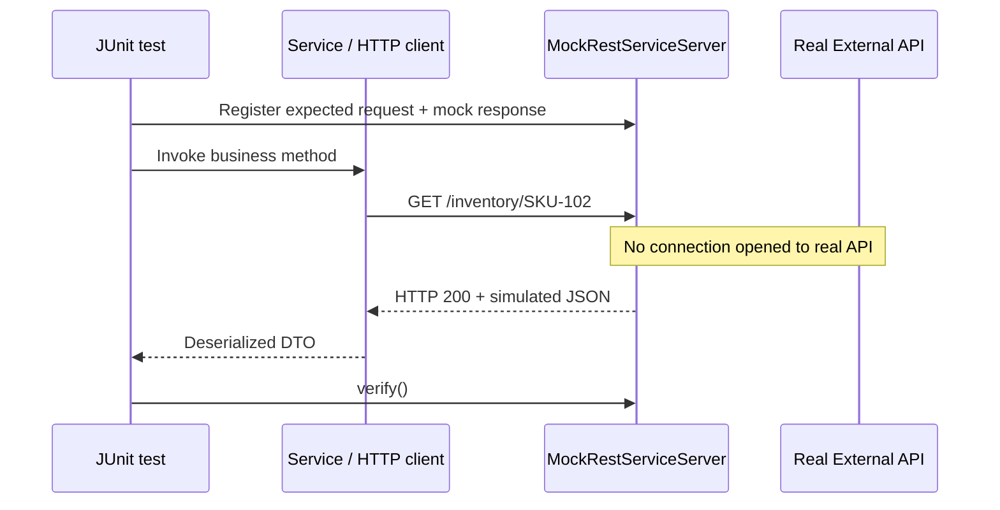

# `MockRestServiceServer` for Synchronous HTTP Clients

## 1. Why Test HTTP Clients at the Integration Boundary?

In the **SPRING_BOOT_INTEGRATION** module, Spring Boot connects systems across HTTP clients, databases, caches, message brokers, and Spring Integration adapters. A service making HTTP calls must guarantee the right URL, HTTP method, headers, JSON body, timeout behavior, and error interpretation. If you only mock the partner service class with Mockito, many bugs at the HTTP boundary go unnoticed: passing the wrong path variable, omitting an auth header, mis-serializing JSON, or mishandling status codes.

**`MockRestServiceServer`** in Spring Framework's `spring-test` module verifies requests sent by **Spring's synchronous HTTP clients** without starting a real HTTP server. The test registers expected requests and simulated responses; the client executes its real request-building code and receives the defined response.

Example: an ordering application checks inventory before placing an order. We want to verify the application actually sends:

```http
GET /inventory/SKU-102 HTTP/1.1
Host: inventory.example.test
Accept: application/json
```

and deserializes the JSON response into a DTO:

```json
{
  "sku": "SKU-102",
  "available": 12
}
```

Two distinct aspects require separate verification:

1. **Client-side contract:** the application emits the right request and handles responses properly, including `4xx`, `5xx`, or interrupted connections.
2. **Compatibility with the real server:** HTTP/TLS transport, real authentication, proxy settings, load balancers, and live partner data.

`MockRestServiceServer` focuses on the first aspect; it does not replace testing against a stub HTTP server on a real port or an integration environment.

## 2. Choosing the Right Tool by Client Type

| Client in the application | Compatible with `MockRestServiceServer`? | Explanation / alternative |
| --- | --- | --- |
| `RestTemplate` | **Yes** | Binds directly to the `RestTemplate` instance; requests are intercepted at `ClientHttpRequestFactory`. |
| `RestClient` (Spring Framework 6.1+) | **Yes** | Binds to `RestClient.Builder` **before** calling `build()`. This is also a synchronous HTTP client. |
| `@HttpExchange` HTTP interface backed by `RestClientAdapter` | **Yes**, indirectly | Binds to the underlying `RestClient.Builder` behind the HTTP interface proxy; tests verify requests generated by the proxy. |
| `WebClient`, Reactor Netty | **Not directly** | `WebClient` uses a different `ExchangeFunction` / `ClientHttpConnector` abstraction; consider WireMock, MockWebServer, or testing via an appropriate connector. |
| OpenFeign or third-party HTTP clients not built on `RestTemplate`/`RestClient` | **Not directly** | Use client-specific test support or an HTTP test server like WireMock/MockWebServer. |
| Server-side Spring MVC controller | **Not its primary purpose** | Use `MockMvc` to test requests **entering** a controller; do not confuse with **outbound** requests to partners. |

The name `RestClient` is easily confused with `WebClient`. `RestClient` offers a fluent API yet executes **synchronously**; `WebClient` is a reactive client. Using `MockRestServiceServer` differs accordingly between the two.

### How the Mock Server Works



Under the hood, Spring builds a test `ClientHttpRequestFactory` and attaches it to the bound client. When the client executes a request, that factory routes it to the mock server to match expectations and return responses. This exercises serialization, request headers, status handling, and message converters configured on the client; it **does not** perform DNS, TCP, TLS, or send real network packets.

## 3. Dependencies and Versions

The following examples use Java 17+, JUnit Jupiter, AssertJ, Spring Framework **6.1+**, and `RestClient`, matching Spring Boot versions that introduced `RestClient` support (Spring Boot 3.2+). If your project uses `RestTemplate` on an older Spring line, apply the `bindTo(restTemplate)` pattern shown later.

In a Spring Boot application with the web and test starters, the required components are already included:

```xml
<dependencies>
    <dependency>
        <groupId>org.springframework.boot</groupId>
        <artifactId>spring-boot-starter-web</artifactId>
    </dependency>
    <dependency>
        <groupId>org.springframework.boot</groupId>
        <artifactId>spring-boot-starter-test</artifactId>
        <scope>test</scope>
    </dependency>
</dependencies>
```

`spring-boot-starter-test` brings in `spring-test`, JUnit, and AssertJ. `MockRestServiceServer` resides in `org.springframework.test.web.client`; request matchers live in `MockRestRequestMatchers`; response creators live in `MockRestResponseCreators`. For projects not using starters, add the equivalent dependencies matching your project's managed versions.

Tests like these run under plain JUnit and **do not require** `@SpringBootTest` when the subject under test is a small HTTP client/service. Booting the full application may be warranted when testing auto-configuration, bean wiring, or real security filters, yet should not be the default for every outbound HTTP test.

## 4. Complete Example with `RestClient`

Suppose the ordering app calls an inventory service. We want to test both **reading stock** and **reserving stock**, checking the idempotency header on reservation.

### 4.1. Client Used in Production

```java
package example.integration.inventory;

import java.util.Objects;
import org.springframework.http.MediaType;
import org.springframework.web.client.RestClient;

public final class InventoryClient {
    private final RestClient restClient;

    public InventoryClient(RestClient restClient) {
        this.restClient = restClient;
    }

    public Availability getAvailability(String sku) {
        Availability result = restClient.get()
                .uri("/inventory/{sku}", sku)
                .accept(MediaType.APPLICATION_JSON)
                .retrieve()
                .body(Availability.class);

        return Objects.requireNonNull(result, "Empty inventory response");
    }

    public Reservation reserve(ReserveRequest request) {
        Reservation result = restClient.post()
                .uri("/reservations")
                .contentType(MediaType.APPLICATION_JSON)
                .accept(MediaType.APPLICATION_JSON)
                .header("Idempotency-Key", request.orderId())
                .body(request)
                .retrieve()
                .body(Reservation.class);

        return Objects.requireNonNull(result, "Empty reservation response");
    }

    public record Availability(String sku, int available) {}

    public record ReserveRequest(String orderId, String sku, int quantity) {}

    public record Reservation(String reservationId, String status) {}
}
```

In production, `RestClient` is built from a builder configured with base URL, authentication, interceptors, timeouts, and message converters. Constructor injection lets the test supply the exact client under test. Avoid calling `RestClient.create("https://...")` inside each method call, as tests cannot cleanly attach mocks to clients created ad hoc.

### 4.2. Happy-Path Test: Right `GET`, Headers, and JSON Response

```java
package example.integration.inventory;

import static org.assertj.core.api.Assertions.assertThat;
import static org.springframework.test.web.client.match.MockRestRequestMatchers.*;
import static org.springframework.test.web.client.response.MockRestResponseCreators.*;

import org.junit.jupiter.api.BeforeEach;
import org.junit.jupiter.api.Test;
import org.springframework.http.HttpHeaders;
import org.springframework.http.HttpMethod;
import org.springframework.http.MediaType;
import org.springframework.test.web.client.MockRestServiceServer;
import org.springframework.web.client.RestClient;

class InventoryClientTest {

    private MockRestServiceServer server;
    private InventoryClient inventoryClient;

    @BeforeEach
    void setUp() {
        RestClient.Builder builder = RestClient.builder()
                .baseUrl("https://inventory.example.test");

        // Must bind to the builder before building RestClient.
        server = MockRestServiceServer.bindTo(builder).build();

        inventoryClient = new InventoryClient(builder.build());
    }

    @Test
    void getAvailability_matchesRequestAndReadsJsonResponse() {
        server.expect(requestTo(
                    "https://inventory.example.test/inventory/SKU-102"))
                .andExpect(method(HttpMethod.GET))
                .andExpect(header(HttpHeaders.ACCEPT,
                        MediaType.APPLICATION_JSON_VALUE))
                .andRespond(withSuccess(
                        """
                        {"sku":"SKU-102","available":12}
                        """,
                        MediaType.APPLICATION_JSON));

        InventoryClient.Availability result =
                inventoryClient.getAvailability("SKU-102");

        assertThat(result.sku()).isEqualTo("SKU-102");
        assertThat(result.available()).isEqualTo(12);

        // Verify the expected request was actually executed.
        server.verify();
    }

    @Test
    void reserve_sendsJsonBodyAndIdempotencyKey() {
        server.expect(requestTo(
                    "https://inventory.example.test/reservations"))
                .andExpect(method(HttpMethod.POST))
                .andExpect(header(HttpHeaders.CONTENT_TYPE,
                        MediaType.APPLICATION_JSON_VALUE))
                .andExpect(header("Idempotency-Key", "ORDER-42"))
                .andExpect(content().json(
                        """
                        {
                          "orderId":"ORDER-42",
                          "sku":"SKU-102",
                          "quantity":2
                        }
                        """))
                .andRespond(withSuccess(
                        """
                        {
                          "reservationId":"RSV-9",
                          "status":"RESERVED"
                        }
                        """,
                        MediaType.APPLICATION_JSON));

        var request = new InventoryClient.ReserveRequest(
                "ORDER-42", "SKU-102", 2);

        InventoryClient.Reservation result =
                inventoryClient.reserve(request);

        assertThat(result.reservationId()).isEqualTo("RSV-9");
        assertThat(result.status()).isEqualTo("RESERVED");
        server.verify();
    }
}
```

Key highlights of the example:

- `requestTo(...)` matches the **full** URI, including scheme, host, path, and query string if present. Match the actual URI produced by the code; for encoded or variable-order query parameters, combine `requestToUriTemplate(...)`, `queryParam(...)`, or suitable matchers instead of brittle string equality.
- `method(HttpMethod.GET/POST)` catches wrong HTTP methods.
- `header(...)` catches missing `Accept`, `Content-Type`, idempotency keys, or business headers. Avoid asserting real secret token values.
- `content().json(...)` compares JSON structurally; far better than exact string comparison when property order or whitespace varies.
- `withSuccess(body, MediaType.APPLICATION_JSON)` returns HTTP 200, body, and content type so the client's converters run as normal.
- `server.verify()` confirms expected requests occurred. Creating a fresh server and client per test in `@BeforeEach` prevents expectations from leaking across tests.

JSON configuration in the example assumes Jackson is on the classpath. If DTOs rely on naming strategies, custom modules, enum mappings, or date-time converters, construct the client with production-matching configuration so tests actually catch conversion bugs.

### 4.3. `404`/`503` Errors Are Not Successful Responses

With `retrieve()` and no custom status handler registered, `RestClient` throws a `RestClientResponseException` subclass by default upon receiving `4xx` or `5xx`.

```java
import static org.assertj.core.api.Assertions.assertThatThrownBy;
import static org.springframework.test.web.client.match.MockRestRequestMatchers.*;
import static org.springframework.test.web.client.response.MockRestResponseCreators.*;

import org.junit.jupiter.api.Test;
import org.springframework.http.HttpStatus;
import org.springframework.web.client.HttpServerErrorException;

@Test
void getAvailability_503_isNotConvertedIntoSuccess() {
    server.expect(requestTo(
                "https://inventory.example.test/inventory/SKU-503"))
            .andExpect(method(HttpMethod.GET))
            .andRespond(withStatus(HttpStatus.SERVICE_UNAVAILABLE)
                    .contentType(MediaType.APPLICATION_JSON)
                    .body("""
                          {"code":"INVENTORY_UNAVAILABLE"}
                          """));

    assertThatThrownBy(() ->
            inventoryClient.getAvailability("SKU-503"))
            .isInstanceOf(HttpServerErrorException.class)
            .hasMessageContaining("503");

    server.verify();
}
```

This snippet is an **additional test method** inside `InventoryClientTest`, with the corresponding imports. If the app maps `404` to `ItemNotFoundException`, `429` to a retryable error, and `503` to a transient downstream error, implement `onStatus(...)` in the client or error handler and test the **real business exception**. Never relax expectations to match an arbitrary guess; each test must represent the error contract the client is required to uphold.

### 4.4. Simulating I/O Failures to Exercise Recovery Branches

Beyond HTTP status codes, `MockRestServiceServer` can throw simulated I/O errors:

```java
import java.net.SocketTimeoutException;
import org.springframework.web.client.ResourceAccessException;

@Test
void getAvailability_whenTransportFails_throwsAccessException() {
    server.expect(requestTo(
                "https://inventory.example.test/inventory/SKU-ERR"))
            .andRespond(withException(
                    new SocketTimeoutException("simulated read timeout")));

    assertThatThrownBy(() ->
            inventoryClient.getAvailability("SKU-ERR"))
            .isInstanceOf(ResourceAccessException.class);

    server.verify();
}
```

This test exercises the **handling branch when the client receives an I/O exception**. It **does not measure or prove** that a 2-second or 5-second socket timeout configuration is enforced on the real HTTP driver. To test actual timeouts, connection pools, network-layer retries, TLS, or connection reuse, use a loopback HTTP stub server or a real test environment.

## 5. Using `RestTemplate`

Older Spring Boot codebases may still use `RestTemplate`. `MockRestServiceServer` has long supported it and binds directly to the instance:

```java
import static org.assertj.core.api.Assertions.assertThat;
import static org.springframework.test.web.client.match.MockRestRequestMatchers.*;
import static org.springframework.test.web.client.response.MockRestResponseCreators.*;

import org.junit.jupiter.api.Test;
import org.springframework.http.HttpMethod;
import org.springframework.http.MediaType;
import org.springframework.test.web.client.MockRestServiceServer;
import org.springframework.web.client.RestTemplate;

class InventoryRestTemplateTest {

    @Test
    void readsInventoryWithRestTemplate() {
        RestTemplate restTemplate = new RestTemplate();
        MockRestServiceServer server =
                MockRestServiceServer.bindTo(restTemplate).build();

        server.expect(requestTo(
                    "https://inventory.example.test/inventory/SKU-1"))
                .andExpect(method(HttpMethod.GET))
                .andRespond(withSuccess(
                        """
                        {"sku":"SKU-1","available":5}
                        """,
                        MediaType.APPLICATION_JSON));

        InventoryClient.Availability result =
                restTemplate.getForObject(
                        "https://inventory.example.test/inventory/{sku}",
                        InventoryClient.Availability.class,
                        "SKU-1");

        assertThat(result.available()).isEqualTo(5);
        server.verify();
    }
}
```

The main difference is the **binding target**:

```java
// RestTemplate: binds to an existing instance.
MockRestServiceServer.bindTo(restTemplate).build();

// RestClient: binds to the builder before calling builder.build().
MockRestServiceServer.bindTo(restClientBuilder).build();
RestClient client = restClientBuilder.build();
```

If production uses a `RestTemplate` built from Spring Boot's `RestTemplateBuilder` (with interceptors, authentication, timeouts), the test must pass **that configured instance** into the class under test. Constructing a separate `new RestTemplate()` in the test only proves that test client works, not that the application's client is configured accurately.

## 6. Using a Spring Boot Test Slice When Application Configuration Matters

In real applications, HTTP clients are often beans configured from properties, interceptors, token providers, or custom message converters. When testing **wiring** at the Spring context level without booting an HTTP server, consider `@RestClientTest`.

Example production configuration building the client from Boot's builder:

```java
import org.springframework.context.annotation.Bean;
import org.springframework.context.annotation.Configuration;
import org.springframework.web.client.RestClient;

@Configuration(proxyBeanMethods = false)
public class InventoryHttpConfiguration {

    @Bean
    InventoryClient inventoryClient(RestClient.Builder builder) {
        RestClient client = builder
                .baseUrl("https://inventory.example.test")
                .build();
        return new InventoryClient(client);
    }
}
```

A slice test can import that exact configuration into its context:

```java
import static org.assertj.core.api.Assertions.assertThat;
import static org.springframework.test.web.client.match.MockRestRequestMatchers.*;
import static org.springframework.test.web.client.response.MockRestResponseCreators.*;

import org.junit.jupiter.api.Test;
import org.springframework.beans.factory.annotation.Autowired;
import org.springframework.boot.test.autoconfigure.web.client.RestClientTest;
import org.springframework.context.annotation.Import;
import org.springframework.http.MediaType;
import org.springframework.test.web.client.MockRestServiceServer;

@RestClientTest
@Import(InventoryHttpConfiguration.class)
class InventoryClientSliceTest {

    @Autowired
    InventoryClient client;

    @Autowired
    MockRestServiceServer server;

    @Test
    void springConfiguredClientCanUseMockServer() {
        server.expect(requestTo(
                    "https://inventory.example.test/inventory/SKU-2"))
                .andRespond(withSuccess(
                        """
                        {"sku":"SKU-2","available":7}
                        """,
                        MediaType.APPLICATION_JSON));

        assertThat(client.getAvailability("SKU-2").available())
                .isEqualTo(7);

        server.verify();
    }
}
```

In Spring Boot versions supporting `RestClient.Builder` inside `@RestClientTest`, the test slice auto-configures HTTP client test support and `MockRestServiceServer`. For auto-binding to work, the application bean must construct its client using the **context-managed builder**. If the class calls `RestClient.create()`, uses an unmanaged builder, or replaces the request factory after binding, requests can bypass the mock server.

Keep slice tests small: they primarily verify the client and the components needed to construct requests. If the app needs extra mappers or customizers, add them via `@Import` or `@TestConfiguration` within test scope. When wiring is complex or spans multiple layers, consider `@SpringBootTest` with mocked beans or a stub HTTP server depending on the goal.

Note that import/auto-configuration details can vary across Spring Boot major versions; align `@RestClientTest` usage with your version. Plain JUnit tests binding explicitly as in section 4 offer the most predictable control.

## 7. Testing Retries, Multiple Requests, and Order

If the application calls an API multiple times, specify the expected count with `ExpectedCount`:

```java
import org.springframework.test.web.client.ExpectedCount;

server.expect(ExpectedCount.times(2), requestTo(
            "https://inventory.example.test/inventory/SKU-9"))
        .andExpect(method(HttpMethod.GET))
        .andRespond(withSuccess(
                """
                {"sku":"SKU-9","available":9}
                """,
                MediaType.APPLICATION_JSON));

// Illustrative only: invoke twice per client logic.
inventoryClient.getAvailability("SKU-9");
inventoryClient.getAvailability("SKU-9");
server.verify();
```

When testing **retry after failure**, register sequential distinct responses:

```java
server.expect(requestTo(
            "https://inventory.example.test/inventory/SKU-9"))
        .andRespond(withServerError());

server.expect(requestTo(
            "https://inventory.example.test/inventory/SKU-9"))
        .andRespond(withSuccess(
                """
                {"sku":"SKU-9","available":9}
                """,
                MediaType.APPLICATION_JSON));

// Call an application-layer method that actually configures retry,
// e.g., retryingInventoryService.getAvailability("SKU-9").
// Only expect two responses if the code actually configures retries.
```

Never assume `RestClient` or `RestTemplate` retries automatically: neither client **automatically retries 5xx errors**. If the app uses Spring Retry or Resilience4j, test the component that owns the retry policy and verify the exact attempt count. For `POST` operations with side effects, never retry blindly after a timeout; use idempotency keys, `UNKNOWN` intermediate states, and reconciliation.

By default, the mock server matches expectations in registration order. When order is not part of the contract and the test genuinely executes requests whose order can vary, configure the builder to ignore order:

```java
MockRestServiceServer server = MockRestServiceServer
        .bindTo(restClientBuilder)
        .ignoreExpectOrder(true)
        .build();
```

Ignore order only when business semantics do not require ordering. Never make tests easier to pass by disabling critical matchers. Also never share a mutable `MockRestServiceServer` across parallel tests without isolation.

## 8. Common Testing Pitfalls

| Symptom | Common cause | Fix |
| --- | --- | --- |
| Expectations ignored; real requests hit the network | Mock bound to a different `RestClient.Builder`/`RestTemplate` instance than the code uses | Use constructor injection; bind **before** `build()`; verify the client uses the bound builder |
| Test passes even though downstream was never called | Missing `server.verify()` or overly loose expectations | Assert outputs **and** verify requests; match method, URI, headers, and body |
| Test fails solely because JSON property order changed | Comparing JSON as raw exact strings | Use `content().json(...)` and assert business fields |
| Test flakes in batch runs | Sharing mock servers/expectations across tests | Initialize per test; avoid unsafe shared mutable state |
| Test passes, yet production fails TLS/proxy/pooling | Mock server opens no real network connections | Add tests with WireMock/MockWebServer, Testcontainers, or an integration environment |
| Mock response fails to deserialize | Missing JSON converter or client built differently than production | Include matching Jackson/modules and use production client configuration |
| `404`/`500` treated as success | Tests only return `200`; status handler untested | Add `4xx`/`5xx` cases; assert exceptions or business mapping |
| Retries duplicate orders/transactions | Tests only count requests and ignore idempotency | Verify business idempotency headers, check DB state, add recovery tests |
| `@RestClientTest` cannot find client bean | Test slice intentionally skips scanning the entire application | Import required configuration/beans rather than pulling the whole app in |
| Simulated timeout test assumed to prove real timeout | `withException(...)` throws immediately without measuring network clocks | Test real timeout settings against a real stub HTTP server |

For tracing/metrics and interceptors, the mock server can still help verify requests after transformations if the test builds the client with production-like configuration. However, never treat mock results as proof of physical connectivity or load behavior.

## 9. Connection to Transactions, Outbox, and Integration Flows

In Spring Boot Integration, a REST call commonly sits **alongside** database operations or broker publishing. For example:


`MockRestServiceServer` fits testing the **request/response path inside `InventoryClient`**: right URI, JSON, and upstream error handling. It does not prove the DB transaction committed before outbound HTTP began, nor does it test message brokers, rollbacks, outbox dispatching, or duplicate handling. Those require complementary tests at their respective boundaries:

- **DB transactions and locks:** use integration tests with a real database or Testcontainers; verify commit boundaries and state updates.
- **Outbox/brokers:** verify durable event storage, retries, and idempotent consumers, e.g., using broker test containers.
- **Cross-system HTTP contracts:** use a stub HTTP server like WireMock/MockWebServer when real socket behavior matters; use contract testing when two teams release independently.
- **Full business flows:** combine HTTP mocks/stubs, DB, and brokers with enough isolation to test crash points and recovery.

For instance, a payment workflow can use `MockRestServiceServer` to simulate an API gateway timeout. The test should verify the app persists `UNKNOWN`, preserves the same operation ID during reconciliation, and never blindly issues another side-effecting `POST`. Yet verifying **no DB transaction is held open during the HTTP wait** requires observing real transactions and database state in an appropriate integration test, not just `server.verify()`.

## 10. Suggested Test Scenario Matrix

| Scenario | HTTP response / stimulus | Expected at client |
| --- | --- | --- |
| Successful read | `200` + valid JSON | Deserializes DTO accurately; no missing key fields |
| Record creation | `201` + body + `Location` | Sends right method, body, idempotency header; parses result |
| Not found | `404` | Maps to exception or business outcome per contract |
| Unauthorized / forbidden | `401`/`403` | Not treated as endlessly retryable; records auth error |
| Rate limited | `429` + `Retry-After` | Classifies rate limit; respects retry policy if supported |
| Downstream failure | `500`/`503` | Raises contextual error or controlled fallback |
| Invalid body | `200` + schema-violating JSON | Never treated as valid response; verifies parse failure |
| I/O exception | `withException(IOException)` | Maps to access/`UNKNOWN` error; never claims side effect failed |
| Duplicate call | Two requests with same business key | Preserves idempotency key; verifies expected request count |
| Missing required header | `header(...)` matcher | Test fails immediately if client drifts from contract |

Write **short, focused tests** for each critical behavior. There is no need to assert every library-generated header if it is not part of the app's contract. When testing JSON fields, use meaningful matchers; when unexpected fields pose risks (e.g., leaking sensitive fields), add strict expectations or custom matchers.

## 11. Implementation Checklist

1. Confirm the client is genuinely **synchronous `RestClient` or `RestTemplate`**; if it is `WebClient`, pick a different tool.
2. Bind to the **exact instance/builder** used by the code under test; with `RestClient`, bind before `builder.build()`.
3. Define request expectations for the URI, method, headers, and body that truly matter to the contract.
4. Use `MockRestResponseCreators` to return `2xx`, `4xx`, `5xx`, or I/O faults; assert both returned data and exceptions/business mappings.
5. Call `server.verify()` after execution; initialize isolated mock state per test.
6. Test retries, idempotency, and late responses at the layer that owns them; never assume the HTTP client retries on its own.
7. Supplement with an HTTP stub server or integration tests when testing real timeouts, TLS, connection pooling, server auth, and DB/broker side effects.

**Key takeaway:** `MockRestServiceServer` verifies that a synchronous Spring HTTP client **builds the right HTTP requests and handles responses accurately** within its defined boundary. Choose it for fast feedback, deterministic tests, and client contract checks; rely on other test tiers when verifying networking, real servers, or multi-system integration transactions.

### References

- [Spring Framework Javadoc — MockRestServiceServer](https://docs.spring.io/spring-framework/docs/current/javadoc-api/org/springframework/test/web/client/MockRestServiceServer.html).
- [Spring Framework Reference — REST Clients](https://docs.spring.io/spring-framework/reference/integration/rest-clients.html).
- [Spring Boot Reference — Testing Spring Boot Applications](https://docs.spring.io/spring-boot/reference/testing/spring-boot-applications.html).
