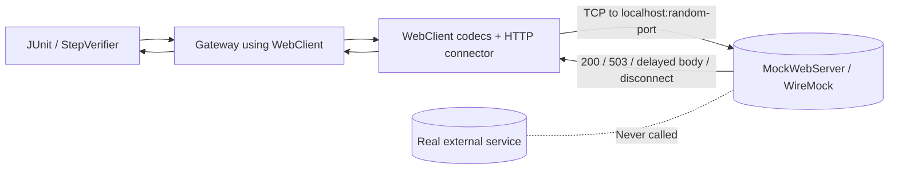
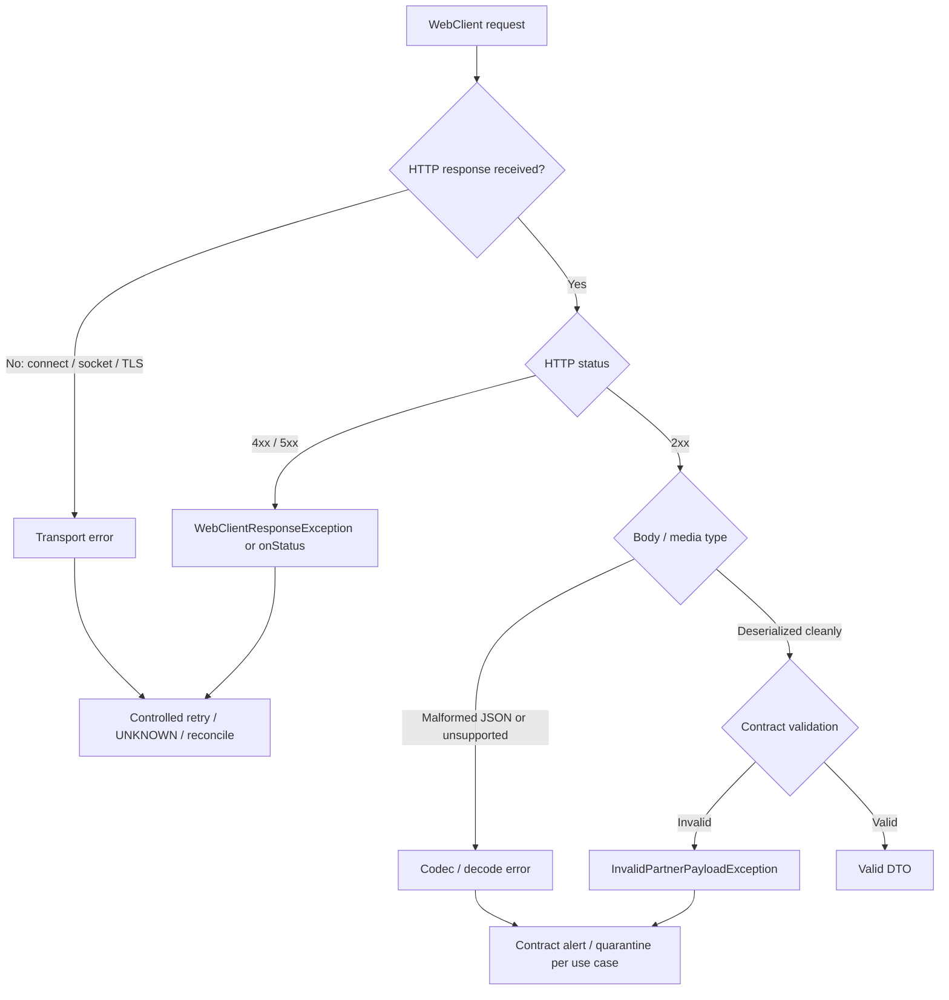
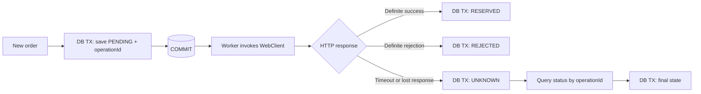

# Mock HTTP Servers for `WebClient`, Timeouts, and Invalid Responses

## 1. Why Do We Need a Mock HTTP Server When Testing `WebClient`?

In **SPRING_BOOT_INTEGRATION**, Spring Boot frequently calls external services to query inventory, fetch shipping rates, submit payments, sync data, or retrieve statuses from partner systems. These integration flows depend on both the **HTTP contract** and unpredictable network behaviors: slow downstreams, mid-stream disconnects, `503` errors, or malformed JSON despite a `200` status code.

Spring WebFlux's `WebClient` is a **reactive** HTTP client, typically returning `Mono<T>` or `Flux<T>`. It can be used inside Spring MVC applications as well, yet its execution model, error handling, and testing differ from synchronous `RestTemplate`/`RestClient`.

If you simply use Mockito to mock `WebClient` or mock the gateway directly, tests can miss real bugs at the HTTP boundary:

- Incorrectly encoded URIs or query parameters.
- Wrong `GET`/`POST` method, `Accept`, `Content-Type`, or idempotency key.
- Jackson codec failing to deserialize JSON or not being selected due to a wrong response `Content-Type`.
- `retrieve()` turning `4xx`/`5xx` into a different exception than business logic expects.
- Untested handling for socket timeouts, truncated responses, or dropped connections.
- Retries accidentally resending side-effecting operations.

An **HTTP stub server** such as **OkHttp MockWebServer** or **WireMock** listens on a local port, accepts requests sent by the real `WebClient`, and returns test-controlled responses. The client still executes real HTTP transport, serialization/deserialization, and reactive operators, without depending on the Internet or live partner services.



**Lesson goal:** select the right stub server, configure `WebClient` to target it, assert requests and `Mono`/`Flux` results, and deliberately simulate abnormal responses to verify timeouts, error classification, and recovery behavior.

## 2. Distinguishing HTTP Testing Tools

| Tool | Target fit | Opens a real HTTP port? | When to use |
| --- | --- | --- | --- |
| `MockWebServer` (OkHttp) | Outbound `WebClient` or other HTTP clients | Yes, on localhost | Per-request queued responses, checking method/headers/body, slow responses, disconnects, statuses, and bodies |
| `WireMock` | Outbound HTTP clients | Yes; can also run embedded | Multiple stubs matched by URL/header/body, stateful scenarios, fault injection, near contract testing |
| `MockRestServiceServer` | Synchronous `RestTemplate`, `RestClient` | No | Binds into Spring-supported synchronous client request factories |
| `WebTestClient` | **Inbound** WebFlux controllers/handlers; can also hit HTTP servers | Depends on mode | Testing APIs **exposed by your app**, not the default mock for services called by `WebClient` |
| Mock `ExchangeFunction` | Unit testing classes using `WebClient` | No | Fast checks of `ClientResponse` handling without HTTP transport |
| Testcontainers + real services | Multi-component integration tests | Yes | Testing real DBs, brokers, proxies, or downstreams needing their own runtime |

Do not try `MockRestServiceServer.bindTo(...)` with `WebClient` as with `RestTemplate`. `WebClient` relies on `ExchangeFunction`/`ClientHttpConnector` and usually runs on Reactor Netty; a localhost HTTP stub server is the cleanest way to exercise the full request/response pipeline.

`MockWebServer` is especially convenient when a test queues a handful of sequential responses and inspects `RecordedRequest`. `WireMock` shines when stubbing many endpoints conditionally, testing scenario-based retries, or sharing complex mappings. Both test the same boundary—there is no need to use both together.

### What Does Testing Against Localhost Prove?

A stub server **does** open a real local HTTP socket, letting you observe connector behavior: connecting, HTTP framing, reading bodies, and cancelling requests. Still, that result **does not prove** public DNS, Internet latency, production TLS/truststores, proxies, load balancers, firewalls, or real partner limits work. Add integration-environment, contract, or E2E tests when those properties matter.

## 3. Preparing Runnable Examples with `MockWebServer`

The examples below target **Java 17+, Spring Boot 3.x, Spring WebFlux/Reactor, and MockWebServer 4.12.x**. In MockWebServer 5.x, some test module packages/APIs differ; if using 5.x, adjust imports per that version's documentation.

Illustrative Maven dependencies:

```xml
<dependencies>
    <dependency>
        <groupId>org.springframework.boot</groupId>
        <artifactId>spring-boot-starter-webflux</artifactId>
    </dependency>

    <dependency>
        <groupId>org.springframework.boot</groupId>
        <artifactId>spring-boot-starter-test</artifactId>
        <scope>test</scope>
    </dependency>

    <dependency>
        <groupId>io.projectreactor</groupId>
        <artifactId>reactor-test</artifactId>
        <scope>test</scope>
    </dependency>

    <dependency>
        <groupId>com.squareup.okhttp3</groupId>
        <artifactId>mockwebserver</artifactId>
        <version>4.12.0</version>
        <scope>test</scope>
    </dependency>
</dependencies>
```

With Gradle, include the equivalent artifacts—especially `reactor-test`, which provides `StepVerifier`. The MockWebServer version above matches the 4.x API snippets; in real projects, choose a compatible release, apply security patches, and manage versions centrally.

`MockWebServer` allocates a dynamic port, avoiding port collisions during parallel test runs:

```java
MockWebServer server = new MockWebServer();
server.start();

String baseUrl = server.url("/").toString();
// Example from a run: http://localhost:52543/

WebClient webClient = WebClient.builder()
        .baseUrl(baseUrl)
        .build();

// server.shutdown() in @AfterEach / finally.
```

Never hardcode `http://localhost:8080`. Each test should start and shut down its server cleanly with a fresh response queue. Likewise, never hardcode the production base URL inside partner client classes; inject `WebClient`/`WebClient.Builder` or read from configuration so tests can swap targets without altering business code.

## 4. Business Client Under Test

Suppose the system calls `GET /inventory/{sku}`. The contract returns JSON:

```json
{
  "sku": "SKU-100",
  "available": 8
}
```

On `404`, the gateway translates to `InventoryNotFoundException`; on unhandled `5xx`, `retrieve()` keeps `WebClient`'s default error behavior. A `200` response missing `sku` or `available`, returning a negative count, or having an empty body must be rejected as a contract violation.

A simple adapter/gateway:

```java
package example.integration.inventory;

import org.springframework.http.MediaType;
import org.springframework.web.reactive.function.client.WebClient;
import reactor.core.publisher.Mono;

public final class InventoryGateway {

    private final WebClient client;

    public InventoryGateway(WebClient client) {
        this.client = client;
    }

    public Mono<Availability> findAvailability(String sku) {
        return client.get()
                .uri("/inventory/{sku}", sku)
                .accept(MediaType.APPLICATION_JSON)
                .retrieve()
                .onStatus(
                        status -> status.value() == 404,
                        response -> response.bodyToMono(String.class)
                                .defaultIfEmpty("")
                                .map(body ->
                                        new InventoryNotFoundException(
                                                "SKU does not exist: " + sku)))
                .bodyToMono(Availability.class)
                .switchIfEmpty(Mono.error(
                        new InvalidPartnerPayloadException(
                                "Inventory API returned an empty body")))
                .map(result -> validate(result, sku));
    }

    private Availability validate(Availability result, String requestedSku) {
        if (result.sku() == null
                || !requestedSku.equals(result.sku())
                || result.available() == null
                || result.available() < 0) {
            throw new InvalidPartnerPayloadException(
                    "Inventory API returned contract-violating data");
        }
        return result;
    }

    public record Availability(String sku, Integer available) {}

    public static final class InventoryNotFoundException
            extends RuntimeException {
        public InventoryNotFoundException(String message) {
            super(message);
        }
    }

    public static final class InvalidPartnerPayloadException
            extends RuntimeException {
        public InvalidPartnerPayloadException(String message) {
            super(message);
        }
    }
}
```

Key design points:

- `bodyToMono(Availability.class)` uses the configured codec to deserialize the response; typically Jackson when JSON dependencies are present.
- `Integer` instead of `int` allows detecting **missing fields**. Primitive `int` would default to `0`, making invalid payloads look like "out of stock."
- `switchIfEmpty(...)` catches empty bodies, e.g., if downstream accidentally returns `204 No Content` on an endpoint promising JSON.
- `validate(...)` guards the business contract. **Deserializable JSON does not equal business-valid JSON.**
- `onStatus(...)` maps a specific HTTP status to a domain exception, returning `Mono<? extends Throwable>`. Reading the body with `bodyToMono(String.class)` before constructing the exception ensures the response body is drained properly.
- For `5xx`, `retrieve()` emits `WebClientResponseException` by default (preserving status, headers, and body for diagnostics). Never collapse every error to `null` and let callers mistake outages for empty stock.
- The gateway returns `Mono` to stay reactive. In WebFlux flows, never call `block()` on the event loop; use `StepVerifier` in tests.

## 5. Complete Test: HTTP 200, Real Request, and JSON Deserialization

The test initializes a dedicated server and gateway for each test method:

```java
package example.integration.inventory;

import static org.assertj.core.api.Assertions.assertThat;

import java.io.IOException;
import java.time.Duration;
import java.util.concurrent.TimeUnit;

import okhttp3.mockwebserver.MockResponse;
import okhttp3.mockwebserver.MockWebServer;
import okhttp3.mockwebserver.RecordedRequest;

import org.junit.jupiter.api.AfterEach;
import org.junit.jupiter.api.BeforeEach;
import org.junit.jupiter.api.Test;
import org.springframework.http.MediaType;
import org.springframework.web.reactive.function.client.WebClient;

import reactor.test.StepVerifier;

class InventoryGatewayHttpTest {

    private MockWebServer server;
    private InventoryGateway gateway;

    @BeforeEach
    void setUp() throws IOException {
        server = new MockWebServer();
        server.start();

        WebClient client = WebClient.builder()
                .baseUrl(server.url("/").toString())
                .build();

        gateway = new InventoryGateway(client);
    }

    @AfterEach
    void tearDown() throws IOException {
        server.shutdown();
    }

    @Test
    void readsAvailabilityFromHttpResponse() throws InterruptedException {
        server.enqueue(new MockResponse()
                .setResponseCode(200)
                .addHeader("Content-Type", "application/json")
                .setBody("""
                        {"sku":"SKU-100","available":8}
                        """));

        StepVerifier.create(gateway.findAvailability("SKU-100"))
                .assertNext(value -> {
                    assertThat(value.sku()).isEqualTo("SKU-100");
                    assertThat(value.available()).isEqualTo(8);
                })
                .expectComplete()
                .verify(Duration.ofSeconds(3));

        RecordedRequest request =
                server.takeRequest(1, TimeUnit.SECONDS);

        assertThat(request).isNotNull();
        assertThat(request.getMethod()).isEqualTo("GET");
        assertThat(request.getPath()).isEqualTo("/inventory/SKU-100");
        assertThat(request.getHeader("Accept"))
                .contains(MediaType.APPLICATION_JSON_VALUE);
        assertThat(server.getRequestCount()).isEqualTo(1);
    }
}
```

The code uses `StepVerifier.verify(Duration)` to bound test duration and avoid hanging indefinitely when a response stalls. `server.takeRequest(timeout, unit)` is likewise bounded, rather than calling `takeRequest()` which blocks forever if no request arrives.

**Important ordering:** `gateway.findAvailability(...)` builds a **lazy** publisher; creating the `Mono` does not send the HTTP request. `StepVerifier` subscribes and triggers the call. Therefore, subscribe/verify **before** taking `RecordedRequest`, unless another mechanism triggers subscription.

### Verifying `POST` and Idempotency Keys

When an integration flow executes a side-effecting operation such as reserving inventory, assert the body and deduplication key:

```java
public record ReserveCommand(
        String operationId, String sku, int quantity) {}

public record ReserveResult(
        String reservationId, String status) {}

public Mono<ReserveResult> reserve(ReserveCommand command) {
    return client.post()
            .uri("/reservations")
            .contentType(MediaType.APPLICATION_JSON)
            .accept(MediaType.APPLICATION_JSON)
            .header("Idempotency-Key", command.operationId())
            .bodyValue(command)
            .retrieve()
            .bodyToMono(ReserveResult.class);
}
```

This is an **illustrative additional method** on a gateway holding a `WebClient` field `client`. The test can enqueue a JSON response, invoke `reserve(...)`, and inspect `RecordedRequest`:

```java
RecordedRequest request =
        server.takeRequest(1, TimeUnit.SECONDS);

assertThat(request).isNotNull();
assertThat(request.getMethod()).isEqualTo("POST");
assertThat(request.getPath()).isEqualTo("/reservations");
assertThat(request.getHeader("Idempotency-Key"))
        .isEqualTo("operation-42");
assertThat(request.getHeader("Content-Type"))
        .contains("application/json");
assertThat(request.getBody().readUtf8())
        .contains("\"sku\":\"SKU-100\"");
```

Run these assertions **after** subscribing and completing `reserve(...)` in a test configured with `MockWebServer`. Simply verifying the header is sent does not prove the external server enforces idempotency; that belongs to the provider's contract and needs separate tests when critical.

## 6. HTTP `4xx`/`5xx`: Clear Error Classification

An HTTP response with an error status **is not** a malformed JSON response. It is an HTTP outcome with distinct rules inside `retrieve()`.

### 6.1. Testing `404` Mapped to a Domain Exception

Add this test to `InventoryGatewayHttpTest`:

```java
@Test
void maps404ToInventoryNotFound() {
    server.enqueue(new MockResponse()
            .setResponseCode(404)
            .addHeader("Content-Type", "application/json")
            .setBody("""
                    {"error":"SKU_NOT_FOUND"}
                    """));

    StepVerifier.create(gateway.findAvailability("MISSING"))
            .expectError(
                    InventoryGateway.InventoryNotFoundException.class)
            .verify(Duration.ofSeconds(3));

    assertThat(server.getRequestCount()).isEqualTo(1);
}
```

`onStatus(...)` reads the error body, emits the exception, and short-circuits deserialization to `Availability`. If the application wants `Optional.empty()` instead of an error, design that contract intentionally rather than treating every failure as "not found."

### 6.2. Testing `503` Preserves Status Information

```java
import org.springframework.web.reactive.function.client.WebClientResponseException;

@Test
void keeps503AsHttpError() {
    server.enqueue(new MockResponse()
            .setResponseCode(503)
            .addHeader("Content-Type", "application/json")
            .setBody("""
                    {"error":"SERVICE_UNAVAILABLE"}
                    """));

    StepVerifier.create(gateway.findAvailability("SKU-100"))
            .expectErrorMatches(error ->
                    error instanceof WebClientResponseException ex
                            && ex.getStatusCode().value() == 503
                            && ex.getResponseBodyAsString()
                                    .contains("SERVICE_UNAVAILABLE"))
            .verify(Duration.ofSeconds(3));
}
```

This matcher checks the business-relevant properties instead of tying assertions to a specific exception subclass name across library versions.

### 6.3. `429`, `Retry-After`, and Retry Budgets

`429 Too Many Requests` may carry `Retry-After` as **seconds or an HTTP-date**; do not assume it always parses as an integer. When testing retry strategies, verify:

- Actual number of requests hitting the stub server.
- Bounded backoff/retry budgets with no infinite loops.
- Retries occur only on transient errors, never blindly on all `4xx`.
- Side-effecting `POST`/`PUT` calls stay safe via idempotency keys or reconciliation.

`MockWebServer` uses an `enqueue(...)` queue; queue `429` then `200` to simulate a successful retry:

```java
server.enqueue(new MockResponse()
        .setResponseCode(429)
        .addHeader("Retry-After", "1"));

server.enqueue(new MockResponse()
        .setResponseCode(200)
        .addHeader("Content-Type", "application/json")
        .setBody("""
                {"sku":"SKU-100","available":8}
                """));

// Only call a method ACTUALLY configured with retryWhen/Resilience4j.
StepVerifier.create(retryingGateway.findAvailability("SKU-100"))
        .expectNextMatches(value -> value.available() == 8)
        .verifyComplete();

assertThat(server.getRequestCount()).isEqualTo(2);
```

`retryingGateway` here **assumes a gateway configured with retry**, unlike the basic `InventoryGateway` in section 4. `WebClient` does not automatically retry `429`/`503` responses. Tests should also apply a time bound matching the backoff budget; avoid unbounded `verifyComplete()` when a test risks stalling. Prefer `expectComplete().verify(Duration.ofSeconds(...))` matching realistic budgets.

## 7. Invalid Responses: Classify Before Writing Tests

"Invalid response" can refer to completely different failure modes:

| Response type | Example | Behavior to verify |
| --- | --- | --- |
| **Error status with valid body** | `503` + JSON `{"error":"DOWN"}` | `retrieve()` emits HTTP error; handling/retry inspects status |
| **Syntactically broken JSON** | `200 application/json` missing closing `}` | Jackson decoder fails; never turned into valid data |
| **Valid JSON violating contract** | `{"sku":"SKU-100"}` missing `available` | DTO validation throws clear business error |
| **Wrong `Content-Type`** | JSON body served as `text/html` | Never assumes JSON decoder runs; handled per contract |
| **Empty body** | `204` when API promises a DTO | Distinguishes absence from valid data |
| **Truncated body mid-stream** | `Content-Length` exceeds bytes sent; socket closes | Transport/body-read error; never persisted as success |
| **Invalid HTTP protocol** | Malformed status line or header framing | Parser/connector rejects; needs raw-byte server for exact testing |
| **Oversized or deeply nested JSON** | Response exceeds codec/memory limits | Bounded limits prevent OOM or process crashes |
| **Wrong charset/encoding** | Header or bytes mismatch encoding | Explicit decoder/validation policy; never swallow error |

Tests should assert the **error category at the responsible layer** rather than assuming every case throws the same exception.

### 7.1. Syntactically Malformed JSON Causes Decode Errors

```java
import org.springframework.core.codec.DecodingException;

@Test
void malformedJsonDoesNotBecomeSuccessfulDto() {
    server.enqueue(new MockResponse()
            .setResponseCode(200)
            .addHeader("Content-Type", "application/json")
            .setBody("""
                    {"sku":"SKU-100","available":
                    """));

    StepVerifier.create(gateway.findAvailability("SKU-100"))
            .expectError(DecodingException.class)
            .verify(Duration.ofSeconds(3));
}
```

Because status is `200`, failure occurs in `bodyToMono(Availability.class)`, not `onStatus`. In most Jackson setups, Spring wraps parse failures in `DecodingException`; if a custom codec/mapper throws another exception, assert the cause chain or decode error category per project contract.

### 7.2. Syntactically Valid JSON Missing Business Fields

```java
@Test
void syntacticallyValidButIncompleteJsonIsRejected() {
    server.enqueue(new MockResponse()
            .setResponseCode(200)
            .addHeader("Content-Type", "application/json")
            .setBody("""
                    {"sku":"SKU-100"}
                    """));

    StepVerifier.create(gateway.findAvailability("SKU-100"))
            .expectError(
                    InventoryGateway.InvalidPartnerPayloadException.class)
            .verify(Duration.ofSeconds(3));
}
```

This is why `Availability.available` uses `Integer` and the gateway checks for `null`. Testing only that "Jackson parsed the JSON" lets incomplete payloads slip downstream with dangerous defaults.

### 7.3. Empty Body Must Not Become Zero Stock

```java
@Test
void emptyBodyDoesNotBecomeAvailabilityZero() {
    server.enqueue(new MockResponse().setResponseCode(204));

    StepVerifier.create(gateway.findAvailability("SKU-100"))
            .expectError(
                    InventoryGateway.InvalidPartnerPayloadException.class)
            .verify(Duration.ofSeconds(3));
}
```

`204 No Content` is a successful HTTP status with no body. If an endpoint defines `204` as meaningful, change the gateway contract accordingly—for instance `Mono<Void>`/`Mono<Optional<...>>` or an explicit status wrapper—rather than synthesizing a fake `available=0` DTO without business agreement.

### 7.4. Wrong `Content-Type` Must Be Tested Explicitly

```java
@Test
void htmlContentCannotBeReadAsInventoryDto() {
    server.enqueue(new MockResponse()
            .setResponseCode(200)
            .addHeader("Content-Type", "text/html")
            .setBody("<html>maintenance</html>"));

    StepVerifier.create(gateway.findAvailability("SKU-100"))
            .expectError()
            .verify(Duration.ofSeconds(3));
}
```

Here we intentionally avoid coupling the assertion to one exact exception class: depending on the app's `HttpMessageReader`/codec list, the error may be an unsupported media type error or a decode error. What matters is that an HTML body **is never interpreted as** a valid inventory DTO. If the gateway must return a uniform domain error, map codec/unsupported-media-type errors explicitly and test that mapping.

### 7.5. Truncated Response Body Mid-Stream

MockWebServer 4.x provides `SocketPolicy` to drop connections deliberately. A test simulating an interrupted HTTP body:

```java
import okhttp3.mockwebserver.SocketPolicy;

@Test
void interruptedResponseBodyIsNotAccepted() {
    server.enqueue(new MockResponse()
            .setResponseCode(200)
            .addHeader("Content-Type", "application/json")
            .setBody("""
                    {"sku":"SKU-100","available":8}
                    """)
            .setSocketPolicy(
                    SocketPolicy.DISCONNECT_DURING_RESPONSE_BODY));

    StepVerifier.create(gateway.findAvailability("SKU-100"))
            .expectError()
            .verify(Duration.ofSeconds(5));
}
```

For tiny responses, byte chunking and socket closure depend on MockWebServer/connector behavior. If a test fails to trigger the fault as expected, enlarge the body or use a `Dispatcher`/server controlling streaming directly; never "fix" the test by deleting the assertion. In production, this fault occurs after HTTP `200` headers arrive, so status checks alone cannot certify response completion.

When you need to test **invalid HTTP status lines, bad header framing, or byte-level chunked framing errors**, MockWebServer mainly emits structured HTTP responses plus selected socket faults. Use a raw socket test server or byte/chunk controller when testing parser limits; exact failures depend on Reactor Netty's HTTP parser and HTTP version.

## 8. Timeouts: Distinguish the Multiple Types

A `WebClient` call can stall at several distinct stages:

```mermaid
flowchart LR
    A[Subscribe Mono] --> B[Resolve DNS / pool acquire]
    B --> C[TCP connect / TLS]
    C --> D[Send request]
    D --> E[Wait headers]
    E --> F[Read body]
    F --> G[Decode / business mapping]
    H[Mono.timeout] -. Can bound total pipeline post-subscribe .-> A
    I[Connect timeout] -. Bounds TCP connect .-> C
    J[Response timeout] -. Bounds response read per connector .-> E
    J -. .-> F
```

| Mechanism | Primary scope | Common symptom |
| --- | --- | --- |
| `Mono.timeout(Duration)` / `Flux.timeout(...)` | Time from subscription to signals per operator rules (for `Flux`, usually between signals) | `TimeoutException` emitted by Reactor operator |
| Reactor Netty `responseTimeout(...)` | Response-reading timeout inside the HTTP client | I/O error, typically with `ReadTimeoutException` in cause chain |
| Netty connect timeout | Establishing TCP connection | Connect timeout or `WebClientRequestException` |
| Pool acquire timeout | Waiting for a connection from the pool | Acquire timeout when pool is saturated |
| TLS handshake timeout | TLS handshake | Handshake/trust/certificate failure, configuration-dependent |
| Proxy/load balancer timeout | Intermediate infrastructure | May appear as `502`/`504` or socket reset |

**No single timeout automatically protects every stage.** Reactor Netty's `responseTimeout` is not an overall business deadline—especially across retries/backoff or chained calls. Conversely, placing `Mono.timeout` at the end of a pipeline enforces an operator-level deadline and cancels the subscription, yet does not replace socket/pool timeouts on the client.

### 8.1. Testing Reactor Operator Timeout with Delayed Responses

`MockWebServer` can delay headers so the gateway fails to receive results before the deadline:

```java
import java.util.concurrent.TimeoutException;

@Test
void timeoutOperatorFailsWhenServerStaysSilent() {
    server.enqueue(new MockResponse()
            .setResponseCode(200)
            .setHeadersDelay(2, TimeUnit.SECONDS)
            .addHeader("Content-Type", "application/json")
            .setBody("""
                    {"sku":"SKU-100","available":8}
                    """));

    StepVerifier.create(
                    gateway.findAvailability("SKU-100")
                            .timeout(Duration.ofMillis(250)))
            .expectError(TimeoutException.class)
            .verify(Duration.ofSeconds(4));
}
```

This test proves **the `timeout` operator** errors when no signal arrives within budget. It does not test Reactor Netty connect or read timeouts. Upon cancellation, the client socket closes while the stub server may still be waiting to flush the delayed response; hence `@AfterEach` shuts down the server cleanly.

To prevent CI flakiness, keep a clear margin between the simulated delay and the deadline (`250 ms` vs `2 s` here). Never test tight margins like `100 ms` vs `110 ms` expecting exact scheduler timing on shared CI runners.

### 8.2. Configuring Reactor Netty Connect and Response Timeouts

When using Reactor Netty as the HTTP connector, configure:

```java
import java.time.Duration;

import io.netty.channel.ChannelOption;
import reactor.netty.http.client.HttpClient;

import org.springframework.http.client.reactive.ReactorClientHttpConnector;
import org.springframework.web.reactive.function.client.WebClient;

HttpClient httpClient = HttpClient.create()
        .option(ChannelOption.CONNECT_TIMEOUT_MILLIS, 1_000)
        .responseTimeout(Duration.ofMillis(500));

WebClient clientWithNetworkTimeouts = WebClient.builder()
        .baseUrl(server.url("/").toString())
        .clientConnector(new ReactorClientHttpConnector(httpClient))
        .build();
```

This is an **illustrative test-specific client configuration**. In production, size timeouts to upstream/downstream SLAs and inspect the app's real request factory/connector rather than hardcoding one timeout for all partners. You may also need connection-pool acquire timeouts, TLS timeouts, and overall deadlines.

To test `responseTimeout`, have the server delay headers/body past the timeout, subscribe with `StepVerifier`, and assert a **transport error** while checking the cause chain appropriate to your connector version. Unlike `Mono.timeout`, transport errors may be wrapped in `WebClientRequestException` with a Netty cause such as `ReadTimeoutException`. Never assert exact millisecond wall-clock elapsed time or couple tests tightly to exception message strings.

### 8.3. Can Virtual Time Test Timeouts Without Real Waiting?

`StepVerifier.withVirtualTime(...)` helps test operators using Reactor schedulers—such as `delayElements` or `timeout` in pure reactive pipelines built over virtual publishers. It **does not fast-forward** real TCP, TLS, socket queues, or real HTTP server clocks.

Therefore:

- Unit-level retry/backoff or `timeout` operator logic can use virtual time when publishers and schedulers are created inside the `StepVerifier` supplier.
- Network/connector-level timeouts must use an HTTP stub server with real delays/connection faults, with well-chosen bounded test durations.
- Never combine virtual schedulers with real `MockWebServer` thinking a 10-second network delay ran in milliseconds.

## 9. Handle `WebClient` Errors at the Stage Where They Occur

An HTTP flow can fail at distinct layers:



### Never Collapse All Errors Into a Successful Fallback

Dangerous example:

```java
return gateway.findAvailability(sku)
        .onErrorReturn(new Availability(sku, 0));
```

This turns every outage (timeout, broken JSON, DNS, auth failure, `503`) into "out of stock." When downstream business decisions rely on that number, real stock data and integration failures become indistinguishable.

A better policy classifies errors:

| Error | Typical decision | Should retry? |
| --- | --- | --- |
| `404` per contract meaning "unknown SKU" | Return explicit business error | Usually no |
| `401/403` | Alert on permissions/token config; never loop endlessly | Only after refreshing/fixing auth |
| `429` | Throttle using `Retry-After` and budget | Conditionally |
| `503/502/504` | Downstream temporarily unavailable | Conditionally with backoff |
| Connect/read timeout on idempotent `GET` | Bounded retry or stale cache fallback if SLA allows | Possible |
| Timeout after `POST` charge | Outcome **unknown**; reconcile via `operationId` | Never retry blindly |
| `200` with invalid JSON/schema | Downstream contract violation; observe and alert | Usually should not retry endlessly |
| Truncated body | Incomplete transport/body read | Depends on operation idempotency |

Depending on the system, even `404` might be retried if data propagates asynchronously and the contract permits it. Never use a generic table to override your agreed partner contract.

### Avoid Leaking Unprocessed `ClientResponse` Resources

With `retrieve()`, default operators handle statuses and bodies per Spring's lifecycle. If using lower-level `exchangeToMono(...)` to inspect statuses directly, always return a publisher that **reads or releases the body cleanly**. For example:

```java
public Mono<String> fetchRawStatus(String sku) {
    return client.get()
            .uri("/inventory/{sku}", sku)
            .exchangeToMono(response -> {
                if (response.statusCode().is2xxSuccessful()) {
                    return response.bodyToMono(String.class);
                }
                return response.createException()
                        .flatMap(Mono::error);
            });
}
```

Here `response.createException()` consumes the error body needed to build the exception, and `bodyToMono(...)` consumes the success body. Never pass `ClientResponse` or `DataBuffer` outside without managing its lifecycle; in streaming pipelines, handle cancellation, size limits, and backpressure carefully.

## 10. Testing Retries and Side Effects with a Stateful Server

A retry test asserting only "eventually returns 200" is incomplete. Inspect the HTTP call count and each request's contents, especially for `POST`:

```mermaid
sequenceDiagram
    participant G as Gateway + retry policy
    participant M as MockWebServer
    G->>M: POST /reservations, Idempotency-Key=op-42
    M-->>G: 503 / timeout
    Note over G: Policy evaluates whether retry is safe
    G->>M: POST /reservations, Idempotency-Key=op-42
    M-->>G: 201 Created
    Note over G,M: Test verifies invariant key; does not prove provider dedup
```

In a test with retry explicitly configured:

1. Enqueue transient failure responses followed by a success response, or use WireMock stateful scenarios.
2. Subscribe to the `Mono` via `StepVerifier` with an overall test timeout.
3. Assert `server.getRequestCount()` and pull each `RecordedRequest`.
4. Assert the exact same `Idempotency-Key` or operation ID across every attempt of **one operation**.
5. When retries exhaust, assert an observable failure—never turn it into fake success.
6. When downstream may have committed despite a dropped response, test the **reconciliation** flow instead of blindly issuing a new operation.

`MockWebServer.enqueue(...)` serves responses in **request arrival order** rather than matching URLs. When a gateway fires parallel requests, queued responses can land on the wrong request. For concurrent calls or multiple endpoints, configure `MockWebServer.setDispatcher(...)` to route based on `RecordedRequest`, or use WireMock stub mappings by path/header. Never rely on lucky ordering in parallel tests.

## 11. Using WireMock for Rich Matching Rules and Fault Injection

WireMock also runs a stub HTTP server, letting you declare matcher-driven stubs per endpoint. Conceptual example for the inventory API:

```java
import static com.github.tomakehurst.wiremock.client.WireMock.*;

WireMockServer wireMock = new WireMockServer(
        options().dynamicPort());

wireMock.start();

try {
    wireMock.stubFor(get(urlEqualTo("/inventory/SKU-100"))
            .willReturn(aResponse()
                    .withStatus(200)
                    .withHeader("Content-Type", "application/json")
                    .withBody("""
                            {"sku":"SKU-100","available":8}
                            """)));

    WebClient client = WebClient.builder()
            .baseUrl(wireMock.baseUrl())
            .build();

    // Build gateway, subscribe via StepVerifier, assert response.
    // Call wireMock.verify(...) to confirm expected requests occurred.
} finally {
    wireMock.stop();
}
```

This matches common WireMock 2.x/3.x API style; add the matching WireMock test dependency and adjust imports for your version. It is an **alternative to `MockWebServer`**, not something to add alongside simple queue-based tests.

WireMock supports delays, fault injection, scenarios, and response templating depending on version/config. For pagination, expired tokens, multi-endpoint flows, stateful retries, or shared stub suites across classes, WireMock is often easier to maintain. When tests require closing a socket mid-body precisely, verify your WireMock version's fault capabilities and confirm the real client failure.

## 12. Building a Meaningful Test Suite for Integration Flows

Organize tests around **contracts** and **risks**, not just piling up mock permutations.

| Scenario | What the stub server emits | What the application must assert |
| --- | --- | --- |
| Successful read | `200` + valid JSON | Method, URI, headers, DTO, single request |
| Query/path encoding | Request with special characters | `RecordedRequest.getPath()` accurate without mangling URI |
| Not found | `404` + error body | Business exception or explicit outcome |
| Rate limit | `429` + `Retry-After` | Backoff, retry cap, no infinite retries |
| Downstream unavailable | `503` or connection drop | Error classification, controlled retry/fallback |
| Broken JSON | `200 application/json` + invalid syntax | Decode error, no fake values written to DB/cache |
| Contract-violating JSON | `200` + missing required field | Business validation failure |
| Wrong `Content-Type` | `text/html` instead of JSON | Codec/media type error or explicit contract handling |
| Empty body | `204` or empty `200` | Never mistaken for a valid DTO |
| Slow headers | `setHeadersDelay` | Operator timeout or response timeout per config |
| Slow body | `setBodyDelay` | Body-read timeout and cancellation |
| Interrupted connection | Socket policy or fault | Partial response never treated as success |
| `POST` retry | Two sequential responses | Invariant operation ID/idempotency key; request count verified |
| Concurrent requests | `Dispatcher` matching path/headers | Responses matched to right requests; order-independent |
| Oversized payload | Response exceeding codec limit | Controlled resource error without unbounded memory growth |

### Tests Should Not Claim What the Stub Server Cannot Simulate

- `MockWebServer` returning `200` does not confirm the **real** service obeys the JSON contract.
- Testing `responseTimeout` on localhost does not replace measuring latency, DNS, TLS, or connection pooling in production-like environments.
- Stub returning "accepted" does not prove a broker/email/payment provider performed side effects or guarantees exactly-once.
- Testing a DTO-reading client does not prove DB transactions commit/roll back cleanly.
- Unit testing a fake `Mono` does not prove Reactor Netty transports requests properly.

For flows involving DB/broker/cache, combine **an HTTP stub server + Testcontainers** to test a targeted set of critical end-to-end journeys: persist record, commit, invoke HTTP, store outcome, retry after crash, or deduplicate messages. When using JPA/JDBC `@Transactional`, never hold a DB transaction open while waiting on HTTP calls, to avoid holding locks and connection pool slots too long.

## 13. Real-World Flow: Reconciling Inventory After an HTTP Timeout

Consider an ordering flow: the application saves an inventory reservation request with `operationId`, then calls Inventory API via `WebClient`.



When the mock server stalls the response past the deadline, the test must verify not only that the `Mono` errored, but that the **orchestration layer** classified the failure properly:

- An HTTP timeout does not tell you whether Inventory API reserved the stock or not.
- The `UNKNOWN` state must persist durably for post-restart reconciliation.
- If re-invoking a side-effecting call, preserve the exact operation ID/idempotency key per partner contract.
- A late-arriving response must never overwrite newer state; enforce versioning or conditional DB updates.
- When dispatching work via Kafka/RabbitMQ or Spring Integration adapters, keep consumers idempotent with bounded retry/backoff.
- An inventory cache can serve temporary display data, yet final reservation decisions must rely on the authoritative source.

`MockWebServer` verifies **HTTP behavior** at the adapter; integration tests with a real DB verify commit points, rollbacks, idempotency, and recovery.

## 14. Common `WebClient` Testing Mistakes

| Anti-pattern | Consequence | Fix |
| --- | --- | --- |
| Building `WebClient` with production URL in tests | Calls live network or depends on partner uptime | Inject base URL/connector and use `server.url("/")` |
| Creating `Mono` then calling `server.takeRequest()` | No request sent because publisher wasn't subscribed | Subscribe with `StepVerifier` or appropriate subscriber |
| Forgetting `server.shutdown()` | Socket/thread leaks affecting later tests | Manage server in `@BeforeEach`/`@AfterEach` or `try/finally` |
| Hardcoding ports | Port collisions in parallel CI | Use dynamic ports |
| `expectNext(...)` with no deadline | Test hangs forever if response stalls | Use `verify(Duration)` or controlled test timeouts |
| Testing invalid JSON by returning `500` | Exercises HTTP status handler instead of decoder | Return `200 application/json` with broken JSON body |
| Valid `200` test using DTOs with primitive defaults | Misses missing critical fields | Use nullable wrappers + explicit validation |
| Using `Mono.timeout` and concluding connect timeout works | Operator timeout differs from transport timeout | Configure and test Reactor Netty timeouts separately |
| Using virtual time to simulate socket delays | Virtual scheduler does not accelerate real HTTP servers | Test real sockets with bounded delays |
| Enqueueing responses without asserting requests | Wrong URL/method still consumes queued response | Inspect `RecordedRequest` and assert method/path/headers/body |
| Swallowing all exceptions with `onErrorReturn(default)` | Hides contract and transport failures | Classify status, decode, I/O, and domain errors |
| Retrying `POST` after timeout with a new ID | Risks duplicate side effects | Preserve stable idempotency key and reconcile |
| Relying on `Thread.sleep` everywhere | Slow and flaky | Use `StepVerifier`, latches, and virtual time in scope |
| Unbounded codec payload size | Oversized responses exhaust memory | Enforce limits and test oversized payloads |

## 15. Pre-Completion Testing Checklist

1. Confirm the outbound class uses **`WebClient`**; pair it with MockWebServer/WireMock or a stub compatible with the HTTP connector.
2. Give tests **full control over base URL** using a dynamic localhost port; never hit real partners.
3. Configure the client with codecs, auth, and request customizers close to production to verify the real contract.
4. Subscribe to publishers with `StepVerifier`; bound both the test verification and `RecordedRequest` retrieval with deadlines.
5. Assert method, path/query, headers, body, and request count—never just the final returned DTO.
6. Test `4xx`/`5xx`, malformed JSON, contract-violating JSON, empty bodies, wrong `Content-Type`, and socket faults separately.
7. Distinguish **Reactor operator timeout**, **Reactor Netty connect/response timeout**, and **overall business deadline**.
8. Test both failure states and retry/backoff; never auto-retry side-effecting `POST`s when outcomes are uncertain.
9. For DB/cache/broker flows, add transaction, outbox, and idempotency tests; HTTP mocks only verify the client side.
10. Monitor flakiness, close servers reliably, and avoid sharing mutable queues/stubs across parallel tests.

**Key takeaway:** an HTTP stub server tests `WebClient` over **real localhost HTTP with completely controlled responses**. It catches URL, header, codec, timeout, malformed-response, and retry bugs before deployment. To make a Spring Boot Integration flow reliable in production, pair these tests with tests covering transaction boundaries, durable state, idempotency, and real external-system behavior.

### References

- [Spring Framework Reference — WebClient](https://docs.spring.io/spring-framework/reference/web/webflux-webclient.html): API, response handling, codecs, and error handling.
- [Spring Framework Reference — WebClient Configuration](https://docs.spring.io/spring-framework/reference/web/webflux-webclient/client-builder.html): builder, connector, and codec configuration.
- [Reactor Core Reference — Testing with StepVerifier](https://projectreactor.io/docs/core/release/reference/testing.html): testing publishers and virtual time.
- [Reactor Netty Reference — HTTP Client](https://projectreactor.io/docs/netty/release/reference/http-client.html): connect/response timeouts and network configuration.
- [OkHttp — MockWebServer](https://square.github.io/okhttp/features/mockwebserver/): stub server, response queues, and `RecordedRequest`.
- [WireMock Documentation](https://wiremock.org/docs/): stub mappings, delays, fault injection, and request verification.
