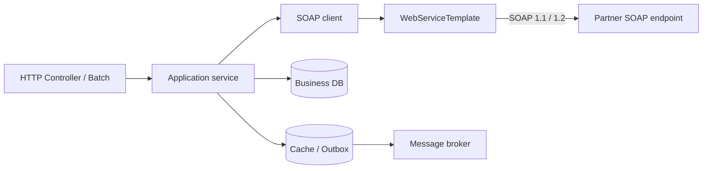
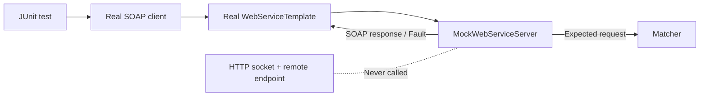
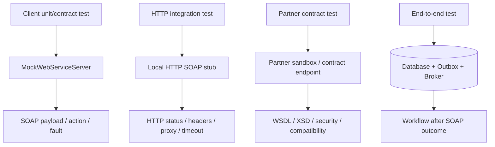
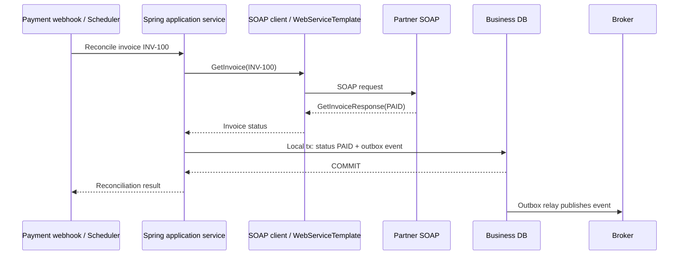

# `MockWebServiceServer` for Outbound SOAP Calls

A Spring Boot application may call an ERP system or insurance partner over **SOAP** to look up invoices, submit documents, confirm transactions, and then update a database, cache, or emit events to a broker. When writing tests, hitting a real SOAP endpoint directly is slow and depends on integration accounts, partner test data, and network stability. Plain HTTP mocks can also overlook XML payloads or SOAP Faults that the client genuinely has to handle.

**`MockWebServiceServer`** from Spring Web Services (Spring-WS) simulates the **SOAP service side at the `WebServiceTemplate` boundary**, defining expected requests and corresponding replies in memory. This lets you test request payloads, `SOAPAction`, SOAP Faults, XML marshalling/unmarshalling, and client result handling without booting a SOAP server or sending requests over the Internet.

This lesson belongs to the **Integration Testing** chapter of the `SPRING_BOOT_INTEGRATION` module. The focus is on using the right tool, setting up Spring Boot tests, verifying request/reply contracts, handling faults, clarifying mock limitations versus real transport testing, and connecting SOAP outcomes with database transactions, caches, brokers, idempotency, and observability.

## 1. SOAP Clients in Spring Boot Integration Architecture

A common flow:



The client sends a **SOAP Envelope** over HTTP (or another transport), which may contain:

- **Envelope:** outer wrapper identifying the SOAP version via its namespace.
- **Header:** protocol metadata, WS-Security, correlation info, routing, or agreed extensions.
- **Body:** business payload in XML, such as `GetInvoiceRequest`.
- **Fault:** SOAP-level error representation carrying fault code, fault string/reason, and optional detail.

Example SOAP 1.1 request:

```xml
<soapenv:Envelope
    xmlns:soapenv="http://schemas.xmlsoap.org/soap/envelope/"
    xmlns:inv="urn:example:invoice:v1">
  <soapenv:Header/>
  <soapenv:Body>
    <inv:GetInvoiceRequest>
      <inv:invoiceId>INV-100</inv:invoiceId>
    </inv:GetInvoiceRequest>
  </soapenv:Body>
</soapenv:Envelope>
```

Example SOAP 1.1 response:

```xml
<soapenv:Envelope
    xmlns:soapenv="http://schemas.xmlsoap.org/soap/envelope/"
    xmlns:inv="urn:example:invoice:v1">
  <soapenv:Body>
    <inv:GetInvoiceResponse>
      <inv:invoiceId>INV-100</inv:invoiceId>
      <inv:status>PAID</inv:status>
    </inv:GetInvoiceResponse>
  </soapenv:Body>
</soapenv:Envelope>
```

In most `MockWebServiceServer` tests, the `payload(...)` matcher inspects **the payload element inside the SOAP Body**, without needing to repeat the full Envelope in response fixtures. This differs from many HTTP mock tools that match the entire raw HTTP request body.

### 1.1. Which Boundary Is Being Mocked?



The mock server is not a SOAP service listening at `localhost:8080`. It attaches to a specific `WebServiceTemplate` and replaces the template's communication boundary to control requests and responses. As a result, tests run fast and deterministically and verify client-side XML processing, yet **do not prove DNS, TCP, TLS, proxies, connection pooling, HTTP timeouts, or real endpoint availability**.

## 2. How `MockWebServiceServer` Differs from Other Testing Tools

| Tool | Mocked boundary | Well-suited to verify | What not to extrapolate |
| --- | --- | --- | --- |
| **`MockWebServiceServer`** | Client-side Spring-WS `WebServiceTemplate` | SOAP payload, `SOAPAction`, SOAP Faults, marshalling/unmarshalling, client handling | Real HTTP socket/TLS/timeout behavior |
| Spring-WS `MockWebServiceClient` | Server-side SOAP endpoints exposed by your app | Endpoint receiving SOAP requests, responses, validation, interceptors | That outbound SOAP clients work |
| `MockRestServiceServer` | Spring REST clients (`RestTemplate`/`RestClient`) | HTTP/REST JSON, headers, status codes | Automatic understanding of SOAP Faults or Spring-WS clients |
| WireMock/MockWebServer | Real local stub HTTP server | HTTP status/headers, transport, redirects, timeouts/chunking per tool support | Automatic SOAP contract verification unless explicitly configured |
| Real SOAP stub/server or partner environment | Full interaction against real endpoint/WSDL | TLS, auth, gateways, networking, namespaces, compatibility | Absolute stability of test data |
| Testcontainers DB/broker | Real controlled infrastructure | Transactions, outbox, deduplication, delivery/redelivery | Accurate SOAP payload structure if SOAP client is untested |

**`MockWebServiceServer`** directly answers: *Did the Spring-WS client build the expected SOAP request and handle the SOAP reply/fault per contract?* For real timeouts and network connection failures, supplement with tests at a transport layer.

### 2.1. Do Not Confuse with `MockWebServiceClient`

The two names are easy to mix up:

- `org.springframework.ws.test.client.MockWebServiceServer`: acts as a **mock SOAP server**, used to **test a client** making outbound SOAP calls.
- `org.springframework.ws.test.server.MockWebServiceClient`: acts as a **mock SOAP client**, used to **test server `@Endpoint`s** exposed by your Spring-WS application.

When your service **calls a partner's SOAP service**, pick `MockWebServiceServer`. When you **implement an `@Endpoint` receiving SOAP from partners**, pick `MockWebServiceClient`.

## 3. Dependencies and Required Components

Example Gradle setup for a Spring Boot application using Spring Web Services:

```gradle
dependencies {
    implementation 'org.springframework.boot:spring-boot-starter-web-services'
    testImplementation 'org.springframework.boot:spring-boot-starter-test'
    testImplementation 'org.springframework.ws:spring-ws-test'
}
```

`spring-ws-test` supplies `MockWebServiceServer`, `RequestMatchers`, and `ResponseCreators`. For applications generating SOAP DTOs from WSDL/XSD, also include the JAXB runtime or code-generation plugin matching your Java/Spring Boot version. When using `Jaxb2Marshaller`, make sure generated JAXB classes and namespaces match the partner's WSDL.

Versions of Spring Web Services, Spring Framework, and Spring Boot must be compatible (especially in the Jakarta ecosystem). Use Spring Boot dependency management/BOM rather than mixing mismatched versions manually. This lesson uses `WebServiceTemplate`, `StringSource`, `StringResult`, and Spring-WS test APIs; exact SOAP transport configuration may differ across versions.

| Component | Role |
| --- | --- |
| `WebServiceTemplate` | Builds SOAP requests, sends via a message sender, handles responses/faults |
| `WebServiceGatewaySupport` | Convenient base class for SOAP clients using `WebServiceTemplate` |
| `SaajSoapMessageFactory` | Creates SOAP messages, supports selecting the required SOAP version |
| `Jaxb2Marshaller` | Converts Java objects ↔ XML per JAXB contract |
| `SoapActionCallback` | Sets `SOAPAction` on requests per SOAP contract |
| `MockWebServiceServer` | Attaches expectations and mock replies to the template under test |
| `RequestMatchers` | Matchers such as `payload(...)` or `soapAction(...)` |
| `ResponseCreators` | Produces SOAP responses such as `withPayload(...)` or SOAP Faults |

To ensure the mock server intercepts calls, bind to **the exact `WebServiceTemplate` invoked by the client under test**. Attaching a mock to a different template instance will not intercept the client's requests and can cause tests to hit real endpoints.

## 4. Minimal SOAP Client Without WSDL Code Generation

The example below uses XML `Source` to focus on the request/reply boundary. Real applications can swap in DTOs/JAXB when contracts grow complex.

```java
package example.integration.soap;

import java.util.regex.Pattern;
import org.springframework.ws.client.core.WebServiceTemplate;
import org.springframework.ws.soap.client.core.SoapActionCallback;
import org.springframework.xml.transform.StringResult;
import org.springframework.xml.transform.StringSource;

public final class InvoiceSoapClient {
    private static final Pattern VALID_ID =
            Pattern.compile("[A-Za-z0-9_-]{1,64}");

    private final WebServiceTemplate template;

    public InvoiceSoapClient(WebServiceTemplate template) {
        this.template = template;
    }

    public String getInvoiceXml(String invoiceId) {
        if (invoiceId == null ||
                !VALID_ID.matcher(invoiceId).matches()) {
            throw new IllegalArgumentException("Invalid invoiceId");
        }

        String requestXml = """
                <inv:GetInvoiceRequest xmlns:inv="urn:example:invoice:v1">
                  <inv:invoiceId>%s</inv:invoiceId>
                </inv:GetInvoiceRequest>
                """.formatted(invoiceId);

        StringResult response = new StringResult();
        boolean received = template.sendSourceAndReceiveToResult(
                new StringSource(requestXml),
                new SoapActionCallback("urn:invoice:get"),
                response);

        if (!received) {
            throw new IllegalStateException("SOAP reply body is missing");
        }
        return response.toString();
    }
}
```

Design notes:

1. `InvoiceSoapClient` receives an injected `WebServiceTemplate` instead of instantiating one per call, allowing tests to bind mocks to **the exact instance**.
2. The example restricts `invoiceId` to safe ASCII characters to prevent injecting untrusted input into XML. For general data, use JAXB/DOM/escaping XML writers rather than `String.formatted(...)`.
3. `SoapActionCallback` sets the action per partner contract; do not assume all SOAP endpoints require the same action.
4. `sendSourceAndReceiveToResult` writes the response payload into `StringResult`. In real business code, parse with schema validation/DTOs instead of `String.contains(...)`.
5. When a response is a SOAP Fault, `WebServiceTemplate` normally uses its fault resolver to throw an exception; handle error policy in the client or application service.

Spring Boot bean configuration for the example:

```java
@Configuration(proxyBeanMethods = false)
public class InvoiceSoapConfig {

    @Bean
    WebServiceTemplate invoiceWebServiceTemplate() {
        WebServiceTemplate template = new WebServiceTemplate();
        template.setDefaultUri(
                "https://partner.example.test/soap/invoices");
        return template;
    }

    @Bean
    InvoiceSoapClient invoiceSoapClient(
            WebServiceTemplate invoiceWebServiceTemplate) {
        return new InvoiceSoapClient(invoiceWebServiceTemplate);
    }
}
```

The URL is illustrative only; **tests using the mock server do not need and should not connect to that endpoint**. Production configuration requires `@ConfigurationProperties` URIs, authentication, proxies, TLS, timeouts, connection pooling, and observability. The lesson examples do not invoke Gradle or live services; the immediate goal is accurately demonstrating an outbound SOAP test.

## 5. First Test: Mocking a Successful SOAP Response

A valuable test exercises the **real client**, sets expectations for the request the client generates, supplies a simulated reply, and asserts the application's parsed result. JUnit 5 example:

```java
package example.integration.soap;

import org.junit.jupiter.api.BeforeEach;
import org.junit.jupiter.api.Test;
import org.springframework.ws.client.core.WebServiceTemplate;
import org.springframework.ws.test.client.MockWebServiceServer;
import org.springframework.xml.transform.StringSource;

import static org.assertj.core.api.Assertions.assertThat;
import static org.springframework.ws.test.client.RequestMatchers.payload;
import static org.springframework.ws.test.client.ResponseCreators.withPayload;

class InvoiceSoapClientTest {
    private InvoiceSoapClient client;
    private MockWebServiceServer server;

    @BeforeEach
    void setUp() {
        WebServiceTemplate template = new WebServiceTemplate();
        template.setDefaultUri(
                "https://partner.example.test/soap/invoices");

        client = new InvoiceSoapClient(template);
        server = MockWebServiceServer.createServer(template);
    }

    @Test
    void shouldSendInvoiceRequestAndReadPaidResponse() {
        StringSource expectedRequest = new StringSource("""
                <inv:GetInvoiceRequest xmlns:inv="urn:example:invoice:v1">
                  <inv:invoiceId>INV-100</inv:invoiceId>
                </inv:GetInvoiceRequest>
                """);

        StringSource responsePayload = new StringSource("""
                <inv:GetInvoiceResponse xmlns:inv="urn:example:invoice:v1">
                  <inv:invoiceId>INV-100</inv:invoiceId>
                  <inv:status>PAID</inv:status>
                </inv:GetInvoiceResponse>
                """);

        server.expect(payload(expectedRequest))
                .andRespond(withPayload(responsePayload));

        String responseXml = client.getInvoiceXml("INV-100");

        assertThat(responseXml).contains("INV-100", "PAID");
        server.verify();
    }
}
```

Steps:

1. Create a real `WebServiceTemplate` (which will not use the real network sender once mocked).
2. Construct the client with that template.
3. Call `MockWebServiceServer.createServer(template)` to attach the mock server to the template.
4. `server.expect(payload(...))` declares the SOAP body payload the client must send; `andRespond(withPayload(...))` returns the mock SOAP body content.
5. Invoke the client method—that is **the code under test**.
6. Assert the result and call **`server.verify()`** to confirm every expectation was fulfilled.

Without `server.verify()`, missing expectations can slip through silently. If a test invokes matchers directly or reads XML fixtures without calling `InvoiceSoapClient`, it never verifies the client's real sending path.

### 5.1. Why Do Expectations Usually Specify Payload Rather Than the Entire Envelope?

`WebServiceTemplate` and `SoapMessageFactory` wrap the payload inside a SOAP Envelope according to the configured SOAP version. The test above uses:

```xml
<inv:GetInvoiceRequest xmlns:inv="urn:example:invoice:v1">
  <inv:invoiceId>INV-100</inv:invoiceId>
</inv:GetInvoiceRequest>
```

not `<soapenv:Envelope>...`. The `payload(...)` matcher operates at the **SOAP Body XML payload** level. Matching only the payload does not verify SOAP Headers, HTTP headers, or wire details. When the contract requires `SOAPAction` or WS-Security headers, add appropriate matchers or tests rather than inferring from the payload alone.

### 5.2. Verifying `SOAPAction`

`InvoiceSoapClient` attaches `new SoapActionCallback("urn:invoice:get")`. An independent test can verify the action:

```java
import static org.springframework.ws.test.client.RequestMatchers.soapAction;
import static org.springframework.ws.test.client.ResponseCreators.withPayload;

@Test
void shouldSetPartnerSoapAction() {
    server.expect(soapAction("urn:invoice:get"))
            .andRespond(withPayload(new StringSource("""
                    <inv:GetInvoiceResponse
                        xmlns:inv="urn:example:invoice:v1">
                      <inv:invoiceId>INV-100</inv:invoiceId>
                      <inv:status>PAID</inv:status>
                    </inv:GetInvoiceResponse>
                    """)));

    client.getInvoiceXml("INV-100");
    server.verify();
}
```

This is **another test method in the same test class from section 5**, not a standalone class. It registers one expectation for one request and checks that `SOAPAction` matches the contract; the first test checks the XML payload. To assert multiple matchers on a single request, combine `RequestMatcher`s as supported by your API version or write a composite matcher—never register two separate `server.expect(...)` calls and inadvertently require the client to send two requests.

In SOAP 1.1, the action typically maps to the HTTP `SOAPAction` header. SOAP 1.2 carries action semantics via the `application/soap+xml` media type and different HTTP binding rules. Verify SOAP version and transport in infrastructure tests rather than relying solely on the action string.

## 6. SOAP Faults: Simulating Contract-Level Errors

Partners may return a **SOAP Fault**, with HTTP status, headers, and body varying by SOAP binding. With `MockWebServiceServer`, simulate Faults at the SOAP layer to test how `WebServiceTemplate` and the application service classify errors, rather than returning a REST-style JSON error string.

Example server-side SOAP fault test:

```java
import java.util.Locale;
import org.springframework.ws.soap.client.SoapFaultClientException;

import static org.assertj.core.api.Assertions.assertThatThrownBy;
import static org.springframework.ws.test.client.RequestMatchers.payload;
import static org.springframework.ws.test.client.ResponseCreators.withServerOrReceiverFault;

@Test
void shouldPropagatePartnerSoapFault() {
    server.expect(payload(new StringSource("""
                    <inv:GetInvoiceRequest xmlns:inv="urn:example:invoice:v1">
                      <inv:invoiceId>INV-100</inv:invoiceId>
                    </inv:GetInvoiceRequest>
                    """)))
            .andRespond(withServerOrReceiverFault(
                    "Partner temporarily unavailable",
                    Locale.ENGLISH));

    assertThatThrownBy(() -> client.getInvoiceXml("INV-100"))
            .isInstanceOf(SoapFaultClientException.class);

    server.verify();
}
```

`withServerOrReceiverFault` generates a Fault with the SOAP 1.1 **Server** or SOAP 1.2 **Receiver** fault code depending on the message factory. Spring-WS uses `SoapFaultMessageResolver` by default to turn SOAP Faults into `SoapFaultClientException`; if the client configures a custom `FaultMessageResolver`, adjust the test's expectation to match the application contract.

Classify errors by **fault code, detail, and contract**, not merely the word "Server":

| Error type | Possible causes | Retry policy |
| --- | --- | --- |
| SOAP Sender/Client Fault | Schema-invalid XML, missing parameter, invalid content | Usually do not retry with the same payload |
| SOAP Receiver/Server Fault | Partner SOAP infrastructure temporarily unavailable | Bounded retry possible if the operation is idempotent |
| Business Fault in `detail` | Invoice does not exist, order locked, invalid permissions | Per business error code and data recoverability |
| HTTP `401`/`403` from gateway | Missing credentials/scope or proxy/gateway block | Fix credentials/permissions; never retry blindly |
| HTTP `503`/network timeout | Service or gateway unreachable | Retry/backoff while guarding against uncertain state |
| XML unmarshal failure | Reply mismatches schema/JAXB class | Contract defect needing investigation; avoid infinite retries |

### 6.1. Testing Sender/Client Faults vs. Receiver/Server Faults Serves Different Goals

An additional test:

```java
import static org.springframework.ws.test.client.ResponseCreators.withClientOrSenderFault;

@Test
void invalidRequestShouldProduceClientFault() {
    server.expect(payload(new StringSource("""
                    <inv:GetInvoiceRequest xmlns:inv="urn:example:invoice:v1">
                      <inv:invoiceId>INV-100</inv:invoiceId>
                    </inv:GetInvoiceRequest>
                    """)))
            .andRespond(withClientOrSenderFault(
                    "Invalid invoice identifier",
                    Locale.ENGLISH));

    assertThatThrownBy(() -> client.getInvoiceXml("INV-100"))
            .isInstanceOf(SoapFaultClientException.class);

    server.verify();
}
```

This test simulates **the partner rejecting the request** per contract, rather than forcing the client to send an invalid `invoiceId` past local validation. When local validation rejects input before the template sends a request, test that no SOAP call occurs without registering a mock response.

### 6.2. Do Not Treat Every SOAP Fault as Retryable

A SOAP `POST` can create a transaction, initiate a payment, or place an order. If the client times out, the partner **may have already committed**. Retrying without an idempotency key/operation ID can execute the side effect twice. For critical integration services:

1. Assign a stable operation ID before making the SOAP call.
2. Transmit the ID per agreed contract (in the payload or header).
3. On timeout, query transaction status by operation ID or reconcile with the partner if supported.
4. Retry only with the same ID/payload within defined SLA and policy bounds.
5. Persist pending/failed/unknown status in the DB; never assume error equals unprocessed.

`MockWebServiceServer` tests handling of **specific simulated SOAP replies/faults**; it does not create end-to-end idempotency guarantees on its own.

## 7. Testing SOAP XML: Namespaces, Schemas, and Key Fields

Syntactically valid XML is not necessarily valid against WSDL/XSD. Common SOAP pitfalls include:

- QNames of root and child elements: identical local names in different namespaces are distinct elements.
- Differences between an omitted element, an empty element, and `xsi:nil="true"`.
- Element ordering per `xsd:sequence`, list elements, and min/max occurrences.
- Date-time formats, timezones, decimals, currency codes, and field length bounds.
- SOAP 1.1 vs. SOAP 1.2 Envelopes, SOAP Headers, and WS-Security.
- XML encoding and canonicalization when digital signatures are used.

Example of **two requests that are NOT equivalent** in QName:

```xml
<!-- Root belongs to invoice:v1 namespace -->
<GetInvoiceRequest xmlns="urn:example:invoice:v1">
  <invoiceId>INV-100</invoiceId>
</GetInvoiceRequest>

<!-- Same local name, different namespace: invoice:v2 -->
<GetInvoiceRequest xmlns="urn:example:invoice:v2">
  <invoiceId>INV-100</invoiceId>
</GetInvoiceRequest>
```

Payload tests should assert real contract namespaces rather than just `contains("<GetInvoiceRequest>")`. For complex integration tests, use namespace-aware XML assertions or schema validation to avoid brittle whitespace/prefix sensitivity while still catching QName mismatches.

### 7.1. When Should You Validate Schemas?

When a partner service provides stable XSD/WSDL files, you can:

- Generate JAXB classes from the schema and use `Jaxb2Marshaller` to catch JAXB mapping drift.
- Validate request/response XML against the XSD in dedicated contract tests, especially when using raw `StringSource`.
- Check required fields, enums, and namespaces in fixtures.
- Test previous and new schema versions during rolling upgrades.

Note: `MockWebServiceServer` does not fetch WSDLs or validate full schemas merely because `payload(...)` was used. Add explicit validators and contract-derived fixtures when schema validation is needed rather than assuming WSDL coverage.

### 7.2. SOAP Headers, WS-Security, and Digital Signatures

Many partners require WS-Security `UsernameToken`, timestamps, certificate-based signatures, or custom SOAP headers. The `payload(...)` matcher **does not verify headers**, and body-only `StringSource` cannot test certificates or signatures.

Divide verification cleanly:

1. **Client mapping tests:** request body and business fields with `MockWebServiceServer`.
2. **Message callback/interceptor tests:** verify actions, custom headers, and security token attachment.
3. **Security integration tests:** use test certificates, the real SOAP stack, and a server capable of verifying signatures/timestamps.
4. **Operational tests:** TLS, mTLS, truststores, proxies, and credential rotation in controlled infrastructure.

Never commit real passwords or private keys in XML fixtures. Never "fix" a test by disabling XML signature verification or TLS hostname validation in production config.

## 8. Testing SOAP Clients Using JAXB and WSDL-Generated Classes

In real systems, manual XML string building does not scale. Spring-WS commonly pairs `WebServiceTemplate` with `Jaxb2Marshaller` to marshal WSDL/XSD-generated objects and unmarshal DTOs. `MockWebServiceServer` intercepts the message **after marshalling**, allowing you to verify the real SOAP XML generated from DTOs.

Suppose JAXB classes were generated into `example.generated.invoice` from the partner's schema:

```java
@Configuration(proxyBeanMethods = false)
public class PartnerSoapConfiguration {

    @Bean
    Jaxb2Marshaller partnerInvoiceMarshaller() {
        Jaxb2Marshaller marshaller = new Jaxb2Marshaller();
        marshaller.setContextPath("example.generated.invoice");
        return marshaller;
    }

    @Bean("partnerInvoiceTemplate")
    WebServiceTemplate partnerInvoiceTemplate(
            Jaxb2Marshaller partnerInvoiceMarshaller) {
        WebServiceTemplate template = new WebServiceTemplate();
        template.setMarshaller(partnerInvoiceMarshaller);
        template.setUnmarshaller(partnerInvoiceMarshaller);
        template.setDefaultUri(
                "https://partner.example.test/soap/invoices");
        return template;
    }
}
```

Key imports: `org.springframework.oxm.jaxb.Jaxb2Marshaller`, `org.springframework.ws.client.core.WebServiceTemplate`, `org.springframework.context.annotation.Configuration`, `org.springframework.context.annotation.Bean`. `setContextPath(...)` requires JAXB context to locate the generated classes or `ObjectFactory`. If generated classes wrap elements in `JAXBElement`, adjust calls and response unwrapping accordingly—never assume every JAXB binding produces direct POJOs.

DTO-style client (illustrative with generated classes):

```java
public final class PartnerInvoiceGateway {
    private final WebServiceTemplate template;

    public PartnerInvoiceGateway(WebServiceTemplate template) {
        this.template = template;
    }

    public GetInvoiceResponse lookup(GetInvoiceRequest request) {
        Object reply = template.marshalSendAndReceive(
                request, new SoapActionCallback("urn:invoice:get"));

        if (!(reply instanceof GetInvoiceResponse response)) {
            throw new IllegalStateException(
                    "Unexpected SOAP response object type");
        }
        return response;
    }
}
```

`GetInvoiceRequest` and `GetInvoiceResponse` are not built-in Spring-WS classes; they are **generated/application types** derived from the WSDL. The snippet assumes direct JAXB root mapping; if the schema generates `JAXBElement<GetInvoiceResponse>`, unwrap it explicitly. That is why tests must run against your project's actual JAXB schema instead of copying methods blindly.

### 8.1. Tests Must Match the XML Produced by the Marshaller

A sound workflow:

1. Build a real `Jaxb2Marshaller` with generated classes and WSDL namespaces.
2. Build a real `WebServiceTemplate` wired with the marshaller/unmarshaller.
3. Build the real gateway using that template.
4. Attach `MockWebServiceServer` to the template **after configuring it**.
5. `expect(payload(...))` with the expected XML QName, fields, and values.
6. `andRespond(withPayload(...))` with response XML for the unmarshaller to parse.
7. Assert fields on the resulting object and call `server.verify()`.

Conceptual snippet:

```java
// Request/response are JAXB-generated classes matching the project's WSDL.
GetInvoiceRequest request = new GetInvoiceRequest();
request.setInvoiceId("INV-100");

server.expect(payload(new StringSource("""
                <inv:GetInvoiceRequest xmlns:inv="urn:example:invoice:v1">
                  <inv:invoiceId>INV-100</inv:invoiceId>
                </inv:GetInvoiceRequest>
                """)))
        .andRespond(withPayload(new StringSource("""
                <inv:GetInvoiceResponse xmlns:inv="urn:example:invoice:v1">
                  <inv:invoiceId>INV-100</inv:invoiceId>
                  <inv:status>PAID</inv:status>
                </inv:GetInvoiceResponse>
                """)));

GetInvoiceResponse reply = gateway.lookup(request);
assertThat(reply.getStatus()).isEqualTo("PAID");
server.verify();
```

This is a **test method snippet** meant for a test class that already initialized `gateway` and `server` from the same `WebServiceTemplate`. If generated JAXB classes use root element wrappers, different namespaces/schemas, or enums, update request/response types to match the contract; tests will expose any drift.

### 8.2. Watch Out for DTOs/Formatters That Alter Values

Common subtle discrepancies in SOAP and JAXB:

- `BigDecimal` serialized with a different scale or decimal format than the partner expects.
- Date-time values using UTC vs. local timezone, `XMLGregorianCalendar`, and timezone offsets.
- Empty lists vs. absent elements vs. `xsi:nil`.
- Default element namespaces differing from the generated package namespace.
- Unknown or newly added enum values breaking unmarshalling.
- Namespace prefix changes even when QNames remain valid; avoid strict plain-text matching on irrelevant prefixes.

For versioned contracts, maintain fixtures across supported schema versions to test backward and forward compatibility during rolling deployments.

## 9. Using `MockWebServiceServer` in Spring Boot Integration Tests

Section 5 showed a standalone test without a Spring context. When you need to verify **real Spring wiring** of application config (beans, marshallers, interceptors, gateways), boot the context and bind the mock server to the real template bean:

```java
@SpringBootTest
class InvoiceSoapWiringTest {
    @Autowired
    @Qualifier("partnerInvoiceTemplate")
    WebServiceTemplate template;

    @Autowired
    PartnerInvoiceGateway gateway;

    private MockWebServiceServer server;

    @BeforeEach
    void createSoapMock() {
        server = MockWebServiceServer.createServer(template);
    }

    @Test
    void wiringShouldSendExpectedPayload() {
        // Use a JAXB fixture matching the application's real WSDL.
        GetInvoiceRequest request = invoiceRequest("INV-100");

        server.expect(payload(new StringSource("""
                        <inv:GetInvoiceRequest
                            xmlns:inv="urn:example:invoice:v1">
                          <inv:invoiceId>INV-100</inv:invoiceId>
                        </inv:GetInvoiceRequest>
                        """)))
                .andRespond(withPayload(new StringSource("""
                        <inv:GetInvoiceResponse
                            xmlns:inv="urn:example:invoice:v1">
                          <inv:invoiceId>INV-100</inv:invoiceId>
                          <inv:status>PAID</inv:status>
                        </inv:GetInvoiceResponse>
                        """)));

        GetInvoiceResponse response = gateway.lookup(request);
        assertThat(response.getStatus()).isEqualTo("PAID");
        server.verify();
    }
}
```

`invoiceRequest(...)` is a project-defined test fixture; `PartnerInvoiceGateway` must be registered as a Spring bean if using standard constructor injection from section 8. The snippet does not generate JAXB classes or list every bean declaration; its purpose is showing how to test wiring against existing components in a real SOAP project.

**Common pitfall when Spring Boot has multiple HTTP/SOAP clients:** if the test injects a new `WebServiceTemplate` rather than the exact instance used by `PartnerInvoiceGateway`, requests can go out over the network or expectations remain unmet. Prefer named `@Qualifier` beans, shared instances, and real dependency injection.

### 9.1. Mock Server Lifecycle and Parallel Tests

The mock server holds stateful expectations. Avoid:

- Storing the mock server in a shared static field across parallel tests.
- Registering expectations in one test and letting another test reuse a template whose sender was mutated.
- Calling `verify()` only on the happy path, skipping it if an earlier assertion fails.
- Assuming Spring's test context cache automatically restores `WebServiceTemplate` objects mutated by tests.

With a shared test context, create the mock per test method and check how transport senders reset/recreate in your library version. When strong isolation is needed or tests significantly mutate bean/transport state, isolate the context or apply clean resets; disable parallel execution for tests mutating the same singleton template.

For single-request tests, you can call `server.verify()` in `@AfterEach`, ensuring setup failures or unconfigured expectations do not mask the original test error. Aim to keep each test self-contained in setup/verification and independent of JUnit execution order.

## 10. SOAP Faults and Mapping Errors to Domain Semantics

In production, an application service rarely wants to leak `SoapFaultClientException` straight up to an HTTP controller. Use an adapter/gateway to translate transport/SOAP errors into meaningful domain exceptions:

```text
WebServiceTemplate
    |-- GetInvoiceResponse ----> InvoiceStatus(PAID/PENDING/...)
    |-- SOAP Sender Fault -----> PartnerContractException (non-retryable)
    |-- SOAP Receiver Fault ---> PartnerUnavailableException (retryable per policy)
    |-- HTTP/TLS error -------> PartnerConnectivityException
    |-- Unmarshal error ------> PartnerResponseContractException
```

The domain exceptions in the diagram are project-defined types. You can map errors inside the SOAP adapter:

```java
public InvoiceStatus queryStatus(String id) {
    try {
        GetInvoiceResponse soap = gateway.lookup(
                buildInvoiceRequest(id));
        return mapToDomain(soap);
    } catch (SoapFaultClientException fault) {
        throw mapPartnerFault(fault);
    } catch (WebServiceTransportException connectionError) {
        throw new PartnerConnectivityException(
                "SOAP partner transport failed", connectionError);
    }
}
```

`buildInvoiceRequest`, `mapToDomain`, `mapPartnerFault`, and `PartnerConnectivityException` are illustrative domain helpers/types. `WebServiceTransportException` comes from Spring-WS, and exact exceptions thrown depend on message senders and transport configuration. This snippet simply illustrates **where error classification happens**, not that every HTTP error produces the same exception.

Scenarios to test individually:

| Signal from SOAP/gateway | Desired application behavior |
| --- | --- |
| Valid `PAID` reply | Persist permitted state and return appropriate outcome |
| SOAP Sender/Client Fault | Do not auto-retry with unchanged payload; escalate contract error |
| SOAP Receiver/Server Fault | Bounded retry if idempotent; otherwise reconcile |
| Fault `detail` indicating "invoice not found" | Map to not-found per contract instead of defaulting to `503` |
| Schema-invalid XML body | Throw response contract error; log correlation ID without sensitive body |
| HTTP `401`/`403` outside SOAP envelope | Check tokens, credentials, or permissions; never retry endlessly |
| Timeout after a payment-creation command | Outcome unknown; query status using operation ID |

**`MockWebServiceServer`** produces deterministic SOAP messages and faults. To simulate a remote service committing before TCP drops mid-response, use infrastructure/fault-injection tests; an in-memory mock cannot faithfully reproduce network race conditions.

### 10.1. Verifying Retries Do Not Duplicate Side Effects

If SOAP only queries `GetInvoice`, controlled retries carry far less risk than `CreatePayment`. For side-effecting commands, tests must prove:

1. The same **idempotency key/operation ID** is preserved across all attempts.
2. The request body does not drift across retries.
3. On ambiguous responses, the adapter queries status or records `UNKNOWN`/`PENDING_RECONCILIATION`.
4. `CreatePayment` never retries infinitely on faults or timeouts.
5. Workflow state persists durably by business ID if retries resume after a restart.

Mock tests can set two sequential expectations to assert attempt counts, yet never conclude "sent twice" proves end-to-end exactly-once. Verify DB constraints and partner idempotency contracts using integration/contract tests.

## 11. SOAP 1.1, SOAP 1.2, Transport, and Mock Limitations

SOAP 1.1 and SOAP 1.2 differ in more than XML namespaces—their HTTP bindings, media types, `SOAPAction` handling, and Fault structures differ too. A mock returning a valid SOAP 1.1 reply does not prove the client can call an endpoint enforcing SOAP 1.2.

| Aspect | SOAP 1.1 | SOAP 1.2 |
| --- | --- | --- |
| Envelope namespace | `http://schemas.xmlsoap.org/soap/envelope/` | `http://www.w3.org/2003/05/soap-envelope` |
| Common HTTP `Content-Type` | `text/xml` | `application/soap+xml` |
| Action | Typically via HTTP `SOAPAction` header | May use `action` parameter inside `Content-Type`, per binding |
| General fault codes | `Client` / `Server` | `Sender` / `Receiver` |
| Payload contract | Specific WSDL/XSD and SOAP binding | Specific WSDL/XSD and SOAP binding |

Example SOAP 1.2 configuration when a partner requires it:

```java
@Bean
SaajSoapMessageFactory partnerSoap12MessageFactory() {
    SaajSoapMessageFactory factory = new SaajSoapMessageFactory();
    factory.setSoapVersion(SoapVersion.SOAP_12);
    return factory;
}

@Bean
WebServiceTemplate soap12WebServiceTemplate(
        SaajSoapMessageFactory partnerSoap12MessageFactory) {
    WebServiceTemplate template =
            new WebServiceTemplate(partnerSoap12MessageFactory);
    template.setDefaultUri("https://partner.example.test/soap12");
    return template;
}
```

Key imports: `org.springframework.ws.soap.saaj.SaajSoapMessageFactory` and `org.springframework.ws.soap.SoapVersion`. This is an **alternative configuration** to the default SOAP template; avoid registering multiple `WebServiceTemplate` beans without names/qualifiers and relying on ambiguous autowiring. Spring-managed SAAJ message factories initialize via bean lifecycle and require a compatible SAAJ implementation on the classpath.

### 11.1. Which Layers Cover Real-World Testing?



Recommended test stratification:

- **Fast, frequent runs:** `MockWebServiceServer` verifying client XML mapping and fault handling.
- **CI integration suite:** HTTP SOAP stubs (WireMock/MockWebServer or test SOAP server) verifying status codes, transport, connectivity, timeouts, wire `SOAPAction`, and proxies when needed.
- **Contract/sandbox:** verifying WSDL/XSD compatibility and real partner security in an authorized sandbox.
- **End-to-end:** verifying SOAP outcomes flow cleanly through business transactions, caches, outboxes, and consumers/brokers under failures and redeliveries.

Never rely on `MockWebServiceServer` as sole proof that production TLS certificates, Basic/Bearer auth, WS-Security signatures, or connection timeouts work.

## 12. Designing Tests Around SOAP Business Contracts

Business scenario: after receiving a payment callback, the system queries partner SOAP to confirm the invoice. On a valid `PAID` response, the service updates PostgreSQL and writes an `InvoicePaid` outbox event. On `PENDING`, it does not confirm payment; on SOAP Fault or timeout, the workflow records an uncertain state for retry or reconciliation.



In a `MockWebServiceServer` test, **Partner SOAP** is mocked while the application service, SOAP adapter, and DB transactions can remain real using Testcontainers/JDBC. Invariants to verify:

1. No invoice becomes `PAID` when SOAP returns `PENDING`, a SOAP Fault, or schema-invalid data.
2. Status updates and outbox records commit **in the same DB transaction**.
3. Reprocessing the same invoice/event ID never creates two payment records or two business events; enforce scoped unique constraints/idempotency.
4. When the network fails after a side-effecting SOAP command, the client never blindly replays—it tracks operation IDs and intermediate state.
5. The SOAP adapter does not hold a DB transaction open while waiting on the partner when lookup and DB writes can be decoupled.

### 12.1. Never Use Mocks as Proof of DB Transactions

A test like:

```java
server.expect(payload(expectedRequest))
        .andRespond(withPayload(paidResponse));
service.reconcile("INV-100");
server.verify();
```

proves only that the service sent the expected SOAP request and received the mocked reply. To prove data and outbox consistency, query **the real database in the test** after transaction commit, including cases where a fault is injected between the two writes.

Conceptual integration test design (helpers supplied by the project):

```java
@Test
void soapPaidResponsePersistsStatusAndOutboxAtomically() {
    arrangeInvoice("INV-100", "PENDING");
    expectSoapPaidResponse("INV-100"); // Wrapper around mockServer.

    reconciliationService.reconcile("INV-100");

    assertThat(invoiceRepository.statusOf("INV-100"))
            .isEqualTo("PAID");
    assertThat(outboxRepository.countByBusinessKey(
            "invoice-paid:INV-100")).isEqualTo(1);
    server.verify();
}
```

This is a conceptual skeleton requiring `arrangeInvoice`, `expectSoapPaidResponse`, and real repositories in the test project. For PostgreSQL, use Testcontainers or an equivalent test database. More important than mocking every dependency is ensuring Spring wiring, transactions, and DB constraints execute where they live.

### 12.2. Using Mocks to Verify Non-Retry Policies

Suppose the partner returns a SOAP Fault because `invoiceId` is invalid. The application must not retry the same request endlessly. A test can register **exactly one** expectation, invoke the service, and assert the error is classified as non-retryable. If the code erroneously retries, the second unexpected SOAP request causes the test to fail immediately.

For transient errors, queue distinct sequential responses to verify the retry policy, replacing real sleeps with a controllable scheduler/clock when testing backoff. Fast tests prove attempt counts and final decisions; real timeout/wall-clock timing tests belong in the infrastructure suite.

## 13. Hard Cases: Attachments, Security, and Evolving Contracts

SOAP is often more than small XML text. Additional scenarios to test include:

### 13.1. SOAP with Attachments / MTOM

SOAP messages can carry attachments via MIME multipart or MTOM/XOP. The `payload(...)` matcher only checks the XML payload; it does not automatically validate attachment bytes, content types, sizes, or transfer encoding. For these cases:

- Test the client's serializer and file/attachment mapping.
- Test size limits, streaming, and resource cleanup.
- Test against an HTTP server stub or test SOAP endpoint capable of receiving multipart/MTOM.
- Test I/O errors and idempotent retries for side-effecting uploads.

Never cram a huge attachment into a `StringSource` and conclude real file uploads are covered.

### 13.2. WS-Security

If the client uses an interceptor to sign SOAP messages or attach `UsernameToken`, verify **Header contents**, signature algorithms/certificates, timestamp clock skew, and real server-side verification. Mock tests can confirm the interceptor runs and emits the expected header; real security tests require an independent verifier and test keys/certificates.

Never use real production credentials or accept arbitrary signatures just to avoid configuring a test keystore. Redact sensitive information in SOAP Faults/details before publishing CI artifacts.

### 13.3. Partner Upgrades WSDL/XSD Versions

When schemas evolve:

1. Obtain the approved contract and regenerate JAXB classes for the version.
2. Keep request/response fixtures for supported versions.
3. Test namespaces, root QNames, optional/required fields, `SOAPAction`, and Fault semantics.
4. Run targeted tests in a partner sandbox to catch transport/security differences missed by mocks.
5. Plan migration strategies when producers or partners temporarily span multiple versions.

If a WSDL changes only its namespace while keeping element local names intact, tests comparing element name strings stay green falsely; `payload(...)` with the exact expected QName/schema catches contract drift.

### 13.4. Empty or Unexpected SOAP Responses

Never assume every call returns `GetInvoiceResponse`:

- HTTP returns a response lacking a valid SOAP body.
- SOAP response carries a Fault instead of a normal payload.
- Reply has an empty payload or uses a `one-way` message exchange with no reply.
- XML parses cleanly, yet business status is unknown.
- Partner returns a schema-valid response whose `invoiceId` mismatches the request.

Clients must define clear contracts for each case. Test **mismatched `invoiceId`**, missing fields, and unknown statuses—not just the happy path.

## 14. Recommended Test Matrix

A reliable SOAP client test suite does not need hundreds of identical tests, yet must cover boundaries where real bugs occur:

| Category | Scenario | Appropriate tool | What must be proven |
| --- | --- | --- | --- |
| Request | Send valid payload | `MockWebServiceServer` | Root QName, namespace, ID, and required fields match |
| Request | Set `SOAPAction` | `MockWebServiceServer` | Action matches contract; callback not omitted |
| Request | ID with invalid characters | Unit/client test | Request blocked or encoded per contract |
| Request | Using JAXB-generated DTOs | Mock + real JAXB | XML marshals cleanly; response unmarshals cleanly |
| Response | `PAID` reply | Mock SOAP reply | Mapper yields domain status `PAID` |
| Response | `PENDING` reply | Mock SOAP reply | Data is not prematurely marked complete |
| Response | Mismatched invoice ID | Mock SOAP reply | Business contract mismatch detected |
| Fault | SOAP Sender/Client | Mock SOAP Fault | Invalid data is not retried endlessly |
| Fault | SOAP Receiver/Server | Mock SOAP Fault | Transient failure classified with proper retry policy |
| Fault | Fault detail with business code | Mock Fault with contract detail or SOAP fixture | Mapper separates business faults from infrastructure errors |
| Transport | HTTP `401`/`403`, proxy `407` | HTTP stub/proxy test | Auth/routing and error handling accurate |
| Transport | Connect/read timeout | HTTP stub with delay/fault injection | Timeouts/connection pools actively enforced |
| Transport | HTTPS/mTLS/WS-Security | HTTPS SOAP stub or partner sandbox | Hostname, truststore, signatures, and certificates verified |
| Schema | Different v1/v2 namespaces | XML matchers + XSD/JAXB tests | Versioned QNames/fields never accepted interchangeably |
| Message | SOAP 1.1 vs. SOAP 1.2 | Mock factory + HTTP stub | Envelopes, content types, and Fault semantics match |
| Transaction | SOAP `PAID` followed by DB insert failure | DB integration + SOAP mock | No partial commits; outbox rolls back with business state |
| Duplicate | Same callback/invoice processed again | DB integration | Unique constraint/idempotency prevents duplicate effects |
| Downstream | Outbox relay republishes | Broker integration/Testcontainers | Consumer handles duplicates safely |
| Operations | Partner SOAP outage | Fault injection + scheduler/worker | Workflow records state, bounds retries, alerts |

### 14.1. Scope of Each Assertion

When a test using `MockWebServiceServer` passes, the valid conclusion is:

> Under simulated SOAP request/response/fault conditions, the real client built requests matching expectations and processed replies according to tested logic.

Do not conclude "the production SOAP endpoint works" from that test alone. If the test also mocks the DB, do not conclude real transactions rolled back together with the outbox. Each test tier must declare its target, dependencies, and level of assurance.

### 14.2. Verifying SOAP Is Not Called When Local Validation Fails

For the client in section 4, inputs containing disallowed characters are rejected before constructing a request:

```java
@Test
void invalidIdMustNotTriggerSoapCall() {
    assertThatThrownBy(() ->
            client.getInvoiceXml("../other-service"))
            .isInstanceOf(IllegalArgumentException.class);

    // No expectations registered; any unexpected request to the mock
    // fails the test setup.
    server.verify();
}
```

This test prevents malformed inputs from reaching partners. In real systems, never rely solely on simple regexes as SSRF defense; validate endpoint URLs/redirects separately and never concatenate untrusted input into URLs.

## 15. Common Pitfalls with `MockWebServiceServer`

| Symptom | Likely cause | Fix |
| --- | --- | --- |
| Test still tries to connect to the Internet | Mock bound to the wrong `WebServiceTemplate` instance | Inject the exact template used by the client and bind the mock to it |
| Matcher reports payload mismatch despite similar text | Different namespace, QName, element order, or nil/default | Compare XML by namespace/contract; inspect JAXB mappings |
| Test expects two messages while client sends one | Registered two `server.expect(...)` calls instead of combining matchers for one request | One expectation per expected request; combine matchers appropriately |
| `SOAPAction` missing or wrong | Forgot `SoapActionCallback` or wrong SOAP binding | Check callback, SOAP version, WSDL binding, and wire HTTP when needed |
| XML tests pass yet partner returns HTTP `415` | Wrong `Content-Type` or SOAP 1.1/1.2 mismatch | Configure message factory and test HTTP transport |
| Fault response does not map to domain exception | Wrong `FaultMessageResolver` or missing adapter mapper | Test SOAP Faults with codes/details and map them in the adapter |
| JAXB throws during unmarshal | Namespace/class/schema mismatch or missing generated class | Verify `Jaxb2Marshaller`, context path, JAXB runtime, and XSD |
| Test passes locally yet times out in production | Mock uses no real network sockets | Add HTTP stubs with delays, timeouts, and pool metrics |
| Test passes yet partner rejects WS-Security | Verified Body only, skipping Headers/signatures/TLS | Test interceptors and validate security against an independent endpoint |
| Tests pass alone, fail together | Shared template/mock state across tests or parallel execution | Isolate test state, reset senders properly, avoid mutating shared singletons |
| Controller returns `500` on SOAP Sender Fault | Raw SOAP exception leaks to HTTP layer without mapping | Map partner errors to domain/API error contracts |
| Retries create two transactions at partner | Non-idempotent SOAP command; timeout assumed to mean unexecuted | Use operation IDs, query status, bound retries, and reconcile |

### 15.1. Investigating a Failing Test in Order

1. **Right instance?** Confirm which `WebServiceTemplate` the real gateway uses and verify the mock attached before the call.
2. **Right contract?** Check request payload QName, namespace, `SOAPAction`, SOAP version, and schema version—not just XML prefixes.
3. **Right response?** Confirm the response fixture has a valid SOAP payload compatible with the unmarshaller.
4. **Right fault behavior?** Check which fault resolver `WebServiceTemplate` uses and whether exceptions are caught in the service or gateway.
5. **Right request count?** Check for retries, interceptors, or callbacks emitting extra messages.
6. **Right test scope?** If the bug involves TLS, HTTP proxies, or socket timeouts, move to transport-level integration tests.

### 15.2. Controlled Debugging Without Leaking SOAP Payloads

SOAP payloads can contain payment details, invoices, or PII. On test failure, never enable full raw XML wire logging in production-like CI runs and leak secrets into artifacts. Instead capture:

- `correlationId`, `operationId`, SOAP operation/action, and version.
- Payload QName, schema version, and marshal/send/receive durations.
- Redacted fault code/category and business detail codes.
- Total duration, attempt count, and workflow/retry state.
- Test fixture identifiers rather than real secret values.

When keeping XML for diagnostics, use synthetic data and test artifact stores with strict access and retention controls. Never commit tokens, passwords, or private keys in test sources.

## 16. Checklist for Writing Outbound SOAP Tests in Spring Boot

1. **Right tool:** testing outbound `WebServiceTemplate` calls with `MockWebServiceServer`, not `MockWebServiceClient`?
2. **Right template:** mock server bound to **the exact instance** used by the SOAP gateway, preventing outbound network leaks?
3. **Request:** verified body QName/namespace, mandatory fields, `SOAPAction`, and business-critical fields?
4. **Response:** valid reply fixtures testing normal statuses, missing fields, mismatched invoice IDs, and schema versions?
5. **Faults:** tested Sender/Client Faults, Receiver/Server Faults, and mapping business faults into application errors?
6. **JAXB:** marshaller/unmarshaller tested with real WSDL-generated classes, distinguishing direct POJOs from `JAXBElement` wrappers?
7. **SOAP security:** Headers, WS-Security, mTLS, and TLS covered by dedicated tests rather than body-only mocks?
8. **Networking:** separate HTTP stub/integration tests for timeouts, proxies, HTTP statuses, content types, and connection failures?
9. **Transactions:** SOAP outcomes persisted via short DB transactions and outbox at clean boundaries, with no partial writes on failure?
10. **Idempotency:** side-effecting SOAP commands preserve operation IDs across retries; consumer/broker redeliveries never duplicate effects?
11. **Test isolation:** fresh expectations per test, `verify()` invoked, no shared mutable mock state or parallel races?
12. **Operations:** correlation IDs, fault categories, attempt counts, latencies, and reconciliation states observable without leaking sensitive data?

**Conclusion:** `MockWebServiceServer` is the primary tool for verifying **SOAP requests, replies, and faults of Spring-WS clients** without relying on live partners. Its value peaks when bound to the real `WebServiceTemplate` with XML-contract matchers and application-behavior assertions. To ensure a Spring Boot integration flow is production-safe, pair these SOAP tests with HTTP/TLS, DB transaction, outbox, idempotency, broker, and failure-recovery tests—**each test tier proves its own boundary and cannot replace the others**.
