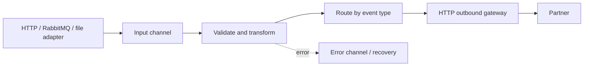

# Spring Integration Test and Substituting Endpoints in Flows

## 1. Why Test Integration Flows and When Should Endpoints Be Substituted?

In the **SPRING_BOOT_INTEGRATION** module, a flow may receive an HTTP request or broker message, transform data contracts, query a database/cache, invoke an HTTP client, and emit results through Spring Integration adapters. Unit testing individual Java methods is not enough to prove that **messages actually traverse the intended channels, handlers, order, filters, and error paths**.

Example order-sync flow:



To test transformation and routing logic, you do not always need to call a real partner. **Substituting endpoints in a flow** keeps most Spring Integration wiring running for real inside the `ApplicationContext`, while swapping a chosen handler or trigger for a controllable, verifiable test double.

A worthwhile test should answer:

1. Do messages travel from the input channel to the right endpoint with the expected payload and headers?
2. Do filtering, routing, transformation, aggregation, and error flows behave as configured?
3. When an external endpoint fails, does the flow retry, emit error replies, dead-letter, or checkpoint per contract?
4. Which pieces are replaced (mocked) and which must run against real/ephemeral resources for confidence?

**Distinction:** `Spring Integration Test` is the toolkit supporting tests of Spring Integration components and flows. `@SpringBootTest` boots the Spring Boot application environment. They work together rather than replacing one another.

## 2. Concepts: Endpoints, Handlers, Channels, and Triggers

| Component | Role in flow | What typically needs testing |
|---|---|---|
| `Message<?>` | Payload plus headers carrying integration context | Content, correlation ID, routing keys, data types, idempotency key |
| `MessageChannel` | Handoff point between steps | Wiring and synchronous vs. asynchronous dispatch |
| `MessageHandler` | Processes a message at an endpoint | Invoked expected number of times, right payload, reply or exception |
| `MessageSource<?>` | Produces messages from a polled source | Filtering, polling, checkpointing, and poll schedule |
| `MessageProducer` | Actively emits messages from an event source | Lifecycle, subscriptions, external sources, and errors |
| `Endpoint` | Connects handler/source to channels and manages lifecycle | Start/stop, endpoint ID, polling/consumption |
| `Trigger` | Governs poller schedule | Controlling poll timing without relying on wall clocks |
| `ErrorChannel` | Error-handling path for async flows or configured error flows | `ErrorMessage`, root cause, retry, and recovery behavior |

A `DirectChannel` invokes subscribers synchronously on the sender's thread in most setups; an `ExecutorChannel` introduces an asynchronous boundary; a `QueueChannel` buffers messages for consumers. Consequently, the same assertion can pass on `DirectChannel` yet fail or flake on `ExecutorChannel` if checked before the handler finishes.

**Endpoint IDs differ from channel names.** When replacing a handler via `MockIntegrationContext`, supply the ID of the **Spring Integration-managed endpoint**, typically set explicitly via DSL `.id("...")`. Passing a channel name or business service bean name causes replacement to fail or miss the intended step.

## 3. Tools in the Testing Ecosystem

| Tool | Purpose | Limitations |
|---|---|---|
| `spring-integration-test` | Supports `@SpringIntegrationTest` and `MockIntegrationContext`, swapping endpoint handlers/triggers | Does not simulate arbitrary protocols or provision databases/brokers |
| `spring-integration-test-support` | Utilities, matchers, and standalone test helpers | Does not boot a full application context |
| `spring-boot-starter-test` | JUnit Jupiter, Spring Test, Mockito, and version-appropriate test utilities | Does not start external adapters without dependencies/config |
| `@SpringBootTest` | Loads Spring Boot configuration, beans, and wiring | Can be slow; risks side effects if external sources aren't blocked |
| `@SpringIntegrationTest` | Adds Spring Integration test infrastructure; supports disabling endpoint auto-startup | Does not replace test logic or assertions |
| `MockIntegrationContext` | Replaces an endpoint's message handler or trigger in the test context | Applies only to Spring Integration-managed replaceable endpoints |
| Mockito / `MockIntegration` | Mock, stub, verify handlers | Does not prove adapters talk to real servers |
| `QueueChannel` / test probe | Captures output messages for bounded-timeout assertions | In-memory queues do not prove broker delivery/durability |
| Testcontainers / WireMock | Spins up isolated brokers, DBs, and HTTP endpoints | Requires managing lifecycles, images/runtimes, and test data |

Artifact coordinates and package APIs must align with your Spring Boot, Spring Integration, Spring Framework, and Java versions. Typically you add `org.springframework.integration:spring-integration-test` in test scope alongside the Spring Integration modules used by the app.

Example Gradle dependencies:

```groovy
dependencies {
    implementation 'org.springframework.boot:spring-boot-starter-integration'
    testImplementation 'org.springframework.boot:spring-boot-starter-test'
    testImplementation 'org.springframework.integration:spring-integration-test'
}
```

When Spring Boot manages dependency versions via its BOM/plugin, let the BOM select compatible versions. If you need HTTP, AMQP, Kafka, SFTP, JDBC, or XML adapters, add their respective dependencies; `spring-integration-test` does not pull them in automatically.

## 4. Define Test Scope Before Mocking

Do not replace an entire flow with mocks and call it an integration test. Explicitly define **control points** and **boundaries kept real**.

| Goal | Recommended scope | What to simulate |
|---|---|---|
| Test a pure Java transformer | Unit test | No Spring context needed |
| Test routing/filtering/wiring of an `IntegrationFlow` | Spring Integration flow test | Endpoints calling external systems, time-driven triggers |
| Test HTTP clients and data contracts | Integration test with WireMock/MockWebServer | Partner server, keeping real HTTP adapter |
| Test RabbitMQ delivery and acks | Testcontainers RabbitMQ, real listener | Downstream services if appropriate |
| Test schemas, transactions/outbox | PostgreSQL Testcontainers, real migrations | Partner HTTP or unrelated external adapters |
| Test cross-adapter operational behavior | End-to-end in an isolated test environment | Only services without viable sandboxes |

A test substituting `httpOutboundEndpoint` with a mock **does not test** URLs, TLS, timeouts, codecs, or HTTP status handling of the real adapter; test those separately against a stub HTTP server or sandbox. Conversely, booting a real broker for every simple routing rule adds weight without proportional confidence.

## 5. Sample Spring Integration Flow with a Replaceable Endpoint

Suppose a Spring Boot service receives an order code on an input channel, normalizes whitespace, drops blank values, and forwards it to a partner client. Internal processing runs for real while the partner-calling endpoint can be substituted in tests.

```java
@Configuration
class OrderIntegrationConfiguration {

    @Bean
    MessageChannel orderInput() {
        return new DirectChannel();
    }

    @Bean
    MessageHandler partnerOrderHandler(PartnerOrderClient client) {
        return message -> client.sendOrder((String) message.getPayload());
    }

    @Bean
    IntegrationFlow orderFlow(
            @Qualifier("orderInput") MessageChannel orderInput,
            @Qualifier("partnerOrderHandler") MessageHandler partnerOrderHandler) {

        return IntegrationFlow.from(orderInput)
                .transform(String.class, String::trim)
                .filter(String.class, value -> !value.isBlank())
                .handle(partnerOrderHandler,
                        endpoint -> endpoint.id("partnerOrderEndpoint"))
                .get();
    }
}
```

Assume the app defines `PartnerOrderClient` with `void sendOrder(String orderCode)`; the example needs the corresponding Spring Integration DSL, messaging, Java, and Spring configuration imports. `partnerOrderEndpoint` names the **consumer endpoint** connecting the handler to the channel—that is the ID used to substitute the handler in tests.

Here, `DirectChannel` keeps execution synchronous and straightforward to assert; production may use executors or brokers, requiring dedicated tests for concurrency, retries, and message durability.

You do not need to distort production flows just for testing. Still, **assigning stable, well-scoped endpoint IDs** improves lifecycle control, troubleshooting, and boundary substitution during tests.

## 6. Substituting a Handler with `MockIntegrationContext`

### 6.1. Test Substituting the Outbound Endpoint

`@SpringIntegrationTest` combined with `@SpringBootTest` builds the real flow context and exposes `MockIntegrationContext`. In the test, substitute `partnerOrderEndpoint`'s handler before sending a message:

```java
@SpringBootTest
@SpringIntegrationTest
class OrderIntegrationFlowTest {

    @Autowired
    MockIntegrationContext mockIntegrationContext;

    @Autowired
    @Qualifier("orderInput")
    MessageChannel orderInput;

    @Test
    void normalizesPayloadAndDeliversToPartnerEndpoint() {
        MessageHandler replacement = Mockito.mock(MessageHandler.class);

        mockIntegrationContext.substituteMessageHandlerFor(
                "partnerOrderEndpoint", replacement);

        try {
            boolean accepted = orderInput.send(
                    MessageBuilder.withPayload("  ORD-42  ")
                            .setHeader("correlationId", "test-42")
                            .build()
            );

            assertThat(accepted).isTrue();

            Mockito.verify(replacement, Mockito.times(1))
                    .handleMessage(Mockito.argThat(message ->
                            "ORD-42".equals(message.getPayload())
                            && "test-42".equals(
                                    message.getHeaders().get("correlationId"))
                    ));
        } finally {
            mockIntegrationContext.resetBeans();
        }
    }
}
```

Import the corresponding JUnit Jupiter, Spring Boot Test, Spring Integration Test, Spring Messaging, AssertJ, and Mockito types. The example assumes the context loads the configuration above, registers required dependencies, and has a valid Spring Boot application entrypoint.

Key takeaways:

1. `substituteMessageHandlerFor("partnerOrderEndpoint", replacement)` swaps the handler on **the endpoint with that ID**, bypassing calls to `PartnerOrderClient`.
2. Transformers, filters, channels, and `Message<?>` wrapping execute with real wiring; assertions verify the payload and headers arriving at the boundary.
3. Because `DirectChannel` and the mock handler are synchronous, verification can follow `send()` immediately. Asynchronous flows require bounded waiting.
4. `resetBeans()` restores substituted beans so subsequent tests reusing the Spring context do not observe the fake handler. Test listeners may assist cleanup depending on version, yet explicit reset makes ownership clear.
5. This test **does not verify** real HTTP networking, message durability, transactions, publisher confirms, or retries outside the substituted handler.

If the real handler produces a reply, the replacement must return an appropriate reply rather than acting as a void sink; otherwise, downstream steps stall or fail due to a missing reply. Match replacements to the one-way vs. request-reply contract.

### 6.2. Using a Mock Handler That Returns Replies

When testing transformations both before and after a request-reply endpoint, use `MockIntegration` helpers to build a replying mock handler, or mock the underlying service bean while keeping the real handler. Contractually:

```text
input -> transform -> [substituted request-reply endpoint]
      -> transform result -> output channel
```

The replacement must emit a reply of the type downstream expects, preserving required headers/correlation. If it always returns `null`, the flow terminates silently with no output—a test-setup bug rather than a routing bug.

With multiple endpoints, substitute **only boundaries causing out-of-scope side effects**. Mocking validators, routers, transformers, and outbound adapters turns the test into Mockito verifying Mockito, providing zero integration evidence.

### 6.3. When to Replace a Dependency Instead of the Endpoint

To test HTTP adapter mappings, exception mapping, adapter-level retries, or correlation headers, keep the real adapter and replace the **HTTP server** with WireMock. If you merely want to suppress `PartnerOrderClient` side effects, mock the client bean via Spring Test (`@MockitoBean` on newer Boot versions, `@MockBean` on older ones).

Differences:

- Substituting the endpoint: skips the handler and network call, focusing on wiring before/after the swap point.
- Mocking the injected bean: keeps the handler/adapter running against a fake client, covering handler logic too.
- Replacing the external server: keeps client, HTTP adapter, serialization, and interceptors real—closest to real integration.

## 7. Preventing Inbound Adapters from Auto-Starting on Context Boot

Polling or message-driven adapters can start immediately once the Spring context refreshes, causing tests to lose control over when files are read, DB rows polled, brokers consumed, or APIs called.

`@SpringIntegrationTest` offers `noAutoStartup` to prevent named endpoints from auto-starting in the test context:

```java
@SpringBootTest
@SpringIntegrationTest(noAutoStartup = {
        "fileInboundEndpoint",
        "scheduledInboundEndpoint"
})
class ImportFlowTest {
    // Substitute triggers or start sources manually after fixtures are ready.
}
```

Names must match managed endpoint bean IDs. For example, DSL can assign IDs explicitly via `.from(..., spec -> spec.id("fileInboundEndpoint"))`; never put directory paths or channel names into `noAutoStartup`.

Benefits:

- Prevents side effects before mocks are attached.
- Lets tests prepare fixtures, databases, and HTTP stubs before activating sources.
- Avoids periodic pollers firing before tests start or after tests finish.
- Reduces contention between tests sharing a context.

**Do not restart every endpoint just to run one case** if you can inject test messages directly into the channel after the adapter. When testing the adapter/poller itself, start that single endpoint intentionally, monitor outcomes, and stop it during cleanup.

## 8. Substituting Triggers to Control Polling

`MockIntegrationContext` also supports replacing the `Trigger` on polling endpoints, giving deterministic control instead of production intervals. Depending on Spring Integration version, the API looks like:

```java
@Autowired
MockIntegrationContext mockIntegrationContext;

void configurePollingForTest() {
    Trigger fastTestTrigger = new PeriodicTrigger(
            Duration.ofMillis(200));

    mockIntegrationContext.substituteTriggerFor(
            "fileInboundEndpoint", fastTestTrigger);
}
```

`PeriodicTrigger` is one example; exact constructors and overloads vary across Spring Framework versions. If the application uses `CronTrigger` or timezone-sensitive schedules, choose a matching trigger or deterministic test trigger. This illustrates trigger substitution; the endpoint must actually have a poller and be started for polling to execute.

Real polling is not always needed to test downstream logic. For transformer/router tests, **sending messages directly to the input channel** is simpler, faster, and deterministic.

Avoid `Thread.sleep(...)` assuming a 200ms poller always completes on time. Executor scheduling, CI load, and external I/O cause flakiness. Use `QueueChannel.receive(timeout)`, `CountDownLatch`, or conditional waiting such as Awaitility with finite deadlines.

## 9. Verifying Outputs and Asynchronous Flows

### 9.1. Output Probes with `QueueChannel`

When asserting a flow's output messages, wire an output channel as a queue in tests:

```java
@Bean
QueueChannel testResults() {
    return new QueueChannel();
}
```

Have the flow route outputs to `testResults` and receive in the test:

```java
@Autowired
@Qualifier("testResults")
PollableChannel testResults;

@Test
void emitsExpectedPayload() {
    // Actively send test message to the flow's input channel.
    Message<?> reply = testResults.receive(5_000);

    assertThat(reply).isNotNull();
    assertThat(reply.getPayload()).isEqualTo("EXPECTED");
}
```

This assumes the flow wires to `testResults` and the test sent a message before calling `receive`. Never leave leftover messages in `QueueChannel` across cases; isolate data per test, purge queues/reset context as needed, or use dedicated test channels.

`QueueChannel` is an application-level in-memory buffer; **it cannot replace RabbitMQ/Kafka tests** when verifying real broker persistence, acks, dead-lettering, and redelivery.

### 9.2. Asynchronous Boundaries and Timeouts

When flows include `ExecutorChannel`, executor-backed `PublishSubscribeChannel`, `splitter`, `aggregator`, schedulers, HTTP callbacks, or message-driven adapters, downstream work can finish after `send()` returns.

Reliable testing method:

1. Configure stubs and fixtures before sending messages.
2. Send an event carrying a unique test ID.
3. Await the final outcome or business condition within a finite deadline.
4. Assert message counts, headers, DB state, and expected endpoint invocation counts.
5. Stop sources, drain tasks, and clean up data/consumers when the test ends.

Never assert only `send() == true`: that usually confirms only that the channel accepted the message at send time, not that async handlers succeeded.

### 9.3. Correlation, Splitters, and Aggregators

For split/aggregate flows, construct messages with valid `correlationId`, `sequenceNumber`, and `sequenceSize` per contract. Test all key cases:

- All parts arrive → aggregator emits exactly one result.
- One part arrives late or never arrives → timeout or partial-result policy fires.
- Duplicate message → idempotency or release policy prevents duplicate outputs.
- Concurrent groups → correlation IDs never bleed across orders.

Assign unique correlation IDs per test; if the aggregator uses a persistent message store, scope cleanup per test and avoid reusing group IDs that interfere across runs.

## 10. Testing Errors, Retries, and Transactions with Substituted Endpoints

### 10.1. Simulating Failures at the Right Boundary

Replacing an outbound handler with a mock that throws exercises part of the error path:

```java
MessageHandler failingHandler = message -> {
    throw new MessagingException(message, "Partner temporarily unavailable");
};

mockIntegrationContext.substituteMessageHandlerFor(
        "partnerOrderEndpoint", failingHandler);
```

With `DirectChannel`, exceptions typically propagate back to the caller. With `ExecutorChannel` or async inbound adapters, errors route to `errorChannel` or configured error handling; verify behavior matching your topology. Merely declaring an `errorChannel` bean does not automatically convert synchronous exceptions into `ErrorMessage`s.

If you aim to test retry advice attached **directly to the substituted handler**, replacing the endpoint itself can bypass or alter the advice boundary; test the real endpoint structure or keep the real handler and mock its inner dependency instead. Retry tests should verify attempt counts, retryable exception filters, backoff, recoverers, and post-exhaustion state.

### 10.2. Mocks Do Not Create Cross-System Transactions

A test substituting an HTTP gateway cannot prove:

- JDBC transactions and brokers commit atomically.
- Partners durably received messages.
- Acks/offsets commit in the right order.
- Post-crash retries avoid duplicate side effects.

In real systems, add separate tests using test databases and brokers to simulate crashes between DB commit, broker publish, and ack; verify **outbox/inbox, unique constraints, idempotency keys, DLQs, and replay**. For HTTP adapters, use stub HTTP servers returning `500`, `503`, timeouts, malformed bodies, and unexpected responses.

### 10.3. Verifying Business Invariants

Rather than stopping at `verify(mock, times(1))`, assert the flow's final outcome:

| Scenario | What to assert |
|---|---|
| Valid payload | Accurate field mapping, target endpoint, and business key |
| Missing payload field | No outbound call; contract validation error emitted |
| Different routes | Message enters exact expected branch(es) |
| Transient HTTP error | Bounded retries, no infinite blocking, recoverable state |
| Duplicate event | Only one business side effect accepted |
| Timeout | Bounded wait, error signal, and retry/recovery policy applied |
| Stop/restart | Remaining jobs/messages drain or replay safely |

## 11. Keeping Tests Independent, Reproducible, and Side-Effect-Free

### 11.1. Isolating Test Resources

A `@SpringBootTest` context can boot many beans together: directory pollers, Rabbit listeners, schedulers, or outbound HTTP adapters. Ensure:

- Use a `test` profile with isolated sandbox endpoints/databases/brokers; test secrets lack production write permissions.
- Disable auto-startup for out-of-scope sources, or use `noAutoStartup` and explicit startup controls.
- Use Testcontainers for DBs/brokers and mock servers for HTTP; inject test endpoints via properties—never hardcode production URLs.
- Give parallel tests isolated IDs/queues/fixture files; restrict permissions and clean up resources.
- Keep results independent of system wall clocks: use controllable clocks/triggers, condition-based waits, and clear deadlines.

`@ActiveProfiles("test")` does not prevent hitting production if CI overrides connection strings or injects production credentials. Enforce isolation with network rules, least-privilege accounts, and strict configuration checks.

### 11.2. Preventing Tests from Interfering with Each Other

Endpoint substitution mutates wiring in the **shared `ApplicationContext`** across test cases. Two parallel tests sharing a context can overwrite each other's endpoint substitutions and produce bogus failures. Manage this proactively:

- Reset substitutions at the end of each case using the proper API (`resetBeans()`) or version-appropriate test listener support.
- Do not run cases that mutate the same endpoint/context in parallel unless each uses a separate context.
- Avoid slapping `@DirtiesContext` onto every test; reloading contexts slows the suite down. Reserve it for unrecoverable state or real context config changes.
- Clean up `QueueChannel`, persistent message stores, caches, files, outbox rows, and DB fixtures according to test ownership.

### 11.3. Never Claim Behavior Outside the Mock Boundary

When mocking an outbound HTTP handler, you only prove that messages **reached the handoff point where the outbound handler sits**. You have not verified TCP, TLS, serialization, HTTP status codes, or partner commits. When reporting test coverage, state clearly which boundaries ran for real and which were substituted.

## 12. Observing Test Flows

A thorough flow test preserves diagnostic details for CI failures:

- **Correlation/trace IDs:** connect input messages, routers, transformations, outbound boundaries, and error paths; never put arbitrary IDs into high-cardinality metric tags.
- **Message metadata:** payload type, source, destination, retry count, latency, final status.
- **Timings:** per-endpoint processing duration, queue wait time, and end-to-end duration, clearly defined.
- **Errors:** business errors, mapping errors, timeouts, broker/client failures; never log passwords or sensitive payloads.
- **Evidence:** DB/broker assertions, requests captured at HTTP stubs, mock invocations, and test file paths.

Spring Boot Actuator/Micrometer can instrument HTTP clients, listeners, and Spring Integration steps when enabled. Even when tracing is sampled, metrics and test assertions must remain verifiable; having a trace does not prove business work succeeded.

When an async test fails, report **which final state was never reached** (missing reply, uncommitted DB, wrong DLQ, exhausted retries) alongside the timeout deadline. A bare "message sent" input log is rarely enough to diagnose.

## 13. Step-by-Step Workflow for an Endpoint-Substitution Test

1. **Map the message path:** input channel, transformers/filters/routers, external endpoints, output/error channels, transaction boundaries, and async hops.
2. **Pick a focused goal:** one specific behavior, e.g., "after normalization, valid orders reach the partner endpoint once."
3. **Set stable endpoint IDs:** use the endpoint's ID, not the channel or service bean name.
4. **Boot context and gate sources:** use `@SpringBootTest` + `@SpringIntegrationTest`; disable out-of-scope auto-starting adapters.
5. **Substitute handlers/triggers:** use `MockIntegrationContext` only at boundaries being replaced; stub replies or errors per contract.
6. **Send inputs and wait:** send a test message with a unique ID; verify synchronously or await asynchronously with a finite timeout.
7. **Assert outcomes:** payload/headers/correlation, routing decisions, call counts, business state, and error handling.
8. **Restore and clean up:** reset mocks/substitutions, stop any started test endpoints, and clean fixtures/message stores.
9. **Add real-adapter tests:** use WireMock/Testcontainers/contract tests to cover everything the mock skipped.

### Pre-Acceptance Checklist

- [ ] Test objective and boundaries are documented clearly.
- [ ] Substituted endpoints have explicit IDs inside the Spring Integration context.
- [ ] No out-of-scope inbound adapters auto-start uncontrollably.
- [ ] Mock behavior matches the one-way or request-reply contract.
- [ ] Assertions verify payload, headers, invocation counts, and outcomes—not merely `send()`.
- [ ] Async flows wait on conditions with finite deadlines.
- [ ] Covers errors, retries, duplicates, or invalid payloads when required by contract.
- [ ] Substitutions are reset; state between tests is isolated.
- [ ] Mocked adapters have separate tests against realistic test resources.
- [ ] All secrets, endpoints, and test data are isolated from production.

## 14. Common Mistakes

**"`@SpringIntegrationTest` automatically mocks every outbound adapter."** No. It provides test infrastructure; you must explicitly specify endpoints to substitute, control auto-startup, and configure the test environment.

**"Passing the channel name to `substituteMessageHandlerFor(...)` works too."** Not necessarily. The API expects a valid endpoint ID; assign IDs explicitly in DSL or configuration.

**"A void mock handler always works for request-reply."** False when downstream expects a reply. Use a replacement matching the request-reply contract or mock the dependency inside the real handler.

**"If `verify(mock)` passes, the HTTP adapter works."** No. Mocking the endpoint bypasses the real adapter; test HTTP/serialization/timeouts with a stub server or sandbox.

**"`Thread.sleep(1000)` is fine for async listeners."** CI and executor scheduling have no fixed timing guarantees. Await signals or business conditions with finite timeouts.

**"`@Transactional` rolls back everything in the flow."** Test transactions do not cover broker publishes, HTTP calls, file I/O, or separate async threads. Test boundaries and deduplication explicitly.

**"All tests can run in parallel against one shared `ApplicationContext`."** Substitutions mutate shared state and cause races. Isolate contexts or serialize cases mutating endpoints.

**"With `noAutoStartup`, no startup side effects can occur."** That setting only affects specified Spring Integration endpoints; schedulers, external listeners, or other beans can still run. Inventory every external trigger.

## 15. Conclusion

In the **Integration Testing** chapter, `Spring Integration Test` lets you focus on **message flow correctness** while exercising real Spring Boot wiring. `@SpringIntegrationTest` and `MockIntegrationContext` help control lifecycles and swap message handlers or triggers at specific endpoints to test transformations, routing, and error handling deterministically. For systems combining HTTP clients, databases, caches, message brokers, and Spring Integration adapters, the reliable strategy is **testing flows with endpoint substitutions at side-effecting boundaries**, paired with dedicated tests using real adapters, brokers, and databases in isolated environments to verify transactions, retries, idempotency, data contracts, and observability.
