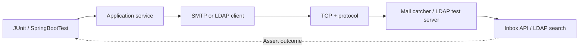
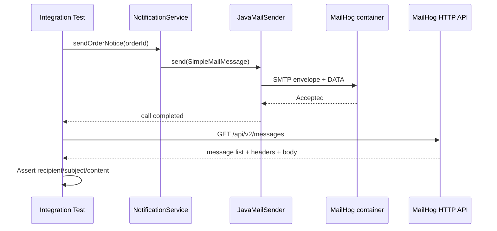
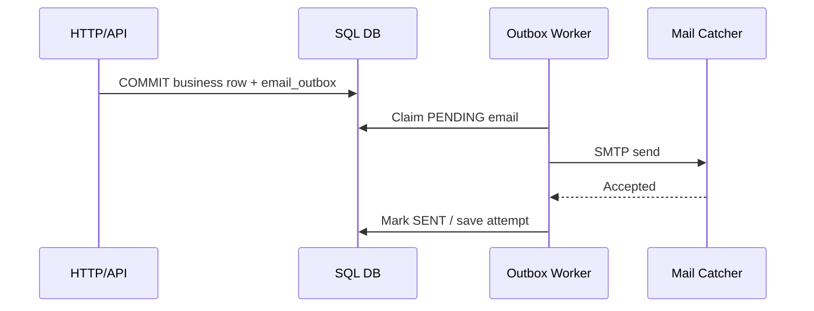
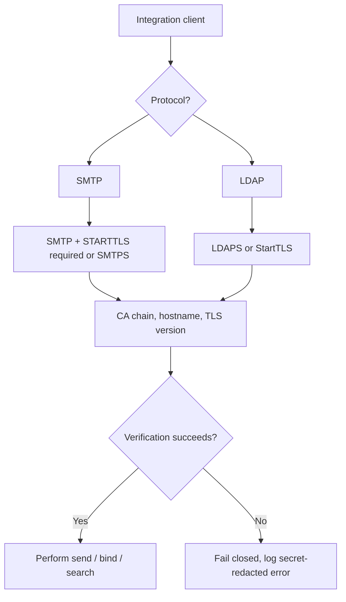
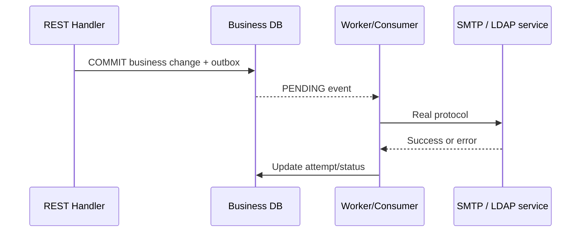

# Testing Mail or LDAP with Isolated Services

A Spring Boot application can pass every unit test yet fail immediately when sending email over SMTP or looking up users in LDAP. Mocking `JavaMailSender` misses wrong hosts/ports, SMTP authentication errors, header encoding bugs, or missing STARTTLS. Mocking `LdapTemplate` fails to prove the search base DN is accurate, the bind account has sufficient permissions, or the directory returns attributes matching the contract. These bugs only surface when the application **communicates with a service that genuinely understands the protocol**.

This lesson belongs to the **Integration Testing** chapter of the **SPRING_BOOT_INTEGRATION** module: integrating Spring Boot with HTTP clients, databases, caches, message brokers, and Spring Integration adapters—focusing on configuration, data contracts, transactions, failures, deduplication, testing, and observability. Here, we design tests so that an **SMTP server or LDAP directory runs isolated from application logic**, typically in a dedicated container whose lifecycle is managed by the test. This tests real networking and protocols in a controlled environment without emailing real customers or modifying corporate directories.

After this lesson, you will be able to:

- Choose between mocks, fake/embedded servers, isolated service containers, and staging environments according to the confidence needed.
- Write integration tests that send emails via SMTP to a mail catcher, query them back via a test HTTP API, and assert recipients, subjects, bodies, and duplicate prevention.
- Write integration tests connecting to LDAP, seeding test LDIF/entries, and verifying search/filters, bind authentication, and common error paths.
- Supply dynamic endpoints via `@DynamicPropertySource` and manage lifecycles and state for stable CI execution without hardcoded ports.
- Test timeouts, TLS, access permissions, retries, idempotency, sensitive data handling, and boundaries that simulated services cannot prove alone.

> **Example versions:** Spring Boot 3.x, Spring Framework 6.x, JUnit Jupiter, Testcontainers, and common mail/LDAP starters. The concepts apply to newer compatible versions, though specific artifact/image versions and APIs must match your project's BOM. In code snippets, hosts, domains, and accounts are synthetic test data; production deployments differ.

## 1. What Does Testing an Integration Actually Verify?

### 1.1. Contract Boundaries



An integration test must cross at least the boundaries prone to misconfiguration:

1. Spring Boot builds the right client beans from real configuration.
2. The client opens a connection to an endpoint listening on the host and port supplied by the test environment.
3. The client executes real protocol operations: SMTP `MAIL FROM`, `RCPT TO`, `DATA`, or LDAP bind/search.
4. The test observes side effects at the test service rather than merely verifying a mock was called.
5. When the protocol returns errors, the application classifies and handles them properly: bounded retries, error signals, job state updates, or safe termination.

A mail catcher proves the SMTP server **accepted the message**; it does not prove an Internet mailbox received it or that SPF/DKIM/DMARC work. An OpenLDAP container proves the app speaks LDAP to the test server; it does not prove every behavior of Microsoft Active Directory or an enterprise-managed directory service.

### 1.2. Comparing Testing Tiers

| Tier | Mail | LDAP | What it proves | What it does not prove |
|---|---|---|---|---|
| Unit test with mocks | `verify(sender).send(...)` | Mock `LdapTemplate.search` | Message/filter building logic, mock-simulated error branches | TCP, SMTP/LDAP protocol, authentication, TLS |
| In-JVM fake/embedded server | GreenMail/Wiser | Embedded LDAP/UnboundID | Substantial protocol and mapping behavior | Process/container isolation; certain vendor-specific behaviors |
| Isolated container service | MailHog/Mailpit or SMTP test server | OpenLDAP test container | Networking, Spring config, protocol, and partial server behavior | Full production rules, proxies, certificates, and policies |
| Production-like staging | Real sandbox SMTP relay | Test LDAP/AD tenant | Connectivity, TLS, policies, and near-production schemas | Guarantee that production config will never drift |

Not every test belongs in a real staging environment. Most tests should run fast and independently in CI. Reserve a small set of compatibility tests against real vendor sandboxes for behaviors that containers cannot faithfully simulate.

### 1.3. Properties of a Good "Isolated Service"

- **No production infrastructure:** never send to corporate production SMTP relays or bind to directories containing real users.
- **Independent data:** use `@example.invalid` addresses, `dc=example,dc=org` DNs, and fake accounts/secrets; give each test suite clean fixtures.
- **Reproducible lifecycle:** start before the Spring context, stop after the suite, and pin image versions.
- **Real networking:** container listens on an isolated port, and host/port are injected into the client under test.
- **Observable:** provides an inbox API, LDAP search, or equivalent query mechanism to assert post-action effects.
- **Failure paths:** allows stopping the service, changing credentials, inducing timeouts, or presenting untrusted certificates under test control.
- **No cross-test interference:** reset state between tests on shared containers, or isolate records with unique IDs.

An in-JVM embedded server still provides a real protocol endpoint for testing clients, though without the same process isolation as a container. Choose based on the test's objective.

## 2. Project Setup and Spring Boot Configuration

### 2.1. Relevant Dependencies

Example Gradle Kotlin DSL for an application needing SMTP and LDAP:

```kotlin
dependencies {
    implementation("org.springframework.boot:spring-boot-starter-mail")
    implementation("org.springframework.boot:spring-boot-starter-data-ldap")
    implementation("org.springframework.boot:spring-boot-starter-actuator")

    testImplementation("org.springframework.boot:spring-boot-starter-test")
    testImplementation("org.testcontainers:junit-jupiter")
    testImplementation("org.awaitility:awaitility")
}
```

In addition to these dependencies, Testcontainers requires a compatible Docker/OCI container runtime on developer machines or CI runners. Use the Spring Boot BOM or project dependency management to keep versions aligned. `GenericContainer` does not require a specialized Testcontainers module for SMTP or LDAP.

If a service uses only mail, omit LDAP dependencies; if it uses only directory lookups, omit mail. Both are paired here because the lesson covers two integration types sharing the same **isolated-service testing** strategy.

### 2.2. Profiles and Externalized Configuration

Production configuration should be supplied by the deployment environment, for example:

```yaml
# application.yml — illustrative config, do not use for CI tests
spring:
  mail:
    host: ${SMTP_HOST}
    port: ${SMTP_PORT}
    username: ${SMTP_USERNAME}
    password: ${SMTP_PASSWORD}
    properties:
      mail.smtp.auth: true
      mail.smtp.starttls.enable: true
      mail.smtp.starttls.required: true
      mail.smtp.connectiontimeout: 5000
      mail.smtp.timeout: 5000
      mail.smtp.writetimeout: 5000

  ldap:
    urls: ${LDAP_URL}
    base: dc=corp,dc=example
    username: ${LDAP_BIND_DN}
    password: ${LDAP_BIND_PASSWORD}
```

This illustrates **SMTP with STARTTLS** and an environment-provided LDAP URL. Settings differ for SMTPS (implicit TLS), LDAP over TLS (`ldaps://`), or LDAP StartTLS. Never copy SMTP TLS settings blindly to LDAP: the two protocols follow different configuration rules.

Tests should override endpoints via `@DynamicPropertySource` instead of hardcoding `localhost:25`, `localhost:389`, or modifying source config files per run. Test container credentials are synthetic; production credentials must never enter repositories or logs.

### 2.3. Two Caveats with `@SpringBootTest`

`@SpringBootTest` boots the Spring application context and may start application listeners, schedulers, or batch jobs. When testing only mail/LDAP, explicitly disable unrelated startup jobs or load a scoped context. If booting the full context, verify no consumer, retry worker, or publisher can send data to real external systems.

Conversely, a test that manually constructs `JavaMailSenderImpl` and calls it directly will miss Spring Boot auto-configuration, profile, or property-binding bugs. Therefore, the examples below use real Spring beans and inject host/port via dynamic properties.

## 3. Testing SMTP with a Containerized Mail Catcher

### 3.1. Why Use a Mail Catcher?

MailHog or Mailpit are SMTP servers built for development and testing. They accept messages over SMTP and let tests query the captured mailbox via an HTTP API or web UI. Emails remain inside the test environment without ever reaching public Internet mailboxes.



**Golden rule:** verify the email **actually arrived in the mail catcher**, not just `verify(sender).send(...)`. If emails are dispatched asynchronously from a queue or outbox worker, wait for the outcome with a bounded timeout.

### 3.2. Minimal Application Service

```java
package example.integration.mail;

import org.springframework.mail.SimpleMailMessage;
import org.springframework.mail.javamail.JavaMailSender;
import org.springframework.stereotype.Service;

@Service
public class OrderNotificationService {

    private final JavaMailSender sender;

    public OrderNotificationService(JavaMailSender sender) {
        this.sender = sender;
    }

    public void sendOrderNotice(String orderId, String recipient) {
        SimpleMailMessage message = new SimpleMailMessage();
        message.setFrom("no-reply@example.invalid");
        message.setTo(recipient);
        message.setSubject("Order received");
        message.setText("Order " + orderId + " was accepted.");
        sender.send(message);
    }
}
```

In production, `recipient` must come from validated/authorized data, and business rules must define exactly when an email is emitted. In this example, the method invokes SMTP synchronously; when `send()` returns, the test SMTP server accepted the message at the protocol level, **which does not yet prove the recipient read the email**.

### 3.3. Testcontainers with MailHog and Dynamic Ports

JUnit 5 example. Pin images to explicit versions and use a Docker network/runtime compatible with CI. Inside the container, port `1025` is SMTP and `8025` is MailHog's HTTP API/Web UI.

```java
package example.integration.mail;

import static org.assertj.core.api.Assertions.assertThat;
import static org.awaitility.Awaitility.await;

import java.net.URI;
import java.net.http.HttpClient;
import java.net.http.HttpRequest;
import java.net.http.HttpResponse;
import java.time.Duration;

import com.fasterxml.jackson.databind.JsonNode;
import com.fasterxml.jackson.databind.ObjectMapper;

import org.junit.jupiter.api.Test;
import org.junit.jupiter.api.TestInstance;
import org.springframework.beans.factory.annotation.Autowired;
import org.springframework.boot.test.context.SpringBootTest;
import org.springframework.test.context.DynamicPropertyRegistry;
import org.springframework.test.context.DynamicPropertySource;
import org.testcontainers.containers.GenericContainer;
import org.testcontainers.junit.jupiter.Container;
import org.testcontainers.junit.jupiter.Testcontainers;
import org.testcontainers.utility.DockerImageName;
import org.testcontainers.containers.wait.strategy.Wait;

@SpringBootTest
@Testcontainers
class OrderNotificationSmtpIT {

    @Container
    static final GenericContainer<?> mailhog =
            new GenericContainer<>(
                    DockerImageName.parse("mailhog/mailhog:v1.0.1"))
                .withExposedPorts(1025, 8025)
                .waitingFor(
                    Wait.forHttp("/api/v2/messages")
                        .forPort(8025)
                        .forStatusCode(200));

    @DynamicPropertySource
    static void mailProperties(DynamicPropertyRegistry properties) {
        properties.add("spring.mail.host", mailhog::getHost);
        properties.add(
                "spring.mail.port",
                () -> mailhog.getMappedPort(1025));
        properties.add("spring.mail.properties.mail.smtp.auth",
                () -> "false");
        properties.add("spring.mail.properties.mail.smtp.starttls.enable",
                () -> "false");
        properties.add("spring.mail.properties.mail.smtp.starttls.required",
                () -> "false");
    }

    @Autowired
    OrderNotificationService notifications;

    private final HttpClient http = HttpClient.newHttpClient();
    private final ObjectMapper json = new ObjectMapper();

    @Test
    void submitsExpectedMessageToIsolatedSmtp() {
        notifications.sendOrderNotice(
                "ORD-1042", "qa-recipient@example.invalid");

        await().atMost(Duration.ofSeconds(10)).untilAsserted(() -> {
            JsonNode response = mailhogMessages();
            assertThat(response.path("total").asInt()).isEqualTo(1);

            JsonNode message = response.path("items").get(0);
            JsonNode headers = message.path("Content").path("Headers");

            assertThat(headers.path("To").toString())
                    .contains("qa-recipient@example.invalid");
            assertThat(headers.path("Subject").toString())
                    .contains("Order received");
            assertThat(message.path("Content").path("Body").asText())
                    .contains("ORD-1042");
        });
    }

    private JsonNode mailhogMessages() throws Exception {
        URI endpoint = URI.create(
                "http://" + mailhog.getHost() + ":"
                + mailhog.getMappedPort(8025)
                + "/api/v2/messages");

        HttpRequest request = HttpRequest.newBuilder(endpoint)
                .timeout(Duration.ofSeconds(3))
                .GET()
                .build();

        HttpResponse<String> response = http.send(
                request, HttpResponse.BodyHandlers.ofString());

        assertThat(response.statusCode()).isEqualTo(200);
        return json.readTree(response.body());
    }
}
```

Execution notes:

- `@Testcontainers` and `@Container` start/stop the container for the test class. Testcontainers maps container ports to **random host ports**, avoiding conflicts with SMTP/LDAP already running on developer machines.
- `@DynamicPropertySource` is read by Spring Test when building the context; `JavaMailSender` receives the exact MailHog endpoint. The Testcontainers JUnit extension ensures the container starts before Spring evaluates dynamic properties in standard setups.
- MailHog here accepts **plain SMTP without auth/TLS**, making it great for sandbox content and delivery-path checks. It **does not test production STARTTLS/auth configuration**; test those separately with a server supporting them.
- The `/api/v2/messages` HTTP API and JSON schema above are **MailHog-specific**; if switching to Mailpit, adapt to Mailpit's API and schema.
- `await()` bounds waiting cleanly, especially when emails go through async workers. Never use fixed `Thread.sleep(...)` to "wait for email arrival."
- The test assumes **an empty initial mailbox and a single test using the container**. If multiple tests share one MailHog container, clear the inbox between tests or filter by a unique `messageId`/correlation ID rather than asserting total message count equals 1 on a shared mailbox.

For HTML emails, attachments, or multiple recipients, assert real MIME details: `Content-Type`, multipart boundaries, attachment names/types, charsets, `To/Cc/Bcc` headers, and Unicode encoding. Specifically, `Bcc` must not leak into headers visible to recipients even though it appears in SMTP envelope recipients.

### 3.4. Do Not Let Test Naming Blur Email Semantics

Succeeding over SMTP usually means the mail server **accepted** the message. Final delivery to an Internet inbox still depends on relays, DNS, spam policies, hop-to-hop TLS, quotas, and bounces. Name tests accurately—such as `submitsToSmtp` or `smtpAcceptsMessage`—rather than `deliversToCustomerInbox` when querying MailHog.

Real email pipelines often need three distinct states: `PENDING` (queued to send), `ACCEPTED_BY_SMTP` (server accepted), and `DELIVERED/BOUNCED` (when backed by trusted provider webhooks). Never conflate these states in metrics or business notifications.

## 4. Testing What Can Go Wrong with SMTP

### 4.1. Key Test Case Matrix

| Scenario | Test server setup | Behavior to verify |
|---|---|---|
| Plain-text send succeeds | SMTP accepts | Accurate recipient, subject, body; app records matching state |
| SMTP unreachable | Stop service or block port in controlled test | Finite timeout, categorized log, request does not hang forever |
| Wrong username/password | Test SMTP with AUTH enabled returning auth error | No infinite retries on bad credentials; password never logged |
| STARTTLS required but unavailable | Server lacks STARTTLS support | Client refuses plaintext fallback when TLS is required |
| Wrong CA/hostname certificate | TLS-enabled SMTP with invalid certificate fixture | TLS handshake fails; never disable verification to make tests green |
| Transient SMTP `4xx` | Server simulates `421`/`450`/`451` | Bounded backoff retries; no send storm |
| Permanent SMTP `5xx` | Server simulates `550`/`553` | Classified as non-recoverable; dead-lettered/flagged for review |
| HTML/multipart email | SMTP catcher preserves MIME | Accurate headers, UTF-8 charset, links, attachments, and boundaries |
| Retry after ambiguous timeout | Server may have accepted while client lost reply | Send identifier, duplicate handling, and reconciliation per contract |

MailHog excels at **happy paths and inspecting message contents**. It does not natively simulate arbitrary SMTP `4xx`/`5xx` faults, AUTH/STARTTLS permutations, or mid-protocol drops. Use GreenMail (which supports multiple SMTP/POP3/IMAP modes) or a programmable SMTP test server/proxy with controllable responses for negative testing. Pick tools capable of reproducing the real fault rather than forcing MailHog beyond its capabilities.

### 4.2. Timeouts and Retries

```yaml
spring:
  mail:
    properties:
      mail.smtp.connectiontimeout: 3000
      mail.smtp.timeout: 3000
      mail.smtp.writetimeout: 3000
```

These values are illustrative milliseconds for compatible Jakarta Mail SMTP providers. They bound distinct phases: socket connect, response read, and socket write. When testing timeouts, inject real delays via a network proxy or fault injector to prove timeouts fire; merely asserting string properties is insufficient.

Retry principles:

- Network errors and SMTP `4xx` are generally **retryable**, with bounded attempt caps and backoff.
- Bad credentials, misconfigured TLS, or invalid addresses require config/data fixes rather than continuous retries.
- When a response drops after `DATA`, the client cannot tell whether the server accepted the email; retrying can send a **duplicate email**. Outboxes and application-level job locks reduce duplicates, yet SMTP provides no end-to-end exactly-once guarantee.
- When sending emails after a SQL transaction, use an outbox or after-commit hook; never call SMTP inside a long DB transaction assuming an SMTP exception rolls back an already-sent email.

### 4.3. Testing Sending via an Outbox

Common integration flow:



Tests should confirm:

1. Rolling back the business transaction **creates no outbox record to send**.
2. Committing the business transaction creates one logical send job per `eventId`/idempotency key.
3. The worker claims the row, sends to the SMTP catcher, and transitions state conditionally.
4. When SMTP errors, status remains retryable or moves to dead-letter per policy.
5. If the worker crashes after SMTP accepts but before updating the DB, the request is not lost and duplicate handling follows policy.

Never assert only `email_outbox.status=SENT` and assume the SMTP server received it; inspect the mail catcher as well to verify the real side effect.

## 5. LDAP: Behaviors That Are Hard to Catch with Mocks

### 5.1. LDAP Is Not a "Users Table"

LDAP organizes entries in a Distinguished Name (DN) tree with object classes, attributes, search bases/scopes/filters, and bind rules. For example:

```text
dc=example,dc=org
└── ou=people
    ├── uid=alice,ou=people,dc=example,dc=org
    └── uid=bob,ou=people,dc=example,dc=org
```

An application may bind with a **service account** to search for the user's entry, then bind with the user's DN to verify their password—or use another auth flow depending on directory vendor. Frequent misconfigurations include:

- Wrong `spring.ldap.base`, causing empty searches or `No such object`.
- Search filter mismatched to schema (e.g., `uid` in OpenLDAP vs. `sAMAccountName` in AD).
- Bind DN succeeds yet lacks ACL permission to read an attribute—different from a mock.
- DNs containing commas, equals signs, Unicode characters, or slashes needing proper escaping.
- Search scope (`onelevel` vs. `subtree`) mismatched to the directory layout.
- Wrong TLS CA/hostname when the server enforces LDAPS or StartTLS.
- Vendor-specific LDAP referrals, pagination/size limits, or schema rules differing from simple mocks.

Test **the exact Spring LDAP client configured in your application**, rather than invoking an LDAP SDK directly outside the real bean setup.

### 5.2. Sample LDIF Dataset

```ldif
dn: ou=people,dc=example,dc=org
objectClass: top
objectClass: organizationalUnit
ou: people

dn: uid=alice,ou=people,dc=example,dc=org
objectClass: top
objectClass: person
objectClass: organizationalPerson
objectClass: inetOrgPerson
uid: alice
cn: Alice Example
sn: Example
mail: alice@example.invalid
userPassword: test-secret
```

This data is strictly for test environments. Never copy real accounts or production secrets into fixtures, and never assume production stores cleartext `userPassword`. Test LDAP servers may accept demo passwords directly, whereas real directories store hashes or delegate password checks elsewhere.

Seeding via LDIF files can be cleaner than code when fixtures are large, though it depends on the container image's bootstrap hooks. The next section seeds directly with `LdapTemplate` so the test stays self-contained without extra external fixture files.

## 6. Running an Isolated LDAP Server with Testcontainers

### 6.1. Dedicated OpenLDAP Test Setup

A common choice is an OpenLDAP container configured for a dummy `example.org` domain. The `osixia/openldap:1.5.0` image is pinned here for illustration; real projects should pick a maintained image compatible with their CPU/CI architecture, checking security policies and maintenance status before adopting.

```java
package example.integration.ldap;

import static org.assertj.core.api.Assertions.assertThat;
import static org.springframework.ldap.query.LdapQueryBuilder.query;

import java.util.List;

import javax.naming.directory.Attributes;
import javax.naming.directory.BasicAttribute;
import javax.naming.directory.BasicAttributes;

import org.junit.jupiter.api.Test;
import org.springframework.beans.factory.annotation.Autowired;
import org.springframework.boot.test.context.SpringBootTest;
import org.springframework.ldap.core.AttributesMapper;
import org.springframework.ldap.core.LdapTemplate;
import org.springframework.test.context.DynamicPropertyRegistry;
import org.springframework.test.context.DynamicPropertySource;
import org.testcontainers.containers.GenericContainer;
import org.testcontainers.containers.wait.strategy.Wait;
import org.testcontainers.junit.jupiter.Container;
import org.testcontainers.junit.jupiter.Testcontainers;
import org.testcontainers.utility.DockerImageName;

@SpringBootTest(properties = {
        "spring.ldap.base=dc=example,dc=org",
        "spring.ldap.username=cn=admin,dc=example,dc=org",
        "spring.ldap.password=admin-test-secret"
})
@Testcontainers
class LdapDirectoryIT {

    @Container
    static final GenericContainer<?> ldap =
            new GenericContainer<>(
                    DockerImageName.parse("osixia/openldap:1.5.0"))
                .withEnv("LDAP_ORGANISATION", "Example Org")
                .withEnv("LDAP_DOMAIN", "example.org")
                .withEnv("LDAP_ADMIN_PASSWORD", "admin-test-secret")
                .withExposedPorts(389)
                .waitingFor(Wait.forListeningPort());

    @DynamicPropertySource
    static void directoryProperties(
            DynamicPropertyRegistry properties) {
        properties.add("spring.ldap.urls",
                () -> "ldap://" + ldap.getHost()
                      + ":" + ldap.getMappedPort(389));
    }

    @Autowired
    LdapTemplate ldapTemplate;

    @Test
    void searchesAndAuthenticatesAgainstDirectory() {
        // Spring LDAP resolves DNs relative to base dc=example,dc=org.
        ldapTemplate.bind(
                "ou=people", null, organizationalUnit("people"));

        ldapTemplate.bind(
                "uid=alice,ou=people", null, aliceAttributes());

        List<String> emails = ldapTemplate.search(
                query().base("ou=people")
                       .where("uid").is("alice"),
                (AttributesMapper<String>) attrs ->
                        (String) attrs.get("mail").get());

        assertThat(emails)
                .containsExactly("alice@example.invalid");

        assertThat(ldapTemplate.authenticate(
                "ou=people", "(uid=alice)", "test-secret"))
                .isTrue();

        assertThat(ldapTemplate.authenticate(
                "ou=people", "(uid=alice)", "wrong-secret"))
                .isFalse();
    }

    private static Attributes organizationalUnit(String ou) {
        BasicAttributes attributes = new BasicAttributes(true);
        BasicAttribute classes = new BasicAttribute("objectClass");
        classes.add("top");
        classes.add("organizationalUnit");
        attributes.put(classes);
        attributes.put("ou", ou);
        return attributes;
    }

    private static Attributes aliceAttributes() {
        BasicAttributes attributes = new BasicAttributes(true);
        BasicAttribute classes = new BasicAttribute("objectClass");
        classes.add("top");
        classes.add("person");
        classes.add("organizationalPerson");
        classes.add("inetOrgPerson");
        attributes.put(classes);
        attributes.put("uid", "alice");
        attributes.put("cn", "Alice Example");
        attributes.put("sn", "Example");
        attributes.put("mail", "alice@example.invalid");
        attributes.put("userPassword", "test-secret");
        return attributes;
    }
}
```

This test uses the `LdapTemplate` auto-configured by Spring Boot from `spring.ldap.*` and exercises real search/bind operations—no `LdapTemplate` mocking or Java-side simulation needed.

**Limitations to remember:**

- Port `389` here is plaintext LDAP **inside an isolated container**. Never apply test plaintext/credentials to production. TLS paths (`ldaps://` or StartTLS) must be tested separately with proper certificates/truststores.
- The image may take time to initialize its schema/base DN after opening port 389. `Wait.forListeningPort()` checks the TCP port, **not that LDAP is ready to accept binds**. Add a bind/search readiness check (or short bounded retry) in CI if startup races occur.
- Test seeding uses admin credentials for brevity; production application code should use a least-privilege service account. Test read/write permission policies separately when required.
- This test expects a fresh directory for the test class. If reusing the container or running parallel tests under the same base DN, a second `bind("ou=people")` will fail with `entryAlreadyExists`. Reset datasets or isolate OUs per test.

### 6.2. Asserting Application Business Logic

The test above verifies `LdapTemplate`. When your application defines a `DirectoryUserService`, invoke **the real service method**, for example:

```java
@Service
public class DirectoryUserService {
    private final LdapTemplate ldap;

    public DirectoryUserService(LdapTemplate ldap) {
        this.ldap = ldap;
    }

    public String findEmailByUid(String uid) {
        List<String> emails = ldap.search(
                query().base("ou=people").where("uid").is(uid),
                (AttributesMapper<String>) attributes ->
                        (String) attributes.get("mail").get());

        return emails.stream()
                .findFirst()
                .orElseThrow(() ->
                        new IllegalArgumentException("Unknown user"));
    }
}
```

Imports needed: `org.springframework.stereotype.Service`, `org.springframework.ldap.core.LdapTemplate`, `org.springframework.ldap.core.AttributesMapper`, `java.util.List`, and static `LdapQueryBuilder.query`. Using the query builder escapes filter values properly instead of string concatenation like `"(uid=" + userInput + ")"`, which risks LDAP injection.

In real projects, define behavior for duplicate UID matches, missing/`null` attributes, Unicode, aliases, referrals, and size limits; if contracts require unique UIDs, test multiple-match rejection rather than silently taking the first entry.

## 7. Testing Critical LDAP Failure Paths

### 7.1. Negative Test Matrix

| Scenario | Data/configuration | Behavior to prove |
|---|---|---|
| Valid account | Entry + matching password | Bind succeeds; search returns only authorized attributes |
| Wrong password | Non-matching fake password | Authentication fails; password never logged |
| Non-existent user | Unseeded UID | Returns `not found` or auth failure per API without enumerating users |
| Wrong Base DN | Base outside tree | Error or empty result per library behavior, properly classified |
| Missing attribute | Entry lacks `mail` | Mapping avoids unhandled `NullPointerException` |
| Special characters in search filter | UID containing `*`, `(`, `)`, `\` | Input does not turn into unintended LDAP filter syntax |
| Locked / expired account | Directory supporting policy | App obeys policy or maps appropriate error |
| Server unreachable | Stopped container/controlled network block | Finite timeout, classified as `directory unavailable` |
| Referrals / pagination | Large directory with referrals | No silent user truncation per contract; pagination limits honored |
| Wrong LDAPS CA or hostname | Untrusted test certificate | Client rejects TLS verification rather than bypassing cert checks |

A basic OpenLDAP container does not automatically model **AD account lockout, group nesting, nested membership, vendor paging controls, or bind ACLs** and referral policies. Vendor-dependent features must be verified in a near-production directory sandbox.

### 7.2. Never Concatenate Raw Input into Filters

Avoid code like:

```java
// Dangerous: user input can alter LDAP filter syntax.
String filter = "(uid=" + userProvidedUid + ")";
```

A safer approach:

```java
List<String> emails = ldapTemplate.search(
        query().base("ou=people")
               .where("uid").is(userProvidedUid),
        (AttributesMapper<String>) attrs ->
                (String) attrs.get("mail").get());
```

Spring LDAP's query builder escapes filter values per library rules. Distinguish **filter-value escaping** from **DN-component escaping**: when constructing DNs dynamically, use `LdapNameBuilder` or `javax.naming.ldap.LdapName` rather than concatenating commas and equals signs manually. Moreover, escaping does not replace input validation against business contracts.

### 7.3. Bind and Search Often Run Under Different Privileges

A common authentication pattern:

1. Service account binds using its own dedicated secret.
2. Searches for the user by `uid` or `sAMAccountName` to resolve the exact DN.
3. Binds with the user's DN and user-supplied password.
4. Only after authentication succeeds does it query groups/roles per policy.

Therefore, "search succeeded" does not prove "login succeeds." Tests should cover both search and bind, and verify in permission tests that the service account **cannot** exceed its intended scope.

Never assume "user not found" when a service account simply lacks read ACLs on an entry; distinguish access denied, entry missing, and bad filter results via real API exceptions.

## 8. Certificates, TLS, and Security Configuration

### 8.1. Two TLS Modes to Test Separately

**SMTP:**

- STARTTLS: starts plain SMTP, then upgrades the socket via `STARTTLS`. When security is required, set "required" so it never falls back to plaintext.
- SMTPS: implicit TLS immediately upon connection; uses different host/port and properties from STARTTLS.
- Authentication: depending on the relay, verify username/password or SASL/OAuth2 mechanisms over TLS.

**LDAP:**

- `ldaps://`: TLS immediately upon socket connect.
- LDAP StartTLS: opens standard LDAP then performs StartTLS via the proper API before binding or transmitting secrets.
- Truststore/CA and hostname validation must match the server cert; when behind proxies or DNS aliases, the certificate's SAN must include the target hostname the client connects to.



### 8.2. Negative TLS Scenarios

Use a TLS-capable test server with test certificates signed by a dedicated CA and matching host SANs. Verify:

- Valid CA and matching hostname: connection succeeds.
- Untrusted CA: rejected with trust/certificate-path failure.
- Hostname mismatching SAN: rejected when hostname verification is enabled.
- Expired certificate: fails with the expected error category.
- Server offering only disallowed TLS versions: fails cleanly in a controlled way.

Never "fix" a failing test with `trust-all`, `sslmode=disable`, or disabling hostname verification in production. The plain MailHog container test earlier **does not replace** these TLS scenarios; pair with GreenMail or a suitable TLS test server to reproduce them.

### 8.3. Never Leak Credentials

- SMTP/LDAP secrets must come from environment/secret stores and never appear in assertion failure output.
- When debugging JavaMail/LDAP wire protocols, turn off verbose tracing after investigation; traces can expose users, email headers, or directory attributes.
- Use fake mailboxes and reserved test domains; never send tests to real customer emails "just to see if it arrives."
- Close or dispose LDAP contexts after each operation per client lifecycle, especially with unmanaged contexts or connection pools.

## 9. Integrating into Larger Spring Boot Workflows

SMTP and LDAP rarely stand alone. An integration system might:

- HTTP endpoint creates an order → persists SQL → publishes broker event → consumer sends email.
- HTTP auth → binds LDAP/queries groups → caches roles → authorizes adapter access.
- Spring Batch reads users from LDAP → syncs to SQL → emails summary via SMTP.
- Spring Integration flow receives message → transforms/routes → queries LDAP or sends notification.

### 9.1. Distinguishing Transaction Boundaries



A JDBC transaction cannot roll back an email already accepted over SMTP. If a consumer crashes after SMTP accepts yet before committing its offset or outbox status, the message can run a second time. Likewise, an LDAP response is point-in-time read data; it never forms an atomic transaction with SQL or Redis.

Consequently, integration tests must assert both **internal state** and **side effects on the isolated external service** when end-to-end reliability is the goal.

### 9.2. Mail + Broker: Testing At-Least-Once Delivery

Suppose a consumer receives `OrderPlaced(eventId)` and sends an email:

- Deliver the same `eventId` twice; the app must apply its deduplication policy if the contract mandates one logical email.
- Simulate SMTP accepting the email before `email_outbox` commits, restart the worker, and verify retry/duplicate policy.
- Send invalid payloads; never enter infinite retries and never emit unvalidated emails.
- During broker retries/backoff, confirm no parallel SMTP connection storm exhausts server limits.

MailHog does not enforce these policies itself; it supplies **verifiable real output evidence** for tests combining databases and brokers.

### 9.3. LDAP + Cache: Testing Stale Data and Permission Changes

When LDAP roles or profiles are cached in Redis or local caches, tests must verify:

1. Initial LDAP query returns expected attributes/roles.
2. Subsequent calls serve from cache without hitting the directory as designed.
3. When an entry changes or is disabled, cache refreshes or invalidates per TTL/invalidation hooks.
4. When LDAP is unavailable, fail-open vs. fail-closed behavior matches data sensitivity—be especially careful with stale permissions on sensitive access checks.

Do not rely on overly simplistic LDAP mocks for these states. Seed and mutate entries in the isolated LDAP server and read through the real business service.

## 10. Stability, Parallelism, and CI Environments

### 10.1. Avoid Fixed Ports and Time Dependencies

Common anti-patterns:

```text
BAD:  spring.mail.port=1025 hardcoded across all CI jobs
BAD:  Thread.sleep(10000) assuming the email arrived
BAD:  Test A creates an LDAP user; Test B assumes it already exists
BAD:  Shared mailbox where every test asserts total == 1
BAD:  Tests hitting production SMTP/LDAP with real secrets
GOOD: Mapped ports from Testcontainers + DynamicPropertySource
GOOD: Bounded await with finite timeout and explicit output conditions
GOOD: Independent fixtures, controlled cleanup, unique identifying keys
GOOD: Isolated test services, synthetic data, synthetic credentials
```

For parallel runs, either give each test class its own container or share a container with isolated namespaces/fixtures and strict state resets. Sharing reduces startup overhead while increasing race and data-pollution risk. If a Spring context caches across two classes while the first class's static container stopped, the cached context points to a dead endpoint. Align container and context lifecycles—for instance independent classes with matching contexts or a shared container outliving cached contexts.

### 10.2. Readiness Differs from "Container Running"

- MailHog: HTTP API health/list messages responds `200` and the SMTP port genuinely accepts connections.
- LDAP: the server initialized its base DN/schema and accepts binds, not just an open TCP port.
- If a container is not ready yet, wait with bounded service-specific signals. Never raise timeouts endlessly to mask startup races.
- On CI failures, retain root-cause container logs and exceptions while masking credentials, email addresses, and sensitive payloads.

Testcontainers pulls images on first use, so CI needs a container runtime and registry pull access. Pinning tags or digests preserves repeatability; whenever upgrading images, re-run contract tests to catch schema/response changes.

### 10.3. Cleaning Data and Isolating Tests

For mail catchers:

- Clear the mailbox between tests if the server API supports it.
- Or attach a unique correlation ID per test and assert only messages matching that ID.
- Never let parallel tests mutate a shared mailbox while asserting global counts.

For LDAP:

- Seed isolated OUs/UIDs; when sharing a base tree, delete child entries before parent entries.
- After mutating attributes, verify state resets before the next test.
- When using connection pools, close/clean test contexts properly to avoid dangling sessions or stale references.
- Never generate fixtures tied to wall-clock time that alter business logic randomly; use test IDs or controllable fake clocks.

**Cleanup must fit isolation scope.** Testcontainers tearing down containers does not replace explicit cleanup on long-lived shared containers or persistent external volumes.

## 11. Testing Network Errors and Resilience

### 11.1. Three Error Categories to Separate

| Error group | SMTP | LDAP | Typical policy |
|---|---|---|---|
| Configuration | Wrong host/port, TLS mismatch | Wrong Base DN, wrong Bind DN | Fail fast with clear cause; fix configuration |
| Transient | Socket reset, `421`/`450`, timeout | Directory unavailable, network timeout | Bounded retry, backoff, circuit breaker if appropriate |
| Data/permissions | Recipient permanently rejected, invalid body | Invalid credentials, missing entry, missing ACL | Clear contract error; usually no infinite retry |

Never collapse every `JavaMailSender` or `LdapTemplate` exception into an unclassified `RuntimeException("integration failed")`. Before retrying, know whether the operation is idempotent—especially since emails are side effects that a server may accept even when the client times out.

### 11.2. Controlled Fault Injection Tests

Practical techniques:

- Run a test SMTP/LDAP server configured to return deliberate error codes.
- Place a network proxy like Toxiproxy in front of the container to inject latency, connection resets, or timeouts.
- Stop the container **in a dedicated isolated test** to assert client timeouts and cleanup—never stop a container shared with other running tests.
- Rotate test secrets to trigger auth failures, then restore valid config to prove new connections recover.
- Inject invalid CA/SAN certificates inside test TLS fixtures instead of mutating JVM-wide truststores in ways that leak to other tests.

When testing resilience, assert two sides: **application return behavior** (exceptions, status codes, retry counts) and **service-side impact** (no misrouted emails, no corrupt directory writes, or proper deduplication when already accepted). Bound all waits so CI never hangs indefinitely.

### 11.3. Avoid Ordering Assumptions in Async Flows

When events travel through Kafka/RabbitMQ or Spring Integration `ExecutorChannel`, concurrent threads can reorder steps. Assert **final outcomes** within a deadline keyed by correlation ID rather than asserting callbacks fire before a fixed timestamp. Likewise, use latches/probes or controlled failure hooks instead of sleeps to simulate crash windows.

A sound test must fail reliably if the email never arrives by the deadline or the LDAP filter misses; it must never go green merely because of an excessively long wait.

## 12. Combined Test Matrix and Coverage Guarantees

### 12.1. Recommended Test Portfolio

| Scenario | Tool | Expectation |
|---|---|---|
| Mapping `OrderNotice` → email | Unit test with mocked sender | Accurate subject, template, recipient, and conditional branches |
| Real plain-text email send | MailHog Testcontainer | SMTP accepts; inbox contains message with right MIME/headers |
| SMTP AUTH + STARTTLS | GreenMail or supporting test server | Succeeds with valid CA/auth; fails cleanly on misconfiguration |
| Email retry/outbox | Mail catcher + SQL test DB + worker | Retries and outbox states accurate; duplicates handled per policy |
| LDAP query + bind | OpenLDAP Testcontainer | DNs, filters, mappings, and valid/invalid passwords behave as expected |
| LDAP filter injection | OpenLDAP + special-character input | Input escaped safely; search scope never expands unexpectedly |
| LDAP missing permission/attribute | Directory fixture with distinct accounts/ACLs | Application classifies missing permissions vs. missing data |
| LDAPS/StartTLS | Server with TLS fixtures | CA and hostname verification remain enforced |
| AD vendor-specific behavior | Real AD/directory sandbox | Group nesting, referrals, policies, and schemas match deployment |
| Flaky networking | Fault proxy + container | Timeouts/retries/circuit breakers honor SLOs |

You do not need to run every heavy test on every file save; split fast commit-time checks from deeper compatibility suites in CI. Still, core SMTP sends and LDAP search/bind contracts should run automatically on a frequent cadence.

### 12.2. Assertions Worth More Than "Did Not Throw"

For SMTP, verify:

- Recipient lists and envelopes match business requirements.
- Subject and text/HTML bodies, encoding, and attachments (when present) match.
- No credentials, tokens, or sensitive internal data leak into messages.
- Message counts match deduplication policy; filter by correlation ID in parallel tests.
- When the server rejects, internal state never falsely records `SENT`.

For LDAP, verify:

- Base DN, search scope, and filters match without returning unintended entries.
- Attribute mappings handle types and `null`/missing values safely.
- Both valid and invalid password binds return controlled outcomes.
- User-not-found is distinguished from directory-unavailable.
- Raw passwords and sensitive filters are never logged; inputs are escaped.

### 12.3. Define Levels of Success Transparently

Never write an assertion like `assertThat(result).isTrue()` without clarifying what succeeded. A method might return `true` because **it queued a job**, **submitted via SMTP**, or **an LDAP search found an entry**. Name metrics, states, and tests after the exact boundary proven—especially alongside databases, caches, and brokers, where "request accepted" does not mean "external side effect completed."

## 13. Two Representative Case Studies

### Case Study A — Order Confirmation Notification via Broker and SMTP

**Context:** an HTTP service saves an order and writes an outbox row; a worker consumes the event and sends an email. Unit tests pass, yet production occasionally drops emails or sends duplicates when workers restart.

**Test design:** SQL test database + real worker + MailHog container. The test creates an order, commits, waits for the worker to send the email, and asserts the inbox. Inject a failure updating `email_outbox.status` right after SMTP accepts, restart the worker, and verify retry/duplicate policy rather than assuming SMTP is transactional. Track one logical send via `eventId` and measure `accepted`, `attempted`, and `failed` metrics.

**Lesson:** acceptance by an SMTP catcher proves protocol handoff; business reliability still depends on outbox durability, redelivery handling, and idempotency.

### Case Study B — Login and Group Membership Lookup via LDAP

**Context:** an auth service verifies passwords against LDAP and fetches `mail` and group memberships. Unit tests mocking `LdapTemplate` always returned a user, yet staging returned zero results due to a wrong search base and accounts whose DNs contained commas.

**Test design:** OpenLDAP container seeded with OUs, users, attributes, and filters featuring Unicode and special characters; real Spring `LdapTemplate` receiving dynamic base DN config. Tests verify search, valid/invalid binds, and escaping. For group nesting and AD-specific policies, add AD sandbox tests since OpenLDAP does not replicate AD schemas or semantics by default.

**Lesson:** mocks fit pure authorization logic, yet cannot replace testing DNs, binds, ACLs, and LDAP filters against a real directory.

## 14. Operational Checklist and Summary

Before adding tests to CI, verify:

- [ ] Test SMTP/LDAP endpoints are injected dynamically; no production secrets or endpoints exist in tests.
- [ ] Test services genuinely listen on the protocol and pass readiness checks before contexts/tests begin.
- [ ] Image versions are pinned; CI has Docker/runtime access and captures failure logs cleanly.
- [ ] SMTP tests assert messages via the test server API rather than stopping at `verify(send)`.
- [ ] LDAP tests assert real search and bind operations rather than mocked calls.
- [ ] Fixtures and mailboxes are isolated so parallel tests never contend for data.
- [ ] Timeouts, auth failures, TLS CA/hostname checks, malformed data, and redeliveries are tested at appropriate boundaries.
- [ ] Sensitive data and secrets stay out of logs, test payloads, and high-cardinality metric tags.
- [ ] When outboxes/brokers/Batch are involved, `accepted`/`committed`/`delivered` states are distinct and tested.
- [ ] Simulation limits are documented: MailHog is not an Internet relay, and OpenLDAP is not Active Directory.

When a test fails, follow this diagnostic order: **Did Spring properties bind properly? → Is the container/service ready? → DNS/port/network? → TLS/auth? → Protocol and schema? → Application logic? → Async timing/retries?** Correlate client errors with test service logs and correlation IDs—never raise timeouts or disable TLS before finding the root cause.

**Key takeaway:** testing Mail/LDAP against isolated services verifies **network and protocol contracts** where mocks miss real defects. It boosts confidence in configuration and integration behavior strictly within the features the test server genuinely supports. Sound test design pairs clear boundaries, clean fixtures, TLS checks, bounded retries, idempotency, and assertions matching exact success levels.

### References by Version

- [Spring Boot — Sending Email](https://docs.spring.io/spring-boot/reference/io/email.html).
- [Spring Boot — LDAP](https://docs.spring.io/spring-boot/reference/data/nosql.html#data.nosql.ldap).
- [Spring Framework — DynamicPropertySource](https://docs.spring.io/spring-framework/reference/testing/annotations/integration-spring/annotation-dynamicpropertysource.html).
- [Spring LDAP Reference](https://docs.spring.io/spring-ldap/reference/).
- [Testcontainers — JUnit 5](https://java.testcontainers.org/test_framework_integration/junit_5/).
- [MailHog API](https://github.com/mailhog/MailHog/blob/master/docs/APIv2/swagger-2.0.yaml).
- [GreenMail — Email Test Server](https://greenmail-mail-test.github.io/greenmail/).
- [LDAPv3 Search Filters (RFC 4515)](https://www.rfc-editor.org/rfc/rfc4515).

Always cross-check official Spring, Testcontainers, and test server documentation against **your exact project versions** before adopting configuration in production or long-lived CI pipelines.
