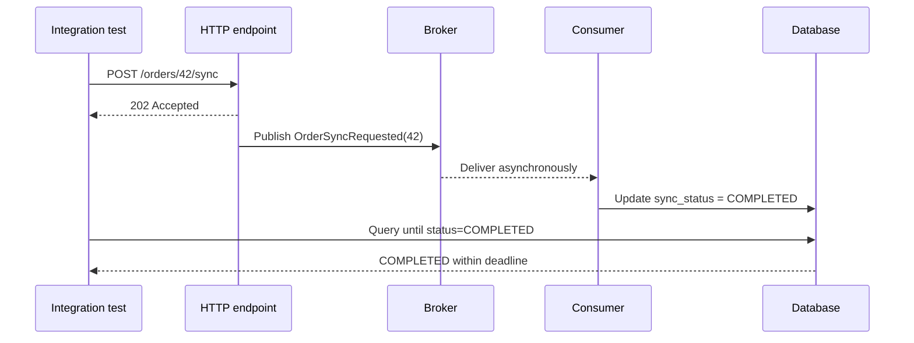
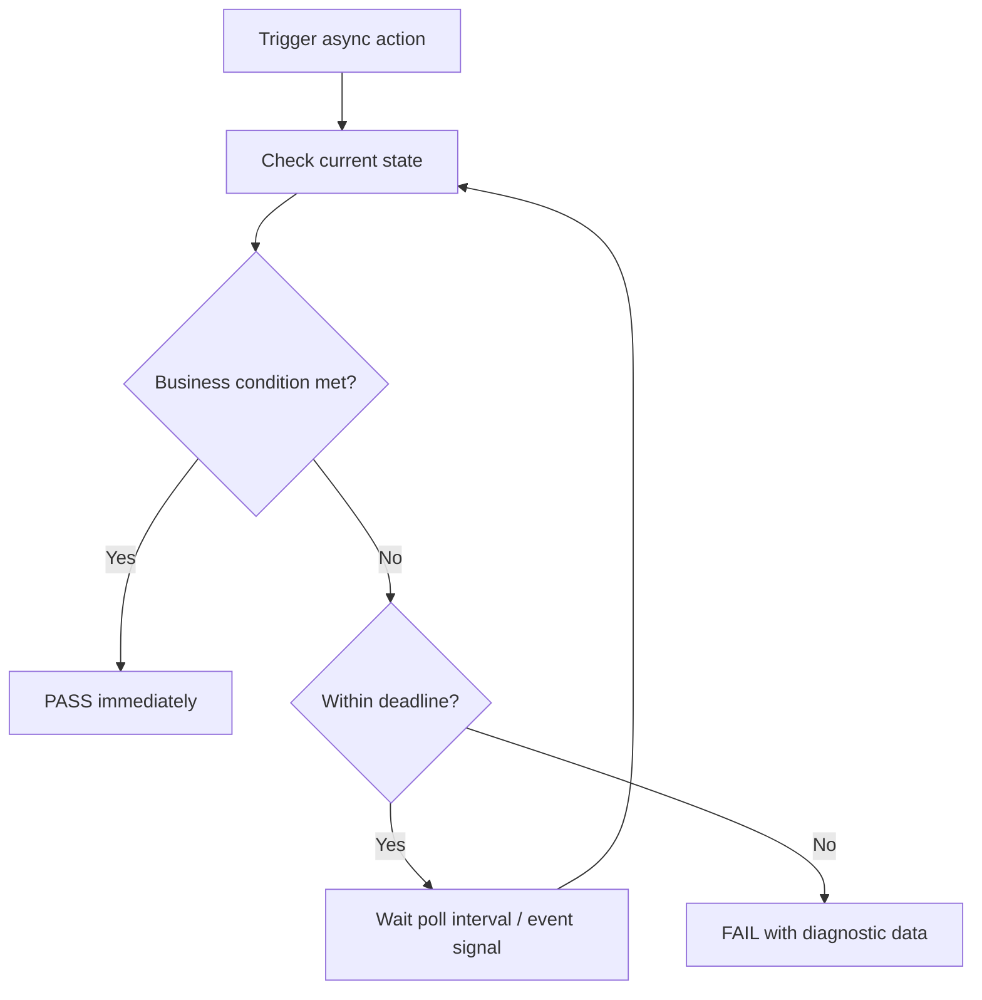
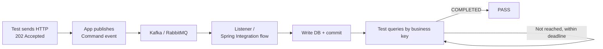
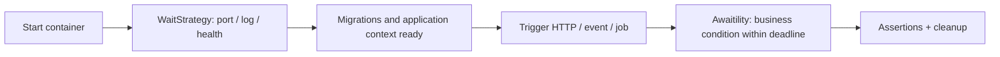

# Waiting on Asynchronous Conditions with Deadlines Instead of Fixed Sleeps

A Spring Boot integration test often triggers an action on one thread while the outcome appears on another: an HTTP request emits a command handled asynchronously over Kafka or RabbitMQ; a polling adapter reads a database and calls a partner service; an `@Async` handler updates a status table; or Quartz schedules a cache refresh. In those scenarios, **when the initial call returns is not necessarily when the business operation finishes**.

Writing `Thread.sleep(2000)` and then asserting looks simple, yet proves unreliable: a fast CI runner may finish in 50 ms, while a run encountering slow CPU scheduling, container startup, or a broker rebalance may take over 2 seconds. Tests wait unnecessarily long when the system is fast and fail intermittently when it is slow. The solution is **waiting on an observable condition within an explicit deadline**, then verifying the business contract.

This lesson belongs to the **Integration Testing** chapter of the **SPRING_BOOT_INTEGRATION** module. Every example connects to HTTP, database, cache, broker, and Spring Integration flows while emphasizing transactions, error handling, retries, deduplication, and observability. The goal is writing tests that finish fast on success while enforcing bounded waits and clear diagnostics on failure.

## 1. The Problem: Asynchrony Makes Immediate Assertions Miss Final Outcomes

Suppose the application accepts `POST /orders/{id}/sync` and returns `202 Accepted`. That response means only that the request **was accepted**, while actual processing flows through a broker, consumer, and database:



If the test queries the table right after HTTP `202`, observing `NOT_FOUND` or `PENDING` may be **accurate at that instant**—not necessarily a bug. Tests must verify one of two distinct contracts:

| Contract type | Assertion target | Appropriate verification |
| --- | --- | --- |
| **Synchronous** | HTTP returns the right status, schema, and response as soon as the request ends. | Direct assertion, no waiting needed. |
| **Asynchronous** | An event is consumed, a row is committed, a cache is updated, an outbound message is sent, or a flow reaches a terminal state. | Condition wait up to a deadline, or bounded event-signal wait. |

A crucial principle: **"Wait 2 seconds" is not a success condition.** It only burns time. A real condition describes the required outcome—such as "the order with business key X has status `COMPLETED` in the database" or "an event with correlation ID X was received."

## 2. Why Does `Thread.sleep()` Make Tests Slow and Flaky?

```java
// Flaky pattern:
sendOrderSyncCommand(orderId);
Thread.sleep(2_000);
assertThat(orderRepository.findStatus(orderId)).isEqualTo(COMPLETED);
```

| Issue | Consequence |
| --- | --- |
| Fixed wait even when the condition finishes early | Suite slows down by the sum of all sleeps. |
| Execution time varies with CI load, startup, network, broker, and GC | Flaky tests: pass on a laptop, fail in CI. |
| No state visibility during the wait | On failure, you cannot tell whether the state was ever reached. |
| Sleep duration does not represent an SLA | Hard to justify why 2 seconds was picked or when to change it. |
| Relies on lucky thread scheduling | Masks race conditions that resurface in other environments. |

Bumping `sleep(2000)` to `sleep(10000)` may reduce immediate failures while multiplying suite runtime without proving the flow works. No matter how long you sleep, a dead-lettered or dropped event never turns into a success.



This is an **eventual assertion**: verifying a condition eventually becomes true within a finite time budget. It fits asynchronous outcomes without replacing synchronous assertions on immediate return payloads.

## 3. Three Mandatory Elements: Condition, Deadline, and Observation Cadence

### 3.1. The Condition Must Tie to a Business Outcome

A good condition reads clearly:

- The test's `orderId` has status `COMPLETED` in the database.
- Exactly one outbox row exists for `businessKey` with post-commit status recorded.
- The test consumer received the event carrying the target `correlationId`.
- The cache holds the expected value version or a counter reached its threshold.
- The system recorded `FAILED` and routed the event to the DLQ when downstream errored.

Weak conditions are "the thread ran," "the log contains some string," "the application is ready," or "the queue is empty," whenever those signals fail to prove business completion. For example, a queue can be empty because a message was never published, was ACKed early, or failed—not necessarily because it succeeded.

### 3.2. Deadline Bounds Maximum Wait Time

The deadline is the maximum duration the test permits for the condition to become true—for instance **5 seconds** in a given test environment. Choose it based on system behavior and normal CI variance rather than padding indefinitely "just in case."

| Work type | Factors determining the deadline |
| --- | --- |
| In-process `@Async` | Scheduler/executor latency, CPU load, and state update time. |
| Broker consumer | Publish, networking, rebalances, offset/ACK commits, consumer latency, and retries. |
| Database read-after-write | Commit, replication/consistency, polling, indexing, or read-model projection. |
| Spring Integration poller | Poll interval, trigger, batch size, backpressure, and handler latency. |
| Quartz | Trigger schedule, misfire handling, scheduler lag, job runtime. |
| Testcontainers & infrastructure | Container readiness, schema/migration run, and listener startup. |

An assertion deadline belongs to the **test contract**, separate from individual network call timeouts. If a query inside the wait condition hangs for 2 minutes, `atMost(5 seconds)` from a wait library cannot always abort a blocking call at exactly 5 seconds. Configure real timeouts on HTTP, JDBC, brokers, and query clients at the execution layer.

### 3.3. Poll Interval Balances Speed Against Load

The delay between checks sets observation frequency. For in-memory state checks, polling every few tens of milliseconds is reasonable; against real APIs or databases, polling too aggressively floods requests and slows down the very system under test.

For example, `atMost(5s)` with `pollInterval(100ms)` checks periodically for up to 5 seconds. If the condition is met at 150 ms, the test finishes early instead of idling for the full 5 seconds. These numbers are **illustrative**; tune them to each real flow.

## 4. Using Awaitility Instead of Fixed Sleeps

**Awaitility** is a Java library for waiting on asynchronous conditions with readable assertions. Spring Boot's `spring-boot-starter-test` may already include Awaitility depending on dependency sets and Boot versions; check `testRuntimeClasspath` or your dependency tree. If absent, declare the test dependency and let the BOM manage its version if your Boot release manages it:

```xml
<dependency>
    <groupId>org.awaitility</groupId>
    <artifactId>awaitility</artifactId>
    <scope>test</scope>
</dependency>
```

If your project does not manage this artifact's version, pick one compatible with your JDK and test stack rather than omitting the version without a BOM/parent.

Replace the sleep snippet above with:

```java
import static org.awaitility.Awaitility.await;
import static org.assertj.core.api.Assertions.assertThat;

import java.time.Duration;

sendOrderSyncCommand(orderId);

await()
    .alias("sync status of order " + orderId)
    .atMost(Duration.ofSeconds(5))
    .pollInterval(Duration.ofMillis(100))
    .untilAsserted(() ->
        assertThat(orderRepository.findStatus(orderId))
            .isEqualTo(COMPLETED));
```

`untilAsserted` re-runs the assertion until it passes or times out; on timeout, the test fails with details about the unmet condition. `alias` ties timeout messages to the exact business entity. Never place `Thread.sleep()` before or inside the lambda.

An alternative form:

```java
await()
    .atMost(Duration.ofSeconds(5))
    .until(() -> orderRepository.findStatus(orderId) == COMPLETED);
```

Use `untilAsserted` for rich assertions (multiple fields, business invariants, AssertJ descriptions); use `until` when a boolean predicate is sufficient. If the polling lambda mutates state, test outcomes become unreliable: never execute writes, consume queues, delete rows, or ACK messages inside a repeated check.

### Accurate Expectations for Exceptions and Timeouts

Do not treat every exception thrown during polling as "not ready yet" indefinitely. If the database reports bad credentials or invalid SQL syntax, that configuration bug should fail immediately. Ignore or retry only exceptions **genuinely allowed as transient by the contract**, preserving the original root cause on failure. A wait library can retry failed assertions, yet cannot decide on its own which connection errors are retryable.

Always bound timeouts with finite values and document why they were chosen. Never use `await().forever()` in CI; hung tests waste runners and hide bugs. Never put `Thread.sleep()` inside `untilAsserted` either, as each poll iteration would introduce unpredictable delays.

## 5. Complete Example: `@Async` Updating a Read Model

The example below can run in a Spring Boot test with JUnit Jupiter, Awaitility, and AssertJ. A bean accepts a command via an `@Async` method and updates an in-memory read model. This minimal model demonstrates **outcome-observing tests**; in real systems, replace the read model with a real repository, cache, or consumer.

```java
import static org.awaitility.Awaitility.await;
import static org.assertj.core.api.Assertions.assertThat;

import java.time.Duration;
import java.util.Map;
import java.util.UUID;
import java.util.concurrent.ConcurrentHashMap;

import org.junit.jupiter.api.Test;
import org.springframework.beans.factory.annotation.Autowired;
import org.springframework.boot.test.context.SpringBootTest;
import org.springframework.context.annotation.Bean;
import org.springframework.context.annotation.Configuration;
import org.springframework.scheduling.annotation.Async;
import org.springframework.scheduling.annotation.EnableAsync;

@SpringBootTest(classes = AsyncProjectionIT.Config.class)
class AsyncProjectionIT {

    @Autowired
    CommandIngress ingress;

    @Autowired
    ReadModel readModel;

    @Test
    void eventuallyPublishesCompletedState() {
        String businessKey = UUID.randomUUID().toString();

        ingress.accept(businessKey); // Returns before work completes.

        await()
            .alias("projection " + businessKey)
            .atMost(Duration.ofSeconds(5))
            .pollInterval(Duration.ofMillis(50))
            .untilAsserted(() ->
                assertThat(readModel.stateOf(businessKey))
                    .isEqualTo("COMPLETED"));
    }

    @Configuration(proxyBeanMethods = false)
    @EnableAsync
    static class Config {
        @Bean
        ReadModel readModel() {
            return new ReadModel();
        }

        @Bean
        CommandIngress commandIngress(ReadModel readModel) {
            return new CommandIngress(readModel);
        }
    }

    static class ReadModel {
        private final Map<String, String> states =
                new ConcurrentHashMap<>();

        void complete(String key) {
            states.put(key, "COMPLETED");
        }

        String stateOf(String key) {
            return states.get(key);
        }
    }

    static class CommandIngress {
        private final ReadModel readModel;

        CommandIngress(ReadModel readModel) {
            this.readModel = readModel;
        }

        @Async
        public void accept(String businessKey) {
            readModel.complete(businessKey);
        }
    }
}
```

Key points determining correctness:

1. `@EnableAsync` enables Spring's `@Async` handling. `ingress.accept(...)` must be called **through the Spring proxy** (the injected bean here); calling `this.accept(...)` on the same instance bypasses the proxy and runs synchronously.
2. `ConcurrentHashMap` ensures thread-safe reads/writes in the example. A shared unsynchronized `HashMap` introduces data races that can break tests even when business code is sound.
3. A per-test `UUID` key prevents reading leftover state from another test.
4. `await().untilAsserted(...)` verifies **the observed outcome** in the read model rather than guessing when the executor runs.
5. The test uses an in-memory read model to focus on the async lifecycle. To verify a real integrated system, swap in real adapters/databases/brokers or Testcontainers and test commits, serialization, networking, and failures.

In real applications, configure a dedicated `@Async` executor (thread count, queue capacity, thread names, rejection policy) and capture exceptions from `void` methods. An `@Async void` method throwing an exception can make tests observe only a timeout while the cause sits in worker logs; pair timeouts with background error visibility.

## 6. When a Direct Signal Exists, Use a Bounded Event Wait

State polling excels when inspecting databases or caches. When a test already has a reliable **completion signal**, bounded synchronization primitives are often more precise and lighter:

### 6.1. `CountDownLatch` for a Known Single Event

```java
import static org.assertj.core.api.Assertions.assertThat;

import java.util.concurrent.CountDownLatch;
import java.util.concurrent.TimeUnit;

CountDownLatch processed = new CountDownLatch(1);

// In the test fixture: the test consumer calls processed.countDown()
// after confirming work for the target business key finished.
sendCommandWithObservableCallback(processed);

boolean completed = processed.await(5, TimeUnit.SECONDS);
assertThat(completed).as("business command completed").isTrue();
```

`await(timeout)` returns `false` on expiration. Never call unbounded `latch.await()` in CI. A bare latch also does not prove the payload was handled accurately: after receiving the signal, assert IDs, persisted data, and expected side effects. Place `countDown()` at the true completion point—for example **after transaction commit**, not when the consumer merely begins processing.

### 6.2. `BlockingQueue.poll` to Receive Test Messages

```java
import static org.assertj.core.api.Assertions.assertThat;

import java.util.concurrent.BlockingQueue;
import java.util.concurrent.TimeUnit;

BlockingQueue<OrderSyncedEvent> receivedEvents = testEventCollector.queue();

sendOrderSyncCommand(orderId);

OrderSyncedEvent event = receivedEvents.poll(5, TimeUnit.SECONDS);
assertThat(event).as("OrderSyncedEvent within deadline").isNotNull();
assertThat(event.orderId()).isEqualTo(orderId);
assertThat(event.status()).isEqualTo("COMPLETED");
```

This illustrates `testEventCollector` and `OrderSyncedEvent` provided by a test harness. The collector may be a test Kafka listener, Spring Integration test channel adapter, or internal consumer, and must capture only relevant test messages. If unrelated messages exist in the queue, a single `poll()` is not guaranteed to match the right key; filter by correlation ID, isolate test data, or wrap retrieval with an overall deadline to prevent interference from unrelated events.

**Never call `receivedEvents.poll()` repeatedly inside an Awaitility lambda carelessly:** `poll()` is destructive, so a failed iteration can consume and discard the target message before the next poll. For queues, prefer blocking `poll(timeout)` or a non-destructive collector/state query.

## 7. Testing HTTP → Broker → Database by Eventual Contract

A classic Spring Boot Integration pattern:



Structure the test cleanly into **two assertions**:

1. **Immediate assertion:** HTTP accepted the valid request and returned the expected status and contract response, including a request/correlation ID if supported.
2. **Eventual assertion:** the target business key reached its terminal state in the database or emitted an observable outbound event—appearing after commit/ACK per contract.

Sample pattern (HTTP client and repository beans supplied by the test application):

```java
String orderId = "it-" + UUID.randomUUID();

ResponseEntity<Void> response = restTemplate.postForEntity(
        "/orders/" + orderId + "/sync", null, Void.class);
assertThat(response.getStatusCode().value()).isEqualTo(202);

await()
    .alias("order synchronization " + orderId)
    .atMost(Duration.ofSeconds(15))
    .pollInterval(Duration.ofMillis(200))
    .untilAsserted(() -> {
        OrderSyncRecord record = repository.findByOrderId(orderId)
                .orElseThrow(() -> new AssertionError(
                        "No committed record for " + orderId));
        assertThat(record.getStatus()).isEqualTo("COMPLETED");
        assertThat(record.getExternalReference()).isNotBlank();
    });
```

This assumes `restTemplate`, `repository`, and `OrderSyncRecord` are wired in a full Spring Boot test. Do not run this snippet standalone without providing those components and endpoint.

If the app initially writes `RECEIVED` and later updates to `COMPLETED`, wait specifically for `COMPLETED` rather than `existsByOrderId(orderId)`. If business failures record `FAILED`, detect `FAILED` and fail immediately rather than polling uselessly until the deadline expires.

### Verifying Execution Count and Deduplication

Observing a record **once at poll time** does not prove a second duplicate won't appear seconds later due to retries or rebalances. For flows requiring deduplication, add assertions on data constraints—such as unique business keys—deliver duplicate events, and verify no duplicate writes occur. Use test-specific keys and query row counts on the authoritative datastore rather than counting log lines on a single replica.

Under *at-least-once delivery*, the true goal is **idempotent side effects**, not "the consumer receives the message once." Resend the same command/event and verify business impact yields a single valid outcome.

## 8. Testing *Non-Occurrence* Conditions: Why Is It Harder?

Asserting "event X eventually appears within 5 seconds" has a clear stopping point. Conversely, asserting "event X will never appear" cannot be proven purely by waiting a finite time. A test can only prove **non-occurrence within a defined observation window**.

Example with Awaitility:

```java
await()
    .during(Duration.ofMillis(500))
    .atMost(Duration.ofSeconds(2))
    .pollInterval(Duration.ofMillis(50))
    .untilAsserted(() ->
        assertThat(repository.countByBusinessKey(orderId)).isEqualTo(1L));
```

Across the 500 ms window, `count == 1` must hold continuously per Awaitility's rules. Still, a stray event could arrive after the window closes; size the window according to retry schedules, max redelivery delays, or termination criteria. If retries run minutes apart, a 500 ms observation **does not** prove no duplicate occurs later.

Separate two questions: **eventual success** (terminal state appears) and **stability/safety** (state is never corrupted during the observation window). Wherever possible, verify safety using durable database constraints or by intentionally injecting duplicates and waiting for processing to finish rather than picking an arbitrary wait window.

## 9. Sources of Flaky Tests That Awaitility Alone Cannot Fix

### 9.1. Uncommitted Transactions Across Threads

In Spring Test, `@Transactional` on a test method binds a transaction to the test thread and rolls it back at the end. An `@Async` worker or broker consumer on another thread **will not see uncommitted test data**. No matter how long you wait, it stays invisible—or reads under different isolation rules causing confusing results.

**Failure example:** a test inserts an `Order` via a repository inside the test transaction, then publishes an event carrying `orderId`. The consumer on another thread queries `Order` from the database and fails to find it because the test transaction never committed.

Remedies:

- Never wrap an async end-to-end test in a rollback-only test transaction if other threads must read the data.
- Commit fixtures before publishing events; manage setup transactions intentionally using `TransactionTemplate` or test transaction APIs.
- Clean up rows by unique business key after async work completes rather than relying on rollback to clean side effects from other threads.
- When testing transactional outboxes, verify publishing occurs after commit as designed.

### 9.2. Shared Data and Consumers Across Tests

Consumer groups, queues, topics, caches, or tables may be shared across parallel tests. One test can steal another test's event, read leftover rows from a prior run, or hit partition contention.

Fixes: unique business keys/correlation IDs, isolated namespaces/topics/containers when needed, controlled cleanup, dedicated consumer groups, and avoiding assertions on global message totals. Before raising deadlines in parallel suites, fix isolation first.

### 9.3. Side-Effecting Checks or Inconsistent Reads

A polling lambda calling `receive()`, `poll()`, `delete()`, or `ack()` mutates state on every iteration. Read replicas with replication lag or stale caches can also flip conditions unpredictably.

Prefer **non-destructive state reads** in polling checks. When verifying stability, use an appropriate observation window and query the authoritative source. When strong read-after-write consistency is required, select datastore/consistency settings matching the contract instead of tweaking poll intervals.

### 9.4. Unready Infrastructure and Missing I/O Timeouts

Awaitility awaits **business outcomes**; it does not replace waiting for Kafka brokers, Cassandra clusters, or PostgreSQL to accept connections. If a dependency is not ready, business assertions time out even when application code is completely correct.

Use readiness checks or Testcontainers wait strategies suited to each dependency, finish schema migrations before sending inputs, and set explicit I/O timeouts on HTTP, database, and broker clients. Account deliberately for application retry/backoff budgets in test deadlines; never mask bugs by extending deadlines endlessly.

### 9.5. Schedulers, Polling Intervals, and Virtual Time

A Spring Integration poller running every 10 seconds cannot be reliably tested with a 1-second deadline if relying on real polling. For logic using `@Scheduled`, Quartz, timeouts, or retry backoff, decouple scheduling from business handling and test with controllable clocks/schedulers when supported. When real scheduler execution must be verified, configure short test intervals and wait with matching deadlines.

## 10. Testcontainers: Wait for Readiness Before Awaiting Business Outcomes

When testing against real databases, brokers, or caches, separate **infrastructure readiness** from **business completion**.



Example `Wait.forHttp` for a test service exposing `/health`:

```java
import java.time.Duration;
import org.testcontainers.containers.GenericContainer;
import org.testcontainers.containers.wait.strategy.Wait;

GenericContainer<?> dependency = new GenericContainer<>("example/service:test")
    .withExposedPorts(8080)
    .waitingFor(
        Wait.forHttp("/health")
            .forPort(8080)
            .forStatusCode(200)
            .withStartupTimeout(Duration.ofSeconds(60)));
```

This illustrates `WaitStrategy` with a **placeholder image**; substitute your real test service image and its actual health endpoint. For Kafka, RabbitMQ, databases, or specialized containers, use module-appropriate readiness strategies rather than assuming every service exposes HTTP `/health`.

**Two deadlines serve two distinct purposes:** startup timeout bounds waiting for dependencies to become ready; Awaitility `atMost` bounds waiting for business outcomes after triggering input. Combining both into a single `Thread.sleep()` blurs infrastructure failures and business-logic bugs together.

## 11. When a Wait Expires, the Test Must Explain Why

A helpful timeout failure answers at minimum: **which entity**, **which condition failed**, **how long it waited**, **the last observed state**, and **any downstream errors**.

Context-rich assertion example:

```java
await()
    .alias("OrderSyncCompleted for " + orderId)
    .atMost(Duration.ofSeconds(15))
    .pollInterval(Duration.ofMillis(200))
    .untilAsserted(() -> {
        SyncStatus actual = repository.findStatus(orderId);
        assertThat(actual)
            .as("status of order %s (expected COMPLETED)", orderId)
            .isEqualTo(SyncStatus.COMPLETED);
    });
```

On timeout, inspect logs for HTTP clients, consumers, Spring Integration error channels, broker DLQs, DB exceptions, Quartz jobs, or async executors keyed by `correlationId`. Consider non-mutating diagnostic helpers to report `lastStatus`, `lastError`, retry counts, backlog, timestamps, and trace IDs upon failure.

Select diagnostics by flow:

| Flow | Signals to observe |
| --- | --- |
| HTTP → broker | HTTP request ID, publish success/timeout, consumer group, offset or message ID. |
| Broker → database | Consumer exceptions, ACK/NACK, record status, transaction commit, DLQ/retries. |
| Spring Integration | Endpoints/channels, message headers, error channel, poller status, handler errors. |
| Cache/NoSQL | Keys, consistency, TTL, document/entry state, and query outcomes. |
| Quartz | `JobKey`, fire time, misfires, job exceptions, and checkpoint state. |

Never expose passwords, tokens, sensitive payloads, or PII in timeout failure messages. Preserve trace/correlation IDs for troubleshooting without creating security leaks in CI logs.

### When Should a Test Fail Fast?

If the application returns `400 Bad Request` for a valid request, TLS certificates are rejected, database tables are missing, or a message lands directly in the DLQ due to an unrecoverable error, the test should surface **the root error immediately**. Waiting the full 15 seconds for an impossible condition wastes time and obscures the real cause.

In advanced tests, combine eventual-success checks with an explicit terminal-failure check. When using an Awaitility version supporting `failFast`, exit early once `FAILED` is observed; otherwise, use a bounded polling loop checking both terminal outcomes cleanly. Never catch `Exception` and blindly return `false`, as that swallows programming errors.

## 12. Reasoning About Timing Budgets and Parallel Limits

For a data-sync command, the test deadline should reflect the full chain of steps:

\[
T_{\text{deadline}} \ge T_{\text{publish}} + T_{\text{deliver}} + T_{\text{process}} + T_{\text{commit}} + T_{\text{visibility}} + \text{reasonable margin}
\]

This is a model for **reasoning about deadlines**, not an exact formula for every distributed system. Steps may overlap or repeat under retries, and bottlenecks shift across environments. Validate deadlines against representative CI runs.

When chaining several sequential `await` calls, worst-case timeouts add up and slow down failing suites. If steps share one business operation, enforce **one overall deadline** and track remaining budget; if testing individual stages, keep stage deadlines tight and pinpoint failures by layer. Never let each retry or test helper invent long independent timeouts that defeat overall bounds.

Under parallel runs, code using `ThreadLocal`, thread-bound transactions, shared executor queues, or shared data behaves differently as concurrency scales. Passing individually does not prove suite stability—verify isolation and resource capacity.

### Limitations of Framework-Level Timeouts

JUnit's `assertTimeout` checks elapsed time without necessarily interrupting hung work. `assertTimeoutPreemptively` runs code on a separate thread and can break Spring Test's thread-bound transaction assumptions, especially with `@Transactional`. Use thread-context-aware timeout APIs; for real I/O, enforce timeouts on clients/drivers and shut down resources cleanly rather than expecting test timeout assertions to abort blocked sockets.

## 13. Comparing Wait Mechanisms and Choosing the Right One

| Wait mechanism | Best fit | Advantages | Limitations |
| --- | --- | --- | --- |
| `Thread.sleep(duration)` | Rare cases intentionally simulating elapsed time; never for business-outcome tests. | Easy to write. | Ignores actual completion, slow and flaky. |
| Awaitility `untilAsserted` | Querying DB/cache state, read models, counters, business health. | Exits early on pass, clear deadlines, readable assertions. | Polling costs queries; condition must be safe and observable. |
| `CountDownLatch.await(timeout)` | One completion callback/signal directly observable by the test. | Zero polling, crisp synchronization. | Signal must fire after commit/completion; single-use latch carries no payload. |
| `BlockingQueue.poll(timeout)` | Test collector capturing messages from configured listeners/channels. | Awaits real events and inspects payload. | Destructive read; must filter by business key and handle multiple events. |
| Testcontainers `WaitStrategy` | Starting dependent containers/services. | Waits for readiness before running business tests. | Does not verify business flow execution. |
| Clock/test scheduler/virtual time | Retries, backoff, schedules, and time-simulated pipelines. | Fast and independent of wall clocks. | Must still verify real integration in dedicated tests. |

No single tool fits every scenario. The core principle is **waiting on the contract's real signal within a finite deadline and emitting actionable diagnostics on failure**.

## 14. Checklist for Writing Asynchronous Integration Tests

- [ ] Separate synchronous assertions from eventual assertions; identify business outcomes observable post-commit.
- [ ] Send commands/events with unique business keys and correlation IDs per test.
- [ ] Replace fixed `Thread.sleep()` with Awaitility or bounded signal waits.
- [ ] Size deadlines and poll intervals to test SLAs, infrastructure latency, and query cost; never wait forever.
- [ ] Polling conditions produce zero side effects and never consume messages needed by assertions.
- [ ] Ensure fixture transactions commit before async consumers read; clean up data afterward.
- [ ] Separate database/broker/container readiness from waiting on business state.
- [ ] Cover success, failure, retry, DLQ, idempotency, and post-redelivery state where applicable.
- [ ] For negative tests, define finite observation windows without claiming "never" from a brief wait.
- [ ] On timeout, report business ID, last observed state, last error, trace, and metrics without leaking secrets.
- [ ] Test with near-production executor, transaction, and listener configurations while preserving parallel isolation.

### References

- [Awaitility — Usage](https://github.com/awaitility/awaitility/wiki/Usage): `until`, `untilAsserted`, timeouts, polling, and stability conditions.
- [Spring Boot — Testing Spring Boot Applications](https://docs.spring.io/spring-boot/reference/testing/spring-boot-applications.html): `@SpringBootTest`, test contexts, and integration apps.
- [Spring Framework — Testing](https://docs.spring.io/spring-framework/reference/testing.html): transaction management in tests and context lifecycles.
- [Spring Integration — Testing Support](https://docs.spring.io/spring-integration/reference/testing.html): testing channels, endpoints, and message flows.
- [Testcontainers — Waiting for Containers to Start or Be Ready](https://java.testcontainers.org/features/startup_and_waits/): readiness/startup strategies for test dependencies.
- [JUnit 5 — User Guide](https://junit.org/junit5/docs/current/user-guide/): timeout assertions and test organization strategies.

**Key takeaway:** in asynchronous integration testing, **elapsed time is not an outcome**. Rather than sleeping a fixed duration and hoping, wait on a meaningful business state or event within a finite deadline. When the condition fails, the test must fail with enough diagnostic trail to pinpoint whether the defect lives in HTTP, the broker, the database, Spring Integration, Quartz, or the test configuration itself.
