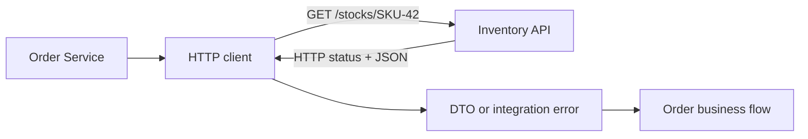
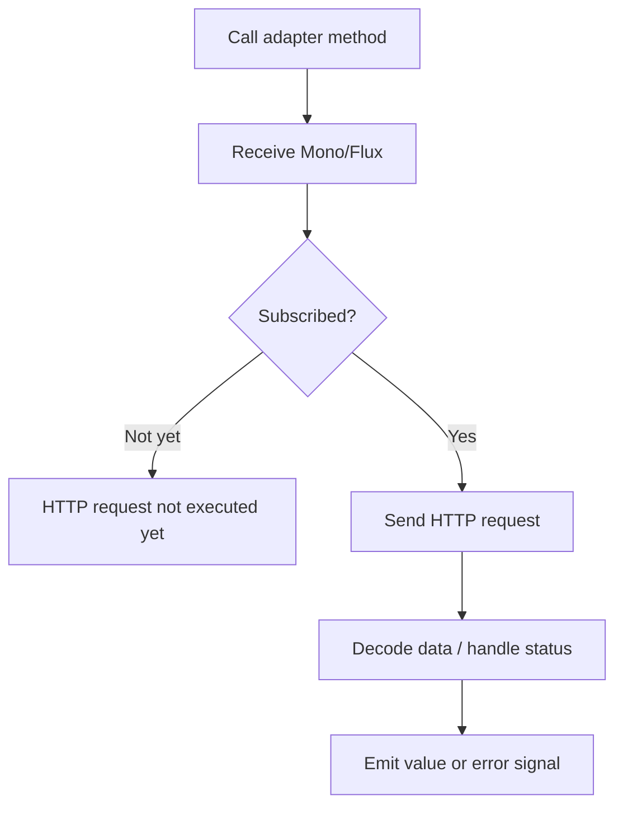

# RestClient, RestTemplate, and WebClient in Spring Boot

When a Spring Boot application needs to call another system's HTTP API, the choice of client directly affects the processing model, performance under load, error management, and testability. Three common options are **`RestClient`**, **`RestTemplate`**, and **`WebClient`**. They can all exchange JSON over HTTP, but their programming style and resource usage differ significantly.

This lesson belongs to the **SPRING_BOOT_INTEGRATION** topic: organizing system integration via HTTP clients, databases, caches, message brokers, and Spring Integration adapters; focusing on configuration, data contracts, transactions, errors, duplicate handling, testing, and observing real integration flows.

After this lesson, you will be able to:

- Choose the right HTTP client for a Spring MVC application, a reactive application, or a system using legacy APIs.
- Write HTTP calls with `RestClient`, `RestTemplate`, and `WebClient`; understand the difference between blocking calls and reactive pipelines.
- Design an integration boundary with clear configuration, DTOs, timeouts, error classification, and retry policies.
- Test HTTP interactions and identify risks around transactions, idempotency, security, and system observability.

> **Version milestone:** `RestClient` was introduced in Spring Framework 6.1 and has auto-configuration support in Spring Boot 3.2+. The Java examples below target Java 17 and Spring Boot 3.2+/Spring Framework 6.1+. When a project uses a different version, verify the corresponding APIs, starters, and configurations. The standalone code snippets illustrate each option; you do not need to register all three clients simultaneously in one application.

## 1. Placing the three clients in an integration problem

Suppose **Order Service** needs to ask **Inventory Service** how many items remain before confirming an order. Inventory provides the contract:

```http
GET /stocks/{sku}
Accept: application/json

HTTP/1.1 200 OK
Content-Type: application/json

{"sku":"SKU-42","available":12}
```

A `404` response indicates the SKU does not exist; `503` indicates the service is temporarily unavailable. The network connection may fail or respond slowly, even while Inventory is still processing the request. Therefore, an HTTP call is not merely about converting JSON into a Java object.



You should encapsulate the Inventory calls inside an adapter/client class with a clear interface, rather than scattering direct HTTP requests across controllers, services, and message listeners. This applies to all three solutions.

## 2. Quick comparison and selection rules

| Criterion | `RestClient` | `RestTemplate` | `WebClient` |
|---|---|---|---|
| Programming model | Imperative, fluent API | Imperative, template API | Reactive, using `Mono`/`Flux` |
| In a typical call | Blocks the calling thread until a result arrives | Blocks the calling thread until a result arrives | Does not block a thread waiting for I/O when used in a reactive pipeline |
| Suitable context | New synchronous code, Spring MVC, batches using regular threads | Maintaining or gradually upgrading legacy applications | WebFlux applications, streaming, high-concurrency I/O tasks under the reactive model |
| Typical query style | `.get().uri(...).retrieve().body(...)` | `.getForObject(...)`, `.exchange(...)` | `.get().uri(...).retrieve().bodyToMono(...)` |
| Status handling | `.onStatus(...)`, defaults to throwing on `4xx/5xx` with `retrieve()` | `ResponseErrorHandler`, defaults to throwing on `4xx/5xx` | `.onStatus(...)`, defaults to throwing on `4xx/5xx` with `retrieve()` |
| Request extensibility | Request interceptor, builder, request factory | `ClientHttpRequestInterceptor`, builder, request factory | `ExchangeFilterFunction`, connector, Reactor operators |
| Testing the HTTP client | `MockRestServiceServer` or fake HTTP server | `MockRestServiceServer` or fake HTTP server | Fake HTTP server such as WireMock/MockWebServer, or mock `ExchangeFunction` |

**Common selection guidelines:**

1. Spring MVC applications or services using synchronous methods, writing new HTTP integration code: **prefer `RestClient`**.
2. Applications already using `RestTemplate` stably: **you can continue maintaining it**, migrating to `RestClient` gradually when changes are needed. There is no need to replace it solely because the API is older.
3. Applications with a reactive pipeline from controller to I/O operations, or needing data streaming/concurrency at an appropriate scale: **use `WebClient`**.

`WebClient` does not automatically make an MVC application reactive. If you call `.block()` to obtain the result, the calling thread still has to wait; the non-blocking advantage of the reactive chain disappears at that point. Conversely, `RestClient` can be sufficient for many high-load systems if connection counts, thread pools, and timeouts are properly designed. Base the decision on the actual processing architecture, not merely on the number of HTTP requests.

## 3. `RestClient`: synchronous choice with a fluent API

### 3.1. Dependencies, configuration, and data contract

For a Spring MVC application with `spring-boot-starter-web`, the required HTTP classes for `RestClient` are normally already on the classpath. Use the `RestClient.Builder` provided by Spring Boot to inherit customizations registered for the application (such as converters and observation when related configuration is enabled).

Place the server address and wait limits in configuration instead of hardcoding them in code:

```yaml
# application.yml
integration:
  inventory:
    base-url: ${INVENTORY_BASE_URL:https://inventory.example}
    connect-timeout: 2s
    read-timeout: 3s
```

```java
// InventoryHttpProperties.java
import java.net.URI;
import java.time.Duration;
import org.springframework.boot.context.properties.ConfigurationProperties;

@ConfigurationProperties(prefix = "integration.inventory")
public record InventoryHttpProperties(
        URI baseUrl,
        Duration connectTimeout,
        Duration readTimeout
) {}
```

In a real application, you must validate that `baseUrl` is valid, timeout durations are positive, and avoid putting API keys or passwords in source code. A Java `record` is suitable for a small immutable DTO:

```java
// StockResponse.java
public record StockResponse(String sku, int available) {}
```

Depending on the API contract, you can add validation for required fields, handle field renaming via JSON annotations, and enforce version compatibility rules. HTTP DTOs belong to the integration boundary: do not assume the other system's JSON structure is your internal domain model.

### 3.2. Create the client once and reuse it

The following example uses JDK `HttpClient` as the HTTP transport. `connectTimeout` limits the connection-opening phase; `readTimeout` limits waiting to read the response according to the request factory's mechanism. This is **not** an overall time budget for the entire business operation.

```java
// InventoryRestClientConfiguration.java (abbreviated imports)
@Configuration(proxyBeanMethods = false)
@EnableConfigurationProperties(InventoryHttpProperties.class)
class InventoryRestClientConfiguration {

    @Bean("inventoryRestClient")
    RestClient inventoryRestClient(
            RestClient.Builder builder,
            InventoryHttpProperties properties
    ) {
        java.net.http.HttpClient httpClient = java.net.http.HttpClient.newBuilder()
                .connectTimeout(properties.connectTimeout())
                .build();

        JdkClientHttpRequestFactory factory =
                new JdkClientHttpRequestFactory(httpClient);
        factory.setReadTimeout(properties.readTimeout());

        return builder
                .baseUrl(properties.baseUrl().toString())
                .requestFactory(factory)
                .defaultHeader(HttpHeaders.ACCEPT,
                        MediaType.APPLICATION_JSON_VALUE)
                .build();
    }
}
```

The Spring types in the example belong to `org.springframework.context.annotation`, `org.springframework.boot.context.properties`, `org.springframework.web.client`, `org.springframework.http`, and `org.springframework.http.client`. In a real project you can choose another request factory/connection pool, but you must measure and configure connection limits appropriate for concurrent requests. Do not create a new client and transport for every call.

### 3.3. Sending requests and mapping errors

```java
// StockNotFoundException.java
public class StockNotFoundException extends RuntimeException {
    public StockNotFoundException(String sku) {
        super("SKU not found: " + sku);
    }
}
```

```java
// InventoryHttpClient.java (abbreviated imports)
@Service
class InventoryHttpClient {
    private final RestClient client;

    InventoryHttpClient(@Qualifier("inventoryRestClient") RestClient client) {
        this.client = client;
    }

    StockResponse getStock(String sku) {
        StockResponse result = client.get()
                .uri("/stocks/{sku}", sku)
                .retrieve()
                .onStatus(status -> status.value() == 404,
                        (request, response) -> {
                            throw new StockNotFoundException(sku);
                        })
                .body(StockResponse.class);

        if (result == null) {
            throw new IllegalStateException("Inventory returned an empty body");
        }
        return result;
    }
}
```

Key takeaways:

- `.uri("/stocks/{sku}", sku)` applies a URI template to properly encode parameters; avoid concatenating input strings directly into the URL.
- `.retrieve()` is a convenient approach when you want to read the body. By default, HTTP `4xx/5xx` raises an exception; `.onStatus(...)` lets you map business-meaningful statuses such as `404`.
- `RestClientResponseException` typically contains the error response status and body; I/O, connection, or timeout errors may appear as `ResourceAccessException`. Do not lump all exceptions into "product not found".
- `200 OK` with an empty body, malformed JSON, or mismatched types are also cases to handle. For APIs that only return a status such as `204 No Content`, use an appropriate read method instead of expecting a DTO.
- JSON `POST`, `PUT`, and `PATCH` use `.body(requestDto)` and set the corresponding `Content-Type`. Verify the API's constraints—do not assume every endpoint supports idempotent updates.

`RestClient` also provides `.exchange(...)` when lower-level access to the request/response is needed. Use it only when `.retrieve()` and handlers are insufficient, because the author must ensure error classification logic and proper response closing/consumption according to the API.

## 4. `RestTemplate`: understanding and maintaining running systems

`RestTemplate` is Spring's long-standing synchronous API. It remains useful when an existing codebase has many interceptors, `ResponseErrorHandler` implementations, test configurations, or adapters built on `RestTemplate`. With Spring Boot, you can create it from `RestTemplateBuilder` and register it as a bean:

```java
@Configuration
class LegacyHttpConfiguration {
    @Bean
    RestTemplate legacyRestTemplate(RestTemplateBuilder builder) {
        return builder.build();
    }
}
```

Example of the same stock lookup request:

```java
ResponseEntity<StockResponse> response = restTemplate.exchange(
        "https://inventory.example/stocks/{sku}",
        HttpMethod.GET,
        HttpEntity.EMPTY,
        StockResponse.class,
        "SKU-42"
);

StockResponse stock = response.getBody();
```

`RestTemplate` uses `HttpMessageConverter` for JSON and, with the default error handler, throws an exception on `4xx/5xx` statuses. `exchange(...)` is useful when you need headers, HTTP methods, or a `ResponseEntity`; `getForObject(...)` is concise when you only need the body. Requests are blocking just like `RestClient`.

When migrating gradually to `RestClient`, compare all behaviors of the old client before switching:

| Concern | With `RestTemplate` | With `RestClient` |
|---|---|---|
| Reading DTO | `getForObject(url, Dto.class)` | `get().uri(url).retrieve().body(Dto.class)` |
| Custom headers and method | `exchange(...)` with `HttpEntity` | `.get()/.post()/.method()`, `.headers(...)`, `.body(...)` |
| Error HTTP status | `ResponseErrorHandler` | `.onStatus(...)` or builder-level handler |
| Headers/tracing/auth | `ClientHttpRequestInterceptor` | Corresponding request interceptor/filter via builder |
| Testing request/response | `MockRestServiceServer` | `MockRestServiceServer` |

Do not replace the API line by line and assume exact equivalence: default errors, converters, URL encoding, timeouts, interceptors, logging, and transport configuration can differ if the builders are not configured identically. Prefer migrating at adapter boundaries that already have contract tests.

## 5. `WebClient`: organizing calls as a reactive pipeline

`WebClient` belongs to Spring WebFlux. A project typically adds `spring-boot-starter-webflux` to get WebClient and Reactor. When an application includes both Spring MVC and WebFlux starters, having `WebClient` **does not mean** every endpoint switches to a reactive runtime; Spring Boot usually still selects a servlet web application when Spring MVC is present.

### 5.1. Where does the execution flow differ?



`Mono<T>` represents at most one element or an error; `Flux<T>` represents multiple elements. Building a pipeline with `WebClient` is normally **lazy**: work happens upon subscription. When a WebFlux controller returns a `Mono`, the framework handles the subscription. Do not call `.subscribe()` yourself inside a service just to "trigger the request," because errors, lifecycle, and results can easily detach from the business flow.

### 5.2. Configuring the transport and calling the Inventory API

The following example uses Reactor Netty to set connection-open and response-wait limits. Netty's `responseTimeout` and `.timeout(...)` on `Mono` have different meanings: the former applies to the HTTP response at the transport layer; the latter imposes a limit on the entire publisher from subscription time.

```java
// InventoryWebClientConfiguration.java (abbreviated imports)
@Configuration(proxyBeanMethods = false)
@EnableConfigurationProperties(InventoryHttpProperties.class)
class InventoryWebClientConfiguration {

    @Bean("inventoryWebClient")
    WebClient inventoryWebClient(
            WebClient.Builder builder,
            InventoryHttpProperties properties
    ) {
        reactor.netty.http.client.HttpClient nettyClient =
                reactor.netty.http.client.HttpClient.create()
                .option(io.netty.channel.ChannelOption.CONNECT_TIMEOUT_MILLIS,
                        Math.toIntExact(properties.connectTimeout().toMillis()))
                .responseTimeout(properties.readTimeout());

        return builder
                .baseUrl(properties.baseUrl().toString())
                .clientConnector(new ReactorClientHttpConnector(nettyClient))
                .build();
    }
}
```

```java
// ReactiveInventoryHttpClient.java (abbreviated imports)
@Service
class ReactiveInventoryHttpClient {
    private final WebClient client;

    ReactiveInventoryHttpClient(
            @Qualifier("inventoryWebClient") WebClient client
    ) {
        this.client = client;
    }

    Mono<StockResponse> getStock(String sku) {
        return client.get()
                .uri("/stocks/{sku}", sku)
                .retrieve()
                .onStatus(status -> status.value() == 404,
                        response -> Mono.error(new StockNotFoundException(sku)))
                .bodyToMono(StockResponse.class)
                .switchIfEmpty(Mono.error(
                        new IllegalStateException("Inventory returned an empty body")))
                .timeout(Duration.ofSeconds(4));
    }
}
```

Without a custom mapping, `WebClient.retrieve()` converts `4xx/5xx` responses into `WebClientResponseException` (or a subclass); connection, TLS, and timeout errors must be considered separately. `.exchangeToMono(...)` allows reading the status, headers, and body with more custom branching logic. If you use `exchangeToMono`, you must consume the body properly in every branch per the API contract.

What to avoid in a reactive application:

```java
// Do not call block() inside a WebFlux pipeline/controller.
StockResponse stock = webClient.get()
        .uri("/stocks/{sku}", "SKU-42")
        .retrieve()
        .bodyToMono(StockResponse.class)
        .block();
```

`block()` forces the current thread to wait for the result; on Reactor threads that do not support blocking, this operation can even cause runtime errors. If the entire application uses JDBC/JPA and synchronous processing, choosing `RestClient` is usually less complex. If using `WebClient`, strive to keep the processing chain non-blocking all the way to the caller and pay attention to whether any auxiliary operations (database, cache, CPU-heavy encryption) are blocking.

## 6. Integration mechanisms matter more than the client name

### 6.1. Timeouts, resource limits, and errors

Do not make HTTP calls in production with infinite or unspecified timeouts. Distinguish at least:

- **Connection timeout:** waiting to establish the TCP/TLS connection per the transport.
- **Read/response timeout:** limit for waiting on response data; exact semantics vary by HTTP transport.
- **Overall deadline:** total budget for a business task (which may include retries, backoff, and multiple downstream calls). Not every client provides the same deadline semantics out of the box.
- **Pool/queue limit:** limit on concurrent connections and time waiting for a connection, aligned with Inventory's capacity; short timeouts without limiting fan-out can still cause overload.

Categorize errors so callers handle them properly:

| Scenario | Interpretation | Recommended action |
|---|---|---|
| `200`, valid JSON | Success | Convert DTO to business result |
| `404` for SKU | Business error depending on contract | Return "not found" status; do not retry unconditionally |
| `400`, `401`, `403` | Invalid request, missing permissions/token | Check payload and auth mechanism; do not repeatedly retry the same request |
| `429` | Rate limited | Respect `Retry-After` if present, apply backoff and retry cap |
| `502`, `503`, `504` | Potentially transient dependency error | Retry selectively if the operation is safe and time budget remains |
| Connection reset, timeout | Server-side outcome may be unknown | Distinguish read/write operations, idempotency, and actual state before retrying |
| `200` with corrupted body | Contract violation or decode failure | Record data compatibility error and investigate rather than returning a wrong default |

Do not catch every exception and return `null` or `200 OK`: this erases error semantics and hides Inventory outages from upstream systems. Translate transport/HTTP errors into clear integration exceptions while preserving status and correlation IDs where appropriate; never log tokens or full sensitive bodies.

### 6.2. Retries, idempotency, and duplicate handling

Retries are only safe if you understand **HTTP methods and business contracts**. A typical lookup `GET` can be retried after a transient error with a low attempt limit and exponential backoff with jitter. However, a `POST` creating a reservation may already have been executed by Inventory before the client timed out: resending indiscriminately can reserve stock twice.

If Inventory supports idempotency keys, use one stable key per **business operation** and resend that exact key across retries:

```java
// RestClient example when Inventory declares support for Idempotency-Key.
ReservationResponse reservation = restClient.post()
        .uri("/reservations")
        .header("Idempotency-Key", operationId)
        .body(new ReservationRequest(orderId, sku, quantity))
        .retrieve()
        .body(ReservationResponse.class);
```

`operationId` must be tied to a specific order request and stored or deterministically reproducible; never generate a new UUID on each retry. Inventory must also implement deduplication and define the key retention period. The header alone does not guarantee *exactly once*.

If using Spring Retry/Resilience4j for synchronous calls or `retryWhen(...)` in Reactor, clearly define the retryable error predicate, maximum attempts, backoff, total time limit, and circuit breaker when needed. Avoid nesting retries across multiple layers (HTTP client, service, message consumer) that multiply the actual request count unexpectedly. `4xx` responses are generally not automatically retried; `429` specifically requires a dedicated policy.

### 6.3. Authentication and secret configuration

Access credentials may be issued via OAuth2 client credentials, API keys, or mTLS depending on the system. Configure secrets via a secret store or secure environment variables, rotate tokens according to their lifecycle, send tokens in headers over HTTPS, and never write secret values to logs. `RestClient` can use a request interceptor or `.headers(...)`; `WebClient` has filters and corresponding OAuth2 client mechanisms. Distinguish authentication for **outbound** requests from authentication for **inbound** requests to Order Service.

### 6.4. Database transactions, caches, and message brokers

An HTTP call to Inventory **does not participate in the same ACID transaction** as Order Service's database merely because the calling method has `@Transactional`. If the SQL transaction rolls back after Inventory has already reserved stock, the two systems' states can diverge. Conversely, a timeout on the Order side does not prove Inventory rolled back.

In high-reliability workflows, consider state orchestration, *compensation* mechanisms, the outbox pattern, and idempotent event processing. Avoid keeping a database transaction open solely while waiting for HTTP if you can separate the communication phase from the data-update phase. For slowly changing lookup data, caching reduces requests but requires a TTL, invalidation rules, and tolerance for some staleness. When the business flow does not need an immediate answer, a message broker reduces synchronous coupling; consumers must guard against duplicate processing because delivery can occur more than once.

Spring Integration provides HTTP inbound/outbound gateways and adapters to bring HTTP requests into a message flow with channels, transformers, routers, and error handling. Choose `RestClient`/`WebClient` directly when you need a simple HTTP adapter; consider Spring Integration when orchestrating a chain of message flows. Outbound gateways suit request–reply style; outbound channel adapters suit one-way sending flows. Framework choice does not replace requirements for timeouts, error handling, data contracts, and idempotency.

### 6.5. Operational observability

With Spring Boot Actuator/Micrometer and appropriate tracing configuration, ensure clients are initialized using Spring Boot's builder so registered customizations and observations are applied. Measure at least:

- Rate, latency (especially p95/p99), timeouts, network errors, and HTTP status distribution by downstream name.
- Retry counts, circuit breaker events, in-flight requests, and connection pool usage (if the transport exposes metrics).
- Trace/correlation IDs from Order Service through Inventory, with appropriate sampling and without exposing sensitive data.

Do not use SKUs, order IDs, or URLs with dynamic parameters as unbounded metric tags (*high cardinality*). In error logs, prefer the templated endpoint name, status, duration, correlation ID, and business error code; redact tokens, cookies, personal information, and sensitive bodies.

## 7. Testing at the right HTTP boundary

Unit tests for business services can mock the `InventoryGateway` interface; meanwhile, verifying that URLs, headers, JSON, statuses, and timeouts are transformed accurately should happen at the HTTP adapter. Testing layers complement one another:

| Test level | Goal | How to execute |
|---|---|---|
| Business unit test | Order Service decisions when in stock, out of stock, or failing | Fake/mock `InventoryGateway` |
| Client contract test | Method, URI, headers, JSON, `404/5xx` mapping, empty body | `MockRestServiceServer` for `RestClient`/`RestTemplate`; WireMock/MockWebServer for real HTTP |
| Integration test | Timeouts, auth, configuration, retries, tracing propagation | Run with a fake HTTP server or controllable test environment |
| End-to-end | Orders and stock remain consistent across failure/retry steps | Cross-service environment and test data with failure conditions |

Example of `MockRestServiceServer` with `RestClient` (requires `spring-test`, normally included in `spring-boot-starter-test`; imports and static imports omitted):

```java
@Test
void returnsStockFromInventoryJson() {
    RestClient.Builder builder = RestClient.builder()
            .baseUrl("https://inventory.test");
    MockRestServiceServer server =
            MockRestServiceServer.bindTo(builder).build();
    InventoryHttpClient sut = new InventoryHttpClient(builder.build());

    server.expect(requestTo("https://inventory.test/stocks/SKU-42"))
            .andExpect(method(HttpMethod.GET))
            .andRespond(withSuccess(
                    "{\"sku\":\"SKU-42\",\"available\":12}",
                    MediaType.APPLICATION_JSON));

    assertEquals(12, sut.getStock("SKU-42").available());
    server.verify();
}
```

Add cases for `404` (expecting `StockNotFoundException`), `503`, timeouts, missing-field bodies, and invalid JSON; for write endpoints, verify the idempotency key is **preserved** across retries. `MockRestServiceServer` stubs at the request factory level and therefore does not prove real TCP timeouts, TLS, or pooling; to verify transport behaviors, use a real HTTP test server and simulate delayed responses or dropped connections.

With `WebClient`, `StepVerifier` is useful for asserting values/error signals from `Mono` or `Flux`; combine it with WireMock/MockWebServer to verify the emitted HTTP requests. `WebTestClient` is primarily intended for testing reactive or MVC server endpoints and should not be mistaken for the default tool to mock outbound HTTP for `WebClient`.

## 8. Common mistakes and how to fix them

1. **Choosing `WebClient` and calling `.block()` everywhere:** increases complexity without preserving reactive execution. Use `RestClient` if the actual architecture remains synchronous.
2. **Retrying every `POST` by default:** a timeout may occur after the server has already persisted data. Check idempotency, deduplication keys, and the API's retry policy.
3. **Omitting timeouts/connection limits:** a slow downstream can exhaust thread or connection pools; calculate deadlines across the entire request path.
4. **Catching every exception and returning a success response:** hides outage signals, breaks business logic and observability; classify errors by contract and HTTP status.
5. **Using HTTP DTOs as JPA entities:** partner JSON changes can leak into the database and domain model; place mappers at the adapter boundary.
6. **Making HTTP calls inside long SQL transactions:** holds database locks while waiting on the network, while HTTP itself cannot be rolled back with the transaction; redesign update ordering or compensation workflows.
7. **Creating a client/transport per request:** loses reuse benefits and increases resource overhead; manage beans and transport configuration centrally.
8. **Testing only the happy path:** misses `404`, `429`, `5xx` errors, malformed JSON, dropped connections, empty bodies, timeouts, and duplicate requests.

## 9. Application scenarios

**Scenario A — Synchronous API:** An Order Service built with Spring MVC calls Inventory before creating an order, uses JDBC/JPA, and returns JSON immediately. Choose `RestClient`, encapsulate timeouts, auth, and error mapping in an `InventoryGateway`; monitor latency and status per downstream.

**Scenario B — Legacy system:** A large codebase uses `RestTemplate`, has custom auth interceptors, and has extensive integration tests. Continue using it while stable; when migrating to `RestClient`, migrate adapter by adapter accompanied by contract tests to reduce the risk of behavioral changes.

**Scenario C — Reactive pipeline:** An API Gateway/WebFlux needs to aggregate results from multiple APIs that can execute concurrently, and the entire I/O pipeline fits the reactive model. Choose `WebClient`, combine `Mono.zip`/`flatMap` with concurrency limits, timeouts, error policies, and backpressure where needed; avoid `.block()` mid-pipeline.

**Scenario D — Long-running stock confirmation:** The order-creation flow must write to the database, call Inventory to reserve stock, and emit an event for fulfillment. Regardless of which HTTP client is chosen, you still need idempotency keys, business state tracking, outbox or compensation mechanisms, and duplicate message handling. An HTTP client only solves sending requests—it does not solve cross-system consistency on its own.

### Self-check questions

1. Why might a typical Spring MVC application be a better fit for `RestClient` than `WebClient`, even when calling multiple APIs?
2. How do `RestClient` and `RestTemplate` differ in API style and synchronous request handling?
3. Why does creating a `Mono` from a `WebClient` call not necessarily send the HTTP request immediately? When is `.block()` problematic?
4. When `POST /reservations` times out, what makes retrying dangerous and what contract does the server need to prevent duplicates?
5. Why can `@Transactional` not roll back changes that have already occurred in Inventory? Which mechanisms can support consistency?
6. To verify real network timeouts, why is using `MockRestServiceServer` alone insufficient?

**Takeaway:** `RestClient` is a sensible starting point for new synchronous HTTP code; `RestTemplate` is suited for maintaining and migrating legacy systems; `WebClient` fits applications pursuing a reactive pipeline. With any choice, integration quality depends on API contracts, timeouts, error handling, retry/idempotency, testing, and system observability.
