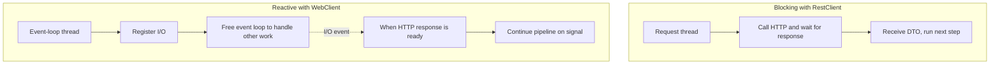
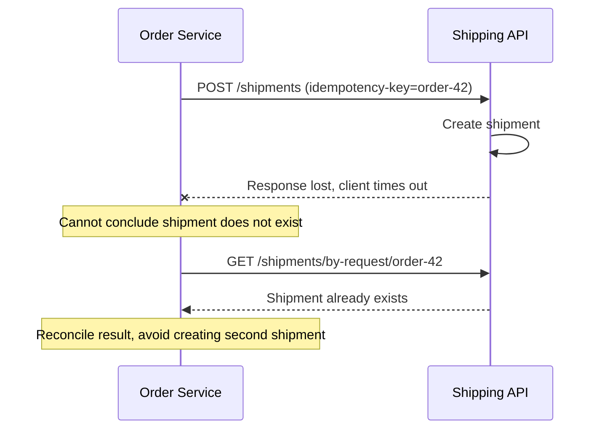
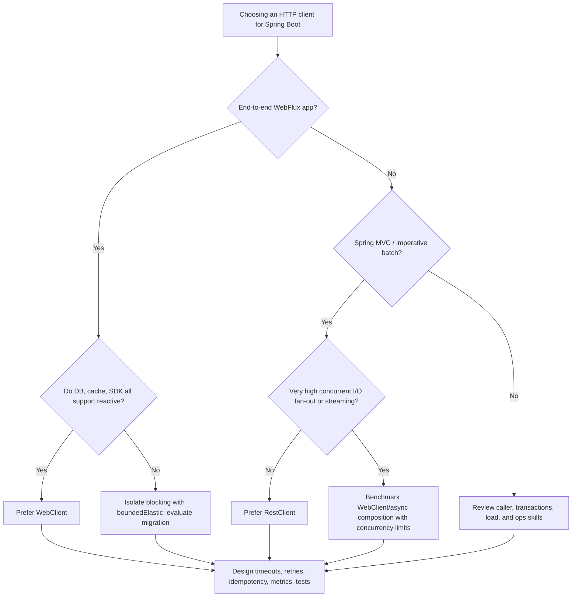

# Choosing Blocking or Reactive APIs Based on Application Architecture

> **Chapter:** HTTP Client Selection  
> **Scope:** SPRING_BOOT_INTEGRATION — organizing integration across HTTP clients, databases, caches, message brokers, and Spring Integration adapters; emphasizing configuration, data contracts, transactions, errors, duplicate handling, testing, and observing real flows.

## 1. Problem: which client to choose for outbound HTTP calls?

Suppose an application receives an order, queries inventory via a REST API, persists the order in PostgreSQL, and publishes `OrderCreated` through a broker. The development team must pick an API to call the inventory system:

- **Blocking API:** the call returns a DTO or throws an exception; the calling thread waits until a response or error arrives. Examples include `RestClient` and `RestTemplate` in Spring Framework.
- **Reactive API:** the call returns a publisher such as `Mono<StockStatus>` or `Flux<StockStatus>`; processing steps are composed into an asynchronous pipeline that is non-blocking when using a non-blocking connector/driver. An example is `WebClient` in Spring WebFlux.

The right question **is not merely which API is faster**. You must consider the application architecture, other I/O types in use, concurrency levels, transactions, deadlines, and operational skills. Choosing reactive solely at the HTTP layer while the rest of the service continuously makes blocking JDBC/JPA calls can complicate the design without delivering the intended benefits.

### 1.1. Learning outcomes

After this lesson, you will be able to:

1. Distinguish *blocking*, *asynchronous*, *non-blocking*, and *reactive* without conflating them.
2. Choose `RestClient`, `WebClient`, or the declarative `@HttpExchange` API based on the Spring MVC/WebFlux model.
3. Explain the roles of platform threads, virtual threads, event loops, and connection pools.
4. Write two integration examples for the same data contract with intentional configuration, timeouts, and error handling.
5. Identify the risks of `.block()`, unsafe retries, transactions across HTTP, duplicate processing, and ignoring publisher errors.
6. Test, measure performance, and observe the client before deciding to migrate architectures.

## 2. Understanding execution models accurately

### 2.1. Blocking does not mean "slow," and reactive does not mean "parallel"

**Blocking:** a Java thread invokes an I/O operation and waits until it finishes. While waiting, that thread does not continue executing code after the call.

**Asynchronous:** the result may arrive later; the caller uses a callback, future, or publisher. An API returning `CompletableFuture` may run I/O work on another thread pool, but that **does not prove** the underlying I/O is non-blocking.

**Non-blocking I/O:** an I/O mechanism that does not need to dedicate a waiting thread per pending network operation; the system can receive notifications when sockets become ready.

**Reactive:** a way of representing and composing processing streams via publisher/subscriber, supporting a demand/backpressure model. Reactor uses `Mono<T>` for 0–1 results and `Flux<T>` for 0–N results. Whether the entire pipeline is non-blocking also depends on every step underneath.



The diagram is simplified. Real systems also involve other threads, schedulers, connection pools, SSL, parsers, codecs, and resource limits. Reactor can still use threads to run CPU tasks or blocking sources if offloaded to an appropriate scheduler.

### 2.2. Thread-holding cost and latency

Consider 200 concurrent HTTP calls, each waiting an average of 500 ms for a partner:

- A blocking model using **platform threads** typically needs enough threads to hold all waiting calls; too many threads consume stack memory, context switching, and system resources.
- Non-blocking `WebClient` can serve many waiting sockets with relatively few event-loop threads; the application must still manage connection pools, memory, timeouts, and downstream load.
- **Virtual threads** (Java 21+, supported via configuration in compatible Boot versions) make the cost of a concurrent blocking task much lower than a platform thread. Even so, the `RestClient` API remains **blocking in semantics** and does not provide Reactor backpressure; the connection pool and target server remain limits.

This is a resource analysis, **not a benchmark** or a guarantee that WebClient is faster by a specific percentage. If downstream responds nearly instantaneously and concurrency is low, a blocking solution is often simpler and sufficient.

### 2.3. Many requests do not mean unlimited connections can be opened

System capacity must satisfy all three layers:

| Layer | Blocking | Reactive | What must be configured/measured |
| --- | --- | --- | --- |
| Execution threads | Platform/virtual threads waiting or processing | Event-loop threads and schedulers | Thread count, wait time, thread starvation |
| HTTP connections | Request factory and HTTP pool | Reactor Netty/connector and pool | Max connections, pending acquire, keep-alive, timeout |
| Target service | Same upstream limits | Same upstream limits | Rate limit, concurrency, response time, 429/503 |

Reactive saves waiting threads but does not eliminate socket limits or rate limits. Pushing thousands of requests at once with unbounded `flatMap` can saturate the pool and cause a retry storm.

## 3. Main HTTP client APIs in the Spring ecosystem

The content and illustrative code below target **Spring Boot 3.2–3.5**, using Spring Framework 6.1+ and Java 17+. Starter names and auto-configuration may change in major lines such as Boot 4; always check the documentation matching the BOM you use.

| Option | API Style | Common Dependency | When to use | Key notes |
| --- | --- | --- | --- | --- |
| **`RestClient`** | Fluent, blocking | Spring Web / `spring-boot-starter-web` | Spring MVC, imperative services, JDBC/JPA, minimal streaming needs | Modern API for synchronous HTTP code; has `RestClient.Builder` configured by Boot |
| **`WebClient`** | Fluent, reactive | Spring WebFlux / `spring-boot-starter-webflux` | End-to-end WebFlux, high concurrent I/O, streaming, reactive composition | Returns `Mono`/`Flux`; do not call `subscribe()` and discard results |
| **`RestTemplate`** | Blocking, older imperative | Spring Web | Maintaining existing codebases | Still usable; for new flows consider `RestClient` |
| **HTTP service interface** | Declarative interface via `@HttpExchange` | Spring Web + suitable adapter | Wanting a clear client contract and less boilerplate | Can use `RestClient` or `WebClient` adapter; return types must match |
| **JDK `java.net.http.HttpClient`** | Blocking or `CompletableFuture` | JDK 11+ | Needing lower-level control or avoiding Spring adapters | Async futures do not automatically create a Reactor pipeline or full Boot integration |

**MVC/WebFlux REST controllers are the server side**, whereas `RestClient`/`WebClient` are outbound clients. An MVC application can call WebClient, but it must use the right processing model and must not assume the server has become WebFlux.

### 3.1. Starters and BOM

With Spring Boot 3.x, an MVC application typically uses:

```groovy
dependencies {
    implementation 'org.springframework.boot:spring-boot-starter-web'
    testImplementation 'org.springframework.boot:spring-boot-starter-test'
}
```

If the application is reactive from the ground up:

```groovy
dependencies {
    implementation 'org.springframework.boot:spring-boot-starter-webflux'
    testImplementation 'org.springframework.boot:spring-boot-starter-test'
}
```

These two blocks are **per-application choices**. When the WebFlux starter is added to an application that already has the Spring MVC starter, Boot usually selects **Spring MVC as the default web application type** if both are present; the presence of `WebClient` does not automatically turn an MVC server into WebFlux.

Let Spring Boot's BOM manage compatible versions of Spring Web, Spring WebFlux, Reactor, Netty, and HTTP clients. Do not mix arbitrary Framework/Boot versions just to upgrade a single API.

### 3.2. Two questions before choosing

**Which processing model does the application use for business logic?**

- Controllers/services return DTOs directly, use JPA/JDBC and thread-bound transactions → typically choose `RestClient`.
- Controllers/services return `Mono`/`Flux`, use R2DBC, reactive Redis, and reactive downstream → typically choose `WebClient`.
- A Spring MVC application calls multiple HTTP endpoints in parallel → you may use WebClient/Futures at the I/O boundary even if the whole app is not reactive, but you must manage threads and timeouts.

**Does operational load truly require non-blocking?**

- Measure concurrent in-flight requests, latency, I/O wait time, and thread utilization.
- If most time is spent on CPU, heavy serialization, or a blocking database, adding WebClient will not solve that bottleneck.
- If there are many independent waiting I/O calls, streaming, or fan-out needing concurrency limits, WebClient offers composition advantages.

## 4. Client selection matrix by application architecture

| Actual architecture | Default choice | Reason | What to avoid |
| --- | --- | --- | --- |
| Spring MVC + JDBC/JPA, synchronous flow | `RestClient` | Same execution model; errors and transactions are easy to follow | Holding a DB transaction while waiting too long on upstream |
| Spring MVC + Java 21 virtual threads | `RestClient` on virtual threads if verified | Reduces platform thread holding cost while waiting on HTTP | Forgetting pool limits, rate limits, and timeouts |
| Spring MVC with large fan-out to many HTTP APIs | Consider `WebClient` or bounded async composition | Combines multiple I/O calls without holding a thread per wait | Calling `.block()` on each branch loses most advantages |
| Spring WebFlux + reactive persistence | `WebClient` | End-to-end non-blocking, fits Reactor pipelines | Calling blocking HTTP/JDBC on the event loop |
| Spring WebFlux needing an irreplaceable blocking library | Temporarily run blocking work on a dedicated bounded scheduler, plan replacement | Isolates blocking I/O from the event loop | `Mono.just(blockingCall())` or blocking directly inside `map` |
| Imperative batch job, moderate call volume | `RestClient` | Sequential code and straightforward error control | Forgetting concurrency limits if the batch uses many workers |
| Continuous streaming/chunked response processing | Usually choose `WebClient` | `Flux` and incremental processing fit well | Aggregating huge responses into memory unnecessarily |

### 4.1. Virtual threads are a third resource choice, not a third client type

In the Spring Boot 3.2+ ecosystem, when using Java 21+, you can enable virtual thread support across Boot-supported components:

```yaml
spring:
  threads:
    virtual:
      enabled: true
```

With MVC, virtual threads can help reduce pressure from blocking request handling and certain Boot-managed executors. However:

- `RestClient` **still blocks the calling thread** in terms of program control flow.
- Virtual threads do not allow JDBC databases, HTTP sockets, connection pools, or upstream services to accept infinite requests.
- Specific synchronized libraries, native calls, or `synchronized` sections can affect scalability; measure and profile in practice before concluding.
- Some application types running solely on virtual/daemon threads have requirements to keep the JVM alive; check Boot guidance for your specific runtime.

If the goal is solely to improve blocking I/O throughput in an MVC application, trying virtual threads and measuring can be easier than converting the entire application to Reactive. If the goal is streaming/reactive flows and backpressure, virtual threads do not replace those properties.

## 5. Imperative example: Spring MVC calling stock via RestClient

The application has an endpoint receiving a SKU, calling a stock HTTP API, and returning a DTO. Suppose the partner provides:

```text
GET https://inventory.example.invalid/api/items/{sku}/stock
200 OK
Content-Type: application/json

{"sku": "SKU-42", "available": 7}
```

The `example.invalid` domain is purely illustrative; it is not a real service. The example uses Spring Boot 3.2+ with Spring Web.

### 5.1. Separating endpoint configuration from Java

```yaml
integration:
  inventory:
    base-url: ${INVENTORY_BASE_URL:https://inventory.example.invalid/api}
```

In production, configure HTTPS endpoints, authentication, and secrets from secure configuration sources. Never commit real tokens in the repository or write them to logs.

### 5.2. Dedicated RestClient bean per upstream

```java
import org.springframework.beans.factory.annotation.Value;
import org.springframework.context.annotation.Bean;
import org.springframework.context.annotation.Configuration;
import org.springframework.web.client.RestClient;

@Configuration
class InventoryRestClientConfig {

    @Bean("inventoryRestClient")
    RestClient inventoryRestClient(
            RestClient.Builder builder,
            @Value("${integration.inventory.base-url}") String baseUrl) {
        return builder.baseUrl(baseUrl).build();
    }
}
```

Boot provides `RestClient.Builder` when the appropriate auto-configuration applies; using the injected builder lets you pick up shared HTTP customizers already configured. We create a dedicated `RestClient` bean because Boot cannot automatically infer a specific partner's endpoint.

### 5.3. DTO and gateway

```java
// StockStatus.java
public record StockStatus(String sku, int available) {
}
```

```java
import java.util.Objects;
import org.springframework.beans.factory.annotation.Qualifier;
import org.springframework.stereotype.Service;
import org.springframework.web.client.RestClient;

@Service
public class BlockingInventoryGateway {
    private final RestClient client;

    public BlockingInventoryGateway(
            @Qualifier("inventoryRestClient") RestClient client) {
        this.client = client;
    }

    public StockStatus findStock(String sku) {
        StockStatus stock = client.get()
                .uri("/items/{sku}/stock", sku)
                .retrieve()
                .body(StockStatus.class);
        return Objects.requireNonNull(
                stock, "Inventory API returned an empty body");
    }
}
```

Against a real API, validate `available >= 0`, the returned SKU, JSON format, and the distinction between 404 (SKU does not exist), 429 (rate limit), and 503 (temporary outage). `Objects.requireNonNull` only illustrates that an empty body must be handled; a production application should translate it into a contract error with clear codes and metrics.

### 5.4. MVC REST controller

```java
import org.springframework.web.bind.annotation.GetMapping;
import org.springframework.web.bind.annotation.PathVariable;
import org.springframework.web.bind.annotation.RestController;

@RestController
public class StockController {
    private final BlockingInventoryGateway gateway;

    public StockController(BlockingInventoryGateway gateway) {
        this.gateway = gateway;
    }

    @GetMapping("/stock/{sku}")
    public StockStatus stock(@PathVariable String sku) {
        return gateway.findStock(sku);
    }
}
```

The `findStock(...)` call runs on the request-processing thread and only returns once upstream finishes or fails. With the synchronous model, you can write clear sequential steps and use `try/catch` or `@RestControllerAdvice` to map errors. If upstream is slow, this thread must wait; therefore, timeouts and concurrency caps are mandatory in production.

## 6. Reactive example: Spring WebFlux calling the same API with WebClient

Keep the same URL and DTO, but have the entire HTTP integration return `Mono<StockStatus>`. The example below assumes a **WebFlux application**; do not register two controllers with overlapping mappings simultaneously in the same application.

### 6.1. WebClient bean from Boot's builder

```java
import org.springframework.beans.factory.annotation.Value;
import org.springframework.context.annotation.Bean;
import org.springframework.context.annotation.Configuration;
import org.springframework.web.reactive.function.client.WebClient;

@Configuration
class InventoryWebClientConfig {

    @Bean("inventoryWebClient")
    WebClient inventoryWebClient(
            WebClient.Builder builder,
            @Value("${integration.inventory.base-url}") String baseUrl) {
        return builder.baseUrl(baseUrl).build();
    }
}
```

Spring Boot can auto-configure a `WebClient.Builder` when Spring WebFlux is present. Creating `WebClient` from the appropriate builder leverages connectors, codecs, and customizers configured by the application.

### 6.2. Gateway returning a Publisher

```java
import java.time.Duration;
import org.springframework.beans.factory.annotation.Qualifier;
import org.springframework.stereotype.Service;
import org.springframework.web.reactive.function.client.WebClient;
import reactor.core.publisher.Mono;

@Service
public class ReactiveInventoryGateway {
    private final WebClient client;

    public ReactiveInventoryGateway(
            @Qualifier("inventoryWebClient") WebClient client) {
        this.client = client;
    }

    public Mono<StockStatus> findStock(String sku) {
        return client.get()
                .uri("/items/{sku}/stock", sku)
                .retrieve()
                .bodyToMono(StockStatus.class)
                .switchIfEmpty(Mono.error(
                        new IllegalStateException("Empty inventory body")))
                .timeout(Duration.ofSeconds(3));
    }
}
```

`Mono` describes work that will emit a result or error when subscribed to. `timeout` here sets an illustrative **pipeline-level deadline**; it does not replace connect timeout, response timeout, or pool-acquire timeout configuration on the HTTP connector. Canceling a subscription on timeout does not mean the target server definitely stops any processing already started.

### 6.3. WebFlux controller

```java
import org.springframework.web.bind.annotation.GetMapping;
import org.springframework.web.bind.annotation.PathVariable;
import org.springframework.web.bind.annotation.RestController;
import reactor.core.publisher.Mono;

@RestController
public class ReactiveStockController {
    private final ReactiveInventoryGateway gateway;

    public ReactiveStockController(ReactiveInventoryGateway gateway) {
        this.gateway = gateway;
    }

    @GetMapping("/stock/{sku}")
    public Mono<StockStatus> stock(@PathVariable String sku) {
        return gateway.findStock(sku);
    }
}
```

The controller returns the publisher to the web framework; **never call `subscribe()` yourself**. The framework manages the subscription, sends the HTTP response, and propagates errors. A method that calls `WebClient` and then `subscribe()` to "run in the background" and immediately returns HTTP 200 can lose errors, commit business work at the wrong time, or break traceability.

## 7. Easily confused combinations and how to handle them properly

### 7.1. Can Spring MVC use WebClient?

**Yes.** `WebClient` is an HTTP client; it does not require the server to use WebFlux. For example, MVC can use `WebClient` to combine three independent HTTP requests. However, if you ultimately call `.block()` to switch back to synchronous style, the MVC thread still has to wait for the result. That can sometimes be acceptable at an **imperative boundary**, but it is not "automatically end-to-end non-blocking."

An example coordinating multiple upstreams in a pipeline:

```java
Mono<Tuple2<StockStatus, PriceStatus>> combined = Mono.zip(
        inventoryGateway.findStock(sku),
        pricingGateway.findPrice(sku));
```

The snippet assumes `pricingGateway.findPrice(...)` returns `Mono<PriceStatus>` and that required types/imports are present (Reactor `Mono`, `Tuple2`). If the two I/O calls are independent and the connector is non-blocking, the pipeline can wait for both results concurrently. But when MVC blocks at the end of the pipeline, **a servlet thread is still waiting**. You must set an overall deadline, limit concurrent requests, and handle errors from each upstream.

With MVC supporting async response models, you can return `DeferredResult` or `CompletableFuture` per the controller contract, though that choice requires testing context propagation, cancellation, error handling, and executor/servlet configuration.

### 7.2. Should WebFlux call RestClient directly?

**Do not call RestClient, JDBC/JPA, or synchronous SDKs directly on the Netty event loop.** A 2-second blocking operation can stall the event-loop thread and slow down other connections sharing that thread.

Incorrect example:

```java
// WRONG: findStock() runs immediately when the expression is evaluated,
// even before the Mono is subscribed.
Mono<StockStatus> wrong = Mono.just(blockingInventoryGateway.findStock(sku));
```

If you must use a synchronous API inside a reactive pipeline, isolate it:

```java
import reactor.core.publisher.Mono;
import reactor.core.scheduler.Schedulers;

Mono<StockStatus> bridged = Mono.fromCallable(
        () -> blockingInventoryGateway.findStock(sku))
        .subscribeOn(Schedulers.boundedElastic());
```

`Mono.fromCallable` defers invocation until subscription time; `subscribeOn(Schedulers.boundedElastic())` moves the blocking work onto a scheduler designed for such tasks. This is a bounded **migration bridge**: `boundedElastic` has a finite thread/queue capacity and does not turn the call into non-blocking I/O. Do not pass an entire thread-bound JDBC transaction across an arbitrary pipeline expecting `@Transactional` to retain the same semantics across multiple schedulers.

### 7.3. Why is `.block()` especially dangerous in a reactive flow?

```java
// WRONG if running on the Reactor Netty event loop.
StockStatus stock = reactiveInventoryGateway.findStock(sku).block();
```

`block()` blocks the calling thread until the publisher completes; Reactor can even throw an error if a blocking API is called on a scheduler marked non-blocking. It defeats the benefit when placed in the middle of a reactive pipeline and risks starvation or deadlock when combined with work that also needs the very event loop being blocked.

If the outer boundary is genuinely synchronous, you can convert once at the **system edge** while clearly understanding which thread is waiting; often it is simpler to use `RestClient` directly for that use case.

### 7.4. Reactor context is not a regular ThreadLocal

Spring MVC/imperative code often carries information in `ThreadLocal`, such as MDC logging, security context, or transaction resources. Reactor has **Reactor Context**, and execution may switch threads. Therefore:

- Do not assume MDC/ThreadLocal propagates automatically across every `publishOn`, `subscribeOn`, and callback.
- Use Spring/Micrometer context propagation and observation/tracing integrations appropriate for your version; verify traces across boundaries.
- Reactive transactions (such as R2DBC with a reactive transaction manager) bind transactions within the reactive pipeline; they do not automatically merge with thread-bound JDBC/JPA transactions.
- A successful reactive HTTP call does not mean the message broker has published or the database has committed as intended; you must design consistency explicitly.

### 7.5. The declarative `@HttpExchange` API still needs a backend choice

Spring Framework supports describing an HTTP contract via an interface:

```java
import org.springframework.web.bind.annotation.PathVariable;
import org.springframework.web.service.annotation.GetExchange;
import org.springframework.web.service.annotation.HttpExchange;

@HttpExchange("/items")
public interface InventoryHttpService {
    @GetExchange("/{sku}/stock")
    StockStatus findStock(@PathVariable String sku);
}
```

With Spring Framework 6.1+, you can create a proxy using `HttpServiceProxyFactory` and `RestClientAdapter`:

```java
import org.springframework.web.client.support.RestClientAdapter;
import org.springframework.web.service.invoker.HttpServiceProxyFactory;

InventoryHttpService service = HttpServiceProxyFactory
        .builderFor(RestClientAdapter.create(inventoryRestClient))
        .build()
        .createClient(InventoryHttpService.class);
```

This assumes `inventoryRestClient` already has a base URL ending in `/api`. When using `WebClientAdapter`, a reactive interface typically returns `Mono<StockStatus>` to retain composition benefits; do not just swap the adapter while keeping every method synchronous and expecting non-blocking behavior. Proxies standardize endpoints and simplify testing, but they **do not automatically define timeouts, retries, transactions, or error contracts**.

## 8. Timeouts, connection pools, and load limits

A client choice is only complete when you know how to stop overly slow calls. Distinguish:

| Limit | What does it mean? | If unbounded |
| --- | --- | --- |
| **Connect timeout** | Max time to wait while establishing a connection to host:port | Client may wait too long when the network path is broken |
| **Response/read timeout** | Time waiting for response/reads per request factory or connector semantics | One request can hold resources for too long |
| **Pool acquire timeout** | Time waiting for an available connection from the pool | Queue for connections grows, extending latency |
| **Per-attempt timeout** | Limit for a single HTTP attempt | One attempt cannot consume the entire budget |
| **End-to-end deadline** | Total limit across request, retries, backoff, deserialization, and processing | User has timed out while backend keeps working |
| **Max concurrency / bulkhead** | Number of concurrent requests allowed to one upstream | Quota exceeded, socket exhaustion, overload |

Do not assume default timeout values fit your system. For instance, if an API's SLA is 2 seconds, you cannot arbitrarily set an upstream timeout of 10 seconds plus three retries.

### 8.1. Configuring RestClient with the JDK HTTP request factory

With Spring Framework 6.1+, you can use `JdkClientHttpRequestFactory` and `java.net.http.HttpClient`:

```java
import java.net.http.HttpClient;
import java.time.Duration;
import org.springframework.http.client.JdkClientHttpRequestFactory;
import org.springframework.web.client.RestClient;

HttpClient jdkClient = HttpClient.newBuilder()
        .connectTimeout(Duration.ofSeconds(1))
        .build();

JdkClientHttpRequestFactory factory =
        new JdkClientHttpRequestFactory(jdkClient);
factory.setReadTimeout(Duration.ofSeconds(3));

RestClient client = RestClient.builder()
        .requestFactory(factory)
        .baseUrl("https://inventory.example.invalid/api")
        .build();
```

This is an example of **configuring a specific request factory**, not necessarily Boot's default. If the application receives a Boot auto-configured builder, apply the request factory on that builder to preserve shared customizers instead of building every client from scratch. In high-throughput environments, evaluate connection reuse, pool limits, and characteristics of the chosen request factory. The name `readTimeout` must be understood per its implementation; do not assume a single timeout governs every phase of a request.

### 8.2. Configuring WebClient with Reactor Netty

When WebClient uses Reactor Netty as its connector, configure connect and response timeouts on the connector:

```java
import java.time.Duration;
import io.netty.channel.ChannelOption;
import reactor.netty.http.client.HttpClient;
import org.springframework.http.client.reactive.ReactorClientHttpConnector;
import org.springframework.web.reactive.function.client.WebClient;

HttpClient httpClient = HttpClient.create()
        .option(ChannelOption.CONNECT_TIMEOUT_MILLIS, 1000)
        .responseTimeout(Duration.ofSeconds(3));

WebClient client = WebClient.builder()
        .clientConnector(new ReactorClientHttpConnector(httpClient))
        .baseUrl("https://inventory.example.invalid/api")
        .build();
```

The snippet assumes compatible `reactor-netty-http` and Netty dependencies managed by Boot. You can apply corresponding settings to the application's `WebClient.Builder` bean to reuse shared customizers.

If a custom pool is needed, use `ConnectionProvider` with appropriate max connections, pending acquire count, and wait timeouts. When creating a manual pool/provider, the application must manage its lifecycle and release resources. The HTTP pool and Reactor schedulers are independent limits.

### 8.3. Do not retry by multiplying load

Suppose an HTTP call has at most 3 attempts and the outer service layer also retries the entire method 3 times. Upstream calls can reach 9. If a message broker redelivers as well, load can multiply even further.

Operational rules:

1. Designate which layer owns the retry budget.
2. Distinguish **attempt count** (including the initial try) from **retry count** (only subsequent retries).
3. Add backoff with jitter; honor `Retry-After` on HTTP 429/503 when required by contract.
4. Limit concurrency and use a circuit breaker/bulkhead when needed.
5. Never retry side-effecting operations without proving idempotency or reconciliation.
6. Ensure total retries and backoff do not exceed the use case's deadline.

Reactive does not automatically enforce these principles; they must still be built into the flow.

## 9. Mapping HTTP errors: different syntax, same responsibility

### 9.1. Define the error contract before picking the API

Suppose the inventory API specifies:

| Signal | Agreed meaning | Action |
| --- | --- | --- |
| 200 + valid JSON | Stock data available | Parse + validate DTO |
| 404 + code `SKU_NOT_FOUND` | SKU does not exist | Return domain result, do not retry |
| 429 + `Retry-After` | Technical rate limit exceeded | Wait in a controlled manner if budget remains |
| 503 | Service temporarily unavailable | Bounded retry for `GET` when appropriate |
| 400 due to invalid request schema | Contract/caller error | Fix payload/code, do not retry |
| Read timeout after side-effecting `POST` | Unclear whether upstream committed | Query status/idempotency key before resending |

**HTTP status alone does not determine the business error type.** Some APIs return domain codes in the response body or use 409/422; the adapter must understand the upstream contract.

### 9.2. RestClient: translating status to a business exception

Example of a standalone exception:

```java
public final class UnknownSkuException extends RuntimeException {
    public UnknownSkuException(String sku) {
        super("Unknown SKU: " + sku);
    }
}
```

With `RestClient`:

```java
StockStatus stock = client.get()
        .uri("/items/{sku}/stock", sku)
        .retrieve()
        .onStatus(
                status -> status.value() == 404,
                (request, response) -> {
                    throw new UnknownSkuException(sku);
                })
        .body(StockStatus.class);
```

For other error responses without a custom handler, `retrieve()` converts error statuses into exceptions by default. In real systems, inspect the error body and domain code before concluding that 404 always means the SKU does not exist.

### 9.3. WebClient: translating status into a publisher error signal

```java
Mono<StockStatus> stock = client.get()
        .uri("/items/{sku}/stock", sku)
        .retrieve()
        .onStatus(
                status -> status.value() == 404,
                response -> Mono.error(new UnknownSkuException(sku)))
        .bodyToMono(StockStatus.class);
```

WebClient maps errors into `onError` inside the pipeline; exceptions are not necessarily thrown when `findStock(...)` returns. To handle them, use operators like `onErrorMap`, `onErrorResume`, or `retryWhen` at the semantically right place; do not wrap **creating** a `Mono` in `try/catch` thinking you have caught all asynchronous errors.

**Be cautious with `onErrorResume`:** returning default data such as "0 items available" when the inventory API is actually disconnected can lead to wrong decisions. Fallbacks must be permitted by the domain, and responses should indicate when data is temporary or unreliable if required.

### 9.4. Use RetryWhen only for safe calls

Example of retrying specifically when upstream returns HTTP 503 on a `GET` operation:

```java
import java.time.Duration;
import org.springframework.web.reactive.function.client.WebClientResponseException;
import reactor.core.publisher.Mono;
import reactor.util.retry.Retry;

Mono<StockStatus> stockWithRetry = reactiveInventoryGateway.findStock(sku)
        .retryWhen(Retry.backoff(2, Duration.ofMillis(200))
                .maxBackoff(Duration.ofSeconds(1))
                .jitter(0.5)
                .filter(error ->
                        error instanceof
                                WebClientResponseException.ServiceUnavailable))
        .timeout(Duration.ofSeconds(5));
```

`Retry.backoff(2, ...)` in Reactor allows **at most two retries after the initial attempt**. This example sets an overall 5-second timeout for the pipeline including retries, alongside the per-attempt timeout configured in the gateway. It only illustrates the API; measure and adjust the budget based on real latency and rate limits, add logging/metrics on exhaustion, and classify connection errors as well if appropriate.

Do not copy this retry snippet verbatim onto `POST /charge`, `POST /shipment`, or event-publishing operations: with side effects, timeouts can happen **after upstream has already applied the request**.

## 10. Transactions and consistency in integration flows

### 10.1. Do not hold a database transaction while waiting indefinitely on HTTP

Example ordering flow:

```text
1. Check stock over HTTP
2. Save the order to PostgreSQL
3. Send OrderCreated to the broker
```

With Spring MVC/JPA, design short database transactions with clear boundaries instead of opening a transaction before step 1 and holding locks/connections throughout the upstream wait. With WebFlux/R2DBC, the same decision still holds: using publishers does not automatically shorten transaction resource hold times if the pipeline puts boundaries in the wrong place.

### 10.2. Reactive does not create cross-system transactions

| Component | Questions to answer |
| --- | --- |
| HTTP client | Could the call have been applied by upstream before timing out? |
| JDBC/JPA or R2DBC | When does the DB transaction begin/commit/rollback? |
| Redis cache | Should a cache miss/timeout halt the business operation? |
| Kafka/RabbitMQ/Pulsar broker | When is publish success confirmed? Is duplicate delivery possible? |
| Spring Integration | Which adapter acks/checkpoints the message and at what stage? |

No HTTP client guarantees atomic commits between PostgreSQL and a broker. If order data and events must stay consistent, you can use a **transactional outbox**: write both the order and the outbox entry in the SQL transaction, then have an independent publisher send the event. Consumers must be idempotent because publishing/acknowledgment can be retried.

### 10.3. Idempotency on write timeouts



The diagram assumes the partner **has a lookup API by request key**; this is not a standard endpoint on every API. If the partner has an idempotency contract, you can retry with **the same key and payload** as specified. If no mechanism exists, move the operation into a state requiring reconciliation instead of blindly creating a new request.

This holds true for both RestClient and WebClient: **the threading model does not change the semantics of HTTP side effects**.

## 11. System-meaningful HTTP client testing

A test that only checks a returned DTO is not enough to prove the client operates reliably. Separate:

| Test layer | RestClient | WebClient | What to verify |
| --- | --- | --- | --- |
| Unit | Mock gateway/service | Publisher with `StepVerifier` | Business mapping, fallback, retry predicate |
| HTTP contract | `MockRestServiceServer` or mock HTTP server | Mock HTTP server + `StepVerifier` | URL, method, headers, JSON, status, error body |
| Timeout/retry | Slow server or 503 → 200 | Slow server, 503 → 200 sequence | Total deadline, attempt count, error after exhaustion |
| Integration | HTTP test server running in-process/container | HTTP test server running in-process/container | Real TLS, connector, pool, serialization |
| End-to-end | HTTP → DB → broker | Reactive HTTP → R2DBC → broker | Side effects, transactions, duplicates, traces, and recovery |

### 11.1. Example testing RestClient with MockRestServiceServer

With Spring Framework 6.1+ and `spring-boot-starter-test`:

```java
import org.junit.jupiter.api.Test;
import org.springframework.http.MediaType;
import org.springframework.test.web.client.MockRestServiceServer;
import org.springframework.web.client.RestClient;

import static org.assertj.core.api.Assertions.assertThat;
import static org.springframework.test.web.client.match.MockRestRequestMatchers.requestTo;
import static org.springframework.test.web.client.response.MockRestResponseCreators.withSuccess;

class InventoryRestClientTest {

    @Test
    void mapsValidResponse() {
        RestClient.Builder builder = RestClient.builder()
                .baseUrl("https://inventory.example.invalid/api");
        MockRestServiceServer server =
                MockRestServiceServer.bindTo(builder).build();
        RestClient client = builder.build();

        server.expect(requestTo(
                "https://inventory.example.invalid/api/items/SKU-42/stock"))
                .andRespond(withSuccess(
                        "{\"sku\":\"SKU-42\",\"available\":7}",
                        MediaType.APPLICATION_JSON));

        StockStatus stock = client.get()
                .uri("/items/{sku}/stock", "SKU-42")
                .retrieve()
                .body(StockStatus.class);

        assertThat(stock).isNotNull();
        assertThat(stock.available()).isEqualTo(7);
        server.verify();
    }
}
```

This tests outbound mapping **without making real network calls** and does not measure thread utilization or TCP timeouts. When you need to test timeouts, TLS, and connector behavior, use a real HTTP test server (such as WireMock/MockWebServer) and configure the exact backend being used.

### 11.2. Reactive testing with StepVerifier

Example when you have a gateway calling an HTTP mock server returning valid JSON:

```java
import reactor.test.StepVerifier;

StepVerifier.create(reactiveInventoryGateway.findStock("SKU-42"))
        .assertNext(stock -> {
            assertThat(stock.sku()).isEqualTo("SKU-42");
            assertThat(stock.available()).isEqualTo(7);
        })
        .verifyComplete();
```

This test snippet is the **assertion part**: you need to configure the mock server and corresponding AssertJ imports. To test timing/backoff, you can use `StepVerifier.withVirtualTime` when operators support virtual clocks appropriately; real network connection timeouts still require controlled integration tests. Never use arbitrary `Thread.sleep` calls in place of synchronization conditions or test deadlines.

### 11.3. Must-have scenarios

1. 200 + valid body, 204/empty body, schema-violating JSON, or missing fields.
2. 404 per domain contract, 429 + `Retry-After`, 503 recovering after one retry.
3. Invalid DNS, connect timeout, response timeout, TLS handshake failure.
4. Concurrent requests exceeding the pool; verify backpressure/bulkhead and queue exhaustion behavior.
5. Reactive pipeline cancellation; verify no misconception that "canceled client = server rollback."
6. `POST` succeeding upstream but losing the response; idempotency/reconciliation prevents duplicate side effects.
7. Trace and correlation IDs across HTTP calls, DB, and message broker; logs do not leak credentials.

## 12. Observability and performance evaluation

Do not choose reactive based solely on a single-request benchmark. Run with the same contract, simulated upstream/latency, pool/concurrency limits, load, and data processing logic.

### 12.1. Operational metrics to collect

| Metric | Question |
| --- | --- |
| p50/p95/p99 latency per upstream | Is there tail latency or contention when downstream is slow? |
| Throughput and in-flight requests | How many concurrent requests can the system sustain? |
| Platform/virtual thread count, event-loop utilization | Are threads saturated or unintentionally blocked? |
| HTTP connection pool active/idle/pending | Is the pool too small, queue too large, or opening too many connections? |
| Retry attempts, timeouts, 429/503, circuit breaker state | Is there a retry storm or partner quota exceedance? |
| CPU, heap, GC, allocation rate | Does reactive trade memory/CPU costs under real load? |
| Latency from request to DB/broker completion | Is the overall flow better or only the HTTP portion? |
| Tracing/correlation | Can related requests, messages, and transactions be correlated? |

Spring Boot Actuator, Micrometer, and tracing can measure HTTP clients if suitable dependencies, instrumentation, observation registries, and exporters are configured. Do not assume that adding the WebFlux starter automatically exposes every pool or broker metric. Depending on the connector/backend, metrics may require additional opt-in. For high-cardinality data like SKUs, tokens, or URLs with sensitive queries, do not place them directly into metric tags.

### 12.2. A fair comparative benchmark design

1. Define an SLO, for example endpoint p95 under 500 ms at 200 in-flight requests.
2. Lock the same dataset, payloads, network latency, and downstream rate limits.
3. For blocking: control thread pool/virtual threads, HTTP connection pool, and timeouts.
4. For reactive: control event-loop/schedulers, connection pool, `flatMap` concurrency limit, and timeouts.
5. Ramp load gradually; measure throughput, tail latency, timeouts, errors, CPU, heap, and queues.
6. Identify the real bottleneck (upstream throttling, DB pool, GC, etc.) before concluding which client fits.

Results must be evaluated across the **entire flow**, not just the time to construct a `Mono`. Calling `WebClient.get()...bodyToMono(...)` usually only assembles the pipeline; you must subscribe and await completion to measure real HTTP request latency.

## 13. Practical decision tree



### 13.1. Pre-decision checklist

- [ ] Identified Boot/Framework versions and let the BOM manage dependencies?
- [ ] Confirmed whether the request server is MVC or WebFlux and persistence is JDBC/JPA or R2DBC?
- [ ] Configured connect, response, pool acquire timeouts, and overall deadline?
- [ ] Bounded concurrency, pool size, and retry budget per upstream?
- [ ] Classified HTTP 4xx/5xx and domain errors according to the actual contract?
- [ ] For write operations, provided an idempotency key or reconciliation path on timeout?
- [ ] Avoided blocking APIs on event loops or subscribing to reactive publishers and ignoring errors?
- [ ] Ensured transaction, cache, and broker publish boundaries have consistency mechanisms?
- [ ] Tested overload, timeouts, duplicates, and verified sufficient metrics/traces?

## 14. Synthesis scenarios and self-check questions

**Scenario A — Spring MVC taking orders, JPA, and broker:** each request reads inventory once, writes to PostgreSQL, and emits an outbox event. The flow is imperative and HTTP concurrency is moderate. **Choosing `RestClient`** with timeouts, error classification, short transactions, and an outbox is a sensible starting point.

**Scenario B — Real-time price aggregation API:** each request calls 20 independent upstreams, many responses are slow, and the app uses WebFlux/R2DBC and streams results. **Choose `WebClient`** with bounded `flatMap` concurrency, overall timeouts, business-approved fallbacks, and pool/event-loop metrics.

**Scenario C — Spring MVC handling 1,000 concurrent requests due to slow downstreams:** try optimizing timeouts/pools/rate limits, measure CPU/threads, and consider **virtual threads with RestClient** on Java 21+ before committing to the cost of rewriting the entire system to reactive.

Questions:

1. Why is `WebClient` returning a `Mono` not enough to conclude the entire pipeline is non-blocking?
2. Can Spring MVC call WebClient? When `.block()` is used, which thread is waiting?
3. If a WebFlux application uses Hibernate/JPA, what is the risk of calling repositories directly on the event loop?
4. Which resource cost do virtual threads change, and what semantics of `RestClient` do they leave unchanged?
5. Why does `Mono.just(blockingCall())` fail to isolate a blocking call, whereas `Mono.fromCallable(...).subscribeOn(boundedElastic())` succeeds?
6. When fanning out 50 HTTP calls, why must concurrency be limited even though the I/O is non-blocking?
7. HTTP `POST /charge` fails with a read timeout—can it be retried immediately? What information must be confirmed first?
8. How should you design a benchmark so choosing between RestClient and WebClient reflects system-wide SLOs?

**Takeaway:** `RestClient` suits imperative flows with clear blocking semantics; `WebClient` suits reactive pipelines when underlying I/O is genuinely non-blocking. Base the choice on **real architecture, load, transaction boundaries, resilience, testing, and measurement**, rather than API names or assuming one model is always faster.

### References

- [Spring Framework — REST Clients](https://docs.spring.io/spring-framework/reference/integration/rest-clients.html).
- [Spring Framework — WebClient](https://docs.spring.io/spring-framework/reference/web/webflux-webclient.html).
- [Spring Framework — HTTP Interface](https://docs.spring.io/spring-framework/reference/integration/rest-clients.html#rest-http-interface).
- [Spring Framework — Reactor and Threading Model](https://docs.spring.io/spring-framework/reference/web/webflux/new-framework.html).
- [Spring Boot — Virtual Threads](https://docs.spring.io/spring-boot/reference/features/task-execution-and-scheduling.html).
- [Project Reactor — Reference Guide](https://projectreactor.io/docs/core/release/reference/).
