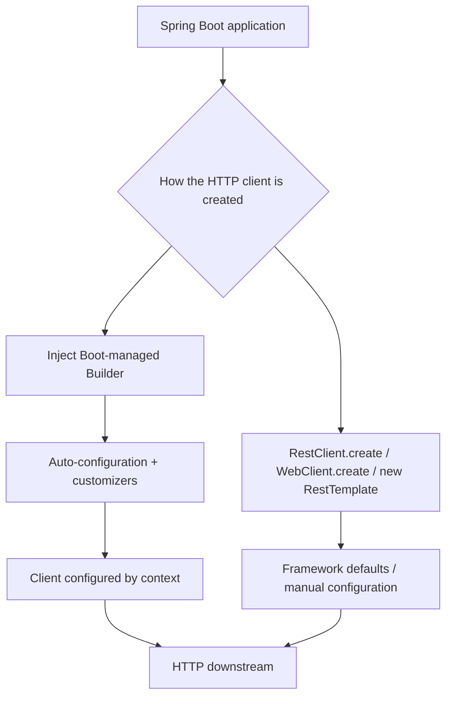
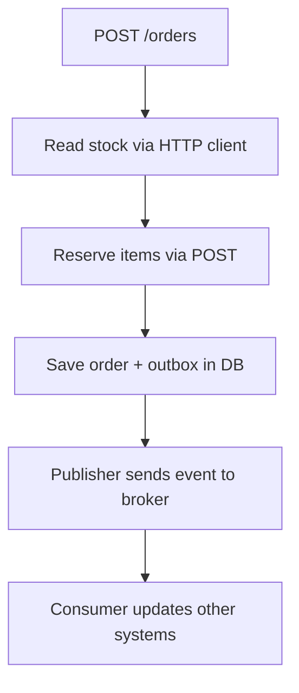
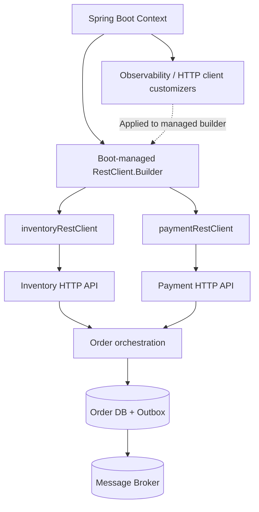

# Boot-Managed Builders vs. Direct Client Creation

## 1. Practical problem: the same HTTP client, different configurations

In the **SPRING_BOOT_INTEGRATION** module, Spring Boot is often the caller of external systems: an Inventory API, Payment API, Identity Provider, or an internal service. Those calls can use `RestClient`, `RestTemplate`, or `WebClient`. The common pitfall is not just **which API to choose**, but **how the client is created**.

Consider two snippets that both call the Inventory API:

```java
RestClient direct = RestClient.create("https://inventory.example.org");
```

and:

```java
@Bean
RestClient inventoryRestClient(RestClient.Builder builder) {
    return builder
        .baseUrl("https://inventory.example.org")
        .build();
}
```

Both can send HTTP requests successfully. However, they are **not equivalent in how they receive configuration from Spring Boot**. `RestClient.Builder` provided by the application context is configured by Boot through auto-configuration and applicable customizers. `RestClient.create(...)` constructs a client directly using Spring Framework defaults; it does not automatically pass through all customizations intended for Boot-managed builders.

The consequences may only surface in production:

- HTTP requests from one client emit metrics/traces, while those from another do not.
- One client uses a centrally configured connector, pool, or TLS setup; the other uses framework defaults.
- Service-identification headers or error interceptors declared via customizers are missing.
- Tests only start the application context and mock a client, never checking how the client is actually created.
- Changing HTTP transport dependencies causes the manually created client to behave differently from the Boot-managed client.

**Goal:** understand which builders are managed by Spring Boot, when to use `create()`/`new` directly, the impact on HTTP transport, codecs, security, timeouts, observability, and testing; then apply these principles to HTTP–database–cache–broker integration flows with clear contracts.



This lesson uses APIs from **Spring Boot 3.2+ / Spring Framework 6.1+** because `RestClient` was introduced in Spring Framework 6.1. For Spring Boot 3.0–3.1, the two older APIs are `RestTemplate` and `WebClient`; do not copy `RestClient` examples into versions that lack this class. Depending on the Boot version, the list of conditions and selected HTTP transport types may vary; verify the runtime in use rather than guessing from dependency names.

## 2. Three HTTP client APIs and their corresponding builders

| Client API | Common builder in Spring Boot | Programming style | When to use |
| --- | --- | --- | --- |
| `RestClient` | `RestClient.Builder` | Synchronous, fluent API | Imperative/MVC applications needing a modern HTTP client |
| `RestTemplate` | `RestTemplateBuilder` | Synchronous, method-based API | Legacy code, systems already using RestTemplate |
| `WebClient` | `WebClient.Builder` | Reactive, returns `Mono`/`Flux` | Non-blocking pipelines, streaming, WebFlux, or a dedicated client needing reactive |

All three APIs perform outbound HTTP, and there is no mandatory reason to pick WebClient solely to call a REST API. If a Spring MVC service is synchronous and the request count/processing style fits, `RestClient` is usually easier to integrate. If you need to compose multiple asynchronous calls or long-lived streams, `WebClient` has advantages. `RestTemplate` remains usable for existing applications; for new code on Spring Framework 6.1+, consider `RestClient`.

Common points:

1. Spring Boot prepares **builders**; it does not automatically create a single client bean for every upstream.
2. The application uses the builder to configure **a dedicated client per target system**, then calls `build()`.
3. Factors like base URLs, authorization, timeouts, JSON contracts, and retries remain the application's design responsibility.
4. Spring Boot auto-configuration only runs when the relevant dependencies/conditions are present and not overridden by other configuration.

### 2.1. Difference between the framework API and Boot auto-configuration

`RestClient`, `RestTemplate`, and `WebClient` are **Spring Framework** APIs. `RestClient.Builder` and `WebClient.Builder` can also be created directly in Java without Spring Boot. `RestTemplateBuilder` is a **Spring Boot** utility designed to create and configure `RestTemplate` consistently with the application.

Therefore:

- `RestClient.builder()`: gives you a builder created directly by **Spring Framework**.
- Injecting `RestClient.Builder`: receives a builder provided by the **Spring Boot application context** when auto-configuration conditions match.
- `WebClient.builder()`: gives you a builder created directly by **Spring Framework**.
- Injecting `WebClient.Builder`: receives a builder that has passed through Boot auto-configuration.
- `new RestTemplate()`: creates an instance directly with Framework defaults.
- Injecting `RestTemplateBuilder` and calling `build()`: creates `RestTemplate` through Boot's builder utility.

The difference is not that a Boot-managed client always "sends faster," but that it has a **centralized configuration integration point**, making behavior consistent and easier to verify.

## 3. Dependencies and conditions for receiving Boot-managed builders

### 3.1. MVC / synchronous HTTP applications

With Maven managing versions via the Spring Boot BOM:

```xml
<dependency>
    <groupId>org.springframework.boot</groupId>
    <artifactId>spring-boot-starter-web</artifactId>
</dependency>
```

In Spring Boot 3.2+, the Web starter typically provides the `RestClient` API and Boot's builder auto-configuration, along with libraries for a Servlet/MVC application. `RestTemplateBuilder` is also provided by Boot when relevant configuration conditions apply.

You do not need to declare your own `RestClient.Builder` bean just to use the client. Try injecting the existing builder first; if global customization is needed, prefer customizers or Boot-supported client configuration mechanisms.

### 3.2. Applications needing WebClient

```xml
<dependency>
    <groupId>org.springframework.boot</groupId>
    <artifactId>spring-boot-starter-webflux</artifactId>
</dependency>
```

The WebFlux starter provides WebClient and Reactor dependencies in common setups. In an application that has both `spring-boot-starter-web` and `spring-boot-starter-webflux`, Spring Boot usually still selects the **Servlet/MVC web application type** unless overridden; however, **you can still inject `WebClient.Builder` to make outbound HTTP calls**.

Not every project using WebClient needs to rewrite controllers to `Mono`/`Flux`. However, calling `block()` on a Netty event loop can cause stalls or errors; you must understand the synchronous/asynchronous boundary clearly.

### 3.3. Missing builder: check conditions before creating manually

If you encounter:

```text
No qualifying bean of type
'org.springframework.web.client.RestClient$Builder' available
```

check:

- Is Spring Boot 3.2+ and Spring Framework 6.1+ in use?
- Is `spring-web`/the Web starter on the **runtime classpath**?
- Is `@EnableAutoConfiguration` / `@SpringBootApplication` active in the current context?
- Was HTTP client auto-configuration explicitly excluded?
- Is the code running inside an overly narrow test slice?
- Is there custom configuration causing Boot to back off, or another bean causing ambiguity?

For `WebClient.Builder`, check `spring-webflux` and its related dependencies. For `RestTemplateBuilder`, check Boot's web client module auto-configuration and context. Inspect the **Condition Evaluation Report** instead of assuming every failure is "missing starter."

## 4. What does a Boot-managed builder receive?

A Boot auto-configured builder can be prepared from components and customizations in the context:

| Capability | Benefit | Conditions/limits |
| --- | --- | --- |
| HTTP message converters / codecs | Encode/decode JSON, text, and corresponding media types | Depends on classpath and custom configuration |
| HTTP request factory / client connector | Selects transport on classpath per Boot's strategy | Not guaranteed to be a single fixed transport across all versions |
| `RestClientCustomizer` / `WebClientCustomizer` | Adds global headers, filters, connectors, or policies | Only applies when the builder passes through appropriate configuration |
| `RestTemplateCustomizer` | Adjusts `RestTemplate` built by the builder | Does not automatically affect `new RestTemplate()` |
| Observation/tracing integration | HTTP client observations via Micrometer/`ObservationRegistry` when configured | Requires dependencies, registry, and appropriate export/actuator setup |
| SSL bundles and related integration | Mechanism to apply application-configured certificate/SSL bundles | Does not automatically guarantee every client enforces the same TLS/mTLS policy |
| Separate builder per upstream | Separates base URL, auth, and timeouts | Application must explicitly create per-upstream client beans |

**Do not assume every row in the table is always active.** Boot prepares builders based on the context and classpath. Without telemetry dependencies, expected metrics/tracing may not appear. If no SSL bundle is declared or applied to the client, there is no basis to claim mTLS is active.

Configuration **Boot cannot know automatically**:

- The Inventory API endpoint contract: `/api/v1/inventory/{sku}`, JSON schema, status codes.
- Timeout durations matching Order Service's SLA.
- Which OAuth2 token belongs to which upstream.
- Whether `POST /reservations` should be retried.
- Which consumer handles errors after the database has committed.
- Which data may be logged, cached, or forwarded through a broker.

Builders help **avoid missing standardized system configurations**; they do not replace business design or testing.

## 5. Boot-managed RestClient.Builder: complete example

Suppose Catalog Service calls the Inventory API to fetch stock. Configure the endpoint per environment:

```yaml
inventory:
  api:
    base-url: ${INVENTORY_API_BASE_URL:https://inventory.example.org}
```

Define a DTO matching the provider contract:

```java
package example.integration.inventory;

public record InventoryResponse(
        String sku,
        Integer availableQuantity) {
}
```

**Step 1: create a `RestClient` bean from the Boot-injected builder.**

```java
package example.integration.inventory;

import org.springframework.beans.factory.annotation.Value;
import org.springframework.context.annotation.Bean;
import org.springframework.context.annotation.Configuration;
import org.springframework.http.HttpHeaders;
import org.springframework.http.MediaType;
import org.springframework.web.client.RestClient;

@Configuration
public class InventoryHttpClientConfiguration {

    @Bean("inventoryRestClient")
    RestClient inventoryRestClient(
            RestClient.Builder builder,
            @Value("${inventory.api.base-url}") String baseUrl) {

        return builder
            .baseUrl(baseUrl)
            .defaultHeader(
                HttpHeaders.ACCEPT,
                MediaType.APPLICATION_JSON_VALUE
            )
            .build();
    }
}
```

**Step 2: use the client in the application's gateway.**

```java
package example.integration.inventory;

import org.springframework.beans.factory.annotation.Qualifier;
import org.springframework.stereotype.Component;
import org.springframework.web.client.RestClient;

@Component
public class InventoryGateway {

    private final RestClient client;

    public InventoryGateway(
            @Qualifier("inventoryRestClient") RestClient client) {
        this.client = client;
    }

    public InventoryResponse getInventory(String sku) {
        InventoryResponse result = client.get()
            .uri("/api/v1/inventory/{sku}", sku)
            .retrieve()
            .body(InventoryResponse.class);

        if (result == null) {
            throw new IllegalStateException(
                "Inventory API returned no response body"
            );
        }
        return result;
    }
}
```

The key difference lies in the **`RestClient.Builder builder` parameter**: the bean is built via the application context's builder instead of calling `RestClient.create(baseUrl)` inline. When Boot/configuration supplies customizers for observability, codecs, or HTTP transport, the resulting client receives those customizations.

`RestClient` is built to be **reused** across requests. Do not create a new client for each loop item or HTTP controller call. Per-request auth info and correlation IDs must be passed in a controlled manner—never attach user A's token as a `defaultHeader` on a singleton shared by all users.

### 5.1. What happens on 404 and 5xx?

`retrieve()` treats HTTP 4xx/5xx as errors by default. Some exceptions may be `HttpClientErrorException` or `HttpServerErrorException` depending on the status. Do not treat every 404 as "out of stock"; read the Inventory API contract.

For example, if the contract specifies that 404 means "SKU does not exist," the gateway layer can map it to a domain error:

```java
public InventoryResponse getInventoryOrThrow(String sku) {
    try {
        InventoryResponse response = client.get()
            .uri("/api/v1/inventory/{sku}", sku)
            .retrieve()
            .body(InventoryResponse.class);

        if (response == null) {
            throw new IllegalStateException("Empty inventory response");
        }
        return response;
    } catch (org.springframework.web.client.HttpClientErrorException.NotFound ex) {
        throw new InventoryNotFoundException(sku, ex);
    }
}
```

`InventoryNotFoundException` is an application-defined exception; implement it according to business error rules. Do not catch `Exception` and return 0 available stock for all failures: timeouts, TLS failures, and JSON decode mismatches do not mean "out of stock."

### 5.2. Direct RestClient is not wrong, just a different choice

You can create a client without Boot:

```java
RestClient directClient =
    RestClient.create("https://inventory.example.org");

// Or:
RestClient directFromBuilder =
    RestClient.builder()
        .baseUrl("https://inventory.example.org")
        .build();
```

Both use defaults and customizations **declared directly at the creation site or by Spring Framework**, without automatically picking up all `RestClientCustomizer`/`ObservationRegistry`/other Boot application context configurations. That **does not mean** they lack JSON converters altogether or cannot use TLS: Spring Framework also has classpath-based defaults. The difference is **whether it passes through Boot auto-configuration**.

When writing a Java library independent of Spring Boot, a tiny test, or a CLI tool managing all configuration itself, direct creation can make sense. In a Boot application with multiple downstreams and shared policies, injecting the builder reduces configuration drift.

## 6. Boot-managed WebClient.Builder vs. WebClient.create

When a non-blocking client or stream processing is needed, inject `WebClient.Builder`:

```java
package example.integration.inventory;

import org.springframework.beans.factory.annotation.Value;
import org.springframework.context.annotation.Bean;
import org.springframework.context.annotation.Configuration;
import org.springframework.http.HttpHeaders;
import org.springframework.http.MediaType;
import org.springframework.web.reactive.function.client.WebClient;

@Configuration
public class InventoryReactiveClientConfiguration {

    @Bean("inventoryWebClient")
    WebClient inventoryWebClient(
            WebClient.Builder builder,
            @Value("${inventory.api.base-url}") String baseUrl) {

        return builder
            .baseUrl(baseUrl)
            .defaultHeader(
                HttpHeaders.ACCEPT,
                MediaType.APPLICATION_JSON_VALUE
            )
            .build();
    }
}
```

Usage:

```java
package example.integration.inventory;

import org.springframework.beans.factory.annotation.Qualifier;
import org.springframework.stereotype.Component;
import org.springframework.web.reactive.function.client.WebClient;
import reactor.core.publisher.Flux;
import reactor.core.publisher.Mono;

@Component
public class InventoryReactiveGateway {
    private final WebClient client;

    public InventoryReactiveGateway(
            @Qualifier("inventoryWebClient") WebClient client) {
        this.client = client;
    }

    public Mono<InventoryResponse> getInventory(String sku) {
        return client.get()
            .uri("/api/v1/inventory/{sku}", sku)
            .retrieve()
            .bodyToMono(InventoryResponse.class);
    }

    public Flux<InventoryResponse> listInventory() {
        return client.get()
            .uri("/api/v1/inventory")
            .retrieve()
            .bodyToFlux(InventoryResponse.class);
    }
}
```

`bodyToFlux` can decode items from a JSON array or streaming representation matching the codec and `Content-Type`; **it does not mean every endpoint instantly becomes a real-time event stream**. `WebClient` typically returns cold publishers: requests execute only upon subscription. Never call `subscribe()` inside a service and ignore the result/error; WebFlux controllers can return `Mono`/`Flux` so the framework manages the subscription.

Comparison:

```java
// Without using Boot-managed builder:
WebClient direct = WebClient.create("https://inventory.example.org");

// Using injected Boot-managed builder:
WebClient managed = builder
    .baseUrl("https://inventory.example.org")
    .build();
```

`WebClient.create(...)` is still a valid Spring Framework API. However, if the system has registered `WebClientCustomizer` beans for tracing, connectors, filters, or shared policies, the direct client **does not automatically go through** those customizers.

### 6.1. Mixing WebClient and Spring MVC

A Spring MVC application can call WebClient, but do not assume that merely using `WebClient` makes JDBC/JPA calls in the service non-blocking. If you call `block()` in the imperative layer, that is an intentional blocking point requiring a deadline. Never call `block()` inside a Reactor event-loop or WebFlux request handler. Choose a thread and concurrency model that fits the entire flow.

## 7. RestTemplateBuilder vs. new RestTemplate

For legacy code using `RestTemplate`, Spring Boot provides `RestTemplateBuilder` to configure clients consistently. **Spring Boot does not usually create a single default `RestTemplate` bean** for direct injection; it provides `RestTemplateBuilder` so you can build beans as needed.

Example:

```java
import org.springframework.boot.web.client.RestTemplateBuilder;
import org.springframework.context.annotation.Bean;
import org.springframework.context.annotation.Configuration;
import org.springframework.web.client.RestTemplate;

@Configuration
public class LegacyInventoryClientConfiguration {

    @Bean("inventoryRestTemplate")
    RestTemplate inventoryRestTemplate(
            RestTemplateBuilder builder) {

        return builder
            .rootUri("https://inventory.example.org")
            .build();
    }
}
```

Consumer layer:

```java
import org.springframework.beans.factory.annotation.Qualifier;
import org.springframework.stereotype.Component;
import org.springframework.web.client.RestTemplate;

@Component
public class LegacyInventoryGateway {
    private final RestTemplate template;

    LegacyInventoryGateway(
            @Qualifier("inventoryRestTemplate") RestTemplate template) {
        this.template = template;
    }

    public InventoryResponse getInventory(String sku) {
        return template.getForObject(
            "/api/v1/inventory/{sku}",
            InventoryResponse.class,
            sku
        );
    }
}
```

`rootUri` supports relative URIs starting with `/` in applicable methods. When passing an absolute URI, root URI logic does not apply the same way as with relative paths.

Compare with direct instantiation:

```java
RestTemplate direct = new RestTemplate();
```

`new RestTemplate()` uses Spring Framework defaults. It works fine when the endpoint is simple and you configure everything explicitly. However, `RestTemplateCustomizer` beans registered with Boot do not automatically apply to instances created with `new`.

### 7.1. RestTemplateBuilder's immutability difference

`RestTemplateBuilder` is designed so configuration methods return a new builder. When calling `builder.rootUri(...)`, use the **returned builder**, rather than calling the method and discarding the return value:

```java
RestTemplateBuilder configured =
    builder.rootUri("https://inventory.example.org");

RestTemplate template = configured.build();
```

By contrast, `RestClient.Builder` and `WebClient.Builder` are **mutable builders**. Do not share a single mutated builder across different upstreams without cloning it or obtaining a fresh builder via injection.

## 8. An important comparison table of initialization approaches

| Initialization approach | Goes through Boot auto-configuration? | Receives Boot global customizers? | Practical choice |
| --- | --- | --- | --- |
| Inject `RestClient.Builder`, call `build()` | Yes, when bean is created by Boot | Yes | Recommended for RestClient in Boot apps |
| `RestClient.create(url)` | Bypasses context builder | Not automatically applied | Libraries, demos, self-managed clients |
| Direct `RestClient.builder()` | Bypasses context builder | Not automatically applied | When intentionally building full config |
| Inject `WebClient.Builder`, call `build()` | Yes, when bean is created by Boot | Yes | Recommended for WebClient in Boot apps |
| `WebClient.create(url)` | Bypasses context builder | Not automatically applied | Simple clients or outside Boot context |
| Inject `RestTemplateBuilder`, call `build()` | Yes | Yes, via builder/customizers mechanism | Recommended when still using RestTemplate |
| `new RestTemplate()` | No | Not automatically applied | Small codebases or self-managed config |
| Inject an app-created `RestClient`/`WebClient` bean built from a builder | Depends on how that bean was created | Yes if created using a managed builder | Good for attaching upstream-specific policies |

The columns compare **sources of configuration**, not claiming that direct clients are inherently wrong, insecure, or unable to encode JSON. Direct clients can be fully configured in code; the drawback is needing a separate process to ensure policies are not accidentally omitted.

## 9. Customizers: where to declare shared HTTP policies

A compelling reason to inject Boot's builders is the ability to declare a policy in a dedicated bean and apply it consistently across Boot-configured clients.

### 9.1. RestClientCustomizer

Example adding an **application-identifying** header (not a per-user token):

```java
import org.springframework.boot.web.client.RestClientCustomizer;
import org.springframework.context.annotation.Bean;
import org.springframework.context.annotation.Configuration;
import org.springframework.http.HttpHeaders;

@Configuration
public class GlobalRestClientPolicy {

    @Bean
    RestClientCustomizer callerServiceHeader() {
        return builder -> builder.defaultHeader(
            "X-Caller-Service",
            "order-service"
        );
    }
}
```

When a Boot-configured `RestClient.Builder` bean is injected, compatible customizers in the context are applied per Boot's mechanism. A client created via `RestClient.create(...)` does not receive this header automatically.

**Never put an access token meant for upstream A into a customizer applied to every client.** Global customization fits genuinely shared policies (such as non-sensitive service identification or instrumentation). Credentials, mTLS, and per-target tokens must be configured per client/identity to avoid leaking them to other domains.

### 9.2. WebClientCustomizer

```java
import org.springframework.boot.web.reactive.function.client.WebClientCustomizer;
import org.springframework.context.annotation.Bean;
import org.springframework.context.annotation.Configuration;

@Configuration
public class GlobalWebClientPolicy {

    @Bean
    WebClientCustomizer commonHeader() {
        return builder -> builder.defaultHeader(
            "X-Caller-Service",
            "order-service"
        );
    }
}
```

You can also customize `ExchangeFilterFunction`, codecs, and connectors, but filters must handle bodies, cancellation, and error signals properly; if a filter reads and discards a response body once, downstream may fail to decode it.

### 9.3. RestTemplateCustomizer

```java
import org.springframework.boot.web.client.RestTemplateCustomizer;
import org.springframework.context.annotation.Bean;
import org.springframework.context.annotation.Configuration;

@Configuration
public class GlobalRestTemplatePolicy {

    @Bean
    RestTemplateCustomizer callerHeader() {
        return template -> template.getInterceptors()
            .add((request, body, execution) -> {
                request.getHeaders().add(
                    "X-Caller-Service", "order-service"
                );
                return execution.execute(request, body);
            });
    }
}
```

This example is intentionally simple to show interceptors attached to a builder-created `RestTemplate`. In practice, interceptors/filters must follow consistent rules for logging, trace context propagation, retries, and avoiding secret exposure.

### 9.4. When multiple customizers coexist

Configuration order can affect behavior if customizers modify the same property, such as the request factory or default headers. In Spring, you can use `@Order`/`Ordered` when appropriate. However:

- Do not rely on accidental bean ordering to resolve two conflicting policies.
- If the application defines its own `@Bean RestClient.Builder`, you may inadvertently replace Boot's auto-configuration path.
- If replacing the entire request factory/connector, ensure instrumentation, TLS, and other infrastructure choices remain intact.
- After adding a new customizer, test both builder-created clients and any remaining direct clients.

## 10. Mutable builders, cloning, and multiple target systems

An Order Service may simultaneously call the Inventory API and Payment API. The two clients have different base URLs, certificates, authentication, timeouts, and retry policies. Do not reuse one mutable builder and overwrite its base URL repeatedly without isolation.

Preferred pattern: **each client bean receives its own context-provided builder**.

```java
@Configuration
public class DownstreamClients {

    @Bean("inventoryClient")
    RestClient inventoryClient(RestClient.Builder builder) {
        return builder
            .baseUrl("https://inventory.example.org")
            .build();
    }

    @Bean("paymentClient")
    RestClient paymentClient(RestClient.Builder builder) {
        return builder
            .baseUrl("https://payments.example.org")
            .build();
    }
}
```

In Spring Boot, mutable builders for `RestClient`/`WebClient` are typically scoped so each injection point receives an independent builder. Nevertheless, if you inject **one builder instance into a singleton service and mutate it on every request**, you introduce shared mutable state. Create configured client beans or explicitly `clone()` the builder when variants are needed.

For example, with an existing `WebClient`, `mutate()` creates a builder starting from that client's configuration:

```java
WebClient auditClient = inventoryWebClient.mutate()
    .defaultHeader("X-Operation", "audit")
    .build();
```

This avoids rebuilding the client from defaults; however, inspect whether filters or headers carry state specific to the previous upstream. **Never use `mutate()` to repurpose an Inventory client for Payment while keeping the Inventory token.**

## 11. Timeouts and HTTP transport: builders do not know your SLA

An Inventory API client may need a 2-second deadline; a client downloading large reports may allow a longer wait. A Boot builder cannot infer these SLAs from a service name.

### 11.1. Two timeout groups to distinguish

| Timeout | Purpose | Example failure |
| --- | --- | --- |
| Connect timeout | Limits time spent establishing a TCP connection | Downstream is unreachable |
| Response/read timeout | Limits waiting for response/data reads per transport | Server responds slowly or stalls transmission |
| Pool acquisition timeout | Limits waiting to acquire a connection from the pool | Pool is saturated |
| Overall call deadline | Limits total processing time per business SLA | Request misses SLA even if individual steps did not time out |

Not all transports use the same property/method names for these timeouts. For `RestClient`/`RestTemplate`, the concrete HTTP request factory determines supported APIs. For `WebClient` backed by Reactor Netty, you configure `HttpClient` and `ReactorClientHttpConnector`; publisher `timeout(...)` is yet another deadline layer.

### 11.2. Example configuring WebClient with a specific connector

```java
import java.time.Duration;

import io.netty.channel.ChannelOption;
import org.springframework.http.client.reactive.ReactorClientHttpConnector;
import org.springframework.web.reactive.function.client.WebClient;
import reactor.netty.http.client.HttpClient;

HttpClient netty = HttpClient.create()
    .option(ChannelOption.CONNECT_TIMEOUT_MILLIS, 2000)
    .responseTimeout(Duration.ofSeconds(5));

WebClient client = bootManagedBuilder
    .baseUrl("https://inventory.example.org")
    .clientConnector(new ReactorClientHttpConnector(netty))
    .build();
```

`bootManagedBuilder` is a context-injected `WebClient.Builder`. This snippet retains other settings on the builder, **but explicitly replaces the client connector**; verify whether it overrides a centrally configured connector. The example assumes Reactor Netty is on the classpath.

### 11.3. Configuring synchronous clients

With `RestClient`, you can supply a `ClientHttpRequestFactory` configured for that upstream; with `RestTemplateBuilder`, use the timeout/request-factory APIs matching your Spring Boot version. Do not copy a snippet from Spring Boot 3.5 into Boot 3.2 assuming method names are identical.

Principles:

1. Pick a request factory/transport matching the classpath and proxy, TLS, and pooling needs.
2. Configure connect/read/pool timeouts according to the upstream SLA.
3. Externalize timeouts via `@ConfigurationProperties` or environment configuration.
4. Test timeout errors and retry behavior, not just HTTP 200 responses.
5. Ensure synchronous calls cannot hold HTTP threads indefinitely when downstream hangs.

## 12. SSL, credentials, and Service Connections

Boot-managed builders integrate with SSL bundle configuration and centralized customizations when supported. However, **having a builder does not make TLS/mTLS automatically complete**:

- You need HTTPS endpoints, valid trust chains, and hostname verification.
- For mTLS, the client must apply the right key/trust material for the corresponding upstream.
- OAuth2 tokens or API keys must be fetched from authorized sources and attached only to the **right** target system.
- Never put passwords, tokens, or private-key contents in logs or committed configuration files.
- Never attach a caller's `Authorization` header to every client via a global customizer.

**Distinguish service connections from HTTP client base URLs.** Local-development conveniences like Spring Boot Docker Compose or Testcontainers can generate `ConnectionDetails` for supported databases, Redis, or brokers. That **does not automatically provide base URLs for arbitrary HTTP APIs**. HTTP clients typically still receive `base-url` via config, service discovery, or a dedicated integration.

If the Inventory API runs in Compose locally, never hardcode production URLs in beans; use profiles/env vars to set the endpoint. In tests, swap the base URL to a mock HTTP server without changing business logic.

## 13. Testing: test with the real client built from the managed builder

There are two distinct kinds of tests:

- **Unit tests:** mock the gateway/interface to test orchestration and mapping in Order Service.
- **HTTP client integration/contract tests:** use the real client to verify method, URI, headers, payload, status, codecs, and error handling; replace the upstream with a mock server or provider verification.

### 13.1. RestClientTest and MockRestServiceServer

Spring Boot supports a REST client test slice in compatible versions, focusing on HTTP client configuration. Example for the Inventory Gateway from section 5:

```java
package example.integration.inventory;

import static org.assertj.core.api.Assertions.assertThat;
import static org.springframework.test.web.client.match.MockRestRequestMatchers.requestTo;
import static org.springframework.test.web.client.response.MockRestResponseCreators.withSuccess;

import org.junit.jupiter.api.Test;
import org.springframework.beans.factory.annotation.Autowired;
import org.springframework.boot.test.autoconfigure.web.client.RestClientTest;
import org.springframework.context.annotation.Import;
import org.springframework.http.MediaType;
import org.springframework.test.web.client.MockRestServiceServer;

@RestClientTest(InventoryGateway.class)
@Import(InventoryHttpClientConfiguration.class)
class InventoryGatewayTest {

    @Autowired
    MockRestServiceServer server;

    @Autowired
    InventoryGateway gateway;

    @Test
    void readsInventoryUsingManagedClient() {
        server.expect(requestTo(
                "https://inventory.example.org/api/v1/inventory/sku-123"
            ))
            .andRespond(withSuccess(
                """
                {
                  "sku": "sku-123",
                  "availableQuantity": 9
                }
                """,
                MediaType.APPLICATION_JSON
            ));

        InventoryResponse result = gateway.getInventory("sku-123");

        assertThat(result.availableQuantity()).isEqualTo(9);
        server.verify();
    }
}
```

This assumes `inventory.api.base-url` defaults as in the `application.yml` example; in environments with custom configuration, set an explicit test value so tests never connect to production. `@RestClientTest` configures the necessary HTTP client/test infrastructure; `@Import` brings the configuration bean from section 5 into the slice. If the project uses custom JSON config, filters, or auth beans, import those beans or run a full-context integration test as appropriate.

**Do not treat consumer-side mock-server tests as a provider-verified contract.** If the consumer expects `availableQuantity`, the Inventory API side also needs schema verification/tests against the real implementation; otherwise both services can drift independently and break integration.

### 13.2. WebClient and MockWebServer

For WebClient, a socket-level mock HTTP server (such as OkHttp MockWebServer or WireMock) verifies base URL, headers, encoding, and status codes. Use `StepVerifier` to subscribe and assert on `Mono`/`Flux`; never call `subscribe()` and poll asynchronous results with `Thread.sleep`.

A small snippet asserting the response:

```java
Mono<InventoryResponse> result = inventoryWebClient.get()
    .uri("/api/v1/inventory/{sku}", "sku-123")
    .retrieve()
    .bodyToMono(InventoryResponse.class);

reactor.test.StepVerifier.create(result)
    .assertNext(dto -> {
        org.assertj.core.api.Assertions.assertThat(dto.sku())
            .isEqualTo("sku-123");
    })
    .verifyComplete();
```

This is the **assertion** portion of the test; you need an upstream test server/stub returning the response and an `inventoryWebClient` bean pointing to it. `StepVerifier` only verifies signals actually emitted upon subscription.

### 13.3. Catching bypassed customizers

Add a test with a **global customizer** in the context, then assert that the client sends the expected common header or produces HTTP observations. If someone replaces the factory with `RestClient.create()` or `new RestTemplate()`, the test catches the missing header/behavior.

Example expected HTTP request:

```http
GET /api/v1/inventory/sku-123 HTTP/1.1
Host: inventory.example.org
Accept: application/json
X-Caller-Service: order-service
```

For tracing, assert observations/metrics via a test observation registry when appropriate rather than requiring a hardcoded trace ID string. Ensure the mock server prevents real external traffic during tests.

### 13.4. Non-happy-path cases to include

| Case | Expected outcome |
| --- | --- |
| 200 with schema-valid JSON | Decode DTO accurately, preserve required fields |
| 204/200 with empty body | Handle per contract, no NPE |
| 404 item not found | Map to domain error or empty per API contract |
| 429/503 | Retry/backoff only when safe and bounded |
| TLS/DNS/connection refused | Classify transport error, retain safe diagnostic info |
| Provider adds a JSON field | Consumer tolerates it if contract allows |
| Provider changes type/drops required field | Contract/validation test fails |
| POST timeout after server processed | No duplicate side effect thanks to idempotency |
| Base URL/token of upstream A used for B | Test blocks credential leakage |
| Newly added global customizer | Managed clients receive policy; direct clients are evaluated separately |

## 14. Observability and tracing: why bugs often surface only in production

When a system calls many HTTP downstreams, operators need to know:

- Which API is slow and request counts by status code.
- Which request correlates with which order/event without exposing PII.
- Whether transport failed at DNS/TLS/connection pool or the provider returned HTTP 5xx.
- Whether retries are amplifying load on downstream or recovering normally.
- After a configuration update, which client no longer emits expected metrics or traces.

Spring Boot combined with Micrometer Observation/Actuator and compatible tracing libraries can instrument outbound HTTP clients. **Boot-managed builders are a primary integration point** for applying those configurations; direct clients may require manual instrumentation setup.

Do not conclude "a client with no traces must have been created directly"; it could also be caused by a missing registry/exporter, sampling, endpoint instrumentation, or config. When investigating, inspect the actual bean, client creation code, auto-configuration, request factory, and tracing pipeline together.

### 14.1. Correlation ID is not a security token

If you need to pass `X-Correlation-ID` downstream, add it per call via a request interceptor or filter. Never read it from a mutable variable shared across requests. If relying on MDC/`ThreadLocal`, check how context propagates across Reactor or executors; an async integration flow can lose `ThreadLocal` without configured propagation.

Avoid logging raw request/response bodies when they contain user data, passwords, OTPs, bearer tokens, or payment details. Measure counts, latencies, and error codes before enabling body logging.

## 15. Retries, transactions, and idempotency do not live in the builder

Creating a client from a Boot-managed builder **does not** make requests exactly-once, automatically safely retried, or part of a database transaction.

Order Service example:



If `POST /reservations` times out, the client cannot know for sure that upstream did not reserve stock. Retrying a POST without an `Idempotency-Key` or business request ID can create multiple reservations. Nor does an Order Service `@Transactional` block automatically roll back an HTTP request already committed by Inventory Service.

**Consistent error-handling principles:**

1. Set sensible deadlines and transport timeouts per upstream.
2. Classify errors before deciding to retry: validation/permission errors differ from 503/timeouts.
3. Use idempotency keys and deduplication for side-effecting operations.
4. Use a transactional outbox and consumer inbox when consistency between DB and broker is required.
5. Record correlation ID, operation, and attempt count to observe request–reply and subsequent flows.
6. Test the "server succeeded, response lost" scenario rather than only HTTP 200 responses.

The builder handles **communication configuration**; retry policies, API contracts, and business reliability must be designed at the appropriate integration layer.

## 16. Common mistakes when migrating from direct creation to Boot-managed builders

| Symptom | Likely cause | How to check |
| --- | --- | --- |
| Injecting `RestClient` fails with no bean | Boot provides the builder, not per-API client beans | Define a `@Bean RestClient` from the builder |
| `RestClient.Builder` missing | Boot/Framework version too old or missing classpath | Check Spring Boot ≥3.2, Spring Web, and condition report |
| HTTP client lacks tracing/metrics | Created via `create()` directly, missing registry or instrumentation | Inspect client creation code and observation configuration |
| Old client unchanged after adding customizer | Direct client or bean created through a custom path | Build from managed builder, test headers/filters |
| Two APIs hit the wrong URL | Reused mutable builder and mutated `baseUrl` uncontrollably | One bean per upstream; clone builder if needed |
| HTTP 401 on unexpected upstream | Global auth header applied to all destinations | Scope credentials per client/identity |
| `RestTemplateBuilder` method called with no effect | Returned new builder instance was discarded | Chain/assign returned builder, then call `build()` |
| JSON parse failure despite HTTP success | Incompatible codec/DTO/Content-Type/schema | Contract tests, inspect converter/codec |
| WebFlux starter present but app runs MVC | Boot defaults to Servlet web app when both starters exist | Check web application type; WebClient still works outbound |
| Timeouts behave unexpectedly | Underlying request factory/connector or deadline differs from config | Identify runtime transport and timeout type |
| New client drops SSL/observations | Overwrote configured connector/request factory | Check customizer order and actual bean wiring |
| Client test passes while provider changes schema | Consumer tests use private fixtures, provider lacks verification | Share contracts, add provider verification |

### 16.1. Using the Condition Evaluation Report to verify created beans

You can enable startup debug logging in development:

```properties
debug=true
```

Then inspect the auto-configuration section for `RestClient`, `WebClient`, `RestTemplateBuilder`, and customizers. With Spring Boot Actuator, the `conditions` endpoint (when enabled and secured) also shows why auto-configuration conditions matched or did not match.

Verify not only "does a bean exist," but also:

- Did the builder come from Boot or a custom `@Bean`?
- Which transport/request factory/connector does the final client use?
- Do customizers apply to the **actual client instance** invoked at runtime?
- Are there multiple `RestClient`/`WebClient` beans, and are `@Qualifier` annotations correct?
- Which profile/env supplies the base URL and secret properties?

## 17. Selection rules when designing Spring Boot integration modules

| Situation | Client/API to consider | How to construct |
| --- | --- | --- |
| Spring MVC service calling a standard REST API | `RestClient` | Bean built from Boot-injected `RestClient.Builder` |
| Legacy application heavily using RestTemplate | `RestTemplate` | Use `RestTemplateBuilder`, avoid abrupt full rewrites |
| Needs non-blocking composition or SSE/NDJSON | `WebClient` | Bean built from Boot-injected `WebClient.Builder` |
| Java library running outside a Boot context | `RestClient.create()` or `WebClient.create()` | Explicitly configure all required SSL/auth/timeouts/observations |
| Multiple upstreams with distinct policies | Pick API per upstream requirements | Create named client beans, each with its own builder |
| Unified mTLS, audit, and tracing requirements | Any supported API | Prefer managed builder + verified policies |
| Critical flows involving DB/cache/broker | Choose API by threading model | Builder is only part of it; add contracts, outbox/idempotency, and tests |

### 17.1. Pull request review checklist

- [ ] Does the Boot/Framework version support the chosen client API?
- [ ] Did the author distinguish `RestClient`/`RestTemplate`/`WebClient` APIs from how clients are constructed via builders?
- [ ] Are Boot client beans created from **managed builders**, unless direct creation was intentionally chosen?
- [ ] Does each upstream have its own base URL, authentication, TLS, timeouts, and quotas?
- [ ] Is unsafe sharing of mutable builders between clients avoided?
- [ ] Are customizers verified to apply to the actual client instances?
- [ ] Are status codes, JSON schemas, empty/null bodies, timeouts, and retries covered by contracts?
- [ ] Do POSTs or side-effecting calls have proper idempotency/reconciliation?
- [ ] Are there real HTTP client tests against a mock server plus provider contract tests?
- [ ] Do metrics/tracing and logs redact sensitive data and break down errors per upstream?
- [ ] Is HTTP client success kept distinct from DB commit or broker consumer completion?

## 18. Synthesis scenario: Order Service calling Inventory and Payment

Order Service uses Spring Boot 3.2+ and Spring MVC. It calls the Inventory API to read stock, calls the Payment API for a side-effecting operation, and publishes `OrderCreated` through a broker after saving to the DB.

A sound code organization:



Suppose Inventory uses only GET with a short TTL cache, whereas Payment uses POST requiring mTLS and idempotency. Then:

1. Create **two separate `RestClient` beans** from managed builders.
2. Configure endpoints, trust/key material, and credentials per upstream.
3. Use customizers for *genuinely shared* policies (correlation, observation); never share the Payment token with Inventory.
4. Inventory GET can use bounded retries on 503 when safe, with a fallback aligned to consistency requirements.
5. Payment POST must carry a business idempotency key and a reconciliation path if a timeout happens after commit.
6. Write the order and outbox entry in one DB transaction, and have a publisher send the event after commit.
7. Consumers handle duplicate events via an inbox or unique constraint.
8. Test the actual client beans to ensure headers, timeouts, and codecs do not drift across local, CI, and production.

**Conclusion:** `RestClient.create()`, `WebClient.create()`, or `new RestTemplate()` can send HTTP requests successfully, but they bypass **builders already configured by Spring Boot**. In Spring Boot applications communicating with multiple targets, injecting `RestClient.Builder`, `WebClient.Builder`, or `RestTemplateBuilder` to build named clients reuses consistent configuration, prevents observability/transport drift, and simplifies testing. Using a managed builder is a **configuration engineering** decision—it does not replace data contracts, error bounds, transactions, retries, and deduplication in the integration flow.
