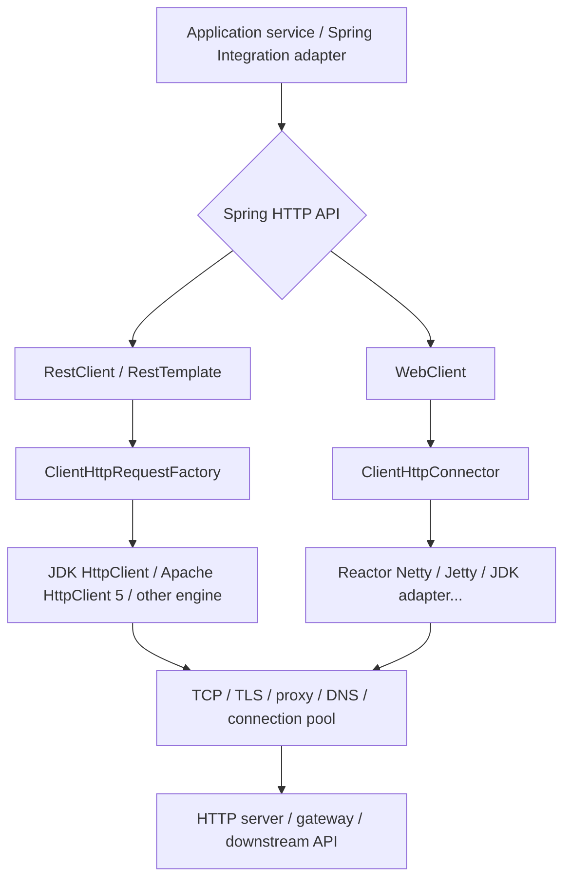
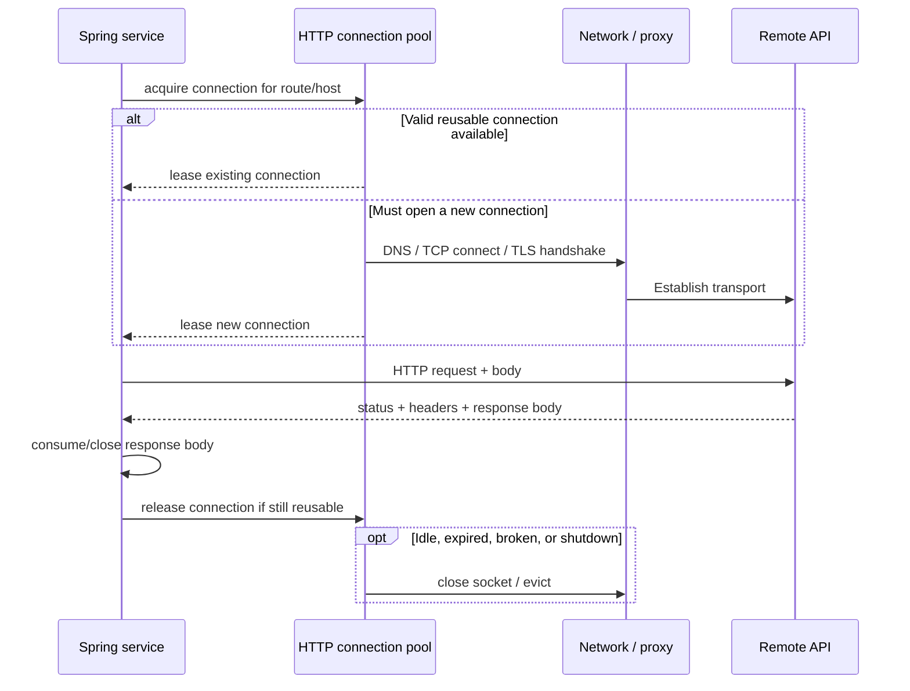
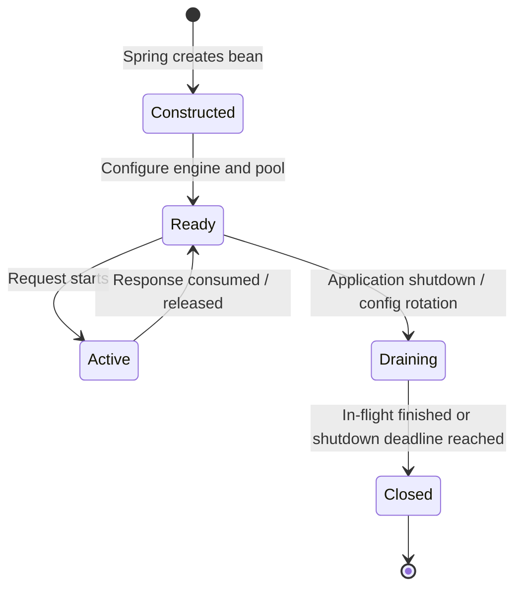
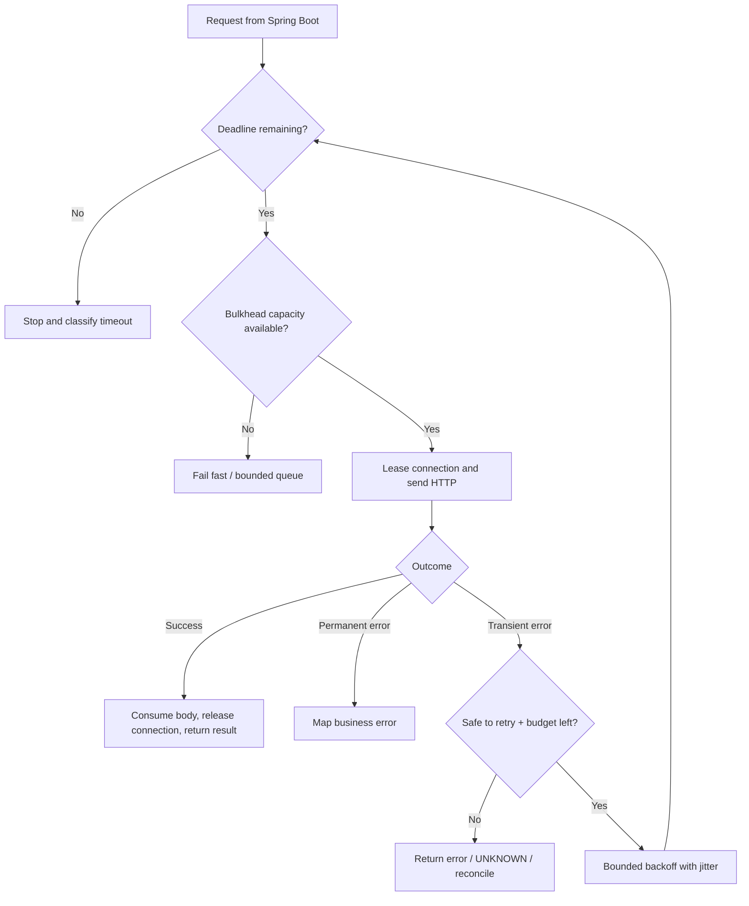
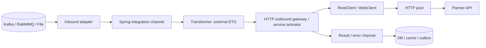

# Underlying HTTP Libraries, Connection Pools, and Connection Lifecycle

In **SPRING_BOOT_INTEGRATION**, HTTP clients are a critical link when Spring Boot calls partner APIs, internal services, or gateways fronting data systems. Choosing between `RestClient` and `WebClient` is only **part** of the decision: underneath sit the HTTP transport, DNS, TCP, TLS, proxies, connection pools, I/O schedulers, timeouts, and resource release mechanisms. A system can handle JSON and status codes accurately yet still degrade severely under load by **opening a new connection per request**, **failing to return connections to the pool**, or **configuring timeouts at the wrong phase**.

This lesson belongs to the **HTTP Client Selection** chapter and focuses on **underlying HTTP libraries, connection pools, and connection lifecycles** in Spring Boot. The goal is not to pick one "best" library for every case, but to understand which resources an HTTP call consumes, how pools are shared, how to protect them under load, and how to test them realistically. The material connects to configuration management, DTO contracts, retries, idempotency, transactions, caching, brokers, Spring Integration, testing, and observability for integration flows.

> Java examples target **Java 17+, Spring Boot 3.x / Spring Framework 6.x** with transport library versions managed by the Boot BOM. APIs for Apache HttpClient 5, Reactor Netty, and Spring builders may differ across releases; verify against your project's exact versions. Pool and timeout numbers are solely illustrative to show the mental model, **not optimal default configurations**.

## 1. Learning objectives

After this lesson, you will be able to:

1. Distinguish **Spring APIs** (`RestClient`, `WebClient`, `RestTemplate`, HTTP interfaces) from the **HTTP engine** performing network I/O (`JDK HttpClient`, Apache HttpComponents, Reactor Netty, etc.).
2. Describe the lifecycle from acquiring a pooled connection, opening TCP/TLS, sending the request, receiving the response, and releasing the body to reusing or closing the connection.
3. Distinguish pool acquisition timeout, TCP connect timeout, response/read timeout, idle timeout, connection lifetime, and overall operation deadline.
4. Design per-destination connection limits, concurrency, queueing, and HTTP/1.1 vs. HTTP/2 behavior.
5. Configure an HTTP client whose pool is **created once**, reused, and closed in a controlled manner in Spring Boot.
6. Understand failures such as connection leaks, stale connections, proxy/TLS/DNS changes, and retries causing duplicate side effects.
7. Test throughput/connections/timeouts, measure pool metrics, and select a transport matching the real constraints of an integration flow.

## 2. Two layers of choice: the API in code and the underlying HTTP transport

At the application layer, developers see code like `restClient.get().retrieve()` or `webClient.post().retrieve()`. However, **what manages sockets and connection pools** depends on the chosen `ClientHttpRequestFactory` (synchronous path) or `ClientHttpConnector` (reactive path).



| Component | Primary role | Does it determine pool sizing by itself? |
| --- | --- | --- |
| `RestClient` | Fluent **synchronous** Spring Framework HTTP API, returns result to calling thread | No. Depends on the underlying request factory/engine. |
| `RestTemplate` | Older synchronous API, still encountered in legacy projects | No. Also depends on the request factory. |
| `WebClient` | Reactive HTTP API based on Publisher/`Mono`/`Flux` | Not directly; depends on the connector and event-loop/transport. |
| Declarative HTTP interfaces | Proxies interface methods to HTTP calls via a chosen adapter | No. Must determine whether the proxy uses `RestClient` or `WebClient` and its engine. |
| `ClientHttpRequestFactory` | Synchronous Spring API bridge to HTTP transport | May hold/reference a pooled engine. |
| `ClientHttpConnector` | Reactive Spring API bridge to transport | Usually references an HTTP client and connection provider. |
| Apache HttpClient 5 | HTTP engine with explicitly configurable connection manager/pool | **Yes**, via `PoolingHttpClientConnectionManager` and request configuration. |
| JDK `java.net.http.HttpClient` | Standard JDK HTTP engine supporting HTTP/1.1 and HTTP/2 depending on peer | Manages connections internally; lacks Apache-style pool tuning APIs. |
| Reactor Netty `HttpClient` | Non-blocking network engine with event loop and `ConnectionProvider` | **Yes**, via `ConnectionProvider` and transport configuration. |

A `RestClient` can use Apache HttpClient; a `WebClient` can use Reactor Netty or another engine. Therefore, claims like "RestClient has no pool" or "WebClient handles all pooling automatically" are wrong without knowing the **underlying configuration**.

### 2.1. Blocking, non-blocking, and what to measure

- With a **synchronous client**, the calling thread usually waits until a response or error arrives. Concurrent requests are shaped by both the thread pool and connection pool.
- With a **reactive client**, network I/O need not block an event-loop thread; you still must cap open requests/connections, pending acquires, and response payload volume. Never block the event loop with `block()` or unisolated blocking JDBC calls.
- Never assume reactive is faster for a single isolated request. It can be more efficient in **thread usage under high concurrent I/O**, yet it remains constrained by target API, network, and pool bottlenecks.

Choosing synchronous or reactive must fit the caller's architecture, integration libraries, error handling, and operational readiness. **Misconfigured pooling** can trigger cascading timeouts under either model.

## 3. Lifecycle of an HTTP request and a connection

A typical HTTP exchange:



The lifecycle has critical phases:

1. **Destination/route resolution:** DNS lookup, proxy, target scheme/host/port, and TLS configuration. A hostname may resolve to different IPs over time.
2. **Acquiring a connection from the pool (*lease/acquire*):** if an idle, valid connection exists, reuse it; if below cap, open a new one; if full, the request waits or fails once the acquisition timeout expires.
3. **TCP connect and TLS handshake:** opening a new connection incurs network and CPU overhead for handshakes. Connect timeout may not cover every TLS or proxy negotiation phase.
4. **Sending the request and receiving the response:** request headers, body, server processing, and receiving status/headers/body. The network can be slow in either direction.
5. **Consuming or closing the response body:** the library must know the response is finished to reuse the connection safely. Leaving a body unread or unclosed can keep the connection busy.
6. **Returning to the pool or closing:** keep-alive enables reuse when protocol, headers, and socket state permit. Broken, expired-TTL, overly idle, or server-closed connections are evicted.
7. **Application shutdown:** custom HTTP clients/pools must be closed in accordance with bean lifecycle; leaving resources open past shutdown can leak threads, sockets, or background evictors.

**Do not confuse connection reuse with cached data:** a connection pool reuses the **TCP/TLS transport channel**, not the previous HTTP response. Caching lives at another layer with its own freshness and invalidation rules.

### 3.1. When is a connection not reused?

Examples: the server returns `Connection: close`, client/peer closes the socket, the response body was not fully consumed as required by the engine, the connection becomes invalid, proxy config changes, or the pool evicts it due to lifetime. Retrying after a connection failure must be distinguished from business retries: an error while reusing a "stale" socket may occur **before sending the full request**, yet does not always prove the remote side did not process it.

**HTTP keep-alive** keeps a connection open across multiple HTTP exchanges; **TCP keepalive** is a socket-level probe at the TCP layer, typically on a very different interval. These two concepts are not the same setting.

## 4. Underlying HTTP libraries and selection criteria

| Engine | Strengths/characteristics | Things to evaluate |
| --- | --- | --- |
| **JDK `HttpClient`** | Built into JDK 11+, supports synchronous/asynchronous, HTTP/2 when negotiated; minimal extra dependencies | Internal pool management; lacks full per-route/eviction tuning APIs like Apache; behavior and options depend on JDK version. |
| **Apache HttpComponents Client 5** | Explicit pooling manager, total/per-route caps, connect/socket/response/request timeouts, flexible proxy/TLS/routing | Must manage `CloseableHttpClient` and connection manager lifecycle; easy to misconfigure limits or accidentally create multiple pools. |
| **Reactor Netty** | Non-blocking, `ConnectionProvider`, event loop; fits `WebClient`/Reactor and high concurrent I/O | Must control pending acquire, max connections, event-loop blocking, resource cleanup, and backpressure. |
| **Jetty HTTP client** | Async HTTP client with Jetty pool, thread, and transport configuration | Requires matching versions and lifecycle management. |
| **Simple URLConnection-based factory** | Minimal config, suited for very basic cases | Lacks the same level of pool/metrics/timeout controls as dedicated engines; verify actual runtime behavior. |

**Do not choose by name alone:** evaluate HTTP/2, proxies, mTLS, OAuth/tokens, DNS failover, pool observability needs, project compatibility, and concurrency levels. Do not introduce a new engine just because a client "seems slow" when the real culprit is a DB query, partner latency, or lock contention.

### 4.1. How do HTTP/1.1 and HTTP/2 affect the pool?

With HTTP/1.1 in typical clients, one connection generally serves **one active request** at a time, so concurrent requests require multiple connections (aside from rarely used pipelining). HTTP/2 supports **multiplexing multiple streams over a single TCP connection**, bounded by stream/concurrency limits enforced by both peers and the client.

Therefore, **do not** mechanically apply "100 concurrent requests = 100 TCP connections" when running HTTP/2. At the same time, **HTTP/2 does not mean only one connection forever**: stream limits, flow control, server settings, proxies, TLS ALPN, HTTP/1.1 fallback, and reconnects all play a role.

`maxConnections` or `maxConnPerRoute` mean different things depending on engine and protocol. Before shrinking a pool to a couple of sockets assuming HTTP/2, verify that **HTTP/2 is actually negotiated** and stream/concurrency metrics are sufficient. A proxy may speak HTTP/2 to the client while falling back to HTTP/1.1 toward the backend.

## 5. Connection pools: limits, waiting, reuse, and resource coordination

A connection pool holds reusable connections keyed by the engine's **destination/route** logic. A route may comprise scheme, host, port, proxy, TLS config, and other attributes depending on implementation. Do not assume two URLs sharing DNS/IP always share a pool, nor that different hosts share a socket.

| Pool property | Meaning | Risk if misconfigured |
| --- | --- | --- |
| **`max total connections`** | Ceiling on total connections in the shared pool | Too low causes acquire waits; too high exhausts file descriptors/sockets and overloads servers. |
| **`max per route`** | Ceiling per target/route (where supported by engine) | A busy partner stalls, or starves others if unpartitioned. |
| **Pending acquire queue** | Number of requests waiting for a connection | Unbounded queues inflate latency/memory and mask overload. |
| **Pool acquisition timeout** | Time spent waiting to lease a connection | Longer than overall deadline causes callers to wait pointlessly. |
| **Max idle time** | How long an idle connection remains eligible before pool eviction | Too long risks sockets closed by NAT/load balancers; too short increases TLS handshakes. |
| **Max connection lifetime / TTL** | Maximum lifespan of a connection, even if active | Forces periodic reconnects; too short causes churn, too long sticks to old routes/TLS. |
| **Idle eviction / validation** | Detecting and pruning stale/broken connections | Without proper policies, reuse hits "stale connection" errors. |
| **Shutdown/dispose** | Releasing the entire pool and background resources | Missing cleanup leaves sockets/threads alive past intended lifecycle. |

A large pool cannot fix a target service that only tolerates 20 concurrent requests. If each instance has a max pool of 100 and you run 10 instances, **aggregate connection capacity** can reach 1,000, not counting other clients or processes. Match capacity to the target API, load balancer, and downstream database limits.

### 5.1. Estimating pool size from actual concurrency

A starting estimate from Little's Law under steady state:

\[
\text{average in-flight requests}
\approx
\text{throughput (req/s)}
\times
\text{average latency (s)}
\]

For instance, one instance sends **60 requests/second** to a partner with **0.2 seconds** average latency: average concurrency is about **12 requests**. With HTTP/1.1 and one active request per connection, a pool of **12** covers the average but lacks headroom for p95/p99, bursts, retries, or latency spikes. An initial illustrative range of **24–32 connections per route** can be load-tested and tuned, rather than treated as a mandatory magic number.

When scaling to 5 instances, recalculate aggregate concurrency and downstream limits. If the target API only handles 40 concurrent requests, raising **each** instance's pool to 200 usually makes things worse. You may need bulkheads, per-host concurrency limits, rate limiters, and bounded queues rather than merely adding sockets.

### 5.2. HTTP pools are not DB pools

An HTTP pool protects sockets to a partner; `HikariCP` protects JDBC connections to a database. A single application HTTP request can simultaneously hold **one worker thread**, **one DB connection**, and **one outbound HTTP connection** if transaction boundaries are poorly scoped. Never make external HTTP calls while holding long DB locks/transactions unless specifically designed and measured.

Example chain: inbound HTTP → BEGIN transaction → SQL → 3-second partner call → COMMIT. Even though SQL took only 20 ms, the DB connection and locks may be held for the full 3 seconds. Tuning the HTTP pool will not fix that waste; fix the transaction, async, or outbox boundary instead.

## 6. Per-phase timeouts and end-to-end operation deadlines

The most frequently confused timeouts:

| Timeout | Phase protected | What it does NOT prove |
| --- | --- | --- |
| **Pool acquire / connection request timeout** | Waiting for a free connection from the pool | Does not bound DNS/connect/response once a connection is leased. |
| **DNS resolution timeout** | Depends on resolver/transport and OS/JVM settings | Not every engine exposes a convenient standalone property. |
| **TCP connect timeout** | Establishing TCP connection to host/proxy | Does not necessarily cover TLS handshake, pool acquisition, or full response. |
| **TLS handshake timeout** | TLS handshake in engines supporting dedicated config | Does not mean the HTTP server processed the request. |
| **Socket/read inactivity timeout** | One I/O wait interval per engine semantics | Not always the **total** time to receive a body or stream. |
| **Response timeout** | Usually bounds waiting for a response; exact meaning varies by engine | Some clients measure time to headers, others silence gaps; never treat as full E2E. |
| **Request/operation timeout** | One full HTTP call where supported by engine/API | Excludes business steps before/after HTTP. |
| **Overall business deadline** | Entire flow across HTTP + DB + cache + broker + serialization/retries | Not automatically enforced just by transport timeouts. |
| **Idle timeout / TTL** | Connection lifespan **while idle** or total socket age | Not a deadline for completing a business request. |

Suppose a task must finish within **2,500 ms** and has already spent 900 ms in JDBC. Even if the HTTP client has `responseTimeout=2s`, only **1,600 ms** remain, and you still need reserve time for subsequent steps. Do not let the HTTP call consume a full 2 seconds. Before each I/O step:

\[
\text{allowedStep}
= \min(\text{configuredStepLimit},
       \text{remainingOverallBudget} - \text{reserve})
\]

If the result is non-positive, **do not start the new step**. Within a single Java process, `System.nanoTime()` is suited for measuring elapsed intervals. When propagating deadlines across systems or brokers, use UTC timestamps or budgets accounting for clock skew—never pass machine A's raw `nanoTime` to machine B.

**A timeout can occur after the server has already committed the effect.** If `POST /payments` times out while the client waits for a response, you cannot conclude the payment did not happen. Use a stable idempotency key, a status-inquiry API, transactional outbox, or reconciliation process as required by the business. Never blindly retry a side-effecting request merely because a connection closed.

## 7. What Spring Boot configures vs. what the application owns

In Spring Boot 3.x, Boot can create and customize **`RestClient.Builder`** when corresponding libraries are present (especially from Boot 3.2 / Framework 6.1) and **`WebClient.Builder`** when WebFlux is present. Spring-managed builders can be wired with HTTP message converters/codecs, metrics/tracing, and request factory/connector detection depending on dependencies and versions.

However, **Boot cannot know how many connections each partner needs, how many concurrent requests are safe, which proxy/TLS profile applies, or what idle timeouts and SLAs hold**. Adding Apache HttpClient or Reactor Netty to the classpath **does not automatically ensure** all application requests share a single intentionally tuned pool.

| What Boot can prepare when conditions match | What the application must decide itself |
| --- | --- |
| Auto-configure `RestClient.Builder`, `WebClient.Builder`, and certain customizers | Choose the right **underlying engine** per outbound adapter. |
| Message converters/JSON codecs and Boot ecosystem integration | JSON/XML contracts, headers, credentials, error mapping, and schema versions. |
| Certain shared HTTP resources enabled across the ecosystem | Pool size, pending acquire, connection lifetime, proxy, TLS, and per-partner isolation. |
| Context/lifecycle for Spring-managed beans | Own and close custom `CloseableHttpClient`/`ConnectionProvider` at the right time. |
| Infrastructure observability when Actuator/Micrometer and auto-config apply | Per-partner metrics, timeout classification, end-to-end deadlines, retries, and alerts. |

**Preferred path:** inject a Boot-managed builder and build **one client per partner** as a singleton Spring bean. Never build a new client **per request**. If using a custom engine and pool, declare them as beans with clear lifecycle ownership.

Distinguish:

```java
// Avoid inside request-handling methods if it creates a new
// HTTP engine/pool or bypasses Spring Boot configuration:
RestClient client = RestClient.create();

// Instead, inject Boot-managed RestClient.Builder into @Configuration,
// configure baseUrl and transport, and build the RestClient bean once.
```

`RestClient.create()` is not "forbidden": it is handy for small programs or controlled experiments. The problem is **creating it repeatedly without understanding transport and lifecycle**, or assuming it automatically receives all Boot customizers, tracing, and pooling. Likewise, do not casually call `WebClient.create()` and bypass project-managed connector configuration.

### 7.1. One pool for all partners or one pool per partner?

An HTTP engine can maintain **per-route pools** for multiple hosts. A single shared pool reduces management overhead, yet different partners may require:

- Different **mTLS certificates**, trust stores, or proxies;
- Different concurrency limits and distinct SLAs;
- Isolated authentication policies to prevent header leakage between partners;
- Protection so one target system cannot exhaust connections and starve others;
- Independent certificate/token/endpoint rotation schedules.

In those cases, create **separate HTTP clients/pools per policy group of partners**, though not necessarily one client per endpoint path. Never rely on a single shared `RestClient`/`WebClient` with mutable default headers to inject the current tenant's credentials; per-request headers must be supplied per call.

## 8. Example: Spring Boot + RestClient + Apache HttpClient 5

Apache HttpComponents Client 5 fits well when you need explicit control over **max total/per-route**, connection lifetime, idle eviction, and HTTP settings. In Maven, alongside the Spring Web starter, add Apache HttpClient 5 if not already pulled transitively:

```xml
<dependency>
    <groupId>org.springframework.boot</groupId>
    <artifactId>spring-boot-starter-web</artifactId>
</dependency>
<dependency>
    <groupId>org.apache.httpcomponents.client5</groupId>
    <artifactId>httpclient5</artifactId>
</dependency>
```

To ensure Apache is actually used, **explicitly specify the request factory** rather than assuming Boot selects this engine. Example for Spring Framework 6.x with Apache HttpClient 5:

```java
import org.apache.hc.client5.http.config.ConnectionConfig;
import org.apache.hc.client5.http.impl.classic.CloseableHttpClient;
import org.apache.hc.client5.http.impl.classic.HttpClients;
import org.apache.hc.client5.http.impl.io.PoolingHttpClientConnectionManager;
import org.apache.hc.client5.http.impl.io.PoolingHttpClientConnectionManagerBuilder;
import org.apache.hc.core5.util.TimeValue;
import org.apache.hc.core5.util.Timeout;
import org.springframework.context.annotation.Bean;
import org.springframework.context.annotation.Configuration;
import org.springframework.http.client.HttpComponentsClientHttpRequestFactory;
import org.springframework.web.client.RestClient;

@Configuration(proxyBeanMethods = false)
public class PartnerApacheHttpConfig {

    @Bean(destroyMethod = "close")
    CloseableHttpClient partnerApacheHttpClient() {
        PoolingHttpClientConnectionManager pool =
                PoolingHttpClientConnectionManagerBuilder.create()
                        .setMaxConnTotal(80)
                        .setMaxConnPerRoute(24)
                        .setDefaultConnectionConfig(
                                ConnectionConfig.custom()
                                        .setConnectTimeout(
                                                Timeout.ofMilliseconds(250))
                                        .setSocketTimeout(
                                                Timeout.ofMilliseconds(900))
                                        .setTimeToLive(TimeValue.ofMinutes(3))
                                        .build())
                        .build();

        return HttpClients.custom()
                .setConnectionManager(pool)
                .evictExpiredConnections()
                .evictIdleConnections(TimeValue.ofSeconds(30))
                .build();
    }

    @Bean
    RestClient partnerRestClient(
            RestClient.Builder builder,
            CloseableHttpClient partnerApacheHttpClient) {

        var requestFactory =
                new HttpComponentsClientHttpRequestFactory(
                        partnerApacheHttpClient);
        requestFactory.setConnectionRequestTimeout(200);

        return builder
                .requestFactory(requestFactory)
                .baseUrl("https://partner.example.org")
                .build();
    }
}
```

**Configuration breakdown:**

| Setting | Meaning |
| --- | --- |
| `setMaxConnTotal(80)` | Maximum of 80 total connections in this client's Apache pool. |
| `setMaxConnPerRoute(24)` | Maximum of 24 connections to one route as defined by Apache. |
| `setConnectionRequestTimeout(200)` | Caller waits up to ~200 **milliseconds** to acquire a connection from the manager; not the TCP connect timeout. |
| `setConnectTimeout(250 ms)` | Bounds connection establishment per Apache connection config; not an overall deadline for all phases. |
| `setSocketTimeout(900 ms)` | Bounds socket read operations per HttpCore semantics, **not total E2E time** for large bodies. |
| `setTimeToLive(3 minutes)` | Caps connection age; reduces the chance of keeping connections stale for too long. |
| `evictIdleConnections(30 seconds)` | Evicts connections idle too long via background eviction, preventing stale socket buildup. |
| `@Bean(destroyMethod="close")` | Spring invokes `close()` on bean destruction, cleaning up the HTTP client/pool/background resources it owns. |

**Ownership note:** In this snippet, the pool is created **inside** the `CloseableHttpClient` bean, and the client owns the pool by default. When Spring closes the client, the pool is released. If you declare the pool as a separate bean and share it across multiple clients in shared connection manager mode, define **who actually closes the pool**; never close it while another client is still active.

**Timeout note:** Not every Spring Framework 6.x release exposes identical `setReadTimeout` setters on `HttpComponentsClientHttpRequestFactory`. The example uses Apache's `ConnectionConfig` for socket timeout and the request factory's `setConnectionRequestTimeout` to avoid version-specific API confusion. If you want to bound waiting for a response via `RequestConfig.setResponseTimeout` or per request, configure it explicitly on the Apache client/context and verify its semantics in your HttpClient 5 version.

### 8.1. Creating a business adapter using the configured client

```java
import org.springframework.beans.factory.annotation.Qualifier;
import org.springframework.stereotype.Component;
import org.springframework.web.client.RestClient;

public record PartnerOrderResponse(String orderId, String status) {}

@Component
public class PartnerOrderHttpAdapter {
    private final RestClient client;

    public PartnerOrderHttpAdapter(
            @Qualifier("partnerRestClient") RestClient client) {
        this.client = client;
    }

    public PartnerOrderResponse fetch(String orderId) {
        PartnerOrderResponse response = client.get()
                .uri("/v1/orders/{id}", orderId)
                .retrieve()
                .body(PartnerOrderResponse.class);

        if (response == null) {
            throw new IllegalStateException("Empty partner response");
        }
        return response;
    }
}
```

`RestClient` is built once and can be reused safely across threads under normal usage; each call creates request-specific state instead of mutating the bean. This sample omits authentication, status/error mapping, retries, and workflow deadlines; those belong to the application's adapter design.

### 8.2. Why not create `CloseableHttpClient` per request?

If each request runs `HttpClients.custom().build()` and forgets to close it:

- Each new instance creates its **own pool and connection manager**, losing keep-alive and reuse.
- TCP connect and TLS handshakes repeat on every call, increasing latency and CPU on both client and server.
- Sockets and thread/eviction resources can accumulate when not closed properly.
- There is no single place to cap concurrency, inspect pool stats, or update configuration.

Even if `try-with-resources` closes the client after each request, you avoid some leaks but **still get no long-lived connection pooling**. That is typically a design flaw for continuously running web services, unlike a CLI tool that sends one request and exits.

## 9. Example: RestClient with JDK `HttpClient`

When fine-grained Apache per-route pool tuning is unnecessary, `java.net.http.HttpClient` is a low-dependency option. It supports HTTP/2 when server/proxy compatibility allows; configuring HTTP/2 is a **negotiation preference**, not a guarantee every request uses HTTP/2.

```java
import java.net.http.HttpClient;
import java.time.Duration;
import org.springframework.context.annotation.Bean;
import org.springframework.context.annotation.Configuration;
import org.springframework.http.client.JdkClientHttpRequestFactory;
import org.springframework.web.client.RestClient;

@Configuration(proxyBeanMethods = false)
public class PartnerJdkHttpConfig {

    @Bean
    HttpClient partnerJdkHttpClient() {
        return HttpClient.newBuilder()
                .connectTimeout(Duration.ofMillis(300))
                .version(HttpClient.Version.HTTP_2)
                .build();
    }

    @Bean
    RestClient partnerJdkRestClient(
            RestClient.Builder builder, HttpClient partnerJdkHttpClient) {

        var factory = new JdkClientHttpRequestFactory(
                partnerJdkHttpClient);
        factory.setReadTimeout(Duration.ofMillis(900));

        return builder
                .requestFactory(factory)
                .baseUrl("https://partner.example.org")
                .build();
    }
}
```

**This is an alternative** to the Apache configuration in section 8, not an instruction to register two identically named `RestClient` beans in one app. `JdkClientHttpRequestFactory.setReadTimeout(Duration)` belongs to compatible Spring Framework generations; check APIs for your project version. The JDK client manages connections internally and can be shared across many calls when the instance is reused.

Trade-off: **you cannot apply Apache's `setMaxConnPerRoute`/`PoolingHttpClientConnectionManager` APIs to the JDK client**. If you need per-partner request concurrency limits, use a semaphore/bulkhead/rate limiter in the adapter layer or pick an engine with the required pool controls. Do not confuse physical connection limits with limits on active HTTP/2 streams/requests.

Note that JDK lifecycle support varies across Java versions. On Java 17, do not assume the same public `close()/shutdown()` APIs available in newer JDKs; if your project requires strict network resource teardown, check the exact lifecycle support in the deployed JDK. Keeping one long-lived `HttpClient` for the application's lifetime remains far better than creating a new instance per call.

## 10. WebClient + Reactor Netty: managing `ConnectionProvider`

For WebFlux applications or reactive clients, Reactor Netty lets you configure the pool via **`ConnectionProvider`**. Example for Java 17+ / Spring Boot 3.x:

```xml
<dependency>
    <groupId>org.springframework.boot</groupId>
    <artifactId>spring-boot-starter-webflux</artifactId>
</dependency>
```

Declare a custom provider and reuse it for a `WebClient`:

```java
import io.netty.channel.ChannelOption;
import java.time.Duration;
import org.springframework.context.annotation.Bean;
import org.springframework.context.annotation.Configuration;
import org.springframework.http.client.reactive.ReactorClientHttpConnector;
import org.springframework.web.reactive.function.client.WebClient;
import reactor.netty.http.client.HttpClient;
import reactor.netty.resources.ConnectionProvider;

@Configuration(proxyBeanMethods = false)
public class PartnerReactiveHttpConfig {

    @Bean(destroyMethod = "dispose")
    ConnectionProvider partnerConnectionProvider() {
        return ConnectionProvider.builder("partner-api-pool")
                .maxConnections(50)
                .pendingAcquireMaxCount(100)
                .pendingAcquireTimeout(Duration.ofMillis(200))
                .maxIdleTime(Duration.ofSeconds(30))
                .maxLifeTime(Duration.ofMinutes(3))
                .evictInBackground(Duration.ofSeconds(15))
                .build();
    }

    @Bean
    WebClient partnerWebClient(
            WebClient.Builder builder,
            ConnectionProvider partnerConnectionProvider) {

        HttpClient engine = HttpClient.create(partnerConnectionProvider)
                .option(ChannelOption.CONNECT_TIMEOUT_MILLIS, 300)
                .responseTimeout(Duration.ofMillis(900));

        return builder
                .clientConnector(new ReactorClientHttpConnector(engine))
                .baseUrl("https://partner.example.org")
                .build();
    }
}
```

```java
import org.springframework.beans.factory.annotation.Qualifier;
import org.springframework.stereotype.Component;
import org.springframework.web.reactive.function.client.WebClient;
import reactor.core.publisher.Mono;

@Component
public class ReactivePartnerOrderAdapter {
    private final WebClient client;

    public ReactivePartnerOrderAdapter(
            @Qualifier("partnerWebClient") WebClient client) {
        this.client = client;
    }

    public Mono<PartnerOrderResponse> fetch(String orderId) {
        return client.get()
                .uri("/v1/orders/{id}", orderId)
                .retrieve()
                .bodyToMono(PartnerOrderResponse.class);
    }
}
```

| Reactor Netty setting | Meaning |
| --- | --- |
| `maxConnections(50)` | Maximum connections per provider policy for managed pools. |
| `pendingAcquireMaxCount(100)` | Caps requests waiting to acquire per provider mechanism; prevents unbounded queues. |
| `pendingAcquireTimeout(200 ms)` | Caps wait time to acquire a connection, distinct from TCP connect. |
| `maxIdleTime(30 s)` | Connections idle too long can be evicted per pool policy. |
| `maxLifeTime(3 minutes)` | Caps connection age during checks and reuse. |
| `evictInBackground(15 s)` | Periodically purges invalid/expired connections based on configured criteria. |
| `CONNECT_TIMEOUT_MILLIS=300` | Limits TCP connect establishment. |
| `responseTimeout(900 ms)` | Guards waiting for response per Reactor Netty semantics, not an end-to-end business deadline. |
| `destroyMethod="dispose"` | Disposes the application-created provider/pool when the context closes. |

**Important lifecycle note:** Reactor Netty may use **global shared event-loop resources** (and other HTTP resources) depending on configuration. When the application creates a custom `ConnectionProvider`, it must dispose of that provider; do not dispose shared event-loop resources while other clients remain active. In Spring Boot, inspect integration with `ReactorResourceFactory`/actual lifecycle before deeply customizing `LoopResources` or altering global resource management.

### 10.1. Reactive does not eliminate the need for backpressure

A `WebClient` can initiate many async requests quickly, yet the pool only permits 50 connections and up to 100 pending acquires in the example. If upstream fires 10,000 requests at once, requests **will be rejected, queued, or timed out**—"non-blocking" does not mean "infinite."

Cap concurrency at the calling layer, e.g., via `flatMap(..., concurrency)`, bulkheads, or per-partner rate limiters. When consuming from a broker/queue, the count of Kafka listeners, AMQP consumers, or Spring Integration pollers must also align with HTTP pool and DB pool capacities. If a broker delivers faster than downstream can sustain, lower prefetch/batch sizes or offload work to a durable queue.

### 10.2. Reactive deadlines and cancellation

Reactive pipelines can apply `timeout(Duration)` to bound how long a **subscriber waits for a result**:

```java
import java.time.Duration;
import reactor.core.publisher.Mono;

public Mono<PartnerOrderResponse> fetchWithinBudget(
        ReactivePartnerOrderAdapter adapter,
        String orderId,
        Duration remainingBudget) {
    return adapter.fetch(orderId)
            .timeout(remainingBudget);
}
```

Timeout triggers cancellation of the subscription and frees client-side transport resources, but **cannot undo a side effect already committed on the server**. For safe `GET`s, retries may be simpler; for a payment `POST`, always require an idempotency key and a way to query the outcome when responses are lost.

Never call `block()` on a **Netty event-loop thread**. If the overall architecture is synchronous Spring MVC, `WebClient` can be used if you understand the thread cost and trade-offs of `block()` versus `RestClient`. Never rewrite an entire system to reactive solely to get a connection pool: Apache HttpClient 5 and the JDK client reuse connections as well.

## 11. Keep-alive, stale connections, DNS, TLS, and proxies

In cloud environments, requests commonly traverse **DNS → load balancer/proxy → gateway → server**. A connection pool must handle partner IP changes, ingress drains, NAT dropping idle sockets, certificate rotations, or server-initiated connection closes.

### 11.1. Keep-alive must fit the idle timeout along the entire path

Example:

```text
Spring Boot instance
    |
    | idle connection after 90 seconds
    v
Load balancer: closes idle connection after 60 seconds
    |
    v
Partner API
```

If the client keeps a pooled connection for 90 seconds while the load balancer closes idle sockets after 60 seconds, the next reuse attempt may hit EOF, reset, or connection closed. The pool will need to establish a fresh connection. Depending on the client and failure timing, the request may be retried automatically or fail back to the application.

One way to reduce errors is setting the client's **max idle time** **lower** than the load balancer/proxy's documented idle timeout, combined with eviction/validation and safe retries. However, do not assume lowering idle timeout eliminates all resets: servers can still close connections at any moment due to deployments, overload, or network faults.

### 11.2. DNS changes do not immediately redirect existing sockets

When DNS returns a new IP, already-open connections remain tied to the previous IP until closed. A pool with an overly long lifetime can keep hitting the old target as long as the network accepts it; conversely, if the old IP stops serving, broken connections must be evicted and recreated to re-resolve and reconnect. DNS TTL is governed by resolvers, the JVM, OS, client, and infrastructure; **connection TTL is different from DNS TTL**.

Do not try to "fix DNS failover" simply by increasing `maxConnections`. Measure reuse, lifetime, and error rates during rolling deployments, and inspect the actual load balancer behavior.

### 11.3. TLS and certificate rotation

A TLS handshake occurs when opening a new transport connection; reused requests may skip re-handshaking from scratch. When rotating a trust store or client certificate for mTLS:

- Determine whether the HTTP client/pool reloads TLS configuration; many engines construct the SSL context at startup.
- Existing connections may persist until expired or closed; set lifetimes and plan rotation accordingly.
- If replacing an SSL context/identity, you may need to **build a new pool** and drain the old pool instead of mutating shared state mid-flight.
- Never disable hostname verification or trust validation just to bypass handshake errors in staging or production.

TLS version, ciphers, SNI, proxy CONNECT, ALPN/HTTP2 negotiation, and mTLS policies all affect connection latency. Test through proxies/gateways mirroring production rather than concluding solely from `localhost`.

### 11.4. Do not mix security identities inside one shared pool arbitrarily

Two partners might share a hostname behind a reverse proxy while requiring different certificates or credentials. Some authentication lives in request headers, while some belongs to the **transport/TLS connection**. When client certificates or proxy auth must stay separate, configure two distinct clients/pools—never mutate a shared client's SSL context or default headers right before a call.

**Connection reuse must never become "session leakage":** never store tenant tokens in mutable default headers and swap them per current thread. An immutable client can be shared, while each request supplies its own credentials, correlation ID, and idempotency key per contract.

## 12. Spring bean lifecycle and safe shutdown

An outbound client in Spring Boot typically lives roughly as long as the application context:



Operational aspects to distinguish:

1. **Beans created once:** `RestClient`/`WebClient` along with their HTTP engine/pool are initialized during configuration, not created per inbound request.
2. **Owning bean:** each custom pool is owned by a bean with a clear lifecycle. In the Apache example, `CloseableHttpClient` closes the manager; in Reactor Netty, the app-created `ConnectionProvider` is disposed.
3. **In-flight requests:** when a deployment stops, Spring Boot offers server graceful shutdown depending on version/config, but **inbound graceful shutdown does not automatically drain all custom outbound HTTP calls cleanly**. Define which requests may complete, shutdown timeouts, and safe cancellation.
4. **Retries/jobs across shutdown:** if an HTTP call already sent a broker message or created an outbox/job, shutdown must not treat that effect as undone. Durable state and idempotency enable safe recovery on restart.
5. **Shared beans/transports:** if multiple adapters share a pool, never shut it down with one adapter's lifecycle while others are active, or they will fail with `connection pool shut down`.

### 12.1. Avoid the extremes of "closing too early" and "never closing"

| Practice | Consequence |
| --- | --- |
| Opening/closing `CloseableHttpClient` per request | Loses pooling, increases TCP/TLS overhead; no long-lived connection reuse. |
| Creating a new pool per tenant/request | Sockets/background resources grow with tenant cardinality, hard to cap total usage. |
| Closing a shared manager when a secondary client shuts down | Other clients sharing that manager fail; define a single owner. |
| Failing to close custom pools on context destruction | Resource leaks or unfreed resources during test/dev reloads. |
| Arbitrarily disposing global event loops | Can halt other reactive clients or servers. |

**Good pattern:** the Spring context owns transport/pool beans, and adapters only **use** them. Runtime adjustments (if needed) go through an explicit config-reload mechanism that stands up a replacement client/pool, shifts traffic, and drains the old pool safely.

### 12.2. Streaming resources need their own lifecycle

Not every request receives a few KB of JSON. Downloading large files, Server-Sent Events (SSE), or streaming HTTP responses can hold a connection open for a long time. A small pool sized for normal JSON APIs can be **completely occupied by streaming requests**.

When dealing with long-lived streams:

- Consider a dedicated pool/client or cap concurrent streams.
- Read and process responses using streaming APIs so the full body is not buffered in RAM.
- Close streams and propagate cancellation properly when the request or user cancels.
- Avoid setting an unreasonably short `readTimeout` on valid long-lived streams, while still enforcing heartbeats and dead-connection detection.

An SSE endpoint might send a heartbeat every 15 seconds with a longer silence timeout per contract; that is a different problem from a GET JSON API returning in a few hundred milliseconds. Never force both onto the same pool/timeout profile merely because both speak HTTP.

## 13. Reading response bodies properly to return connections to the pool

A connection can stay leased longer than expected if the application fails to consume or close the response body according to the client's contract. Result: new requests **wait to acquire** even though the target server is fast.

With standard usage:

```java
PartnerOrderResponse response = partnerRestClient.get()
        .uri("/v1/orders/{id}", orderId)
        .retrieve()
        .body(PartnerOrderResponse.class);
```

Spring and the HTTP engine handle reading and closing the response in normal flow, making it safer than holding raw `InputStream`s manually. When using **low-level exchange**, streaming downloads, or custom body parsing, ensure resources are closed/consumed.

Example of streaming consumption inside `RestClient.exchange`:

```java
import java.io.IOException;
import java.io.InputStream;
import org.springframework.web.client.RestClient;

public final class PartnerFileDownloader {
    private final RestClient client;

    public PartnerFileDownloader(RestClient client) {
        this.client = client;
    }

    public long countBytes(String documentId) {
        return client.get()
                .uri("/v1/documents/{id}", documentId)
                .exchange((request, response) -> {
                    if (!response.getStatusCode().is2xxSuccessful()) {
                        throw new IllegalStateException(
                                "Download failed: " + response.getStatusCode());
                    }
                    try (InputStream body = response.getBody()) {
                        byte[] buffer = new byte[8192];
                        long count = 0;
                        int read;
                        while ((read = body.read(buffer)) != -1) {
                            count += read;
                        }
                        return count;
                    } catch (IOException ex) {
                        throw new IllegalStateException(
                                "Unable to read response body", ex);
                    }
                });
    }
}
```

This is a **chunked-reading example**, not writing to a real file. Never echo large response bodies into logs or hold large byte arrays in memory unnecessarily. Adapters downloading files must cap max size, verify checksums/content types, prevent path traversal on partner-supplied filenames, and apply suitable timeouts.

In reactive `WebClient`, standard `retrieve().bodyToMono(...)` or `bodyToFlux(...)` lets codecs consume data; when using `exchangeToMono`/`exchangeToFlux` or handling raw `DataBuffer`, follow release/cancellation contracts strictly. Avoid calling `subscribe()` casually while ignoring error handling and omitting lifecycle attachment.

### 13.1. A "connection leak" is not always an unclosed socket

A pool reporting `leased=24, available=0, pending=100` can happen when:

- 24 requests are genuinely waiting on a slow server;
- Response bodies were not consumed/closed;
- 24 streaming requests hold connections long-term;
- Blocking code in handlers delays release;
- Retries/call fan-out hold too much concurrent I/O.

Therefore, inspect **pool stats and per-step latency** rather than concluding a leak solely because `available=0`. Real leaks show leased connections failing to return even after business processing finishes and no requests remain active.

## 14. Per-partner and per-environment configuration

Place transport settings in a clearly named application namespace instead of scattering timeout numbers across Java classes:

```yaml
app:
  partners:
    catalog:
      base-url: ${CATALOG_API_URL:https://sandbox.catalog.example.org}
      max-total-connections: 80
      max-connections-per-route: 24
      pool-acquire-timeout: 200ms
      connect-timeout: 250ms
      socket-timeout: 900ms
      max-connection-lifetime: 3m
      idle-eviction: 30s
    billing:
      base-url: ${BILLING_API_URL:https://sandbox.billing.example.org}
      max-connections-per-route: 8
      pool-acquire-timeout: 100ms
      connect-timeout: 300ms
      socket-timeout: 1500ms
```

`app.partners.*` are **not** built-in Boot properties. Declare `@ConfigurationProperties` with validation and explicitly **apply** those values to the concrete HTTP engine/pool. Example:

```java
import jakarta.validation.constraints.Min;
import jakarta.validation.constraints.NotNull;
import java.net.URI;
import java.time.Duration;
import org.springframework.boot.context.properties.ConfigurationProperties;
import org.springframework.validation.annotation.Validated;

@Validated
@ConfigurationProperties(prefix = "app.partners.catalog")
public record CatalogHttpProperties(
        @NotNull URI baseUrl,
        @Min(1) int maxTotalConnections,
        @Min(1) int maxConnectionsPerRoute,
        @NotNull Duration poolAcquireTimeout,
        @NotNull Duration connectTimeout,
        @NotNull Duration socketTimeout,
        @NotNull Duration maxConnectionLifetime,
        @NotNull Duration idleEviction
) {}
```

When using this properties record, register it via `@ConfigurationPropertiesScan` on the application or `@EnableConfigurationProperties(CatalogHttpProperties.class)` on the appropriate configuration class. Then wire those values when constructing `CloseableHttpClient` and `RestClient`. **Never mutate fields on a singleton pool lacking thread-safe reconfiguration APIs simply because dynamic config reloaded.**

### 14.1. Configure by SLA instead of copy/paste

Billing may need fewer connections with a longer read timeout than catalog; a search API may need many short GET requests with minimal side effects. Define profiles by characteristics:

| Partner | Characteristics | Configuration priority |
| --- | --- | --- |
| Catalog/read API | Frequent GETs, small bodies, cacheable | Adequately sized pool, low latency, bounded safe retries. |
| Billing/payment API | Side-effecting POSTs, tighter concurrency | Strict limits, idempotency keys, timeout classification, and reconciliation. |
| File export/download | Large bodies, long streams | Dedicated pool/connections, appropriate size/time caps, guaranteed body close. |
| Notification provider | Burst messaging, rate limits | Rate limiter, batching/backpressure, 429/`Retry-After` handling per contract. |

Clients can be shared within a **group with matching policies**. Avoid creating one pool per URL path or per customer if that explodes pool counts. Conversely, never share TLS trust configurations between two partners requiring distinct security identities.

### 14.2. Secrets and security configuration

Credentials, client certificates/private keys, and proxy passwords must come from a secret manager or environment variables per security policy. Never commit real values in sample production YAML. When observing HTTP errors, never log `Authorization`, cookies, or full bodies containing sensitive data; log intentional metadata like logical host/operation, status, latency, and correlation ID.

## 15. Retries, backpressure, circuit breakers, and idempotency must accompany the pool

A connection pool controls **socket counts**; it does not automatically solve retries, overload, or business correctness. Worse, misconfigured retries cause a slow target to be called **even more**:



### 15.1. Do not let retries collapse the pool

Suppose a target API has a 24-connection pool. When the partner slows down, 24 requests are busy and 100 are pending; if every caller retries three times immediately, queued work multiplies even further. Coordinate:

1. **Per-phase timeouts:** pool acquire, connect, read/response, and overall deadline.
2. **Max attempts + backoff:** retry only appropriate transient errors; never retry validation errors or 4xx in general.
3. **Remaining budget:** before each retry, verify enough time remains for backoff, acquisition, the partner call, and final required steps.
4. **Concurrency/bulkhead:** cap active requests per partner, even when HTTP/2 multiplexing permits multiple streams on one socket.
5. **Circuit breaker:** when a dependency fails broadly, reject a portion of calls early per policy to shed load and recover faster.
6. **Rate limiting:** obey partner limits and `429 Too Many Requests`, honoring `Retry-After` when permitted by contract and within deadline.

**Transport retries differ from business retries.** An HTTP engine may automatically retry certain connection-level failures, while the application adapter has Spring Retry/Resilience4j retries. Without coordination, actual attempts can far exceed what developers think is configured.

### 15.2. Side-effecting operations must preserve idempotency keys

Suppose a workflow receives `POST /api/payments`, records internal state, and sends `POST` to a payment service:

```text
Client sends payment(requestId = pay-892)
  -> Spring Boot HTTP client sends request to partner
  -> partner processes and COMMITS
  -> response is lost due to timeout/reset
  -> client resends the same requestId
```

Here, the transport error does not tell you whether the transaction succeeded or failed at the partner. You must:

- Send a **stable idempotency key** across all retries of the same business operation per partner contract.
- Persist processing state locally in your database with a unique constraint where appropriate.
- If the partner supports lookup by business ID, **reconcile before retrying** when the outcome is ambiguous.
- Never treat `Future.cancel`, Reactor timeouts, or closing a socket as a server-side **rollback**.
- If you must write to the DB and emit an event afterward, consider a transactional outbox so events are not lost if the process crashes between systems.

### 15.3. Connection pools are not transaction boundaries

With Spring Integration, a message may traverse an HTTP outbound gateway, JDBC adapter, Redis cache, and Kafka/AMQP. Returning an HTTP connection to the pool only proves the network resource was freed; it does **not** mean the database transaction committed or the broker acknowledged.

Track these facts independently: connection pool state, HTTP response status, business result, database commit status, and event/outbox publish status. When a step times out, recovery relies on **durably persisted business state**, not idle socket counts.

## 16. Combining HTTP clients with Spring Integration and other adapters

A flow may ingest data from files or brokers and then call a partner over HTTP:



In this diagram, the connection pool **belongs to the HTTP client/connector**, not to the `MessageChannel` or `IntegrationFlow` itself. Declaring another flow can drive additional throughput toward the same HTTP partner without **increasing the target API's real capacity**.

### 16.1. Synchronous vs. asynchronous flows change when work is confirmed

| Flow | Consideration |
| --- | --- |
| `DirectChannel` → synchronous HTTP client | Handler holds the caller's thread; HTTP errors can propagate back to the message source/gateway. |
| `ExecutorChannel` → synchronous HTTP client | Message dispatch can finish before the HTTP call completes; requires an error channel and queue/thread management. |
| Reactive `WebClient` inside handler | Must **explicitly wire Mono/Flux completion into the flow lifecycle**; avoid fire-and-forget that acks messages before HTTP succeeds. |
| Kafka/RabbitMQ listener → HTTP call | If the listener acks before the HTTP side effect completes, broker retries are no longer simple recovery. |
| File/JDBC poller → HTTP call | Poll interval and `maxMessagesPerPoll` must match the HTTP pool; requires durable checkpoints/claims for safe restarts. |

**Incorrect example:** a Kafka listener calls `webClient.post().retrieve().bodyToMono(...).subscribe()` and returns immediately; the container acks/commits the offset, and the HTTP call fails later. A log saying "HTTP request started" is not proof of business success. Or holding the message unacked while making a side-effecting HTTP call and crashing before ack: the message will be redelivered, requiring idempotency.

### 16.2. Aligning load between producers and downstreams

Suppose 8 Kafka listener threads each spawn 6 parallel HTTP calls. In the worst case, **48 in-flight HTTP operations** originate from a single instance, even though the per-route pool cap is 24 connections. Excess calls wait to acquire or time out (HTTP/2 semantics may differ). Scaling to 4 instances pushes potential demand to **192**.

To prevent overload:

- Cap concurrent calls per message or across the partner overall.
- Bound the pending acquire queue; fail fast when downstream saturates.
- Use durable state/outbox/work queues if work need not finish synchronously.
- Monitor consumer lag, pool wait times, and target API quotas together.
- Do not increase `maxConnections` without measuring the partner's API/database capacity.

### 16.3. DTOs, HTTP clients, and caches are separate contracts

The HTTP client returns `PartnerOrderResponse` matching the partner's JSON schema; the service should map it to a **domain command/result** before saving to DB, updating cache, or emitting Kafka events. Never forward the raw HTTP client response into a broker simply because Spring Integration makes wrapping a `Message<?>` convenient.

If the cache or broker uses a different `ObjectMapper` than the HTTP converter, validate schemas at each boundary. Connection pools optimize transport; **data contracts** must be enforced separately via DTOs, validation, mappers, and versioning.

## 17. Observability: measure the connection pool, not just HTTP statuses

An API can report `200 OK` for completed requests while hundreds of other requests are **waiting to acquire from the pool**, missing deadlines, or being rejected before ever reaching the server. Monitoring only status codes misleads operators into blaming partner latency or business logic.

| Signal | Example | Questions to answer |
| --- | --- | --- |
| **Active/leased connections** | Count of connections currently in use | Are we frequently near `max per route`/`max total`? |
| **Idle/available connections** | Count of reusable connections | Are connections reused or constantly opened/closed? |
| **Pending acquires** | Requests waiting on the pool | Does the queue grow when downstream slows down? |
| **Pool acquire latency/timeouts** | Wait time to lease and timeout counts | Is the bottleneck in the pool or in network/response? |
| **New connections/connection closes** | TCP/TLS handshake rate, idle evictions, resets | Is there connection churn, TLS failover, or a keep-alive mismatch? |
| **HTTP latency and status** | p50/p95/p99, 2xx/4xx/5xx, 429 | Is the API slow processing or throttling us? |
| **Connect/read timeouts and TLS errors** | Categorized by phase | How do proxy/TLS/DNS failures compare to response timeouts? |
| **Retries/circuit breaker** | Attempts, retry success, open breaker | Is a retry storm multiplying load? |
| **In-flight/business deadline** | Remaining flow budget | Does each step fit the overall flow SLA? |
| **Downstream queues/DB pools/broker lag** | Hikari pending, Kafka lag, AMQP unacked | Is HTTP contention backing up the entire pipeline? |

### 17.1. Apache HttpClient pool stats

`PoolingHttpClientConnectionManager` exposes counts such as **leased**, **available**, **pending**, and **max**. An observation snippet when you hold a Spring-managed manager:

```java
import org.apache.hc.client5.http.impl.io.PoolingHttpClientConnectionManager;
import org.apache.hc.core5.pool.PoolStats;

public final class ApachePoolSnapshot {
    public static String describe(
            PoolingHttpClientConnectionManager manager) {
        PoolStats stats = manager.getTotalStats();
        return "leased=" + stats.getLeased()
                + ", available=" + stats.getAvailable()
                + ", pending=" + stats.getPending()
                + ", max=" + stats.getMax();
    }
}
```

This is an **observation pattern**, not forcing you to change ownership from section 8: if you need to inject the manager into a metrics bean, declare the manager as a separate bean **without closing the pool twice or too early**; ensure either the client remains owner or one single owner is designated. With multiple hosts, inspect per-route stats rather than only total pool stats.

### 17.2. Reactor Netty and Micrometer

Reactor Netty can emit metrics for connection providers and HTTP clients when enabled per version/project configuration; Spring Boot Actuator/Micrometer can provide HTTP client observations when using properly integrated builders/connectors. Reactor Netty metrics for **active/idle/pending connections** help detect saturation, though exact metric names and whether they are enabled by default **depend on version, connector, and configuration**.

Do not assume every `RestClient`/`WebClient` exposes the same metric set simply because Actuator is enabled. Verify the actuator endpoint, meter registry, and transport instrumentation, and test that metrics are actually emitted when sending requests.

### 17.3. Correlation IDs and cardinality control

Outbound call logs should include `partner`, `operation`, `attempt`, `durationMs`, `poolAcquireMs` (if measurable), `outcome`, and correlation ID. Never attach `orderId`, `customerId`, dynamic URL paths, or raw exception messages containing personal data as high-cardinality **metric labels**. Use normalized route/operation names and exception categories.

A good alert says more than "HTTP 5xx increased": it can say "poolAcquireTimeout rising on partner billing, max connections saturated, billing downstream Hikari also saturated." Such alerts point to concrete actions: throttle inbound requests, stop a retry storm, lower concurrency, scale capacity where needed, or contact the partner.

## 18. Testing transport and connection pools

### 18.1. Distinguishing mock JSON client tests from network integration tests

`MockRestServiceServer` or mocking `RestClient` tests URLs, headers, JSON, and error mapping at the Spring HTTP API layer, **but usually does not traverse real TCP sockets or Apache/Reactor pools**. To test pooling, stale connections, TLS/proxies, or transport timeouts, use a **real test HTTP server** (such as WireMock or MockWebServer on localhost or an isolated integration environment).

| Test level | What to verify | What remains unproven |
| --- | --- | --- |
| Adapter unit test | DTO mapping, status handling, retry selection, idempotency key | DNS/TCP/TLS, pooling, and real server behavior. |
| HTTP contract test | Method, path, headers, JSON schema, error responses via mock server | Whether pools reuse under high concurrency or real remote honors contract. |
| Network integration test | Real connections to HTTP test server, pool acquisition, close/read body, timeouts | Production proxy/mTLS/load balancer unless reproduced in test. |
| Load test | Throughput, p95/p99, connection churn, pending acquires, CPU/RAM | Failure modes not explicitly simulated. |
| E2E | Inbound API → service → HTTP client → partner/stub → DB/cache/broker per declared scope | Does not automatically guarantee zero redelivery or duplicate side effects. |

### 18.2. A small test with a real HTTP server

Assume the test environment has JUnit 5, Apache HttpClient 5, and `okhttp3.mockwebserver.MockWebServer`. Example:

```java
import static org.junit.jupiter.api.Assertions.assertEquals;

import okhttp3.mockwebserver.MockResponse;
import okhttp3.mockwebserver.MockWebServer;
import org.apache.hc.client5.http.impl.classic.CloseableHttpClient;
import org.apache.hc.client5.http.impl.classic.HttpClients;
import org.apache.hc.client5.http.impl.io.PoolingHttpClientConnectionManager;
import org.apache.hc.client5.http.impl.io.PoolingHttpClientConnectionManagerBuilder;
import org.junit.jupiter.api.Test;
import org.springframework.http.client.HttpComponentsClientHttpRequestFactory;
import org.springframework.web.client.RestClient;

class ApachePoolingIT {
    @Test
    void releasesConnectionsAfterReadingResponses() throws Exception {
        var server = new MockWebServer();
        server.start();
        try {
            server.enqueue(new MockResponse().setBody("one"));
            server.enqueue(new MockResponse().setBody("two"));

            PoolingHttpClientConnectionManager pool =
                    PoolingHttpClientConnectionManagerBuilder.create()
                            .setMaxConnTotal(2)
                            .setMaxConnPerRoute(1)
                            .build();

            try (CloseableHttpClient apache = HttpClients.custom()
                    .setConnectionManager(pool)
                    .build()) {

                var client = RestClient.builder()
                        .requestFactory(
                                new HttpComponentsClientHttpRequestFactory(
                                        apache))
                        .build();
                String url = server.url("/example").toString();

                assertEquals("one", client.get().uri(url)
                        .retrieve().body(String.class));
                assertEquals("two", client.get().uri(url)
                        .retrieve().body(String.class));

                // After the response body is consumed, none remain leased.
                assertEquals(0, pool.getTotalStats().getLeased());
            }
        } finally {
            server.shutdown();
        }
    }
}
```

This test uses a **real HTTP server** and real manager, verifying that after two body reads zero connections remain leased. It does **not** yet prove the exact same TCP connection was reused or test saturation under load; proving reuse requires inspecting connection identity/network metrics or driving concurrent scenarios with suitable test tools.

Here `RestClient.builder()` is created directly because the test intentionally targets **isolated transport behavior**; testing Spring Boot auto-configured behavior should inject the application's Spring-managed builder/bean instead of a detached builder.

### 18.3. Additional scenarios to test

1. **Pool saturation:** cap pool to 1 connection, hold request A open, then send B; B must fail cleanly on acquire timeout. Do not misreport B as a remote 503 if it never reached the server.
2. **Unclosed response bodies:** exercise low-level streaming and verify leased connections return after success, error, and cancellation.
3. **Slow-responding server:** distinguish connect timeout from read/response timeout; verify attempt count and total elapsed time stay within deadline.
4. **Remote closes keep-alive:** server closes idle socket before client reuses it; verify errors are classified and safe retries work.
5. **DNS/proxy/TLS:** test through a production-like proxy/TLS setup; verify mTLS certificate rotation and hostname verification.
6. **HTTP/2 fallback:** client prefers HTTP/2 while peer/proxy only supports HTTP/1.1; verify negotiated protocol and pool behavior.
7. **Side-effect retries:** response lost after stub receives `POST`; same idempotency key persists across attempts and target records only one effect.
8. **Multiple adapters sharing a pool:** ensure closing one bean or rotating config does not strip the connection manager from active sibling clients.
9. **Rolling restarts:** inbound server stops accepting new requests while in-flight outbound calls and outbox/jobs finish or recover per contract.
10. **Backpressure:** drive Kafka pollers or HTTP inbound faster than the target API allows; ensure pending queues do not grow unbounded.

In asynchronous tests, wait on conditions with deadlines instead of arbitrary `Thread.sleep(5000)`. In performance tests, measure under steady configuration, sufficient request volume, controlled warm-up, and separate latency across pool acquisition, TLS handshake, and server processing.

## 19. Common failures: isolate the right phase instead of raising timeouts

| Symptom | Possible cause | Diagnostic steps to take |
| --- | --- | --- |
| **Timeouts only under high load despite fast partner** | Pool exhausted, long pending acquires, pre-send queueing | Check `leased/active`, `pending`, acquire latency, and in-flight counts. |
| Immediate `Connection refused` | Wrong host/port, no listener, firewall/proxy, or wrong DNS route | Check endpoint, network path, DNS resolution, and connect attempts. |
| `SSLHandshakeException` | Trust store, hostname, mTLS cert, cipher/TLS version, proxy CONNECT | Inspect certificate chain and TLS policy; never disable verification. |
| First request very slow, subsequent requests fast | DNS/TCP/TLS warm-up, JIT, connection reuse, or service cold start | Compare first-connection vs. reused-connection latency; inspect handshake time. |
| Reset/EOF errors after several idle minutes | Server/LB/NAT closed idle connection; pool held stale socket | Compare keep-alive/idle timeouts, eviction, connection lifetime, and client logs. |
| `Pool shut down` while traffic is still flowing | Bean/pool closed prematurely, shared across adapters with wrong lifecycle | Find connection manager owner, shutdown hooks, and hot-reload/rotation code. |
| High CPU, many TCP `TIME_WAIT` sockets | Frequent connection creation/teardown, keep-alive not reused | Check whether clients are created per request, connection churn, and TLS handshakes. |
| `Too many open files` or unbounded sockets | Too many pools/connections, unclosed streams, OS limits too low | Measure sockets/file descriptors, manager counts, leased/available, body close, and pool caps. |
| WebClient slow despite low CPU | Pending acquires, event-loop blocking, slow downstream, unconsumed bodies | Inspect Reactor Netty metrics and blocking calls on event loops. |
| Kafka lag spikes after adding HTTP call | Consumers hold threads waiting on partner; concurrency/prefetch exceeds pool capacity | Measure per-message HTTP latency, listener concurrency, max in-flight, and ack policy. |
| More HTTP 429/503 after "optimizing the pool" | Pool/concurrency too high, overwhelming partner or exceeding quota | Apply rate limits, bulkheads, backoff, and reduce concurrency. |
| Error spike after DNS failover or partner deploy | Pool retains old connections; TTL/idle/validation misconfigured | Observe IP/route/TLS rotation, connection age, and retry policy. |
| HTTP/2 underperforms expectations | Fallback to HTTP/1.1, concurrent stream cap, proxy protocol translation | Verify negotiated protocol and real stream/connection metrics. |
| Timeout yet payment data was persisted | Response lost after server commit; non-idempotent retry | Query by idempotency key and reconcile state before resending. |
| Actuator enabled yet pool metrics missing | Transport instrumentation disabled or client built outside configured builder | Check meter registry, connector/client config, and send real requests. |

**5-step isolation workflow:**

1. **Identify error type:** pool acquisition failure, connect failure, TLS failure, read timeout, server 4xx/5xx, or business deadline exceeded.
2. **Compare timestamps:** time spent in queue, pool, connect, server response, deserialization, and retries; never rely solely on total duration.
3. **Check capacity metrics:** active/leased, pending, threads/executors, DB pool, partner rate limits, and running instance count.
4. **Audit resource lifecycle:** are response bodies closed, clients/managers repeatedly instantiated or prematurely closed, or event loops blocked?
5. **Assess correctness after failure:** for side-effecting operations, verify actual business state before retrying or redriving.

Do not fix every failure by raising `readTimeout` from 1 second to 30 seconds. That holds connections and workers longer, swells pending queues, cascades failures to other APIs, and blows past overall deadlines.

## 20. Strategy for choosing a library and initial configuration

A practical decision process:

### Step 1 — Identify caller characteristics

- **Blocking MVC/JDBC application:** start with `RestClient` paired with an HTTP engine offering suitable pooling; Apache HttpClient 5 is helpful when explicit max total/per-route caps and direct metrics are needed.
- **Truly reactive WebFlux application:** `WebClient` with Reactor Netty is the standard choice; keep the chain non-blocking and tune `ConnectionProvider`.
- **Small application with light external traffic:** JDK `HttpClient` can suffice when fine-grained tuning is unnecessary. Do not pick it assuming "it needs no pool"; it still manages connections internally.
- **When special features drive the choice:** proxy, HTTP/2, mTLS, streaming, or security/operational requirements may dictate the engine before debating API syntax.

### Step 2 — Define capacity and reliability requirements

For each partner, document:

- Expected throughput and bursts (requests/sec), concurrency per instance and across the deployment.
- p50/p95/p99 latency, connect and TLS handshake times, response/body sizes.
- Partner-committed rate limits and max in-flight caps.
- How many requests need HTTP/2 multiplexing or long-lived streaming.
- Whether each request is a retryable GET or a side-effecting POST requiring idempotency/reconciliation.
- Overall operation deadline, per-phase timeout bounds, and retry budget.
- HA topology: proxy/LB, DNS rotation, certificate rotation, and shutdown behavior.

### Step 3 — Set reasonable limits and load-test

Do not size pools solely by CPU core count. For HTTP/1.1, use throughput × latency to **estimate average concurrency**, add headroom for bursts, and validate under load testing. For HTTP/2, measure active streams and multiplexing behavior; do not map sockets one-to-one with requests.

For example, a service executing **40 GET/sec/instance** with **150 ms** average latency averages **6 in-flight requests/instance**. You might start with a per-route pool of **12–20** for HTTP/1.1 and verify under p99/bursts, factoring in total instance count and target quotas. If responses slow to 2 seconds during degradation, 40 req/s produces **80 in-flight** unless throttled; raising the pool to "absorb" 80 can push failure load onto the partner. Prefer bulkheads/rate limits and fast-fail over blindly adding connections.

### Step 4 — Verify lifecycle and error handling

Run network/pool and fault-injection tests:

1. After success, error, and cancellation, **leased connections return to baseline**.
2. Pool saturation fails cleanly via acquire timeout instead of queueing indefinitely.
3. Idle sockets closed by the remote peer are handled properly; new connections are opened when needed.
4. App shutdown/restart causes no resource leaks; outbox and idempotent requests recover cleanly.
5. p95/p99 metrics, pending counts, retries, business outcomes, and downstream lag match observed reality.

### Step 5 — Separate non-HTTP guarantees from the HTTP pool

**Never equate "HTTP sent" with "business work complete."** When a flow includes a database, cache, and message broker, design contracts, transactions, outbox/inbox, deduplication, and reconciliation alongside the pool. A successfully reused TCP connection does not ensure a Kafka event was published once or a Redis cache was updated.

## 21. Deployment and operations checklist

Before promoting an outbound HTTP adapter to production, verify:

1. **Client API:** `RestClient`/`WebClient` matches the caller; actual `ClientHttpRequestFactory` or `ClientHttpConnector` is known?
2. **Transport:** JDK/Apache/Reactor Netty/Jetty chosen for explicit constraints (per-route pool, HTTP/2, TLS, proxy, metrics), not merely classpath defaults?
3. **Lifecycle:** client/pool is a reused bean with a single lifecycle owner, closed/disposed on shutdown; no per-request client creation?
4. **Pool caps:** max connections, max per route, pending acquire, and instance count fit downstream quotas/concurrency?
5. **Timeouts:** pool acquire, connect, response/read, TLS where applicable, idle, and max lifetime match engine semantics; overall business deadline separated?
6. **HTTP/2/streaming:** actual negotiated protocol verified; multiplexing, long streaming bodies, cancellation, and closing handled properly?
7. **Network/TLS/DNS:** proxy, mTLS, trust/hostname verification, rotation, LB/NAT idle timeouts, and DNS changes tested?
8. **Errors/retries:** connection failures, timeouts, 429/503, retry/backoff, and circuit breakers classified and bounded within budget?
9. **Idempotency:** side-effecting POSTs after timeout have business IDs/idempotency keys and reconciliation APIs; transactions/outbox protect event publishing?
10. **Multi-adapter balance:** Spring Integration pollers, Kafka/RabbitMQ consumers, DB pool, and HTTP pool concurrency balanced to avoid backlogs?
11. **Contracts/security:** JSON/XML DTOs, auth headers, tenant isolation, response size caps, and redacted logging adhere to policy?
12. **Testing:** tested API contracts, real transport, pooling, pool saturation, stale connections, timeouts, streaming close, load, failover, and shutdown?
13. **Observability:** tracking leased/available/pending, acquire latency, HTTP latency, retry count, active connections/streams, correlation ID, error rates, and business outcomes?

**Takeaway:** `RestClient` and `WebClient` are only **programming interfaces**; the underlying HTTP engine dictates how sockets, connection pools, timeouts, and event loops behave. A pool created once with sensible caps, safe connection reuse, and clean shutdown prevents connection churn and prolonged resource waits. Yet **pooling does not replace deadlines, controlled retries, transactions, or idempotency**: in Spring Boot Integration, you must observe both the transport and business outcomes to recover reliably when partner HTTP calls slow down or fail.
