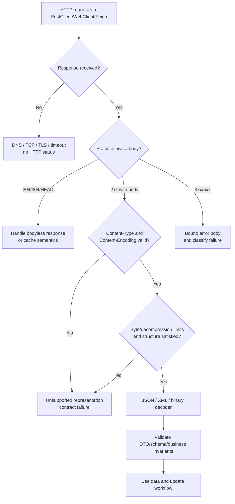
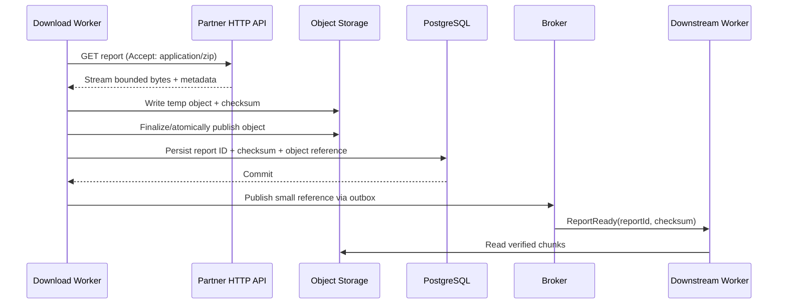
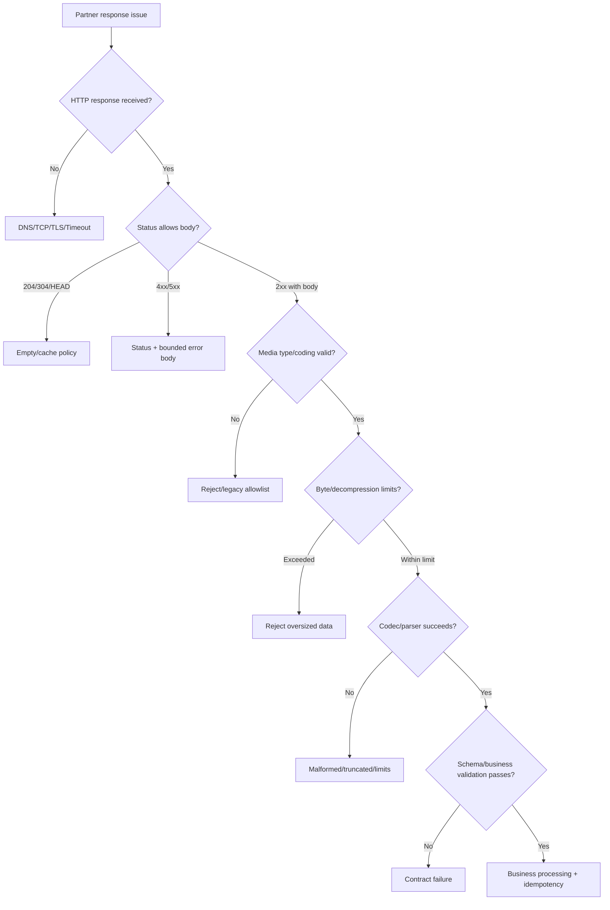

# Content Negotiation, Codecs, and Response Content Limits

## 1. Scenario: an HTTP response succeeds at connection time but cannot be read

In the **SPRING_BOOT_INTEGRATION** module, Spring Boot frequently calls partner APIs to check order status, inspect stock, fetch exchange rates, look up customers, or download reconciliation data. Flows must also coordinate with databases, caches, message brokers, and Spring Integration adapters. At the HTTP client boundary, a successful TCP/HTTP connection is **not enough** to guarantee the response is usable.

Suppose a service sends:

```http
GET /v1/orders/ORD-501 HTTP/1.1
Host: partner.example.internal
Accept: application/json
X-Correlation-Id: req-501
```

Expected response:

```http
HTTP/1.1 200 OK
Content-Type: application/json; charset=utf-8

{"orderId":"ORD-501","status":"SHIPPED"}
```

Yet real environments can return:

- `200 OK` with `Content-Type: text/html` because a gateway returned a login page.
- `200 OK` with JSON missing required fields or carrying a `status` outside the enum.
- `200 OK` with `Content-Type: application/json` whose body is XML, HTML, malformed JSON, or truncated data.
- `204 No Content` when client code assumes a non-null DTO.
- `206 Partial Content` when the app requested a `Range` yet deserializes the byte slice as a complete JSON document.
- `200 OK` with a tiny gzip payload on the wire that decompresses into hundreds of MB.
- `503 Service Unavailable` with a huge HTML error page while the error handler tries to parse it as JSON.
- `200 OK` returning an array of millions of elements, blowing memory on `bodyToMono(List.class)` without resource budgets.

This lesson addresses three related yet **distinct** decisions:

1. **Content negotiation:** which representation does the client request and the server choose?
2. **Codecs/converters:** how does the client turn HTTP bytes into Java data or streams?
3. **Response content limits:** at which layer does the client protect memory, CPU, time, and payload size?

It applies to `RestClient`, `WebClient`, Spring HTTP Interface, OpenFeign, and Spring Integration HTTP adapters; different APIs do not imply identical default codecs or limits.

### Learning objectives

After this lesson, you will be able to:

- Distinguish `Accept`, `Content-Type`, `Accept-Encoding`, and `Content-Encoding`.
- Interpret `406`, `415`, `413`, `204`, `206`, and `304` per HTTP semantics.
- Configure and recognize Spring `HttpMessageConverter`, `HttpMessageReader`/`Decoder`, Jackson, and Feign decoders.
- Set `maxInMemorySize` for WebClient and understand why it is **not** a hard limit on total HTTP response size.
- Build a `RestClient` read path that bounds actual bytes before parsing JSON.
- Recognize decompression bombs, deep JSON nesting, huge arrays, XML XXE, and error-body overruns.
- Design status/error classification, timeouts, retries/idempotency, and response observability.
- Test mismatched media types, oversized payloads, gzip, truncation, missing fields, and streaming.

> Examples reference Spring Framework 6.1+ and Spring Boot 3.2+ for `RestClient`; `WebClient` belongs to Spring WebFlux. Certain APIs, codec defaults, and properties change across Spring Framework 6.x/7.x, Boot 3.x/4.x, and HTTP transports. Verify against your project's version/BOM when implementing. Thresholds such as 256 KiB or 5 MiB are **illustrative values**, not mandatory defaults for all applications.

## 2. Four questions to resolve before reading a body

When an HTTP response arrives, the client should evaluate in roughly this order:



This is a **logical design**, not a claim that every HTTP client enforces all steps automatically. In many cases, codecs start reading the body as soon as `retrieve().body(...)` or `bodyToMono(...)` runs, so byte/encoding guards must be configured **before** aggregation occurs.

Every failure mode must be classified:

| Layer | Example | Nature |
| --- | --- | --- |
| Transport | DNS failure or TLS handshake error | No HTTP response received |
| HTTP status | `429`, `503`, `404` | Server responded |
| Metadata | `Content-Type: text/html` instead of JSON | Representation contract mismatch |
| Content coding | Corrupt gzip, decompression over limit | Error/attack at coding layer |
| Codec | Malformed JSON, unparseable XML | Cannot decode payload |
| Data schema | Missing field, wrong type, version mismatch | DTO fails contract |
| Business | Status `SHIPPED` with missing tracking ID | Business invariant violated |
| Resource limit | Oversized body, excessive depth, timeout | Resource budget exceeded |

**Never blindly retry** format/schema errors simply because the client threw an exception. A malformed payload will not become valid on the tenth download.

## 3. Accept: telling the server which formats the client can receive

`Accept` is a **request header** describing the media types the client prefers or can process:

```http
GET /v1/inventory/SKU-001 HTTP/1.1
Host: inventory.example.internal
Accept: application/json
```

This means "I want a JSON representation." **It does not force every server to comply**; always inspect the actual response, especially behind proxies, CDNs, or legacy integrations.

Multiple formats with weights:

```http
Accept: application/vnd.example.inventory+json;v=2, application/json;q=0.8
```

- `application/vnd.example.inventory+json` is a vendor-specific media type with structured suffix `+json`.
- `v=2` is only a convention/version parameter **if defined by the partner API**; not every server understands it.
- `q=0.8` is a quality preference; media types without `q` default to 1.
- `*/*` accepts many types and is inappropriate when an adapter **only** parses JSON.
- If no matching representation can be selected, a server may return `406 Not Acceptable`, though some servers ignore preferences; the client must still verify `Content-Type`.

**Never treat `Accept: application/json` as authentication, JSON validation, or resource protection.** It is solely a negotiation hint.

## 4. Request Content-Type vs. response Content-Type

These are two directions carrying the same header name with distinct meanings.

```http
POST /v1/reservations HTTP/1.1
Host: inventory.example.internal
Content-Type: application/json
Accept: application/json

{"orderId":"ORD-501","sku":"SKU-001","quantity":2}
```

`Content-Type` on the **request** describes how to interpret the request body sent by the client. `Accept` states the response format the client wants. The response carries its own `Content-Type`:

```http
HTTP/1.1 201 Created
Content-Type: application/json

{"reservationId":"RSV-901","status":"RESERVED"}
```

If the client sends JSON while the server only accepts XML, the server may return **415 Unsupported Media Type**. If the client accepts only JSON and the server cannot provide it, the server may return **406 Not Acceptable**.

| Header | Where sent? | Answers the question |
| --- | --- | --- |
| Request `Content-Type` | Client → server | What media type is the request body? |
| Request `Accept` | Client → server | Which response type does the client prefer? |
| Response `Content-Type` | Server → client | What media type does the returned body actually have? |
| Request `Accept-Encoding` | Client → server | Which content codings can the client decode? |
| Response `Content-Encoding` | Server → client | How has the response body been encoded/compressed? |
| Response `Vary` | Server → client/caches | Which request headers affect the chosen representation? |

**415 vs. 406**: 415 indicates the media type/coding of the **incoming content** is unsupported; 406 concerns response selection against `Accept`. Real APIs may use contract-specific statuses, so always rely on both status codes and stable error codes.

## 5. JSON, XML, text, and binary: same HTTP, different semantics

The same logical endpoint can serve different representations:

```http
GET /v1/reports/2026-11 HTTP/1.1
Accept: application/json
```

```json
{"period":"2026-11","count":42}
```

Or:

```http
GET /v1/reports/2026-11 HTTP/1.1
Accept: application/xml
```

```xml
<report>
  <period>2026-11</period>
  <count>42</count>
</report>
```

Or:

```http
GET /v1/reports/2026-11.csv HTTP/1.1
Accept: text/csv
```

```text
period,count
2026-11,42
```

These formats do not share schemas or decoders:

- JSON needs a JSON parser, Java DTO mapping, and schema constraints.
- XML needs a parser/mapper and XXE/entity-expansion protections.
- CSV needs rules for delimiters, encoding, escaping, required columns, max rows, and header/data separation.
- PDF/images/ZIP should be processed as bytes or streamed to files/object storage; **never** deserialize them into business DTOs.
- Protobuf/Avro require corresponding schemas and serializers/decoders; `application/octet-stream` alone does not define the schema.

In Java, `String.class` is **not** a "format-neutral decoder": reading JSON/XML into a `String` and then re-parsing causes **double buffering** and loses control over byte limits and charsets. Use text only when the contract genuinely calls for text.

## 6. Charset and JSON: bytes do not equal Java character counts

`Content-Type: application/json; charset=utf-8` is standard in Java integrations. Cross-system JSON should use UTF-8. Understand that:

- One Unicode character can occupy multiple bytes in UTF-8.
- `String.length()` counts UTF-16 code units, which equals neither UTF-8 byte count nor always Unicode code points.
- `@Size(max=1000)` on a Java object **does not bound** total response bytes.
- `Content-Length` measures the byte length of the HTTP content in that representation, not the post-parse character count.
- Invalid UTF-8, BOMs, incompatible charsets, or truncated text can cause decoder errors even on HTTP 200.

**Body-size protection must count actual bytes at the right read boundary.** Never rely on `responseString.length()` thinking you capped decoder memory.

## 7. Accept-Encoding and Content-Encoding: compression is not a data format

Example compression negotiation:

```http
GET /v1/exports/orders HTTP/1.1
Accept: application/json
Accept-Encoding: gzip
```

The server may reply:

```http
HTTP/1.1 200 OK
Content-Type: application/json
Content-Encoding: gzip
Vary: Accept, Accept-Encoding
```

These two headers have distinct meanings:

- **`Content-Type: application/json`**: after decoding content codings, the representation is JSON.
- **`Content-Encoding: gzip`**: bytes transmitted in the HTTP content are gzip-encoded/compressed.
- `Transfer-Encoding: chunked` in HTTP/1.1 is **message framing**, not a JSON/XML/gzip content type.
- `Vary` tells caches that response variants depend on `Accept`/`Accept-Encoding` (must be emitted accurately by the server).

A 50 MiB JSON document can compress down to a few hundred KiB if repetitive. **Wire byte limits alone do not protect post-decompression memory.**

HTTP clients may inject `Accept-Encoding` and decompress automatically depending on the transport (JDK HttpClient, Apache HttpClient, Reactor Netty, etc.). Never guess: inspect transport configuration and test real gzip responses.

## 8. Three limit types that must be designed separately

Suppose each expected response is under 256 KiB:

| Limit type | Where enforced? | Protects | Does NOT protect |
| --- | --- | --- | --- |
| **Wire bytes** | HTTP client/transport when reading raw bytes | Bandwidth, pre-decompression buffers | Gzip bombs after decompression |
| **Decoded bytes** | Between decompression and parser, counting while streaming | Memory/CPU from expanded content | JSON depth/item count/semantic size |
| **Codec aggregation memory** | WebClient reader/decoder `maxInMemorySize` | Buffering across many code paths | Unbounded streaming bytes, sockets/DB state |
| **Parser constraints** | Jackson/XML/CSV decoder | Nesting depth, number/string token lengths, dangerous structures | Total body bytes unless applied separately |
| **Business DTO limits** | Bean Validation/schemas/rules | Field values, item counts, business rules | Resources already spent parsing the full body |
| **Concurrency/budget** | Bulkheads/connection pools/rate limiters | Total concurrent responses | Individual oversized bodies without per-response caps |

**Total byte limits** and **codec memory limits** are not identical. For example, a 1 GiB response streamed in 8 KiB chunks may never breach an aggregation cap, yet still consume excessive time, disk, and network resources.

**Rule:** budget (1) each HTTP response, (2) each decoding step, (3) total concurrency, and (4) the overall workflow. Never expect a single property to cover all four.

## 9. Content-Length: an early-rejection optimization, not a safety proof

`Content-Length` lets the client abort early before reading if the server advertises a size larger than the contract allows. However:

- HTTP/1.1 chunked responses do not necessarily carry `Content-Length`.
- Proxies/transports can re-frame, compress/decompress, or strip the header.
- Truncated responses and connection resets cause actual bytes to differ from the declared header.
- A spoofed/wrong header from upstream is not a security source of truth.
- `Content-Length` typically describes encoded content bytes, not decompressed bytes.
- `HEAD` and bodyless status codes follow separate semantics.

Correct model:

```text
if (knownContentLength > allowedWireBytes) {
    reject_early();
}
while (read_next_chunk()) {
    bytesRead += chunkSize;
    if (bytesRead > hardLimit) {
        abort_read();
    }
    process_bounded_chunk();
}
```

This is **pseudocode**. Actual limits must guard the right stream (wire or decompressed) without skipping chunked transfers. An interceptor that inspects the header and then calls `readAllBytes()` is not a hard size limit.

## 10. RestClient, WebClient, and OpenFeign: who owns the codec?

| Client | Decoding abstraction | Typical configuration point |
| --- | --- | --- |
| `RestClient` | `HttpMessageConverter<?>` | `RestClient.Builder.messageConverters(...)`, Boot builder customizers |
| `WebClient` | `HttpMessageReader<?>`/`Decoder<?>` via `ExchangeStrategies` | `WebClient.Builder.codecs(...)` |
| Spring HTTP Interface + RestClient | Inherits RestClient adapter | Underlying `RestClient` behind the proxy |
| Spring HTTP Interface + WebClient | Inherits WebClient adapter | Underlying `WebClient` behind the proxy |
| Spring Cloud OpenFeign | Feign `Decoder` and Spring HTTP message converters (with Spring Cloud defaults) | Named-client `Decoder`/configuration |
| Spring Integration HTTP outbound adapter | Depends on RestTemplate/WebClient/adapter implementation | Corresponding HTTP client/codec configuration |

**HTTP Interface specifies methods/paths/bodies and has no independent codec of its own.** With the exact same Java interface, proxies backed by `RestClientAdapter` and `WebClientAdapter` have different memory limits and exception behaviors.

**A Feign `Decoder` is not a Spring WebFlux `Decoder`** just because they share a name. Setting `spring.codec.max-in-memory-size` for Spring codecs does not automatically bound all Feign responses.

## 11. HttpMessageConverter in RestClient

Spring MVC and imperative HTTP clients use `HttpMessageConverter` to read/write Java types by media type.

Common converters when corresponding libraries are on the classpath:

| Converter | Data | Notes |
| --- | --- | --- |
| `MappingJackson2HttpMessageConverter` | JSON ↔ Java objects | Jackson and matching JSON/+json media types |
| `StringHttpMessageConverter` | Text ↔ String | Does not validate JSON business contracts |
| `ByteArrayHttpMessageConverter` | Bytes ↔ `byte[]` | Aggregates body; large memory risk |
| `ResourceHttpMessageConverter` | Resource | Resource/streaming behavior depends on concrete `Resource` |
| XML converters | XML ↔ Java objects | Require dependencies and hardened parser settings |
| Form/multipart converters | Form data or multipart | Do not automatically handle JSON/XML |

When calling:

```java
OrderStatusDto dto = restClient.get()
    .uri("/v1/orders/{orderId}", orderId)
    .accept(org.springframework.http.MediaType.APPLICATION_JSON)
    .retrieve()
    .body(OrderStatusDto.class);
```

`RestClient` picks a converter capable of reading `OrderStatusDto.class` for the response `Content-Type`. If the server returns `application/xml` without a matching XML converter, you get a conversion/unsupported media type error. If the server returns `text/html` when you asked for a DTO, never force HTML into JSON just to "let it pass."

**Never pass `byte[].class` or `String.class` to `body(...)` for unbounded data** without a byte-counting guard before aggregation.

## 12. RestClient: explicit Accept and status handling

A straightforward partner API client:

```java
import org.springframework.http.HttpHeaders;
import org.springframework.http.MediaType;
import org.springframework.stereotype.Component;
import org.springframework.web.client.RestClient;

@Component
public class PartnerOrderClient {

    private final RestClient client;

    public PartnerOrderClient(RestClient.Builder builder) {
        this.client = builder
            .baseUrl("https://partner.example.internal")
            .defaultHeader(
                HttpHeaders.ACCEPT,
                MediaType.APPLICATION_JSON_VALUE
            )
            .build();
    }

    public OrderStatusDto find(String orderId) {
        return client.get()
            .uri("/v1/orders/{orderId}", orderId)
            .accept(MediaType.APPLICATION_JSON)
            .retrieve()
            .body(OrderStatusDto.class);
    }

    public record OrderStatusDto(
        String orderId,
        String status
    ) {}
}
```

In a real application:

- Load `baseUrl` from validated/allowlisted configuration; never hardcode production endpoints.
- Boot-injected `RestClient.Builder` normally carries message converters, observations, and customizers. Never construct a fresh builder per request if centralized customizations are needed.
- `.accept(...)` declares the desired response format; it does not limit bytes automatically.
- `.retrieve().body(...)` throws HTTP status exceptions by default or converter exceptions if a 2xx body is malformed.
- Record mapping does not ensure `status` belongs to allowed business values; validate after decoding.
- This snippet handles small DTOs and **does not yet enforce a hard body-size cap**; the next sections show bounded reading.

When handling `204` or `404` with special semantics, choose an appropriate return type or response strategy. Never call `Objects.requireNonNull(body)` and treat 204 as a network error.

## 13. RestClient example: keep 2xx, 204, 4xx, and network errors distinct

`RestClient.retrieve()` raises errors for 4xx/5xx under default handling. You can use `toEntity(...)` to read status and headers on successful responses, or `exchange(...)` for lower-level control over the entire response.

Example using `exchange` to check status before decoding:

```java
import org.springframework.http.HttpStatusCode;
import org.springframework.http.MediaType;
import org.springframework.web.client.RestClient;

public String readOrderResponse(
        RestClient client, String orderId) {

    return client.get()
        .uri("/v1/orders/{orderId}", orderId)
        .accept(MediaType.APPLICATION_JSON)
        .exchange((request, response) -> {
            HttpStatusCode status = response.getStatusCode();

            if (status.value() == 204) {
                return "NO_CONTENT";
            }
            if (!status.is2xxSuccessful()) {
                throw new IllegalStateException(
                    "Partner HTTP status " + status.value()
                );
            }

            // Only an illustration: actual body reading
            // must be bounded before parsing.
            return "SUCCESS";
        });
}
```

Important: when calling `exchange(...)`, **`retrieve()`'s default status handlers do not run automatically**; you must handle status, headers, and body per contract. Never return `SUCCESS` while ignoring the body if the business flow requires data from the response.

**Large 4xx/5xx error bodies:** reading or discarding the body must honor the request factory's resource/connection release rules; never inadvertently load a huge HTML/JSON error page into memory just to build an exception or log line.

## 14. Hard cap when reading response bytes in RestClient

For read paths with a small-body contract (e.g., at most 256 KiB after HTTP transport delivery), you can **count actual bytes read** before invoking the JSON decoder. This educational example fits small bounded responses; large streaming requires a different pattern.

```java
import java.io.ByteArrayOutputStream;
import java.io.IOException;
import java.io.InputStream;

public final class BoundedBodyReader {

    private BoundedBodyReader() {}

    public static byte[] readAtMost(
            InputStream source, int maxBytes) throws IOException {

        if (maxBytes < 0) {
            throw new IllegalArgumentException(
                "maxBytes must be nonnegative"
            );
        }

        ByteArrayOutputStream output =
            new ByteArrayOutputStream(
                Math.min(maxBytes, 8192)
            );
        byte[] chunk = new byte[8192];
        int total = 0;

        int count;
        while ((count = source.read(chunk)) != -1) {
            if (count > maxBytes - total) {
                throw new ResponseTooLargeException(
                    "PARTNER_RESPONSE_TOO_LARGE"
                );
            }
            output.write(chunk, 0, count);
            total += count;
        }
        return output.toByteArray();
    }

    public static final class ResponseTooLargeException
            extends IOException {
        public ResponseTooLargeException(String message) {
            super(message);
        }
    }
}
```

**Properties of this helper:**

- Never calls `readAllBytes()` before checking the limit.
- Does not rely solely on `Content-Length`.
- Throws immediately and stops reading as soon as a chunk pushes total bytes over the threshold.
- Bounds whatever bytes the `InputStream` **actually supplies**. If the transport already decompressed gzip, this counts decoded bytes; if not, it counts encoded bytes. To cap **both**, place guards both before and after decompression.
- Still buffers data in `ByteArrayOutputStream` up to the threshold; never use for multi-GiB downloads.
- Aborting after a partial read may prevent connection reuse; the request factory must close/release the response cleanly.
- Never turn `ResponseTooLargeException` into an HTTP 413 on the **inbound** request. It is an **outbound partner response** failure inside your application.

### Combining exchange and Jackson

```java
import com.fasterxml.jackson.databind.ObjectMapper;
import java.io.IOException;
import org.springframework.http.MediaType;
import org.springframework.web.client.RestClient;

public final class BoundedPartnerDecoder {

    private static final int MAX_BODY_BYTES = 256 * 1024;

    private final RestClient client;
    private final ObjectMapper mapper;

    public BoundedPartnerDecoder(
            RestClient client, ObjectMapper mapper) {
        this.client = client;
        this.mapper = mapper;
    }

    public PartnerOrderStatus load(String orderId) {
        return client.get()
            .uri("/v1/orders/{orderId}", orderId)
            .accept(MediaType.APPLICATION_JSON)
            .exchange((request, response) -> {
                int status = response.getStatusCode().value();

                if (status == 204) {
                    throw new IllegalStateException(
                        "Response required, got 204"
                    );
                }

                if (!response.getStatusCode().is2xxSuccessful()) {
                    // Classify the HTTP status without
                    // aggregating the remote error body.
                    throw new IllegalStateException(
                        "Partner status " + status
                    );
                }

                MediaType type =
                    response.getHeaders().getContentType();

                if (type == null || !isJsonMediaType(type)) {
                    throw new IllegalStateException(
                        "Expected JSON response"
                    );
                }

                try {
                    byte[] bytes = BoundedBodyReader.readAtMost(
                        response.getBody(), MAX_BODY_BYTES
                    );
                    return mapper.readValue(
                        bytes, PartnerOrderStatus.class
                    );
                } catch (IOException ex) {
                    throw new IllegalStateException(
                        "Cannot decode bounded partner JSON", ex
                    );
                }
            });
    }

    private static boolean isJsonMediaType(MediaType type) {
        String subtype = type.getSubtype().toLowerCase(
            java.util.Locale.ROOT
        );
        return "application".equalsIgnoreCase(type.getType())
            && ("json".equals(subtype)
                || subtype.endsWith("+json"));
    }

    public record PartnerOrderStatus(
        String orderId, String status
    ) {}
}
```

This is a **minimal boundary adapter** lacking full domain error classes, metrics, HTTP timeouts, and semantic validation. Inject a safely configured `ObjectMapper` (with parser limits) rather than creating one per request, use `Content-Length` for early rejection when present, and handle transport `Content-Encoding` accurately. For bodies exceeding the quota, the helper avoids buffering the full body; when reporting errors, **never log the raw response**.

Limits can be configured per operation; large PDF/download responses need a dedicated streaming API rather than raising `MAX_BODY_BYTES` globally.

## 15. WebClient and configuring maxInMemorySize

`WebClient` uses `HttpMessageReader`/`Decoder` codecs to convert response bytes into Java types or reactive publishers. Common configuration:

```java
import org.springframework.context.annotation.Bean;
import org.springframework.context.annotation.Configuration;
import org.springframework.web.reactive.function.client.WebClient;

@Configuration(proxyBeanMethods = false)
public class PartnerWebClientConfiguration {

    @Bean("partnerWebClient")
    WebClient partnerWebClient(WebClient.Builder builder) {
        return builder
            .baseUrl("https://partner.example.internal")
            .codecs(configurer ->
                configurer.defaultCodecs()
                    .maxInMemorySize(256 * 1024)
            )
            .build();
    }
}
```

This is a **buffering/aggregation memory limit across many codecs**, not a hard cap on all bytes transferred over the network:

- When `bodyToMono(OrderStatusDto.class)` must buffer/deserialize, exceeding the decoder limit throws `DataBufferLimitException`.
- A streaming `bodyToFlux(DataBuffer.class)` can consume **continuous chunks** whose cumulative bytes far exceed 256 KiB without violating a per-buffer aggregation limit.
- `maxInMemorySize` does not bound JSON nesting depth, compressed wire bytes, number of business items, or total streaming time.
- Custom codecs/adapters may not share identical semantics; always test the real path.
- If the app defines multiple `WebClient` builders/instances, verify the limit on the **exact client actually invoked**.

**Never raise `maxInMemorySize` to several GiB to handle exports**, as that signals a need for streaming/chunking/object-storage downloads rather than aggregating into huge objects.

## 16. spring.codec.max-in-memory-size: know its scope before configuring

When Spring Boot auto-configuration/customizers for WebFlux codecs apply, you can configure:

```yaml
spring:
  codec:
    max-in-memory-size: 256KB
```

Misconceptions to avoid:

1. This property configures **codec behavior within Boot-supported scope** per stack and version; it does not apply to all `RestClient`s, Feign decoders, Apache HttpClient, or custom `ObjectMapper`s.
2. If you instantiate `WebClient.builder()` directly without Boot's builder/customizers, some customizations may **not apply**.
3. Both inbound WebFlux HTTP and outbound WebClient may share codec infrastructure, yet this is **not** a hard body limit at a gateway/nginx.
4. Never copy `spring.servlet.multipart.max-request-size` as a guide for JSON response limits; inbound multipart uploads differ from outbound JSON responses.
5. 256 KiB is commonly cited as the default for several WebFlux codec paths across many Spring Framework versions, yet you must **verify your exact version** rather than treating it as a universal constant.

If one partner client needs a different quota from all others, configure `.codecs(...)` on a **dedicated `WebClient.Builder`** or separate bean, and test that the per-client override takes effect.

## 17. WebClient: safe Accept and error status handling

Example reactive client requesting JSON:

```java
import org.springframework.http.HttpStatusCode;
import org.springframework.http.MediaType;
import org.springframework.web.reactive.function.client.WebClient;
import reactor.core.publisher.Mono;

public final class ReactivePartnerClient {

    private final WebClient webClient;

    public ReactivePartnerClient(WebClient webClient) {
        this.webClient = webClient;
    }

    public Mono<OrderStatusDto> find(String id) {
        return webClient.get()
            .uri("/v1/orders/{id}", id)
            .accept(MediaType.APPLICATION_JSON)
            .retrieve()
            .onStatus(
                HttpStatusCode::isError,
                response -> Mono.error(
                    new PartnerStatusException(
                        response.statusCode().value()
                    )
                )
            )
            .bodyToMono(OrderStatusDto.class);
    }

    public record OrderStatusDto(
        String orderId, String status
    ) {}

    static final class PartnerStatusException
            extends RuntimeException {
        PartnerStatusException(int status) {
            super("Partner HTTP status: " + status);
        }
    }
}
```

What this example demonstrates:

- `Accept: application/json` is sent in the request.
- `onStatus` classifies 4xx/5xx **from the HTTP response**, here without reading the remote error body to avoid buffering oversized or sensitive payloads.
- If DNS/TCP/TLS fails before a response arrives, `onStatus` does not run; transport errors propagate on the reactive stream.
- `bodyToMono(...)` decodes the body only on subscription; the DTO must still be validated after decoding.
- If the response is `204 No Content`, the publisher completes as `Mono.empty()` rather than emitting a DTO; the workflow must define whether empty is acceptable.
- Never call `.block()` on a Reactor event-loop thread.
- Resubscribing or retrying a cold `Mono` fires additional HTTP requests. Side-effecting POSTs require idempotency.

**Note:** the snippet signals status errors without reading the body; content draining/release is governed by WebClient exchange infrastructure and transport. When parsing `application/problem+json` error bodies is required, enforce a small byte cap and fallback for malformed or oversized error bodies.

## 18. What DataBufferLimitException tells you — and what it does NOT

A frequent exception in WebClient/WebFlux:

```text
org.springframework.core.io.buffer.DataBufferLimitException:
Exceeded limit on max bytes to buffer
```

It typically means a Spring decoder/aggregator exceeded its buffering byte limit. It **does NOT prove**:

- That the server returned HTTP `413`.
- That the partner's `Content-Length` exceeded the wire quota.
- That the entire HTTP response was already loaded into RAM beforehand.
- Whether the response was actually valid or invalid JSON.
- That all streaming paths abort under the same policy.
- Whether the limit applied before or after decompression as intended by the architecture.

A bad fix is writing:

```yaml
spring:
  codec:
    max-in-memory-size: 64MB
```

and considering the issue solved. If an API is expected to return a 20 KiB DTO, a 20 MiB response may signal **API contract drift, a proxy error page, or a malicious payload**. Inspect `Content-Type`, per-operation quotas, partner behavior, and error classification before expanding memory budgets.

For legitimately large exports or batches, use **streaming and incremental processing** instead of aggregating a single giant DTO.

## 19. Jackson limits: small bodies can still consume huge CPU/memory

A JSON body of just a few hundred KiB with extreme nesting or giant number tokens can exhaust resources during parsing. Jackson 2.15+ provides `StreamReadConstraints` for parser limits such as depth, string length, and number length:

```java
import com.fasterxml.jackson.core.JsonFactory;
import com.fasterxml.jackson.core.StreamReadConstraints;
import com.fasterxml.jackson.databind.ObjectMapper;

public final class PartnerJsonMapperFactory {

    public static ObjectMapper create() {
        JsonFactory jsonFactory = JsonFactory.builder()
            .streamReadConstraints(
                StreamReadConstraints.builder()
                    .maxNestingDepth(40)
                    .maxStringLength(16_384)
                    .maxNumberLength(80)
                    .build()
            )
            .build();

        return new ObjectMapper(jsonFactory);
    }
}
```

These limits:

- `maxNestingDepth`: caps object/array nesting depth.
- `maxStringLength`: caps string token length per parser semantics.
- `maxNumberLength`: caps numeric token length.
- Do not bound **total body bytes**, total array item count, or JSON field count.
- Do not replace Bean Validation or JSON Schema for required fields, enums, and business invariants.
- Exact constraint exception types may vary by Jackson version; classify by **decode context** rather than matching a fragile message string.

**Note on Spring Boot ObjectMapper:** `new ObjectMapper(jsonFactory)` does not automatically inherit Spring Boot's modules and settings (Java Time, custom serializers, naming policies, etc.). This factory is illustrative; in real projects configure the mapper/`JsonFactory` **specifically on the client codec**, register compatible modules, and test serialization.

Creating a mapper bean without wiring it into the active `WebClient`/`RestClient`/Feign decoder provides **zero protection on the live response path**.

## 20. JSON schema validation: successful deserialization does not mean valid data

Suppose the partner returns:

```json
{
  "orderId": null,
  "status": "SHIPPED",
  "trackingId": ""
}
```

Jackson can still instantiate a Java object if fields are nullable, yet the data **violates the business contract**. Add a validation layer after decoding:

```java
import jakarta.validation.constraints.NotBlank;
import jakarta.validation.constraints.Pattern;
import jakarta.validation.constraints.Size;

public record OrderStatusDto(
    @NotBlank @Size(max = 80) String orderId,
    @NotBlank
    @Pattern(regexp = "NEW|PAID|SHIPPED|CANCELLED")
    String status,
    @Size(max = 120) String trackingId
) {}
```

Using a `jakarta.validation.Validator` bean:

```java
import jakarta.validation.ConstraintViolation;
import jakarta.validation.Validator;
import java.util.Set;

public final class PartnerResponseValidator {

    private final Validator validator;

    public PartnerResponseValidator(Validator validator) {
        this.validator = validator;
    }

    public OrderStatusDto validate(OrderStatusDto dto) {
        if (dto == null) {
            throw new IllegalArgumentException(
                "PARTNER_EMPTY_RESPONSE"
            );
        }

        Set<ConstraintViolation<OrderStatusDto>> problems =
            validator.validate(dto);

        if (!problems.isEmpty()) {
            throw new IllegalArgumentException(
                "PARTNER_SCHEMA_INVALID"
            );
        }

        if ("SHIPPED".equals(dto.status())
                && (dto.trackingId() == null
                    || dto.trackingId().isBlank())) {
            throw new IllegalArgumentException(
                "PARTNER_TRACKING_REQUIRED"
            );
        }

        return dto;
    }
}
```

To use Jakarta Bean Validation in Spring Boot, include `spring-boot-starter-validation` and configure an appropriate validator bean. This is **post-deserialization validation**; it does not replace body byte caps or JSON parser constraints.

Contract decisions to settle explicitly:

- **Missing vs. null:** absent fields may map to null; if both carry distinct meanings, inspect the JSON tree/presence.
- **Primitive defaults:** `int` can turn a missing field into `0`; use boxed `Integer` + `@NotNull` when required.
- **Unknown fields:** ignore for forward compatibility or reject to catch contract drift?
- **New enum values:** map deliberately to `UNKNOWN` or fail to quarantine?
- **Version:** inspect media type parameters, headers, or body fields consistently.
- **Monetary values:** prefer `BigDecimal` or agreed integer minor units instead of `double` when precision matters.

**Never persist or cache unvalidated responses** into a cache or system of record; once bad data is persisted, errors propagate across broker and integration flows.

## 21. XML: beyond converters, guard against XXE and entity expansion

If a partner serves `application/xml`, you can use XML converters, Jackson XML, or JAXB with the proper dependencies. However, XML from untrusted sources requires parsers configured **against XXE, entity expansion, and oversized inputs**.

Example hardening a `DocumentBuilderFactory`:

```java
import javax.xml.XMLConstants;
import javax.xml.parsers.DocumentBuilderFactory;

public final class SafeXmlFactory {

    public static DocumentBuilderFactory create()
            throws Exception {

        DocumentBuilderFactory factory =
            DocumentBuilderFactory.newInstance();

        factory.setNamespaceAware(true);
        factory.setFeature(
            XMLConstants.FEATURE_SECURE_PROCESSING,
            true
        );
        factory.setFeature(
            "http://apache.org/xml/features/disallow-doctype-decl",
            true
        );
        factory.setFeature(
            "http://xml.org/sax/features/external-general-entities",
            false
        );
        factory.setFeature(
            "http://xml.org/sax/features/external-parameter-entities",
            false
        );
        factory.setXIncludeAware(false);
        factory.setExpandEntityReferences(false);
        factory.setAttribute(
            XMLConstants.ACCESS_EXTERNAL_DTD, ""
        );
        factory.setAttribute(
            XMLConstants.ACCESS_EXTERNAL_SCHEMA, ""
        );
        return factory;
    }
}
```

Parser providers may not support all features/attributes. In production, **never silently catch and ignore exceptions** when security settings fail to apply; fail closed or choose a supporting parser. Simply writing this factory does not automatically configure every XML decoder in Spring; ensure the HTTP converter **actually uses the hardened parser**.

For JAXB, Jackson XML, or StAX, inspect equivalent settings (`XMLInputFactory`, external entities, DTDs) and test with an external-entity payload. Also add **total bytes, nesting/element counts, and timeouts**; disabling XXE alone does not stop all XML bombs.

## 22. CSV, text, and binary: never use one decoder for everything

A `text/csv` response can be valid HTTP yet have mismatched columns, broken quotes/escapes, embedded newlines inside fields, or millions of rows. Loading it into one `String` and calling `split("\\n")` can:

- Consume huge memory.
- Misparse quoted multiline CSV fields.
- Accept malformed or duplicate headers unchecked.
- Mishandle delimiters, locales, or charsets per contract.
- Pass formulas like `=HYPERLINK(...)` into Excel exports, causing CSV formula injection downstream.

For large CSVs, use a **streaming CSV parser** capping row count, field length, and total bytes; agree on CSV format, delimiter, encoding, and column schemas.

For PDF, ZIP, images, or backup archives:

1. Verify `Content-Type` and magic bytes/file signatures when required by contract; never trust filenames alone.
2. Stream to temp files or object storage with a **byte quota**, checksum, and deadline.
3. Never auto-extract archive entries containing `../`, symlinks, or path traversal.
4. Cap total decompressed size, entry count, and nesting depth.
5. Route sensitive or untrusted uploads through dedicated virus scanning pipelines when needed.
6. Never use `bodyToMono(byte[].class)` for huge files.

**Response shape dictates resource handling.** Small JSON DTOs and multi-GB ZIP exports must never share the same default decoder and limits.

## 23. When does WebClient streaming bypass maxInMemorySize?

Example reading raw buffers:

```java
import org.springframework.core.io.buffer.DataBuffer;
import reactor.core.publisher.Flux;

Flux<DataBuffer> chunks = webClient.get()
    .uri("/v1/exports/orders.csv")
    .accept(org.springframework.http.MediaType.parseMediaType(
        "text/csv"
    ))
    .retrieve()
    .bodyToFlux(DataBuffer.class);
```

This only **declares the stream**; there is no consumer yet, no total byte limit, and no lifecycle management for `DataBuffer`. Once subscribed, if data streams indefinitely, the codec aggregation limit does not act as a hard total cap.

With pooled buffers (especially Reactor Netty), code consuming `DataBuffer` directly must **release** buffers when finished (e.g., `DataBufferUtils.release`), including on error and cancellation. Forgetting release causes buffer leaks. Never retain a `DataBuffer` reference across async stages without clear ownership.

### An example of intentional bounded aggregation

If a format is capped at 256 KiB but you need raw buffers to check a signature:

```java
import org.springframework.core.io.buffer.DataBuffer;
import org.springframework.core.io.buffer.DataBufferUtils;
import reactor.core.publisher.Mono;

Mono<byte[]> boundedBytes = DataBufferUtils
    .join(
        webClient.get()
            .uri("/v1/signed-small-document")
            .retrieve()
            .bodyToFlux(DataBuffer.class),
        256 * 1024
    )
    .map(joined -> {
        try {
            byte[] result =
                new byte[joined.readableByteCount()];
            joined.read(result);
            return result;
        } finally {
            DataBufferUtils.release(joined);
        }
    });
```

`DataBufferUtils.join(Publisher, int)` caps total bytes **joined in this pipeline**; exceeding the limit raises `DataBufferLimitException` and cancels upstream. This remains **bounded aggregation**, not multi-GB file streaming. Test release/cancellation on your exact Spring version, content encoding, and transport.

For legitimately huge payloads, stream directly to files or object storage enforcing quotas **while writing**, avoiding full `byte[]` arrays in RAM. When using `DataBufferUtils.write`, check the right overload/lifecycle and never block the event loop with synchronous filesystem I/O.

## 24. Reactive backpressure is not a total byte quota

Reactive Streams allow consumers to request items/buffers at a manageable rate. This avoids certain forms of unbounded demand, yet:

- Individual `DataBuffer` sizes depend on the transport/decoder.
- A stream can emit millions of small buffers over time.
- Calling `collectList()` pulls every business item into memory.
- `flatMap(..., concurrency)` bounds inner publishers but not total bytes per response.
- Unbounded `onBackpressureBuffer()` converts backpressure into OOM.
- Cancellation does not guarantee the remote server stops sending immediately or rolls back a POST side effect.

Therefore, enforce **total byte counts, deadlines, concurrency caps, and downstream output quotas** alongside demand/backpressure. When streaming CSV rows into a database, batch writes, persist checkpoints/offsets, and enforce idempotency so retries do not duplicate rows.

## 25. gzip and decompression bombs: cap before and after decompression

Consider:

```text
Network response encoded with gzip: 75 KiB
       |
       v
HTTP client decompression
       |
       v
JSON body after decompression: 45 MiB
       |
       v
Jackson decoder / DTO aggregation
```

If you only check `Content-Length: 76800` (75 KiB) on the response, the client accepts it yet expands far beyond a 256 KiB quota after decompression.

Layered defense in order:

1. **Encoded byte cap:** limit bytes received off the wire when transport supports it.
2. **Decompressed byte cap:** count bytes post-decompression and abort early once exceeded.
3. **Compression ratio/CPU/deadline:** guard against extreme zip/gzip ratios or slow decompression.
4. **Parser constraints:** depth, string length, number length, item count, and token count.
5. **Application validation:** business schema, record count, and total processing cost.
6. **Concurrency cap:** prevent hundreds of requests from decompressing large bodies simultaneously.

Verify whether the client delivers **compressed bytes** or **decompressed bytes** at your interceptor/stream hook. For instance, Reactor Netty controls compression via `HttpClient.compress(...)`, while specifics vary across transports; tests must verify actual content encoding before and after.

Do not attach `Accept-Encoding: gzip` manually unless the HTTP client is configured to decompress it. And never decompress the same payload **twice** when the transport already handled decompression.

## 26. Wrong or missing Content-Type: strict or fallback?

Three responses carrying the exact same JSON text:

```http
HTTP/1.1 200 OK
Content-Type: application/json

{"status":"OK"}
```

```http
HTTP/1.1 200 OK
Content-Type: text/plain

{"status":"OK"}
```

```http
HTTP/1.1 200 OK

{"status":"OK"}
```

The first obeys the JSON contract. The other two are **not equivalent**, even though the bodies look like JSON. Two strategies exist:

**Strict:** reject wrong or missing `Content-Type` with `UNSUPPORTED_RESPONSE_MEDIA_TYPE`. Appropriate for financial/security APIs with agreed schemas.

**Controlled compatibility:** solely for a specifically identified legacy integration, accept `text/plain` or missing `Content-Type` **only if** body bytes stay within bounds and JSON parsing/schema validation succeed. Emit a warning metric for legacy deviation and set a deadline to fix the partner.

Never implement "if JSON fails, try XML, then Java deserialization" across arbitrary responses. Broad **content sniffing** widens the attack surface and masks contract drift.

For `application/problem+json`, this is a standardized error representation distinct from success DTOs; map by **status + media type + schema** rather than deserializing into `OrderStatusDto`.

## 27. 204, 205, HEAD, 304, and bodyless responses

Not every successful HTTP status carries a response body:

| Case | What to understand |
| --- | --- |
| `204 No Content` | Response has no content; decoders must not expect a DTO |
| `205 Reset Content` | Success with view-reset semantics; no content in response |
| `HEAD` | Metadata equivalent to GET without returning content |
| `304 Not Modified` | Conditional GET; reuse cached representation per validators |
| `200 OK` with empty body | Likely a contract violation if endpoint must return a DTO |
| `202 Accepted` | Work accepted per contract; **does not mean processing finished** |

A client method returning a non-null `OrderStatusDto` should fail explicitly on 204/empty rather than letting a `NullPointerException` surface later.

### ETag and conditional GET

```http
GET /v1/catalog/SKU-001 HTTP/1.1
If-None-Match: "catalog-v15"
Accept: application/json
```

The server may reply `304 Not Modified`. The client must use **cached data matching the ETag, URI, tenant, and Accept variant**, never treating 304 as a JSON error. When the server sends `Vary: Accept` or `Vary: Accept-Encoding`, cache keys and variant selection must include those headers per HTTP caching semantics.

Never share ETag caches across tenants for sensitive data or on endpoints disallowed by contract. A `304` response **contains no DTO to re-decode**.

## 28. 206 Partial Content and Range: never deserialize a slice as a complete document

When downloading large files, clients may request a byte range:

```http
GET /v1/exports/report.zip HTTP/1.1
Range: bytes=0-1048575
```

The server may reply:

```http
HTTP/1.1 206 Partial Content
Content-Type: application/zip
Content-Range: bytes 0-1048575/7340032
```

This is a **partial** representation, not the full file. If resuming or assembling ranges, validate `Content-Range`, received size, `ETag`/`If-Range`, checksums, and assembly order. Never stitch chunks from different file versions.

For JSON DTO endpoints, **never treat every 2xx as identical to 200**. An unexpected `206` indicates a contract mismatch; decoders must not parse a JSON fragment as a full document.

If the server ignores `Range` and returns `200 OK` with the entire file, handle it explicitly: restart the download from byte 0 or reject? Never append a full `200` file onto an existing partial resume offset without checking the status code.

## 29. Error bodies: application/problem+json, proxy HTML, and limits

When a partner returns an error:

```http
HTTP/1.1 503 Service Unavailable
Content-Type: application/problem+json
Retry-After: 30

{"type":"about:blank","title":"Unavailable","status":503}
```

Or a gateway may return huge `text/html`. Safe policy:

1. Classify by **HTTP status** first; never require parsing the error body just to know the server failed.
2. Allow `application/problem+json` or a contract-defined error JSON schema **under a small byte cap**.
3. If the error body is empty, wrong media type, malformed, or oversized, preserve the status and a safe technical error code.
4. Never pass unbounded `response.bodyToMono(String.class)` into logs or metrics.
5. Log only error code, status, logical destination name, trace ID, timing, and size; never log tokens, cookies, or PII.
6. On `429`/`503`, inspect `Retry-After` **while still enforcing overall deadlines/retry budgets**; never retry infinitely.
7. On timeouts receiving no response, **there is no HTTP status** to parse and `onStatus` does not execute.

In Spring, `RestClientResponseException` or `WebClientResponseException` may buffer part of the error response for diagnostics. Buffering limits/semantics vary by client, codec, and version; never blindly call `getResponseBodyAsString()` and dump it into logs. When error bodies can be huge, use decoders/handlers with real byte caps and test against an HTTP server.

## 30. Feign/OpenFeign: request Accept and response Decoder

With Spring Cloud OpenFeign:

```java
import org.springframework.cloud.openfeign.FeignClient;
import org.springframework.web.bind.annotation.GetMapping;
import org.springframework.web.bind.annotation.PathVariable;

@FeignClient(
    name = "partner-orders",
    url = "${clients.partner-orders.url}"
)
public interface PartnerOrderFeign {

    @GetMapping(
        value = "/v1/orders/{id}",
        produces = "application/json"
    )
    PartnerOrderStatus get(
        @PathVariable("id") String id
    );
}
```

`produces="application/json"` under Spring Cloud OpenFeign's Spring MVC contract expresses the expected response type and drives the corresponding `Accept` header. Yet Feign executes using its own `Client`/`Decoder` and named-client codec config, **not WebClient's `maxInMemorySize`**.

When a hard response-size cap is needed in Feign:

- Use a **custom Feign `Decoder`** that bounds bytes while reading `feign.Response.Body` before handing off to Jackson/Spring decoders.
- Or wrap the underlying transport/client to enforce quotas on the stream directly.
- A decoder invoked only after the transport already buffered the full body in memory arrives **too late** to protect that step.
- When `Content-Length` is absent, still count actual bytes.
- Separate error paths: Feign `ErrorDecoder` handles HTTP status errors; enforce a separate byte cap when reading error bodies.
- Configure URLs, connect/read timeouts, connection-pool limits, and retry policies per operation.

**Never set a WebFlux property and claim all Feign responses are bounded.** Test against a real mock HTTP server using `Transfer-Encoding: chunked`, gzip, 2 MiB JSON, and large HTML 502 responses to confirm every layer works.

## 31. HTTP Interface inherits the selected underlying client

Spring HTTP Interface provides typed method declarations:

```java
import org.springframework.web.bind.annotation.PathVariable;
import org.springframework.web.service.annotation.GetExchange;
import org.springframework.web.service.annotation.HttpExchange;

@HttpExchange(accept = "application/json")
public interface OrderStatusHttpApi {

    @GetExchange("/v1/orders/{id}")
    OrderStatusDto find(
        @PathVariable("id") String orderId
    );
}
```

Backed by `RestClientAdapter`, the proxy inherits `RestClient` mechanics and `HttpMessageConverter`s. Backed by `WebClientAdapter`, it inherits `WebClient` codecs and exchange strategies.

A typical synchronous factory (Spring Framework 6.1+):

```java
import org.springframework.web.client.RestClient;
import org.springframework.web.client.support.RestClientAdapter;
import org.springframework.web.service.invoker.HttpServiceProxyFactory;

RestClient restClient = restClientBuilder
    .baseUrl("https://partner.example.internal")
    .build();

OrderStatusHttpApi api = HttpServiceProxyFactory
    .builderFor(RestClientAdapter.create(restClient))
    .build()
    .createClient(OrderStatusHttpApi.class);
```

`restClientBuilder` is the app/Spring Boot-configured builder. This snippet does not yet enforce a hard body cap, retry policy, or post-decode DTO validation. For reactive proxies with `WebClientAdapter`, return types are typically `Mono<OrderStatusDto>`.

**Do not treat HTTP Interface as proof that codecs/limits are safe.** Merely swapping the underlying adapter from WebClient to RestClient changes the execution model and memory behavior even though the Java interface looks identical.

## 32. Choosing a client by format and size requirements

| Scenario | Typically suitable choice | Companion rules |
| --- | --- | --- |
| Small JSON DTO, Spring MVC | `RestClient` or HTTP Interface + RestClient | `Accept`/media type check + bounded bytes + validation |
| Small JSON DTO, WebFlux reactive | `WebClient` or HTTP Interface + WebClient | Codec limit + parser constraints + validation |
| Standardized on OpenFeign | OpenFeign | Named-client decoder/timeouts/response cap |
| Large JSON array processed incrementally | WebClient streaming or streaming Jackson/JDBC pipeline | Total bytes/items/deadline + backpressure |
| Multi-GB CSV export | Streaming download + CSV parser | Checksum, disk quota, resume/retention |
| PDF/ZIP/images | Binary/file streaming | Media type/signature, total cap, antivirus if needed |
| Legacy XML | Hardened XML parser/converter | XXE/depth/size limits |
| 503 error response with HTML | Status-first error policy | Bounded error body, no raw logging |
| Broker event needing a file | HTTP download → object storage → durable event reference | Never stuff entire files into messages |
| Partner serves multiple formats | Negotiation + allowlisted codecs/versions | `Content-Type` verification and contract tests |

**Libraries are the execution layer; contracts are the decision layer.** Do not pick WebClient assuming "it's lighter" if code still calls `collectList()` on millions of items; do not pick OpenFeign solely for concise interfaces if its error decoder loads unbounded bodies into RAM.

## 33. Retries, timeouts, and response limits: three separate budgets

An HTTP request can fail because:

- HTTP 429/503 → response received, possibly with `Retry-After`.
- Read/connect timeout → no complete HTTP response may exist.
- Oversized body → client aborts despite server returning 200.
- Invalid JSON schema → response arrived but violates contract.
- Truncated response → parser/transport throws.

Do not apply one retry policy to all failures:

| Failure | Retry? | Reason |
| --- | --- | --- |
| 200 + wrong Content-Type | Do not auto-retry | Contract drift/permanent across identical attempts |
| 200 + malformed JSON | Do not hot-retry | Payload will not fix itself; alert producer |
| 200 + body exceeds hard cap | Do not retry verbatim | Resource protection |
| 204 when DTO is required | Not by default | Contract/version mismatch |
| 429 | Possibly | Honor `Retry-After` + quota + bounded backoff |
| 503 | Possibly | Transient if downstream is recovering |
| DNS/TCP timeout on GET | Possibly | Idempotent GET, within deadline and retry budget |
| POST timeout after side effect | Reconcile/idempotent only | Outcome uncertain |
| 304 | Not an error to retry | Use matching cached representation |

**A `DataBufferLimitException` is not a cue to "raise `maxInMemorySize` and retry."** It may be your client-side guard working as intended.

Every workflow needs a timeout **spanning** queue wait, connect/read, decoding, validation, retries/backoff, and downstream persistence. If the business deadline expires after 10 seconds, raising read timeout to 60 seconds only shifts pressure into worker pools and response latency.

## 34. Passing large payloads through Spring Integration/brokers

Suppose a service downloads a 200 MiB reconciliation file from a partner and notifies RabbitMQ or Kafka downstream. Anti-pattern:

```text
WebClient.bodyToMono(byte[].class)
     |
     +--> publish 200 MiB bytes directly into broker message
     |
     +--> multiple retries / duplicates / memory spikes
```

Safer design:



Key points:

- Stream the body with total byte quota, deadline, checksum, and disk/object-storage budget.
- Never trust `Content-Length` instead of counting actual bytes.
- `ETag`/`If-Range` can enable controlled resume, but never stitch fragments from two versions.
- Never publish the reference before the object is finalized and metadata commits per contract.
- Broker messages carry identity, schema version, hash, and pointer—**not** huge raw files.
- Outbox recovers publishing when the broker is down; consumers remain idempotent on redeliveries.
- If the HTTP download fails mid-stream, mark `FAILED/PARTIAL` or retry/resume appropriately—never mark `COMPLETED`.
- Object storage secrets and report PII require proper ACLs, encryption, and retention.

This shows how HTTP codecs and response limits tie directly into **databases, caches, and brokers**, not just networking config.

## 35. Observing response sizes, decoding errors, and negotiation

Important signals for outbound HTTP:

| Metric/signal | Purpose |
| --- | --- |
| `http.client.requests` and latency | Call duration by client, URI template, and status |
| Response encoded bytes | Tracks network/compression bandwidth cost |
| Response decoded bytes | Detects data growth or abnormal gzip ratios |
| Codec buffer limit hits | Counts `DataBufferLimitException` or equivalent |
| JSON/XML parse failures | Distinguishes corrupt payloads from 503s |
| Unexpected Content-Type | Spots gateway HTML login pages or schema drift |
| 204/206/304 counts | Monitors empty/partial/cache response contracts |
| Oversized error bodies | Shows proxies/partners returning non-contract errors |
| Retry attempts/exhaustion | Prevents retry storms |
| Outbox/backlog age | Integration SLA when responses/data fail |
| Connection pool pending/active | Surfaces transport bottlenecks |
| Correlation/trace IDs | Traces HTTP → DB → broker under access control |

Structured log **without payload**:

```json
{
  "client": "partner-orders",
  "operation": "fetch-order-status",
  "httpStatus": 200,
  "responseMediaType": "text/html",
  "errorCode": "UNEXPECTED_RESPONSE_MEDIA_TYPE",
  "reportedContentLength": 54321,
  "correlationId": "req-501"
}
```

Never place `orderId`, `customerId`, full URIs with query secrets, or raw response bodies into **metric labels**. Labels must stay low-cardinality; put specific IDs in sanitized traces/logs restricted to authorized personnel.

**Measure at the right point:** if a proxy decompresses transparently, codec byte metrics reflect decoded bytes rather than wire bytes. Name metrics explicitly instead of calling everything `response.size` and miscomparing numbers.

## 36. Testing content negotiation with MockRestServiceServer

For `RestClient` in a Spring Boot project with `spring-test`, `MockRestServiceServer` verifies request `Accept` headers and response media types:

```java
import static org.assertj.core.api.Assertions.assertThat;
import static org.assertj.core.api.Assertions.assertThatThrownBy;
import static org.springframework.test.web.client.match.MockRestRequestMatchers.header;
import static org.springframework.test.web.client.match.MockRestRequestMatchers.method;
import static org.springframework.test.web.client.match.MockRestRequestMatchers.requestTo;
import static org.springframework.test.web.client.response.MockRestResponseCreators.withSuccess;

import org.junit.jupiter.api.Test;
import org.springframework.http.HttpHeaders;
import org.springframework.http.HttpMethod;
import org.springframework.http.MediaType;
import org.springframework.test.web.client.MockRestServiceServer;
import org.springframework.web.client.RestClient;

class ContentNegotiationRestClientTest {

    @Test
    void requestsJsonAndDecodesJson() {
        RestClient.Builder builder = RestClient.builder()
            .baseUrl("http://partner.test");
        MockRestServiceServer server =
            MockRestServiceServer.bindTo(builder).build();
        RestClient client = builder.build();

        server.expect(requestTo(
                "http://partner.test/v1/orders/ORD-501"
            ))
            .andExpect(method(HttpMethod.GET))
            .andExpect(header(
                HttpHeaders.ACCEPT,
                MediaType.APPLICATION_JSON_VALUE
            ))
            .andRespond(withSuccess(
                """
                {"orderId":"ORD-501","status":"SHIPPED"}
                """,
                MediaType.APPLICATION_JSON
            ));

        StatusDto dto = client.get()
            .uri("/v1/orders/{id}", "ORD-501")
            .accept(MediaType.APPLICATION_JSON)
            .retrieve()
            .body(StatusDto.class);

        assertThat(dto).isNotNull();
        assertThat(dto.status()).isEqualTo("SHIPPED");
        server.verify();
    }

    record StatusDto(String orderId, String status) {}
}
```

This verifies request headers/URI and the converter in mock mode; it **does not traverse TCP/TLS** or verify real byte caps or chunked/gzip wire behavior.

Add additional tests for:

- `application/xml` when only JSON converters are registered.
- `text/html` on HTTP 200.
- `application/problem+json` on HTTP 503.
- Empty/204/304 responses.
- Missing/blank JSON fields and unknown enum values.
- `Content-Type` with `+json` suffix or charset.
- Server returning `406` when no acceptable media type matches.

Do not assert a single exact Spring exception class across all framework versions; assert **error categories/outcomes and absence of side effects** at the adapter/domain layer.

## 37. Testing actual bytes with an HTTP mock server and network faults

To verify total bytes, chunked transfer, compression, truncated responses, and transport exceptions, use a socket-level test HTTP server such as WireMock or MockWebServer instead of merely mocking `RestClient` calls.

Test matrix:

| Case | Test input | What to prove |
| --- | --- | --- |
| Valid small JSON | 200 + JSON Content-Type + 2 KiB | Valid DTO |
| Vendor JSON | `application/vnd.example+json` | Accepted/rejected per contract |
| HTML instead of JSON | 200 + text/html | Contract failure, not cached |
| Malformed JSON | 200 + missing closing brace | Parse failure, no hot retry |
| Valid JSON with null field | 200 + JSON `orderId:null` | Validation failure |
| 204/205 | No body | Business empty-response policy |
| 304 | ETag/If-None-Match | Correct cached representation |
| 206 | Partial ZIP/report bytes | Never deserialized as full file |
| 429/503 + error JSON | `application/problem+json` | Status-first, retry budget |
| 502 + 5 MiB HTML | Large error body | No OOM, no raw body logging |
| Chunked > 256 KiB | No Content-Length | Actual byte cap triggers |
| Small Content-Length, oversized body | Misbehaving/test-simulated upstream | Header not blindly trusted |
| Small gzip → huge decoded | High compression ratio | Decoded-size cap triggers |
| Invalid gzip | Corrupt compressed bytes | Clear decode error |
| Deeply nested JSON | Parser depth > max | Parser constraints trigger |
| Huge array | Items > quota | Not buffered unboundedly into a list |
| Slow drip/chunk delay | Delayed chunks | Read timeout and overall deadline trigger |
| Truncated body | Connection reset mid-body | Transport/codec error, not marked success |
| TLS verification failure | Untrusted HTTPS test server cert | TLS verification not bypassed |
| Cross-host redirect | 3xx Location to non-allowlisted host | No credential leak/SSRF |
| Concurrent large responses | Multiple concurrent calls | Pool/bulkhead/memory budgets hold |

**Tests do not need huge files.** Lower the test client's limit to a few KiB and send a body exceeding it; verify reads abort past the threshold. Load/security tests can run separately in isolated environments with production-sized quotas.

For WebClient streaming, test **cancellation/release** and verify oversized streams never complete. For RestClient bounded readers, test chunked bodies and assert `ResponseTooLargeException` or your application error code instead of holding all bytes in RAM.

## 38. Troubleshooting by symptom

| Symptom | Layer involved | Investigation direction |
| --- | --- | --- |
| RestClient fails to convert DTO, unsupported content | Message converter/media type | Actual `Content-Type`, Jackson dependency |
| WebClient `DataBufferLimitException` | Codec aggregation | Body shape, `maxInMemorySize`, streaming |
| `JsonParseException` | JSON parser | Syntax/charset/truncation |
| `MismatchedInputException` | Jackson mapping | JSON shape/types vs. DTO |
| `StreamConstraintsException` | Jackson parser quota | Nesting/string/number length |
| 200 yet HTML body | Contract/proxy/auth | Gateway login/redirect, media type |
| 200 yet 50 MiB response | Contract drift/oversize | Expected quota, export vs. DTO |
| 204 causes NullPointerException | Empty response policy | Return type, optional DTO |
| 304 parsed as JSON | Cache/conditional request | ETag, cached representation |
| 206 treated as whole file | Range/partial response | `Content-Range`, checksum/version |
| 406 Not Acceptable | Accept negotiation | `Accept` media types/q, server variants |
| 415 Unsupported Media Type | Request Content-Type/coding | Request serializer/server support |
| Partner 503 with huge HTML | Error body | Status-first mapping, bounded error reads |
| gzip body causes memory spike | Decompression | Encoded vs. decoded limits |
| Multi-row CSV causes OOM | Unbounded collection | Streaming parser, row quota |
| WebClient buffers leak | DataBuffer lifecycle | Release/cancel/error paths |
| Feign ignores `spring.codec.*` | Different codec stack | Feign `Decoder`/HTTP client limits |
| Invalid JSON retried repeatedly | Misclassified error | Stop retrying permanent contract failures |
| GET timeouts raised yet p99 stays high | Queue/pool/overall deadline | Worker waits, connection pool, retries |
| HTTP succeeds yet DB holds bad data | Missing validation | DTO/business checks before persisting |

### Diagnostic flowchart



**Never fix at the wrong layer:** swapping JSON decoders will not handle a 503 HTML response properly; raising `maxInMemorySize` will not stop gzip bombs or total streaming bytes; retrying will not fix a response with mismatched field types.

## 39. Common mistakes

1. **Treating `Accept` and `Content-Type` as the same.** `Accept` asks for a response format; `Content-Type` labels the actual body.
2. **Treating `Content-Type` as proof of valid format.** The body can still be malformed or truncated.
3. **Treating `Content-Length` as a hard cap.** Chunked/compressed transfers can render it inaccurate.
4. **Capping only compressed bytes.** Gzip bombs still produce huge decoded bodies.
5. **Using `spring.codec.max-in-memory-size` to protect Feign.** Feign does not automatically use WebFlux decoders.
6. **Relying on `@Size` on DTOs to cap HTTP bytes.** Validation runs only after parsing the DTO.
7. **Replacing `bodyToMono(List.class)` with `bodyToFlux(...).collectList()` and calling it streaming.** `collectList()` still aggregates everything in memory.
8. **Failing to release pooled `DataBuffer`s.** Causes buffer leaks.
9. **Retrying 200 + malformed JSON.** Turns a permanent contract error into a retry storm.
10. **Reading and logging full error bodies.** Risks OOM and secret leakage.
11. **Treating 204/304/206 like a 200 JSON response.** Violates HTTP semantics.
12. **Omitting parser limits for XML/JSON.** Exposes apps to CPU/memory exhaustion and XXE.
13. **Decoding every response to `String` before parsing.** Causes double buffering and charset mishandling.
14. **Allowing broad content sniffing across formats.** Masks contract drift and increases attack surface.
15. **Changing global `ObjectMapper` settings without testing.** Breaks sibling integrations.
16. **Creating WebClient builders manually bypassing Boot customizers.** Drops tracing, limits, and policies.
17. **Skipping post-deserialization DTO validation.** Persists/caches corrupt data.
18. **Letting HTTP inputs dictate remote URLs.** Enables SSRF and redirect credential leaks.
19. **Testing only with mocked decoders.** Misses gzip, real HTTP sockets, and chunked transfers.
20. **Publishing large files directly into broker messages.** Causes backlogs, memory pressure, and costly retries.
21. **Retrying POSTs after timeout with new IDs.** Duplicates side effects.
22. **Increasing HTTP timeouts to mask queue waits.** Fails to fix workflow bottlenecks.
23. **Conflating pre- and post-compression byte metrics.** Confuses dashboards and obscures guard behavior.
24. **Confusing remote errors with client-guard failures.** Returns misleading 503/413 codes to internal callers.
25. **Assuming every 2xx carries a usable body.** 204/206/202 have distinct semantics.

## 40. Synthesis scenario: small JSON statuses, huge ZIP exports

A Spring Boot service integrates with a logistics partner through three endpoints:

- `GET /v1/shipments/{id}`: small JSON DTO, typically under 20 KiB.
- `POST /v1/shipments`: side-effecting JSON command returning a receipt or 202.
- `GET /v1/reports/export`: multi-GB reconciliation ZIP.

Initially the team uses a single shared WebClient:

```java
webClient.get()
    .uri("/v1/reports/export")
    .retrieve()
    .bodyToMono(byte[].class)
    .block();
```

On large exports, the app throws `DataBufferLimitException`. The team bumps `spring.codec.max-in-memory-size` to 256MB, yet larger files still fail and cause memory spikes. Meanwhile, the partner returns long HTML 502s on the JSON endpoint, the exception logger dumps raw bodies, and a proxy enables gzip so decompressed payloads grow far larger. Finally, the app treats 202 responses as "shipment finished," corrupting state.

### Improvement steps

**Step 1 — Split API contracts.** Shipment status/reservation accepts `application/json` under a tight quota; export accepts `application/zip` with streaming/file quotas and separate decoder policies.

**Step 2 — Distinguish statuses.** Decode only valid 200 JSON GETs; map 204/404 explicitly; mark POST 202 as `PENDING` and track completion. Classify 502 HTML as `REMOTE_UNAVAILABLE` without attempting JSON success decoding.

**Step 3 — Enforce byte caps at the right layers.** Configure codec limits and bounded wire/decoded bytes on the JSON client; use streaming, total file quotas, checksums, deadlines, and object storage on the export client. Never materialize the whole export as `byte[]`.

**Step 4 — Harden compression/parsers.** Cap decompressed gzip bytes, parser nesting/string lengths, item counts, and DTO validation. Never enable compression without verifying transport decompression.

**Step 5 — Bound error bodies.** Parse status-first, cap `application/problem+json` reads tightly, and never log full HTML/gzip error payloads.

**Step 6 — Business-aware retries.** Bounded retries for GET on 503/timeout. POSTs use stable idempotency keys and reconciliation; never hot-retry oversized or format-invalid errors.

**Step 7 — Isolate workloads.** Give the download worker its own pool/connection quota so heavy exports cannot starve the latency-sensitive shipment-status API. Monitor queue/file/object-storage budgets.

**Step 8 — Pass large data by reference.** Emit a small event via outbox/broker only once the object is fully stored; downstream streams verified chunks by checksum.

**Step 9 — Real tests.** Use a mock HTTP server returning chunked/gzip/truncated bodies, vendor JSON, 1 MiB HTML 502s, and Range ZIPs; verify byte guards, media policies, flat memory, and no event emitted on partial downloads.

**Step 10 — Observability.** Build dashboards breaking down partner status, media mismatches, encoded/decoded response sizes, codec limit hits, download progress, checksum failures, retries, and outbox age.

**Expected outcome:** the JSON client rejects malformed or oversized payloads cleanly; large files stream safely; network faults and contract faults follow distinct paths; and business tasks are never marked complete prematurely.

## 41. Implementation and self-assessment checklist

- [ ] API contracts specify `Accept`, `Content-Type`, JSON/XML/CSV/binary format, and schema version.
- [ ] Distinction between `Accept-Encoding`, `Content-Encoding`, `Content-Length`, and `Transfer-Encoding` is clear.
- [ ] `Accept` is sent explicitly for JSON-only endpoints; `406`/`415` are handled per contract.
- [ ] Media type and `Content-Length` are not blindly trusted as proof of a safe body.
- [ ] Both wire byte limits **and** decoded byte limits exist when compression is supported.
- [ ] JSON/XML parser constraints, item counts, field lengths, and business validation are enforced.
- [ ] WebClient `maxInMemorySize` is sized for DTO workloads, recognizing streaming bypasses this aggregation cap.
- [ ] RestClient/Feign enforce appropriate bounded reading without assuming WebFlux properties apply.
- [ ] Large files are never aggregated into unbounded `byte[]`/`String`/`List`.
- [ ] Pooled `DataBuffer`s are released on success, error, and cancellation.
- [ ] 204/205/HEAD/304/206/202 responses have explicit business semantics and matching return types.
- [ ] `application/problem+json` and HTML error bodies are classified status-first under byte quotas.
- [ ] Permanent codec/schema/oversize errors are never retried; GET and POST have separate retry/idempotency policies.
- [ ] Connect/read timeouts, overall deadlines, connection pools, and bulkheads are configured per partner.
- [ ] Header/redirect/endpoint allowlists prevent SSRF and credential leaks.
- [ ] Raw responses, tokens, full URIs with PII, and IDs are excluded from logs and metric labels.
- [ ] Metrics track encoded/decoded bytes, media mismatches, codec limits, parser errors, and retries.
- [ ] Socket-level HTTP tests cover chunked transfers, gzip bombs, truncated bodies, huge 502 HTML, and stream cancellation.
- [ ] Tests cover malformed 200 DTOs, schema version mismatches, unexpected `+json`, and 204/304/206.
- [ ] Large payloads are streamed with checksums and durable references rather than pushed directly into brokers.
- [ ] Verified exact Spring Boot/Framework/Jackson/Feign/Reactor Netty versions and confirmed runtime limits.

**Takeaway:** `Accept` requests a **desired format**, `Content-Type` declares the **actual format**, codecs govern **how payloads are decoded**, and response limits bound **resource consumption**. WebClient's `maxInMemorySize` protects many aggregation paths but is not a total streaming byte quota; RestClient and Feign require transport-specific guards. Reliable integration combines **media negotiation, bounded decoding, schema validation, timeouts, error classification, idempotency, observability, and testing against real HTTP responses**.

## References

- [Spring Framework Reference – REST Clients](https://docs.spring.io/spring-framework/reference/integration/rest-clients.html): RestClient, WebClient, HTTP Interface, and message conversion.
- [Spring Framework Reference – WebFlux Codecs](https://docs.spring.io/spring-framework/reference/web/webflux/reactive-spring.html): HTTP readers/decoders, buffering, and reactive processing.
- [Spring Framework Reference – WebFlux Configuration](https://docs.spring.io/spring-framework/reference/web/webflux/config.html): codec configuration and `maxInMemorySize`.
- [Spring Framework Javadoc – DataBufferUtils](https://docs.spring.io/spring-framework/docs/current/javadoc-api/org/springframework/core/io/buffer/DataBufferUtils.html): streaming, joining, and releasing DataBuffers.
- [Spring Boot Reference – REST Client](https://docs.spring.io/spring-boot/reference/io/rest-client.html): `RestClient.Builder`, `WebClient.Builder`, and customizations.
- [Spring Boot Application Properties](https://docs.spring.io/spring-boot/appendix/application-properties/): `spring.codec.max-in-memory-size` per version.
- [Spring Cloud OpenFeign Reference](https://docs.spring.io/spring-cloud-openfeign/reference/): Encoder/Decoder, Spring MVC contract, and client customization.
- [Jackson Core Javadoc – StreamReadConstraints](https://fasterxml.github.io/jackson-core/javadoc/2.17/com/fasterxml/jackson/core/StreamReadConstraints.html): JSON depth/string/number token limits.
- [RFC 9110 – HTTP Semantics](https://www.rfc-editor.org/rfc/rfc9110): Accept, Content-Type, HTTP methods/status codes.
- [RFC 9111 – HTTP Caching](https://www.rfc-editor.org/rfc/rfc9111): caching, ETag, and Vary.
- [RFC 8259 – JSON](https://www.rfc-editor.org/rfc/rfc8259): JSON format and encoding.
- [Project Reactor Reference](https://projectreactor.io/docs/core/release/reference/): reactive streams, demand, retry/cancellation.
- [Spring Integration Reference – HTTP Support](https://docs.spring.io/spring-integration/reference/http.html): HTTP inbound/outbound adapters and message channels.

Reference documentation may target newer releases than your application. Cross-check your Spring Boot BOM, Spring Framework minor version, Jackson/Feign libraries, and deployed HTTP transport; verify wire bytes, codec behavior, and error paths with tests rather than trusting YAML settings alone.
