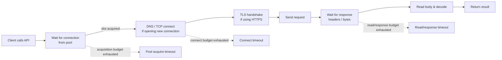
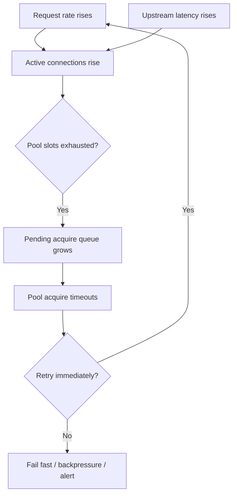
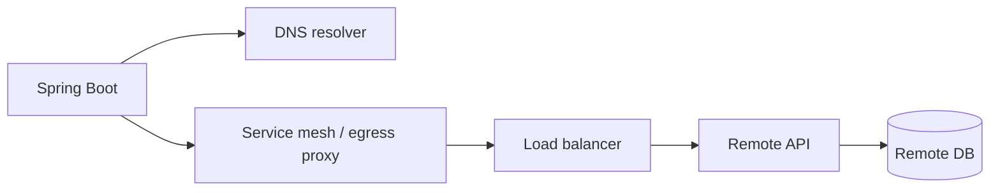
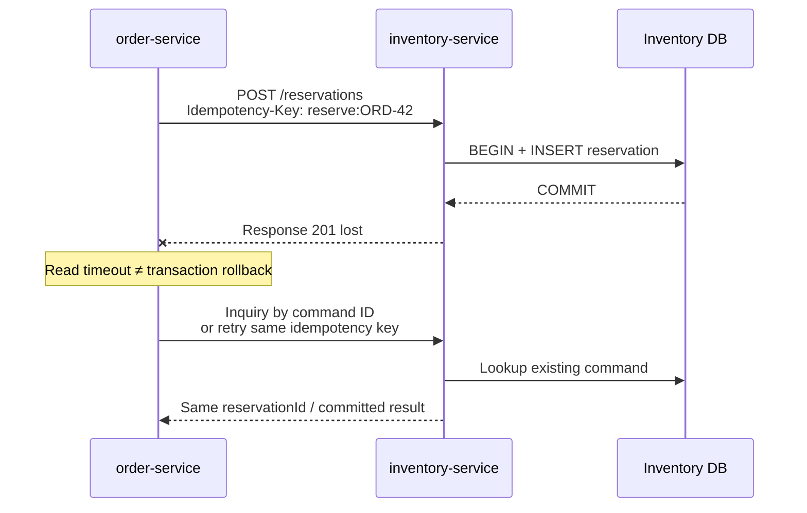
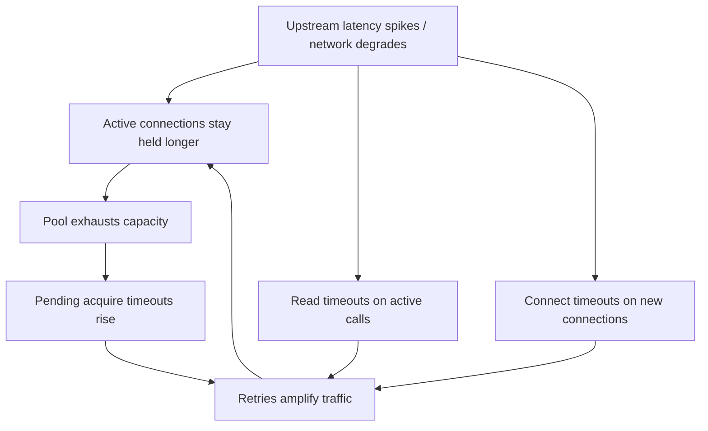

# Distinguishing Connect Timeout, Read Timeout, and Connection Pool Acquisition Timeout

## 1. Problem: "HTTP timeout" is not a single failure

A Spring Boot application `order-service` calls `inventory-service` to check stock before confirming an order. Under rising traffic, some calls fail after 300 ms; others wait 800 ms and report connection failure; still others connect successfully, wait 3 seconds for a response, and then time out. If all of them are logged generically as "inventory timeout" and retried, the application itself can generate extra load and lengthen the connection pool queue.

Three distinct wait durations must be separated:

1. **Waiting for a connection from the pool (connection acquisition/lease/pending acquire timeout):** waiting for a usable connection slot before performing request I/O.
2. **Connect timeout:** limiting the time spent establishing a TCP connection to the target address when opening a new connection.
3. **Read/response timeout:** limiting the wait for HTTP data over an established connection, with exact details depending on the library.

These are three **different boundaries**. Setting `connect timeout=1s` does not stop a request from waiting 20 seconds in the pool; setting `read timeout=3s` does not guarantee the total request finishes within 3 seconds.



This lesson belongs to the **HTTP Client Selection** chapter in the **SPRING_BOOT_INTEGRATION** module. The module covers integrating Spring Boot with HTTP clients, databases, caches, brokers, and Spring Integration adapters, emphasizing configuration, data contracts, transactions, errors, deduplication, testing, and observing real integration flows. Choosing appropriate timeouts must therefore align with **upstream capacity, connection counts, latency budgets, and retry safety**, rather than picking an isolated property.

**Objectives:**

1. Trace the timeline of an HTTP request across connection pool, DNS, connect, TLS, response, and body reading.
2. Distinguish connection acquisition timeout, connect timeout, read/response timeout, idle timeout, and overall deadline.
3. Understand why reusing a pooled connection skips TCP connect.
4. Configure Spring Boot WebClient/Reactor Netty per boundary: `pendingAcquireTimeout`, `CONNECT_TIMEOUT_MILLIS`, `responseTimeout`.
5. Configure RestClient with Apache HttpClient 5: `connectionRequestTimeout`, `connectTimeout`, and `responseTimeout`.
6. Know JDK HttpClient differences and when no equivalent "pool lease" knob is exposed.
7. Classify failures to apply retries, backoff, circuit breakers, and bulkheads accurately.
8. Avoid duplicating side effects of HTTP POST when timeouts leave the outcome uncertain.
9. Write controlled tests for pool exhaustion, TCP connect delays, response delays, streaming bodies, cancellation, and overall deadlines.
10. Set up metrics and runbooks to determine whether requests bottleneck at the **pool**, **network connection**, or **upstream response**.

> **Version scope:** Java examples use Java 17+, Spring Boot 3.x, Spring Framework 6.x, BOM-compatible Reactor Netty 1.x, Apache HttpClient 5, and JDK HttpClient. APIs and defaults may change in Spring Boot 4.x / Spring Framework 7.x / Reactor Netty 2.x; verify dependencies and Javadocs for your exact runtime before deploying. Timeout values in examples are purely illustrative, **not standard defaults or SLOs**.

## 2. Three clocks start at three different points

### 2.1. Waiting for a connection (pool acquisition/lease timeout)

Many HTTP clients use a **connection pool** to reuse TCP/TLS connections and cap concurrent connections to an upstream. When all slots are busy, new requests may enter a **pending queue** waiting for a free slot.

```text
               Connection pool: maxConnections = 2
                          ┌───────────────────┐
Request A ────────────────>│ connection #1 BUSY│
Request B ────────────────>│ connection #2 BUSY│
                          └───────────────────┘
Request C ──> pending queue ──> wait for connection release
Request D ──> pending queue ──> may time out right here
```

**Acquisition timeout** bounds how long a pending request may wait for a connection/slot. If it times out before leasing a slot:

- No TCP SYN or HTTP request has necessarily been sent to upstream.
- It may indicate **local contention**: excessive concurrency, unconsumed/unclosed response bodies, leaks, an undersized pool, or slow upstreams holding connections open.
- Increasing connect timeout or read timeout **does not directly fix** pool queueing.
- Retrying immediately can enqueue more pending requests and worsen saturation.

In Apache HttpClient 5 this is typically called **connection request timeout**; in Reactor Netty it is **pending acquire timeout**. Different names, same underlying wait for pool capacity.

**HTTP/2 note:** one physical connection can multiplex multiple concurrent streams when client and server support HTTP/2. Pool policies, active streams, and server limits no longer correspond one-to-one with "one socket per HTTP request." Do not estimate capacity from socket count alone when running HTTP/2.

### 2.2. Connect timeout

When the client must open a fresh TCP connection, it connects to the resolved IP/port. **Connect timeout** bounds this TCP connection establishment phase per connector implementation.

```text
pool grants slot / need to open new connection
  -> resolve hostname (DNS)
  -> TCP connect attempt
     -> SYN / SYN-ACK / ...
  -> connected
  -> TLS handshake (HTTPS)
  -> send HTTP request
```

Connect timeout is **not equivalent** to:

- **DNS resolution timeout:** resolving a hostname can consume time prior to TCP connect.
- **TLS handshake timeout:** HTTPS adds TLS negotiation, certificate checks, and hostname verification.
- **Proxy negotiation timeout:** an HTTP CONNECT or SOCKS proxy introduces its own steps.
- **Read/response timeout:** already connected, waiting on the server or bytes.
- **Total operation deadline:** total time the user/caller waits.

A socket connect can fail **immediately** due to `connection refused`, `no route to host`, or DNS errors; that is **not always a connect timeout**. Simply encountering a connection error does not mean the full configured millisecond budget elapsed.

**Connection reuse:** if the client obtains a valid idle keep-alive connection from the pool, it **skips opening a new TCP connection**, so connect timeout does not apply to that request. Consequently, two calls to the same endpoint can exhibit different timings and failure modes.

### 2.3. Read timeout / response timeout

After the connection is established and the request is sent, the application waits for the server to process and emit bytes. Depending on the client, different notions exist:

- **Socket read timeout / SO_TIMEOUT:** bounds how long a single blocking read waits for data.
- **Response timeout:** how long the HTTP client allows waiting for/reading the response, depending on implementation.
- **First-byte/header timeout:** bounds waiting for response start or headers (not every client exposes a separate option).
- **Inter-read inactivity timeout:** bounds silence gaps with no network read events on a streaming response.
- **Total body deadline:** total time to download and decode the body—**never automatically guaranteed** just by setting a read timeout.

```text
TCP connected, HTTP request sent
    |
    |--- server queue / business processing ---|
                                          headers
                                             |
                                             +-- chunk 1
                                             +---------- chunk 2
                                             +---------- chunk 3
                                                        ...
```

If upstream sends zero bytes for a long enough interval, read/response timeout fires. Yet if upstream dribbles a small chunk just before each inactivity deadline, a large response or SSE stream can drag on far longer **without ever tripping the inter-read wait**.

**Critical point:** Reactor Netty's `responseTimeout` is typically implemented to bound the time **between network-level reads** for a response. It is not a contract guaranteeing "the entire HTTP request finishes in N seconds." Likewise, for Apache HttpClient 5's `RequestConfig.responseTimeout`, verify exact semantics in your version/implementation rather than assuming parity with Reactor Netty or JDK HttpClient.

### 2.4. Total deadline (end-to-end time budget)

One client call can traverse multiple phases:

```text
Start
  -> pool pending acquire 200ms
  -> DNS 50ms
  -> TCP connect 500ms
  -> TLS handshake 150ms
  -> send/processing 700ms
  -> body read/decode 400ms
  -> application work 200ms
End
```

Even with a 300 ms acquisition timeout, 800 ms connect timeout, and 2 s read timeout, total time is **not guaranteed to stay under 2 s or 3.1 s**. DNS/TLS/other overhead, multi-chunk streams, retries, and downstream processing all consume budget.

To bound total elapsed time, enforce a **logical request deadline** at the right layer, size phase timeouts accordingly, cap retry attempts and backoff, and propagate remaining budget across downstream calls.

## 3. Request timeline using a pooled connection

Suppose an outbound WebClient to Warehouse is configured with:

```yaml
# Logical example, not automatic Spring Boot property names.
poolAcquisitionTimeout: 250ms
tcpConnectTimeout: 800ms
responseReadTimeout: 2s
operationDeadline: 4s
```

Consider four scenarios:

| Scenario | Pool | TCP | Server/body | Timeout likely triggered |
| --- | --- | --- | --- | --- |
| A: pool full for 400 ms | Pending without a slot | No new connect | Request not sent | **Acquisition** at 250 ms. |
| B: pool grants slot, blackholed TCP SYN | Slot granted immediately | TCP connect never completes | Request not sent | **Connect** at 800 ms, unless another limit fires first. |
| C: reused connection, upstream silent 3 s | Idle connection leased | **No new connect** | No response read events | **Read/response** around 2 s. |
| D: upstream sends 1 chunk every 1.5 s for 30 s | Connection leased | Connected cleanly | Inter-chunk gap < 2 s | Does not necessarily trip read timeout; **4 s deadline** should stop it. |

### 3.1. When one timeout fires first, others may never start

For instance, if Request C waits 250 ms to acquire and fails:

```text
acquire timer: expired
connect timer: not applicable
response timer: not applicable
business request may not have reached upstream
```

That signals **local pool saturation**, not proof that Warehouse is unreachable.

### 3.2. Network errors are not timeouts

Never equate:

```text
Socket error = connect timeout
5xx         = read timeout
NoSuchHost  = connection pool exhausted
```

These are distinct failure classes:

| Signal | Common root cause | Can a single exception type prove everything? |
| --- | --- | --- |
| `Connection refused` | No listener on IP:port or policy rejection. | Usually fails fast rather than timing out. |
| `UnknownHostException` | DNS/hostname resolution failure. | Never treat as TCP connect timeout. |
| `SSLHandshakeException` | TLS trust, certificate, or protocol mismatch. | Never treat as read timeout; never blindly retry. |
| Pool acquire timeout | No slot available in time. | Inspect pool pending/active; may be local overload. |
| TCP connect timeout | Socket failed to connect within limit. | Inspect network path, firewall, endpoint. |
| Read/response timeout | Connected cleanly but response failed to progress as expected. | Inspect upstream latency, body streaming, proxies, and contract. |
| HTTP `503` | Server/gateway **sent an HTTP response**. | Not a transport timeout; distinct retry policy. |
| HTTP `429` | Upstream rate limiting. | Honor `Retry-After` and quotas; never blindly enlarge the pool. |

### 3.3. Controlling HTTP connection lifetime

Beyond the three core timeouts:

- **Max idle time:** maximum duration a pooled connection stays idle before eviction (client-dependent).
- **Max life time:** maximum total age of a connection before eviction.
- **Idle eviction:** interval for sweeping stale connections.
- **Pool pending queue max:** cap on queued waiters to prevent unbounded queues.
- **TCP keepalive / HTTP keep-alive:** separate mechanisms; neither replaces a request timeout.
- **Response body consumption:** failing to consume or cancel bodies holds or invalidates connections.
- **Connection validation/stale detection:** helps avoid reusing sockets already closed by servers or proxies.

A client with `maxConnections=200` against a server supporting only 20 active requests is rarely better than a pool of 20; pool sizing must reflect upstream capacity and HTTP/1.1 vs. HTTP/2 behavior.

## 4. Two bounding dimensions: time and concurrency

Wait times are coupled with concurrency. From an operational Little's Law approximation:

\[
\text{Average concurrency} \approx \text{Throughput (request/s)} \times \text{Latency (s)}
\]

If a dependency receives an average of 100 HTTP calls/sec and each holds a slot for 0.2 s, average in-flight calls hover around 20. If latency climbs to 1.5 s at constant traffic, average concurrency jumps to ~150. A pool of 40 immediately builds a pending queue even when TCP networking is healthy.

**Never treat a back-of-the-envelope average as an absolute pool formula.** Factor in bursts, p95/p99 latency, HTTP/2 streams, upstream concurrency limits, thread pools, connection reuse, retry traffic, replica counts, and client resource caps.

### 4.1. Undersized pools, slow responses, and acquire timeouts



When acquire timeouts appear, raising `maxConnections` helps only if upstream can handle more load and the client host has resources; otherwise, it merely shifts the backlog onto upstream and risks a cascading failure.

### 4.2. What matters is "slot acquired" vs. "not yet acquired"

| Phase | Occupying pool capacity? | Could the request have reached the server? |
| --- | --- | --- |
| Pending acquire | No lease yet; waiting in queue. | Usually no. |
| Connecting new socket | Occupying pool slot/capacity per implementation. | HTTP request usually not sent yet. |
| TLS handshake | Connection being established. | Application HTTP request not yet sent. |
| Request body sent | Connection active. | **Yes**, server may be processing. |
| Waiting/reading response | Connection/stream active. | **Yes**, side effect may have committed. |
| Response complete / released | Slot can return to pool. | Client has processed the outcome. |

This is a typical model, not a guarantee across every connector (e.g., HTTP/2 multiplexers or proxies). When retrying writes, **knowing which phase timed out** informs risk assessment, though it never replaces an idempotency contract.

## 5. Choosing an HTTP client/connector by timeout behavior

Spring Boot supports multiple HTTP APIs. Timeout policies must be configured on the actual connector, not merely inside a service method.

| Technology | Model | Waiting for connection | Connect | Read/response |
| --- | --- | --- | --- | --- |
| `RestClient` + Apache HttpClient 5 | Imperative/blocking | `RequestConfig.connectionRequestTimeout` | `ConnectionConfig.connectTimeout` in pooling manager | `RequestConfig.responseTimeout` |
| `RestClient` + JDK HttpClient | Imperative Spring wrapper | JDK manages internal reuse/pooling; no equivalent Spring factory lease knob | `HttpClient.Builder.connectTimeout` | `JdkClientHttpRequestFactory.setReadTimeout` / JDK request timeout per API |
| `WebClient` + Reactor Netty | Non-blocking/reactive | `ConnectionProvider.pendingAcquireTimeout` | Netty `ChannelOption.CONNECT_TIMEOUT_MILLIS` | `HttpClient.responseTimeout` |
| `WebClient` + JDK connector | Non-blocking abstraction over JDK client | No Reactor `ConnectionProvider` | JDK client connect timeout | Depends on JDK request implementation and Reactor operators |
| `RestTemplate` + Apache HttpClient 5 | Legacy imperative | Same HttpComponents pool manager | `ConnectionConfig` | `RequestConfig` |

**Note:** `RestClient` is Spring's high-level API; timeouts depend on the **`ClientHttpRequestFactory`**. `WebClient` is the reactive API; timeouts depend on the **`ClientHttpConnector`**, HTTP client, and Reactor operators. The names `RestClient` or `WebClient` alone **do not define full timeout semantics**.

### 5.1. When to choose RestClient?

- Spring MVC/imperative applications with synchronous request/response flows.
- Readable workflows that do not need reactive backpressure across thousands of concurrent streams.
- Pair with Apache HttpClient 5 when distinct pool lease, connect, and response timeouts are required.
- Use Boot-injected `RestClient.Builder` to preserve interceptors, observability, and configured request factories.

### 5.2. When to choose WebClient?

- WebFlux/non-blocking applications composing `Mono`/`Flux` or streaming SSE/NDJSON.
- Need to bound pool pending acquisitions and TCP connect/read inactivity via Reactor Netty.
- Need cancellation, backpressure, concurrency limits, and overall publisher deadlines.
- Never call `.block()` on the Netty event loop just to reuse imperative code.

### 5.3. When NOT to switch libraries just to "get more timeouts"?

Do not migrate RestClient → WebClient if the real problems are uncancelled HTTP requests, a 10-slot connection pool meeting rising upstream latency, or excessive retries. You can solve those via Apache HttpClient 5 pool/request timeouts, backpressure, and proper response consumption. Conversely, merely swapping factories never turns a blocking app non-blocking.

## 6. WebClient + Reactor Netty: three timeouts in three places

This option illustrates separation clearly because Reactor Netty exposes `ConnectionProvider` for pending acquisition limits, Netty TCP connect options, and HTTP response timeout.

### 6.1. Dependencies for Spring Boot 3.x

```xml
<dependencies>
    <dependency>
        <groupId>org.springframework.boot</groupId>
        <artifactId>spring-boot-starter-webflux</artifactId>
    </dependency>
    <dependency>
        <groupId>org.springframework.boot</groupId>
        <artifactId>spring-boot-starter-actuator</artifactId>
    </dependency>
</dependencies>
```

`spring-boot-starter-webflux` typically pulls in Reactor Netty transitively. If an application intentionally swaps reactive HTTP connectors, verify the runtime connector rather than applying Reactor Netty settings to another connector expecting them to work. Let the Spring Boot BOM manage `reactor-netty-http` versions instead of pinning incompatible releases manually.

### 6.2. Configuring the connection pool, TCP, and response

```java
// InventoryWebClientConfiguration.java
package com.example.integration.http;

import java.time.Duration;
import io.netty.channel.ChannelOption;
import org.springframework.beans.factory.annotation.Value;
import org.springframework.context.annotation.Bean;
import org.springframework.context.annotation.Configuration;
import org.springframework.http.client.reactive.ReactorClientHttpConnector;
import org.springframework.web.reactive.function.client.WebClient;
import reactor.netty.http.client.HttpClient;
import reactor.netty.resources.ConnectionProvider;

@Configuration(proxyBeanMethods = false)
public class InventoryWebClientConfiguration {

    @Bean(name = "inventoryConnectionProvider",
          destroyMethod = "dispose")
    ConnectionProvider inventoryConnectionProvider() {
        return ConnectionProvider.builder("inventory-http-pool")
            .maxConnections(40)
            .pendingAcquireMaxCount(80)
            .pendingAcquireTimeout(Duration.ofMillis(250))
            .maxIdleTime(Duration.ofSeconds(30))
            .build();
    }

    @Bean("inventoryWebClient")
    WebClient inventoryWebClient(
        WebClient.Builder builder,
        ConnectionProvider inventoryConnectionProvider,
        @Value("${inventory.base-url}") String baseUrl
    ) {
        HttpClient netty = HttpClient
            .create(inventoryConnectionProvider)
            .option(
                ChannelOption.CONNECT_TIMEOUT_MILLIS,
                800
            )
            .responseTimeout(Duration.ofSeconds(2));

        return builder
            .baseUrl(baseUrl)
            .clientConnector(
                new ReactorClientHttpConnector(netty)
            )
            .codecs(codecs -> codecs
                .defaultCodecs()
                .maxInMemorySize(1024 * 1024)
            )
            .build();
    }
}
```

```yaml
# application.yml
inventory:
  base-url: ${INVENTORY_BASE_URL:http://localhost:8089}
```

Limits are placed where they actually take effect:

| Setting | Demo value | Controls |
| --- | --- | --- |
| `maxConnections(40)` | 40 | Pool connection slots (factor in protocol/HTTP2). |
| `pendingAcquireMaxCount(80)` | 80 | Max queued acquire waiters; fails fast once full. |
| `pendingAcquireTimeout(250ms)` | 250 ms | How long a request waits for a pool slot. |
| `CONNECT_TIMEOUT_MILLIS=800` | 800 ms | TCP connect attempt when opening a new socket. |
| `responseTimeout(2s)` | 2 seconds | Read/response inactivity gap per Reactor Netty. |
| `maxIdleTime(30s)` | 30 seconds | Idle connection reuse window. |
| `maxInMemorySize(1MiB)` | 1 MiB | Aggregation buffer cap for codecs—**not a timeout**. |

**Why does `maxInMemorySize` appear here?** An oversized JSON response can tie up a connection and decoder for a long time; nevertheless, `DataBufferLimitException` is **different** from acquisition, connect, or read timeouts. For large downloads, use streaming with total byte limits; never raise read timeouts to compensate for body size, nor raise codec limits to fix TCP timeouts.

### 6.3. Why inject WebClient.Builder?

Spring Boot typically auto-configures `WebClient.Builder` with observations, codecs, and environment customizers. Using the injected builder preserves standard configuration while allowing a tailored **connector** policy for Inventory. If multiple WebClient beans manually mutate a single shared builder instance, baseUrl/headers/connectors can bleed across clients; call `builder.clone()` or inject independent builders per lifecycle rules.

**Lifecycle:** an application-created `ConnectionProvider` must be disposed on shutdown—hence `@Bean(destroyMethod="dispose")` above. Creating a provider per request destroys pooling and leaks resources. Conversely, when using Boot-managed shared Reactor Netty resources, understand `ReactorResourceFactory` lifecycle so you never accidentally destroy shared resources.

### 6.4. A WebClient request with an overall deadline

```java
// InventoryGateway.java
package com.example.integration.http;

import java.time.Duration;
import org.springframework.beans.factory.annotation.Qualifier;
import org.springframework.stereotype.Component;
import org.springframework.web.reactive.function.client.WebClient;
import reactor.core.publisher.Mono;

@Component
public class InventoryGateway {
    private final WebClient webClient;

    public InventoryGateway(
        @Qualifier("inventoryWebClient") WebClient webClient
    ) {
        this.webClient = webClient;
    }

    public Mono<InventoryView> readInventory(String sku) {
        return webClient.get()
            .uri("/api/v1/stock/{sku}", sku)
            .retrieve()
            .bodyToMono(InventoryView.class)
            .timeout(Duration.ofSeconds(4));
    }
}
```

```java
// InventoryView.java — separate file
package com.example.integration.http;

public record InventoryView(
    String sku,
    long available,
    long version
) {}
```

For an uncached Publisher, placing `timeout(4s)` outside `bodyToMono` bounds the total elapsed time from subscription to terminal signal **in this pipeline**. Until the `Mono` is subscribed to, no request starts. Putting `retryWhen` **inside** `timeout` includes retries and backoff in the deadline; putting `timeout` inside retry grants each attempt another 4 seconds.

`Mono.timeout(...)` emits a timeout error and cancels the upstream subscription when exceeded, yet **does not prove the remote operation rolled back**. Pure read HTTP GETs can typically be retried if policy permits; side-effecting POSTs need idempotency keys and unknown-outcome handling.

### 6.5. Example combining retries without multiplying budgets

```java
import java.time.Duration;
import reactor.util.retry.Retry;

public Mono<InventoryView> readWithRetry(
    String sku
) {
    return webClient.get()
        .uri("/api/v1/stock/{sku}", sku)
        .retrieve()
        .bodyToMono(InventoryView.class)
        .retryWhen(
            Retry.backoff(2, Duration.ofMillis(200))
                .maxBackoff(Duration.ofMillis(700))
                .jitter(0.5)
                .filter(this::isTemporaryWarehouseFailure)
        )
        .timeout(Duration.ofSeconds(4));
}
```

This method snippet illustrates a gateway holding `webClient` and an application-defined `isTemporaryWarehouseFailure(Throwable)` predicate. It must **not** retry every `Throwable`; the predicate should distinguish 503/429 per contract and transient network errors while **avoiding retrying** pool saturation failures that only pack the queue further unless explicit capacity/budgets allow.

In Reactor, `Retry.backoff(2, ...)` allows **two retries after the initial attempt**, i.e., at most three HTTP attempts. Placing `timeout(4s)` outside the retry operator caps the entire logical call, though if outer callers/gateways also retry, total system attempts still multiply.

### 6.6. Reactor Netty response timeout and streaming

```text
responseTimeout = 2s

Server sends:
  chunk 1 at t=1s
  chunk 2 at t=2.5s
  chunk 3 at t=4s
  chunk 4 at t=5.5s

Silence gap between chunks ~1.5s
  -> each gap stays below 2s
  -> response still lasts longer than 5s
```

When APIs stream Server-Sent Events, video, or long-lived NDJSON, `responseTimeout(2s)` may **break valid streams** if gaps between events exceed 2 seconds. Streams require dedicated idle timeouts, heartbeat intervals, and lifecycles distinct from typical JSON request–response deadlines. Never put `timeout(4s)` on an SSE stream meant to stay subscribed for hours.

### 6.7. Isolating pools by upstream and trust boundary

```text
inventory-api -> inventory-http-pool (max 40, acquire 250ms)
pricing-api   -> pricing-http-pool   (max 20, acquire 150ms)
reporting-api -> reporting-pool      (max 8, long streaming)
```

A report export can occupy connections for minutes; sharing a pool with 300 ms Inventory GETs lets reports starve critical APIs and trigger acquire timeouts. Separate pools do not isolate everything (CPU/network threads may still be shared), yet they prevent **pool contention** and keep metrics clean.

Size pools after load testing rather than copying example numbers blindly into production.

## 7. RestClient + Apache HttpClient 5: lease, connect, response

For Spring MVC/imperative apps, Apache HttpClient 5 offers explicit transport-level control over pooling and timeouts.

### 7.1. Dependencies

```xml
<dependencies>
    <dependency>
        <groupId>org.springframework.boot</groupId>
        <artifactId>spring-boot-starter-web</artifactId>
    </dependency>
    <dependency>
        <groupId>org.apache.httpcomponents.client5</groupId>
        <artifactId>httpclient5</artifactId>
    </dependency>
</dependencies>
```

Use the Apache HttpClient 5 version managed by your Spring Boot BOM whenever possible. Never consult Apache HttpClient **4.x** docs for 5.x classes because packages, timeout configuration, and builder APIs differ.

### 7.2. Creating the pooling manager and request config

```java
// InventoryRestClientConfiguration.java
package com.example.integration.http;

import java.time.Duration;
import org.apache.hc.client5.http.classic.HttpClient;
import org.apache.hc.client5.http.config.ConnectionConfig;
import org.apache.hc.client5.http.config.RequestConfig;
import org.apache.hc.client5.http.impl.classic.CloseableHttpClient;
import org.apache.hc.client5.http.impl.classic.HttpClients;
import org.apache.hc.client5.http.impl.io.PoolingHttpClientConnectionManager;
import org.apache.hc.client5.http.impl.io.PoolingHttpClientConnectionManagerBuilder;
import org.apache.hc.core5.util.Timeout;
import org.springframework.beans.factory.annotation.Value;
import org.springframework.context.annotation.Bean;
import org.springframework.context.annotation.Configuration;
import org.springframework.http.client.HttpComponentsClientHttpRequestFactory;
import org.springframework.web.client.RestClient;

@Configuration(proxyBeanMethods = false)
public class InventoryRestClientConfiguration {

    @Bean(name = "inventoryApacheHttpClient",
          destroyMethod = "close")
    CloseableHttpClient inventoryApacheHttpClient() {
        ConnectionConfig connConfig = ConnectionConfig.custom()
            .setConnectTimeout(Timeout.ofMilliseconds(800))
            .build();

        PoolingHttpClientConnectionManager manager =
            PoolingHttpClientConnectionManagerBuilder.create()
                .setDefaultConnectionConfig(connConfig)
                .setMaxConnTotal(40)
                .setMaxConnPerRoute(20)
                .build();

        RequestConfig requestConfig = RequestConfig.custom()
            .setConnectionRequestTimeout(
                Timeout.ofMilliseconds(250)
            )
            .setResponseTimeout(Timeout.ofSeconds(2))
            .build();

        return HttpClients.custom()
            .setConnectionManager(manager)
            .setDefaultRequestConfig(requestConfig)
            .build();
    }

    @Bean("inventoryRestClient")
    RestClient inventoryRestClient(
        RestClient.Builder builder,
        CloseableHttpClient inventoryApacheHttpClient,
        @Value("${inventory.base-url}") String baseUrl
    ) {
        HttpComponentsClientHttpRequestFactory factory =
            new HttpComponentsClientHttpRequestFactory(
                inventoryApacheHttpClient
            );

        return builder
            .baseUrl(baseUrl)
            .requestFactory(factory)
            .build();
    }
}
```

**Layered configuration:**

| Apache HC5 layer | API | Bounds |
| --- | --- | --- |
| Pool leasing | `RequestConfig.setConnectionRequestTimeout` | Waiting for a connection lease from the pooling manager. |
| TCP connection establishment | `ConnectionConfig.setConnectTimeout` | TCP connect timeout when opening a socket. |
| Response reads | `RequestConfig.setResponseTimeout` | Waiting for response/reads per HC5 implementation. |
| Pool capacity | `setMaxConnTotal / setMaxConnPerRoute` | Total connections and per-route connection counts. |

**Do not confuse** `maxConnPerRoute` with application-wide max connections; across multiple hosts/routes, balance both per-route and total caps. If the route to Warehouse is capped at 20, requests can hit pending lease timeouts even while global capacity remains available.

**Version note:** In Apache HC5, connect timeout is set on `ConnectionConfig` of the connection manager here; older `RequestConfig.setConnectTimeout` examples may be deprecated or differ in semantics. Always verify Javadocs for the exact Apache HC5 version your application runs.

### 7.3. Service invoking RestClient

```java
// InventorySyncGateway.java
package com.example.integration.http;

import org.springframework.beans.factory.annotation.Qualifier;
import org.springframework.stereotype.Component;
import org.springframework.web.client.RestClient;

@Component
public class InventorySyncGateway {
    private final RestClient rest;

    public InventorySyncGateway(
        @Qualifier("inventoryRestClient") RestClient rest
    ) {
        this.rest = rest;
    }

    public InventoryView readInventory(String sku) {
        InventoryView body = rest.get()
            .uri("/api/v1/stock/{sku}", sku)
            .retrieve()
            .body(InventoryView.class);

        if (body == null || !sku.equals(body.sku())) {
            throw new IllegalStateException(
                "Inventory response violates contract"
            );
        }
        return body;
    }
}
```

`RestClient` is imperative/blocking: the calling thread may wait on pool lease, TCP connect, or response read. If 200 servlet threads block waiting 250 ms on the pool, the web server still incurs thread/queueing costs. Coordinate servlet thread capacity, pool max/queue limits, external API SLAs, and backpressure/throttling tools.

### 7.4. Never confuse the Apache connection pool with the JDBC DataSource pool

```text
HTTP connection pool:
  routes -> inventory.example.org:443
  capacity -> outbound HTTP sockets/connections

HikariCP:
  JDBC connections -> PostgreSQL database
  capacity -> database sessions
```

These two pools are completely separate. An HTTP connection request timeout **does not mean** the Hikari pool is out of slots. Conversely, `SQLTransientConnectionException` or Hikari `connectionTimeout` has nothing to do with Apache HTTP client TCP connect timeouts. In Spring Integration flows touching both DB and HTTP, monitor each pool separately.

### 7.5. Managing lifecycle and response bodies

`CloseableHttpClient` is a resource that must be closed on context shutdown—hence `destroyMethod="close"` above. Creating a client per request destroys reuse and spikes TLS handshakes and `TIME_WAIT` sockets.

With `RestClient`, always read/close response bodies through proper APIs (`retrieve().body(...)` or `exchange(...)` with explicit closing/consumption). Leaving responses open or handing streaming bodies to background tasks without clear ownership drains the pool and triggers connection request timeouts.

## 8. RestClient + JDK HttpClient: not every client exposes three matching knobs

Spring Framework 6.1+ includes `JdkClientHttpRequestFactory` wrapping `java.net.http.HttpClient`. Sample config:

```java
// InventoryJdkRestClientConfiguration.java
package com.example.integration.http;

import java.net.http.HttpClient;
import java.time.Duration;
import org.springframework.beans.factory.annotation.Value;
import org.springframework.context.annotation.Bean;
import org.springframework.context.annotation.Configuration;
import org.springframework.http.client.JdkClientHttpRequestFactory;
import org.springframework.web.client.RestClient;

@Configuration(proxyBeanMethods = false)
public class InventoryJdkRestClientConfiguration {

    @Bean("inventoryJdkRestClient")
    RestClient inventoryJdkRestClient(
        RestClient.Builder builder,
        @Value("${inventory.base-url}") String baseUrl
    ) {
        HttpClient jdkClient = HttpClient.newBuilder()
            .connectTimeout(Duration.ofMillis(800))
            .build();

        JdkClientHttpRequestFactory factory =
            new JdkClientHttpRequestFactory(jdkClient);
        factory.setReadTimeout(Duration.ofSeconds(2));

        return builder
            .baseUrl(baseUrl)
            .requestFactory(factory)
            .build();
    }
}
```

**Key differences:**

- JDK `HttpClient` manages connection reuse/pooling internally, yet Spring's `JdkClientHttpRequestFactory` **lacks equivalent `connectionRequestTimeout`/`pendingAcquireTimeout` APIs** compared to Apache HC5 or Reactor Netty.
- `HttpClient.Builder.connectTimeout(...)` covers connection establishment, not overall logic, DB, or JSON mapping.
- `JdkClientHttpRequestFactory.setReadTimeout(...)` sets the factory read timeout per your Spring Framework version; empirically test behavior with delayed headers and streaming bodies.
- When strict limits on concurrent leases and pending queues are needed, choose a connector with explicit pool controls, or add an application-level **bulkhead/semaphore** with clear metrics.

**Do not assume "JDK client has no pool" simply because it lacks a public pending-acquire knob:** it manages connections internally; it simply does not expose configuration knobs and semantics matching the Reactor Netty/Apache examples.

### 8.1. JDK request timeout differs from Spring factory timeouts

JDK `HttpRequest.Builder.timeout(Duration)` governs request duration per JDK API and `HttpClient.send`/`BodyHandler` completion; check exact JDK/JVM version docs for streaming bodies. It is not automatically identical to Reactor `responseTimeout` (inactivity gap), and `RestClient` may not expose every per-request JDK option directly.

Measure against a test HTTP server with delayed headers and chunked bodies instead of writing mechanical equivalence tables:

```text
Apache responseTimeout 2s
Reactor Netty responseTimeout 2s
JDK factory readTimeout 2s

=> DO NOT assume all three clients will abort a streaming response
   at the exact same timestamp in every scenario.
```

### 8.2. Can TLS handshake time sit outside the connect limit?

In most cases, configure and measure TLS handshake timeouts separately when the connector supports them. TCP connect may complete quickly while TLS negotiation stalls, certificate chain validation fails, or hostname checks mismatch. Connect timeout often does not cover full TLS time. In Reactor Netty, `HttpClient.secure(...)` exposes SSL handshake timeout settings; in Apache/JDK, consult the exact APIs of your version and TLS stack.

**Never** disable certificate verification or switch from HTTPS to HTTP to "fix timeouts." A TLS handshake failure is a trust/protocol/certificate issue, not a reason to retry over insecure transport.

## 9. DNS, proxies, TLS, and network idle: waits outside the "three timeouts"

When investigating timeouts in Kubernetes, cloud VPCs, or corporate networks, multiple hops sit between service and upstream:



Along the real path, clients can encounter:

- Slow DNS lookups or stale IPs returned by resolvers.
- Successful TCP connect from client to **proxy**, while the proxy fails to reach upstream.
- HTTP CONNECT proxies stalling tunnel setup.
- Slow/failing TLS handshakes between client↔proxy or client↔upstream.
- Load balancer idle timeouts silently closing pooled keep-alive connections.
- Overloaded upstream thread pools or DB connection pools delaying response headers.
- Gateways returning HTTP 504 on schedule while client timeouts are longer.

**Connect timeout always applies to a specific connection**, which may be the hop to a proxy rather than the origin host. When a proxy fails forwarding, the client sees HTTP 502/503/504 or a connection reset rather than a client-side TCP connect timeout.

### 9.1. DNS resolution is not always covered by connect timeout

Example:

```text
Resolve inventory.example.com -> 1.5 seconds
TCP connect timeout option     -> 0.8 seconds
TCP connect actually takes     -> 0.1 seconds
TLS handshake                  -> 0.3 seconds

Total before HTTP request ~1.9s even with connect timeout=0.8s.
```

Values are purely illustrative. DNS involves cache TTLs, multiple A/AAAA records, IPv4/IPv6 preferences, and resolver timeouts/retries. When DNS errors occur, inspect DNS/resolver metrics instead of increasing pool `pendingAcquireTimeout` or `responseTimeout`.

### 9.2. Pooled keep-alive connections can go stale

A server or load balancer may close idle connections after 60 seconds while the client keeps them pooled for 120 seconds and tries to reuse one. The result can be a connection reset before receiving any response, even though connect timeout never fired.

Mitigations:

- Tune client `maxIdleTime` appropriately relative to upstream/LB idle timeouts.
- Enable idle connection eviction/validation as supported by your HTTP client.
- Avoid pools with infinite idle lifetimes when proxies terminate idle sockets early.
- Perform **bounded** retries on read-only requests when errors are stale-connection resets; verify side effects for POSTs.
- Track connection reuse rates, resets, idle counts, and errors per upstream.

### 9.3. Separate TLS handshake timeout

In Reactor Netty versions supporting `SslProvider`:

```java
// Additional example for an existing HttpClient.
HttpClient secured = netty.secure(ssl ->
    ssl.handshakeTimeout(Duration.ofSeconds(3))
);
```

`secure(...)` must be configured alongside the environment's proper SSL context, truststore, and hostname verification; it does not replace URL HTTPS/TLS trust policies. When customizing SSL contexts, never install `InsecureTrustManagerFactory` or disable hostname verification to silence handshake timeouts or errors.

### 9.4. Idle timeout is not a request deadline

Pool `maxIdleTime` bounds **how long an idle connection is kept**, not an active request. `responseTimeout` bounds response reads per client semantics, not how long a connection sits idle afterward. Socket `readTimeout` does not govern pool `maxIdleTime` either.

Each knob answers a distinct question:

```text
maxIdleTime             : how long can an idle connection remain pooled?
pendingAcquireTimeout   : how long may a request wait for a slot?
connectTimeout          : how long may TCP connect wait?
TLS handshakeTimeout    : how long may TLS negotiation wait?
response/readTimeout    : how long to wait for response data?
total deadline          : how long may the entire logical operation wait?
```

## 10. Comparing HTTP/1.1 and HTTP/2 when sizing pools

### 10.1. HTTP/1.1 keep-alive

Standard HTTP/1.1 clients generally do not run concurrent requests over one connection without pipelining. Thus, 40 pooled active connections roughly correspond to ~40 HTTP calls reading responses concurrently on that route. This is an **approximation**, not a strict rule for every client.

### 10.2. HTTP/2 multiplexing

HTTP/2 can run multiple concurrent streams over a single TCP/TLS connection; `SETTINGS_MAX_CONCURRENT_STREAMS` and connector/server resources govern effective capacity.

```text
HTTP/1.1:
  connection #1 -> request A
  connection #2 -> request B

HTTP/2:
  connection #1 -> stream A, stream B, stream C...
  concurrency also bounded by max concurrent streams/flow control
```

Therefore, `maxConnections=40` does not equal 40 requests when HTTP/2 is genuinely enabled and negotiated. In operations, verify the negotiated protocol (ALPN), stream counts, flow control, server concurrency caps, and how connectors open extra connections once stream limits fill.

### 10.3. HTTP/2 stream resets

A response may terminate with a stream reset due to HTTP/2 protocol rules, upstream quotas, or proxies; that is neither a socket-level connect timeout nor a read timeout. Retry policies must inspect stream error classification, idempotency, and upstream load. Never treat every `RST_STREAM` as automatic license to resend an HTTP POST.

### 10.4. Both HTTP/1.1 and HTTP/2 still need request-level budgets

Even with multiplexing, every logical request still requires:

- Distinguishing "not yet sent" from "already sent."
- Bounded header/body sizes and streaming policies.
- An overall deadline spanning request and retries.
- Correlation IDs, trace spans, and explicit outcomes.
- Never inferring remote rollback from cancellation or timeouts.

## 11. Designing timeouts from SLOs instead of arbitrary numbers

Suppose `order-service` has a p99 API target of 5 seconds, budgeted as:

```text
API request budget             = 5000 ms
Authorization, validation      = 300 ms
PostgreSQL transaction          = 500 ms
Inventory HTTP call            = 2500 ms
Payment HTTP call              = 1000 ms
Serialization + margin         = 700 ms
---------------------------------------
Total                          = 5000 ms
```

If the Inventory HTTP client allows 3 attempts, each allowing 2 seconds of read inactivity plus backoff, a single dependency easily blows through 2.5 seconds. Use **budget-aware retries** and pass remaining deadlines forward to subsequent calls.

### 11.1. Separating per-attempt and total deadlines

```text
Logical inventory lookup deadline: 2500ms

Attempt #1:
  pool acquire <= 150ms
  connect (if needed) <= 500ms
  response read inactivity <= 1000ms
  timeout/failure after 900ms

Backoff <= 200ms

Attempt #2:
  remaining deadline ~1400ms
  must complete or be cancelled before 2500ms overall
```

This is a **budgeting model**, not a mathematical guarantee that phases execute strictly sequentially or that OS timers fire to the exact millisecond. Account for TLS/DNS/proxy, streaming, and scheduler jitter; validate against real latency measurements.

### 11.2. Caller limits must decrease cleanly down the chain

Example:

```text
External API Gateway timeout: 6s
order-service request deadline: 5s
inventory logical deadline: 2.5s
single read attempt timeout: 1s
```

If `order-service` waits 8 seconds before canceling Inventory while the API gateway already returned 504 after 6 seconds, the app continues burning connections/threads on work the caller abandoned. Well-structured systems set downstream deadlines shorter than upstream deadlines, leaving margin for error mapping, cleanup, and network overhead.

There is no universal rule like "HTTP client timeouts are always 1s." Over WANs or valid batch exports, 1s triggers false timeouts; other endpoints require <100 ms. Base configurations on SLOs and historical per-operation latency.

### 11.3. Multi-phase timeout budgets cannot simply be summed mechanically

```text
pendingAcquire=250ms
connect=800ms
responseTimeout=2000ms

WRONG inference:
  request is guaranteed to time out after at most 3050ms.
```

Because:

- DNS/TLS/proxy add overhead outside these timers.
- `responseTimeout` may reset on network reads, letting streams run longer.
- Java application work runs before and after the client call.
- Retrying a logical command repeats multiple phases.
- Connection pooling skips connect when reusing sockets.

To enforce a hard wall-clock deadline, add an appropriate **total timeout** layer suited to async vs. blocking execution, and test actual resource cancellation.

### 11.4. Total deadlines with imperative clients

In a blocking service, `RestClient.retrieve()` is not a Reactor Publisher where you simply chain `.timeout(...)`. Options include:

- Apache HttpClient/JDK per-phase transport timeouts so network calls never hang forever where supported by the connector.
- Request-scoped deadlines at the application boundary, passing remaining budget into per-request client/connector configs where supported.
- Service-layer bulkheads/concurrency limits.
- `CompletableFuture` + executor + timeout only if you fully understand cancellation and blocking socket I/O; `Future.cancel(true)` does not always interrupt socket reads or roll back remote side effects.
- On Java 21+, consider structured concurrency per your JDK's API/preview status, while **never** assuming it replaces transport timeouts.

For synchronous HTTP, the simplest verifiable approach is combining phase-specific timeouts + bounded attempts + caller deadlines rather than wrapping blocking I/O in a timer that fails to abort underlying sockets.

## 12. Timeouts, retries, and idempotency

A timeout often means only that **the client received no result within budget**, not that the server failed to execute.

### 12.1. Three phases and their consequences for POST

| Timeout | Did the HTTP message reach upstream? | Safe to auto-retry POST? |
| --- | --- | --- |
| **Pool acquire** before getting a slot | Usually **not yet sent by this HTTP client**. | No side effect from this attempt yet, though overload/caller layers remain; retry only if cause and budget allow. |
| **TCP connect** before sending HTTP request | Usually request **not sent** over that new connection. | Can consider retrying transient errors, after verifying proxy/reuse semantics and avoiding multiplied retries. |
| **Read/response** after sending request | **May have arrived and committed remotely**. | **Never blindly retry**; require provider idempotency key/inquiry. |

This is a typical mental model, not legal/transactional proof derived solely from exception classes. With proxies, redirects, interceptors, and multi-layer retries, an earlier attempt of a logical command may already have succeeded even if a later attempt fails during acquisition.

### 12.2. POST reservation with unknown outcome



**Conditions for safe write retries:**

- Stable logical command ID/idempotency key across all attempts—**never generate a new UUID per retry**.
- Provider enforces keys atomically, checks request fingerprints, and stores/replays outcomes.
- Key retention exceeds all retries, DLT windows, and reconciliation horizons.
- Inquiry path exists by provider ID or business command ID when outcomes are unclear.
- Without guarantees, transition the workflow to `UNKNOWN_OUTCOME` and reconcile instead of marking `FAILED_NOT_EXECUTED`.

An HTTP client timeout, circuit breaker, or service mesh retry **cannot magically provide exactly-once business effects**.

### 12.3. Even GET must guard against request amplification

```text
API Gateway retry: 2 total attempts
Service retry:     3 total attempts
HTTP client retry: 3 total attempts

Worst-case calls = 2 × 3 × 3 = 18
```

18 calls for one GET can crush an already struggling upstream. Assign **a single intentional retry owner per boundary**, cap overall deadlines, and never endlessly retry pool acquisition saturation.

### 12.4. Classifying failures for retry policies

| Failure | Default handling direction to consider |
| --- | --- |
| Pool acquire timeout | Local saturation: fail fast/backpressure; inspect pool, reduce concurrency. Immediate retries usually hurt. |
| TCP connect timeout | Bounded retry possible for idempotent GETs if deadline remains; inspect upstream/network. |
| DNS NXDOMAIN/bad hostname | Usually misconfiguration; do not hot-retry. |
| Invalid TLS certificate | Trust/config failure; never retry via insecure fallback. |
| GET read timeout | Bounded retry + backoff/jitter for read-only queries while upstream has capacity. |
| POST read timeout | `UNKNOWN_OUTCOME`; idempotency/inquiry before retrying. |
| HTTP 429 | Honor `Retry-After`/quotas; avoid hammering the endpoint. |
| HTTP 503 | Transient candidate; evaluate retry/circuit breaker within budget. |
| HTTP 400/401/403/422 | Usually permanent/contract/permission; do not retry like 503. |
| JSON decode/codec limit | Usually contract/payload size error; do not blindly retry. |

**Never** write `catch (Exception e) { retry(); }`; define an error taxonomy per operation covering cause chains across versions.

## 13. Timeouts across Spring Integration, Kafka, and databases

### 13.1. HTTP outbound handlers and Spring Integration retries

```text
Kafka event / HTTP inbound
  -> Spring Integration outbound handler
     -> WebClient / RestClient
        -> connection pool
        -> connect/read
  -> business DB update / ack / next step
```

If a handler attaches `RequestHandlerRetryAdvice` while the HTTP client adds another retry operator, attempts multiply. If the handler is reactive and merely **returns a Mono** while Spring Integration advice retries **creating the Mono**, it may fail to retry HTTP errors emitted upon subscription; confirm which adapter/gateway actually subscribes and propagates completion.

**Keep distinct:** handler call failure, inbound broker acknowledgment, database transaction commit, and HTTP remote side effects do not form one unified transaction.

### 13.2. Never hold DB transactions across long HTTP retries

Dangerous pattern:

```text
BEGIN PostgreSQL transaction
  UPDATE orders SET status='PAYMENT_PENDING'
  POST payment
    -> pool acquire wait
    -> TCP connect
    -> read timeout
    -> sleep 500ms + retry
    -> sleep 1s + retry
COMMIT PostgreSQL
```

While waiting, the transaction holds JDBC connections and locks, starving HikariCP. Other Kafka consumers or HTTP handlers needing the DB stall, creating cascading timeouts **across two separate connection pools**.

Prefer:

```text
BEGIN local DB transaction
  update order state + insert outbox command
COMMIT

worker:
  reserve HTTP capacity + call provider with bounded deadline
  record result or UNKNOWN_OUTCOME
  ack work after durable result/parking
```

Outbox/inbox patterns, stable command IDs, and provider idempotency survive crashes and replays. They do not turn HTTP + DB + broker into an atomic XA transaction.

### 13.3. Kafka consumers and timeouts

If a synchronous Kafka listener waits through 30-second HTTP read timeouts across 5 retries, processing can exceed poll/consumer-group timeouts, triggering rebalances and redeliveries. An event that already caused a remote side effect before offset commit will run again. Balance:

- Listener concurrency and poll batch size.
- HTTP total deadline + retry budget.
- Kafka `max.poll.interval.ms`, heartbeats, and container pause settings.
- Durable parking/DLT for prolonged dependency outages.
- Idempotent handlers committing offsets only after durable effects.

Never stretch `max.poll.interval.ms` indefinitely to cover up an unbounded HTTP timeout or unbounded pool pending queue.

### 13.4. RabbitMQ listeners and unacked messages

A Rabbit listener with `prefetch > 1` holds multiple unacked messages while handlers block on HTTP. If all consumers wait on pool acquisition:

```text
Rabbit queue -> 100 unacked messages
HTTP pool    -> 20 active + 80 pending
Upstream     -> 503/slow
```

Avoid fast inline retries inside the listener, which hold unacked messages longer and trigger redeliveries when channels drop. Coordinate prefetch/concurrency, HTTP pool capacity, bounded retries, and DLX/parking while preserving idempotency on redelivery.

### 13.5. Cache/Redis/DB pool timeouts mean something different from HTTP pools

Within a single service:

| Pool/resource | Typical timeout | What to monitor |
| --- | --- | --- |
| WebClient Reactor Netty | `pendingAcquireTimeout` | HTTP pool pending/active/idle. |
| RestClient Apache HC5 | `connectionRequestTimeout` | Route lease waits, leased/available/pending. |
| HikariCP JDBC | `connectionTimeout` | JDBC active/idle/pending, DB lock/query latency. |
| Lettuce Redis | Client command/connect timeouts | Redis connections/commands, event loop/broker. |
| Kafka producer | Delivery/request timeouts | Send buffer, broker ACK latency. |

All contain words like "connection" or "timeout," yet target completely different resources. Never report a generic "connection timeout" without specifying `dependency + phase + client type`.

## 14. Testing: separating the three timeouts via controlled failure windows

**Never test timeouts by hitting random public Internet hosts.** DNS, firewalls, kernel TCP retransmissions, cloud routing, proxies, and IPs behave unpredictably across dev laptops, CI, and production. Use a local test HTTP server for response behavior, deliberate pool saturation for acquisition, and a controllable network harness for TCP SYN/handshake drops.

### 14.1. Mandatory test matrix

| Test | Setup condition | Expected phase | Must NOT be confused with |
| --- | --- | --- | --- |
| Pool max=1, request A holds connection, B waits 200 ms | 1 waiter in acquire queue | B's pool acquisition timeout | B's connect/read. |
| Insufficient pending queue capacity | Pending requests exceed max count | Immediate or implementation-defined rejection | TCP connect timeout. |
| Network drops TCP SYN to test host/port | 3-way handshake never completes | TCP connect timeout | Connection refused. |
| Port has no listener, host sends RST | Connection rejected immediately | Connection refused | Waiting full connect timeout. |
| Non-existent DNS name | Resolver returns no valid IP | DNS error | TCP connect timeout. |
| Untrusted TLS certificate | TCP connect already succeeded | TLS handshake failure | Read timeout. |
| Server reads request and sends nothing | TCP connected and request sent | Read/response timeout | Pool acquisition timeout. |
| Server sends 1 byte every 500 ms | Read events keep arriving | Does not necessarily trip inactivity timeout | Total deadline. |
| Server immediately returns 503 | HTTP response arrived | HTTP 503 status error | Transport timeout. |
| JSON body exceeds codec limit | Bytes arrived but decoder cannot aggregate | `DataBufferLimitException` | Read timeout. |
| Client cancels mid-POST | Server may continue executing | Unknown remote outcome | "Guaranteed rollback." |

### 14.2. Test dependencies

```xml
<dependencies>
    <dependency>
        <groupId>org.springframework.boot</groupId>
        <artifactId>spring-boot-starter-test</artifactId>
        <scope>test</scope>
    </dependency>
    <dependency>
        <groupId>io.projectreactor</groupId>
        <artifactId>reactor-test</artifactId>
        <scope>test</scope>
    </dependency>
    <dependency>
        <groupId>com.squareup.okhttp3</groupId>
        <artifactId>mockwebserver</artifactId>
        <version>4.12.0</version>
        <scope>test</scope>
    </dependency>
</dependencies>
```

`mockwebserver 4.12.0` illustrates the `okhttp3.mockwebserver.*` API; match your project's dependency constraints. A test HTTP server simulates HTTP behavior but **cannot natively simulate TCP SYN drops**.

### 14.3. JUnit: response timeout after successful connection

```java
// WebClientResponseTimeoutTest.java
package com.example.integration.http;

import static org.junit.jupiter.api.Assertions.*;

import java.io.IOException;
import java.time.Duration;
import java.util.concurrent.TimeUnit;
import okhttp3.mockwebserver.MockResponse;
import okhttp3.mockwebserver.MockWebServer;
import org.junit.jupiter.api.AfterEach;
import org.junit.jupiter.api.BeforeEach;
import org.junit.jupiter.api.Test;
import org.springframework.http.client.reactive.ReactorClientHttpConnector;
import org.springframework.web.reactive.function.client.WebClient;
import reactor.netty.http.client.HttpClient;
import reactor.test.StepVerifier;

class WebClientResponseTimeoutTest {
    private MockWebServer server;
    private WebClient client;

    @BeforeEach
    void setUp() throws IOException {
        server = new MockWebServer();
        server.start();

        HttpClient netty = HttpClient.create()
            .responseTimeout(Duration.ofMillis(300));

        client = WebClient.builder()
            .baseUrl(server.url("/").toString())
            .clientConnector(
                new ReactorClientHttpConnector(netty)
            )
            .build();
    }

    @AfterEach
    void tearDown() throws IOException {
        server.shutdown();
    }

    @Test
    void responseDelayTriggersReadResponseTimeout() {
        server.enqueue(new MockResponse()
            .setResponseCode(200)
            .setHeadersDelay(1200, TimeUnit.MILLISECONDS)
            .setBody("OK"));

        var result = client.get()
            .uri("/slow-headers")
            .retrieve()
            .bodyToMono(String.class);

        StepVerifier.create(result)
            .expectError()
            .verify(Duration.ofSeconds(5));

        // Verify the server actually received the HTTP request,
        // meaning it was not stuck waiting in the pool.
        try {
            assertNotNull(
                server.takeRequest(2, TimeUnit.SECONDS)
            );
        } catch (InterruptedException interrupted) {
            Thread.currentThread().interrupt();
            fail("Interrupted while waiting for request");
        }
    }
}
```

This test deliberately delays response headers; the HTTP test server receives the request first, confirming the client connected and failed waiting on the response. `expectError()` illustrates the timeout path, yet **is not enough** to isolate the Netty cause across versions; production tests should assert the appropriate `ReadTimeoutException` cause chain / connector wrapper and inspect traces/Netty logs. CI exhibits scheduling jitter, so separate thresholds cleanly rather than asserting exact millisecond boundaries.

### 14.4. JUnit: connection pool acquisition timeout

To test the acquisition phase, occupy the sole connection with request one while dispatching request two:

```java
// WebClientPoolAcquireTimeoutTest.java
package com.example.integration.http;

import static org.junit.jupiter.api.Assertions.*;

import java.io.IOException;
import java.time.Duration;
import java.util.concurrent.TimeUnit;
import okhttp3.mockwebserver.MockResponse;
import okhttp3.mockwebserver.MockWebServer;
import okhttp3.mockwebserver.SocketPolicy;
import org.junit.jupiter.api.AfterEach;
import org.junit.jupiter.api.BeforeEach;
import org.junit.jupiter.api.Test;
import org.springframework.http.client.reactive.ReactorClientHttpConnector;
import org.springframework.web.reactive.function.client.WebClient;
import reactor.core.Disposable;
import reactor.netty.http.client.HttpClient;
import reactor.netty.resources.ConnectionProvider;
import reactor.test.StepVerifier;

class WebClientPoolAcquireTimeoutTest {
    private MockWebServer server;
    private ConnectionProvider pool;
    private WebClient client;

    @BeforeEach
    void setUp() throws IOException {
        server = new MockWebServer();
        server.start();

        pool = ConnectionProvider.builder("test-one-slot")
            .maxConnections(1)
            .pendingAcquireMaxCount(1)
            .pendingAcquireTimeout(Duration.ofMillis(200))
            .build();

        HttpClient http = HttpClient.create(pool)
            .responseTimeout(Duration.ofSeconds(10));

        client = WebClient.builder()
            .baseUrl(server.url("/").toString())
            .clientConnector(
                new ReactorClientHttpConnector(http)
            )
            .build();
    }

    @AfterEach
    void tearDown() throws IOException {
        pool.dispose();
        server.shutdown();
    }

    @Test
    void secondRequestTimesOutWaitingForPool() throws Exception {
        // Server accepts first request without sending a response.
        server.enqueue(new MockResponse()
            .setSocketPolicy(SocketPolicy.NO_RESPONSE));

        Disposable occupied = client.get()
            .uri("/occupy")
            .retrieve()
            .bodyToMono(String.class)
            .subscribe(
                ignored -> {},
                error -> {}
            );

        try {
            assertNotNull(
                server.takeRequest(2, TimeUnit.SECONDS),
                "First request should occupy the only connection"
            );

            StepVerifier.create(
                client.get()
                    .uri("/wait-for-pool")
                    .retrieve()
                    .bodyToMono(String.class)
            )
                .expectError()
                .verify(Duration.ofSeconds(3));

            // In a stricter test, inspect cause chain / pool metrics.
            // Not a connect timeout: server only received A.
            assertNull(
                server.takeRequest(300, TimeUnit.MILLISECONDS)
            );
        } finally {
            occupied.dispose();
        }
    }
}
```

**Expected mechanism:** `maxConnections=1` is occupied by request A, so B waits for a slot and trips `pendingAcquireTimeout=200ms`. A's read timeout is 10 seconds—far longer than B's wait—so B never sends an HTTP request to the server. With other test frameworks, server-side connection closures or HTTP/2 multiplexing could alter results; this relies on MockWebServer's HTTP/1.1 default.

**Test note:** calling `subscribe()` directly here is solely to pin the connection open in a controlled test. In reactive business services, never subscribe manually inside a method and also return another Publisher for callers to subscribe twice; that triggers duplicate HTTP calls/side effects and breaks ownership.

### 14.5. Pool "acquire timeout" vs. queue "full"

With `pendingAcquireMaxCount(1)`:

```text
Pool maxConnections=1:
 A occupies connection
 B queued, waiting up to 200ms
 C arrives while B pending
 C might fail immediately due to max pending limit
 B later fails after acquisition timeout
```

Both failure modes stem from pool capacity yet differ in cause and timing. Measure **pending count, pool allocation, pending cap reached, and pending acquire duration** instead of a single boolean `poolTimeout=true`.

### 14.6. TCP connect timeout requires a controllable network environment

**Never** use `localhost:unused-port` to simulate a TCP connect timeout. An unbound port usually returns RST / connection refused almost instantly. An unroutable RFC1918 IP may fail with no route, be intercepted by a proxy, or stall inconsistently across hosts.

To prove `CONNECT_TIMEOUT_MILLIS=800`:

1. Set up a test network namespace or container with a routable target IP where TCP SYN packets are **intentionally dropped** rather than returning RST.
2. Set a small connect timeout (e.g., 800 ms) and a larger overall deadline (e.g., 3 s).
3. Invoke the client **with no idle connection** toward that test IP/port.
4. Assert the connector's TCP connect timeout failure category/cause, plus packet capture if supported by the test harness.
5. Contrast with an unbound port (`connection refused`) and unresolvable DNS (`UnknownHost`) to prevent misdiagnosis.
6. Clean up firewall/network rules and container resources after the test.

Network faults can be injected via Toxiproxy, Linux network namespaces/iptables/netem, or equivalent test harnesses **provided the tool acts before TCP handshake completion**. A proxy that **accepts TCP and then drops response bytes** creates a client read timeout—**not** a connect timeout. Never modify firewall rules on production hosts, shared hosts, or unauthorized CI runners.

### 14.7. Testing slow streaming differs from delayed first bytes

Suppose an HTTP server sends 1 byte every 300 ms across a 100-byte body:

```text
Read inactivity timeout: 1s
Inter-chunk delay:        0.3s
Full body duration:      ~30s
Total operation deadline: 3s
```

The read inactivity timer will not fire because chunks arrive every 0.3 s (< 1 s), yet the logical request deadline must abort around 3 seconds. Test with `MockResponse.throttleBody(...)` or a custom chunk-timed server; never rely solely on `setBodyDelay(...)` (which delays the whole body) and assume `responseTimeout` is a total timeout.

### 14.8. Testing cancellation and connection reuse

A timed-out reactive call cancels the body subscription. Verify:

- Is the active pool slot returned or the connection closed cleanly?
- Do pending requests continue succeeding afterward?
- Are raw `DataBuffer`s/response bodies released without direct-memory leaks?
- Are temp files (if streaming downloads) cleaned up on cancellation?
- If a POST was already transmitted, could remote side effects still finish?

With WebClient, prefer `retrieve().bodyToMono(...)`/`toBodilessEntity()` or `exchangeToMono(...)` with explicit body handling. Whenever consuming raw `DataBuffer`s, the application must release buffers per ownership rules. Connection leaks eventually masquerade as acquisition timeouts even when the backend is fast.

## 15. Testing Apache HC5 and JDK clients without merely mocking RestClient

A mock `RestClient` throwing `ResourceAccessException` directly never exercises:

- Apache pooling manager lease queues.
- TCP connection establishment.
- JDK request factory read timeouts.
- TLS handshakes.
- Socket keep-alive reuse.

Therefore, write **integration tests against a real HTTP server** exercising the active connector/request factory.

### 15.1. Apache pool test

```text
Apache HC5:
  maxConnPerRoute = 1
  connectionRequestTimeout = 200ms
  connectTimeout = 800ms
  responseTimeout = 5s

Thread A:
  GET /hold (server accepts, withholds response)

Thread B:
  GET /fast (same host/route)

Expected:
  B fails lease around 200ms;
  /fast NOT received by server before lease timeout.
```

The test can coordinate via `ExecutorService` and latches:

1. Start A on a worker thread.
2. Wait until the test server confirms receipt of `/hold`.
3. Start B.
4. Assert the Apache HC5 lease timeout exception/cause and bounded elapsed duration.
5. Release A/close the test response, and shut down the Apache client and executor.

Never assert an exact 200 ms timing in CI; allow wide timing bounds while asserting **the server never received B**, **pool stats**, and the error category.

### 15.2. Testing RestClient/JDK

For the JDK factory, test delayed response headers and request cancellation per your Spring/JDK version. **Never** copy Reactor Netty `PoolAcquireTimeoutException` assertions onto the JDK client, as it exposes no equivalent error; if the business layer adds its own semaphore/bulkhead for concurrency, test that semaphore directly rather than assuming internal JDK queue knobs exist like HC5.

### 15.3. TLS and certificate scenarios

Run a test HTTPS server with an untrusted certificate or hostname mismatch. Expected:

```text
TCP connect succeeds
TLS handshake / hostname verification fails
No HTTP business request is successfully exchanged
Error is TLS/security-related, not timeout by default
```

Never add a "fallback to insecure TLS" in test or prod adapters. When trusting a test CA, restrict it to an isolated test truststore/cert chain rather than installing a JVM-wide trust-all manager.

## 16. Observing pool, connect, and response independently

A single `http_client_request_duration_seconds` chart cannot reveal why calls are slow. You must see whether time went into **connection acquisition**, **socket connect**, or **upstream response/read**.

### 16.1. Key metrics to track

| Metric/signal | Diagnostic insight | Source |
| --- | --- | --- |
| Active connections | Slots currently in use; approaching max at peak? | Reactor Netty/Apache pool stats. |
| Idle/available connections | Is reusable capacity available? | Pool metrics. |
| Pending acquire requests | Are calls queueing client-side? | Reactor `ConnectionProvider`; Apache pool pending. |
| Pending acquire duration/timeouts | Delay at the client before sending requests? | Pool instrumentation/logs. |
| Pool max connections/pending max | Do configured caps match actual capacity? | Config/runtime pool stats. |
| TCP connect duration/errors | Network, firewall, DNS, or target listener issues? | Connector metrics/traces. |
| TLS handshake duration/errors | Trust chain/SSL negotiation/hostname problems? | TLS/client diagnostics. |
| Response TTFB/latency | Upstream slow processing after receiving request? | HTTP observations and server metrics. |
| Response read idle timeout count | Server failing to emit bytes in time? | Connector-specific errors. |
| Overall deadline timeouts | Caller budget expired before response finished? | Application metrics. |
| HTTP 429/503/504 | Upstream/gateway returned status—not a socket timeout. | HTTP client status metrics. |
| Retry attempts/success-after-retry | Are retries healing transient glitches or amplifying load? | Spring Retry/Resilience4j metrics. |
| In-flight requests by operation | Are concurrency bursts filling the pool? | App/bulkhead/connector metrics. |
| Leased connections not returned | Forgotten response bodies or streams? | Pool + leak diagnostics. |
| JVM heap/direct memory | Memory pressure and raw `DataBuffer` leaks. | JVM/Reactor Netty/Netty metrics. |

### 16.2. Reactor Netty pool metrics

Reactor Netty emits connection provider metrics when supported integration is active. Common names often start with prefixes such as:

```text
reactor.netty.connection.provider.active.connections
reactor.netty.connection.provider.idle.connections
reactor.netty.connection.provider.pending.connections
reactor.netty.connection.provider.max.connections
```

These names are **examples from common Reactor Netty lines**; verify actual meter names and tags in your registry for your application version. Enable metrics on `ConnectionProvider` when Micrometer is present:

```java
ConnectionProvider provider = ConnectionProvider
    .builder("inventory-http-pool")
    .maxConnections(40)
    .pendingAcquireMaxCount(80)
    .pendingAcquireTimeout(Duration.ofMillis(250))
    .metrics(true)
    .build();
```

This is a **replacement variant for `inventoryConnectionProvider()` in section 6**, not a reason to create a second pool just for metrics. Configure Reactor Netty HTTP client metrics, Boot observations, and registries as needed for request-level telemetry; do not assume pool metrics are exposed automatically solely by enabling Actuator.

### 16.3. Apache HC5 pool stats

With a `PoolingHttpClientConnectionManager` injected/retained as its own bean, inspect:

```java
import org.apache.hc.core5.pool.PoolStats;

PoolStats stats = manager.getTotalStats();
int leased = stats.getLeased();
int available = stats.getAvailable();
int pending = stats.getPending();
int max = stats.getMax();
```

`manager` is the exact bean instance used by Apache HttpClient. Call `getStats(route)` when isolating which route is bottlenecked. If each `RestClient` has its own manager, one manager's total stats **do not** represent the entire service.

Export gauges/alerts per dependency and normalized route. Never put dynamic hostnames containing tokens, query params, userIds, or orderIds into metric tags.

### 16.4. What a useful trace looks like

A helpful trace record includes:

```text
http.client.request
  dependency=inventory
  operation=readStock
  client=webclient-reactor-netty
  outcome=POOL_ACQUIRE_TIMEOUT
  timeoutConfig.poolAcquireMs=250
  timeoutConfig.connectMs=800
  timeoutConfig.responseMs=2000
  elapsedMs=260
```

This is an **illustrative application telemetry schema**, not something emitted automatically by all Spring Boot instrumentations. If a connector does not emit distinct acquisition and connect spans, never **guess** the failing phase from elapsed time alone. Combine exception causes, pool metrics, server logs, and network traces.

**Never** log Authorization headers, cookies, raw POST bodies, idempotency secrets, or full URLs containing PII. Correlation IDs/trace IDs link to upstream logs, but must never become high-cardinality metric labels.

### 16.5. Distinguishing client timeouts from HTTP 504

```text
Case 1:
  Upstream gateway returns HTTP 504 Gateway Timeout
  Client receives response status/body
  -> HTTP status error, not necessarily local read timeout

Case 2:
  Client response read timer expires
  No HTTP status received
  -> client-side timeout

Case 3:
  Client pending acquire timer expires
  HTTP request may never have left application
  -> local capacity problem
```

Client libraries can wrap multiple causes under one superclass; inspect **root cause + status presence + phase metrics** before categorizing.

## 17. Classifying exceptions by policy, not by the word "timeout"

### 17.1. Spring wrapper classes differ from root causes

Spring `RestClient` typically wraps I/O failures in `ResourceAccessException`; `WebClient` wraps I/O failures in `WebClientRequestException`. Yet these wrappers **do not distinguish** pending acquire, connect, read, DNS, or TLS.

For example:

```text
RestClient:
  ResourceAccessException
    caused by SocketTimeoutException

WebClient:
  WebClientRequestException
    caused by Netty connect/read/pool exception

JDK HttpClient:
  HttpConnectTimeoutException
  HttpTimeoutException
  SSLHandshakeException
```

Never hardcode classification via message substrings like `ex.getMessage().contains("timeout")`; messages change across versions, may be localized, or get wrapped multiple layers deep.

### 17.2. Example domain error taxonomy

```java
// OutboundFailureType.java
package com.example.integration.http;

public enum OutboundFailureType {
    POOL_ACQUIRE_TIMEOUT,
    TCP_CONNECT_TIMEOUT,
    RESPONSE_READ_TIMEOUT,
    TLS_HANDSHAKE_FAILURE,
    DNS_FAILURE,
    HTTP_RATE_LIMITED,
    HTTP_SERVICE_UNAVAILABLE,
    HTTP_PERMANENT_REJECTION,
    CLIENT_CANCELLED,
    UNKNOWN_OUTCOME,
    OTHER_IO_ERROR
}
```

**Note:** an enum does not classify exceptions by itself. Build an adapter tailored to your active connector, map wrappers/root causes for that dependency, and write tests catching hierarchy changes during upgrades. **Never** turn `UNKNOWN_OUTCOME` into an unconditionally retryable exception; it demands per-operation inquiry/idempotency handling.

### 17.3. Error classifiers must match the specific connector

Reactor Netty involves exceptions from Netty, Reactor Pool, and Spring WebClient wrappers. Certain pool exceptions live in internal or shaded packages and **should not be relied upon as stable compile-time APIs**.

Instead:

1. Log sanitized class/cause chains in staging.
2. Match typed public exceptions where libraries expose stable APIs.
3. For pool rejections/timeouts, combine connector metrics/event hooks with connector-specific policies.
4. Write real tests with `maxConnections=1` and small `pendingAcquireTimeout` to capture real failure objects.
5. Re-verify classifiers/tests whenever upgrading library versions; avoid "catch all socket errors and retry POST."

### 17.4. Never stack retries at HTTP client and service layers simultaneously

```text
WebClient retryWhen(2 retries)
  wrapped by @Retryable(maxAttempts=3)
  called by API gateway retry(2 attempts)
  -> 3 × 3 × 2 = 18 possible outbound calls
```

Multi-layer retries amplify calls rapidly. As attempts pile up, each connect/read timeout inflates total latency and load. When all pods retry on the same short interval, they trigger a **retry storm**; use exponential backoff + jitter for transient faults, a single retry owner, and circuit breakers/bulkheads to protect downstreams.

## 18. Sizing pools from throughput, latency, and upstream capacity

### 18.1. A simple sizing calculation

Suppose each `order-service` replica serves 200 inventory lookups/sec, and an average HTTP request holds a connection for 150 ms:

\[
200 \; \text{requests/s} \times 0.15 \; \text{s}
= 30 \; \text{in-flight calls (average)}
\]

A pool of `maxConnections=40` may cover the **average** under HTTP/1.1, yet if p99 latency spikes to 2 seconds, peak concurrency far exceeds 40. Never treat `40` as a final answer; load-test burstiness and tail latency.

**Adjustment factors:**

- Request rate per replica, not merely cluster-wide total.
- Number of endpoints/hosts/routes sharing the pool and `maxConnPerRoute`.
- HTTP/1.1 vs. HTTP/2 multiplexing.
- Duration response bodies stay open/read, including slow streaming.
- Upstream concurrency/quotas (oversized pools overload partners).
- Extra retry traffic and internal gateway/service-mesh retries.
- Client CPU/thread/event-loop capacity and network throughput.
- TLS handshakes/connection churn if keep-alive is unstable.

### 18.2. Is a longer pending queue always better?

No. If a caller has a 1-second deadline while the pending queue lets requests sit for 5 seconds, those requests tie up memory and futures long after users gave up. Size `pendingAcquireTimeout` relative to **remaining deadline**, never absurdly larger than the logical budget.

```text
Traffic > capacity:
  pending queue grows
  wait increases
  requests time out at gateway
  upstream still finishes old requests
  retries add traffic
```

Keep pending queues **bounded**, favor fast-fail/backpressure with metrics, and base pool/queue increases on upstream capacity—not merely to hide dashboard errors.

### 18.3. Pool size must pair with bulkheads and server concurrency

If an inventory dependency allows at most 50 concurrent calls cluster-wide, yet 10 pods each run a pool max of 40, the cluster can theoretically push 400 active connections. Per-pod pools do not partition a cluster-wide quota; use global/distributed limiters or divide quotas per replica.

Resilience4j `Bulkhead`/semaphores limit concurrent business invocations in app code, while the HTTP pool limits connections/streams. They interact yet **are not identical**. Placing a bulkhead outside retries holds slots across backoff sleeps; placing it around each attempt bounds only active I/O. Choose scope deliberately and test under overload.

### 18.4. Deadlines come before pool size

A case where you should **lower** `pendingAcquireTimeout` to 50 ms rather than raising the pool to 500:

```text
Checkout API SLO: 300ms
Current pool pending: 800ms
Upstream request p99: 200ms

Request pending 800ms -> already impossible to meet SLO
```

Strategy: fail fast when capacity is unavailable within budget, return degraded/error responses per contract, cut fan-out or cache read-only data where safe, and shield upstream. Conversely, for batch jobs tolerating multi-minute waits, longer durable queues scheduled asynchronously beat holding synchronous HTTP threads.

## 19. Runbook: responding by timeout type

### 19.1. When pool acquisition timeouts rise

1. Identify the real client: Reactor Netty `ConnectionProvider`, Apache HC5 manager, or another engine.
2. Check `active / idle / pending / max` per upstream/route; is `maxConnPerRoute` throttling even though `maxConnTotal` has headroom?
3. Inspect active HTTP request latencies, streaming tasks, and unconsumed/unreleased response bodies.
4. Check caller concurrency, bulkheads, retries, and queue/pending caps.
5. Check for connection leaks or cancelled HTTP responses failing to release slots.
6. If upstream is healthy with headroom, consider raising pool size carefully while watching p95/p99 and memory/sockets.
7. If upstream is overloaded, reduce concurrency or shed load; **never** enlarge the pool and hot-retry.
8. Confirm connection managers are reused rather than created per request.

**Verification metrics after fix:** pending acquires drop, active connections stop pinning at cap, latency drops, and upstream 503/429s do not spike.

### 19.2. When TCP connect timeouts rise

1. Pinpoint the exact target being connected to: origin host, proxy, sidecar, or LB?
2. Inspect DNS resolution, A/AAAA records, routes, firewalls, security groups, and network policies.
3. Inspect upstream listener/port health and accepted connection counts.
4. Separate connect timeouts from `connection refused`, `no route to host`, and TLS handshake errors.
5. Check connection churn: overly low `maxIdleTime`, broken keep-alive, or lack of pool reuse.
6. Check TLS handshakes separately if TCP connects succeeded.
7. Run authorized network path tests rather than probing arbitrary hosts.
8. Only increase connect timeout if network reality justifies it and overall deadlines still fit.

**Important clue:** if 95% of requests succeed via reused connections while spikes happen only on new sockets, investigate DNS, LB, or handshakes rather than upstream app latency alone.

### 19.3. When read/response timeouts rise

1. Verify via trace/correlation ID whether the server **received the request**.
2. Inspect upstream threads, DB pools, queue waits, GC pauses, outbound dependencies, and processing latency.
3. Separate delayed headers, missing first byte, slow body chunks, closed connections, and returned HTTP 504s.
4. Check request payload size/schema; uploading a large POST body can consume time too, not just server reads.
5. Verify whether streaming contracts (SSE/NDJSON/downloads) need idle timeouts distinct from JSON request/response.
6. Check if caller overall deadlines expired before the local read timeout fired.
7. Separate GETs from side-effecting POSTs before retrying; mark POSTs `UNKNOWN_OUTCOME` when responses vanish.
8. Tune DB/upstream latency, concurrency, response timeouts, and deadlines per SLO instead of blindly raising read timeout to 60 seconds.

**Clue:** if server logs report returning 200 in 100 ms while the client hits a read timeout, inspect intermediate proxies, LBs, body framing, networking, and streaming using correlation IDs instead of assuming the server finished flushing bytes.

### 19.4. When all three failure types rise together

An upstream outage often cascades:



In this incident, do not chase whichever exception currently tops the chart. Find the **upstream/network root cause**, engage circuit breakers/rate limiters, trim retries, and release active connections properly. Pool acquisition timeouts are often a **downstream symptom** of read timeouts.

### 19.5. When timeouts appear right after deployment

Audit recent changes:

- Did the request factory/client connector change due to dependencies or Spring Boot auto-detection?
- Are timeout settings still wired to the **live bean**?
- Was a `WebClient` built manually with `WebClient.builder()`, dropping the custom connector?
- Did production profiles/properties override values?
- Were multiple pools opened instead of a singleton provider?
- Did HTTP/2/ALPN, proxy, TLS, or DNS/cache behavior change?
- Did retry policies add a new layer or alter attempt counts?
- Is a new streaming code path holding response bodies open?

If logs print `connectTimeout=800` while the live connector uses a different JDK factory, that setting is dead code. Verify runtime wiring with connector-specific tests.

## 20. Common mistakes

| Mistake | Consequence | Fix |
| --- | --- | --- |
| Treating every `timeout` as one error | Misdiagnoses pool saturation as network/upstream failure. | Tag `dependency + connector + phase + root cause`. |
| Assuming `connectTimeout=1s` caps the whole request at 1s | Pool/DNS/TLS/read/retries still exceed 1s. | Enforce per-phase timeouts and overall deadline. |
| Leaving pending acquire timeout unconfigured | Requests stall indefinitely waiting on the pool. | Set `pendingAcquireTimeout`/`connectionRequestTimeout` per SLO. |
| Raising connect timeout when pool acquires fail | Adds zero capacity to the pool. | Inspect active/idle/pending, cut load, or size pool properly. |
| Setting `maxConnections` huge to eliminate pending | Floods upstream with connections/calls. | Size from throughput, upstream quotas, and load tests. |
| Expanding pending queue from 100 to unbounded | Latency and memory balloon past caller deadlines. | Bounded pending queues + backpressure/fail fast. |
| Setting 2s read timeout claiming downloads finish in 2s | Streaming keeps resetting read timers with steady chunks. | Enforce separate total deadlines, byte caps, and stream lifecycles. |
| Using tiny response timeouts on SSE | Long-lived streams drop between sparse events. | Use stream-appropriate heartbeats and idle policies. |
| Assuming connect timeout covers TLS handshakes | TCP finishes while TLS hangs or fails. | Configure TLS handshake budgets and trust diagnostics. |
| Treating DNS errors as connect timeouts | Debugs firewalls instead of resolvers. | Track DNS metrics, resolver caches, and host config. |
| Using `localhost:unused-port` to test TCP connect timeout | Returns connection refused almost immediately. | Use a test network harness that drops SYNs deliberately. |
| Using a test proxy that accepts TCP and drops responses to test connect timeout | Actually tests read timeout. | Simulate faults **before TCP handshake**. |
| Thinking reused connections hit connect timeout | Keep-alive skips TCP connect completely. | Test fresh connections and reused connections separately. |
| Ignoring `maxConnPerRoute` in Apache HC5 | One route starves despite free global pool capacity. | Monitor both total and per-route lease metrics. |
| Using Apache HttpClient 4.x APIs on HC5 | Wrong packages/semantics and deprecated APIs. | Read HC5 Javadocs for your exact version. |
| Assuming every WebClient uses Reactor Netty after swapping connectors | `ConnectionProvider` settings have no effect. | Verify the runtime `ClientHttpConnector`. |
| Creating a new WebClient/ConnectionProvider per request | Loses reuse, spikes sockets/TLS, leaks resources. | Use singleton beans with explicit lifecycle management. |
| Creating a new Apache `CloseableHttpClient` per request | Loses pooling, spikes FDs and `TIME_WAIT`. | Reuse a singleton and close on shutdown. |
| Ignoring bodies or failing to release raw `DataBuffer`s | Active slots remain pinned, causing pool acquisition timeouts. | Consume/release responses per contract. |
| Letting blocking `RestClient` wait indefinitely in controllers | Exhausts servlet thread pools. | Enforce phase timeouts, total budgets, bulkheads/capacity. |
| Calling `WebClient.block()` on event loops | Stalls reactive execution and spikes latencies/timeouts. | Compose `Mono/Flux` and keep blocking I/O off event loops. |
| Equating JDK `HttpTimeoutException` with Netty pending acquire timeout | Wrong phase diagnosis and wrong remediation. | Classify per connector and version. |
| Retrying every `WebClientRequestException` | Retries non-transient DNS/TLS/pool saturation failures. | Allowlist transient causes; never retry blindly. |
| Retrying POST after read timeout with a new key | Causes duplicate charges/reservations if remote committed. | Stable idempotency key/inquiry/`UNKNOWN_OUTCOME`. |
| Retrying across multiple layers without counting total attempts | Retry amplification and cascading outages. | Single retry owner and end-to-end attempt cap. |
| Mistaking HTTP 504 for a client read timeout | Gateway intentionally returned a status response. | Separate HTTP responses from local transport errors. |
| Measuring only a single HTTP request duration metric | Hides whether time went to pool, connect, or read. | Emit connector pool, TCP/TLS, response, and total metrics. |
| "Fixing" timeouts by disabling TLS verification | Exposes MITM and credential theft risks. | Fix CA/certificates/DNS/trust properly. |
| Raising timeouts without updating caller SLOs | Callers give up while backend keeps holding resources. | Align deadlines across the full call chain. |

## 21. Production HTTP client configuration checklist

1. **Choose model:** synchronous `RestClient`/Apache HC5 or reactive `WebClient`/Reactor Netty matching the app; verify active connector at runtime.
2. **Separate three phases:** pool acquisition, TCP connect, and response read; include monitoring and exception mapping.
3. **Pool budget:** max connections, max per route/streams, pending queue cap, and pending-acquire timeout aligned with upstream capacity.
4. **TCP budget:** connect timeout, DNS/retry policy, proxy config, and failure diagnostics defined.
5. **TLS:** handshake timeout, certificate trust/SAN checks, zero insecure fallbacks.
6. **Read budget:** server response/headers/body semantics and streaming idle behavior tested.
7. **Total deadline:** overall logical request budget covering retries, backoff, DNS/TLS, decoding, and downstream work.
8. **Retry policy:** transient/permanent/unknown-outcome taxonomy, exponential backoff/jitter, and one intentional retry owner.
9. **Idempotency:** side-effecting POSTs carry stable keys and provider guarantees/status inquiry; never infer rollback from timeout.
10. **Response ownership:** all bodies consumed/discarded via proper APIs; raw `DataBuffer`s/file streams cleaned up.
11. **Resource lifecycle:** HTTP client/connection provider/manager are properly scoped singletons closed/disposed on shutdown.
12. **QoS:** isolate pools/bulkheads between long-lived streaming endpoints and latency-sensitive APIs where needed.
13. **Connection reuse:** max idle/lifetime, stale detection, and LB/proxy keep-alive policies aligned.
14. **HTTP/2:** negotiated protocol, concurrent streams, and flow control verified rather than assuming 1 socket = 1 request.
15. **Observability:** pending/active/idle, TCP connect/read failures, HTTP statuses, retries, oldest pending, p95/p99, and external SLOs tracked.
16. **Tests:** pool exhaustion, dropped network SYNs, refused ports, DNS failure, delayed headers, slow streaming, TLS mismatches, and cancellation.
17. **Integration flows:** DB transactions, Kafka/Rabbit ACKs, Spring Integration handler retries, and HTTP boundaries never conflated into one transaction.
18. **Runbook:** designated owners, load-shedding/failover steps, post-deploy config checks, and reconciliation triggers documented.

## 22. Practice exercises

### Exercise A — Reading timelines and identifying timeout types

Given a WebClient configured with:

```text
maxConnections          = 5
pendingAcquireTimeout   = 100 ms
connectTimeout          = 800 ms
responseTimeout         = 2 s
totalDeadline           = 3 s
```

Determine the expected failure and handling for:

1. 5 active requests are holding response bodies while a 6th waits 200 ms.
2. Pool is idle, but TCP SYN packets to the host are dropped.
3. Reused connection; server receives GET and sends no response for 4 seconds.
4. SSE stream emits an event every 1.5 seconds for 30 minutes.
5. HTTP 503 response arrives immediately after 100 ms.
6. DNS resolver fails to resolve the hostname.

For scenario 4, explain why a 2-second response timeout does not guarantee the entire stream ends within 2 seconds, and why a 3-second `totalDeadline` breaks an intentionally long-lived SSE stream.

### Exercise B — Proving pending acquire timeout

Write an integration test with `MockWebServer`:

1. Configure `ConnectionProvider.maxConnections=1`, `pendingAcquireTimeout=200ms`.
2. Send request A to an endpoint that holds the response open indefinitely.
3. Wait until the test server confirms receiving A.
4. Send request B to the same host.
5. Assert B fails waiting for a pool slot—not with HTTP 503 or a read timeout.
6. Assert the server never received B before B failed.
7. Cancel A and verify no pool slots remain leased.

### Exercise C — Proving connect timeout differs from connection refused

Inside an authorized test network namespace/environment:

1. Spin up an active TCP listener and verify connections succeed.
2. Probe an unbound port and record the refused error.
3. Add a rule dropping TCP SYN packets to a routable target IP and record the connect timeout.
4. Compare exception root causes and elapsed durations.
5. Clean up rules/network resources and verify the host/network returns to baseline.

If a tool only drops responses after TCP handshake completion, label it a **read timeout test**—not a connect timeout simulation.

### Exercise D — Read timeout, streaming, and deadlines

Run MockWebServer with:

- Headers delayed by 3 seconds.
- Long body sending 1 KiB every 500 ms.
- Misbehaving response sending 1 byte every 500 ms forever.
- Immediate HTTP 504 response.

Compare `HttpClient.responseTimeout(2s)` against `Mono.timeout(4s)`; observe pending/active pool slots and cancellation cleanup. Never assert a single identical exception class across all cases.

### Exercise E — Apache HC5 three timeouts

Configure a dedicated RestClient/Apache HC5 bean:

1. Per-route pool cap=1, lease timeout=150ms, connect timeout=800ms, response timeout=2s.
2. Use thread A to hold an HTTP connection while thread B requests the same route.
3. Inspect B's exception, elapsed time, and pool stats.
4. Release A and send C successfully via connection reuse.
5. Inspect `getTotalStats()` and `getStats(route)` for leased/available/pending counts.

Repeat with a JDK-backed RestClient and explain why you cannot copy Apache's public `connectionRequestTimeout` onto `JdkClientHttpRequestFactory`.

### Exercise F — Timeouts inside an integration flow

Build a Spring Integration handler invoked from a Kafka listener:

1. Handler calls Inventory GET via an HTTP client with bounded retries.
2. Simulate slow upstream holding active connections and spiking pool acquire timeouts.
3. Verify zero retry amplification between `RequestHandlerRetryAdvice` and HTTP retries.
4. Verify Kafka offsets are ACKed/committed only after durable DB effects or parking.
5. Switch the handler to POST reservation and simulate a read timeout **after remote commit**.
6. Prove a stable idempotency key/inquiry prevents duplicate reservations on message replay.

### Exercise G — Sizing and load testing

Measure throughput, Inventory GET p50/p95/p99, replica count, and connection reuse. Estimate average concurrency with Little's Law, then load-test pool sizes (20/40/80), pending queues (20/80), and acquisition timeouts (50/250 ms). Compare:

- Upstream latency and HTTP 503/429 rates.
- Client pending-acquire timeout rate.
- JVM/thread/direct-memory/connection counts.
- Overall request SLO and success-after-retry rate.

Never conclude "pool 80 beats pool 40" solely because client wait dropped; verify upstream did not overload and business SLOs genuinely improved.

## 23. Self-check questions

1. Does pool acquisition timeout start before or after TCP connect?
2. If a pool acquisition timeout occurs, has the HTTP request definitely reached upstream?
3. Why does setting connect timeout fail to prevent pending pool requests from waiting too long?
4. Does an existing HTTP connection in a keep-alive pool perform a new TCP connect on every request?
5. Under what network conditions does `connection refused` differ from a connect timeout?
6. Is DNS lookup always bounded by `CONNECT_TIMEOUT_MILLIS`?
7. Is TLS handshake timeout identical to TCP connect timeout?
8. If a server emits one chunk every second, is `responseTimeout=2s` guaranteed to abort the download after 2 seconds?
9. How does `maxIdleTime` differ from `responseTimeout`?
10. Why is HTTP 504 Gateway Timeout not identical to a local read timeout?
11. Can `WebClient` use a connector other than Reactor Netty?
12. Which class configures Reactor Netty's `pendingAcquireTimeout`?
13. Which class configures Apache HC5's `connectionRequestTimeout`?
14. In the HC5 example, is connect timeout configured on `ConnectionConfig` or `RequestConfig`?
15. Does `JdkClientHttpRequestFactory` expose a public pool lease knob equivalent to Apache HC5?
16. How does HTTP/2 change the assumption of how many concurrent HTTP requests one connection handles?
17. Why can sizing `maxConnections` solely from average latency fail during p99 spikes?
18. How does an overly long pending queue affect caller deadlines?
19. Why does a read timeout after HTTP POST fail to prove the remote side effect rolled back?
20. When should an HTTP GET connect timeout be retried, and when should you fail fast?
21. If a system has three retry layers with 2, 3, and 3 total attempts, how many outbound calls happen in the worst case?
22. Why can `Mono.timeout()` cancel the client Publisher without undoing a remote reservation?
23. When a Spring Integration outbound handler retries, do database transactions and broker ACKs automatically roll back with HTTP?
24. When acquire timeouts appear, which pool metrics should you inspect before increasing connections?
25. Is a JVM Hikari `connectionTimeout` directly tied to HTTP pending acquire timeouts?
26. Why can a user seeing only total request latency not tell whether the bottleneck is DNS, pooling, or reads?
27. Which test deterministically separates TCP connect timeout from read timeout?
28. Why is hitting an unbound port on a host not a reliable connect timeout test?
29. If a pool saturates due to unreleased response bodies, will enlarging the pool fix the root cause?
30. When deploying separate clients for Inventory, Pricing, and Reporting, should all three share one pool and identical deadlines?

## 24. References

- [Spring Framework — REST Clients](https://docs.spring.io/spring-framework/reference/integration/rest-clients.html): `RestClient`, request factories, error handling.
- [Spring Boot — Calling REST Services](https://docs.spring.io/spring-boot/reference/io/rest-client.html): `RestClient.Builder`/`WebClient.Builder` auto-configuration and customization.
- [Spring Framework — WebClient](https://docs.spring.io/spring-framework/reference/web/webflux-webclient.html): reactive HTTP client and response processing.
- [Spring Framework — WebClient Configuration](https://docs.spring.io/spring-framework/reference/web/webflux-webclient/client-builder.html): connectors, codecs, injected builders.
- [Spring Framework — HTTP Clients Javadoc](https://docs.spring.io/spring-framework/docs/current/javadoc-api/org/springframework/http/client/HttpComponentsClientHttpRequestFactory.html): Apache HttpComponents client factory.
- [Spring Framework — JdkClientHttpRequestFactory Javadoc](https://docs.spring.io/spring-framework/docs/current/javadoc-api/org/springframework/http/client/JdkClientHttpRequestFactory.html): JDK HTTP request factory, read timeout.
- [Spring Framework — ReactorClientHttpConnector Javadoc](https://docs.spring.io/spring-framework/docs/current/javadoc-api/org/springframework/http/client/reactive/ReactorClientHttpConnector.html): Reactor Netty connector.
- [Reactor Netty — Reference Guide](https://projectreactor.io/docs/netty/release/reference/): HTTP client, connection pools, timeouts, and metrics.
- [Reactor Netty — HTTP Client Javadoc](https://projectreactor.io/docs/netty/release/api/reactor/netty/http/client/HttpClient.html): `responseTimeout`, TCP settings, and TLS integration.
- [Reactor Netty — ConnectionProvider Javadoc](https://projectreactor.io/docs/netty/release/api/reactor/netty/resources/ConnectionProvider.html): `pendingAcquireTimeout`, connection pool capacity, metrics, lifecycle.
- [Apache HttpComponents Client 5](https://hc.apache.org/httpcomponents-client-5.5.x/): Client 5 connection pooling, request/connection configuration, and timeouts; cross-check BOM version.
- [Apache HttpComponents Core 5](https://hc.apache.org/httpcomponents-core-5.3.x/): `Timeout`, `PoolStats`, and networking primitives; verify deployed version.
- [JDK java.net.http.HttpClient](https://docs.oracle.com/en/java/javase/17/docs/api/java.net.http/java/net/http/HttpClient.html): connect timeout, request client lifecycle, connection reuse.
- [JDK HttpRequest.Builder](https://docs.oracle.com/en/java/javase/17/docs/api/java.net.http/java/net/http/HttpRequest.Builder.html): request options and timeout semantics.
- [Project Reactor — Reference](https://projectreactor.io/docs/core/release/reference/): timeout, `retryWhen`, cancellation, and scheduler considerations.
- [Spring Integration — RequestHandlerRetryAdvice](https://docs.spring.io/spring-integration/reference/handler-advice/classes.html#retry-advice): message handler retry scope.
- [Spring for Apache Kafka — Error Handling](https://docs.spring.io/spring-kafka/reference/kafka/annotation-error-handling.html): retry/ack/recovery when event processing fails.
- [RFC 9110 — HTTP Semantics](https://www.rfc-editor.org/rfc/rfc9110.html): safe/idempotent methods, HTTP statuses, and response semantics.
- [RFC 9112 — HTTP/1.1](https://www.rfc-editor.org/rfc/rfc9112.html): connection handling and message framing.
- [RFC 9113 — HTTP/2](https://www.rfc-editor.org/rfc/rfc9113.html): multiplexed streams and flow control.

**Takeaway:** *Pool acquisition* answers "is a connection slot available to start the request?", *connect timeout* answers "was a new TCP connection established on time?", and *read/response timeout* answers "did response data arrive at the expected pace/deadline per the HTTP client?". **None of these individually caps the total duration of a workflow spanning retries, DNS/TLS, databases, and message brokers; you still need overall deadlines and side-effect-aware recovery policies.**
