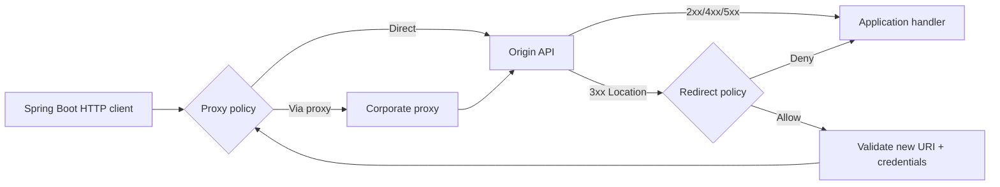
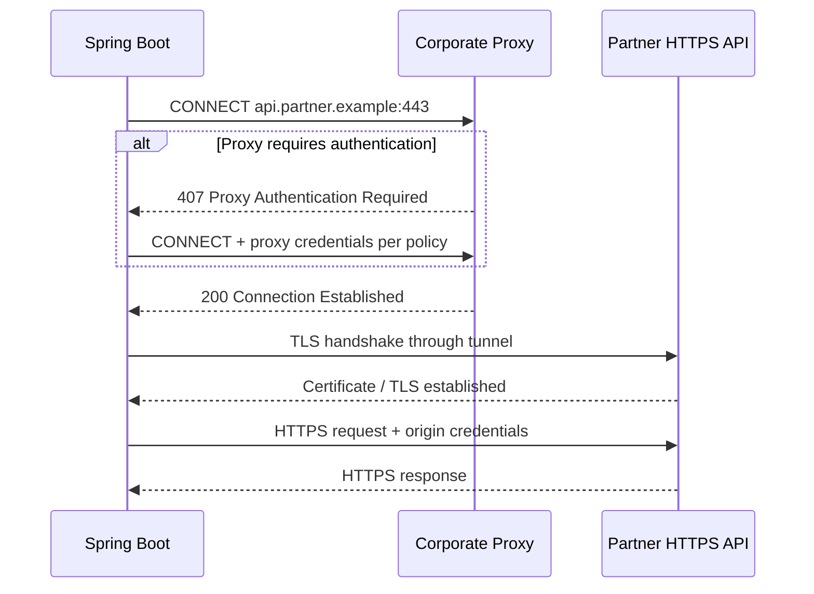
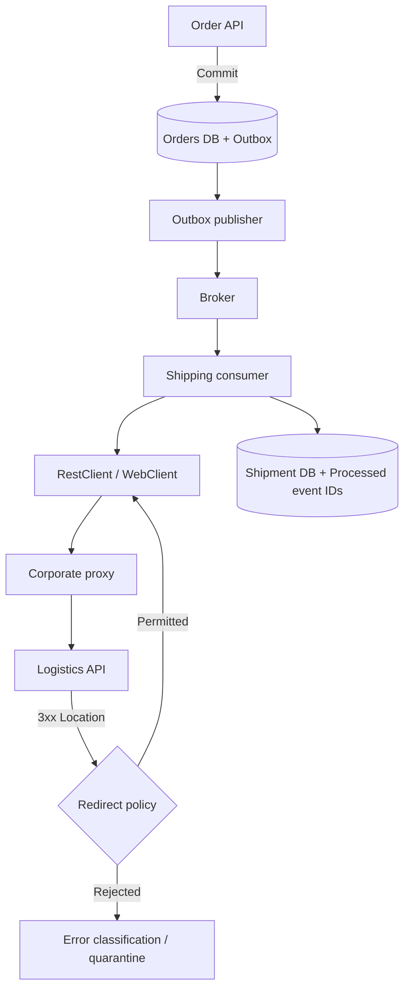

# Proxies, Redirects, and Credential Forwarding Policies

A Spring Boot application making outbound HTTP calls usually needs more than just choosing between `RestClient`, `WebClient`, or `RestTemplate`. In enterprise environments, requests may traverse **proxies**, encounter **3xx redirects**, and carry **Bearer tokens, Basic credentials, cookies, API keys, or client certificates**. With unsuitable defaults, a client can leak secrets to another host, bypass a mandatory proxy, retry an operation that already succeeded, or mistake a redirect response for a business result.

This lesson belongs to the **HTTP Client Selection** chapter of the `SPRING_BOOT_INTEGRATION` module. The goal is to establish clear policies for HTTP routing, redirect handling, and allowed credential scope. Examples focus on real flows linking Spring Boot with HTTP APIs, databases, caches, and brokers, where request failures can trigger duplicate processing and inconsistency. No single proxy or redirect configuration fits every system: you must check each partner's contract and the actual behavior of the underlying HTTP transport.

## 1. Three questions before sending an HTTP request

Every outbound HTTP client must answer:

1. **Where does the request travel?** Direct or via an HTTP proxy, SOCKS proxy, or egress gateway? Does the proxy require authentication? Which hosts may bypass it?
2. **If `Location` is returned, where does it go?** Is auto-following redirects allowed? Same origin only or an allowlist? How are method, body, scheme, and hop-count changes handled?
3. **Who receives secrets?** Which `Authorization` or cookies go to the origin server; which `Proxy-Authorization` goes to the proxy; are bearer tokens ever sent across host/path changes or HTTPS-to-HTTP downgrades?



In this diagram, looping back to the proxy policy is intentional: **a new target URL after a redirect must be re-evaluated**, including network routing and credential attachment. Following a redirect without re-evaluating can turn a legitimate call into unauthorized Internet egress or internal network access.

### 1.1. Distinguishing origin and proxy

A URL's **origin** is defined by the tuple `scheme + host + port`, for example:

```text
https://api.partner.example:443/v1/orders/42
        |____________________|
         HTTPS origin (scheme, host, port)

https://api.partner.example/v2/orders       -> same origin (default HTTPS port 443)
https://auth.partner.example/v1/token       -> different origin (host)
http://api.partner.example/v1/orders        -> different origin (scheme)
https://api.partner.example:8443/v1/orders  -> different origin (port)
```

A **proxy** is an intermediary chosen by the client to reach the origin. For plain HTTP over a forward proxy, requests may use absolute-form URLs. For HTTPS, the client typically issues `CONNECT` to open a tunnel through the HTTP proxy, then performs TLS with the origin over that tunnel. If an enterprise proxy actively decrypts TLS to inspect traffic, the architecture, certificate chain, and trust policy differ.

Two forms of authentication must never be mixed:

| Target | Common header/challenge | Purpose |
| --- | --- | --- |
| Origin API | `Authorization`, `WWW-Authenticate`, HTTP `401` | Proves permission to call the target service |
| HTTP proxy | `Proxy-Authorization`, `Proxy-Authenticate`, HTTP `407` | Proves permission to use the proxy |
| Cookie-based origin | `Cookie`, `Set-Cookie` | Maintains session within a specific cookie scope |
| Mutual TLS | Client certificate in TLS handshake | Connection-layer auth; depends on TLS termination point |

`407 Proxy Authentication Required` is not `401 Unauthorized` from the partner API. On `401`, never automatically resend proxy credentials; on `407`, never send the origin's Bearer token as proxy credentials.

## 2. Proxies: routing, connection types, and bypass policies

### 2.1. Common configuration mechanisms

| Mechanism | Use case | Notes |
| --- | --- | --- |
| HTTP forward proxy | Outbound HTTP/HTTPS through a corporate proxy | May require `CONNECT` and `407` auth |
| SOCKS proxy | Forwarding TCP connections via intermediary per network policy | SOCKS support depends on transport and client library |
| Egress gateway/service mesh | Traffic control at infrastructure layer rather than Java code | Application must still enforce redirect and credential policies |
| Direct connection | Approved internal systems | Must never bypass a mandatory proxy |
| `NO_PROXY`/non-proxy hosts | Specific hosts routed directly per config | Not all HTTP libraries read the same env vars or syntax |

JVM-level proxy properties such as `http.proxyHost`, `https.proxyHost`, or `http.nonProxyHosts` affect the application broadly, yet **are not guaranteed to be honored automatically by every transport**. Apache HttpClient, Reactor Netty, JDK `HttpClient`, and adapters select proxies differently. Always verify the actual runtime transport, especially after swapping request factories or connectors.

An egress contract should specify:

- Which URLs/hosts/ports must use a proxy and which may go direct.
- How environment configuration, secret values, and rotation schedules are supplied.
- Behavior when the proxy is unavailable: fail cleanly or use an approved backup path.
- Policies for DNS lookups, internal IPs, link-local addresses, and cloud metadata endpoints.
- Whether TLS inspection applies; approved CA trust lists and proxy access logging.

Never "fall back to direct when the proxy fails" if policy requires all outbound traffic to traverse the proxy. That alters the security boundary, not just availability.

### 2.2. HTTPS through an HTTP proxy and TLS

For `https://api.partner.example` via a proxy:



This diagram shows an **unintercepted tunnel**. The proxy sees the tunnel destination host/port but generally cannot inspect the encrypted HTTPS payload. If your organization performs TLS interception, the client sees a certificate signed by an internal CA; when permitted by policy, add the approved CA to the appropriate truststore. **Never disable hostname or certificate checks** with "trust all" to bypass TLS errors: doing so eliminates protection against man-in-the-middle attacks.

If the API requires mTLS, verify which TLS handshake requires the client certificate. Authenticating mTLS to the origin does not automatically grant proxy access; the proxy may still require separate authentication.

### 2.3. Scoping proxy configurations

In applications integrating with multiple partners, prefer creating a **separate HTTP client per integration** instead of placing proxy credentials and API tokens into global defaults. For example:

```text
Partner A: https://api.a.example -> corp-proxy-A:3128 -> Bearer token A
Partner B: https://api.b.example -> direct via egress gateway -> mTLS B
Internal:  https://internal.example -> approved network path -> service identity
```

These addresses are purely illustrative. A dedicated client per partner isolates connection pools, truststores, timeouts, proxies, redirects, and credentials. Sharing one configuration makes sense only when targets share identical security boundaries and operational contracts.

## 3. Choosing an HTTP client by level of control

Spring Boot provides several HTTP APIs. **`RestClient`/`RestTemplate`/`WebClient` sit at the Spring API layer**, while connections are handled by a request factory or client connector—backed by JDK HttpClient, Apache HttpClient, Reactor Netty, and others. Proxy and redirect behavior depends on both the Spring API and the underlying transport.

| Option | Programming style | Where proxy/redirect is configured | Notes |
| --- | --- | --- | --- |
| `RestClient` | Synchronous, fluent | `ClientHttpRequestFactory`, e.g., `JdkClientHttpRequestFactory` or Apache factory | Suitable for synchronous API calls; verify active transport |
| `RestTemplate` | Synchronous, older API | `ClientHttpRequestFactory` | Typically maintains legacy systems; same credential/redirect controls needed |
| `WebClient` | Reactive/non-blocking with suitable connector | `ClientHttpConnector`, usually Reactor Netty | Must configure pool, timeouts, TLS, proxy, and async error paths |
| JDK `java.net.http.HttpClient` | Direct Java API | `HttpClient.Builder` with `ProxySelector`, `followRedirects`, `Authenticator` | Good when wanting direct control over JDK transport |
| Apache HttpClient 5 | Blocking or async client depending on module | Route planner, proxy, redirect strategy, credentials provider | Useful for complex routing/connection policies |

`RestClient` is a synchronous API introduced in Spring Framework 6.1+; verify compatible dependencies on other Spring Boot versions. Never assume migrating from `RestTemplate` to `RestClient` preserves identical proxy, redirect, and auth behavior: if the underlying request factory changes, network behavior can change too.

**Selection criteria:** prioritize explicit policy control at the transport layer, per-partner client isolation, alignment with synchronous/reactive models, timeout/retry mechanics, and ability to test both redirects and credential leakage.

## 4. HTTP redirects: 301/302/303/307/308 are not identical

A `3xx` response can contain a `Location` header pointing to a new URL. Auto-following redirects can trigger extra HTTP requests invisible to business logic, especially when handled silently by the client library below.

| Status | General meaning | Method/body when following |
| --- | --- | --- |
| `301 Moved Permanently` | Resource permanently moved | Historically some clients switched POST to GET for compatibility; never rely on uniform behavior across libraries |
| `302 Found` | Temporary redirect | For POST, some user agents convert to GET for compatibility |
| `303 See Other` | Fetch result at another URL | Typically followed with GET (except HEAD), without resending POST body |
| `307 Temporary Redirect` | Temporary redirect preserving method | Must not change method; body may be resent |
| `308 Permanent Redirect` | Permanent redirect preserving method | Must not change method; body may be resent |

Not every `3xx` code should be followed as a `Location` redirect: `304 Not Modified` serves cache validation, and other codes have specific meanings and preconditions. HTTP clients need explicit policies for the statuses they actually support.

### 4.1. Critical pitfall when redirecting a side-effecting POST

Suppose Spring Boot sends:

```http
POST /v1/payments HTTP/1.1
Host: payments.partner.example
Authorization: Bearer <access-token>
Idempotency-Key: payment-request-42
Content-Type: application/json

{"orderId":"o-42","amount":350000}
```

Partner returns `307` pointing to a different URL. If the client auto-follows and resends the body a second time, the app just executed **another HTTP request**. If the first URL processed the request before redirecting or if the client retries after a timeout, duplicate side effects can occur. For payment POSTs, follow redirects only when the API contract and idempotency keys guarantee safe retries; generally, disable automatic redirects, reconcile status, and configure the canonical endpoint directly.

### 4.2. Relative, absolute, and looping redirects

`Location` may be:

```http
Location: /v2/orders/42
Location: https://api.partner.example/v2/orders/42
Location: https://another.example/v2/orders/42
```

Clients must resolve relative redirects against **the URL that returned the response**, never via ad-hoc string concatenation. A cycle `/old → /new → /old` causes loops; bound hop counts and overall deadlines. Libraries apply differing defaults for max hops, method changes, auth headers, and HTTPS downgrades. Application policies must settle these explicitly before enabling auto-follow.

## 5. Credential policies during redirects

Backend HTTP clients are not constrained by browser same-origin rules the way browser JavaScript is. Thus **the application must enforce credential scoping itself**; never assume every HTTP library strips every sensitive header in every scenario.

| Credential/header | Where sent | Risk on redirect |
| --- | --- | --- |
| `Authorization: Bearer ...` | Matching API issuer/audience/scope | Token sent to another host or unauthorized endpoint |
| `Authorization: Basic ...` | Authorized service/realm over TLS | Username/password exposed if sent to wrong authority |
| `Cookie` | Cookie's domain/path/secure scope | Manually attaching `Cookie` headers can bypass cookie-jar rules |
| `X-API-Key` or custom key headers | API issued that key | Library may not recognize custom headers as sensitive and fail to strip them |
| `Proxy-Authorization` | Correct proxy at connection layer | Proxy credentials never belong to origin and must not be sent as app headers to origin |
| Client certificate | Designated, trusted TLS endpoint | Wrong certificate/key picked when changing targets/connectors |

Beyond `Authorization`, watch identity or sensitive metadata headers like `X-Auth-Token`, `X-User-Context`, `X-Forwarded-Authorization`, tenant claims, or session keys. Even when a library strips `Authorization` on cross-host redirects, custom application headers **may still be forwarded**.

### 5.1. Minimum policy to prevent credential leaks

1. **Disable automatic redirect following by default** on outbound integrations carrying sensitive tokens or API keys; enable only after evaluating the contract.
2. When receiving `3xx`, read `Location`, resolve the URI, and check scheme, host, port, path, and destination allowlist.
3. **Reject HTTPS → HTTP downgrades** for requests carrying secrets or sensitive payloads; require valid TLS.
4. Reject cross-origin redirects unless explicitly covered by an allowlist, separate auth mechanism, and clear contract.
5. When building a request to a new URL, **never blindly copy the old request's header map**. Re-evaluate whether each credential may be attached.
6. Bound redirect count, total duration, and allowed HTTP methods; log redirect events with sensitive values redacted.

**Same origin is not always sufficient.** A token issued for `/api/payments` may not be intended for `/public/callback` on the same host. When a partner shares one hostname across multiple applications, check path/purpose and token audience too. Conversely, redirecting from `api.partner.example` to `api2.partner.example` may be valid business-wise yet still require an explicit rule—never forward tokens merely because two hosts share a second-level domain.

### 5.2. Protecting against SSRF and internal network redirects

If the initial URL or `Location` can be influenced by untrusted systems, redirects can turn outbound integrations into **server-side request forgery (SSRF)**. Strictly block destinations such as loopback, private networks, link-local addresses, cloud metadata services, admin interfaces, and sensitive internal endpoints.

Never validate solely via `startsWith("https://api.partner.example")`: a URL like `https://api.partner.example.attacker.test` passes that prefix check. Parse the URI and check scheme, hostname, port, and path per contract. For dynamic targets, handle DNS rebinding, redirect chains, IPv4/IPv6, resolved IP checks, and egress routing; pair application host allowlists with firewall/egress gateways.

## 6. Designing per-integration policies

A sound policy can be written down before coding:

| Element | Example policy for Orders API |
| --- | --- |
| Base URL | `https://api.partner.example` |
| Proxy route | Mandatory via `proxy.corp.internal:3128` |
| TLS | Certificate/hostname verification enabled; trust only approved CAs |
| Proxy credentials | Fetched from secret manager, scoped strictly to that proxy |
| Origin credentials | OAuth2 client credentials, audience scoped to partner |
| Auto redirects | Disabled |
| Manual redirects | GET/HEAD only, max 2 hops, HTTPS, allowlisted origin and path |
| Cross-origin redirects | Denied by default; enabling requires dedicated policy and token |
| Side-effecting POSTs | Never auto-follow or retry without an idempotency contract |
| Timeouts | Connect, response, and total deadline per API SLA |
| Retries | Method/idempotency aware, bounded backoff and attempt cap |
| Logging | Target host, status, hops, request/correlation ID; redact tokens, cookies, sensitive queries |

These are **illustrative values**, not universal defaults. Some APIs legitimately use redirects on endpoint migrations with clear auth and method rules; others forbid redirects altogether.

## 7. Configuring RestClient with explicit proxy and redirect policies

In Spring Framework 6.1+ and matching Spring Boot releases, `RestClient` can use JDK `HttpClient` via `JdkClientHttpRequestFactory`, exposing explicit transport proxy, connection, and redirect controls:

```java
@Configuration(proxyBeanMethods = false)
public class PartnerRestClientConfiguration {

    @Bean("partnerRestClient")
    RestClient partnerRestClient(RestClient.Builder builder) {
        HttpClient transport = HttpClient.newBuilder()
                .connectTimeout(Duration.ofSeconds(3))
                .proxy(ProxySelector.of(
                        new InetSocketAddress("proxy.corp.internal", 3128)))
                .followRedirects(HttpClient.Redirect.NEVER)
                .build();

        return builder
                .requestFactory(new JdkClientHttpRequestFactory(transport))
                .baseUrl("https://api.partner.example")
                .build();
    }
}
```

Key imports: `java.net.http.HttpClient`, `java.net.ProxySelector`, `java.net.InetSocketAddress`, `java.time.Duration`, `org.springframework.http.client.JdkClientHttpRequestFactory`, `org.springframework.web.client.RestClient`, plus Spring configuration annotations. This snippet applies when your HTTP transport and Spring Framework version support this request factory. It assumes the proxy is reachable and omits proxy credentials and truststore configuration.

Key takeaways:

- `followRedirects(HttpClient.Redirect.NEVER)` prevents the transport from silently issuing a second request to `Location`.
- `ProxySelector.of(...)` points the sample client at the HTTP proxy. If certain hosts must bypass the proxy, implement an explicit `ProxySelector`/route policy; never silently bypass the proxy on errors.
- `connectTimeout` bounds only part of connection establishment. Response read timeouts, per-request timeouts, and overall flow deadlines must be configured separately per transport and API capabilities.
- `RestClient.Builder` may be auto-configured by Spring Boot. When sharing builders across clients, avoid unintended overrides and ensure every bean wires the right transport.

### 7.1. Issuing Bearer tokens strictly within the partner scope

```java
@Service
public class PartnerOrderClient {
    private final RestClient client;
    private final PartnerAccessTokenProvider tokens;

    public PartnerOrderClient(
            @Qualifier("partnerRestClient") RestClient client,
            PartnerAccessTokenProvider tokens) {
        this.client = client;
        this.tokens = tokens;
    }

    public String getOrder(String orderId) {
        ResponseEntity<String> response = client.get()
                .uri("/v1/orders/{id}", orderId)
                .headers(headers ->
                        headers.setBearerAuth(tokens.currentAccessToken()))
                .retrieve()
                .toEntity(String.class);

        if (response.getStatusCode().is3xxRedirection()) {
            throw new IllegalStateException(
                    "Partner redirect requires explicit approval");
        }
        return response.getBody();
    }
}
```

`PartnerAccessTokenProvider` is an application service fetching tokens with the right audience/scope and handling refresh/rotation. When `RestClient.retrieve()` hits 4xx/5xx, Spring's default error handling applies (usually throwing an exception), while 3xx should not blindly count as a finished business response. This snippet assumes a `String` body on 2xx; real apps deserialize DTOs and validate them.

Crucially, this method hits only a **fixed base URL** and code-controlled relative paths. If callers pass an absolute URI from an HTTP request or database into `.uri(...)`, it can override the expected host; parse and validate URIs before attaching tokens. Never configure a `RestClient` with default `Authorization` and reuse it across unrelated hosts.

### 7.2. When the proxy requires authentication

JDK `HttpClient` accepts an `Authenticator`. Restrict credential provisioning strictly to the **authorized proxy** rather than answering every challenge blindly:

```java
Authenticator proxyAuthenticator = new Authenticator() {
    @Override
    protected PasswordAuthentication getPasswordAuthentication() {
        if (getRequestorType() != RequestorType.PROXY) {
            return null;
        }
        if (!"proxy.corp.internal".equalsIgnoreCase(getRequestingHost())
                || getRequestingPort() != 3128) {
            return null;
        }
        return new PasswordAuthentication(
                proxyUser,
                proxyPassword.toCharArray());
    }
};

HttpClient transport = HttpClient.newBuilder()
        .proxy(ProxySelector.of(
                new InetSocketAddress("proxy.corp.internal", 3128)))
        .authenticator(proxyAuthenticator)
        .followRedirects(HttpClient.Redirect.NEVER)
        .build();
```

This is a **variant** of the transport setup above. `proxyUser` and `proxyPassword` must be injected securely via runtime configuration/secret manager, never hardcoded in source. Add imports `java.net.Authenticator` and `java.net.PasswordAuthentication`. Transports or proxies may restrict auth schemes—especially Basic over `CONNECT`; test against your real environment and JDK version. Never relax JVM auth or TLS flags without a full security review.

With mTLS or enterprise proxy auth schemes, a simple `Authenticator` may not suffice: verify the actual auth flow required by both proxy and endpoint.

## 8. Handling redirects manually with JDK HttpClient

For endpoints carrying Bearer tokens, the safest starting point is **validating each redirect hop yourself** and sending the token only after the target URL passes checks. This example permits up to two GET redirects within the same origin and `/v1/orders/` path, rejecting non-HTTPS schemes, non-allowlisted hosts/ports, and redirects lacking `Location`.

```java
public final class StrictPartnerRedirectClient {
    private static final int MAX_REDIRECTS = 2;
    private final HttpClient transport;

    public StrictPartnerRedirectClient(HttpClient transport) {
        this.transport = transport; // Must be configured with Redirect.NEVER.
    }

    public String getOrder(URI initialUri, String bearerToken)
            throws IOException, InterruptedException {
        URI current = validateTarget(initialUri);
        Set<URI> visited = new HashSet<>();

        for (int hop = 0; hop <= MAX_REDIRECTS; hop++) {
            if (!visited.add(current)) {
                throw new IOException("Redirect loop");
            }

            HttpRequest request = HttpRequest.newBuilder(current)
                    .timeout(Duration.ofSeconds(8))
                    .header("Accept", "application/json")
                    // Every hop has been validated for the same origin/path.
                    .header("Authorization", "Bearer " + bearerToken)
                    .GET()
                    .build();

            HttpResponse<String> response = transport.send(
                    request, HttpResponse.BodyHandlers.ofString());
            int status = response.statusCode();

            if (isRedirect(status)) {
                if (hop == MAX_REDIRECTS) {
                    throw new IOException("Too many redirects");
                }
                String location = response.headers()
                        .firstValue("Location")
                        .orElseThrow(() -> new IOException(
                                "Redirect without Location"));
                current = validateTarget(
                        current.resolve(URI.create(location)).normalize());
                continue;
            }

            if (status >= 300) {
                throw new IOException(
                        "Partner returned unexpected HTTP status " + status);
            }
            return response.body();
        }
        throw new IOException("Redirect policy exhausted");
    }

    private static boolean isRedirect(int status) {
        return status == 301 || status == 302 || status == 303
                || status == 307 || status == 308;
    }

    private static URI validateTarget(URI uri) {
        boolean valid =
                "https".equalsIgnoreCase(uri.getScheme())
                && "api.partner.example".equalsIgnoreCase(uri.getHost())
                && (uri.getPort() == -1 || uri.getPort() == 443)
                && uri.getRawUserInfo() == null
                && uri.getPath() != null
                && uri.getPath().startsWith("/v1/orders/");
        if (!valid) {
            throw new SecurityException(
                    "Redirect target violates partner policy");
        }
        return uri;
    }
}
```

Additional imports: `java.io.IOException`, `java.net.URI`, `java.net.http.HttpRequest`, `java.net.http.HttpResponse`, `java.util.Set`, and `java.util.HashSet`. Pass in an `HttpClient` already configured with `Redirect.NEVER` and the proper proxy policy as shown earlier. This example is intentionally **for GET only**; never apply it verbatim to POST, PUT, or requests with bodies because 303/307/308 semantics and idempotency differ.

Re-attaching the Bearer token on every hop here is **only sound because every URI—including the initial URI—is validated for the same allowed origin and path**. If policy allows cross-origin redirects, build a fresh request with credentials scoped to the new target; never carry the old host's tokens, Basic credentials, cookies, or API keys across.

This illustrates application-layer URL validation and is not a complete SSRF filter for dynamic targets. Production may need extra canonicalization, rejecting abnormal userinfo/fragments, URI length caps, DNS/IP validation blocking internal networks, and network egress controls. For large responses, also bound body size, total deadline, and connection pools; `BodyHandlers.ofString()` here buffers the entire body in memory.

### 8.1. JDK Redirect.NEVER, NORMAL, and ALWAYS

JDK `HttpClient.Redirect` offers three modes:

- `NEVER`: never follow redirects automatically.
- `NORMAL`: follow redirects except HTTPS-to-HTTP downgrades.
- `ALWAYS`: follow redirects including cases `NORMAL` blocks.

These modes only answer **whether to follow**, not credential audience/path rules or SSRF protection. For authenticated requests, `NORMAL` is **not sufficient** in place of allowlists and header controls. Moreover, libraries, versions, and auth types vary in redirect behavior, so write integration tests verifying exactly where sensitive data is sent.

## 9. WebClient and Reactor Netty: policy lives in the connector

In reactive models, configure Reactor Netty `HttpClient` and wire it into `WebClient` via `ReactorClientHttpConnector`:

```java
@Configuration(proxyBeanMethods = false)
public class PartnerWebClientConfiguration {

    @Bean("partnerWebClient")
    WebClient partnerWebClient() {
        HttpClient transport = HttpClient.create()
                .proxy(spec -> spec
                        .type(ProxyProvider.Proxy.HTTP)
                        .host("proxy.corp.internal")
                        .port(3128))
                .followRedirect(false)
                .responseTimeout(Duration.ofSeconds(8));

        return WebClient.builder()
                .baseUrl("https://api.partner.example")
                .clientConnector(
                        new ReactorClientHttpConnector(transport))
                .build();
    }
}
```

Required imports: `reactor.netty.http.client.HttpClient`, `reactor.netty.transport.ProxyProvider`, `org.springframework.http.client.reactive.ReactorClientHttpConnector`, `org.springframework.web.reactive.function.client.WebClient`, and `java.time.Duration`. This assumes compatible Spring WebFlux and Reactor Netty versions. If `WebClient` uses another connector, Netty proxy/redirect settings **have no effect** on it.

Handling 3xx explicitly with `exchangeToMono`:

```java
public Mono<PartnerOrder> loadOrder(String id, String token) {
    return partnerWebClient.get()
            .uri("/v1/orders/{id}", id)
            .headers(h -> h.setBearerAuth(token))
            .exchangeToMono(response -> {
                if (response.statusCode().is3xxRedirection()) {
                    return Mono.error(new IllegalStateException(
                            "Redirect not permitted"));
                }
                if (response.statusCode().isError()) {
                    return response.createException()
                            .flatMap(ex -> Mono.error(ex));
                }
                return response.bodyToMono(PartnerOrder.class);
            });
}
```

`PartnerOrder` is an application DTO; `partnerWebClient` is the injected bean; `Mono` is from Reactor. You also need handling for 204 or empty bodies if permitted by contract. Many codebases prefer `retrieve()` over `exchangeToMono()`; when distinguishing 3xx explicitly and inspecting `Location`, direct `ClientResponse` access is clearer.

In reactive flows, never call `block()` on event-loop threads and keep blocking work (JDBC, slow file I/O) out of chains without proper schedulers/adapters. Proxies and redirects add extra round trips; configure flow-wide timeouts, backpressure, and subscription cancellation to fit the caller's SLA.

If enabling auto-follow in Reactor Netty or Apache HttpClient, verify exactly how the library preserves or strips sensitive headers across domains and how custom callbacks behave. Never rely on "libraries usually strip `Authorization`" when business policy strictly forbids sending tokens to another origin.

## 10. Origin authentication: tokens, Basic, cookies, and mTLS

### 10.1. Bearer/OAuth2 access tokens

An access token must match the target API's **issuer, audience, scope, and lifetime**. When Spring Boot uses OAuth2 client credentials to call a partner API, the token provider should fetch tokens from integration-scoped client config. Never forward end-user access tokens to every downstream by default; apply explicit delegation or token-exchange rules.

Practical policy:

- Retrieve and refresh tokens from controlled stores; never hardcode in source.
- Attach tokens only after verifying the target URI; never use a global token-injecting interceptor on a multi-host client.
- Handle `401` by checking whether the token expired or was rejected. If permitted by contract, refresh and retry **within bounds** against the same validated target.
- Handle `403` as an authorization/policy failure; never blindly retry with the same token.
- Never log tokens, place them in query strings, or send them in proxy headers.

If a potentially side-effecting POST hits `401` or timeout during token refresh, assess server processing timing and idempotency. Automatic retry is safe only when the contract confirms the prior request was not applied or the server enforces an idempotency key.

### 10.2. HTTP Basic and API keys

Spring's `headers.setBasicAuth(username, password)` or `headers.setBearerAuth(token)` construct headers for the current request. They **do not restrict which URLs receive those headers**. If a REST client accepts absolute URIs or auto-follows redirects to new hosts, application policy must block unintended forwarding.

API keys in `X-API-Key` or custom headers are rarely recognized as special credentials by HTTP libraries. Actively remove or swap them on origin changes. Avoid putting API keys in query strings, which appear in proxy logs, monitoring tools, caches, and traces.

### 10.3. Cookies and sessions

When calling cookie-based APIs, clarify:

- What manages the cookie jar, domain, path, `Secure` flag, expiry, and allowed cookies.
- Whether one tenant/user's cookies could leak into another's request via a shared client/connection.
- Whether cross-host/path redirects obey RFC cookie rules and application policy.
- Whether manual `Cookie` headers bypass cookie-jar protections.

Backend clients do not inherit browser defenses like same-origin policies or CORS. Replacing cookie jars with manual headers places full responsibility for target scoping on your application.

### 10.4. mTLS and truststores

mTLS authenticates via certificates during the TLS handshake. Certificates, private keys, truststores, and TLS contexts have distinct lifecycles and access scopes. When configuring multiple client identities, never let one client use partner A's certificate for partner B.

With HTTPS proxies performing TLS inspection, distinguish proxy-presented certificates from origin certificates. If end-to-end mTLS with the origin is required by contract, a TLS-terminating intercepting proxy may violate it. Never silence certificate errors with `trustAll`, `insecure()`, or disabled hostname verification; fix the trust chain, SNI, certificates, or proxy architecture.

## 11. Timeouts, retries, circuit breakers, and error responses

Proxies and redirects add connection steps. A request may undergo DNS, proxy connect, `CONNECT`, TLS handshake, sending, waiting, and multiple `Location` hops. Thus **connect timeout**, **response/read timeout**, **per-request deadline**, and **overall budget** are distinct bounds.

| Signal | Likely meaning | Recommended action |
| --- | --- | --- |
| `407` from proxy | Proxy rejected/demands auth | Check proxy credentials and policy; never send origin tokens to proxy |
| `401` from API | Invalid/expired token, origin challenge | Bounded refresh if permitted by contract, same validated origin |
| `403` | Insufficient permissions or policy block | Stop and investigate scopes/permissions; do not retry endlessly |
| `301/302/303/307/308` | Server suggests a new URL | Apply redirect policy; check method and credentials |
| `408/429/503` | Timeout/rate limit/unavailable | Retry with backoff if safe, honoring `Retry-After` |
| TLS/hostname verification failure | Invalid certificate/identity | Block request and fix trust/config; never disable verification |
| Proxy unreachable | Network/proxy outage | Follow egress policy; never bypass directly |
| Timeout after payment POST | Server may have processed | Reconcile via idempotency key instead of retrying blindly |

Specifically, a `3xx` response does not signify business success for order creation, payment, or state updates. If a client auto-follows a redirect and ends with `200`, the system must still know **which request** actually performed the side effect, where, and with which HTTP method.

### 11.1. Retries and idempotency

`GET`/`HEAD` are designed as safe/idempotent methods, yet still check API contracts, retry rates, and secondary side effects like logging or counters. `PUT`/`DELETE` are idempotent by HTTP semantics, though real backends may impose extra constraints. `POST` is not idempotent by default; it needs an idempotency key and agreed retry policy with the partner.

Example:

```text
POST /payments  Idempotency-Key: pay-123
  -> timeout, state unknown
  -> GET /payments/by-idempotency-key/pay-123
  -> if unprocessed and contract allows: retry POST with same key/payload
  -> if processed: use existing result
```

Never change the idempotency key between retries; that makes the partner treat retries as brand-new operations. If a 307/308 redirect requires resending a body, apply the exact same deduplication rules and verify the receiving endpoint.

### 11.2. Circuit breakers and load limits

When a proxy or partner API degrades, retrying thousands of concurrent calls amplifies failures. Use bounded timeouts, exponential backoff with jitter, circuit breakers, and bulkheads/pool caps where appropriate. Distinguish permanent routing/policy failures from transient infrastructure errors; a circuit breaker will not fix a wrong-audience token or a forbidden redirect URL.

In Spring Integration flows, an outbound HTTP gateway waits for responses and routes errors into error channels, while broker consumers may redeliver. If a downstream POST committed a side effect before the HTTP response vanished, both HTTP client retries **and** broker retries could re-send the same request: enforce end-to-end idempotency and cap retries at each layer.

## 12. Spring Boot integration: separated config and environment changes

Applications typically run in local, staging, and production with differing network paths. Separate **configuration data** from **security rules**:

```yaml
# application.yml: illustrative app config, not built-in Spring Boot keys.
integration:
  partner-orders:
    base-url: https://api.partner.example
    connect-timeout: 3s
    response-timeout: 8s
    redirects:
      enabled: false
      max-hops: 2
    proxy:
      enabled: true
      host: proxy.corp.internal
      port: 3128
```

Properties under `integration.partner-orders` belong to a **custom namespace**; Spring Boot does not wire them into RestClient/WebClient automatically. Provide a matching `@ConfigurationProperties` class and client builder code to enforce every value:

```java
@ConfigurationProperties(prefix = "integration.partner-orders")
public record PartnerOrdersProperties(
        URI baseUrl,
        Duration connectTimeout,
        Duration responseTimeout,
        RedirectPolicy redirects,
        ProxySettings proxy) {

    public record RedirectPolicy(boolean enabled, int maxHops) {}
    public record ProxySettings(
            boolean enabled, String host, int port) {}
}
```

This is a property model example; register the record via `@ConfigurationPropertiesScan` or `@EnableConfigurationProperties(PartnerOrdersProperties.class)` and add appropriate validation. `base-url`, `connect-timeout`, and `max-hops` bind to camelCase fields. If you swap transports, keep wiring these properties with matching semantics in the new request factory/connector.

Never store proxy passwords, bearer tokens, or private keys in plaintext inside the repository. Use secret managers, workload identities, environment secrets, or approved token services with strict read ACLs and rotation. Be careful with `/actuator/env`, debug config dumps, or exception messages that might expose secrets.

### 12.1. "No proxy" configurations must be tested

Some environments set `HTTP_PROXY`, `HTTPS_PROXY`, and `NO_PROXY`; others use JVM system properties, PAC files, or infrastructure egress routing. Transports parse and honor these differently. Never build production security policies assuming `NO_PROXY=.internal` behaves identically across JDK HttpClient, Apache HttpClient, and Reactor Netty.

To verify:

1. Confirm which runtime transport your outbound HTTP instance actually uses after Boot auto-configuration.
2. Send a test call to a proxy-required host and verify the proxy receives the request/`CONNECT`.
3. Send a test call to an approved direct host and verify the direct route.
4. Trigger a redirect to a host on a different route and verify policy re-evaluation.
5. Simulate a proxy outage; the client must honor the chosen fail-closed/fallback rule rather than accidentally bypassing.

### 12.2. Distinguishing outbound HTTP clients from server-side gateways

`RestClient`/`WebClient` are **outbound HTTP clients**. Spring Cloud Gateway primarily acts as a server-side proxy/gateway receiving and routing inbound requests; Spring Integration's HTTP outbound gateway executes HTTP request/reply inside messaging flows. They address different layers with different configuration.

If a Spring Boot API accepts a partner URL from a caller and calls it with WebClient, placing Spring Cloud Gateway in front of the app **does not protect** the outbound client from SSRF or redirect token leaks. Enforce target validation at the outbound call site and egress layer.

## 13. Cross-cutting scenario across HTTP, DB, and broker

Suppose an order is saved in PostgreSQL, emits an event over RabbitMQ/Kafka, and a Spring Boot consumer sends a shipment request to a logistics service. Logistics sits behind a mandatory proxy and occasionally returns redirects during API version transitions.



A realistic failure chain:

1. Shipping consumer reads `OrderPaid(eventId=e-77)` and prepares `POST /shipments` with `Idempotency-Key=shipment-order-77`.
2. HTTP client sends via proxy; proxy auth succeeds. Origin responds `307 Location: https://legacy-other.example/shipments`.
3. If the client auto-follows and forwards `Authorization` to the new host, the logistics token leaks. If it resends the POST to a new URL lacking the idempotency contract, duplicate shipments can occur.
4. A safe policy rejects the out-of-allowlist redirect, records a reconfigurable failure, and routes the message to error handling. Operators confirm the endpoint/contract change with the partner.
5. Once the new API is verified, the service updates its base URL/identity config and replays **the same event ID and idempotency key**. Database transactions/unique constraints on shipment records guard against broker redelivery duplicates.

This illustrates why proxies, redirects, and auth policies must be designed alongside idempotency, transactions, and recovery. If the consumer acks the broker prematurely without durable job state, a redirect failure drops the event. If the consumer retries infinitely, both the proxy and partner API suffer overload.

A sound design persists shipment state in the DB, dispatches via outbox/worker, records the outcome, updates state, and marks the task complete only per contract. At every boundary, know where side effects commit, which ID reconciles them, and which errors permit retries.

## 14. Testing proxies, redirects, and credential leaks

Unit testing `validateTarget(...)` is helpful but insufficient. Test **real outgoing HTTP requests** through your configured transport against mock servers/proxies or controlled integration environments.

| Scenario | Verifiable expectation |
| --- | --- |
| HTTPS GET through approved proxy | Proxy receives request/`CONNECT`, origin receives valid request, certificates verified |
| Proxy returns `407` | Client supplies proxy credentials or fails cleanly; origin token is not sent to proxy |
| Origin returns `401` | Client does not send proxy secret to origin; token refreshes only per policy |
| Origin returns `302` same origin, valid path | Followed only if enabled; method and token scope preserved |
| Origin returns `307` to non-allowlisted host | **No** second request sent and no leakage of `Authorization`/`X-API-Key` |
| Origin returns `301` HTTPS to HTTP | Downgrade rejected when carrying sensitive data/credentials |
| Redirect to `127.0.0.1` or cloud metadata | Blocked before establishing any outbound connection |
| Redirect loop `A → B → A` | Halts within hop/deadline cap, emits metric |
| `Location` is a relative URI | Resolved against response URI, then origin and path validated |
| Spoofed hostname `api.partner.example.evil.test` | Rejected by URI-parsed hostname allowlist |
| Request carries `X-API-Key` on cross-origin redirect | Header never forwarded |
| HTTP client receives absolute URL from external input | Routed only to validated targets; never overrides base URL silently |
| Proxy loses connectivity | Enforces fail-closed or configured fallback without unauthorized bypass |
| Wrong TLS hostname or untrusted certificate | Handshake fails; trust-all never enabled to pass tests |
| POST gets `307/308` redirect | Body never replayed outside idempotency contract |
| Consumer retries after HTTP timeout | Same idempotency key used; DB prevents duplicate side effects |

WireMock, MockWebServer, or equivalent HTTP test servers can return `3xx`, `401`, and `407` and capture received headers. To test real `CONNECT`, proxy auth, or TLS inspection, run a test proxy supporting those protocols; a standalone origin mock cannot prove proxy wiring works.

### 14.1. Example redirect boundary test

With `StrictPartnerRedirectClient` above:

```java
@Test
void refusesRedirectToDifferentOriginBeforeSendingToken() {
    URI current = URI.create(
            "https://api.partner.example/v1/orders/42");
    URI location = URI.create(
            "https://untrusted.example/collect");

    assertThatThrownBy(() -> validatePartnerRedirect(current, location))
            .isInstanceOf(SecurityException.class);
}
```

`validatePartnerRedirect` is an illustrative helper/test seam extracted from `validateTarget(current.resolve(location))`, not a JDK built-in method. To prove **secrets were never transmitted**, add an integration test pointing at a test server on the untrusted target and assert that server **received zero requests** or **zero sensitive headers**. Checking an exception alone does not prove no network hop happened.

### 14.2. Testing library/version upgrades

Whenever upgrading Spring Boot, Reactor Netty, Apache HttpClient, or the JDK, re-run the test suite for:

- Redirect auto-follow defaults and method/body transformations.
- Header forwarding vs. stripping on origin changes.
- Proxy selection and no-proxy matching.
- Proxy `CONNECT`/`407` and supported auth schemes.
- TLS truststores, hostname verification, mTLS, and connection reuse.
- Error mapping for 3xx/4xx/5xx and deadlines across multi-hop redirects.

These transport-layer behaviors can shift without changing `RestClient.get()` or `WebClient.get()` call sites. Tests that merely mock `RestClient` miss those shifts entirely.

## 15. Observability and operations

When diagnosing outbound HTTP issues, you do not need to log full raw requests. Log normalized fields instead:

```text
integration=partner-orders
method=GET
target_origin=https://api.partner.example
proxy_route=corp-proxy
redirect_hops=1
final_status=200
duration_ms=142
correlation_id=...
policy_decision=redirect_allowed
```

These fields are a sample log format, not a mandatory schema. **Never log** Bearer tokens, Basic auth, `Proxy-Authorization`, cookies, API keys, private keys, or queries containing credentials. If URLs carry sensitive IDs, log the route template (`/v1/orders/{id}`) rather than the full URL.

| Metric group | Example | Operational value |
| --- | --- | --- |
| Proxy | Proxy connection errors, `407`, CONNECT latency | Catches route or proxy credential issues |
| Origin auth | `401`/`403`, token refresh failures | Detects wrong scopes or expired tokens |
| Redirects | 3xx counts, denied redirects, avg hops, loops | Reveals endpoint shifts and cross-origin risks |
| Network | DNS, connect, TLS, response duration, timeouts | Pinpoints slow phases instead of blindly raising timeouts |
| Resilience | Retry attempts, open circuit breakers, rate limits | Spots abnormal load amplification |
| Business | Idempotency duplicates, reconciliation backlog | Surfaces uncertain side effects |

Spring Boot Actuator/Micrometer collects HTTP client metrics depending on instrumentation and config. Metric labels should use stable origin/service names or URI templates—never full URLs containing tokens or user IDs that cause high cardinality. Propagate correlation IDs and trace context per policy, and never abuse trace baggage to carry credentials.

### 15.1. Runbook for unexpected redirects

1. Identify the original request, `3xx` status, parsed target hostname, and hop count from redacted logs.
2. Compare the redirect against the partner contract and allowlist; never loosen rules just to "make it pass."
3. Check for changes to scheme, port, hostname, business path, or HTTP method/body.
4. Verify token audience/scope, auth rules for the new URL, and proxy routing.
5. For side-effecting requests, query business status by idempotency key before retrying.
6. Update configuration/client bindings once confirmed, run credential-leak tests, and monitor post-deploy metrics.

## 16. Pre-implementation checklist for HTTP client selection and rollout

1. **Transport:** which request factory/connector backs `RestClient`, `WebClient`, or other API? Does your version support the needed policies?
2. **Proxy:** does each destination route via proxy or direct? Tested `CONNECT`/`407`, bypass rules, and proxy outages?
3. **TLS:** certificate/hostname verification enabled, proper truststores, per-partner mTLS identities, zero insecure settings?
4. **Redirects:** auto-follow or deny by default? Explicit rules per 301/302/303/307/308, method, body, max hops, and deadline?
5. **Destinations:** are all URLs—including `Location` and external inputs—parsed and validated by scheme, hostname, port, path, and egress policy?
6. **Credentials:** are Bearer, Basic, cookies, API keys, proxy credentials, and client certs strictly scoped without cross-origin leakage?
7. **Errors:** do handlers distinguish 401, 403, 407, rejected 3xx, TLS failures, and timeouts, separating retryable errors from reconfig errors?
8. **Consistency:** do side-effecting POST/PUTs carry idempotency keys and reconciliation on timeouts or unexpected redirects?
9. **Testing:** verified against real transport for proxies, header forwarding, cross-origin redirects, HTTPS downgrades, SSRF, and version upgrades?
10. **Observability:** do logs/metrics diagnose faults without secrets, alerting on denied redirects, proxy failures, and abnormal retries?

When selecting an HTTP client in Spring Boot, the programming API is only part of the decision. **Proxies govern network routing**, **redirects can alter targets and request semantics**, and **credential policies govern who receives secrets**. Controlling all three per integration—paired with timeouts, idempotency, testing, and monitoring—keeps HTTP flows safe and prevents cascading failures into databases, caches, or message brokers.
