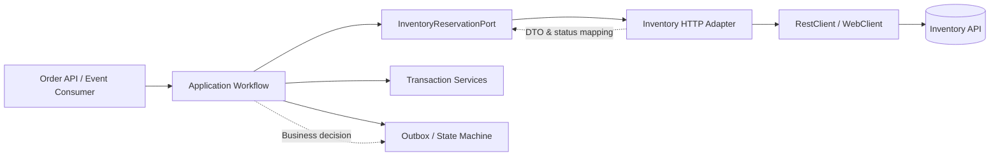
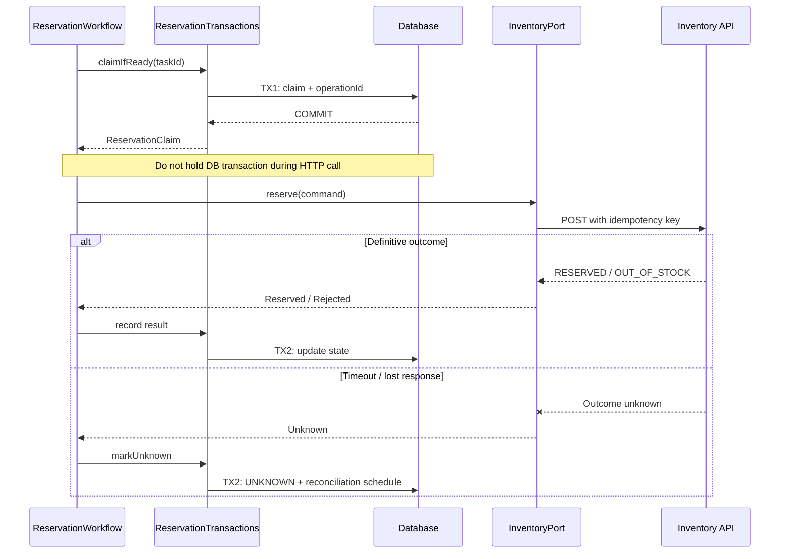
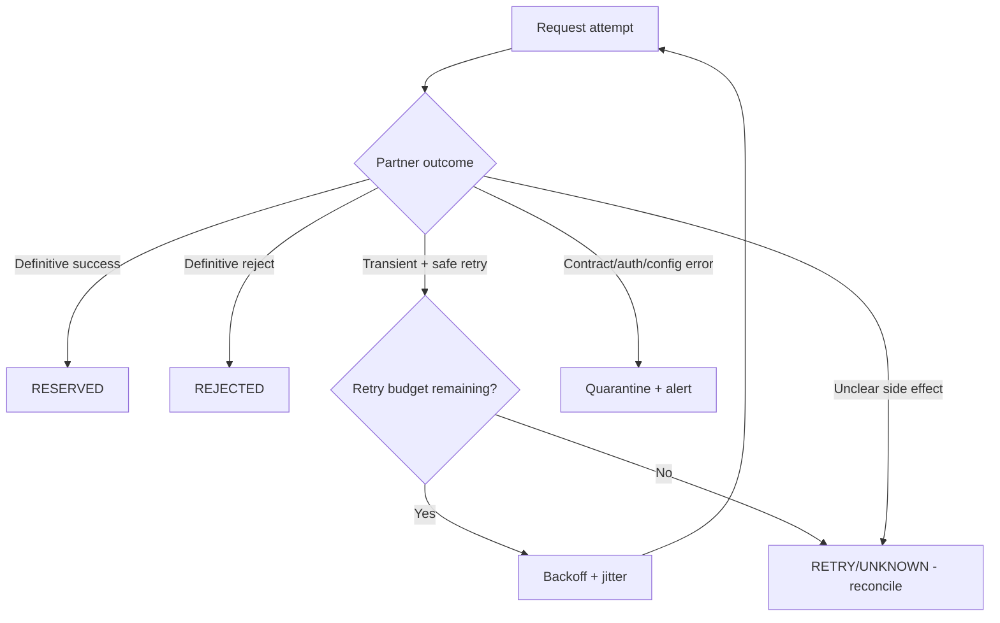

# Boundaries Between HTTP Invocation Mechanics and Business Policy

## 1. Choosing an HTTP client is not yet an integration design

In the **SPRING_BOOT_INTEGRATION** module, Spring Boot orchestrates flows linking HTTP clients, databases, caches, message brokers, and Spring Integration adapters. These flows must do more than send well-formed requests. They must enforce data contracts, classify errors, bound transactions, prevent duplicate processing, and recover cleanly when the application or external systems fail.

For example, an ordering application calls the Inventory API to reserve two items. The HTTP client sends `POST /reservations` with an `operationId`, yet possible outcomes include:

- `201 Created`: the partner confirms the reservation and returns a reservation ID.
- `422 Unprocessable Entity`: the partner rejects with a **contract-defined business error code**, such as `OUT_OF_STOCK`.
- `409 Conflict`: the operation was already submitted, requiring a status lookup (if defined by the partner's contract).
- `429 Too Many Requests`: the partner is rate-limiting traffic; throttle back.
- `503` or connection drop after sending POST: the app **cannot be sure** whether the external system created the reservation.
- `200` with invalid JSON: an HTTP response arrived, yet the payload violates the contract.

Turning every error status into "out of stock" drives wrong business decisions. Retrying a POST with a new ID after a timeout risks reserving stock twice. Calling HTTP inside a lock-holding DB transaction lets a slow downstream stall the entire application.

**Opening takeaway:** `RestTemplate`, `RestClient`, and `WebClient` determine **how HTTP is sent and received**. The integration adapter decides **how to translate the partner contract**. The application/domain decides **what to do with the outcome**, including state transitions, transactions, retries, and reconciliation.



## 2. Three boundaries of responsibility

| Layer | Owns | Example | What it must NOT do |
| --- | --- | --- | --- |
| **HTTP mechanism** | URL, method, request factory/connector, TLS, timeouts, connection pool, serialization, technical headers | `RestClient.post().uri(...).retrieve()` | Decide whether an order is `PAID` or `REJECTED` |
| **Integration adapter** | DTO/wire schema mapping, **per-endpoint** error codes, response validation, translating external data to internal concepts | `201 + reservation_id` → `Reserved`; `422 + OUT_OF_STOCK` → `Rejected` | Hold long DB transactions across network waits |
| **Application/domain policy** | Workflows, state machines, idempotency, business deadlines, retry/reconciliation rules, transaction boundaries | Reservation timeout → `UNKNOWN`; persist job for status inquiry | Parse HTTP JSON or depend on `WebClientResponseException` |

In practice, a **reliability policy** tier sits between technical mechanics and business logic:

- **Transport:** connect timeout, response timeout, pool acquire timeout, TLS, DNS. Configured on the HTTP client.
- **Adapter/partner:** select transient failures, `Retry-After` mapping, rate limiters, circuit breakers, concurrent request caps. Configured per partner.
- **Workflow:** whether an operation may retry, whether timeouts require status inquiry or compensation, when to mark `DONE`. Driven by business invariants and side-effect contracts.

There is no dogma saying "all retries belong to the domain" or "all retries belong to the HTTP client." Policies need **one single owner of the overall retry budget**, preventing multiple layers from multiplying outbound calls.

## 3. Choosing RestTemplate, RestClient, or WebClient

| API | Model | Best fit | Keep in mind |
| --- | --- | --- | --- |
| `RestTemplate` | Synchronous, long-standing API | Existing Spring MVC/batch systems running stably | Remains valid to maintain; configure `RestTemplateBuilder`, error handlers, and message converters |
| `RestClient` | Synchronous, fluent API since Spring Framework 6.1 | New blocking apps wanting readable request/response code | Fluent **does not mean non-blocking** |
| `WebClient` | Reactive, usually `Mono`/`Flux` | WebFlux/non-blocking pipelines, streaming, or reactive composition | Never call `block()` on event loops; understand subscription, backpressure, cancellation |
| HTTP Interface `@HttpExchange` | Declarative contract; executes through an HTTP adapter | Grouping endpoints/methods/headers in an interface | `RestClientAdapter` and `WebClientAdapter` still have different execution models |
| Partner SDK / Java `HttpClient` | Library-dependent | Provider ships an official SDK or requires custom protocol handling | Wrap behind an adapter; test error mapping separately |

Base the decision on the **entire execution model**, not a single HTTP call:

1. Spring MVC applications using blocking JDBC/JPA with moderate call volume: typically start with `RestClient`.
2. Applications already using `RestTemplate`: no need for wholesale rewrites just for syntax. Prioritize timeouts, contract tests, error state handling, and idempotency first.
3. WebFlux applications reactive from controller through service to I/O: `WebClient` fits better to avoid blocking event loops.
4. If the underlying database/JDBC or SDK remains blocking, swapping HTTP to `WebClient` **does not** make the whole system non-blocking.
5. Under high load, measure throughput, p95/p99 latency, pool saturation, backpressure, and downstream quotas; never assume WebClient is automatically faster.

**Architectural benchmark:** you should be able to swap the adapter implementation without changing what `RESERVED`, `REJECTED`, and `UNKNOWN` mean in the application/domain.

## 4. Defining Ports in business language

To keep HTTP details out of the domain, model the capability as "reserving stock" rather than "sending a POST":

```java
// Place each public top-level type in a separate Java file when implementing.

public interface InventoryReservationPort {
    ReservationOutcome reserve(ReserveCommand command);
}

public record ReserveCommand(
        String operationId,
        String orderId,
        String sku,
        int quantity) {}

public sealed interface ReservationOutcome
        permits ReservationOutcome.Reserved,
                ReservationOutcome.Rejected,
                ReservationOutcome.Unknown {

    record Reserved(String reservationId)
            implements ReservationOutcome {}

    record Rejected(String reasonCode)
            implements ReservationOutcome {}

    record Unknown(String operationId)
            implements ReservationOutcome {}
}
```

The port neither returns `ResponseEntity<PartnerResponse>` nor throws `HttpClientErrorException` into the domain. Outcomes express **confirmed knowledge**:

- `Reserved`: carries a reservation ID and partner confirmation that the operation succeeded.
- `Rejected`: partner returned a **definitive** rejection after verifying the business error code.
- `Unknown`: final state cannot be confirmed; the partner may have already executed the side effect.

If an API supports `DEFERRED`, `PENDING`, or `ALREADY_RESERVED`, add explicit outcome types. Never cram every scenario into `boolean success`. Complex domains may further distinguish `Unknown` from `RetryLater` and `IntegrationFailure`.

A reactive application can define the port returning `Mono<ReservationOutcome>`, yet that is an **application-model decision**; never convert an entire domain to reactive merely because one HTTP adapter uses `WebClient`.

## 5. Adapter translates DTOs and statuses per partner contract

Suppose the Inventory API defines this illustrative contract:

| Response | Agreed meaning | Adapter mapping |
| --- | --- | --- |
| `201` + valid `reservation_id` | Stock reserved successfully | `Reserved(reservationId)` |
| `422` + `code=OUT_OF_STOCK` | Definitive rejection | `Rejected("OUT_OF_STOCK")` |
| `409` + `code=REQUEST_IN_PROGRESS` | Operation in flight or already accepted | `Unknown(operationId)`, follow up with lookup |
| `429` + `Retry-After` | Rate limited | Conditional retry/deferral |
| `500/503` after side-effecting call | Outcome uncertain | `Unknown(operationId)` or investigate |
| `401/403` | Invalid credentials/permissions | Integration/configuration error, not business rejection |
| `2xx` + schema-violating body | Contract violation | Protocol/data error; never return success |

**This table is illustrative for the example**, not a universal rule for all HTTP statuses. The same `404` can mean "SKU does not exist" on a GET endpoint or "wrong route" on a POST endpoint. Adapters must evaluate per endpoint and error body rather than applying one global rule.

### 5.1. Configuring a dedicated RestClient per partner

Example client constructed from Boot-supplied `RestClient.Builder`, pulling a validated base URL from configuration properties:

```java
import org.springframework.beans.factory.annotation.Qualifier;
import org.springframework.context.annotation.Bean;
import org.springframework.context.annotation.Configuration;
import org.springframework.web.client.RestClient;

@Configuration(proxyBeanMethods = false)
public class InventoryHttpConfiguration {

    @Bean("inventoryRestClient")
    RestClient inventoryRestClient(
            RestClient.Builder builder,
            InventoryPartnerProperties properties) {
        return builder
                .baseUrl(properties.baseUrl())
                .defaultHeader("Accept", "application/json")
                .build();
    }
}
```

`InventoryPartnerProperties` is an app configuration bean (e.g., `@ConfigurationProperties`); `baseUrl()` returns a pre-validated URL. Timeouts, authentication, TLS, and connection pooling are also attached **specifically to this partner's client**. Never put tokens or production hosts in source code, and never let untrusted caller inputs pick arbitrary hosts (SSRF).

### 5.2. Wire DTOs separated from internal records

Example request body using snake_case fields:

```json
{
  "merchant_order": "ORDER-42",
  "product_code": "SKU-100",
  "units": 2,
  "request_id": "reserve-ORDER-42"
}
```

Adapter-private DTOs can use Jackson:

```java
import com.fasterxml.jackson.annotation.JsonProperty;

record PartnerReserveRequest(
        @JsonProperty("merchant_order") String orderId,
        @JsonProperty("product_code") String sku,
        @JsonProperty("units") int quantity,
        @JsonProperty("request_id") String requestId) {}

record PartnerReserveResponse(
        @JsonProperty("reservation_id") String reservationId) {}

record PartnerErrorResponse(
        @JsonProperty("code") String code,
        @JsonProperty("message") String message) {}
```

Wire DTOs are checked against the real schema. If the provider renames `reservation_id` or introduces a new enum, only the adapter and contract tests change; `OrderService` stays insulated from JSON field names.

### 5.3. Complete illustrative RestClient HTTP adapter

```java
import com.fasterxml.jackson.core.JsonProcessingException;
import com.fasterxml.jackson.databind.ObjectMapper;
import org.springframework.beans.factory.annotation.Qualifier;
import org.springframework.http.MediaType;
import org.springframework.stereotype.Component;
import org.springframework.web.client.HttpClientErrorException;
import org.springframework.web.client.HttpServerErrorException;
import org.springframework.web.client.ResourceAccessException;
import org.springframework.web.client.RestClient;

@Component
public final class InventoryHttpAdapter
        implements InventoryReservationPort {

    private final RestClient http;
    private final ObjectMapper mapper;

    public InventoryHttpAdapter(
            @Qualifier("inventoryRestClient") RestClient http,
            ObjectMapper mapper) {
        this.http = http;
        this.mapper = mapper;
    }

    @Override
    public ReservationOutcome reserve(ReserveCommand command) {
        try {
            PartnerReserveResponse response = http.post()
                    .uri("/v1/reservations")
                    .contentType(MediaType.APPLICATION_JSON)
                    .header("Idempotency-Key", command.operationId())
                    .body(new PartnerReserveRequest(
                            command.orderId(),
                            command.sku(),
                            command.quantity(),
                            command.operationId()))
                    .retrieve()
                    .body(PartnerReserveResponse.class);

            if (response == null || response.reservationId() == null
                    || response.reservationId().isBlank()) {
                throw new PartnerContractException(
                        "Missing reservation_id");
            }
            return new ReservationOutcome.Reserved(
                    response.reservationId());

        } catch (HttpClientErrorException.UnprocessableEntity ex) {
            String code = errorCode(ex.getResponseBodyAsString());
            if ("OUT_OF_STOCK".equals(code)) {
                return new ReservationOutcome.Rejected(code);
            }
            throw new PartnerContractException(
                    "422 with unsupported code: " + code, ex);

        } catch (HttpClientErrorException.Conflict ex) {
            String code = errorCode(ex.getResponseBodyAsString());
            if ("REQUEST_IN_PROGRESS".equals(code)) {
                return new ReservationOutcome.Unknown(
                        command.operationId());
            }
            throw new PartnerContractException(
                    "409 outside contract: " + code, ex);

        } catch (HttpServerErrorException | ResourceAccessException ex) {
            // 5xx or I/O errors do not prove the server did not process.
            return new ReservationOutcome.Unknown(
                    command.operationId());
        }
    }

    private String errorCode(String json) {
        try {
            PartnerErrorResponse response =
                    mapper.readValue(json, PartnerErrorResponse.class);
            if (response == null || response.code() == null) {
                throw new PartnerContractException(
                        "Missing code in downstream error");
            }
            return response.code();
        } catch (JsonProcessingException ex) {
            throw new PartnerContractException(
                    "Error body is not schema-valid JSON", ex);
        }
    }
}
```

`PartnerContractException` is an internal adapter exception (defined separately with `(String)` and `(String, Throwable)` constructors). Real implementations also need **explicit** policies for `429`, `401/403`, and contract mismatches instead of swallowing every failure into `Unknown`:

```java
// Example internal error model, independent of Spring Web:
public final class PartnerContractException extends RuntimeException {
    public PartnerContractException(String message) {
        super(message);
    }
    public PartnerContractException(String message, Throwable cause) {
        super(message, cause);
    }
}
```

For `429`, catch `HttpClientErrorException.TooManyRequests` to emit a `PartnerRateLimitedException` carrying retry timing and operation ID. `Retry-After` can be **integer seconds or an HTTP-date**, and may be absent or malformed; parse with bounds. Workers can persist `RETRY_AT`, throttle rate, and reschedule after commit—never sleep and retry endlessly on an inbound HTTP thread.

**Meaning of exceptions here:** auth errors, schema drift, or malformed bodies are config/contract failures; workers should mark the task for investigation/quarantine and raise an alert. Never auto-convert them into `Rejected(OUT_OF_STOCK)` or silently drop the task.

### Outcome validation rules

A `Reserved` outcome is valid only when:
- The endpoint's status and body match the contract.
- `reservation_id` is non-null, non-blank, and passes constraints.
- Echoed `operation_id`, `tenant_id`, or `sku` fields (if present) match the request.
- Monetary, currency, or quantity fields suffer no unit conversion mistakes.
- `200 + {"success":false}` is never accepted as success merely because the HTTP status is 2xx.

These checks live at the adapter boundary. The application can enforce further business invariants, such as preventing an order from transitioning from `CANCELLED` to `RESERVED`.

## 6. The application owns state transitions, not the HTTP client

An orchestration example that avoids holding `@Transactional` across the HTTP call:

```java
import java.util.UUID;
import org.springframework.stereotype.Service;

@Service
public final class ReservationWorkflow {

    private final InventoryReservationPort inventory;
    private final ReservationTransactions transactions;

    public ReservationWorkflow(
            InventoryReservationPort inventory,
            ReservationTransactions transactions) {
        this.inventory = inventory;
        this.transactions = transactions;
    }

    public void process(UUID taskId) {
        ReservationClaim claim = transactions.claimIfReady(taskId);
        if (claim == null) {
            return;  // Already processed or claimed by another worker.
        }

        ReserveCommand cmd = new ReserveCommand(
                claim.operationId(),
                claim.orderId(),
                claim.sku(),
                claim.quantity());

        ReservationOutcome outcome = inventory.reserve(cmd);

        if (outcome instanceof ReservationOutcome.Reserved reserved) {
            transactions.recordReserved(
                    taskId, claim.operationId(), reserved.reservationId());
        } else if (outcome instanceof ReservationOutcome.Rejected rejected) {
            transactions.recordRejected(
                    taskId, claim.operationId(), rejected.reasonCode());
        } else {
            transactions.markUnknown(taskId, claim.operationId());
        }
    }
}
```

`ReservationTransactions` and `ReservationClaim` are illustrative application components. In a real implementation, `claimIfReady` opens a **short** DB transaction to claim atomically via optimistic locking, conditional updates, or leases; the `record...` methods open new transactions to update state conditionally.



**Why avoid `@Transactional` across the entire workflow?** JDBC/JPA transactions cannot wrap external HTTP calls in ACID semantics; if downstream stalls, DB connections and locks are held pointlessly. Especially for payments, "HTTP succeeded then DB rolled back" never refunds the charge automatically.

### Business state lifecycle

```text
PENDING -> PROCESSING -> RESERVED
             |             |
             +-> REJECTED  |
             +-> UNKNOWN -> RECONCILE -> RESERVED / REJECTED / RETRY
             +-> RETRY (backoff, budget)
```

`UNKNOWN` represents **insufficient information**, not `REJECTED` or `FAILED`. If the partner provides a status-inquiry endpoint by operation ID, workers can reconcile before retrying. Otherwise, apply an explicitly agreed manual or compensating workflow.

## 7. Transactional outbox and crash durability

A workflow that fires HTTP **after** a DB transaction commits can still drop work:

```text
TX1: INSERT order
COMMIT
-- process crashes right here --
scheduleAsync(orderId) has not run
```

Therefore, when integration work must not be lost, persist **order + outbox** within the same transaction:

```java
@Service
public final class OrderCommandService {
    private final OrderRepository orders;
    private final OutboxRepository outbox;

    public OrderCommandService(
            OrderRepository orders, OutboxRepository outbox) {
        this.orders = orders;
        this.outbox = outbox;
    }

    @Transactional
    public UUID create(CreateOrderCommand command) {
        Order order = orders.save(Order.from(command));
        outbox.save(OutboxMessage.reserveInventory(
                order.getId(), order.getOperationId()));
        return order.getId();
    }
}
```

These entities, repositories, and `reserveInventory` factory are project-specific business code, not built-in Spring classes. After `COMMIT`, a dispatcher reads the outbox and hands tasks to workers. If the process crashes, the `PENDING` job remains safely in the DB.

Account for every crash window:

| Window | What can happen | Required safeguard |
| --- | --- | --- |
| After DB commit, before enqueue | Worker has not received job | Durable outbox, polled/re-scanned |
| After claim, before HTTP | Job stuck in `PROCESSING` | Leases and reclaim after expiry |
| After HTTP succeeds, before `DONE` | Retry may re-send same intent | Stable idempotency key / reconciliation |
| After `DONE`, before broker ack | Broker redelivers event | Inbox deduplication, conditional updates |
| Two workers process concurrently | Race or duplicate send | Unique constraints, compare-and-set/versions |
| Timeout with unclear outcome | Side effect may have executed | Retain `UNKNOWN`, query by operation ID |

An outbox guarantees **integration intent is persisted atomically with business state**, not exactly-once delivery by itself. Kafka, RabbitMQ, or Spring Integration `QueueChannel` still involve acks, retries, and replay risks. Never mark an outbox entry `DONE` simply because `adapter.send()` returned true: enqueueing does not prove the remote side effect succeeded.

## 8. Timeouts, retries, and idempotency: a double boundary

### 8.1. Timeouts are resource bounds, not final outcomes

| Error or condition | What does the client know? | Certain side effect did NOT happen? |
| --- | --- | --- |
| Connect fails before transmitting request | Failed to open connection for this attempt | Typically unsent on that socket; still verify proxy/lower-layer retries |
| Read timeout after sending body | No timely response received | **No** |
| Connection reset while reading response | Response may have been truncated | **No** |
| HTTP `503` | Server reported unavailable | **No** by default |
| `Mono.timeout` cancels subscription | Reactive pipeline exhausted budget | **No** proof the server rolled back |
| Contract-valid `422 + OUT_OF_STOCK` | Server confirmed rejection | Can treat as definitive rejection per contract |

Connect timeout, pool acquire timeout, response/read timeout, and workflow deadline are separate bounds. Align timeouts with the overall SLO; never let one partner call consume the caller's entire budget and then multiply it with retries.

### 8.2. Retry policies cannot inspect HTTP status alone

Every retry decision must answer:

1. **Does the operation have side effects?** Idempotent GET differs from stock-reserving or payment-charging POST.
2. **Is the error transient?** 429/503 differ fundamentally from 400/401.
3. **Does the partner enforce deduplication by idempotency key?** How long is the key retention window?
4. **Does the operation ID remain identical across attempts?** Never generate a fresh key merely because a timeout fired.
5. **What is the total retry budget?** Attempts, backoff, jitter, deadlines, and sibling retry layers.
6. **What if the outcome stays unclear?** Reconcile or stay `UNKNOWN`—never default to `FAILED`.



If the HTTP client retries 3 times, the application retries 3 times, and the broker redelivers 3 times, one event can trigger **27 attempts**. Enforce a single end-to-end retry budget and track metrics by `operationId`. Broker/worker retries must also preserve idempotency.

## 9. Same status, different meaning per endpoint

| Status | `GET /products/{sku}` | `POST /reservations` | Design action |
| --- | --- | --- | --- |
| `200` | Valid data if body passes checks | May replay a previously completed result | Validate schema, business code, and operation ID |
| `201` | Rare | Reservation created | Adapter maps to `Reserved` |
| `202` | Rare | Accepted **but not yet completed** | Workflow stays `PENDING`/polls or awaits callback |
| `204` | Success without body per contract | Operation needing no DTO | Do not try deserializing an empty body |
| `404` | SKU does not exist | Wrong path or reservation missing | Endpoint-specific mapping |
| `409` | Conflict/version mismatch | Duplicate or in-progress depending on error code | Inspect code and query status when needed |
| `422` | Invalid input | Out of stock or validation rejection | Never infer solely from status code |
| `429` | Rate limit | Rate limit | Bounded backoff, throttle admission |
| `500/503` | Safe to retry GET | Side effect uncertain | Follow operation semantics and state |

A global `ResponseErrorHandler` or `defaultStatusHandler` claiming "every `404` means empty result" breaks other endpoints. Global configs belong only to truly cross-cutting rules (observability, TLS, default timeouts); endpoint-specific status semantics belong close to each endpoint's contract.

### 2xx with invalid bodies must still fail

A body like `{"available":-5}` or `{"success":false}` is not valid merely because the status is `200`. Adapters must verify:
- Content type, charset, non-empty body, and JSON syntax.
- Required fields, enum values, nullability, and range bounds.
- Matching SKU, tenant, currency, and monetary units.
- Payload version and correlation/operation IDs per contract.
- Policy for unknown fields.

For example, primitive `int available` silently defaults to `0` when missing; using `Integer` + validation distinguishes **missing data** from **zero stock**.

## 10. WebClient must obey the exact same boundaries

In reactive applications, the port can be declared as:

```java
public interface ReactiveInventoryReservationPort {
    Mono<ReservationOutcome> reserve(ReserveCommand command);
}
```

A reactive HTTP adapter might start as:

```java
public Mono<ReservationOutcome> reserve(ReserveCommand command) {
    return webClient.post()
            .uri("/v1/reservations")
            .header("Idempotency-Key", command.operationId())
            .bodyValue(new PartnerReserveRequest(
                    command.orderId(),
                    command.sku(),
                    command.quantity(),
                    command.operationId()))
            .retrieve()
            .bodyToMono(PartnerReserveResponse.class)
            .map(response -> (ReservationOutcome)
                    new ReservationOutcome.Reserved(
                            response.reservationId()));
}
```

**This is strictly a happy-path snippet**, not production-ready: add `onStatus(...)` or `exchangeToMono(...)` to map statuses, body validation, timeouts, cancellation, and unknown outcomes. Never alter business semantics merely because the client moved from blocking to reactive.

Reactive traits to respect:

- `Mono` is normally lazy; requests execute only on subscription.
- `retryWhen(...)` resubscribes and **re-sends POST**; keep a stable operation ID and budget.
- `timeout(...)` cancels the subscription without proving downstream aborted work.
- Never call `block()` on Netty event loops; blocking JDBC/JPA does not turn non-blocking just by adopting `WebClient`.
- Context propagation (trace ID, tenant, security) requires explicit reactive support rather than relying on synchronous `ThreadLocal` transactions.

A blocking Spring MVC application does not have to become reactive just to call an HTTP API. Conversely, a WebFlux app must never run blocking `RestClient` calls on event loops.

## 11. HTTP Interfaces or SDKs do not replace business policies

`@HttpExchange` declares endpoints via an interface:

```java
import org.springframework.web.bind.annotation.PathVariable;
import org.springframework.web.service.annotation.GetExchange;

public interface InventoryHttpApi {
    @GetExchange("/v1/inventory/{sku}")
    InventoryDto getInventory(@PathVariable String sku);
}
```

`HttpServiceProxyFactory` creates proxies over `RestClient` or `WebClient` adapters. Despite concise syntax, proxies **only implement the HTTP contract**:

- They do not automatically know whether `404` means out-of-stock or wrong URL.
- They do not transition workflows to `UNKNOWN`.
- They do not write outboxes or manage DB transactions.
- They do not guarantee idempotency or exactly-once semantics.
- They do not validate business schema/semantics automatically.

Keep `InventoryHttpApi` **inside** `InventoryHttpAdapter`, letting the application depend only on `InventoryReservationPort`. The same applies to OpenFeign, JDK `HttpClient`, or third-party SDKs.

## 12. Testing each layer properly

### 12.1. Testing policies with a fake Port

Test application/domain policies without spinning up an HTTP client:

```java
// Illustrative pseudocode: transaction helper and fixtures are faked.
InventoryReservationPort fakePort =
        command -> new ReservationOutcome.Unknown(
                command.operationId());

ReservationWorkflow workflow =
        new ReservationWorkflow(fakePort, fakeTransactions);

workflow.process(taskId);

// Assert: taskId transitions to UNKNOWN and preserves the same operationId.
// Do not mark RESERVED, do not emit completion event.
```

These tests verify **business decisions**. Because the domain depends solely on `ReservationOutcome`, tests stay decoupled from Spring Web and partner endpoints.

### 12.2. Testing the RestClient adapter with MockRestServiceServer

```java
import static org.assertj.core.api.Assertions.assertThat;
import static org.springframework.test.web.client.match.MockRestRequestMatchers.*;
import static org.springframework.test.web.client.response.MockRestResponseCreators.*;

import com.fasterxml.jackson.databind.ObjectMapper;
import org.junit.jupiter.api.Test;
import org.springframework.http.HttpMethod;
import org.springframework.http.HttpStatus;
import org.springframework.http.MediaType;
import org.springframework.test.web.client.MockRestServiceServer;
import org.springframework.web.client.RestClient;

@Test
void maps201AndValidatesRequest() {
    RestClient.Builder builder = RestClient.builder()
            .baseUrl("https://inventory.example.test");
    MockRestServiceServer server =
            MockRestServiceServer.bindTo(builder).build();

    InventoryReservationPort adapter = new InventoryHttpAdapter(
            builder.build(), new ObjectMapper());

    server.expect(requestTo(
                "https://inventory.example.test/v1/reservations"))
            .andExpect(method(HttpMethod.POST))
            .andExpect(header("Idempotency-Key", "op-42"))
            .andExpect(content().json(
                    """
                    {
                      "merchant_order":"ORDER-42",
                      "product_code":"SKU-100",
                      "units":2,
                      "request_id":"op-42"
                    }
                    """))
            .andRespond(withStatus(HttpStatus.CREATED)
                    .contentType(MediaType.APPLICATION_JSON)
                    .body("""
                          {"reservation_id":"res-123"}
                          """));

    ReservationOutcome outcome = adapter.reserve(
            new ReserveCommand("op-42", "ORDER-42", "SKU-100", 2));

    assertThat(outcome)
            .isEqualTo(new ReservationOutcome.Reserved("res-123"));
    server.verify();
}
```

This snippet represents a **test method inside a JUnit test class** exercising the defined domain/adapter types. It verifies HTTP method, URI, headers, wire JSON, and response mapping. Add cases for `422 + OUT_OF_STOCK`, `409 + REQUEST_IN_PROGRESS`, `429`, `503`, schema-invalid bodies, and unsupported error codes.

`MockRestServiceServer` binds to `RestClient.Builder` before `build()` to intercept calls **without opening real sockets**. It does not verify connect/read timeouts, TLS, or pooling. For `WebClient` or network fault testing, run localhost **MockWebServer/WireMock** with `StepVerifier` for reactive publishers.

### 12.3. Testing transactions, idempotency, and recovery

Use Testcontainers (PostgreSQL/brokers), an HTTP stub server, and fault injection when needed:

1. Transaction persists `order + outbox` and commits.
2. Worker claims task; stub receives POST with the matching `operationId`.
3. Stub accepts the request and drops the connection before responding.
4. Verify state transitions to `UNKNOWN` or `RETRY` per contract.
5. Restart the worker/process and re-scan jobs; no task is lost.
6. Reuse the exact operation ID for inquiry or safe retry; zero duplicate side effects occur.
7. Replay duplicate events; unique constraints/state guards prevent double processing.
8. Slow down HTTP; verify DB transactions are not held open across the network wait.

Unit tests mocking the Port **do not prove** DB locking/commits; HTTP client tests **do not prove** exactly-once semantics. Each test layer must validate the boundary it observes.

## 13. Security and observability follow the same boundaries

Configure the HTTP mechanism securely:

- Enforce allowlisted hosts/base URLs to block SSRF from user-supplied URLs.
- Enforce verified TLS; never disable certificate verification just to "test quickly."
- Store secrets/tokens in a secret manager; keep them out of Git, logs, traces, and exception bodies.
- Set connect/read/pool timeouts, max response sizes, and per-partner concurrency limits.
- Isolate credentials per partner; never attach a global `Authorization` interceptor to all HTTP clients.
- Manage response streams/`DataBuffer` lifecycles to prevent resource leaks.

Track `operationId`/`correlationId` end-to-end:

| Signal | Useful for diagnosing |
| --- | --- |
| HTTP latency per partner/endpoint | Slow downstream vs. pool contention |
| Status and error categories | `429` rate limit, `503` unavailable, contract errors |
| Retry attempts/backoff/timeouts | Retry amplification or SLA violations |
| Aged `UNKNOWN` states | Unreconciled side effects |
| Outbox pending age / dead-letter | Stalled dispatchers or poison messages |
| Duplicate/dedup rate | Redeliveries or crash-recovery retries |
| DB transaction duration and lock waits | Transactions mistakenly held across HTTP calls |

Never log full response bodies containing PII, tokens, or sensitive payloads. Metrics/traces should use bounded-cardinality labels (partner, endpoint template, error category), never raw `operationId`s as metric tags.

## 14. Anti-patterns to avoid

| Practice | Problem | Better design |
| --- | --- | --- |
| `OrderService` builds URLs and checks `HttpStatus` | Domain coupled to HTTP details | Port + translating adapter |
| Mapping all 4xx to `BusinessRejected` | Hides 401/403 and contract bugs | Map per endpoint and error code |
| `onErrorReturn(RESERVED)` after timeout | Fakes success on integration faults | Return `Unknown`/quarantine |
| Retrying POST with a new operation ID | Risks duplicate side effects | Preserve idempotency key and reconcile |
| Wrapping HTTP calls in `@Transactional` | Long DB locks/connections; cannot roll back HTTP | Short transactions + outbox |
| Assuming fluent `RestClient` is non-blocking | Picks wrong concurrency model | Distinguish blocking vs. reactive |
| Calling `WebClient.block()` on event loops | Stalls reactive throughput | Compose `Mono`/`Flux` |
| Global error handler treating all 404s as normal | Misinterprets sibling endpoints | Define per-API error contracts |
| Accepting 200 without DTO validation | Missing fields, unknown enums, wrong currency | Decode + validate protocol and business fields |
| Treating queue `send()==true` as `DONE` | Only proves enqueue succeeded | Mark `DONE` after confirmed outcome |
| Unit tests mocking the full WebClient chain | Misses codec, URI, and header bugs | Test HTTP adapter against real stub server |
| Logs exposing tokens, PII, or raw bodies | Data leakage during incident triage | Redacted structured logging per policy |

## 15. HTTP integration design checklist

1. Confirm whether the app is **blocking** or **reactive**; choose `RestClient`/`RestTemplate` or `WebClient` accordingly.
2. Express Ports in business terms; keep `ResponseEntity`, status codes, and partner DTOs out of the domain.
3. Isolate base URLs, credentials, TLS, timeouts, pools, and headers **per partner**.
4. Document status + JSON body contracts **per endpoint**, including invalid-data 2xx cases.
5. Separate **definitive rejections**, **unknown outcomes**, and **configuration/protocol failures**.
6. Keep operation IDs/idempotency keys stable, backed by one overall retry budget and bounded backoff.
7. Never make outbound HTTP calls while holding unnecessary database transactions.
8. Persist integration intents in an outbox/job table whenever work must survive crashes.
9. Design state machines, conditional updates, deduplication, and reconciliation for unclear outcomes.
10. Test business policies independently, HTTP adapters against mock/stub servers, and DB/brokers in realistic integration setups.
11. Monitor latency, 429/503s, contract errors, retries, `UNKNOWN` tasks, and outbox lag while redacting sensitive logs.

**Key takeaway:** the HTTP client governs **how calls are made**; the adapter governs **translating the contract**; the application/domain governs **business meaning and next actions**. Clear boundaries allow Spring Boot Integration systems to swap HTTP transports, evolve data contracts, and recover from network failures without corrupting business logic.

### References

- [Spring Framework Reference — REST Clients](https://docs.spring.io/spring-framework/reference/integration/rest-clients.html): `RestClient`, `RestTemplate`, HTTP Interface, and body conversion.
- [Spring Framework Reference — WebClient](https://docs.spring.io/spring-framework/reference/web/webflux-webclient.html): reactive HTTP, status/error handling, and exchange.
- [Spring Framework Reference — Declarative Transactions](https://docs.spring.io/spring-framework/reference/data-access/transaction/declarative.html): transaction boundaries and propagation.
- [Spring Integration Reference](https://docs.spring.io/spring-integration/reference/): channels, gateways, adapters, and error handling.
- [Spring Boot Reference — REST Clients](https://docs.spring.io/spring-boot/reference/io/rest-client.html): configuring HTTP clients in Spring Boot.
