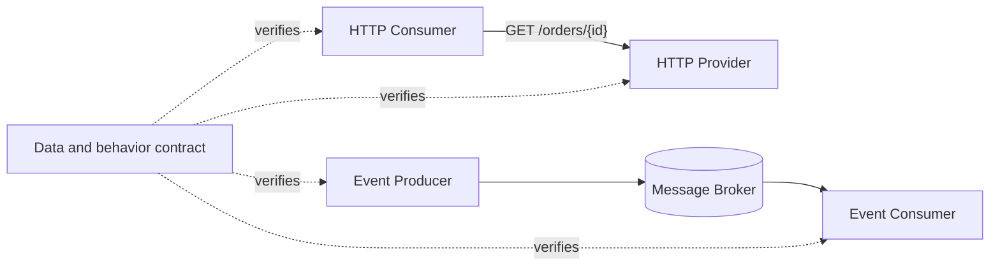
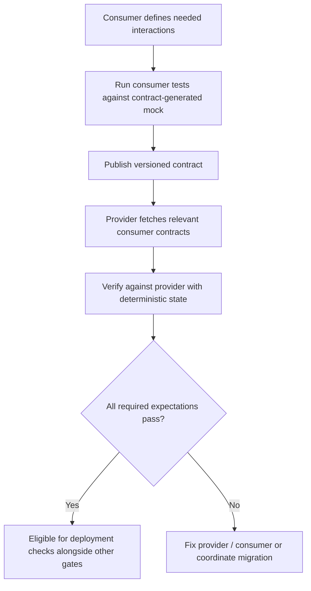
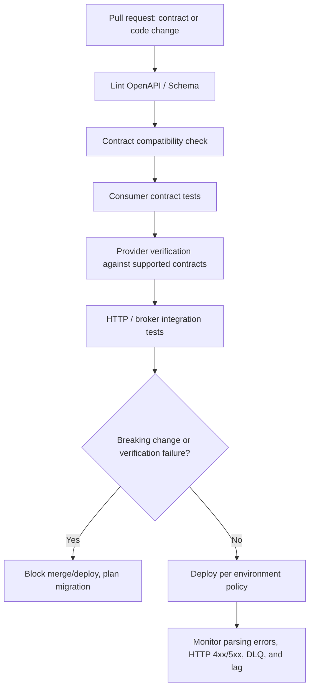

# Testing HTTP Contracts, Schemas, and Messages Between Both Sides

## 1. Why is testing each service individually still not enough?

In the **SPRING_BOOT_INTEGRATION** module, Spring Boot applications integrate via HTTP clients, databases, caches, message brokers, and Spring Integration adapters. Each component may pass its own unit tests while the integration flow still fails because the two sides **understand data and behavior differently**.

For example, Order Service calls Inventory Service to fetch stock availability:

- **Consumer** (Order Service) expects HTTP `200` with JSON containing an integer `availableQuantity` field.
- **Provider** (Inventory Service) successfully deploys a change returning a boolean `available` field and removing `availableQuantity`.
- Each service's unit tests remain green because both use mocks or their own DTOs. When deployed together, the consumer may fail to parse or infer the wrong inventory.

A similar situation occurs when a producer emits an `OrderCreated` event via a broker, but the consumer can no longer read `occurredAt`, misinterprets the currency unit, or treats duplicate events as new transactions.

**Contract testing** verifies the agreement between both sides at the integration boundary: **who sends what, who receives what, in what format, under what conditions, and how it must be handled**. This lesson focuses on HTTP contracts, JSON Schema/OpenAPI, asynchronous messages, edge-case errors, two-sided testing, and integrating checks into CI/CD.



In the diagram, **the contract does not replace deploying the system**. It serves as evidence to catch discrepancies between producer/provider and consumer before changes are deployed. Whether the network works, whether the broker has the right ACL permissions, and whether services coordinate in production still require integration tests and operational observability.

## 2. Distinguishing unit, component, contract, and end-to-end tests

| Test type | Primary question | Example | Limitation |
| --- | --- | --- | --- |
| Unit test | Is the internal logic of a component correct? | DTO mapper, validating `orderId` value | Does not verify that the other side shares the same assumptions |
| Component test | Does the service behave according to its internal configuration? | MockMvc with real controller and fake dependencies | Can still mock the provider's API inaccurately |
| **Consumer contract test** | What request/response or event shape does the consumer actually need? | Contract defined by Order Service | Only valuable when the provider also verifies the contract |
| **Provider verification** | Does the provider satisfy the published consumer contracts? | Provider runs real controller against expectations | Does not prove the real broker/network always works |
| Integration test | Can real components communicate? | Real HTTP server, test database/broker | Resource-intensive; may still miss data variants |
| End-to-end test | Does the end-to-end business flow meet expectations? | Place order → inventory → notification | Slow, noisy, and often does not cover all edge errors |

**Key takeaway:** testing a client against a mock response only proves the client code works against that mock. It becomes part of **two-sided contract testing** when those expectations are shared, the provider verifies against the real implementation, and the verification result is used to decide whether deployment is safe.

Contracts can be **provider-driven** (OpenAPI/JSON Schema published by the provider) or **consumer-driven** (consumer-driven contracts, e.g., Pact/Spring Cloud Contract). Both approaches can be combined; it must be clear who owns the definition, how changes are made, and who checks compatibility.

## 3. Precisely defining the boundary and responsibilities of each side

A good contract describes both **syntax** and **semantics**:

- **Syntax:** URL, HTTP method, headers, JSON fields, data types, `null`/missing, encoding, schema version.
- **Semantics:** “availableQuantity” means sellable quantity, what currency unit “totalAmount” uses, and whether a repeated request creates a new order.
- **Error behavior:** status codes, error body, timeouts, retryable vs. terminal, and how duplicates or invalid messages are handled.
- **Evolution rules:** whether old consumers can read new messages, and whether old producers can keep sending while consumers are upgraded.

Boundary examples:

| Flow | Output contract creator | Consumer side | Important terms |
| --- | --- | --- | --- |
| HTTP GET inventory | Inventory API | Order client | Path, statuses, JSON schema, 404/503, timeout |
| HTTP POST place order | Order API (receives request) and client (sends request) | Both sides | Validation, idempotency key, 201/409/422, error format |
| `OrderCreated` event | Order publisher | Inventory/Notification listeners | Event type, version, event ID, payload, timestamp, ordering |
| Shared cache message | Service writing to Redis | Service reading from Redis | Key prefix, serializer, TTL, handling stale data |
| Shared-schema DB integration | Service owning the schema | External queries/adapters | Migrations and compatibility; best to limit direct coupling |

At an HTTP boundary, the API provider typically decides the response format and error statuses; the consumer should only assert requirements on the fields and behaviors it actually uses. At a message boundary, the producer owns the published event, while each consumer group may have different compatibility requirements.

## 4. HTTP contracts: from example to OpenAPI specification

Suppose Inventory Service has an endpoint:

```http
GET /api/v1/inventory/sku-123 HTTP/1.1
Accept: application/json
```

On success, the response is:

```http
HTTP/1.1 200 OK
Content-Type: application/json

{
  "sku": "sku-123",
  "availableQuantity": 12,
  "updatedAt": "2026-11-21T02:15:00Z"
}
```

A minimal **OpenAPI 3.0.3** specification can capture that contract:

```yaml
openapi: 3.0.3
info:
  title: Inventory API
  version: 1.0.0
paths:
  /api/v1/inventory/{sku}:
    get:
      operationId: getInventory
      parameters:
        - name: sku
          in: path
          required: true
          schema:
            type: string
            minLength: 1
      responses:
        "200":
          description: Inventory item
          content:
            application/json:
              schema:
                type: object
                required: [sku, availableQuantity, updatedAt]
                properties:
                  sku:
                    type: string
                  availableQuantity:
                    type: integer
                    minimum: 0
                  updatedAt:
                    type: string
                    format: date-time
        "404":
          description: SKU not found
        "503":
          description: Inventory temporarily unavailable
```

This specification illustrates the structure; for production use, you should add error schemas, security schemes, request/response examples, value limits, and pagination/header rules if applicable.

**A schema alone is not enough to describe all behavior.** For instance, does `availableQuantity = 0` mean out of stock or not yet synchronized? When a SKU does not exist, should the response be `404` or `200` with quantity 0? Both sides must agree explicitly and test those cases.

### 4.1. HTTP terms that are often overlooked

| Component | What to settle upfront | Typical error |
| --- | --- | --- |
| Method and path | `GET/POST/PATCH`, segments, path/query params | Client calls `/stock/{id}`, provider only handles `/inventory/{id}` |
| Headers | `Accept`, `Content-Type`, auth, correlation | Provider requires a new header that old consumers do not send |
| Status codes | 200/201/204, 400/404/409/422, 429/503 | Consumer tries to read body on a `204 No Content` response |
| Pagination | Page/size, cursor, sorting, stable order | Client misses a page or duplicates records |
| JSON types | integer, decimal, boolean, array, nullable | Provider converts a number to a string |
| Timestamps | ISO-8601, UTC/offset, precision | Client parses timestamp without offset |
| Errors | Stable error code, message, retry hints | Client retries a permanent validation error |
| Idempotency | Behavior on duplicate POST, timeout after write | Request times out then retry creates two records |

## 5. JSON Schema and the difference between syntax and business logic

JSON Schema helps define data constraints in HTTP responses or asynchronous messages: types, required fields, formats, allowed values, and size limits. There are multiple **dialects/versions** of JSON Schema; the next example uses **draft 2020-12**—do not copy it blindly into OpenAPI 3.0 because OpenAPI 3.0 has its own schema dialect.

```json
{
  "$schema": "https://json-schema.org/draft/2020-12/schema",
  "$id": "https://schemas.example.org/inventory/v1.json",
  "type": "object",
  "required": ["sku", "availableQuantity", "updatedAt"],
  "properties": {
    "sku": {
      "type": "string",
      "minLength": 1,
      "maxLength": 64
    },
    "availableQuantity": {
      "type": "integer",
      "minimum": 0
    },
    "updatedAt": {
      "type": "string",
      "format": "date-time"
    }
  },
  "additionalProperties": true
}
```

Here `additionalProperties: true` lets the provider add new fields without breaking consumers **if clients follow a policy of ignoring unknown fields**. Accepting new fields is a common compatibility choice for **responses/events**, whereas for **client-submitted requests**, the provider may need strict validation to catch typos and unsupported fields.

In particular, check:

1. **Missing fields and `null` are different.** `{"updatedAt": null}` violates the schema above; omitting `updatedAt` also violates it because of `required`. Consumers must clearly understand the meaning of each case.
2. **An integer does not mean every Java `int` can hold it.** IDs, monetary amounts, or counters may exceed 32-bit limits; choose appropriate Java types and serialize consistently.
3. **Currencies must have units.** `125000` could be VND, cents, or reward points. Specify `currency` and the smallest unit, or use a decimal string per contract.
4. **Enums can expand.** If a producer adds `BACKORDERED`, exhaustive consumer `switch` statements or Java enum DTOs may fail to parse. Define unknown-value rules and test compatibility.
5. **`format: date-time` depends on the validator.** In JSON Schema 2020-12, whether format validation is enforced depends on the implementation/vocabulary configuration. Do not assume every validator rejects malformed timestamps.
6. **Schema-valid does not mean business-valid.** `availableQuantity = 2` satisfies the schema but could be wrong if actual stock is negative after an adjustment. Business logic needs dedicated tests.

### 5.1. Versioning schemas

Assign clear versions to schemas, such as `inventory/v1.json`, `order-created/v1.json`, or register them in a schema registry if the broker and organization use one. Note that **file versioning** only aids traceability; compatibility must be determined through rules and tests.

| Change | Compatible in common cases? | Condition |
| --- | --- | --- |
| Add optional field to response/event | Usually yes | Consumer ignores unknown fields |
| Add required field to response/event | Can be compatible with old consumers | Must still provide all old fields and consumer accepts new fields |
| Add required field to request | Usually breaking for old clients | Needs a default or transition |
| Remove/rename a field in use | Breaking | All consumers have migrated off the contract |
| Change `integer` to `string` | Usually breaking | Adapter or code supports both |
| Add enum value | Potentially breaking | Consumer handles unknown values |
| Change meaning without changing schema | Semantically breaking | Requires contract/business tests, not just a schema validator |

“Backward/forward compatibility” also depends on **who reads old data vs. who reads new data** and the rules of each serialization framework (Avro, Protobuf, JSON). Do not treat a simple table as an absolute compatibility guarantee.

## 6. Testing an HTTP consumer with Spring Test

Suppose Order Service writes a client calling the inventory API via `RestTemplate`. The following snippet illustrates a minimal consumer:

```java
import org.springframework.web.client.RestTemplate;

public class InventoryClient {
    private final RestTemplate restTemplate;
    private final String baseUrl;

    public InventoryClient(RestTemplate restTemplate, String baseUrl) {
        this.restTemplate = restTemplate;
        this.baseUrl = baseUrl;
    }

    public InventoryDto getInventory(String sku) {
        return restTemplate.getForObject(
            baseUrl + "/api/v1/inventory/{sku}",
            InventoryDto.class,
            sku
        );
    }

    public record InventoryDto(
        String sku,
        int availableQuantity,
        java.time.OffsetDateTime updatedAt
    ) {}
}
```

To verify that the consumer sends the right request and reads a mocked response matching the contract:

```java
import static org.assertj.core.api.Assertions.assertThat;
import static org.springframework.test.web.client.match.MockRestRequestMatchers.*;
import static org.springframework.test.web.client.response.MockRestResponseCreators.*;

import org.junit.jupiter.api.Test;
import org.springframework.http.HttpMethod;
import org.springframework.http.MediaType;
import org.springframework.test.web.client.MockRestServiceServer;
import org.springframework.web.client.RestTemplate;

class InventoryClientContractTest {

    @Test
    void readsRequiredInventoryFields() {
        RestTemplate template = new RestTemplate();
        MockRestServiceServer server =
            MockRestServiceServer.bindTo(template).build();
        InventoryClient client =
            new InventoryClient(template, "http://inventory.test");

        server.expect(requestTo(
                "http://inventory.test/api/v1/inventory/sku-123"))
            .andExpect(method(HttpMethod.GET))
            .andRespond(withSuccess(
                """
                {
                  "sku": "sku-123",
                  "availableQuantity": 12,
                  "updatedAt": "2026-11-21T02:15:00Z"
                }
                """,
                MediaType.APPLICATION_JSON
            ));

        InventoryClient.InventoryDto dto =
            client.getInventory("sku-123");

        assertThat(dto.sku()).isEqualTo("sku-123");
        assertThat(dto.availableQuantity()).isEqualTo(12);
        server.verify();
    }
}
```

The example uses Java text blocks (Java 15+) and Spring Test. **To deserialize the DTO with `RestTemplate`, the project must have a JSON `HttpMessageConverter` (typically via `spring-boot-starter-web` and Jackson) and Jackson support for Java Time; in a standard Boot application these are provided through the appropriate dependencies.** When instantiating `RestTemplate` manually in tests, ensure converters match the real client configuration; if production uses `RestClient` or `WebClient`, test that actual client.

This test **does not prove on its own that the provider satisfies the contract**. It helps catch bugs in the consumer when the request or response does not match expectations. Published fixtures/contracts must be shared and corresponding **provider verification** must run to close the two-sided testing loop.

For error contracts, add cases such as `404`, `429` with `Retry-After`, `503`, wrong content-type, body missing fields, slow responses, and invalid JSON; verify whether the consumer throws, falls back, or retries according to policy.

## 7. Testing an HTTP provider with MockMvc and shared contracts

On the Inventory Service side, you can test the real controller and serialization with `MockMvc`:

```java
import static org.springframework.test.web.servlet.request.MockMvcRequestBuilders.get;
import static org.springframework.test.web.servlet.result.MockMvcResultMatchers.*;

import org.junit.jupiter.api.Test;
import org.springframework.beans.factory.annotation.Autowired;
import org.springframework.boot.test.autoconfigure.web.servlet.AutoConfigureMockMvc;
import org.springframework.boot.test.context.SpringBootTest;
import org.springframework.http.MediaType;
import org.springframework.test.web.servlet.MockMvc;

@SpringBootTest
@AutoConfigureMockMvc
class InventoryProviderContractTest {

    @Autowired
    MockMvc mvc;

    @Test
    void exposesInventoryContract() throws Exception {
        mvc.perform(get("/api/v1/inventory/{sku}", "sku-123"))
            .andExpect(status().isOk())
            .andExpect(content().contentTypeCompatibleWith(
                MediaType.APPLICATION_JSON))
            .andExpect(jsonPath("$.sku").value("sku-123"))
            .andExpect(jsonPath("$.availableQuantity").isNumber())
            .andExpect(jsonPath("$.updatedAt").isString());
    }
}
```

This is a structural test example and requires **fixtures/provider state** so that SKU `sku-123` exists and yields a deterministic result. Never use a production database for tests. For dynamic provider responses, set up state using test fixtures, a test database, or controlled internal dependency stubs. If the endpoint requires authentication, send appropriate test credentials/headers.

`MockMvc` exercises the HTTP stack inside the application context (controllers, validation, message converters, advice) without opening network sockets. Testing proxies, TLS, routing, or real infrastructure requires separate integration tests.

**One risk:** when each side writes its own separate JSON fixture, both tests can pass while their contracts diverge. To solve this, organizations should:

- Use a single versioned contract source: OpenAPI with examples, JSON Schema, or consumer contracts.
- Publish versioned contracts/stubs tied to commit/provider build identifiers.
- Verify the provider **against the exact expectations consumers are using**.
- Never publish or deploy a breaking change before affected consumers are evaluated.

### 7.1. Consumer-driven contracts with Pact or Spring Cloud Contract

Two common approaches in the Java ecosystem are:

**Pact:** the consumer publishes expected interactions; the provider runs verification against its implementation with the required provider states. Pact Broker can be used to version contracts and verify compatibility across deployed versions.

**Spring Cloud Contract:** uses a contract DSL (Groovy/YAML depending on tool and version) to generate provider verification tests and consumer stubs, often paired with WireMock. You must select a Spring Cloud version compatible with the release train and Spring Boot version in use.

The two tools differ in DSL syntax, state management, publishing, and broker metadata. **Do not mix Pact contract syntax into Spring Cloud Contract** without proper conversion. Both still require verifying real implementation behavior: whether the provider exposes the endpoint/behavior and whether the consumer reads the data accurately.

A typical consumer-driven workflow:



For this workflow to protect production, CI must know **which provider version** and **which consumer versions** are running in target environments. Verifying only against the latest contract while ignoring already-deployed consumers creates a false sense of security.

## 8. Message contract testing: what changes when a broker is involved?

In asynchronous communication, the contract is not only the JSON body—it also includes **destination, metadata, and delivery semantics**.

For example, Order Service emits an event:

```json
{
  "eventId": "c5149203-7998-4d5a-aea8-51c04abef332",
  "eventType": "OrderCreated",
  "schemaVersion": 1,
  "occurredAt": "2026-11-21T02:15:00Z",
  "data": {
    "orderId": "ord-1024",
    "customerId": "cus-17",
    "totalMinorUnits": 125000,
    "currency": "VND"
  }
}
```

Consumer Inventory Service might need `eventId`, `data.orderId`, and line-item details; if this event lacks line items, the consumer must have a way to fetch details or agree on another contract. Never assume every “OrderCreated” event carries enough data for every business flow.

JSON Schema can describe the required structure:

```json
{
  "$schema": "https://json-schema.org/draft/2020-12/schema",
  "$id": "https://schemas.example.org/events/order-created/v1.json",
  "type": "object",
  "required": [
    "eventId",
    "eventType",
    "schemaVersion",
    "occurredAt",
    "data"
  ],
  "properties": {
    "eventId": {
      "type": "string",
      "format": "uuid"
    },
    "eventType": {
      "const": "OrderCreated"
    },
    "schemaVersion": {
      "const": 1
    },
    "occurredAt": {
      "type": "string",
      "format": "date-time"
    },
    "data": {
      "type": "object",
      "required": ["orderId", "totalMinorUnits", "currency"],
      "properties": {
        "orderId": { "type": "string", "minLength": 1 },
        "totalMinorUnits": {
          "type": "integer",
          "minimum": 0
        },
        "currency": {
          "type": "string",
          "pattern": "^[A-Z]{3}$"
        }
      },
      "additionalProperties": true
    }
  },
  "additionalProperties": true
}
```

Schema validates message shape, but an **end-to-end contract** must also specify:

| Contract aspect | Example items to settle |
| --- | --- |
| Destination and routing | `orders.events` topic / `orders.created.q` queue, routing key/headers if used |
| Key and partitioning | Whether events for the same order preserve order |
| Content type/encoding | `application/json`, UTF-8 |
| Event identity | `eventId` remains stable across retries of the same event |
| Type and version | `eventType` and `schemaVersion` decoupled from Java class names |
| Timestamp | `occurredAt` uses UTC/offset and represents business time |
| Duplicates | Consumers may receive multiple deliveries and must handle them idempotently |
| Ack and retry | When to ack/commit, retry count, which errors go to DLQ |
| TTL/retention | How long messages are retained; whether offline consumers can catch up |
| Security | Who may publish/consume; whether payload contains sensitive personal data |

Broker terms such as ordering, replication, durable subscriptions, dead-lettering, and maximum redeliveries vary by **JMS/Artemis, RabbitMQ, Kafka, or Spring Integration adapter**. Schema testing does not prove broker semantics.

### 8.1. Where do AsyncAPI and schema registries help?

**AsyncAPI** can describe channels, operations, messages, payloads, and certain protocol bindings. A **schema registry** stores, distributes, and may check schema compatibility for Avro/Protobuf/JSON depending on tooling and policy. Both are **specification sources**—they do not prove that a Spring Boot listener reads and processes payloads correctly.

For example, producer and consumer share a versioned event schema in a repository/registry; the pipeline must verify both that events **emitted** by the producer satisfy the schema and that the consumer **can read** messages it may encounter (including older versions still sitting in the broker).

### 8.2. Two-sided message testing

**Producer side:**
1. Invoke the order-creation use case in a test environment with the real publisher.
2. Capture emitted messages using a test binder, fake transport, or test broker.
3. Verify destination, headers, event ID, version, and payload against the schema.
4. Verify no event is accidentally emitted before the business data transaction takes effect, according to the chosen outbox/transaction design.

**Consumer side:**
1. Feed valid contract-published event fixtures into the consumer through the actual adapter.
2. Verify parsing, validation, business side effects, and acknowledgment.
3. Send a duplicate with the same `eventId`; confirm side effects are not duplicated.
4. Test new fields, missing fields, unknown enums, older versions, and unrecoverable malformed messages.
5. With a real broker, verify redelivery, dead-lettering, concurrency, and ordering under production-like configuration.

When using Spring Integration, test transformations, filters, routers, and error channels alongside listeners or handlers. Adapters may alter headers or content-types; unit tests calling the handler directly will not catch boundary adapter mismatches.

## 9. Edge-case errors must be written directly into the contract

The “happy path” is only a small fraction of a contract. The most costly incidents usually happen at boundaries:

| Edge-error group | Mandatory cases to consider | Two-sided expectation |
| --- | --- | --- |
| Missing/`null`/empty | Required field vanishes, `null` instead of string, empty list `[]` | Fail validation or apply defined default |
| Size limits | Oversized ID, payload over limit, numbers exceeding 32-bit | 4xx or handle per schema and quota |
| Special characters | Unicode, URL-encoded path segments, header injection | Safe validation without breaking parsing |
| Versioning | Producer adds/removes field, new schema, old consumer | Compatibility policy and cross-version tests |
| HTTP 204/404/409/422 | Bodyless response, missing resource, conflict | Client does not mis-decode or mis-retry |
| Rate limits and timeouts | 429 with `Retry-After`, timeout after server write | Bounded retries, proper idempotency |
| Duplicate messages | Event with same ID arrives twice | Only one business side effect |
| Out-of-order | `OrderShipped` arrives before `OrderCreated` | Ordering/version-check rules or reconciliation |
| Poison messages | Corrupt JSON, unknown event type | No infinite retry; DLQ/parking and alerting |
| Mid-flight failures | DB commits then process crashes before ack | Redelivery + inbox/idempotency |
| Reconnect/failover | Broker closes connection, HTTP upstream switches node | Observable reconnect and error handling |
| Authorization errors | Expired token, missing scope, broker ACL | Clear error without leaking sensitive data |

### 9.1. HTTP idempotency on retry after timeout

Suppose Order API exposes `POST /orders`. The client sends a request, the server creates the order, but the response is lost on the network; the client observes a timeout and retries. Without an idempotency contract, two orders may be created.

A pragmatic contract can specify:

- The client sends a stable `Idempotency-Key` for **one** order-creation intent.
- The server stores the fingerprint and processing result by key within a defined scope, synchronized with the business transaction.
- Retries with the same key and **same logical content** receive the stored result or an equivalent result as specified.
- The same key with different content is rejected with a documented error code.
- Define key TTL/retention, concurrent-request handling, and rules when a request is `PROCESSING`.

The exact status code (200/201/409/422) is an **API design decision**—no single choice fits every application. Test timeout-after-commit and two concurrent requests sharing the same key. `Idempotency-Key` does not automatically make things safe merely by existing as a header.

### 9.2. Consumer idempotency and outbox

In messaging, redelivery is normal under at-least-once delivery. One pattern uses an inbox table:

```text
BEGIN database transaction
  INSERT inbox(consumer_name, event_id) with UNIQUE constraint
  IF duplicate: skip side effects
  ELSE: update business state
COMMIT database transaction
ACK broker message (per container/adapter)
```

If the process crashes after DB commit and before broker ack, the broker may redeliver; duplicates are caught by the unique constraint. Note that **the DB transaction and broker ack are not automatically atomic with each other**. If side effects involve HTTP calls or sending emails, you must also design an outbox, downstream idempotency, or reconciliation.

## 10. Verifying messages with a real broker

Schema contract tests alone will not uncover issues like wrong queue names, ACLs, deserializers, headers stripped by adapters, or unexpected broker redelivery behavior. You therefore need an integration test suite running on test infrastructure close to production.

For example, with **Spring JMS**, you can run a real Artemis broker via containers or a test environment:

```java
import static org.assertj.core.api.Assertions.assertThat;

import org.junit.jupiter.api.Test;
import org.springframework.beans.factory.annotation.Autowired;
import org.springframework.boot.test.context.SpringBootTest;
import org.springframework.jms.core.JmsTemplate;

@SpringBootTest
class OrderEventTransportTest {
    @Autowired
    JmsTemplate jmsTemplate;

    @Test
    void transportsOrderCreatedEvent() {
        jmsTemplate.setReceiveTimeout(2000L);
        String destination = "contract-test.orders.created.q";
        String payload = """
            {
              "eventId": "c5149203-7998-4d5a-aea8-51c04abef332",
              "eventType": "OrderCreated",
              "schemaVersion": 1,
              "occurredAt": "2026-11-21T02:15:00Z",
              "data": {
                "orderId": "ord-1024",
                "totalMinorUnits": 125000,
                "currency": "VND"
              }
            }
            """;

        jmsTemplate.convertAndSend(destination, payload);
        Object received = jmsTemplate.receiveAndConvert(destination);

        assertThat(received).isEqualTo(payload);
    }
}
```

This is a **transport smoke test**, not a full schema verification test: although the sample payload contains all required fields per the `OrderCreated` JSON Schema in section 8, the test does not invoke a schema validator directly and does not verify business side effects. For true contract testing, validate fixtures against the schema, assert fields/metadata, and verify the consumer processes them properly rather than merely comparing strings over the broker.

This test requires a running test broker, send/receive permissions for the app, `JmsTemplate` in queue mode, and no competing consumers on the same destination. In CI, isolate destinations per test to avoid interference, and verify TLS/ACLs and destination provisioning on the test broker if production requires them.

**Important lesson:** a test that sends and receives via the same `JmsTemplate` may prove connectivity, but still does not prove consumer business logic works. You must run real listeners/adapters with test dependencies and assert state changes in the target system, or run provider verification against the appropriate contract.

## 11. Compatibility strategies for non-simultaneous deployments

In distributed systems, you cannot guarantee both sides deploy at the exact same time. You therefore need a **compatibility window** between old and new versions.

### 11.1. For HTTP

Suppose you need to rename `availableQuantity` to `sellableQuantity`:

1. **Expand:** provider continues returning `availableQuantity` while adding `sellableQuantity`; add contracts for both fields.
2. **Migrate:** update consumers to switch to `sellableQuantity`; track migrated consumers and live versions.
3. **Contract:** remove the old field only when no consumer depends on it and contract verification across deployed versions confirms it is safe.

If the API is public and you do not control all consumers, you may need a `/v2` endpoint or header content negotiation rather than removing the field outright.

### 11.2. For messages

Old messages may still sit in a queue or topic even after the producer deploys a new schema. Therefore, new consumers must be able to read **both old queued messages** and new messages during the transition window. Testing only new producer against new consumer is insufficient.

Recommended patterns:

- Add optional fields with defaults, or retain old fields during the transition period.
- For major semantic changes, introduce a new event type or schema version with explicit routing/consumption rules.
- Validate compatibility according to registry policies if used; add business-semantics tests because registries do not understand all domain rules.
- Define broker retention and the maximum lifetime allowed for old consumers before dropping compatibility.

**Do not conflate schema artifact versions, API versions, code versions, and event versions.** Each solves a different problem; manage mappings and ownership explicitly.

## 12. Designing high-quality fixtures and tests

A valuable contract suite should contain both **positive fixtures** and **negative/boundary fixtures**. For the inventory response:

| Fixture | Input/response | What it catches |
| --- | --- | --- |
| In stock | `availableQuantity = 12` | Client reads quantity accurately |
| Out of stock | `availableQuantity = 0` | Client does not treat `0` as a missing field |
| Not found | HTTP 404 with error schema | Does not silently coerce to quantity `0` |
| Provider temporary failure | HTTP 503 | Retry/fallback per policy |
| New field | JSON adds `warehouseCode` | Old consumer handles unknown fields |
| Missing required field | JSON omits `availableQuantity` | Contract validator reports error |
| Wrong type | `"availableQuantity": "12"` | Does not rely on undocumented coercion |
| Invalid timestamp | `updatedAt = "yesterday"` | Format validator + parser check |
| Empty body | HTTP 200 with no JSON | Detects response contract violation |

Java DTO parsers can silently skip or coerce certain errors. You therefore need **independent validation against raw JSON** using JSON Schema/OpenAPI with appropriate strictness; do not merely deserialize and assume a non-`null` object is correct.

Avoid overfitting tests to random data (such as current timestamps or broker-generated `JMSMessageID`). Use deterministic provider states/fixtures, matchers for dynamic fields, and assert only what truly belongs to the contract. However, do not make matchers overly loose—like “any string”—for IDs when format or semantics matter.

## 13. Integrating contract testing into CI/CD

A sample pipeline:



In practice, consumers and providers live in separate repositories, so not every step runs inside a single pipeline. Contracts can be published to a broker, registry, or artifact store, triggering verification in the relevant provider pipelines.

**Operational rules to agree on:**

- Contracts have owners, versions, changelogs, and a review process. Renaming fields must not happen “silently” inside controller/DTO refactors.
- CI verifies **currently deployed consumer versions**, not only the latest main branch.
- Provider states used for verification are isolated from production data and do not pollute shared environments.
- Contract verification failures block deployment per policy; if staged rollout is needed, explicitly define the compatibility window and when the old field will be removed.
- Collect results showing which consumer depends on which fields, rather than reporting a generic “contract failed.”

Frameworks like Spring Cloud Contract and Pact help automate this, but you must choose versions compatible with your Spring Boot version, Java APIs, and build setup. Release trains, plugins, and DSLs vary by version; consult documentation matching the exact version in use.

## 14. Post-deployment observability: contracts can still break at runtime

Contract testing reduces drift from code changes, yet cannot cover every environment setting, permission, network fault, or real-world payload. In operations, monitor:

- **HTTP:** request counts, status codes by downstream, p95/p99 latency, timeouts/retries, deserialization/schema validation errors, client versions, and correlation/trace IDs.
- **Messaging:** messages produced/consumed, processing lag, DLQ size, redelivery count, unknown schema/event versions, idempotency duplicates, and converter/adapter errors.
- **Error investigation:** log error codes, contract/schema versions, event IDs, operation names, and tracing context; **never log credentials, tokens, full sensitive payloads, or arbitrary PII**.
- **Recovery actions:** roll back the provider on breaking changes, shift traffic temporarily, retain and reprocess the DLQ after fixing consumers, or run migrations for legacy data.

When a production failure occurs, capture a **sanitized** fixture (with sensitive data stripped) as a regression test at the exact boundary layer. This expands coverage from real failures without coupling tests to external infrastructure.

## 15. End-to-end scenario: Order Service, Inventory API, and broker

Suppose a system has three components: Order Service calls Inventory Service over HTTP, then emits an order event so Notification Service sends an email. The goal is to avoid breaking older consumers during contract changes and avoid duplicate notifications when the broker redelivers.

**Contract design:**

1. **Inventory API:** OpenAPI specifies `GET /api/v1/inventory/{sku}`, `200` with integer `availableQuantity`, `404` when absent, and `503` when upstream is unavailable.
2. **Order consumer:** contract tests cover 200/404/503 responses, timeouts, and new fields; provider verifies against real controller/DTO using deterministic fixtures.
3. **OrderCreated event:** JSON Schema defines `eventId`, `schemaVersion`, `occurredAt`, and required business fields; published destination, content type, and routing are documented.
4. **Notification consumer:** schema validation, parser, tests for unknown fields and older versions; uses an inbox/unique constraint so the same business event never triggers two notifications.
5. **Outbox:** transaction writes order + outbox event; publisher emits to the broker after commit with bounded retries.
6. **Integration tests:** real test broker and database, schema-compliant messages, safe redelivery, and DLQ routing on invalid payloads.
7. **CI/CD and runtime:** breaking-change checks, verification against live consumers, and monitoring HTTP errors, schema errors, duplicate counts, and lag.

**Checklist for every pull request with integration changes:**

- [ ] Are provider/producer, consumer, and contract owner identified?
- [ ] Are OpenAPI/JSON Schema/event contracts and corresponding fixtures updated?
- [ ] Are missing fields, `null`, wrong types, empty arrays, time formats, and expanding enums tested?
- [ ] Are error/timeout statuses, retries, idempotency, redelivery, and DLQ behaviors specified?
- [ ] Do both consumer and provider/producer verify against **the same version expectations**?
- [ ] Do currently deployed versions remain compatible during rollout?
- [ ] Is there at least one integration test over real HTTP transport/broker for critical paths?
- [ ] Are metrics/logs/traces in place to detect drift and recover data after deployment?

**Conclusion:** Integration contracts must be treated as **versioned, owned assets verified by both sides**. OpenAPI/JSON Schema describe data shapes; consumer/provider verification proves both implementations share expectations; integration tests and observability confirm HTTP or message flows behave under real conditions. For Spring Boot systems with caches, databases, brokers, and Spring Integration adapters, pay special attention to error semantics, transactions, versioning, and deduplication—these are where data corruption most often hides even when isolated tests pass.
