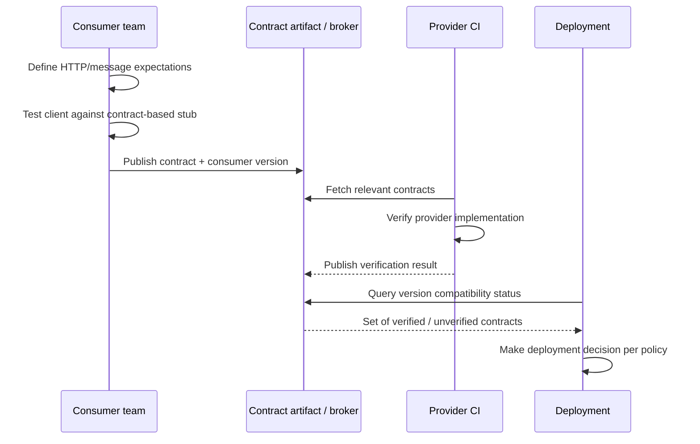
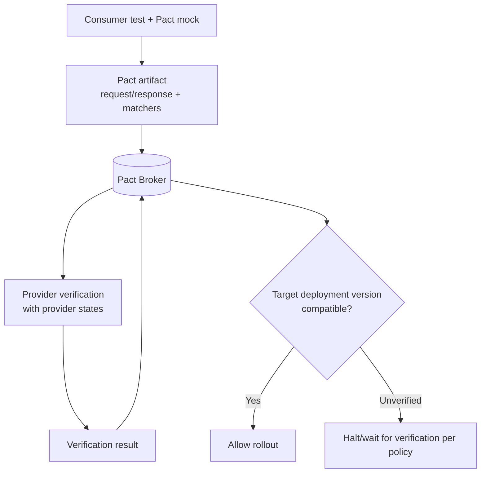
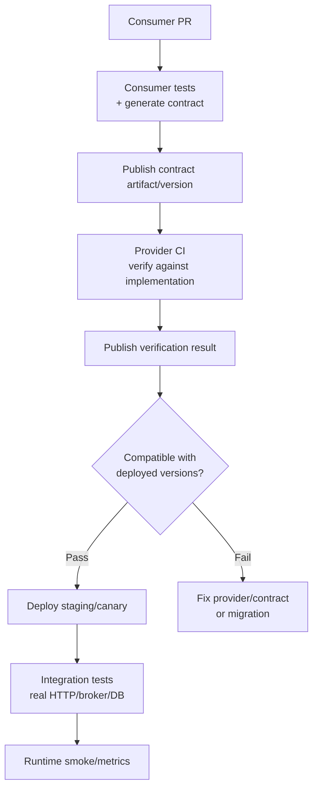

# Consumer-Driven Contracts and Supporting Library Scope

## 1. Context and Objectives

A Spring Boot application rarely operates in isolation. `order-service` calls `warehouse-service` over HTTP to check stock, consumes `PaymentCaptured` events from Kafka, writes to a database, and may push a copy into a cache. Every boundary has a **contract**: URL, HTTP method, status, JSON schema, header names, topic, key, data types, or the meaning of a message. Even a minor provider-side change can break consumers even when both services compile and start cleanly.

For example, `warehouse-service` changes its response from:

```json
{"sku":"SKU-42","available":12}
```

to:

```json
{"sku":"SKU-42","quantityAvailable":"12"}
```

If the consumer deserializes into a Java record `StockResponse(String sku, int available)`, the `available` field may silently default to `0` because the field is missing, or fail mapping depending on configuration. This is a **breaking change for the consumer**, regardless of whether the provider considers the endpoint still returning `200 OK`.

**Consumer-driven contract (CDC)** testing captures the behaviors *consumers actually need*, then verifies the provider still satisfies those behaviors before changes are deployed. It enables teams to evolve services independently while keeping compatibility under control.

Within the **SPRING_BOOT_INTEGRATION** module, CDC is especially useful for HTTP clients, Spring Integration adapters, and message brokers. At the same time, recognize its limits: contract tests alone do not verify database-to-broker consistency, deduplication, latency, TLS, retries, or real infrastructure behavior. Those require additional testing and observability layers.

After this lesson, you will be able to:

1. Explain who the consumer is, who the provider is, and how contracts are generated and verified.
2. Distinguish CDC from OpenAPI, JSON Schema, schema registries, mocks, unit tests, and end-to-end tests.
3. Choose the right scope for Spring Cloud Contract, Pact, WireMock, `MockRestServiceServer`, Spring REST Docs, and related tools.
4. Write an HTTP contract covering both success responses and edge-case errors and enforce it in CI.
5. Apply contract thinking to Kafka/RabbitMQ events without confusing schema guarantees with delivery guarantees.
6. Design version compatibility, error testing, deployment, and observability strategies when services evolve independently.

> **Version scope:** Primary Java examples target Java 17+, Spring Boot 3.x, Spring Framework 6.x, and the `RestClient` API (from Spring Framework 6.1). Spring Cloud Contract, Pact JVM, and Spring Integration must use **versions compatible with your project's BOM/framework**. Do not assume a single version works across both Spring Boot 3.x and 4.x. The YAML contract snippets below illustrate common Spring Cloud Contract HTTP syntax; verify the DSL/plugin and generators for your exact version before adding them to a real build.

## 2. What is a consumer-driven contract?

### 2.1. Three core concepts

| Concept | Explanation | Example |
| --- | --- | --- |
| **Consumer** | Application consuming an API or message. | `order-service` calling the inventory API. |
| **Provider** | Application exposing an endpoint or emitting messages. | `warehouse-service` serving `GET /stocks/{sku}`. |
| **Contract** | Set of input/output interactions the consumer needs the provider to keep stable. | GET with valid SKU returns JSON containing `sku` and numeric `available`. |

A consumer does not need to know the provider's entire API. One consumer using only two fields writes a contract for those two fields; another consumer may additionally rely on `warehouseId`, status `404`, or an `ETag` header. Aggregating contracts across consumers shows the provider **which behaviors currently have active clients depending on them**.

### 2.2. Lifecycle of a CDC



Steps:

1. **Consumer captures real needs:** endpoint, request, fields read, error semantics, and critical assumptions.
2. **Consumer uses contract-driven stubs/mocks** to develop the client even before the provider finishes changes.
3. **Contracts are versioned** (in a repo, artifact repository, or contract broker like Pact Broker).
4. **Provider verification** runs contracts against the provider implementation. If a provider change alters responses or behavior and breaks a contract, CI flags it before release.
5. **Deployment policy** evaluates verification results per version/branch/environment rather than relying on a single generic green build.

CDC shifts the question from “does the provider run?” to “does the provider still deliver the exact behaviors its consumers depend on?”.

### 2.3. CDC does not give consumers unilateral control over the API

In practice, the provider owns API standards, security, load limits, and business rules. Consumers contribute **usage contracts**: the behaviors that must remain intact as the provider evolves. Both teams still need to agree on reasonable expectations, versioning policies, and conflict resolution.

A CDC loses value if a consumer snapshots an entire response including unused fields, random IDs, or unstable timestamps. Contracts should be **strict on what matters and flexible on what does not**, using framework matchers where supported.

## 3. Boundaries of an integration contract

### 3.1. What typically belongs in an HTTP contract

| Part | Example | Why it matters |
| --- | --- | --- |
| Request method/path | `GET /api/v1/stocks/{sku}` | Changing method or path makes clients hit the wrong endpoint. |
| Query/path variables | `sku=SKU-42`, `page=0` | Encoding, optional parameter handling, and pagination. |
| Request headers | `Accept`, `Content-Type`, `Idempotency-Key` | Media types, authentication, and command semantics. |
| Request body | JSON with `orderId`, `quantity` | Schema, mandatory/optional fields, validation. |
| Response status | `200`, `201`, `204`, `400`, `404`, `409` | Clients branch control flow by status code. |
| Response headers | `Location`, `ETag`, `Retry-After` | Clients may use them for lookups, updates, or retries. |
| Response body | Fields, types, nullability, structure | Prevents breaking changes during deserialization. |
| Business semantics | “Same idempotency key returns same reservation” | Prevents treating a contract as mere JSON shape. |

A single contract only verifies the described interactions. It does not prove every input works, every validation rule is right, or that the provider handles production load.

### 3.2. Contracts, schemas, and implementations

| Evidence type | What it verifies | What it does NOT prove alone |
| --- | --- | --- |
| JSON Schema / Avro / Protobuf schema | Structure, types, required fields, schema-level compatibility. | That an endpoint serves the right URL, status, business logic, or side effects. |
| OpenAPI | Full HTTP API description, paths, operations, schemas, expected responses. | That the running implementation matches the spec without tests/validation. |
| CDC interaction test | Provider satisfies scenarios described by consumers. | Behavior outside the contract, performance, or infrastructure failures. |
| Unit test | Logic inside a method/class with mocked dependencies. | Compatibility between two real services. |
| Integration test | Interaction among real components within a bounded scope. | Every production setting or failure mode not reproduced. |
| End-to-end test | Selected user journeys across multiple systems. | Full input/edge-case space; usually slow and environment-sensitive. |

**Defining contracts semantically:** two JSON payloads with the exact same shape can carry different meanings. For example, changing an integer `available` field from “quantity available to sell” to “total stock including reserved items” keeps the type check green while breaking business integration. Always document business meaning and include representative examples, not just schemas.

## 4. Running example: consumer calling Warehouse API

Suppose `order-service` checks inventory before accepting an order. Provider API:

```http
GET /api/v1/stocks/SKU-42 HTTP/1.1
Host: warehouse.example.internal
Accept: application/json
X-Correlation-Id: trace-001
```

Contracted response:

```http
HTTP/1.1 200 OK
Content-Type: application/json

{"sku":"SKU-42","available":12,"warehouseId":"HCM-01"}
```

A useful contract suite covers more than the happy path:

| Scenario | Request | Expected outcome |
| --- | --- | --- |
| SKU exists | GET `/stocks/SKU-42` | 200, `sku` as string, `available` as non-negative integer. |
| SKU does not exist | GET `/stocks/UNKNOWN` | 404 with agreed error code, not 200 + quantity 0 unless allowed by contract. |
| Malformed SKU | GET `/stocks/%...` | 400 (if required by validation contract), no stack trace returned. |
| Missing auth | GET without token | 401 or 403 per security contract. |
| Upstream rate-limited | GET over quota | 429, optionally with `Retry-After`. |
| SKU with URL special characters | GET with proper path encoding | Provider decodes the value properly without misinterpreting path segments. |
| Versioned response change | GET same endpoint | Consumed fields retain types/meanings or follow an active migration plan. |

### 4.1. Consumer adapter in Spring Boot

DTOs should be decoupled from JPA entities and independent of the provider's internal details:

```java
// StockResponse.java
public record StockResponse(
    String sku,
    int available,
    String warehouseId
) {}
```

Gateway using `RestClient`:

```java
// WarehouseGateway.java
import org.springframework.http.MediaType;
import org.springframework.web.client.RestClient;

public class WarehouseGateway {
    private final RestClient client;

    public WarehouseGateway(RestClient client) {
        this.client = client;
    }

    public StockResponse getStock(String sku) {
        StockResponse response = client.get()
            .uri("/api/v1/stocks/{sku}", sku)
            .accept(MediaType.APPLICATION_JSON)
            .retrieve()
            .body(StockResponse.class);

        if (response == null) {
            throw new IllegalStateException("Warehouse returned 200 with empty body");
        }
        if (response.sku() == null || response.available() < 0) {
            throw new IllegalStateException("Warehouse returned invalid data");
        }
        return response;
    }
}
```

In a real application, the gateway is a bean built from a `RestClient.Builder` configured with `baseUrl`, timeouts, authentication, observability, and error policy. Synchronous `RestClient` is the **client runtime**; it does not generate CDCs or verify the provider on its own.

**DTO design note:** `int available` cannot distinguish a missing JSON field from `0` under default Jackson settings. When you must know a field is present and non-null, consider `Integer` plus post-deserialization validation, strict mapping settings, or JSON Schema validation. Contract tests must assert real expectations rather than merely confirming deserialization succeeds.

## 5. Writing an HTTP contract with Spring Cloud Contract

**Spring Cloud Contract (SCC)** supports defining contracts and generating automated tests for the provider as well as stubs for consumers. A single versioned contract source prevents two teams from maintaining two disconnected sets of expectations.

### 5.1. Example YAML contract structure

Suppose a contract file is placed under the contract directory configured in the provider's build:

```yaml
description: "Warehouse returns stock for existing SKU"
name: "should_return_stock_for_existing_sku"
request:
  method: GET
  url: /api/v1/stocks/SKU-42
  headers:
    Accept: application/json
response:
  status: 200
  headers:
    Content-Type: application/json
  body:
    sku: SKU-42
    available: 12
    warehouseId: HCM-01
```

Meaning: given a GET request to that URL and matching `Accept` header, the provider returns status 200, JSON media type, and the asserted fields. The tool can use this contract to generate a **provider-side verification test** and/or stub mapping according to configuration.

Second example for the not-found case:

```yaml
description: "Warehouse returns structured error when SKU is not found"
name: "should_return_not_found_for_unknown_sku"
request:
  method: GET
  url: /api/v1/stocks/UNKNOWN
response:
  status: 404
  headers:
    Content-Type: application/json
  body:
    code: STOCK_NOT_FOUND
    message: "SKU not found"
```

These two YAML snippets illustrate **two distinct contracts**; in a project, save them as separate files according to the contract repository and plugin layout. Do not put multiple top-level YAML documents in one file if your DSL/plugin version does not support it.

### 5.2. Avoiding contracts tied to random data

The example above uses fixed `SKU-42` and `available=12`. To keep generated tests stable:

- Provider verification must set up fixture data or provider state before tests run.
- Do not expect a live production record to always have stock equal to 12.
- If you only care that `available` is a non-negative integer, use **matchers** appropriate for your SCC version instead of hardcoding one number; the example can still supply a representative stub value.
- When status 404 requires an error body, assert the machine-readable code; do not freeze user-facing prose if the client only branches on the code.
- New fields beyond those read by the consumer should not fail the test if the contract allows extension.

### 5.3. Producer verification and consumer stubs

In the SCC model:

1. The consumer team describes contracts and passing criteria.
2. The provider team pulls/receives contracts and configures the SCC verifier and base test class to seed data and boot the target controller.
3. The provider build generates and executes tests from the contracts: if an endpoint changes path, drops a field, or returns the wrong status, the build fails.
4. SCC can generate/publish WireMock stubs for consumers to use in integration tests.
5. CI links the contract artifact/version to the verified provider version.

Depending on team setup, contracts may live in the provider repo, a dedicated repo, or a consumer-contributed artifact. “Consumer-driven” refers to **consumer-defined expectations that the provider must verify**, not a mandate that contract files live in a specific repository.

SCC does not replace provider unit tests, magically create business-accurate DB fixtures, or test real infrastructure simply because stubs were generated. For HTTP in particular, testing controllers in a mock web environment differs from testing real DNS, TLS, and API gateways.

## 6. Testing the consumer side with `MockRestServiceServer`

Spring Framework provides `MockRestServiceServer` to verify **requests produced by the client** without opening HTTP sockets. It is well suited when a team specifically wants to verify that `RestClient` sends the expected URL, headers, method, and handles response bodies.

Example test:

```java
// WarehouseGatewayTest.java
import static org.junit.jupiter.api.Assertions.assertEquals;
import static org.springframework.test.web.client.match.MockRestRequestMatchers.header;
import static org.springframework.test.web.client.match.MockRestRequestMatchers.method;
import static org.springframework.test.web.client.match.MockRestRequestMatchers.requestTo;
import static org.springframework.test.web.client.response.MockRestResponseCreators.withSuccess;

import org.junit.jupiter.api.Test;
import org.springframework.http.HttpHeaders;
import org.springframework.http.HttpMethod;
import org.springframework.http.MediaType;
import org.springframework.test.web.client.MockRestServiceServer;
import org.springframework.web.client.RestClient;

class WarehouseGatewayTest {

    @Test
    void getStockSendsTheRequestRequiredByTheConsumer() {
        RestClient.Builder builder = RestClient.builder()
            .baseUrl("https://warehouse.test");
        MockRestServiceServer server =
            MockRestServiceServer.bindTo(builder).build();
        WarehouseGateway gateway = new WarehouseGateway(builder.build());

        server.expect(
                requestTo("https://warehouse.test/api/v1/stocks/SKU-42"))
            .andExpect(method(HttpMethod.GET))
            .andExpect(header(HttpHeaders.ACCEPT, "application/json"))
            .andRespond(withSuccess(
                """
                {"sku":"SKU-42","available":12,"warehouseId":"HCM-01"}
                """,
                MediaType.APPLICATION_JSON
            ));

        StockResponse result = gateway.getStock("SKU-42");

        assertEquals("SKU-42", result.sku());
        assertEquals(12, result.available());
        server.verify();
    }
}
```

`MockRestServiceServer.bindTo(builder)` must bind to the exact builder from which the gateway constructs its `RestClient`. This test proves the client handles a simulated interaction; it **does not prove the real provider still returns that response**. To make it cross-repo CDC, publish and verify the same contract on the provider side (e.g., via SCC/Pact), or use a shared managed contract with provider-side validation.

### 6.1. What should consumer-side tests verify?

- HTTP method and properly encoded URL/path variables.
- Headers such as `Accept`, `Content-Type`, `Authorization` (using test tokens), correlation IDs, and idempotency keys where required.
- JSON body serialization for POST/PUT/PATCH, including null/missing fields.
- 200/201/204 responses and typed DTOs, envelopes, or generic lists.
- 400/404/409/412/429/5xx responses and how the adapter maps them to business errors.
- Empty bodies, malformed JSON, timeouts, and connection errors; never silently turn 503 into “out of stock.”

For `WebClient`, use an HTTP-level mock server such as WireMock/MockWebServer to test reactive I/O or deliberate `ExchangeFunction` mocks. Do not treat `MockRestServiceServer` as interchangeable for `WebClient`, as they do not share the same request infrastructure.

## 7. Pact: consumer contracts and provider verification via Pact Broker

**Pact** is a cross-platform CDC toolchain: consumer tests declare the interactions they use and emit a **pact file**; the provider runs verification against the corresponding pact. **Pact Broker** stores pacts and verification results by version, branch, and environment to coordinate deployments.

Typical flow:

1. Consumer writes a Pact consumer test: spins up a mock provider, declares expected requests and sample responses/matchers.
2. Real consumer client code calls the mock provider; the test verifies request construction and response handling.
3. The test outputs a pact artifact tagged with consumer name/version and publishes it to Pact Broker.
4. Provider CI fetches relevant consumer pacts, sets up provider states, sends real requests to the provider running in a test environment, and compares responses.
5. Provider publishes verification results. Before deploying, compatibility checks across versions can be queried via the Broker.



**Pact Broker is not a Kafka/RabbitMQ broker.** Pact Broker stores **contracts and verification results**; it plays no role in production message transport.

Provider state is the mechanism for preparing preconditions for verification, such as “SKU-42 exists with stock 12.” State setup must be deterministic and repeatable, avoiding production data or test-order dependencies.

Pact supports matchers so not every field is locked to a static value. However, if a matcher is too permissive (such as accepting any string where business logic requires a finite enum), the contract will miss real breaking changes.

### 7.1. When to consider Pact?

- Consumers and providers may be written in different languages or frameworks.
- Teams want to publish versioned contracts to check compatibility before deployment.
- You need traceability showing which provider version verified against which consumer versions.
- You want consumer tests to run real client code against a mock provider and emit pact artifacts.

Pact does not handle every aspect of mock setup, production tokens/identities, database state, retries after network partitions, or out-of-contract side effects. Keep pacts focused on interactions the consumer relies on, and add integration/E2E tests where real infrastructure evidence is needed.

## 8. Which library supports which job?

No single Spring library covers every kind of contract. Choose tools based on the technical question you need to answer.

| Tool/library | Strongest scope | What it does **NOT** do automatically |
| --- | --- | --- |
| **Spring Cloud Contract** | Contract DSL; generates provider verification tests and client stubs; supports HTTP/messaging via configured integrations. | Does not test production brokers, cross-DB/Kafka transactions, or SLOs. |
| **Pact JVM / Pact Broker** | Consumer-driven interaction tests, provider verification, contract/version tracking, and compatibility matrices. | Does not replace provider state setup, performance tests, or infrastructure tests. |
| **WireMock** | HTTP server stubbing/mocking; request inspection and status/delay/fault simulation. | Using WireMock alone does not guarantee the real provider honors the same expectations. |
| **`MockRestServiceServer`** | In-process HTTP mocking for Spring `RestClient`/`RestTemplate` client tests. | Does not open real sockets or verify the provider. |
| **Spring REST Docs** | Generates API documentation from executed tests so docs stay aligned with tested behavior. | Not automatically cross-repo CDC or a replacement for broker verification. |
| **springdoc-openapi / OpenAPI tooling** | Generates/describes APIs and validates schemas/operations when configured. | Does not prove every consumer remains compatible without tests. |
| **JSON Schema / Avro / Protobuf + Schema Registry** | Schema evolution and compatibility checks for event payloads. | Does not prove consumers commit offsets properly or process side effects idempotently. |
| **AsyncAPI** | Describes channels and messages in event-driven architectures. | Descriptive specs are not real broker delivery tests. |
| **Spring Integration Test** | Tests `IntegrationFlow`, channels, transformers, routers, gateways, and adapters. | Does not verify external partner APIs or production filesystem/broker behavior. |
| **Testcontainers** | Starts real dependencies (databases/brokers) in CI to test protocols, serialization, and transactions. | Does not create contracts or prove production environment parity. |
| **JUnit/AssertJ/Jackson/Bean Validation** | Unit tests, assertions, internal parsing/validation. | No cross-service CDC publishing, versioning, or verification when used alone. |

### 8.1. Choosing by technical question

| What needs to be proven | Typical fit |
| --- | --- |
| Does `RestClient` send the right URL/headers/body and handle errors? | `MockRestServiceServer`; WireMock when real HTTP sockets are needed. |
| Does the provider still satisfy released consumers? | Spring Cloud Contract or Pact + provider verification. |
| Does API documentation reflect tested behavior? | Spring REST Docs; combine with OpenAPI tooling if needed. |
| Are Kafka events schema-compatible? | Avro/JSON Schema/Protobuf and compatibility checks. |
| Do messages actually serialize/consume through a broker? | Spring Kafka tests + embedded broker/Testcontainers Kafka. |
| If DB commits and Kafka publish fails, is the event lost? | Outbox integration/failure tests; CDC alone is insufficient. |
| Does the API sustain 500 RPS and meet timeout SLOs? | Load/performance/resilience tests and metrics. |

**A service can be both provider and consumer**: `order-service` is a consumer of the warehouse HTTP API, yet a provider of the `OrderCreated` event read by notification service. Assign roles **per boundary**, not by service name.

## 9. CDC for message brokers: Kafka, RabbitMQ, and event payloads

Asynchronous events have their own contracts: topic/exchange/routing key names, message keys, headers, schemas, versions, and event meanings. Example:

```json
{
  "eventId": "f9a4d0d1-8cb0-466f-8903-c40f7b1a2e39",
  "schemaVersion": 1,
  "orderId": "ORD-42",
  "occurredAt": "2026-11-21T02:00:00Z",
  "amount": 125000
}
```

### 9.1. What belongs in an event contract

| Component | Example | Compatibility considerations |
| --- | --- | --- |
| Event type | `OrderCreated` | Do not rename or alter semantics without a migration. |
| Topic/exchange/routing key | `orders.created.v1` | Routing directly affects consumer subscriptions. |
| Record key | `orderId` | Governs partitioning and per-key ordering in Kafka. |
| `eventId` | Stable UUID across retries/replays | Used by consumers for deduplication. |
| `schemaVersion` | `1` | Governs evolution rules and reading older versions. |
| Required fields | `orderId`, `amount` | Do not drop, change type, or alter meaning outside policy. |
| Timestamp | ISO-8601 UTC | Explicit timezone, precision, and nullability. |
| Headers | trace ID, content type, schema ID | Data types, propagation, tracing, and auth if used. |

**Consumer-driven event contracts** can verify that producers emit payloads matching consumer expectations or that consumers can read representative messages. SCC supports messaging contracts via configured integrations, and Pact models message interactions as well. However, **message contract tests usually verify message generation/consumption**, not that a real broker persists, partitions, redelivers, and commits offsets correctly in every scenario.

### 9.2. Schema compatibility is not semantic compatibility

Suppose `amount` remains an integer, but the producer changes the unit from VND to cents or switches it to “post-tax amount.” The schema stays valid and consumers still deserialize it, yet financial reports break. Contracts must explicitly state **units, meaning, and business invariants**. Schema registries only enforce structural/type rules supported by the tool; they cannot read business intent.

### 9.3. Edge cases outside schema contract scope

1. **Duplicate delivery:** the same `eventId` is redelivered by Kafka/RabbitMQ; handlers must be idempotent.
2. **Out-of-order:** `OrderCancelled(version=3)` arrives before `OrderPaid(version=2)`; version/sequence guards are required.
3. **Offset/ack window:** DB commits successfully, then the consumer crashes before ack; the message may arrive again.
4. **Dead-letter:** deserialization, validation, and business errors need recovery/replay; a DLT does not fix bad data by itself.
5. **Transaction boundary:** databases and brokers do not share an ACID transaction by default; use outbox/inbox where required.
6. **Backpressure/lag:** consumers fall behind producers; schema contracts do not measure throughput.

With Spring Boot, add tests against real Kafka/RabbitMQ (Testcontainers or test brokers) injecting duplicate and out-of-order data; measure consumer lag, retries, DLT routing, side-effect counts, and database state.

## 10. Designing edge-case contracts at the right level

Happy-path contracts are necessary but insufficient. Edge errors often cause breaking changes when a provider “just tweaks” an error handler or serialization rule.

### 10.1. HTTP error responses should have a stable shape

Example error contract:

```http
HTTP/1.1 409 Conflict
Content-Type: application/problem+json

{
  "type": "https://api.example.com/problems/idempotency-key-conflict",
  "title": "Request conflict",
  "status": 409,
  "code": "IDEMPOTENCY_KEY_REUSED",
  "detail": "Key was already used with different payload"
}
```

This uses an extended **Problem Details** (RFC 9457) format with a custom `code` field. If the consumer only branches on `status` and `code`, do not freeze display text in `detail`. Use matchers/schemas for required fields while letting human-readable phrasing evolve when clients do not depend on it.

### 10.2. Error matrix to consider

| Edge point | Example | What the contract should verify |
| --- | --- | --- |
| Not found | GET unknown SKU | Status 404, error code, and media type. |
| Missing required field | POST missing `orderId` | 400/422 per API, structured error. |
| `null` field | PATCH `{"active":null}` | Keep unchanged, clear field, or reject? |
| Unicode/encoding | SKU or query with spaces/special chars | Path/query decoded properly. |
| Numeric boundaries | `quantity=0`, negative values, overflow | Validation/status and contracted limits. |
| Date/time | UTC timestamp, timezone, precision | Consumer parser accepts format properly. |
| Empty lists | `items=[]`, no next page | Consistent response shape. |
| Pagination | Last page, `nextCursor=null` | Explicit cursor/offset semantics. |
| Conflict | Same Idempotency-Key, different payload | 409 with no extra side effects. |
| Optimistic concurrency | PUT with stale `If-Match` | 412, no overwrite of newer data. |
| Rate limits | 429 and `Retry-After` | Header/value format if consumer relies on it. |
| Async processing | POST returns 202 | Location/status endpoint or completion event per contract. |
| No body | DELETE returns 204 | Consumer does not attempt to parse empty JSON. |
| Content negotiation | `Accept`/`Content-Type` outside agreement | 406/415 or expected representation. |

You do not need contracts for **every possible input value**. Prioritize branches where consumers have distinct handling or where changes easily break compatibility. Property-based/fuzz testing, security testing, and integration testing cover the rest of the input space.

### 10.3. Assumptions that make tests brittle

- Locking down the entire JSON payload when the consumer only reads a few fields.
- Comparing timestamps or correlation IDs against hardcoded values without fixtures.
- Assuming JSON object key ordering is meaningful.
- Confusing an absent field with a `null` field in a PATCH request.
- Assuming every `404` means business “out of stock,” even when the URL itself is wrong.
- Mocking `200` with clean JSON while the real provider returns `206`, `204`, or a different error envelope.
- Stubbing `503` while ignoring timeouts, TCP resets, TLS handshake failures, and out-of-contract retry behavior.

CDC is most effective when it checks **what consumers genuinely rely on**, without coupling to incidental implementation details in the response.

## 11. Compatibility and API evolution strategies

### 11.1. Which changes are usually safe?

| Provider change | Can be compatible when... | What must be verified |
| --- | --- | --- |
| Add optional field to JSON response | Consumers ignore unknown fields and do not deserialize overly strictly. | Consumer tests, matchers/schemas. |
| Add new endpoint | Old endpoints remain unchanged. | Older consumers still verify cleanly. |
| Add enum value | Consumers fall back safely on unknown values. | Test unknown enums; many Java consumers use closed enums. |
| Add required field to request | Has a default or preserves the old contract. | Older consumers still send valid requests. |
| Change numeric field from `int` to `string` | Consumers follow an explicit compatibility policy. | Usually a breaking change; verify across consumer versions. |
| Change error code/status | No consumer depends on it or a migration is agreed. | Error-path contracts and rollout. |
| Remove field/topic/header | All active consumers have migrated away. | Check contracts/versions of deployed consumers. |

Never assume “adding a field is always safe” if consumers use strict deserializers, signatures over raw JSON, or closed schemas. Never assume “internal provider-only changes” are safe if behavior, latency/errors, or business meaning shifts.

### 11.2. Expand–migrate–contract

A common upgrade pattern:

1. **Expand:** provider adds new fields/endpoints/event versions while continuing to serve the old contract.
2. **Migrate:** consumers deploy code reading the new version; publish new contracts, and the provider verifies both old and new versions.
3. **Observe:** confirm old consumers have stopped using the old contract via broker/deployment versions and runtime metrics.
4. **Contract:** only after confirming no dependent consumers remain does the provider remove the old field/endpoint.

For Kafka, do not delete older event readers while old messages remain in retention, DLT, or historical replays. New CI contracts cannot retroactively rewrite old messages sitting in the broker.

### 11.3. Deployment matrix

When consumers and providers deploy independently:

| Consumer | Provider | Question to answer |
| --- | --- | --- |
| v1 in production | v1 in production | Current contract works. |
| v1 in production | v2 about to deploy | Does provider v2 verify consumer v1's pact/contract? |
| v2 about to deploy | v1 in production | Does consumer v2 use fields/endpoints provider v1 does not yet support? |
| v2 in production | v2 in production | Is the new contract verified and observed at runtime? |

Never test only latest-to-latest. Staggered deployments, rollbacks, and mixed-version instances create old–new combinations. Pact Broker or a contract/version management system helps answer compatibility for each version pair, provided CI policies are configured properly.

## 12. CDC in a Spring Boot system's CI/CD

A pipeline can be organized as follows:



### 12.1. Consumer pipeline

- Build the client adapter and unit tests.
- Run consumer interactions against contract-generated stubs/mocks or the Pact mock provider.
- Verify real client code builds the right request and parses responses properly.
- Publish the contract with metadata: service name, commit SHA, branch/tag, and version.
- Do not treat mock status as proof that the production provider works.

### 12.2. Provider pipeline

- Fetch contracts for relevant consumers/versions.
- Set up provider states/fixtures and boot controllers or an HTTP provider test server.
- Verify contracts, including 4xx/409/429 cases and the fields actually consumed.
- Publish verification results tied to the provider commit/version.
- Enforce compatibility gates before rollout; still run required integration, security, and performance tests.

### 12.3. When a contract fails

Inspect the test diff in order:

1. Did **provider behavior actually change** (status/path/field/type), or did a fixture simply drift?
2. Does the contract express a genuine consumer need, or did it lock down unused details?
3. Can the provider be expanded to support both old and new contracts in parallel?
4. If a breaking change is unavoidable, are rollout, versioning, rollback plans, and old-consumer checks in place?
5. Does the consumer need new error/timeout handling code, or just a corrected erroneous expectation?

**Never edit a contract just to “match the new implementation” and turn CI green** when production consumers have not yet migrated. Doing so defeats the compatibility protection of CDC.

## 13. Limits that must be tested by other means

### 13.1. Network, security, and resilience

An in-process provider verification test or test HTTP server does not automatically prove:

- Production DNS, TLS certificates, mTLS, proxies/load balancers, and firewalls are configured properly.
- OAuth2/JWT tokens are issued/refreshed and authorized per tenant.
- Read/connect timeouts, circuit breakers, retry/backoff policies, and connection pools hold up under overload.
- Rate limits/quotas are enforced per client rather than merely returning a mocked 429 response.

These require integration tests with real networking/auth or realistic simulations, load/resilience tests, and monitoring.

### 13.2. Database, cache, and broker

An HTTP contract `POST /orders → 201` does not prove:

- Database and outbox events commit atomically.
- Kafka consumers do not deduct inventory twice after redelivery.
- Caches do not overwrite newer entries when events arrive out of order.
- Transaction rollbacks after HTTP timeouts do not leave two services out of sync.
- DLTs are populated properly on deserialization failures or worker overload.

Test these exact invariants using transaction, integration, and fault-injection tests against real databases, brokers, and adapters. For instance, send the same `eventId` twice to Kafka, crash the consumer after DB commit and before offset commit, and verify only one side effect occurs.

### 13.3. Semantics beyond payload shape

If a contract only checks `{"available":12}` while the business rule changed from “sellable” to “total stock,” producer verification may still pass. Business integration tests, domain invariants, alert metrics, and cross-team coordination are needed to protect **data meaning**.

### 13.4. A tool can create false confidence

**Mocks maintained alongside the implementation** can share the exact same bugs as the implementation. For example, a provider team updates both its controller and WireMock stub in one commit; without an independent consumer contract, changing `available` to `quantityAvailable` slips through. CDC helps by letting consumers own expectations that providers must verify; however, if consumer tests omit critical fields, breaking changes can still slip past.

## 14. Recommended practices across integration types

A practical contract and testing breakdown:

| Boundary | Contract owner | Contract checks | Complementary tests |
| --- | --- | --- | --- |
| `order-service → warehouse HTTP` | Consumer sets expectations, provider verifies | GET stock, POST reservation, errors/statuses, idempotency key. | Timeouts, retries, TLS, provider state, reservation reconciliation. |
| `payment-service → Kafka → order-service` | Order consumer sets event expectations; Payment emits | Event type, topic, key, schemaVersion, amount/currency. | Broker integration, duplicates/out-of-order, offsets, DLT. |
| `batch importer → MongoDB/PostgreSQL` | Domain/DB schema owner | DTO/document schema, unique batch ID, versioning. | Transaction rollbacks, concurrency, indexes, pool timeouts. |
| `Spring Integration file adapter ↔ partner` | Both sides agree on file contract | Filename, extension, encoding, columns, checksum, `.done`/`.writing`. | Temp rename, permissions, large files, restarts, two-reader races. |
| `order-service → Redis/cache` | Application team | Key/value schema, TTL/invalidation semantics. | Failover, concurrent updates, stale writes, and cache stampedes. |

CDC works best at **consumption interfaces between independent teams**. For contracts between two packages in the same repository, type-safe interfaces and module-level tests are often sufficient; there is no need to stand up a Pact Broker just to check an internal method.

## 15. Common pitfalls

| Pitfall | Consequence | Fix |
| --- | --- | --- |
| Calling every mock test “CDC” | Provider can change without the consumer knowing. | Publish contracts and run provider verification on the same artifact. |
| Testing only 200 happy paths | Unexpected 404/409/429/204 responses break clients. | Add edge cases that consumers actually handle. |
| Snapshotting entire JSON bodies | Adding unrelated fields breaks tests. | Use matchers/schemas scoped to fields the consumer uses. |
| Overly loose matchers | Critical type or meaning changes still pass. | Assert required fields, types/formats/ranges, and business rules. |
| Provider verification depends on production data | Flaky, unrepeatable tests. | Use dedicated provider states/fixtures. |
| Treating an OpenAPI file as runtime proof | Spec and implementation can drift apart. | Add contract/runtime verification. |
| Using a schema registry and skipping consumer tests | Schema-valid messages fail due to handler/broker policies. | Test deserialization, idempotency, offsets, and ordering. |
| Unversioned contracts | Cannot tell which version is verified against live consumers. | Track contracts and provider results by commit/version. |
| Verifying only latest consumer vs. latest provider | Rollbacks or mixed-version rollouts break. | Check the matrix of deployed versions. |
| Changing contracts to match broken implementations just for green CI | Hides breaking changes from older consumers. | Keep old contracts until migration completes. |
| Trusting stub servers to prove TLS/circuit breakers | Production transport issues go untested. | Run real integration/resilience tests. |
| Equating matching schemas with matching business semantics | Currency/stock unit changes cause wrong calculations. | Document semantics and domain invariants explicitly. |
| Confusing Pact Broker with a Kafka broker | Misdesigned pipeline responsibilities. | Separate contract/verification storage from message transport. |
| Claiming CDC guarantees exactly-once | DB/email side effects can still duplicate. | Use inbox/outbox, unique constraints, and fault injection. |

## 16. CDC implementation checklist for Spring Boot integration

1. **Map boundaries:** identify consumers and providers per HTTP operation, event type, or file exchange.
2. **Establish ownership and semantics:** decide who writes expectations, who verifies, and who approves breaking changes.
3. **Pick tools:** SCC or Pact for CDC; MockRestServiceServer/WireMock for HTTP client tests; schema registry for events; Testcontainers for brokers/DBs.
4. **Write clear contracts:** request method/path/headers/body, response status/headers/body; event type/key/version/schema; error codes and essential edge cases.
5. **Write consumer tests against real code:** stubs/mocks must be exercised by the client adapter, not via manual JSON comparisons alone.
6. **Run provider verification:** test the real implementation with deterministic provider states; publish versioned results.
7. **Gate deployments:** check compatibility against running versions; prepare rollout/rollback and expand–migrate–contract plans.
8. **Test outside the contract:** auth/TLS, timeouts, resilience, DB transactions, idempotency, Kafka redelivery, DLT, file adapter renames, and cache consistency.
9. **Observe runtime:** latency/error statuses, consumer lag, contract-related parsing errors, schema version distribution, and retries/DLT.
10. **Maintain contracts:** update when consumer needs genuinely change; retire old contracts only after migration is confirmed.

**Self-check questions**

1. Why is a `MockRestServiceServer` test for `RestClient` insufficient to be called cross-service CDC?
2. In CDC, what does the consumer define and what must the provider verify?
3. What is the difference between Pact Broker and a Kafka broker?
4. Is adding a new JSON field always compatible? When does strict deserialization make it incompatible?
5. Why does a schema registry not guarantee an `OrderPaid` event is written to the database only once?
6. If a provider changes 404 to 200 with an empty body, which consumers might be affected?
7. While consumer v1 is still running in production, why must provider v2 verify against contract v1 as well?
8. Why does producer verification in a test environment not replace testing TLS, rate limits, or circuit breakers in production?
9. Why can keeping `available` as an integer while changing its meaning from “sellable” to “total inventory” still be a breaking change?

## 17. References

- [Spring Cloud Contract — Reference Documentation](https://docs.spring.io/spring-cloud-contract/reference/): Contract DSL, Verifier, Stub Runner, producer/consumer workflows, and messaging.
- [Pact — Documentation](https://docs.pact.io/): consumer-driven contracts, provider verification, Pact Broker, and versioning.
- [Spring Framework — REST Client Testing](https://docs.spring.io/spring-framework/reference/testing/spring-mvc-test-client.html): tools and strategies for testing HTTP clients in Spring.
- [Spring Framework — REST Clients](https://docs.spring.io/spring-framework/reference/integration/rest-clients.html): `RestClient`, `WebClient`, HTTP Interfaces, and error handling.
- [WireMock — Documentation](https://wiremock.org/docs/): HTTP stubbing, request matching, faults, and response templating.
- [Spring REST Docs — Reference](https://docs.spring.io/spring-restdocs/docs/current/reference/htmlsingle/): generating API documentation from executed tests.
- [OpenAPI Specification](https://spec.openapis.org/oas/latest.html): describing HTTP API contracts.
- [AsyncAPI Specification](https://www.asyncapi.com/docs/reference/specification/latest): describing event/message channel contracts.
- [Spring for Apache Kafka — Reference](https://docs.spring.io/spring-kafka/reference/): Kafka clients, testing, errors, transactions, and message delivery.
- [RFC 9457 — Problem Details for HTTP APIs](https://www.rfc-editor.org/rfc/rfc9457): structured error responses and extension members.
