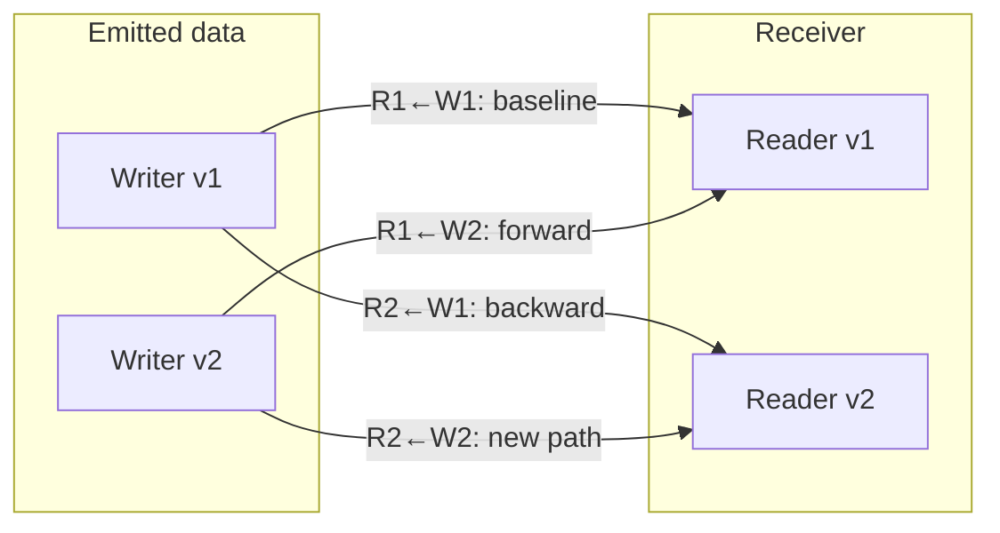
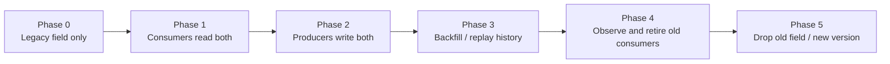
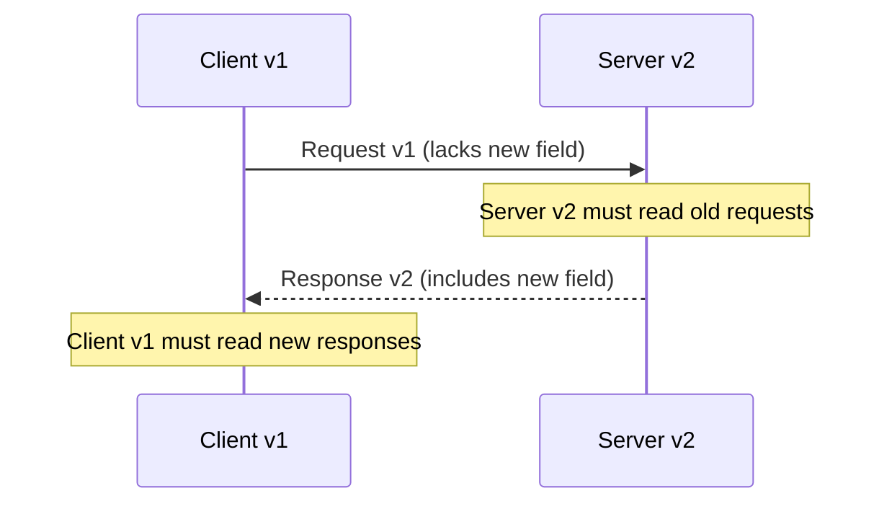
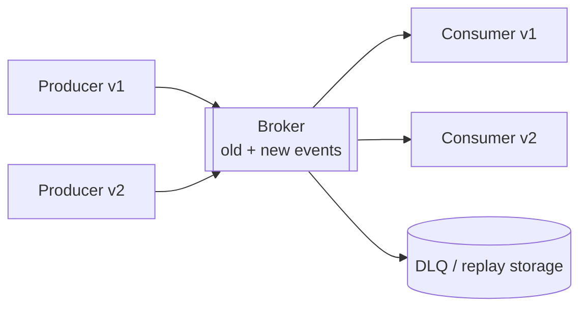
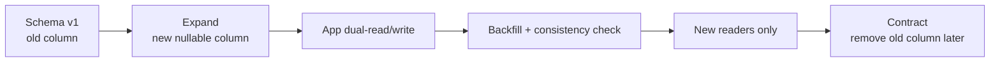
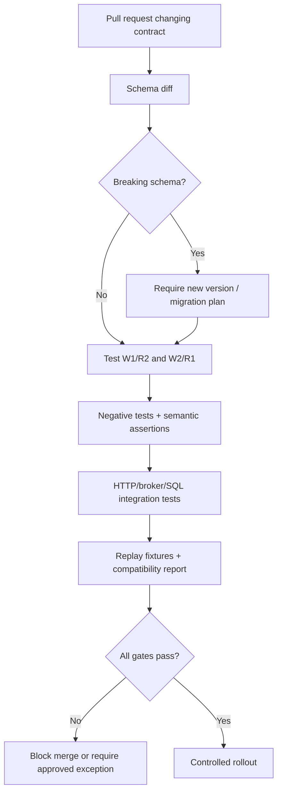
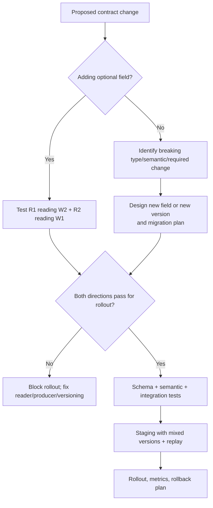

# Verifying Backward Compatibility When Adding Fields or Changing Types

An integration system can run smoothly for months and then break over a tiny JSON change: the producer adds a `salesChannel` field, changes `amount` from a string to a number, or renames `status` from `"PAID"` to `"SETTLED"`. In an application deployed atomically all at once, the mismatch might surface immediately. In distributed systems, however, **producers and consumers are rarely upgraded at the exact same moment**: older instances, queued broker messages, cached data, exchange files, or external partner clients remain on earlier versions.

**Backward compatibility** does not merely mean new JSON “still parses”; it means a given version of the system still understands and processes every payload it can encounter across deployment and replay windows. Proving this requires verifying **schemas**, **business semantics**, **real data**, **deployment procedures**, and **recovery paths**.

This lesson belongs to the **Contracts and Edge Cases** chapter of the **SPRING_BOOT_INTEGRATION** module. In this module, Spring Boot connects systems across HTTP clients, SQL databases, caches, message brokers, and Spring Integration adapters. We will examine compatibility for HTTP JSON, Kafka/RabbitMQ events, databases, integration files, and internal data models—covering new fields, data types, errors, retries, deduplication, testing, and observability.

> **Example scope:** Java 17+, Spring Boot 3.x, and Jackson 2.x for code snippets; the contract principles apply more broadly. Spring Boot 4.x, Jackson 3.x, Avro/Protobuf serializers, or other binders may change package names and configuration mechanics. These examples are learning material; real testing must use your project's actual dependencies and contracts.

## 1. Learning objectives

After this lesson, you will be able to:

1. Define **backward**, **forward**, and **full compatibility**, and distinguish them from binary/source compatibility.
2. Draw an **old/new producer × old/new consumer** matrix before changing a payload.
3. Determine when **adding an optional field** is compatible and when adding a field still breaks older consumers.
4. Identify **unsafe changes**: changing types, renaming, altering enums, changing units, changing date/time formats, or changing null representation.
5. Use Jackson and boundary validation intentionally, without relying on silent coercion to “pass tests.”
6. Design type migrations following the **add → dual read/write → migrate → remove** strategy.
7. Verify contracts across HTTP APIs, brokers, SQL, caches, and file adapters using unit tests, contract tests, integration tests, and replays.
8. Set up CI gates, safe rollouts, and rollbacks while multiple versions coexist.
9. Monitor schema/version mismatches, decoding errors, quarantined payloads, and processing latency.

## 2. A data contract is not just a list of fields

A contract between two systems includes at least:

| Aspect | Example | What breaks if changed incorrectly |
| --- | --- | --- |
| **Structure** | JSON object with `orderId`, `status` | Consumer cannot locate fields |
| **Type** | `totalMinor` is integer, `currency` is string | Parse failure or precision loss |
| **Required/optional** | `eventId` required, `salesChannel` optional | Historical data violates new schema |
| **Allowed values** | `status ∈ {CREATED, PAID, CANCELLED}` | New enum value breaks older consumers |
| **Semantics** | `totalMinor` is the smallest currency unit | Valid type, wrong monetary calculation |
| **Time** | `occurredAt` is ISO 8601 UTC | Wrong timezone or seconds vs. milliseconds confusion |
| **Identity** | `(source, eventId)` identifies an event | Retries trigger duplicate side effects |
| **HTTP behavior** | 200 returns object; 204 has no body | Old client tries to decode empty body |
| **Ordering/versioning** | `aggregateVersion` monotonically increases per aggregate | Older event overwrites newer state |
| **Operational limits** | Max size, rate limits, TTL, replay window | Consumer overload or data loss |

**Schema compatibility** is necessary but insufficient for **semantic compatibility**. For example, changing `quantity = 1` from *one piece* to *one carton* keeps the integer type intact and may pass every JSON Schema check while corrupting business logic.

Similarly, changing an HTTP status from `200` to `202` may not alter a single byte of JSON, yet an old client assuming “200 means completed” will behave wrongly. Contracts must therefore bind **data and behavior together**.

## 3. Defining backward and forward compatibility by reader and writer

There are two roles:

- **Writer/producer** creates data—for example, an API server returning JSON or a Kafka producer publishing an event.
- **Reader/consumer** receives and decodes data—for example, a WebClient, Kafka listener, or Spring Integration transformer.

Conventions:

- `W1`: old writer.
- `W2`: new writer.
- `R1`: old reader.
- `R2`: new reader.

| Capability | Pair to verify | Question |
| --- | --- | --- |
| **Backward compatibility** | **R2 reads W1** | Can the new consumer read old data? |
| **Forward compatibility** | **R1 reads W2** | Can the old consumer read new data? |
| **Full compatibility** | Both **R2 ← W1** and **R1 ← W2** | Can both sides upgrade independently in either order? |
| **Testing only the new version** | **R2 reads W2** | Tests the happy path; **does not prove compatibility** |

For REST APIs, terminology can differ depending on which side is viewed as the reader; in tickets/PRs, **explicitly write out the producer–consumer pairs** to avoid terminology confusion.



During a **rolling deployment**, all four combinations can occur. Messages queued in a broker or stored in files extend the old-data window **even after every producer instance has upgraded**.

### 3.1. Source, binary, and wire compatibility are three separate things

- **Source compatibility**: whether Java code calling an older interface still compiles against a newer library.
- **Binary compatibility**: whether already-compiled bytecode runs against a newer library version.
- **Wire/data compatibility**: whether JSON, Avro, Protobuf, XML payloads, or HTTP protocols are still understood correctly by all parties.

A Spring Boot/Jackson upgrade might remain wire-compatible while breaking binary compatibility with a Java library. Conversely, a Java record can keep identical field names and types while changing value semantics—compiling cleanly while breaking the business contract.

## 4. Running example: OrderCreated v1 and v2

Suppose the Order system emits an `OrderCreated` event whenever an order is created.

**Contract v1:**

```json
{
  "eventId": "evt-101",
  "orderId": "ORD-101",
  "status": "CREATED",
  "occurredAt": "2026-11-21T03:00:00Z"
}
```

A proposed v2 adds the order's origination channel:

```json
{
  "eventId": "evt-101",
  "orderId": "ORD-101",
  "status": "CREATED",
  "occurredAt": "2026-11-21T03:00:00Z",
  "salesChannel": "MOBILE"
}
```

Questions to answer:

1. Does consumer v1 accept the **unknown field** `salesChannel` or fail?
2. When consumer v2 reads a v1 event **missing `salesChannel`**, what does it do?
3. Is `salesChannel` truly optional, or will v2 business code call `salesChannel.equals(...)` without a null check?
4. If defaulting a missing value, does `UNKNOWN` make business sense, or should an “unspecified” state be preserved?
5. Do JSON Schema/OpenAPI/registry contracts permit the new field?
6. Do listeners, caches, DLQ/replay jobs, and analytics consumers share the same rules?

Only after answering these questions does testing the v2 payload against consumer v1 and the v1 payload against consumer v2 become meaningful.

## 5. Adding fields: conditions for a compatible change

### 5.1. Adding an optional field is *conditionally* safe

Adding `salesChannel` can be compatible if:

- **R1** ignores or permits unknown fields.
- **R2** accepts v1 payloads that omit the field.
- No business rule treats `salesChannel` as mandatory on every event.
- Schema validation layers do not enforce a closed schema forbidding extra properties.
- Forwarding, signing, hashing, canonical JSON, or logging layers do not depend on the exact legacy field set.
- Adding the field does not breach message size limits or alter routing/filtering behavior.

**Example that breaks despite only adding a field:**

```json
{
  "eventId": "evt-101",
  "orderId": "ORD-101",
  "status": "CREATED",
  "occurredAt": "2026-11-21T03:00:00Z",
  "salesChannel": "MOBILE"
}
```

If R1 enforces this JSON Schema:

```json
{
  "type": "object",
  "properties": {
    "eventId": { "type": "string" },
    "orderId": { "type": "string" },
    "status": { "type": "string" },
    "occurredAt": { "type": "string" }
  },
  "additionalProperties": false
}
```

then `salesChannel` is rejected regardless of whether business code reads it. This is a **closed-world contract**. The change is only safe if consumers are permitted to ignore new fields, a versioning strategy is used, or the relevant consumers' schemas are updated first.

### 5.2. Adding a required field usually breaks backward compatibility

Suppose v2 declares `salesChannel` **required**. A v1 event lacking this field:

```json
{
  "eventId": "evt-old",
  "orderId": "ORD-OLD",
  "status": "CREATED",
  "occurredAt": "2025-10-15T07:30:00Z"
}
```

will fail reader v2 validation if the new reader requires the field to be present. During broker replay or reading historical files, consumer v2 may stall.

A safer evolution path:

1. Add `salesChannel` as **optional**.
2. Have reader v2 accept null/missing with explicit handling.
3. Have writer v2 populate the field when known.
4. Monitor the missing-field rate on real traffic.
5. Make it required only after the replay window ends and all old writers are gone—or open a **new contract version** if that cannot be guaranteed.

**Do not rush to turn null into a fake valid value.** For example, defaulting missing `salesChannel` to `"MOBILE"` can skew revenue reports. If the business needs to distinguish missing data, use an explicitly contracted `UNKNOWN` value or an optional model.

### 5.3. Missing and explicit null are not the same

Three distinct payloads:

```json
{"eventId":"evt-1"}
```

```json
{"eventId":"evt-1","salesChannel":null}
```

```json
{"eventId":"evt-1","salesChannel":""}
```

They can carry three different meanings:

- Field omitted because an older producer does not know about it.
- New producer knows the field, but the value is currently undefined.
- Producer sent an empty string (possibly a validation error).

Many mapping libraries collapse both **missing** and **explicit null** into Java `null`, losing the distinction. When semantics require distinguishing them (e.g., HTTP PATCH: *do not change* vs. *clear value*), use a JSON tree, patch model, or presence-tracking wrapper rather than a plain nullable field.

## 6. Jackson: tolerant reader and boundary validation

### 6.1. Use annotations to make unknown-field behavior explicit

**`OrderEventV1.java`**

```java
package com.example.integration.contracts;

import com.fasterxml.jackson.annotation.JsonIgnoreProperties;

@JsonIgnoreProperties(ignoreUnknown = true)
public record OrderEventV1(
        String eventId,
        String orderId,
        String status,
        String occurredAt
) {}
```

**`OrderEventV2.java`**

```java
package com.example.integration.contracts;

import com.fasterxml.jackson.annotation.JsonIgnoreProperties;

@JsonIgnoreProperties(ignoreUnknown = true)
public record OrderEventV2(
        String eventId,
        String orderId,
        String status,
        String occurredAt,
        String salesChannel
) {}
```

`@JsonIgnoreProperties(ignoreUnknown = true)` instructs Jackson to ignore undeclared fields when deserializing these two records. That is helpful for extensible events. However, **not every application should ignore all unknown fields**: for contracts that need to catch typos or security-critical fields, enforce strict validation at the boundary.

**Do not rely on assumptions about “what Spring Boot defaults to”**: Jackson behavior can differ across `ObjectMapper`, `JsonMapper`, HTTP message converters, and Kafka serializers/deserializers. Local annotations express clear intent on the types, and tests must exercise **the application's actual configured mapper**.

### 6.2. Bidirectional unit tests with fixtures

```java
package com.example.integration.contracts;

import static org.junit.jupiter.api.Assertions.*;

import com.fasterxml.jackson.databind.ObjectMapper;
import org.junit.jupiter.api.Test;

class OrderEventCompatibilityTest {

    private final ObjectMapper mapper = new ObjectMapper();

    private final String v1Payload = """
            {
              "eventId": "evt-101",
              "orderId": "ORD-101",
              "status": "CREATED",
              "occurredAt": "2026-11-21T03:00:00Z"
            }
            """;

    private final String v2Payload = """
            {
              "eventId": "evt-101",
              "orderId": "ORD-101",
              "status": "CREATED",
              "occurredAt": "2026-11-21T03:00:00Z",
              "salesChannel": "MOBILE"
            }
            """;

    @Test
    void oldReaderAcceptsNewPayload_whenUnknownFieldsAllowed()
            throws Exception {
        OrderEventV1 old = mapper.readValue(
                v2Payload, OrderEventV1.class);
        assertEquals("evt-101", old.eventId());
        assertEquals("CREATED", old.status());
    }

    @Test
    void newReaderAcceptsOldPayload_whenFieldIsOptional()
            throws Exception {
        OrderEventV2 newer = mapper.readValue(
                v1Payload, OrderEventV2.class);
        assertNull(newer.salesChannel());
        assertEquals("ORD-101", newer.orderId());
    }

    @Test
    void newReaderUnderstandsNewPayload() throws Exception {
        OrderEventV2 newer = mapper.readValue(
                v2Payload, OrderEventV2.class);
        assertEquals("MOBILE", newer.salesChannel());
    }
}
```

These tests verify **deserialization behavior** on the chosen payloads; they do not verify that the data is **business-valid**. For example, you still need checks ensuring `eventId`/`orderId` are non-blank, `status` belongs to the allowed set, and `occurredAt` is a parseable instant.

**The absence of `@NotNull` does not mean nulls are arbitrarily allowed in the domain.** Conversely, placing `@NotNull` on a DTO does not trigger Bean Validation automatically when calling `ObjectMapper.readValue(...)` directly. Run real validation at the boundary, via Spring Validator/Bean Validation or explicit validation functions.

### 6.3. Overly broad consumer tolerance can be dangerous

Suppose a producer misspells `tenantId` as `tenentId`. If the reader silently ignores unknown fields and falls back to a default tenant, data risks leaking across tenants or being misprocessed.

A balanced policy:

- **Required fields for identity, security, idempotency, money, and versioning**: validate strictly.
- **Additive fields that do not affect invariants**: allow unknown fields and optionality where appropriate.
- Log/emit controlled metrics on unknown fields if you need to detect unexpected contract drift.
- Use schema/version reviews to catch unplanned changes instead of relying solely on Jackson.

## 7. Changing types: why is it riskier than adding fields?

### 7.1. Example: string → number

Originally:

```json
{"orderId":"ORD-101","totalAmount":"125.50","currency":"USD"}
```

New proposal:

```json
{"orderId":"ORD-101","totalAmount":125.50,"currency":"USD"}
```

`"125.50"` and `125.50` do not have the same **JSON type**: one is a `string`, the other is a `number`. Some Java libraries coerce by default, whereas JavaScript clients, strict JSON Schemas, storage systems, or other consumers may reject the change.

Even when Jackson parses it successfully:

- Binary floating-point numbers can lose precision when representing money.
- Some clients do not preserve `125.50` vs. `125.5` identically as display strings.
- Decimal scale differences can break signatures, hashes, or snapshot comparisons.
- If the sender switches to integer numbers, consumers expecting decimal strings may miscalculate.

**Never use permissive type coercion as proof of compatibility.** Tests must verify both JSON types and actual values/units.

### 7.2. Risk matrix for data changes

| Change | Risk level | Why |
| --- | --- | --- |
| Add optional field, reader ignores unknown | Usually low | Still must verify all consumers and semantics |
| Add required field, no default | High | Old writers omit the field |
| Change `string` to `number` | High | Parse/schema/coercion issues, precision, locale |
| Change `int` to `long` | Medium–high | Old readers may overflow; JavaScript loses precision on large integers |
| Change `long` to `int` | High | Narrows value domain |
| Change `boolean` to `"Y"/"N"` | High | Changes JSON type and meaning |
| Change `timestamp` seconds to milliseconds | Very high | Type may stay identical while timestamps shift by ×1000 |
| Change `"2026-..."` to epoch number | High | Changes type, timezone, and precision |
| Rename field | High | Old readers miss the legacy field |
| Add enum value | Depends on consumer | Exhaustive switches or closed enums may fail |
| Change meaning of existing enum | Very high | Parses cleanly yet triggers wrong behavior |
| Change null → empty array/string | Depends on semantics | Can alter the meaning of “no data” |
| Reorder JSON object keys | Usually low | JSON objects are unordered, unless signing/hashing/custom parsers break |
| Remove legacy field | High | Old readers still depend on it |

### 7.3. Large integers and precision

Java `long` holds signed 64-bit integers. JavaScript `Number` uses IEEE-754 double-precision floating point and only represents integers exactly between `-(2^53 - 1)` and `2^53 - 1`.

Example JSON:

```json
{"sequence":9007199254740993}
```

A JavaScript consumer reading this as `Number` loses precision. Never assume widening `int32 → int64` is universally safe across polyglot ecosystems. For large IDs, consider transmitting them as **explicitly contracted strings** and introducing a new field rather than silently changing an old one.

### 7.4. Enums and pattern matching

Old consumer:

```java
return switch (status) {
    case "CREATED" -> "PENDING";
    case "PAID" -> "COMPLETE";
    case "CANCELLED" -> "CANCELLED";
    default -> throw new IllegalArgumentException(
            "Unknown status: " + status);
};
```

If the producer adds `"PARTIALLY_PAID"`, the old consumer throws an exception. The solution is not always “map `default` to `COMPLETE`.” Instead, decide:

- Can the consumer safely surface `UNKNOWN` without triggering side effects?
- Does the new event need a **separate event type/version**?
- Can consumers upgrade before producers start emitting the new status?
- Does the producer need a per-consumer or per-partner capability/feature flag?

Expanding an enum **can** be forward-compatible if older readers handle unknown values safely, but it is not automatic.

## 8. Safe type-change strategy: add a new field and migrate gradually

### 8.1. Avoid in-place type changes

Rather than changing `totalAmount` from a decimal string to a number, add `totalMinor` holding the amount in the **smallest currency unit**, keeping legacy `totalAmount` during the transition.

**Transitional payload:**

```json
{
  "orderId": "ORD-101",
  "totalAmount": "125.50",
  "totalMinor": 12550,
  "currency": "USD"
}
```

`totalAmount` keeps its legacy meaning and JSON type. `totalMinor` is a **new field** with unambiguous semantics (12,550 cents for USD). Old consumers continue reading `totalAmount` and ignore `totalMinor` if policy allows. New consumers prefer the new field while still supporting historical payloads that only carry `totalAmount`.

**Condition:** Converting to minor units depends on the currency (USD has two decimal places, JPY has zero); this example uses USD for illustration. Production systems need an accurate currency-scale table and rounding rules rather than multiplying every currency by 100.

### 8.2. Contract expansion phases



Explanation:

1. **Expand reading first.** Deploy new consumers that understand `totalMinor` while still reading `totalAmount`.
2. **Dual-write during the transition** while preserving legacy field semantics.
3. **Cross-check values** when both fields appear. If they disagree, treat it as a contract violation rather than picking one arbitrarily.
4. **Backfill/replay** stored records and older carriers such as brokers, caches, and files.
5. **Measure active old consumers/producers** and data retention windows.
6. **Remove the legacy field** only with evidence that all relevant read paths have upgraded; if external clients cannot upgrade together, retain the field or version the endpoint/event.

In multi-partner ecosystems, never assume every v1 consumer will vanish. Publish clear deprecation notices, deadlines, and partner communication channels.

## 9. Verifying JSON types, units, and values in code

### 9.1. Read both fields without trusting implicit coercion

Example transition from `totalAmount` (USD string) to `totalMinor` (integer cents). To focus on transition logic, this example contract supports `USD` only.

**`MoneyContractReader.java`**

```java
package com.example.integration.contracts;

import java.math.BigDecimal;

import com.fasterxml.jackson.databind.JsonNode;

public final class MoneyContractReader {

    public record Money(String currency, long minorUnits) {}

    public Money read(JsonNode node) {
        JsonNode currencyNode = node.get("currency");
        if (currencyNode == null || !currencyNode.isTextual()
                || !"USD".equals(currencyNode.textValue())) {
            throw new IllegalArgumentException(
                    "This example only supports USD currency");
        }

        Long fromNewField = null;
        JsonNode minorNode = node.get("totalMinor");
        if (minorNode != null && !minorNode.isNull()) {
            if (!minorNode.isIntegralNumber()
                    || !minorNode.canConvertToLong()) {
                throw new IllegalArgumentException(
                        "totalMinor must be a 64-bit integer");
            }
            fromNewField = minorNode.longValue();
        }

        Long fromOldField = null;
        JsonNode majorNode = node.get("totalAmount");
        if (majorNode != null && !majorNode.isNull()) {
            if (!majorNode.isTextual()) {
                throw new IllegalArgumentException(
                        "totalAmount must be a decimal string");
            }
            try {
                fromOldField = new BigDecimal(majorNode.textValue())
                        .movePointRight(2)
                        .longValueExact();
            } catch (NumberFormatException | ArithmeticException ex) {
                throw new IllegalArgumentException(
                        "totalAmount is invalid or too large", ex);
            }
        }

        if (fromNewField == null && fromOldField == null) {
            throw new IllegalArgumentException(
                    "Either totalAmount or totalMinor is required");
        }

        if (fromNewField != null && fromOldField != null
                && !fromNewField.equals(fromOldField)) {
            throw new IllegalArgumentException(
                    "Dual-written total amounts do not match");
        }

        long amount = fromNewField != null ? fromNewField : fromOldField;
        if (amount < 0) {
            throw new IllegalArgumentException(
                    "Amount must not be negative");
        }

        return new Money("USD", amount);
    }
}
```

Why this code is safer than decoding straight into `double`:

- Explicitly checks `JsonNode.isIntegralNumber()` and `isTextual()` instead of letting Jackson coerce strings to numbers.
- `BigDecimal.longValueExact()` prevents silently truncating sub-cent decimals or overflowing.
- When both old and new fields are present, **verifies they represent the exact same value**.
- When both are missing, raises a contract error rather than treating the total as zero.
- Uses USD for illustrative clarity; multi-currency systems must handle currency exponents/scales properly.

**Note:** For untrusted JSON payloads, `BigDecimal` can receive very long strings that consume excessive CPU/memory. Real APIs must enforce string length limits, body size limits, and decimal format regexes before parsing.

### 9.2. Testing bidirectional conversion

```java
package com.example.integration.contracts;

import static org.junit.jupiter.api.Assertions.*;

import com.fasterxml.jackson.databind.JsonNode;
import com.fasterxml.jackson.databind.ObjectMapper;
import org.junit.jupiter.api.Test;

class MoneyContractReaderTest {

    private final ObjectMapper mapper = new ObjectMapper();
    private final MoneyContractReader reader =
            new MoneyContractReader();

    private MoneyContractReader.Money decode(String json)
            throws Exception {
        JsonNode node = mapper.readTree(json);
        return reader.read(node);
    }

    @Test
    void readsLegacyAmount() throws Exception {
        assertEquals(12550L, decode("""
                {"totalAmount":"125.50","currency":"USD"}
                """).minorUnits());
    }

    @Test
    void readsNewAmount() throws Exception {
        assertEquals(12550L, decode("""
                {"totalMinor":12550,"currency":"USD"}
                """).minorUnits());
    }

    @Test
    void acceptsMatchingDualWrite() throws Exception {
        assertEquals(12550L, decode("""
                {
                  "totalAmount":"125.50",
                  "totalMinor":12550,
                  "currency":"USD"
                }
                """).minorUnits());
    }

    @Test
    void rejectsTypeChangeAtOldField() {
        assertThrows(IllegalArgumentException.class,
                () -> decode("""
                    {"totalAmount":125.50,"currency":"USD"}
                    """));
    }

    @Test
    void rejectsConflictingDualWrite() {
        assertThrows(IllegalArgumentException.class,
                () -> decode("""
                    {
                      "totalAmount":"125.50",
                      "totalMinor":12551,
                      "currency":"USD"
                    }
                    """));
    }
}
```

Additional tests to include: missing currency, empty string, negative values, values above `Long.MAX_VALUE`, excessive decimal digits, null, malformed JSON, Unicode, excessive lengths, and exact boundary values.

## 10. Contract tests must verify all four version pairs

### 10.1. Fixtures and consumer behavior

A useful fixture directory might look like:

```text
contracts/
  order-created/
    v1-valid.json
    v2-valid.json
    v1-missing-optional.json
    v2-null-optional.json
    v2-type-changed-invalid.json
    v2-unknown-enum.json
    v2-extra-field.json
    v2-max-long.json
    v2-malformed.json
```

This is an **illustrative structure**, not a requirement to create extra files in this lesson. In real projects, keep fixtures under version control with clear provenance (OpenAPI/schema repository or partner-approved samples).

Minimum matrix:

| Test | Producer fixture | Consumer version | Expectation |
| --- | --- | --- | --- |
| A | W1 | R1 | Baseline still works |
| B | W2 | R2 | New path works |
| C | W1 | R2 | **Backward compatibility** |
| D | W2 | R1 | **Forward compatibility** if rollout requires it |
| E | W2 with extra optional field | Strict R1 | Detects breakage; do not label compatible |
| F | W1 missing new field | R2 | Applies missing-field policy |
| G | W2 breaks contracted type | R1/R2 | Rejected under the proper error category |
| H | W2 adds unknown enum | R1 | Controlled fallback or rejection |

Not every release requires **FULL** compatibility. Some systems only need R2 to read W1 because producers upgrade after consumers. However, whenever an external partner still sends W1 and an R1 consumer still exists, your criteria must cover both pairs.

### 10.2. One-way tests are not enough

Common blind spots when writing only:

```java
assertDoesNotThrow(() ->
        mapper.readValue(v2Payload, OrderEventV2.class));
```

This only verifies **W2 → R2**. It tells you nothing about:

- Whether the old consumer accepts new fields.
- Whether the new consumer can read older broker records.
- How business code handles null/unknown values.
- Whether signatures/HMACs, HTTP statuses, or message headers changed.

A proper test uses **v1 consumer artifacts/contracts**, not merely a v2 class renamed to v1. If testing real application versions, run consumer v1 as a separate process/container or maintain contract tests preserving its actual code and behavior.

### 10.3. Test both structure and semantics

Suppose the new event carries `salesChannel = "MOBILE"`. Beyond decoding, assert:

- The order maps to the right tenant/partner.
- The order total does not change when the new field is enabled.
- `eventId` stays identical across retries of the same event.
- Old consumers do not swallow critical business errors via an `UNKNOWN` fallback.
- New events do not alter keys, partitions, or routing unless contracted.
- Re-receiving an older-version event never overwrites newer state.

**Being able to read the JSON is the minimum bar, not the end goal.**

## 11. HTTP APIs: request and response contracts evolve in two directions

### 11.1. Distinguishing request and response roles

For `POST /orders`:

- **Client is the writer** of the request; the server is the reader.
- **Server is the writer** of the response; the client is the reader.

A single upgrade can break compatibility in two opposite directions:



When upgrading the server before clients, verify:

1. **Server v2 accepts request v1**.
2. **Client v1 accepts response v2**.
3. Status codes, headers, validation rules, and error responses still satisfy the old contract.

### 11.2. Example field change in an API

V1 response:

```json
{
  "orderId": "ORD-101",
  "status": "PENDING",
  "totalAmount": "125.50"
}
```

V2 wants to add fields:

```json
{
  "orderId": "ORD-101",
  "status": "PENDING",
  "totalAmount": "125.50",
  "totalMinor": 12550,
  "currency": "USD"
}
```

When the server adds fields, a v1 Jackson client might ignore them depending on configuration, yet a TypeScript runtime validator, mobile SDK, or external partner using a strict parser may fail. Never infer from **one** WebClient's behavior that all consumers are compatible.

### 11.3. Non-JSON HTTP changes that break contracts

| Change | Risk |
| --- | --- |
| Changing `200 OK` to `202 Accepted` | Old callers may assume the operation finished or fail parsing |
| Changing `200 + body` to `204 No Content` | Old clients read the body and get null/error |
| Changing path `/v1/orders` | Old SDKs/HTTP interfaces receive 404 |
| Renaming query param `customerId` to `accountId` | Old clients fail to bind properly |
| Making an optional header required | Old clients omit it and get 400/401 |
| Changing error code names or error JSON shape | Retry/error mapping breaks |
| Changing `Content-Type` or charset | Converters/decoders reject the payload |
| Changing cache lifetime/ETag semantics | Stale display data or broken cache invalidation |
| Changing rate limits / 429 behavior | Clients trigger heavier retry storms |

Include all of these in **OpenAPI and consumer contract tests**, not only body JSON Schemas.

### 11.4. Versioning endpoints when compatibility cannot be preserved

When major changes cannot coexist cleanly, common options include:

- **URL versioning**: `/v1/orders` and `/v2/orders` with distinct contracts.
- **Media type versioning**: `Accept: application/vnd.example.order.v2+json` per organizational standard.
- **Controlled header/capability negotiation** under an explicit contract.
- **Separate event types/topics** when payload content or semantics change substantially on a message broker.

Versioning carries maintenance cost: supporting two implementations/contracts, deprecations, and sunset timelines with partners. Still, it is far clearer than silently mutating the type of an existing field.

## 12. Kafka/RabbitMQ: event schemas and legacy messages in the broker

### 12.1. Deployment cannot be treated as an atomic cutover

In message-driven systems:



Even after producer v1 stops running, the broker can still contain:

- Unconsumed v1 events sitting in partitions.
- Unresolved DLQ messages.
- Archived messages for reprocessing or auditing.
- Snapshots, object storage, or batch files holding old payloads.

Therefore, **consumer v2 must tolerate old data throughout the configured retention/replay window**. Do not delete the v1 deserializer as soon as the new producer finishes deploying.

### 12.2. Envelope, business version, and schema version

An event may carry:

```json
{
  "eventId": "evt-101",
  "eventType": "OrderCreated",
  "schemaVersion": 2,
  "aggregateId": "ORD-101",
  "aggregateVersion": 17,
  "occurredAt": "2026-11-21T03:00:00Z",
  "payload": {
    "orderId": "ORD-101",
    "status": "CREATED",
    "salesChannel": "MOBILE"
  }
}
```

Distinguish clearly:

- `schemaVersion`: version of the **payload/envelope contract**.
- `aggregateVersion`: **business state** version to protect against out-of-order events.
- `eventId`: **per-emission identifier** for deduplication.
- `aggregateId`: grouping key per aggregate, often tied to the Kafka partition key.
- `occurredAt`: business occurrence timestamp; do not replace with consumer receipt time.

Never reuse `schemaVersion` as business ordering. A schema v2 payload can represent aggregateVersion 3 or 900 depending on domain state.

### 12.3. Changing schemas vs. changing serializers are separate decisions

Payloads can be serialized with Jackson JSON, Avro, Protobuf, or custom envelopes. Both sides must agree on:

- Wire format/content type.
- Where schema ID or version lives (headers, body, or registry prefix).
- Key serializer/deserializer.
- Consumer groups and routing.
- Unknown-field and unknown-enum rules.
- Historical data replay mechanisms.
- Message size limits, compression, and timeouts.

Switching from JSON to Avro on the same topic while older consumers cannot decode the new format is a **breaking wire change**, even if business fields stay identical. Changing the Kafka partition key can also alter ordering/partition semantics and disrupt consumer state.

### 12.4. Avro and Protobuf have their own evolution rules

**Avro:** schemas are typed with reader/writer resolution; adding a field with an appropriate default often lets new readers decode old data. Exact rules depend on unions, nulls, defaults, aliases, and compatibility modes—never assume every added field is automatically safe.

**Protobuf:** field numbers/tags are part of the wire contract. Renaming a field while keeping its tag and compatible type behaves completely differently from changing tags or reusing retired tag numbers. When removing fields/tags, **reserve** their numbers and names per Protobuf tooling to prevent misinterpreting historical records. Do not assume `int32 → int64` or new enums are universally safe across polyglot consumers.

**JSON:** has no format-enforced schema registry; the application, JSON Schema/OpenAPI, or a registry must enforce the contract explicitly.

## 13. Schema Registry and compatibility modes

In some broker/serializer ecosystems, a Schema Registry enforces rules for accepting new schemas per subject.

| Conceptual mode | Check | Usage |
| --- | --- | --- |
| **BACKWARD** | New reader decodes data written with previous schema | Fits deploying consumers before producers |
| **FORWARD** | Previous reader decodes data written with new schema | Needed when new producers meet old consumers |
| **FULL** | Both backward and forward | Fits bidirectional rolling upgrades |
| **BACKWARD_TRANSITIVE** | New schema compatible with **all** prior schemas in history | Crucial for replaying long-lived historical data |
| **FORWARD_TRANSITIVE** | New schema readable by **all** prior readers in history | Fits ecosystems with many long-lived old clients |
| **FULL_TRANSITIVE** | Bidirectional across full schema history | Strict requirement; catches breaking changes early |

Exact mode names and behaviors depend on the registry and serializer implementation; not every registry shares identical modes or rules. **Passing a registry compatibility check does not guarantee semantic compatibility**: a registry does not know that `totalMinor` is in cents while `totalAmount` is in dollars.

Also check compatibility for **key schemas** and **value schemas** separately. An unchanged value schema will not save you if the producer alters the Kafka key and breaks ordering.

## 14. SQL schema evolution: expand–migrate–contract

SQL is a critical boundary in **SPRING_BOOT_INTEGRATION** because multiple Spring Boot instances share the same database during rolling deployments.

### 14.1. Example: adding a new column

Initial table:

```sql
CREATE TABLE orders (
    order_id VARCHAR(64) PRIMARY KEY,
    total_amount_text VARCHAR(64) NOT NULL
);
```

To adopt integer minor units, **do not** alter `total_amount_text` in place or rename the column in a way that breaks v1 instances. Instead:

**Expand phase:**

```sql
ALTER TABLE orders
ADD COLUMN total_minor BIGINT;
```

The new column allows `NULL` so app v1 can continue inserting only the original two columns. App v2 knows how to read both.

**Migrate phase:**

- Backfill `total_minor` from `total_amount_text` using a tested script honoring currency rules.
- While v1 and v2 both write, v2 can dual-write or use a controlled sync mechanism to avoid missing values in newly written rows.
- Verify zero discrepancies and null rates before switching read logic.

**Contract phase:**

- Enforce `NOT NULL` only once historical data and all active writers populate the column.
- Drop `total_amount_text` only when no old app version, ETL job, or reporting query still needs it.
- If rollbacks are supported, keep the old column through the rollback window or ensure the previous release can still operate safely.



**Note:** Not every SQL migration runs inside a single transaction or without table locks on every database engine. For large tables, evaluate online DDL, locks, batched backfills, and rollback plans. Flyway/Liquibase manage migration ordering, but do not automatically make migrations “online-safe.”

### 14.2. SQL changes that commonly break old versions

| SQL change | Risk to older app |
| --- | --- |
| Add nullable column | Usually safe when SQL lists columns explicitly |
| Add NOT NULL column without default | Old inserts fail |
| Rename/drop column | Old queries/mappings fail |
| Change varchar to numeric | Old writers pass strings; parse errors or truncation |
| Narrow length/precision | Old or new values fail to fit |
| Change column default | Legacy logic relying on the default changes behavior |
| Add unique constraint | Duplicate legacy data fails migration; old writers hit errors |
| Modify enum/check constraint | Old app inserts values no longer allowed |

Integration apps may access SQL via JDBC, jOOQ, or JPA. Regardless of ORM support, **real transactions and constraints** must be verified against the target database engine.

## 15. Caches, search indexes, and exchange files also have contracts

### 15.1. Redis cache

Caches may contain JSON serialized by a previous version. After deploying a new reader, it can read entries cached earlier:

- If adding an optional field, the new reader must handle it being missing.
- If changing a type in place, the new reader may throw deserialization errors on old entries.
- If changing key formats or TTLs, plan cache invalidation explicitly.
- For major schema changes, consider **versioned cache key prefixes** such as `order:v2:{id}` with a clean transition/expiration plan.

Do not disable all validation just to tolerate stale cache data. For rebuildable caches, controlled invalidation/eviction is an option, provided you assess cache stampedes and source-system load.

### 15.2. Elasticsearch/search projections

Documents in search indexes have their own schemas/mappings. Changing a `keyword` field to `long`, for example, is not just a Java DTO edit: Elasticsearch mappings typically cannot change an existing field's type in place.

The process usually requires creating a new index, reindexing data, catching up on live updates, and switching an alias on schedule. New field names and mappings must be tested against old readers, search queries, sorts, aggregations, and indexers. Reindexing solely from an old snapshot without checkpointing/dual-writing risks losing updates made during the cutover.

### 15.3. CSV, XML, and SFTP files

Appending a CSV column is not automatically compatible if older parsers bind **by column index**.

Example v1:

```csv
order_id,status,total_amount
ORD-101,PAID,125.50
```

V2:

```csv
order_id,status,total_amount,sales_channel
ORD-101,PAID,125.50,MOBILE
```

If an old parser expects exactly three columns, it may reject the file. If it maps by header name and ignores unknown columns, it may succeed. Test with the actual parser/CSV library, including BOM/encoding, delimiters, quoting, newlines, and embedded commas.

For XML, namespaces, XSDs, element ordering, `minOccurs`/`maxOccurs`, and namespace prefixes can break validation or transformers. Updating an XSD to add an optional element can still break strict consumers or XPath logic. SFTP only transports files; **it proves nothing about CSV/XML schema compatibility**.

## 16. Verifying edge-case errors and failure paths

### 16.1. Three error categories to separate

| Category | Example | Handling strategy |
| --- | --- | --- |
| **Syntax/format** | Malformed JSON, broken CSV quotes, wrong content type | Reject/quarantine; do not retry the raw payload |
| **Schema/contract** | Missing required field, number instead of string, unknown enum | Log offending version/field, alert, fix producer or version mapping |
| **Transient infrastructure** | HTTP 503, temporary broker disconnect, SQL timeout | Bounded retry with idempotency |

If a consumer catches `Exception` and retries every payload indefinitely, a v2 event with a breaking type change becomes a **poison message**: burning CPU, blocking backlogs, and never self-healing. Conversely, routing transient network errors straight to a DLQ on the first failure loses automatic recovery.

### 16.2. Example consumer error classification

```java
public void handleEvent(String rawJson) {
    try {
        OrderEventV2 event =
                mapper.readValue(rawJson, OrderEventV2.class);

        validateRequiredFields(event);
        processIdempotently(event);

    } catch (com.fasterxml.jackson.core.JsonProcessingException ex) {
        quarantine(rawJson, "INVALID_JSON", ex);
    } catch (ContractViolationException ex) {
        quarantine(rawJson, "CONTRACT_VIOLATION", ex);
    }
    // Transient SQL/broker errors must be handled by the retry/ack layer.
}
```

`ContractViolationException`, `validateRequiredFields`, `processIdempotently`, and `quarantine` are project-defined types and operations. The snippet shows **classification boundaries**, not a complete Kafka listener.

**Important:** Whether you acknowledge a message after quarantining it or let an exception propagate for broker retry depends on your adapter's listener, transaction, and DLQ policy. Never acknowledge before invalid data is stored **durably** if your contract prohibits losing messages.

### 16.3. EventId and aggregate version must not change arbitrarily during schema updates

Converting an event from JSON v1 to JSON v2 **does not necessarily make it a new business event**. When the same business event is retried or format-converted, preserve stable `eventId`/operation IDs per contract so consumers do not apply side effects twice.

`aggregateVersion` must also preserve its monotonic sequence. Never reset it just because `schemaVersion` incremented. For delayed or out-of-order events, consumers need rules to skip or apply correctly without treating schema version as business ordering.

## 17. Automating compatibility checks in CI

A solid pipeline blocks breaking changes **before merge**, rather than waiting for production consumers to fail.

### 17.1. Testing layers

| Layer | Tools/approach | What it guarantees |
| --- | --- | --- |
| **Schema diff** | OpenAPI diff, JSON Schema diff, Avro/Protobuf compatibility checks | Detects structural changes |
| **Consumer contract tests** | v1/v2 fixtures, consumer-driven contract tests | Verifies real readers accept contracted payloads |
| **Producer contract tests** | Serialize DTOs and validate against schemas/fixtures | Verifies writers never emit out-of-contract payloads |
| **Integration tests** | Mock HTTP servers, Testcontainers broker/SQL/Redis | Verifies codecs, listeners, transactions, keys, and headers |
| **Replay tests** | Replay sanitized payloads captured from prior releases | Catches fields/enums absent from idealized fixtures |
| **Negative tests** | Missing fields, wrong types, nulls, overflows, unknown enums | Verifies fail-safe error classification |
| **End-to-end smoke** | Deploy v1 and v2 side by side in staging | Verifies real rollouts and contracts |

### 17.2. Suggested CI gate



A pipeline that only runs `mvn test` without retaining consumer v1 artifacts or historical schemas will miss many incompatibilities. **Preserve released contract artifacts/fixtures/reference schemas** per policy rather than testing only the latest source code.

### 17.3. Example strict JSON type test

```java
import static org.junit.jupiter.api.Assertions.*;

import com.fasterxml.jackson.databind.JsonNode;
import com.fasterxml.jackson.databind.ObjectMapper;
import org.junit.jupiter.api.Test;

class JsonTypeContractTest {

    private final ObjectMapper mapper = new ObjectMapper();

    @Test
    void legacyTotalAmountMustRemainTextWhileV1IsSupported()
            throws Exception {
        JsonNode valid = mapper.readTree("""
                {"totalAmount":"125.50","currency":"USD"}
                """);

        JsonNode breaking = mapper.readTree("""
                {"totalAmount":125.50,"currency":"USD"}
                """);

        assertTrue(valid.path("totalAmount").isTextual());
        assertFalse(breaking.path("totalAmount").isTextual());
    }
}
```

Checking `JsonNode.isTextual()` explicitly verifies the JSON wire type instead of letting a mapper coerce numbers to strings and produce a “false green” test.

In real projects, run this test against **payloads serialized by the actual producer**, not only hardcoded test JSON.

## 18. Rollout and rollback when multiple versions coexist

### 18.1. Choosing an intentional deployment order

For an additive change where reader v1 does not recognize the new field, a generally safer rollout order is:

1. **Release the new consumer** capable of reading both v1 and v2 payloads.
2. Verify the new consumer does not treat the new field as required when historical payloads omit it.
3. Deploy the new producer, starting to emit the new field behind a feature flag or staged rollout.
4. Monitor consumer errors, missing/unknown rates, backlog, and DLQ.
5. Only after the published compatibility window expires, consider retiring the legacy field.

However, if the producer must upgrade before consumers, you must ensure **R1 can read W2** or introduce a separate event/API version; you cannot simply flip rollout order and hope.

### 18.2. Code rollback is also a contract problem

Suppose producer v2 has already deployed and emitted events with the new field. If you roll a consumer back to v1:

- Can consumer v1 understand W2 payloads still sitting in the broker?
- Are there v2 messages in the DLQ or object storage waiting to be replayed?
- Have caches or SQL tables been written in a new format that v1 code cannot read?
- Do you need to pause the producer or switch it back to emitting v1-compatible payloads during rollback?

**Do not equate rolling back a container image with rolling back data.** Dropped columns or already-published events do not disappear when older code starts up.

### 18.3. Versioning and support schedule

When a breaking change is intentionally required, document clearly:

- Old and new contract versions.
- Which consumers still depend on the old version.
- Start date for emitting the new field and retirement date for the old field.
- Minimum retention/replay window.
- Mapping docs, payload examples, and standard error codes.
- Rollout, rollback, migration, and partner notification plans.
- Legacy schema support SLA or reconciliation procedures for in-flight data.

## 19. Observability: knowing if compatibility actually works

After deployment, gather real evidence rather than trusting a green test suite alone.

### 19.1. Recommended metrics and logs

| Signal | Purpose |
| --- | --- |
| `schema_version_seen` by consumer/contract | Reveals which versions are still arriving |
| `contract_validation_failure_total` by error category | Detects schema-violating payloads |
| `unknown_enum_total` or unknown-field summary | Detects unrecognized producer additions |
| `deserialization_error_total` | Detects codec/serialization mismatches |
| `coercion_fallback_total` | Measures how heavily legacy fallback paths are used |
| `dual_write_mismatch_total` | Flags discrepancies between old and new fields |
| `DLQ size / oldest age` | Detects accumulating poison messages |
| `consumer_lag / replay_failure` | Tracks backlogs during rollout |
| `HTTP 4xx/5xx by contract version` | Identifies old clients sending invalid requests |
| `SQL migration/backfill progress` | Shows when NOT NULL or column removal is safe |

Do not put `orderId`, `eventId`, raw payloads, or customer names into **high-cardinality metric labels**. Put those IDs into access-controlled logs/traces with redaction and bounded retention.

### 19.2. A diagnosable contract error log

```text
operation=consume-OrderCreated
schemaVersion=2
consumerVersion=1.8.4
source=partner-A
errorCategory=TYPE_MISMATCH
field=totalAmount
expectedType=STRING
actualType=NUMBER
eventId=evt-101
action=QUARANTINE
traceId=8f9a...
```

This log provides enough context to diagnose the fault without recording monetary amounts, account numbers, or customer names. `eventId` is illustrative; production systems must enforce appropriate log access controls.

### 19.3. Alert by risk rather than on every unknown field

Differentiate alert severity:

- Approved new optional field: info metric/log only.
- Missing required field or type change: contract error requiring quarantine and alert.
- Unknown status in money or authentication flows: higher severity.
- Rising legacy fallback usage after deploy: sign that the new producer is non-compliant.
- Growing DLQ backlog with repeated retries: pause rollout or throttle ingestion.

Never make a consumer so “tolerant” that genuine errors silently turn into successes.

## 20. Common mistakes

1. **“Adding a field is always compatible.”** False if older readers are strict or the new field alters semantics/size.
2. **“If Jackson reads it, it's compatible.”** False if silent coercion, enum fallbacks, or business rules break.
3. **Adding a required field immediately** while forgetting historical messages in brokers, Redis, or files.
4. **Changing a type in place** from `string` to `number` while testing only the new consumer.
5. **Switching seconds ↔ milliseconds** even though the JSON type stays `number`.
6. **Using `double` for money** or rounding without a contracted rule.
7. **Adding an enum value and mapping unknown values to a success state** to avoid exceptions.
8. **Failing to distinguish null/missing/empty** and relying on meaningless defaults.
9. **Omitting consumer v1 from test suites**, leaving forward compatibility untested.
10. **Testing only schema and ignoring behavior**: HTTP statuses, headers, Kafka keys, partitions, retries.
11. **Treating `schemaVersion` as `aggregateVersion`** and ignoring out-of-order events.
12. **Altering database columns destructively** while old and new app instances coexist.
13. **Forgetting caches, replays, and DLQs**, even after all live services are upgraded.
14. **Retrying contract-invalid payloads forever**, creating poison messages and stalled consumers.
15. **Removing legacy fields too early**, before proving no older clients remain.
16. **Forgetting data rollback**, preparing only Docker image rollbacks.
17. **Skipping dual-write consistency checks**, allowing silent data divergence.
18. **Accepting arbitrary unknown fields at security boundaries**, causing tenant/identity fields to be ignored or misbound.

## 21. Verification workflow before approving a change

Every pull request changing a contract should answer:

1. **Where is the source-of-truth contract?** OpenAPI, JSON Schema, Avro, Protobuf, CSV/XSD, or Java DTO?
2. **Which writers and readers are live?** Current versions, mobile/partner apps, batch jobs, replay consumers.
3. **How long is the legacy data window?** Broker retention, DLQ, object storage, Redis TTL, SQL history.
4. **Is the change additive or breaking?** New fields, requiredness, types, enums, units, renames, behaviors.
5. **What does the W1/R2 and W2/R1 matrix show?** Tested with real legacy artifacts?
6. **How are missing/null/unknown values defined?** Ignored, fallback, rejected, or quarantined?
7. **Were boundary values tested?** Overflow, precision, Unicode, timezones, sizes, unknown enums.
8. **Does it touch SQL, cache, or search indexes?** Does expand–migrate–contract apply?
9. **Does it impact idempotency/routing?** Event IDs, partition keys, aggregate versions, ack semantics.
10. **Do CI gates block breaking changes?** Schema diff, consumer contracts, integration tests, replay fixtures.
11. **Are rollout and rollback planned?** Upgrade sequence, feature flags, deprecation, handling v2 data after rollback.
12. **Is observability sufficient?** Error rates, DLQ, legacy fallback, mismatches, consumer lag.



## 22. Self-check questions

1. Which compatibility direction does R2 reading W1 vs. R1 reading W2 prove?
2. Why does a PR that only tests W2 reading W2 fail to prove backward compatibility?
3. When adding `salesChannel` to JSON, under what conditions can an older reader still fail?
4. What happens to messages retained from last year if you add a required field without a default?
5. Does Jackson `@JsonIgnoreProperties(ignoreUnknown = true)` guarantee business validity?
6. Why must missing fields, null fields, and empty strings be distinguished?
7. Why is changing `"125.50"` to `125.50` a breaking type change even when a mapper coerces it?
8. What risks arise when changing `int` to `long` for a consumer using JavaScript `Number`?
9. When migrating a money string to minor units, why add the new field before removing the old one?
10. How do `schemaVersion`, `aggregateVersion`, and `eventId` differ?
11. Is adding an enum value always forward-compatible? What should be tested?
12. Why can changing a Kafka key/partitioning scheme break business ordering even with an unchanged payload?
13. If Schema Registry reports BACKWARD compatible, is that enough to prove customers will not be misbilled?
14. During SQL rolling deployments, why should you not immediately add a NOT NULL column without a default?
15. Why can appending a column to the end of a CSV file break an older consumer?
16. After deploying a new consumer, why are replay tests against v1 data still necessary?
17. On a payload type-mismatch error, should you retry indefinitely or quarantine? Why?
18. Does rolling back application code automatically revert Redis caches and v2 events in a broker back to v1?
19. Which metrics indicate producer v2 is emitting incompatible data?
20. What evidence is required before officially retiring a legacy field?

### Hands-on exercise

Suppose Order Service emits a v1 JSON event with `orderId`, `eventId`, `status`, `totalAmount` (decimal string), and `currency`. Your task is to add `salesChannel` and migrate to `totalMinor`:

1. Write **v1/v2 contracts** with JSON examples, required/optional rules, enums, timezones, and currency rules.
2. Build reader v1 ignoring unknown fields **only on permitted fields**, and reader v2 supporting both versions.
3. Implement a converter reading both `totalAmount` string and `totalMinor` integer, verifying both values match.
4. Create tests covering W1/R1, W1/R2, W2/R1, and W2/R2.
5. Add negative tests for null, negative amounts, overflow, malformed decimals, unknown enums, missing event ID, and oversized bodies.
6. Set up a Kafka/RabbitMQ test environment; emit v1/v2 messages and verify consumer groups, DLQ, retries, and idempotency.
7. Execute SQL expand–migrate–contract for the `total_minor` column, including backfill and consistency checks.
8. Write a rollout plan for concurrent producers/consumers, including code rollback and handling remaining v2 events.
9. Emit `contract_validation_failure_total`, `legacy_fallback_total`, and `dual_write_mismatch_total` metrics.
10. Prove no duplicate side effects occur when the same `eventId` is replayed under both payload representations.

**Completion criteria:** Compatibility is proven in both required producer/consumer directions, no money/unit/business ID loss occurs, historical data is handled after deployment, and monitoring/recovery paths exist when a consumer encounters a new schema.

## 23. Key takeaways

- **Data compatibility is a relationship between writer and reader**, not an isolated property of one JSON Schema.
- **Backward** tests new reader with old writer; **forward** tests old reader with new writer; **full** requires both.
- **Adding optional fields is only conditionally safe**: old readers must accept unknown fields, new readers must handle missing fields, and business logic must behave properly.
- **Changing types, enums, units, or semantics** is usually riskier than adding fields; never treat silent coercion as proof.
- **Add new field + dual-read/write + consistency check + migrate + remove** is far safer than changing types or renaming in place.
- **Contracts exist in HTTP, brokers, SQL, caches, search indexes, and files**, not just Java DTOs.
- **Replays, DLQs, retries, and rolling deployments** keep old and new payloads coexisting long after a single deployment finishes.
- **Schema tests must pair with semantic tests, integration tests, and observability**, especially around money, tenant isolation, idempotency, event ordering, and HTTP outcomes.

### References

1. [Spring Framework — HTTP Message Conversion](https://docs.spring.io/spring-framework/reference/web/webmvc/message-converters.html)
2. [Spring Framework — WebClient](https://docs.spring.io/spring-framework/reference/web/webflux-webclient.html)
3. [Spring for Apache Kafka — Reference](https://docs.spring.io/spring-kafka/reference/)
4. [Spring AMQP — Reference](https://docs.spring.io/spring-amqp/reference/)
5. [Spring Integration — Reference](https://docs.spring.io/spring-integration/reference/)
6. [Jackson — JsonIgnoreProperties](https://javadoc.io/doc/com.fasterxml.jackson.core/jackson-annotations/latest/com/fasterxml/jackson/annotation/JsonIgnoreProperties.html)
7. [Apache Avro — Schema Specification](https://avro.apache.org/docs/current/specification/)
8. [Protocol Buffers — Updating a Message Type](https://protobuf.dev/programming-guides/proto3/#updating)
9. [Confluent Schema Registry — Schema Evolution and Compatibility](https://docs.confluent.io/platform/current/schema-registry/fundamentals/schema-evolution.html)

**Conclusion:** To evolve contracts safely in **SPRING_BOOT_INTEGRATION**, start from the producer/consumer versions that genuinely coexist, decide what may be omitted or added, keep types and semantics stable on legacy fields, and enforce bidirectional tests alongside explicit rollout plans. When a breaking change is unavoidable, introduce a new field or version and manage the transition explicitly rather than letting failures surface silently in HTTP clients, SQL, brokers, or Spring Integration adapters.
