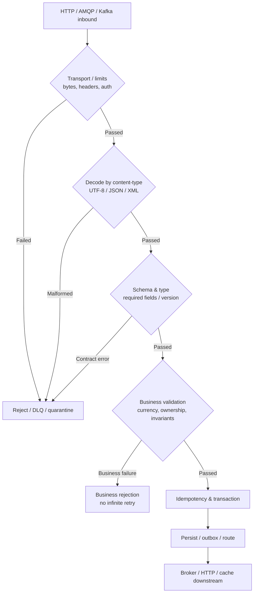
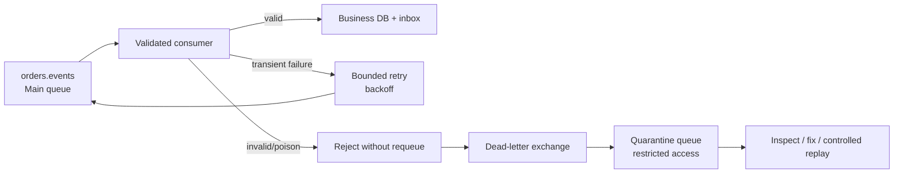
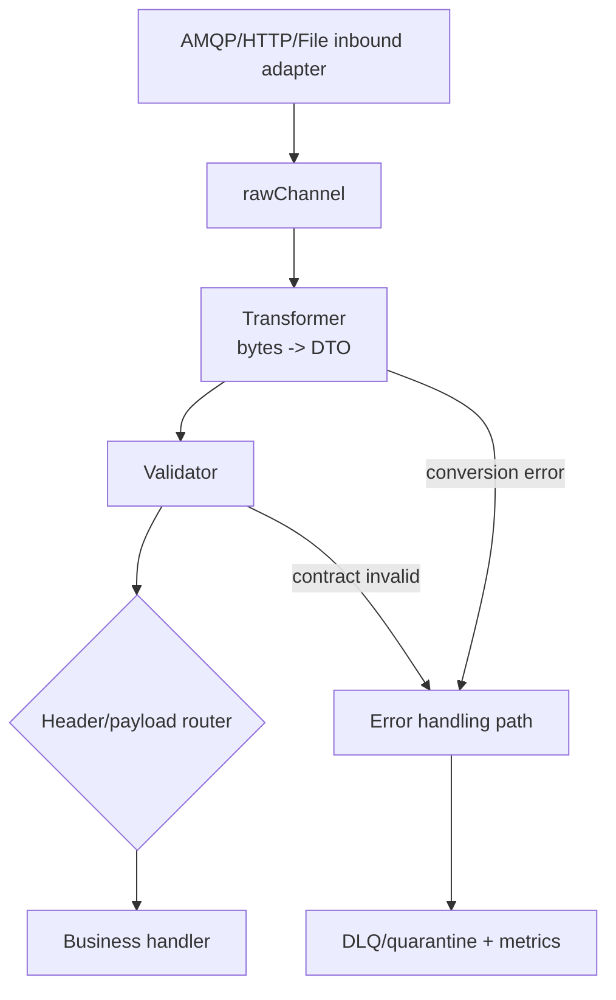
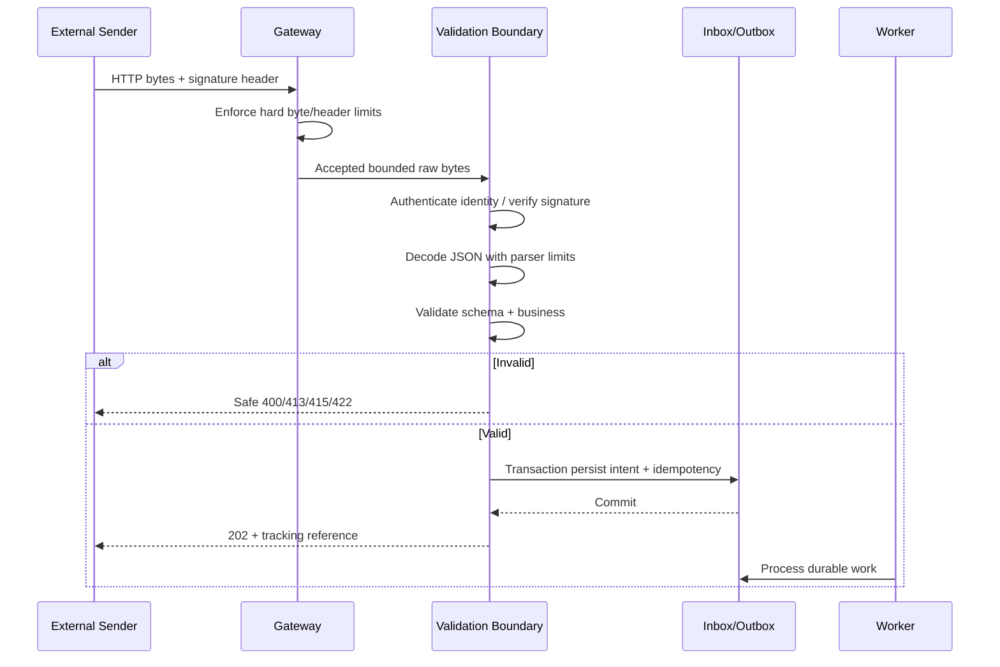
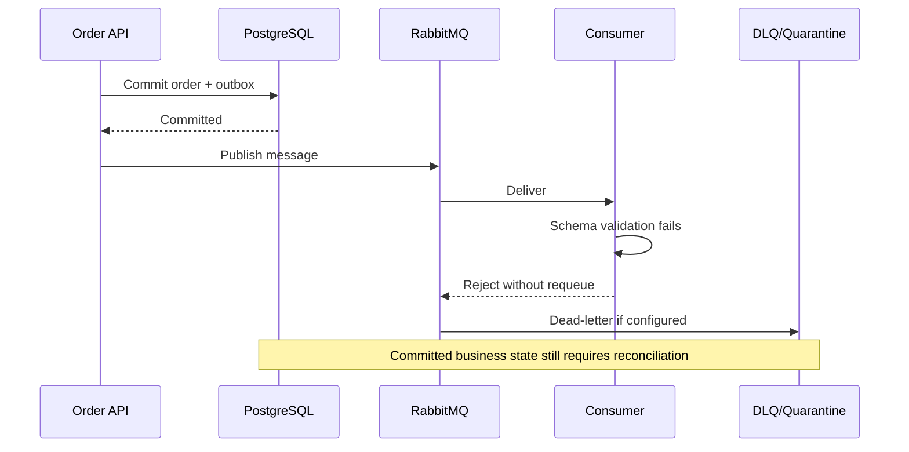
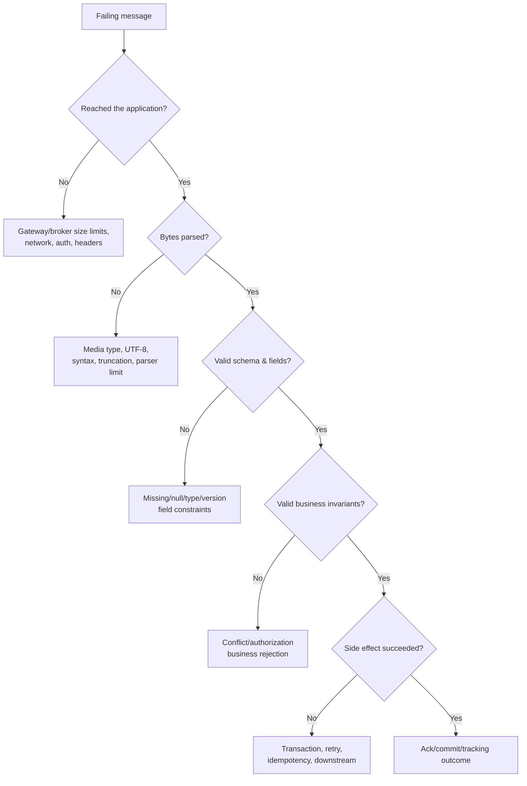

# Messages Missing Fields, Invalid Formats, and Oversized Payloads

## 1. Problem: messages crossing multiple boundaries do not always honor the contract

In the **SPRING_BOOT_INTEGRATION** module, Spring Boot applications commonly exchange messages over HTTP, databases, caches, RabbitMQ/Kafka, and Spring Integration adapters. Data may be re-sent, cross multiple service versions, or come from external partners outside your release cycle. Consequently, a received message is **not automatically valid** simply because the network connection succeeded.

For example, the order service receives an `order.created` event:

```json
{
  "eventId": "evt-2026-1001",
  "eventType": "order.created",
  "schemaVersion": 2,
  "orderId": "ORD-501",
  "customerId": "C-501",
  "totalAmount": 125000,
  "currency": "VND",
  "occurredAt": "2026-11-21T03:00:00Z"
}
```

In practice, you may encounter:

- **Missing fields:** no `eventId`, making deduplication impossible; missing `currency`, making monetary calculations unreliable.
- **Present fields with unusable values:** `"orderId": null`, whitespace-only strings, negative numbers, or malformed timestamps.
- **Wrong types or invalid syntax:** `"totalAmount": "many"`, unclosed JSON braces, broken UTF-8, or XML sent under a JSON content-type.
- **Oversized payloads:** multi-megabyte payloads, huge strings, deeply nested JSON, millions of array elements, or compressed content that expands massively upon decompression.
- **Wrong version or metadata:** producer sends schema v3 while consumer only understands v2, wrong `Content-Type`, or headers routing to the wrong tenant.

If you merely catch `Exception` and retry, the system can enter a **poison message loop**, congesting brokers, exhausting resources, or losing track of an important transaction.

### Objectives

After this lesson, you will be able to:

1. Classify syntax, structural, data-type, semantic, and resource-limit errors.
2. Define contracts with required/optional fields and version compatibility policies.
3. Use Jackson and Jakarta Bean Validation in Spring Boot to validate two distinct layers.
4. Distinguish HTTP 400/413/415/422 errors, codec errors, and transport errors.
5. Enforce size limits across **multiple layers** without assuming one property protects the entire system.
6. Handle poison/unrecoverable messages in RabbitMQ, Kafka, and Spring Integration.
7. Design quarantine/DLQ, acks, transactions, idempotency, and tests so business data is never lost.

> Examples target Java 17+, Spring Boot 3.x, Spring Framework 6.x, modern Jackson 2.x, and Spring AMQP. Codec/servlet/connector settings, API signatures, and defaults vary across versions. Numeric limits shown are **pedagogical examples**—measure and tune them according to your real contracts and traffic.

## 2. Error-handling map from raw bytes to business side effects

A request or message typically passes through these stages:



Some errors are caught **before** the payload ever becomes a Java DTO. For instance, if JSON is missing a closing brace, Jackson never constructs `OrderCreatedEvent`, and `@NotBlank` annotations on the DTO never run. If the body already exceeds a reverse proxy limit, the Java controller may **never receive any request at all**.

| Layer | Error example | Reasonable signal |
| --- | --- | --- |
| HTTP request line/headers | Oversized header, unsupported media type | 400/415/431 or proxy/server-specific limit |
| Raw body | Size exceeds contract | 413 or rejection at broker/gateway |
| Parse/encoding | Invalid JSON syntax, bad UTF-8 | 400 on HTTP; non-retryable error in consumer |
| DTO/schema | Missing field, wrong type, unknown enum | 400 or 422 per API contract |
| Business invariant | Negative money, disallowed currency, tenant mismatch | 422/409 or appropriate business rejection |
| Dependency | DB unavailable, HTTP 503, broker timeout | Bounded retry + durable recovery state |
| Duplicate | Same `eventId` already processed | Return idempotent result; do not treat as poison by default |

**Clear classification** prevents unfixable messages from retrying forever while preventing transient network errors from being misrouted to a DLQ as corrupt data.

## 3. Data contracts must state types, requiredness, and limits

Do not simply define a Java record and call it a complete contract. A contract should specify:

| Field | Type | Required | Constraints | Role |
| --- | --- | --- | --- | --- |
| `eventId` | string | Yes | 1–120 chars, non-blank | Deduplication key |
| `eventType` | string | Yes | Supported enum set | Handler selection |
| `schemaVersion` | integer | Yes | Supported version | Decoder/migration selection |
| `orderId` | string | Yes | 1–80 chars, valid format | Business identity |
| `customerId` | string | Yes | 1–80 chars, valid tenant | Subject |
| `totalAmount` | decimal/integer | Yes | Non-negative, explicit unit | Money |
| `currency` | string | Yes | `VND`, `USD`, ... | Currency unit |
| `occurredAt` | RFC 3339 timestamp | Yes | Explicit offset/timezone | Ordering/audit |
| `metadata` | object | No | Field/depth/size limits | Compatible extension |

Beyond the field table, specify **size thresholds**: total body size, collection item counts, individual string lengths, nesting depth, header count/size, and whether compression is permitted. For example: JSON body at most **256 KiB bytes on the wire after transport decoding**, `items` max 500, any text field max 2,000 characters. These are just examples; file uploads or batch exports need different contracts.

Questions to answer before writing code:

- Does a new field have a safe default, or does it require a new producer version?
- How is explicit `null` treated compared to an omitted field?
- Is `totalAmount` permitted as a numeric string, or must it be a JSON number?
- Are unknown fields ignored for forward compatibility, or rejected?
- Does the contract version come from the **payload** or an **authenticated header**?
- Can oversized messages be stored in object storage and passed by reference?
- Should invalid data return an error to HTTP callers, go to a DLQ, or create a quarantine record?
- When a producer retries, does the idempotency key stay unchanged?

## 4. Missing, null, blank, and default: four non-equivalent states

Example with `orderId`:

```json
{}
```

```json
{"orderId": null}
```

```json
{"orderId": ""}
```

```json
{"orderId": "   "}
```

Cases:

| Data | Problem | How to detect |
| --- | --- | --- |
| Field absent | Producer omitted it or used an older schema | Presence check, or Bean Validation if mapped to `null` |
| Explicit `null` | Producer intentionally sent null or serialized wrongly | `@NotNull`/`@NotBlank`; presence check if distinction matters |
| Empty string | Field present without identity | `@NotBlank` |
| Whitespace only | No value after trimming | `@NotBlank` |
| `"ORD-501"` | Valid basic format | Still needs semantic and ownership checks |

**Special care with Java primitives:** If a DTO uses `int schemaVersion` or `boolean approved`, default values may become `0`/`false` when fields fail to bind as expected, preventing you from distinguishing “omitted” from “explicitly sent `0`/`false`” via Java types alone. When `required` matters, use `Integer`/`Boolean` with validation or inspect presence on a JSON tree.

Never silently default missing currency to `currency="VND"` if producers/partners operate across currencies. A wrong silent default is far more dangerous than a clear contract rejection.

## 5. Invalid syntax, wrong type, wrong schema, and invalid business rule

Four distinct failure modes often lumped together as “bad JSON”:

### 5.1. Invalid JSON syntax

```json
{"eventId":"evt-1","orderId":"ORD-501"
```

Missing closing `}`, Jackson throws `JsonParseException` while parsing. No DTO instance exists for Bean Validation to run on.

### 5.2. Valid JSON syntax but wrong type

```json
{
  "eventId": "evt-1",
  "orderId": "ORD-501",
  "totalAmount": {"amount": 125000}
}
```

If the contract expects a number, an object in `totalAmount` is invalid. Jackson throws `MismatchedInputException`/`JsonMappingException`. Because certain Jackson settings can **coerce** numbers/strings, explicitly decide whether type coercion is allowed.

### 5.3. Unsupported schema/version

```json
{
  "schemaVersion": 3,
  "eventType": "order.created",
  "eventId": "evt-1",
  "payment": {"amount": 125000, "currency": "VND"}
}
```

The payload may be completely valid under **schema v3**, yet consumer v2 does not understand `payment` replacing `totalAmount`. This is a compatibility failure, not a JSON syntax error.

### 5.4. Valid types but invalid business rule

```json
{
  "schemaVersion": 2,
  "eventType": "order.created",
  "eventId": "evt-1",
  "orderId": "ORD-501",
  "customerId": "C-501",
  "totalAmount": -500,
  "currency": "VND",
  "occurredAt": "2026-11-21T03:00:00Z"
}
```

`totalAmount` is a valid number, yet a negative value violates a business invariant. Keep **deserialization**, **field constraints**, and **business validation** separate.

## 6. Charset, Content-Type, gzip, and framing are part of the contract

Format errors go beyond missing braces:

- HTTP declares `Content-Type: application/json`, but the body is actually XML.
- Body consists of JSON bytes containing invalid UTF-8 sequences.
- Producer compresses with gzip without setting `Content-Encoding: gzip` properly.
- Broker message uses Avro/Protobuf while the consumer is configured with a Jackson JSON converter.
- Header `schemaVersion` is numeric, yet clients read it inconsistently as a string or byte array.
- Webhook signatures are computed over **raw bytes**; verifying after re-parsing and re-serializing JSON can alter bytes even if data looks identical.
- Body is truncated mid-stream on connection reset so actual content length differs from expected.

For modern HTTP JSON, **UTF-8** is standard. Do not depend on the OS default charset; converters and contracts must agree on decoding. On brokers, standardize `contentType`, `contentEncoding`, schema identifiers, and serialization versions across producers and consumers.

When digital signatures apply to raw bodies, **inspect raw bytes within size limits** before transforming data. Never log raw payloads containing tokens or PII merely to debug signatures.

## 7. Four validation layers: transport, parser, schema, and business

A reliable pipeline:

1. **Transport guard:** identity, endpoint, Content-Type, content length, header constraints, body size; reject overload as early as possible.
2. **Parser/converter:** bytes → JSON tree/DTO; control encoding, nesting depth, token length, and codec errors.
3. **Schema/field validation:** required/optional/nullability, data types, enums, array counts, version, cross-field shape.
4. **Business validation:** tenant permissions, order state, currency/domain rules, foreign-reference existence, optimistic locks, and idempotency.

Not every layer executes in the same process: a reverse proxy may reject with 413 before Spring Controller runs; a broker may reject publishing an oversized message; a Spring Integration transformer may throw before the service activator.

### Why is @Valid alone not enough?

`@Valid` does not cap how many bytes an HTTP socket reads, does not stop deep JSON nesting before DTO instantiation, does not automatically validate AMQP messages unless configured on the listener, and does not distinguish malformed framing or encoding issues. It is **one** useful layer, not a complete boundary defense.

## 8. Java DTOs: field constraints with Jakarta Bean Validation

To use `@NotBlank`, `@NotNull`, `@PositiveOrZero`, and `@Size`, include the validation starter as needed:

```xml
<dependency>
    <groupId>org.springframework.boot</groupId>
    <artifactId>spring-boot-starter-validation</artifactId>
</dependency>
```

Example DTO compatible with Jackson records:

```java
import java.math.BigDecimal;
import java.time.OffsetDateTime;

import jakarta.validation.constraints.NotBlank;
import jakarta.validation.constraints.NotNull;
import jakarta.validation.constraints.PositiveOrZero;
import jakarta.validation.constraints.Size;

public record OrderCreatedEvent(
    @NotBlank @Size(max = 120) String eventId,
    @NotBlank String eventType,
    @NotNull Integer schemaVersion,
    @NotBlank @Size(max = 80) String orderId,
    @NotBlank @Size(max = 80) String customerId,
    @NotNull @PositiveOrZero BigDecimal totalAmount,
    @NotBlank @Size(min = 3, max = 3) String currency,
    @NotNull OffsetDateTime occurredAt
) {}
```

Notes:

- `@NotBlank` rejects `null`, empty strings, and whitespace-only strings for `String`.
- `@Size` bounds characters/elements at the Java object level; it is **not equivalent** to raw bytes or compressed sizes.
- `@NotNull` on `Integer` catches a missing version when Jackson maps it to `null`.
- `@PositiveOrZero` enforces non-negative money; it does not replace financial scale, currency, or rounding rules.
- Use `BigDecimal` for decimal monetary amounts; avoid `double` when decimal accuracy is required.
- `@NotNull OffsetDateTime` verifies a Java value exists; timestamp format parsing was already decided by the decoder.
- Annotations do not automatically verify `eventType == "order.created"`, `schemaVersion == 2`, or currency allowlists; write explicit rules for those.

For nested objects or lists, add `@Valid` **intentionally** to cascade validation. If `items` must contain at least one element, use `@NotEmpty`, `@Size(max = ...)`, and validate each item. Validating huge object graphs is expensive, so bounded parsing must come first.

## 9. HTTP endpoint: parsing and validating at the boundary

A Spring MVC endpoint:

```java
import jakarta.validation.Valid;

import org.springframework.http.MediaType;
import org.springframework.http.ResponseEntity;
import org.springframework.web.bind.annotation.PostMapping;
import org.springframework.web.bind.annotation.RequestBody;
import org.springframework.web.bind.annotation.RequestMapping;
import org.springframework.web.bind.annotation.RestController;

@RestController
@RequestMapping("/integration/events")
public class IntegrationEventController {

    private final IntegrationEventService service;

    public IntegrationEventController(
            IntegrationEventService service) {
        this.service = service;
    }

    @PostMapping(
        consumes = MediaType.APPLICATION_JSON_VALUE,
        produces = MediaType.APPLICATION_JSON_VALUE
    )
    public ResponseEntity<Receipt> receive(
            @Valid @RequestBody OrderCreatedEvent event) {

        Receipt receipt = service.accept(event);
        return ResponseEntity.accepted().body(receipt);
    }
}
```

`IntegrationEventService` and `Receipt` are application-defined types. This assumes `service.accept` **commits a durable work record** (such as inbox/outbox) before returning a receipt; if it merely invokes `@Async` backed by an in-memory JVM queue, HTTP `202 Accepted` does not guarantee work survives a process crash.

Typically:

- Invalid JSON syntax / failed DTO decoding → `HttpMessageNotReadableException` before the controller method runs.
- DTO parses but fails Bean Validation → `MethodArgumentNotValidException` for `@Valid` request bodies under standard controller validation.
- `Content-Type` does not match `consumes` → `HttpMediaTypeNotSupportedException` or corresponding media-type error handling.
- Business invariant / duplicate / conflict → service produces a **domain outcome**, not necessarily a JSON error.
- Body rejected by proxy/transport as too large → the controller may never be invoked.

Never treat HTTP 202 as meaning downstream brokers/consumers have finished; the response contract must clearly distinguish **durably accepted** from **fully processed**.

## 10. Returning ProblemDetail with safe error codes

An HTTP API should distinguish unparseable payloads from parseable payloads that fail validation. You can use HTTP **400 for invalid requests** with specific error codes. Some APIs use **422** for syntactically valid payloads that fail semantic checks, provided callers agree on that convention. **415** fits unsupported media types; **413** fits oversized bodies.

Example `@RestControllerAdvice` for MVC:

```java
import org.springframework.http.HttpStatus;
import org.springframework.http.ProblemDetail;
import org.springframework.http.converter.HttpMessageNotReadableException;
import org.springframework.web.bind.MethodArgumentNotValidException;
import org.springframework.web.bind.annotation.ExceptionHandler;
import org.springframework.web.bind.annotation.RestControllerAdvice;

@RestControllerAdvice
public class IntegrationContractErrorAdvice {

    @ExceptionHandler(HttpMessageNotReadableException.class)
    ProblemDetail unreadable(HttpMessageNotReadableException ex) {
        ProblemDetail detail =
            ProblemDetail.forStatus(HttpStatus.BAD_REQUEST);
        detail.setTitle("Invalid message format");
        detail.setDetail("Unable to read the request content.");
        detail.setProperty("code", "INVALID_FORMAT");
        return detail;
    }

    @ExceptionHandler(MethodArgumentNotValidException.class)
    ProblemDetail invalidFields(MethodArgumentNotValidException ex) {
        ProblemDetail detail = ProblemDetail.forStatus(422);
        detail.setTitle("Invalid message fields");
        detail.setDetail("Message does not satisfy the data contract.");
        detail.setProperty("code", "INVALID_FIELDS");
        return detail;
    }
}
```

Notice we **do not return raw `ex.getMessage()`** from Jackson or validation; those messages can reflect client-supplied data. If field-level errors are needed, emit only allowlisted field names and constraint codes—never leak raw rejected values, query strings, or stack traces.

Some Spring Boot/Spring MVC configurations already produce Problem Details / `ErrorResponse` automatically; this example illustrates application policy. When adding advice, check interactions if extending `ResponseEntityExceptionHandler` so an exception is not handled twice.

### Why not return 500 for every error?

Returning 500 leads producers to believe the failure is transient and retry corrupt data endlessly. Returning 400/413/415/422 with a stable error code signals callers to **fix the data or change behavior**. Even so, an HTTP 4xx status does not automatically tell a remote producer which bug caused it; organizational contracts must agree on mappings and information protection.

## 11. When missing must differ from explicit null: inspect the JSON tree

For `PATCH` requests or presence-sensitive envelopes:

- **Field omitted**: leave existing value untouched.
- **Field null**: clear existing value (if permitted).
- **Field populated**: update value.

Standard Bean Validation sees both omitted and explicit null as `null` after deserialization. When the difference matters, inspect presence directly:

```java
import com.fasterxml.jackson.databind.JsonNode;
import com.fasterxml.jackson.databind.ObjectMapper;

public class PresenceReader {

    private final ObjectMapper mapper;

    public PresenceReader(ObjectMapper mapper) {
        this.mapper = mapper;
    }

    public String inspect(String rawJson) throws Exception {
        JsonNode root = mapper.readTree(rawJson);
        if (!root.isObject()) {
            return "INVALID_ROOT";
        }

        if (!root.has("customerId")) {
            return "MISSING";
        }

        if (root.get("customerId").isNull()) {
            return "EXPLICIT_NULL";
        }

        if (!root.get("customerId").isTextual()) {
            return "WRONG_TYPE";
        }

        return "PRESENT";
    }
}
```

`has("customerId")` detects whether the key exists even when its JSON value is null; `hasNonNull` is only true when present and non-null. Avoid calling `path(...).asText("")` prematurely, as it erases the distinction between missing, null, and wrong type.

**Warning:** This example takes `String rawJson` for clarity, not as a size filter. In production, enforce body byte limits and parser constraints **before** buffering an entire payload into a `String`.

## 12. Implicit type coercion and numbers: choose a consistent policy

Depending on type, setting, and version, Jackson can coerce `"125000"` into a number or turn empty strings into nulls. While convenient for legacy integrations, it complicates schema enforcement.

Compare:

```json
{"totalAmount": 125000}
```

```json
{"totalAmount": "125000"}
```

```json
{"totalAmount": "125.000,00"}
```

These three are not equivalent under JSON Schema when `totalAmount` must be a `number`. The third is also locale-ambiguous. In integration contracts, standardize:

- Currency codes from an allowed standard set.
- Explicit decimal scale, precision, rounding, or integer minor units.
- ISO/RFC 3339 timestamps with offsets where needed.
- `boolean` as JSON boolean, not `"true"`/`"false"` unless contracted.
- Never use floating-point equality for exact monetary comparisons.

You can configure strict Jackson coercion per version or check types via `JsonNode`/JSON Schema before DTO binding. **Do not flip a global strict coercion setting across the whole app without testing existing clients that rely on legacy coercion.**

## 13. Unknown fields and schema evolution: strict or tolerant?

Producer deploys v3 adding a field:

```json
{
  "eventId": "evt-101",
  "eventType": "order.created",
  "schemaVersion": 3,
  "orderId": "ORD-501",
  "totalAmount": 125000,
  "currency": "VND",
  "newTaxBreakdown": {"vat": 10000}
}
```

A v2 consumer can:

- **Reject unknown fields:** catches mismatches early, though it easily breaks backward/forward compatibility.
- **Ignore new fields:** forward-compatible with additive metadata, provided existing fields retain their meaning.
- **Dispatch parsers by `schemaVersion`:** decode each supported version and map to a canonical model via adapters.
- **Quarantine unsupported new versions:** safer when new schemas carry new business semantics.

Spring Boot/Jackson can fail on unknown properties globally, e.g.:

```yaml
spring:
  jackson:
    deserialization:
      fail-on-unknown-properties: true
```

This is a **global Boot-configured ObjectMapper policy**, which is not always suitable for every endpoint. Use a dedicated `ObjectMapper`/`ObjectReader` or `@JsonIgnoreProperties(ignoreUnknown = true)` on specific DTOs according to their contracts. **Never silently ignore a new field that changes semantics**, such as `isTestPayment` or `reversalReason`.

If a consumer only supports v1/v2, reject v3 clearly with `UNSUPPORTED_SCHEMA_VERSION` instead of forcing v3 into a v2 model and forwarding corrupted meaning downstream.

## 14. Message size means several different kinds of size

A `256 KiB` cap is ambiguous unless you specify which size is bounded:

| Size metric | Example | Why it differs |
| --- | --- | --- |
| On-wire bytes | HTTP body prior to decompression | Determines network quota and gateway limits |
| Decompressed bytes | 20 KiB gzip expanding to 20 MiB | Prevents decompression bombs |
| UTF-8 bytes | Text heavy in multi-byte characters | Does not equal Java `char` count |
| JSON string length | Huge description field | Protects domain models and DB columns |
| Collection item count | `items` containing 100,000 elements | Protects CPU/memory and downstreams |
| JSON nesting depth | Deeply nested `a.b.c...` | Prevents stack/CPU exhaustion |
| Header count/total size | Excessive unnecessary headers | Protects proxies and web servers |
| Response buffer | WebClient reading huge error bodies | Prevents `DataBufferLimitException` |

A compressed message can pass wire-byte caps yet blow past decompressed limits. A 100 KiB JSON body can contain hundreds of thousands of tiny tokens, burning parser CPU. Placing `@Size(max=1000)` on a Java string **does not bound** the raw HTTP body size.

Therefore, enforce **multiple independent defensive layers**, tailored to each protocol and library.

## 15. Inbound HTTP limits: proxies, servers, and codecs

### 15.1. Reverse proxy / API gateway

This is typically the right place to enforce a **hard maximum request body size** before a request consumes memory or CPU in Spring Boot. Gateways can return HTTP `413 Content Too Large` (older phrasing: Payload Too Large), block abnormal headers, and apply rate limits.

Configure this in **the actual infrastructure you run** (Nginx, Envoy, ingress controller, API gateway, etc.)—no single Spring Boot property covers every deployment layer.

### 15.2. Spring MVC Servlet

Distinguish clearly:

- `spring.servlet.multipart.max-file-size` and `max-request-size` govern **multipart uploads**, not general JSON request bodies.
- `server.max-http-request-header-size` governs **headers**, not JSON bodies.
- `server.tomcat.max-http-form-post-size` governs Tomcat's **form POST processing**, not a universal cap on `application/json` requests.
- Servlet containers/connectors may have their own body size, swallow size, or buffering settings; verify Tomcat/Jetty/Undertow and reverse proxy behavior directly.

A guard checking only `Content-Length` can **reject early** when headers declare an oversized body, but cannot protect against chunked transfer-encoding or spoofed `Content-Length`. For a hard application cap, **count actual bytes while reading the stream**, abort at `limit + 1`, handle decompression safely, and avoid buffering past the limit in memory.

### 15.3. WebFlux and codecs

In Spring WebFlux, `spring.codec.max-in-memory-size` limits in-memory buffering across several codecs when aggregating payloads. However, it is **not** a universal inbound body limit protecting every streaming pipeline. `Flux<DataBuffer>` or multipart streaming endpoints may require explicit byte-counting policies.

Example properties:

```yaml
spring:
  codec:
    max-in-memory-size: 256KB
  servlet:
    multipart:
      max-file-size: 4MB
      max-request-size: 5MB
```

These two property groups **target different processing paths**. Do not copy them assuming 256KB protects every Web MVC/WebFlux route; test with `Content-Length`, chunked transfer, gzip, and truncated bodies.

## 16. Jackson StreamReadConstraints: bounding depth, strings, and numbers

With Jackson 2.15+ (verify your exact version), `StreamReadConstraints` protects the parser from pathological JSON structures:

```java
import com.fasterxml.jackson.core.JsonFactory;
import com.fasterxml.jackson.core.StreamReadConstraints;
import com.fasterxml.jackson.databind.ObjectMapper;

public final class BoundedJsonParser {

    public static ObjectMapper newMapper() {
        JsonFactory factory = JsonFactory.builder()
            .streamReadConstraints(
                StreamReadConstraints.builder()
                    .maxNestingDepth(40)
                    .maxStringLength(65_536)
                    .maxNumberLength(100)
                    .build()
            )
            .build();

        return new ObjectMapper(factory);
    }
}
```

Explanation:

- `maxNestingDepth` bounds object/array nesting depth.
- `maxStringLength` bounds string token lengths accepted under Jackson semantics.
- `maxNumberLength` bounds numeric token lengths, defending against massive number strings.
- These constraints **do not replace hard total byte caps**, array element caps, field counts, or parse timeouts.
- `new ObjectMapper(factory)` lacks Boot's auto-configured modules, time settings, mixins, and custom serializers. To deserialize `OffsetDateTime` DTOs, register the Java Time module and matching customizations.
- Never alter a global `ObjectMapper` if doing so breaks other clients/adapters without compatibility tests.

In production systems, ensure the centrally configured mapper is **actually used** by inbound codecs and broker converters—declaring a mapper bean alone does not guarantee every library picks it up.

## 17. Preventing zip bombs, compressed abuse, and malformed resources

A 30 KiB gzipped HTTP body can decompress to tens of megabytes. A zip archive can hold thousands of entries, nested archives, or path-traversal filenames. Partner XML files can abuse entity expansion if parsers permit it.

A safe strategy:

1. Enforce a hard cap on **compressed bytes** at the gateway/transport.
2. Count **decompressed bytes** while streaming decompression; abort at the threshold.
3. Bound compression ratios and CPU/wall time where necessary, not just a single byte limit.
4. Cap archive entry counts, total extracted bytes, and archive nesting depth.
5. Never extract `../` relative or absolute paths onto the filesystem when handling archives.
6. For XML, harden parsers against **XXE/entity expansion** and set depth/size constraints.
7. Parse strictly according to the contracted media type and format; never auto-probe multiple parsers on untrusted input.
8. Log metadata and error codes without dumping full malicious bytes into DLQs or logs.

Even for uncompressed JSON messages, bound array sizes, nesting depth, and string lengths. Payload limits are part of **resource isolation and security**, not merely performance tuning.

## 18. Outbound HTTP: oversized responses or abnormal error bodies

Spring Boot Integration does not only **receive** data—`WebClient`/`RestClient` also reads partner responses. A partner might return a multi-megabyte HTML 502 page or a JSON payload with a massive array.

With `WebClient`, you can cap codec buffering on a specific client:

```java
import org.springframework.web.reactive.function.client.WebClient;

WebClient client = WebClient.builder()
    .baseUrl("https://partner.example.internal")
    .codecs(configurer ->
        configurer.defaultCodecs().maxInMemorySize(256 * 1024)
    )
    .build();
```

**Notes:**

- `maxInMemorySize` caps codec buffering, not the total bytes of every streaming pipeline.
- `DataBufferLimitException` when a body exceeds buffer limits is a **client-side resource/decoding failure**, not proof the server returned HTTP 413.
- `retrieve().onStatus(...)` handles **HTTP responses with status codes**; DNS/TCP/TLS/timeouts occur at the transport layer before any response exists.
- When calling `response.createException()`, consider buffered error body size and avoid logging entire error payloads.
- For very large downloads/streams, stream with explicit byte and time bounds instead of calling `bodyToMono(byte[].class)` and checking size afterward.

An oversized downstream response is not an inbound client error—it can mean the partner violated its **response contract**. Keep outbound failures separate from inbound caller validation errors to avoid misattributing blame.

## 19. RabbitMQ: validating raw messages before business deserialization

RabbitMQ delivers message bytes to consumers, yet your **message converter** may throw before the listener method even receives a DTO. Know exactly where validation runs.

To inspect raw payloads and metadata explicitly inside a listener, receive `org.springframework.amqp.core.Message` and parse under strict controls:

```java
import java.util.Set;

import com.fasterxml.jackson.core.JsonProcessingException;
import com.fasterxml.jackson.databind.ObjectMapper;

import jakarta.validation.ConstraintViolation;
import jakarta.validation.Validator;

import org.springframework.amqp.AmqpRejectAndDontRequeueException;
import org.springframework.amqp.core.Message;
import org.springframework.amqp.core.MessageProperties;
import org.springframework.amqp.rabbit.annotation.RabbitListener;
import org.springframework.stereotype.Component;

@Component
public class OrderEventAmqpListener {

    private static final int MAX_BYTES = 256 * 1024;

    private final ObjectMapper mapper;
    private final Validator validator;
    private final OrderEventProcessor processor;

    public OrderEventAmqpListener(
            ObjectMapper mapper,
            Validator validator,
            OrderEventProcessor processor) {
        this.mapper = mapper;
        this.validator = validator;
        this.processor = processor;
    }

    @RabbitListener(queues = "partner.order.events")
    public void accept(Message message) {
        byte[] bytes = message.getBody();

        if (bytes == null || bytes.length > MAX_BYTES) {
            throw new AmqpRejectAndDontRequeueException(
                "INVALID_MESSAGE_SIZE"
            );
        }

        String contentType =
            message.getMessageProperties().getContentType();
        if (contentType == null
                || !contentType.startsWith(
                    MessageProperties.CONTENT_TYPE_JSON)) {
            throw new AmqpRejectAndDontRequeueException(
                "UNSUPPORTED_CONTENT_TYPE"
            );
        }

        final OrderCreatedEvent event;
        try {
            event = mapper.readValue(
                bytes, OrderCreatedEvent.class
            );
        } catch (JsonProcessingException ex) {
            throw new AmqpRejectAndDontRequeueException(
                "INVALID_JSON", ex
            );
        }

        if (event == null) {
            throw new AmqpRejectAndDontRequeueException(
                "INVALID_ROOT"
            );
        }

        Set<ConstraintViolation<OrderCreatedEvent>> violations =
            validator.validate(event);
        if (!violations.isEmpty()) {
            throw new AmqpRejectAndDontRequeueException(
                "INVALID_FIELDS"
            );
        }

        processor.process(event);
    }
}
```

`OrderEventProcessor` is a project-defined service that must enforce idempotency and transaction policies. This snippet illustrates a **raw-message boundary** routing invalid payloads toward dead-lettering via an explicit exception.

Key points to understand:

1. Bytes were already **buffered into memory** by the RabbitMQ client before this method ran. `bytes.length` is only a **last line of defense**, not a substitute for producer/broker caps.
2. Use an `ObjectMapper` configured with bounded parsing as in section 16; otherwise small raw byte arrays can still carry dangerous JSON nesting or huge numbers.
3. Checking `contentType` requires an exact contract. `startsWith("application/json")` is illustrative rather than a strict MIME parser for every subtype/charset variant; use a MIME parser and subtype/charset allowlist when needed.
4. `Validator.validate()` must be invoked explicitly when manually parsing raw messages; `@Valid` from HTTP controllers does not automatically apply to all Rabbit listeners.
5. `AmqpRejectAndDontRequeueException` signals **not to requeue the rejected message** in Spring AMQP. Messages only enter a DLQ if broker topology/policies are configured properly.
6. Exceptions thrown by `processor.process()` may represent **transient** DB/network failures—do not automatically turn them into `INVALID_FIELDS`.
7. For listeners configured with direct DTO converters, **conversion failures happen before the listener method runs**; error handlers and container policies must be tested separately.

Never include raw payloads or sensitive data in exception messages; short error codes suffice for classification, while correlation/event IDs go to audited records per data policy.

## 20. Why can a single poison message jam RabbitMQ?

A message with broken JSON will **not heal itself** on its 1,000th delivery. If a listener keeps throwing and the broker keeps requeuing immediately, the system can:

- Redeliver the exact same message continuously, exhausting CPU and log storage.
- Starve healthy messages queued behind it.
- Generate massive redelivery rates, hurting throughput and latency.
- Keep workers occupied with unprocessable data.
- Create an unbounded DLQ → main queue → DLQ loop.

One approach:



### Selecting policy by error category

| Error type | Immediate retry? | Typical action |
| --- | --- | --- |
| Malformed JSON, invalid UTF-8 | No | Reject → DLQ/quarantine |
| Missing required field | No | DLQ + notify producer to fix contract |
| Unsupported schema version | No hot retry | Quarantine; replay after consumer upgrade if applicable |
| Oversized body | Do not resend as-is | DLQ metadata or move payload to object storage by reference |
| Auth/signature failure | No | Reject safely, security monitoring |
| Temporary PostgreSQL disconnect | Yes, bounded | Retry/backoff while preserving durable work |
| Broker publish timeout | Conditionally | Handle uncertain outcome + stable `eventId` |
| Permanent business conflict | Depends on contract | Reject/compensate/manual review |
| Duplicate event | Not an error by default | Idempotent success or already-processed state |

“No retry” **does not mean deleting without a trace**. Maintain a safe evidence store with ownership, retention, and a controlled replay workflow.

## 21. DLX/DLQ does not appear automatically just by throwing an exception

RabbitMQ dead-lettering requires appropriate exchanges, queues, bindings, or broker policies. Conceptual topology:

```text
partner.order.events
  ├─ valid delivery --> consumer
  └─ rejected, requeue=false --> DLX: partner.orders.dlx
                                      |
                                      v
                                queue: partner.orders.dlq
```

Spring AMQP listener configuration can specify exception handling policy:

```yaml
spring:
  rabbitmq:
    listener:
      simple:
        default-requeue-rejected: false
```

**Warning:** This setting applies to the **simple listener container** in that configuration block—not automatically to direct containers or custom listener factories. When enabled, uncaught non-retried exceptions reject/drop messages; if no DLX is configured accurately, messages can **disappear from the main queue without ever reaching a DLQ**.

Spring AMQP also provides `ConditionalRejectingErrorHandler`/`FatalExceptionStrategy` to classify certain converter/dispatch errors as fatal; exact behavior and defaults vary by version and container config. **Never rely on guessed defaults instead of real tests.**

A DLQ can be provisioned via broker policies or Spring AMQP `Queue`, `Exchange`, `Binding`/`RabbitAdmin` declarations. For production, decide **who owns topology**: Infrastructure as Code or the application. Avoid having multiple services start up with conflicting queue arguments.

### Never build an infinite retry loop

If a DLQ automatically routes back to the main queue via TTL while a consumer still fails permanently, you have built an infinite loop. For transient errors, use bounded attempt counts, delayed retry policies, backoff, and finally stop at a **parking-lot/quarantine**. When replaying from a DLQ, enforce **version, producer ownership, and idempotency controls**.

## 22. Kafka: deserialization errors can occur before @KafkaListener

In Kafka, a record with schema-invalid bytes can fail inside the **Deserializer** before Spring Kafka invokes the listener method. A `try/catch` inside `@KafkaListener` will not catch failures when the method never executes.

In supported Spring Kafka versions, `ErrorHandlingDeserializer` wraps deserialization failures into record headers so an error handler can handle them or route them to a dead-letter topic per policy.

Illustrative configuration—verify against your exact Spring Kafka version and serializer:

```yaml
spring:
  kafka:
    consumer:
      value-deserializer: org.springframework.kafka.support.serializer.ErrorHandlingDeserializer
      properties:
        spring.deserializer.value.delegate.class: org.springframework.kafka.support.serializer.JsonDeserializer
        spring.json.trusted.packages: com.example.integration.events
        spring.json.value.default.type: com.example.integration.events.OrderCreatedEvent
```

`com.example.integration.events.OrderCreatedEvent` is an **illustrative package**; substitute your real class. You may also need specific type-header/default-type options per contract. Never set `trusted.packages=*` carelessly when deserializing untrusted data.

**Do not assume the YAML above configures a DLT.** You still need a listener container error handler, `DeadLetterPublishingRecoverer` or recovery strategy, producer permissions, topic retention, and an offset commit policy.

Kafka size limits also exist across **producer, broker, topic, and consumer fetch**, with property names/interactions varying by Kafka version. Do not cap only the JSON mapper while ignoring broker-accepted message sizes. A huge record rejected by the broker **never reaches the listener**, so test the producer error path too.

## 23. Spring Integration: transformers and errorChannel do not always catch the same failures

In Spring Integration, a message may pass through converters or transformers before reaching a router or service activator:



With a synchronous **`DirectChannel`**, exceptions from transformers or handlers propagate directly up the caller's stack and **do not automatically become `ErrorMessage`s sent to `errorChannel`**. When using pollers, executor channels, or certain async inbound adapters, exceptions may be wrapped into `ErrorMessage`s and routed to the configured error channel.

Therefore verify:

1. Does transformation run before or after validation? For raw bytes, check size/media type before decoding DTOs.
2. Did the error happen inside the adapter (like a Kafka deserializer) or inside the flow? Adapter-level errors may need dedicated handlers.
3. If `Message<?>` carries an unvalidated payload, which headers can actually be trusted for routing?
4. Does the default route point to `nullChannel`? If so, invalid messages may be **intentionally dropped** without leaving a trace.
5. Are `correlationId`/`eventId` and safe error codes attached when routing to quarantine?
6. If the error flow fails to write an audit/quarantine record, does the durable source retain the message?

Never equate Spring Integration's `errorChannel` with RabbitMQ's DLQ. One is an **in-application error-handling channel**; the other is a **broker-managed queue** with its own topology and delivery semantics.

## 24. A classification table to prevent wrong retries

Design error categories before writing `retryWhen`, `RetryTemplate`, or listener retry advice.

| Category | Nature | Auto-retry | Primary owner |
| --- | --- | --- | --- |
| `INVALID_FORMAT` | Invalid syntax/encoding | No | Producer/schema owner |
| `MISSING_REQUIRED_FIELD` | Missing mandatory data | No | Producer |
| `WRONG_TYPE` | Invalid JSON shape/type | No | Producer/contract |
| `UNSUPPORTED_SCHEMA_VERSION` | Consumer does not understand version | No hot retry; replay after upgrade | Producer + consumer owners |
| `PAYLOAD_TOO_LARGE` | Exceeds size/complexity quota | Do not resend as-is | Producer + platform |
| `UNAUTHORIZED_SOURCE` | Invalid signature/identity/tenant | No | Security/integration owner |
| `BUSINESS_CONFLICT` | Disallowed state | Per rules/version | Business owner |
| `DUPLICATE_EVENT` | Replay of already-processed event | Usually idempotent success | Consumer |
| `DOWNSTREAM_UNAVAILABLE` | DB/HTTP/broker temporarily unavailable | Bounded, with backoff | Consumer/operations |
| `TIMEOUT_UNKNOWN_OUTCOME` | Uncertain if remote side effect committed | Reconcile/idempotent retry | Workflow owner |

Do not classify solely by Java exception class. For instance, `IllegalArgumentException` might stem from bad input **or** a bug inside the consumer itself. A `JsonProcessingException` when parsing raw inbound bytes is usually a contract error, whereas the same exception thrown by an outbox producer serializer is an application bug. Classify by **stage and data origin**.

### Pragmatic retry rules

- **Permanent invalid** → reject with error code; do not burn retry attempts.
- **Transient transport/database** → bounded retry, backoff/jitter, deadlines, and circuit breakers.
- **Unknown outcome after side effect** → query status or retry with a **stable idempotency key** if supported by the partner.
- **Unsupported version** → quarantine with upgrade/replay scheduling; do not spin in a hot loop.
- **Duplicate** → treat as known state; avoid applying side effects twice.

## 25. What should a quarantine record store?

A DLQ is not always the right place for full payloads. A massive message can overload both the **error queue** and incident tooling. Often it is better to store a **compact metadata record**, pointing to an encrypted/access-controlled blob when permitted.

Example PostgreSQL schema:

```sql
CREATE TABLE rejected_integration_event (
    rejection_id UUID PRIMARY KEY,
    source_system VARCHAR(80) NOT NULL,
    event_id VARCHAR(120),
    schema_version INTEGER,
    failure_code VARCHAR(64) NOT NULL,
    payload_sha256 CHAR(64),
    payload_size_bytes BIGINT,
    payload_reference VARCHAR(500),
    first_seen_at TIMESTAMPTZ NOT NULL DEFAULT CURRENT_TIMESTAMP,
    replay_status VARCHAR(24) NOT NULL DEFAULT 'PARKED'
);

CREATE INDEX idx_rejected_source_time
    ON rejected_integration_event(source_system, first_seen_at);
```

This is a **reference schema** requiring migrations, retention, access controls, and audit trails. Never blindly persist raw payloads into a DB just because parsing failed, especially when payloads may contain PII, credentials, or malware.

Useful metadata:

- Authenticated `source_system`, not an arbitrary external header.
- Allowlisted `failure_code` without full stack traces.
- Payload hash for deduplication/forensics when policy allows.
- Actual byte size and schema version if safely readable.
- Correlation/event ID if available; never use client text as a SQL identifier.
- Received timestamp, replay status, attempt count, and owner.
- Reference to a security-controlled payload copy with encryption, TTL, and access restrictions.

If writing the quarantine record fails, **do not acknowledge the message as succeeded**. Keep the durable source intact, retry quarantine persistence with bounds, or halt ingestion per policy. RabbitMQ reject-to-DLQ and PostgreSQL writes are **two separate resources** without an atomic transaction; define which is the source of truth for failure records.

## 26. Idempotency: invalid messages and duplicate messages are separate problems

A message with `eventId=evt-1001` can:

1. Arrive the first time with valid JSON.
2. Be processed by the consumer and commit to the database.
3. Crash the consumer before acknowledgment.
4. Be redelivered by the broker.
5. Be recognized as already processed so the consumer **does not double the side effect**.

That is **duplicate delivery**, not a schema error.

An inbox table with a unique key:

```sql
CREATE TABLE processed_event (
    source_system VARCHAR(80) NOT NULL,
    event_id VARCHAR(120) NOT NULL,
    processed_at TIMESTAMPTZ NOT NULL DEFAULT CURRENT_TIMESTAMP,
    PRIMARY KEY (source_system, event_id)
);
```

If a message arrives missing `eventId`, never generate a fresh UUID per receipt to “patch” and process it; doing so turns every producer replay into independent business mutations. Reject/quarantine the message per contract until a reliable identity key is provided.

### Same eventId with different payload

A subtler edge case: same `(sourceSystem,eventId)` arrives again with a different `totalAmount` or `orderId`. Simply ignoring all duplicates can mask producer corruption. Store a **payload digest or canonical business hash**, compare it against the initial record, and raise `DUPLICATE_ID_DIFFERENT_PAYLOAD` for security/contract review.

**Never replace a transactional unique constraint with a hash check alone.** The hash detects payload mutation; the database unique constraint and transaction prevent races between concurrent workers.

## 27. Order of checks: authentication, size, signature, parsing

For signed webhooks, check ordering must balance security and resource protection:



You do not need to **parse the full JSON** to know a request exceeds hard body limits; blocking early at the gateway is even better. Signatures typically verify against **exact raw bytes**, so buffer bounded raw bytes to verify before deserializing.

Keep in mind:

- **Authenticate before side effects**; never route to tenant-specific handlers using untrusted external metadata.
- **Enforce size guards before full parsing**, especially for compressed bodies.
- **Verify signatures before trusting content**; canonicalization/encoding must follow the exact signature contract.
- **Validate schemas before business transactions**, while deduplication/inbox writes still need transactions and unique constraints.
- **Do not create unbounded PII-laden rejection records** when an attacker floods invalid bodies; pair with rate limiting and retention.

## 28. Response and request metadata can be spoofed

A partner sends:

```text
Content-Type: application/json
X-Partner-Id: trusted-partner
X-Schema-Version: 2
X-Correlation-Id: abc
```

Those headers **do not prove** the sender is `trusted-partner`. Client-supplied headers can be forged arbitrarily. Enforce:

- Source identity via TLS client certificates, OAuth2/mTLS, HMAC signatures, or an agreed authentication mechanism.
- `verifiedSourceSystem`/`verifiedTenantId` assigned **internally after authentication**.
- Contract version verified consistently against the payload and caller permissions.
- Correlation IDs sanitized, length-bounded, and never used as secrets or access tokens.
- Routing headers never permitted to name arbitrary **Spring beans or channels** to steer execution.
- `Content-Type` header matched against an allowed decoder list; avoid permissive “content sniffing” that widens attack surface.

Bounding message bodies achieves little if a multi-megabyte header or thousands of headers exhaust proxies or servlet containers. Configure **header size and count limits** at ingress, clients, and servers.

## 29. Testing DTOs and schemas: minimum test cases

Unit tests for parsers/validators should use deliberately crafted inputs.

| Test case | Input | Expectation |
| --- | --- | --- |
| Contract-compliant | All fields present, valid types | Decode + validate passes |
| Missing `eventId` | Field omitted | `MISSING_REQUIRED_FIELD` |
| `eventId=null` | JSON null | Rejected; no new UUID generated |
| `eventId=""` | Empty string | Rejected by `@NotBlank` |
| `totalAmount="abc"` | Wrong type | Mapping/schema error |
| `totalAmount=-1` | Valid type, constraint violation | Field validation fails |
| `schemaVersion=999` | Unsupported version | Non-retryable quarantine/rejection |
| Missing JSON brace | Malformed bytes | Parser error |
| Root array instead of object | Wrong shape | Parser/schema rejection |
| Duplicate `orderId` field | Two properties with same name | Per strict parser policy; do not silently pick one if disallowed |
| New unknown field | Additive field | Accepted or rejected per versioned contract |
| Very long number | Thousands of digits | Parser numeric-length limit triggers |
| Deeply nested JSON | Nesting > quota | Parser nesting rejection |
| Huge array | Items > quota | Contract/business size rejection |
| Empty body | 0 bytes | Explicit invalid/empty policy |
| Invalid UTF-8 | Invalid byte sequences | Decode/encoding rejection |
| High-ratio gzip | Small compressed, huge decompressed | Blocked by decompressed byte cap |

**Do not assert only exception classes.** Verify errors are categorized cleanly (code/status), no data is written, no event is emitted, no wrong ack occurs, and no sensitive payload leaks.

### Duplicate JSON keys

Example:

```json
{"orderId":"ORD-501","orderId":"ORD-999"}
```

Parsers may pick the last key by default depending on API/config. When contracts or digital signatures are security-critical, consider enabling **strict duplicate detection** in the parser and testing your exact Jackson version. Two systems picking different values can cause severe mismatches on seemingly “readable” JSON.

## 30. Testing the HTTP boundary with MockMvc

In a Spring MVC app using the controller and error advice from sections 9–10, tests can verify 400 on malformed JSON and 422 on missing required fields.

```java
import static org.springframework.test.web.servlet.request.MockMvcRequestBuilders.post;
import static org.springframework.test.web.servlet.result.MockMvcResultMatchers.status;

import org.junit.jupiter.api.Test;
import org.springframework.beans.factory.annotation.Autowired;
import org.springframework.boot.test.autoconfigure.web.servlet.AutoConfigureMockMvc;
import org.springframework.boot.test.context.SpringBootTest;
import org.springframework.http.MediaType;
import org.springframework.test.web.servlet.MockMvc;

@SpringBootTest
@AutoConfigureMockMvc
class IntegrationContractHttpIT {

    @Autowired
    MockMvc mvc;

    @Test
    void malformedJsonReturns400() throws Exception {
        mvc.perform(
            post("/integration/events")
                .contentType(MediaType.APPLICATION_JSON)
                .content("{\"eventId\":\"evt-1\"")
        ).andExpect(status().isBadRequest());
    }

    @Test
    void missingRequiredFieldsReturn422() throws Exception {
        mvc.perform(
            post("/integration/events")
                .contentType(MediaType.APPLICATION_JSON)
                .content("""
                    {"eventId":"evt-2","eventType":"order.created"}
                    """)
        ).andExpect(status().is(422));
    }
}
```

This assumes the project includes Spring MVC starter, validation starter, test starter, `IntegrationEventController`, `IntegrationContractErrorAdvice`, and an `IntegrationEventService` bean with matching test config. These tests stop at validation before the controller receives a DTO, requiring no business side effects; however, `@SpringBootTest` may still require external dependencies at context startup depending on project setup.

**MockMvc does not necessarily pass through deployment reverse proxies and TCP request limits.** Passing 10 MB into MockMvc does not prove Nginx ingress returns 413. For HTTP body limits, run **integration tests over real sockets/proxies** or verify server config in a production-like environment.

## 31. Testing oversized payloads: check more than Content-Length

Your test matrix should cover:

1. Request with `Content-Length` above the cap: proxy/server returns 413 before controller execution.
2. Chunked request omitting total size: stream reader aborts once actual bytes exceed the cap.
3. Mismatched or proxy-rewritten `Content-Length`: never rely on `Content-Length` as the sole defense.
4. Small gzipped body expanding large on decompression: blocked by decompressed quota.
5. Deeply nested JSON with small byte size: rejected by Jackson parser constraints.
6. Huge string field: rejected at parser/schema layer before reaching DB writes.
7. Oversized array: rejected by count cap before allocating millions of DTOs.
8. Multipart upload exceeding file/request limits: test multipart handling separately.
9. WebClient reading oversized response: assert proper client error and no infinite retries.
10. Producer publishing oversized broker message: test **producer/broker rejection**, since the listener never receives it.
11. Consumer receiving a message under broker cap yet over **business contract limit**: deliberate reject/DLQ.
12. Flood of many small messages: rate limits and queue capacities protect aggregate resources, not per-message size alone.

In CI tests, avoid generating gigabytes of payloads that choke runners. Use smaller test limits to prove byte, chunk, and decompression guards trigger at `limit + 1`, and run dedicated load/stress tests in controlled environments.

### Per-task limits vs. aggregate resources

A 256 KiB per-message cap does not stop 10,000 messages from buffering in memory simultaneously. Combine **concurrency caps, queue depths, broker prefetch, throughput quotas, HTTP rate limits**, and memory caps. Resource protection has both **per-request** and **aggregate** dimensions.

## 32. Testing RabbitMQ, Kafka, and error handling in real environments

A component test calling `listener.accept(message)` directly checks parsing/validation logic but **does not prove**:

- Broker ack/nack/requeue behavior.
- Dead-letter exchange/queue bindings.
- Message converters throwing before the listener runs.
- Kafka deserializer failures and offset commits.
- Retry exhaustion, delayed queues, or parking lots.
- Consumer restarts and redeliveries.
- Publisher confirms/returns when sending oversized messages.

For Spring AMQP, run RabbitMQ via Testcontainers or an isolated broker with real main + DLQ queues, and send a malformed message. Assert the message reaches the **DLQ once per policy**, does not hot-loop on the main queue, and subsequent valid messages still process.

For Spring Kafka, run a Kafka test broker and publish malformed bytes via a suitable producer. Verify `ErrorHandlingDeserializer`/error handlers, DLT records, offset advancement, and continued processing of healthy records. Without proper recovery config, a poison record can stall an entire partition.

In both cases, use **eventually assertions with timeouts** rather than `Thread.sleep(5000)` to guess when consumers finished.

## 33. Idempotency and transactions in malformed-data scenarios

Suppose a valid HTTP POST is written to a PostgreSQL outbox, the publisher sends it to RabbitMQ, and a consumer detects a schema error caused by a producer serializer bug:



Dead-lettering a message **does not roll back** the PostgreSQL transaction that already committed upstream. You need a workflow to **fix the producer/contract, route to a compatible consumer, or compensate**, depending on domain rules.

Do not automatically delete an order in PostgreSQL simply because a projection consumer failed to parse an event. If Neo4j or Redis is a read model, backfill/reconcile from the source of truth; if a remote operation had side effects, apply the corresponding saga or reconciliation.

### Avoiding message loss when quarantine fails

If a message is rejected from the main queue without a valid DLX routing/binding, it can be lost. If a consumer catches and swallows an exception after logging so the container auto-acks, the message is also lost. Always assert **business outcomes + durable state + broker state**, not just exceptions.

## 34. Observability: measuring contract errors accurately

Track metrics by integration name, version, and error category:

| Metric/signal | Purpose |
| --- | --- |
| `integration.received` | Messages arriving at boundary, split by source/protocol |
| `integration.invalid` | Rate of parse/schema/business rejections |
| `integration.payload.size` | Received byte distribution; distinguish compressed vs. decompressed if applicable |
| `integration.quarantine.pending` | Count of parked items awaiting intervention |
| `integration.deadletter.count` | Messages routed to DLQ, by cause where safe |
| `integration.retry.attempt` | Transient retry counts and outcomes |
| `integration.duplicate.count` | Deduplicated events prevented from re-applying |
| `integration.schema.version` | Observed schema versions; alert on unsupported versions |
| `integration.processing.latency` | Time to validate, parse, persist, and process |
| Outbox backlog age | Processing delays caused by contract errors or downstreams |

**Metric cardinality warning:** Never attach `eventId`, `orderId`, email, raw URLs, or body contents as metric labels. Keep metric labels low-cardinality; put specific IDs into access-controlled traces/logs rather than unbounded time series.

Structured log example with safe metadata:

```json
{
  "operation": "order-event-ingest",
  "sourceSystem": "partner-erp",
  "schemaVersion": 2,
  "failureCode": "MISSING_REQUIRED_FIELD",
  "field": "eventId",
  "payloadSizeBytes": 1842,
  "correlationId": "req-1001"
}
```

Do not log rejected values, raw payloads, tokens, signatures, session cookies, or full stack traces for untrusted input at INFO on every request. For forensics, store protected metadata and payload references with bounded retention.

### Alerts must drive action

- Spike in malformed errors after a producer release → check contract compatibility.
- Spike in 413s → verify business batch sizes, compression, and gateway quotas.
- DLQ growing while valid messages sit behind → alert producer owner while keeping the main pipeline flowing.
- Rising parse times from deep nesting → investigate resource abuse rather than merely adding threads.
- Rising retries alongside downstream 5xx → tune backoff/circuit breakers rather than blaming contracts.

## 35. Symptom-based troubleshooting

| Symptom | Likely cause | Priority checks |
| --- | --- | --- |
| HTTP 400 before controller | JSON syntax, DTO mapping, or request parsing | Bounded raw bytes, Content-Type, Jackson cause |
| HTTP 422 from advice | DTO parsed, field constraints failed | Field path/code, schema version |
| HTTP 415 | Wrong `Content-Type`/`consumes` | Actual media type, adapter headers |
| HTTP 413 at gateway | Payload/body exceeded hard limit | Proxy/ingress config and actual bytes |
| HTTP 431 or 400 on headers | Header size/count exceeded limit | Header mappers, proxy/server limits |
| `HttpMessageNotReadableException` | Jackson parse/typing failure | Missing brace, wrong token type, date parser |
| `MethodArgumentNotValidException` | Bean Validation violations | `@Valid`, `@NotBlank`/`@NotNull`/`@Size` |
| `DataBufferLimitException` | WebClient/WebFlux codec buffer exceeded | Codec `maxInMemorySize`, streaming design |
| `JsonParseException` | Malformed JSON | Offset/format, charset/truncation |
| `MismatchedInputException` | Wrong shape/type or missing creator arg | DTO/constructor/Jackson coercion |
| `StreamConstraintsException` | JSON depth/string/number exceeded parser constraints | Jackson limits, producer data shape |
| RabbitMQ message keeps redelivering | Bad reject/requeue policy or poison message | Listener error handler, DLX, retry count |
| RabbitMQ DLQ empty despite rejects | Missing or misconfigured DLX/binding | Broker policies/topology, ack mode |
| Kafka listener never called | Deserializer failed before listener | `ErrorHandlingDeserializer`, container error handler |
| Kafka partition stuck on one offset | Repeated poison record | Recovery/DLT/offset strategy |
| Missing `eventId` still writes to DB | DTO validation bypassed or ID auto-generated | Controller/consumer validation + unique key |
| Event processed twice | Redelivery without inbox/idempotency | `eventId`, unique constraint, tx/ack boundary |
| System slows down on small bodies | Deep JSON nesting/token count or concurrency burst | Parser limits, CPU profiles, rate limits |

### Quick diagnostic flow



**Do not fix the wrong layer:** raising `max-in-memory-size` when the payload violates the contract widens the DoS surface; retrying a `MismatchedInputException` will not alter the JSON; editing `@NotBlank` will not fix requests already rejected with 413 by the proxy.

## 36. Anti-patterns: fifteen easily overlooked design mistakes

1. **Treating missing and null as a safe business default:** can turn an order missing a currency into wrong VND charges.
2. **Using primitives for required fields without presence checks:** `0`/`false` hide producer omissions.
3. **Enabling permissive coercion globally:** malformed string formats slip past validation unpredictably.
4. **Relying solely on `@Valid` for message size:** parsers/HTTP buffers may have already ingested huge payloads.
5. **Trusting `Content-Length` alone:** chunked encoding or decompression can still bypass limits.
6. **Decompressing everything before checking size:** zip bombs cause OOMs.
7. **Trusting an external `Content-Type` as proof of valid content:** validate parser, schema, and identity.
8. **Returning raw Jackson exceptions/bodies to callers:** leaks sensitive inputs or internal details.
9. **Retrying every consumer error:** creates poison message loops.
10. **Assuming `AmqpRejectAndDontRequeueException` auto-creates a DLQ:** without topology, messages can vanish.
11. **Catching Kafka exceptions only inside the listener:** deserialization fails before the listener runs.
12. **Routing an unknown `schemaVersion` through an old version path:** silently corrupts semantics and routing.
13. **Generating a new `eventId` on redelivery when missing:** produces duplicate business side effects.
14. **Acknowledging after writing an error log without durable storage or policy:** loses replayability.
15. **Bounding individual message sizes without bounding total concurrency/queue backlog:** still OOMs under floods of small messages.

Also avoid storing full raw payloads in DLQs/quarantine without quotas or retention. A malicious message can hammer both the happy path and the error path.

## 37. Real-world scenario: partner changes format and increases batch size 100x

A Spring Boot service receives payment webhooks over HTTP, writes PostgreSQL inbox/outbox records, and publishes to RabbitMQ for an order-management consumer. During an upgrade, the partner changes:

- `eventId` is occasionally missing in v3 payloads.
- `totalAmount` changed from a number to an object `{value,currency}`.
- Batch size jumped from 50 events to 5,000 events per request.
- Some requests arrive gzipped at 100 KiB on the wire, decompressing to 15 MiB.
- `X-Schema-Version` header says 2 while the payload declares `schemaVersion=3`.
- The older RabbitMQ consumer only knows the v2 DTO, so its converter throws before the listener method.
- Workers configured to requeue continuously fill up the queue and spike lag for valid events.

### Step-by-step analysis

**Step 1 — Do not raise memory limits to “fix” everything.** First establish contracted body size, decompressed limits, max batch counts, and schema versions. 15 MiB decompressed violates a 256 KiB contract and must be rejected with a clear error code.

**Step 2 — Fix versioning.** Do not force v3 into a v2 DTO. Add a v3 decoder/transformer converting `{value,currency}` into the canonical money model only if semantics match and are tested. Mismatched version headers are contract errors requiring rejection/quarantine.

**Step 3 — Preserve event identity.** Missing `eventId` is a contract failure. Never synthesize UUIDs per retry, as doing so breaks idempotency.

**Step 4 — Contain poison message impact.** Classify conversion failures as fatal and wire explicit reject-to-DLQ topology tested against real exchanges/bindings/queues. Stop hot-requeuing unrecoverable messages; assign an owner to the replay contract.

**Step 5 — Bound aggregate load.** Rate-limit producers, cap payload/batch sizes, tune broker prefetch/concurrency, and protect parsers/codecs and connection pools. A per-message limit alone does not stop 5,000 events inside one request.

**Step 6 — Never lose committed transactions.** The PostgreSQL outbox preserves event state; invalid downstream messages do not undo committed order transactions. Use quarantine and reconciliation/backfill after fixing contracts.

**Step 7 — Secure rejection paths.** Do not log payment bodies or tokens; record source, field/error code, `schemaVersion`, hash, byte size, and controlled references.

**Step 8 — Test by layer.** Unit tests for missing/null/wrong types; HTTP socket tests for 413 and gzip; Spring MVC tests for 400/422; RabbitMQ container tests for DLX/poison redelivery; PostgreSQL tests for unique constraints/outbox; parallel v2/v3 compatibility tests.

**Step 9 — Observe.** Track rates of `INVALID_FIELDS`, `UNSUPPORTED_SCHEMA_VERSION`, `PAYLOAD_TOO_LARGE`, DLQ depth, backlog age, and completed orders.

Desired outcome: **never silently accept corrupt data, never stall valid traffic, never lose track of committed work, and support controlled replay once contracts are fixed**.

## 38. Pre-release checklist

- [ ] Contract specifies required/optional/null, data types, enums, schema version, and units (money, time).
- [ ] Explicitly decided whether missing differs from null/empty/blank; no reliance on Java primitive defaults.
- [ ] Jackson/codecs map format/type/schema errors to stable error codes; coercion and unknown fields follow version policy.
- [ ] Parsers bound nesting depth, string/number sizes; collections/batches bound item counts.
- [ ] Requests enforce hard byte caps at gateway/server/stream reader; chunked, compressed, and decompressed sizes handled.
- [ ] Multipart, JSON, XML, HTTP response, and broker message limits are separated; never inferred from one global property.
- [ ] HTTP returns 400/413/415/422 per contract; error bodies are safe and omit raw payloads/PII.
- [ ] Auth/signature/tenant identity verified before business routing; external headers are never trusted blindly.
- [ ] RabbitMQ/Kafka error handlers separate poison vs. transient failures; DLQ/DLT topology and retry bounds tested for real.
- [ ] Converter/deserializer errors **before listeners** have an explicit handling path.
- [ ] Quarantine stores metadata/refs with quotas, ACLs, encryption/retention, and ownership; raw bytes are not dumped to logs.
- [ ] Never ack/commit before durable acceptance or completion as required by contract.
- [ ] Idempotency uses stable event IDs and database uniqueness; replays with the same ID and mutated payloads are detected.
- [ ] Transaction/outbox and broker ack boundaries are clear; consumers handle at-least-once safely.
- [ ] Tests cover missing/null/blank/wrong types, malformed UTF-8/JSON, duplicate keys, unsupported schemas, oversized/chunked/gzip payloads, and huge arrays.
- [ ] Socket/proxy tests prove real size limits; MockMvc is not used as a substitute for ingress checks.
- [ ] RabbitMQ/Kafka tests prove poison messages route to DLQ/DLT while healthy messages continue processing.
- [ ] Metrics/alerts distinguish invalid schema, oversize, conversion, auth, transient failures, and business duplicates.
- [ ] When upgrading frameworks, verify Jackson constraints, Spring AMQP listener/containers, Kafka deserializers, Boot codec/server properties, and API contracts.

**Key takeaway:** An “unprocessable” message may be **missing fields**, **wrongly typed/formatted**, **semantically invalid**, or **over resource limits**. Determine whether failures occur before, during, or after deserialization, separate permanent from transient faults, and handle each properly across HTTP, brokers, and Spring Integration. A reliable **SPRING_BOOT_INTEGRATION** system must **reject with reason, quarantine under control, retry in the right place, bound resources across layers, and preserve business state across crashes and replays**.

## References

- [Spring Framework Reference – Validation](https://docs.spring.io/spring-framework/reference/core/validation/beanvalidation.html): Bean Validation and Spring integration.
- [Spring Framework Reference – Spring MVC](https://docs.spring.io/spring-framework/reference/web/webmvc.html): request bodies, message conversion, error handling.
- [Spring Framework Reference – WebFlux](https://docs.spring.io/spring-framework/reference/web/webflux.html): codecs, streaming, and reactive error handling.
- [Spring Boot Reference – Common Application Properties](https://docs.spring.io/spring-boot/appendix/application-properties/): servlet/multipart/header/codec limits by version.
- [Jackson Core Javadoc – StreamReadConstraints](https://fasterxml.github.io/jackson-core/javadoc/2.17/com/fasterxml/jackson/core/StreamReadConstraints.html): JSON parser limits.
- [Spring AMQP Reference – Exception Handling](https://docs.spring.io/spring-amqp/reference/amqp/exception-handling.html): listener error handling, rejection, and DLQs.
- [Spring for Apache Kafka Reference – Serialization/Deserialization](https://docs.spring.io/spring-kafka/reference/kafka/serdes.html): deserializers and error handling.
- [RabbitMQ Documentation – Dead Letter Exchanges](https://www.rabbitmq.com/docs/dlx): exchanges, bindings, and dead-lettering policies.
- [HTTP Semantics – RFC 9110](https://www.rfc-editor.org/rfc/rfc9110): HTTP statuses and request/response semantics.
- [JSON Schema Specification](https://json-schema.org/specification): required fields, types, formats, and schema versioning.

These references may point to newer library versions than your project uses. Check your exact Spring Boot, Spring Framework, Jackson, Spring AMQP, and Spring Kafka versions, and test limits and failure modes against production-equivalent protocols and infrastructure before deploying configurations.
