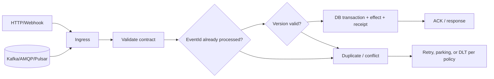
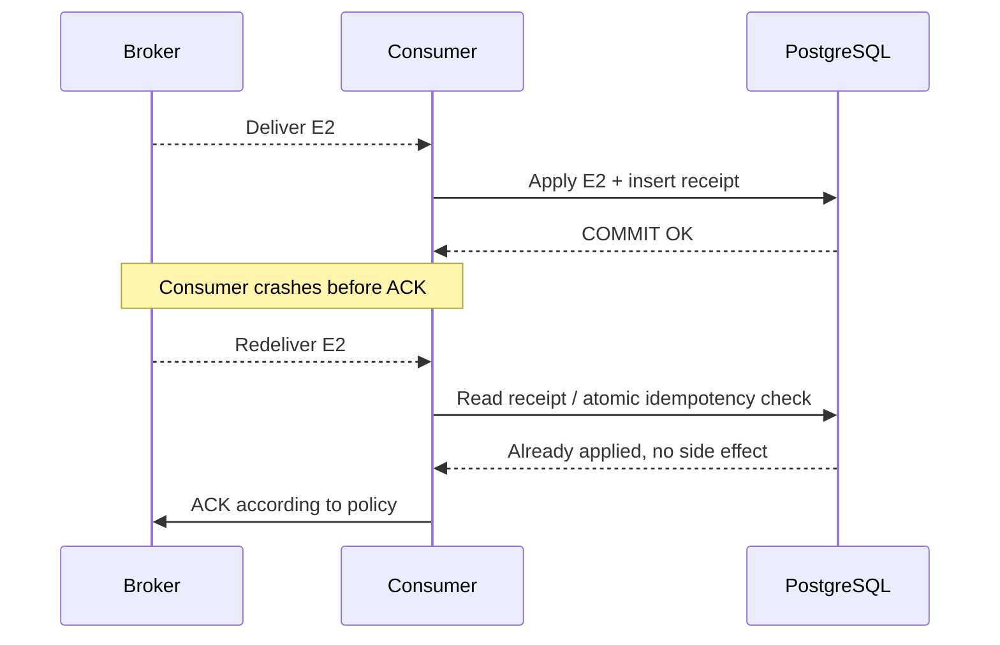
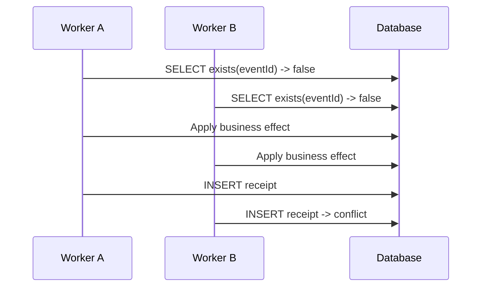
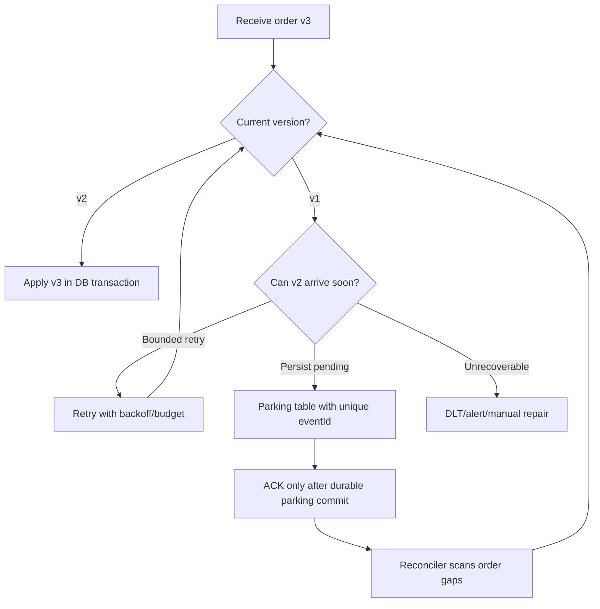
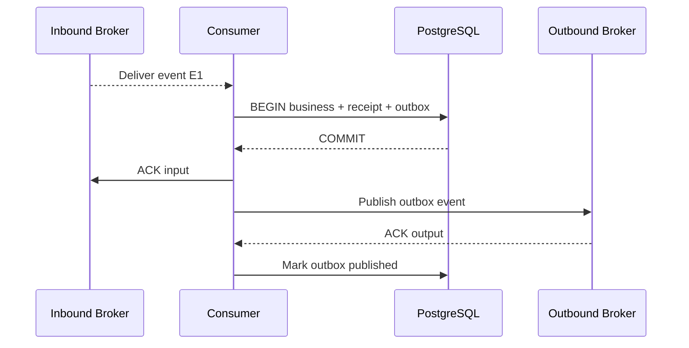
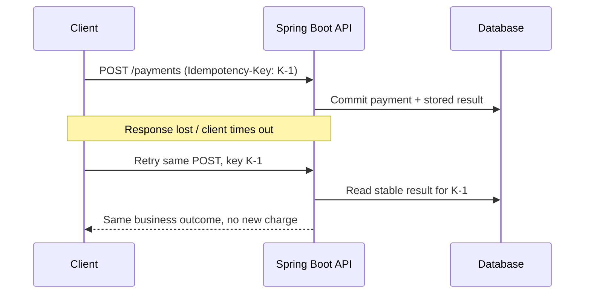
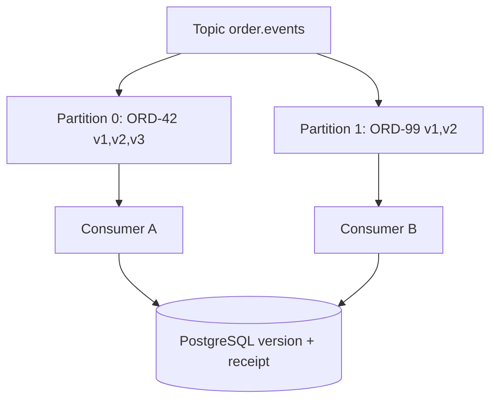
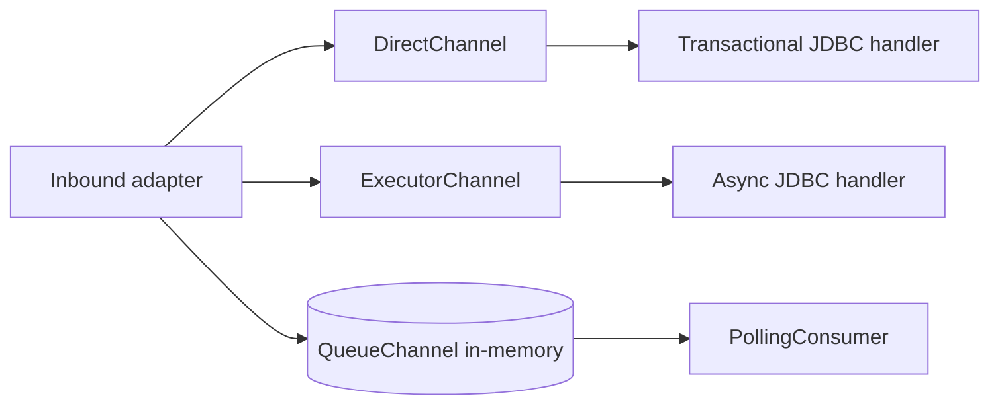
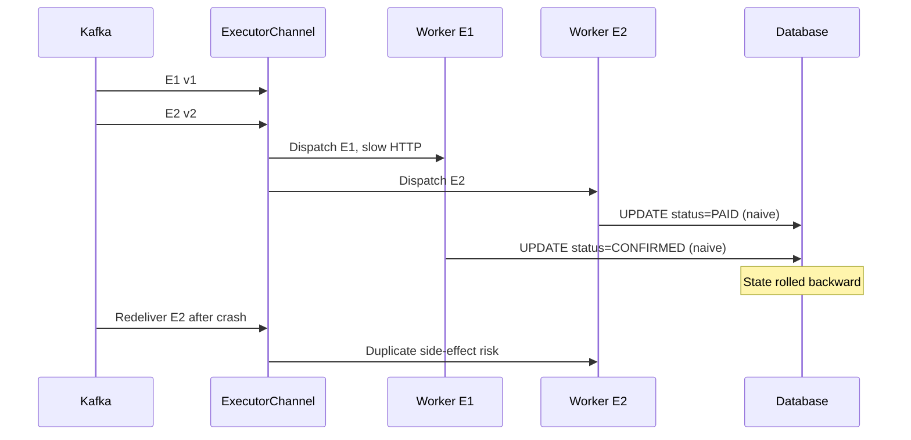

# Testing Duplicate Data, Out-of-Order Delivery, and Concurrency

## 1. Why do these three failure modes determine integration reliability?

In Spring Boot systems integrating HTTP clients, PostgreSQL, Redis, Kafka, RabbitMQ, Pulsar, and Spring Integration, **the same data can arrive multiple times, arrive out of the expected order, or be processed concurrently across multiple threads or pods**. A test that merely sends one valid message and asserts one database row misses most real-world business corruption scenarios.

Suppose a service consumes order state-change events:

```text
Order ORD-42
  event E1: version=1, status=CONFIRMED
  event E2: version=2, status=PAID
  event E3: version=3, status=SHIPPED
```

Scenarios that must be tested:

- **Duplicates:** `E2` is re-sent because the producer timed out after broker acceptance, the consumer crashed after DB commit before ACK, or an HTTP client retried.
- **Out-of-order:** `E3` arrives before `E2` due to multiple producers, retries diverted to another queue, multiple partitions, or parallel processing.
- **Concurrency:** two pods process `E2` simultaneously, or two different events attempt to update the same order at the same version.
- **Interaction of all three:** `E3` arrives early and is parked to wait; then `E2` arrives twice across two pods while one worker is killed mid-flight.



The diagram shows **logical decisions**—it does not mean a naive `SELECT exists` followed by `INSERT` is safe against races. Enforcement must rely on **database constraints, atomic updates, and transactions**.

This lesson belongs to the **Contracts and Edge Cases** chapter of the **SPRING_BOOT_INTEGRATION** module. The goal is not merely conceptual understanding, but **designing tests that reproduce faults and prove business invariants** under retries, crashes, out-of-order arrival, and concurrency.

### Learning objectives

After this lesson, you will be able to:

1. Distinguish duplicate delivery, duplicate side effects, duplicate request IDs, and duplicate business operations.
2. Design event/request contracts with stable identity, versioning, correlation IDs, and conflicting-payload policies.
3. Handle stale events, early out-of-order events with gaps, retries/redeliveries, and concurrent updates per aggregate.
4. Apply PostgreSQL **unique constraints**, optimistic concurrency, conditional updates, and transaction receipts.
5. Write JUnit 5/Testcontainers tests that deterministically reproduce duplicate messages, out-of-order arrival, and multi-worker races.
6. Test crash windows around DB commits, broker ACKs, and HTTP timeouts; determine where inbox/outbox patterns are needed.
7. Verify adapter ACK/retry/DLT/parking policies instead of assuming `MessageChannel.send()` equals successful processing.
8. Build a test matrix, monitoring, and runbooks to operate safely under at-least-once delivery while preserving business outcomes.

> **Illustrative scope:** Java 17+, Spring Boot 3.5.x, Spring Framework 6.x, Spring JDBC, Spring Kafka 3.x/Spring Integration 6.x, and PostgreSQL 16. APIs and adapter settings vary by version; Kafka/RabbitMQ/Pulsar examples are conditional on those transports. There is no automatic “exactly-once across HTTP + DB + broker side effects” from a single annotation or one green test.

## 2. Clearly define failures before writing tests

### 2.1. Duplicate delivery does not mean duplicate effect

An event may be **delivered multiple times**, yet the business effect must happen **at most once**:



**At-least-once delivery** permits redeliveries. The practical target is **effectively-once business effects** within a defined scope via idempotency and transactions, not a promise that the broker only ever delivers once.

### 2.2. Same event ID with a different payload is a conflict

Two payloads:

```json
{"eventId":"EVT-9","orderId":"ORD-42","version":2,"status":"PAID"}
```

```json
{"eventId":"EVT-9","orderId":"ORD-42","version":2,"status":"CANCELLED"}
```

must not be treated as a benign duplicate merely because `eventId` matches. Compare **business fields or a canonical payload fingerprint**, then raise `EVENT_ID_REUSE_CONFLICT`/route to recovery. Silently dropping the second message hides producer or schema bugs.

### 2.3. Out-of-order arrival must be evaluated per aggregate

Ordering usually applies **per `orderId`**, not globally across the entire system:

```text
ORD-42: version 1 → 2 → 3  (strict sequence)
ORD-99: version 1 → 2      (independent)
```

Events for different orders can process concurrently. When `ORD-42/v3` arrives before `ORD-42/v2`, follow your policy: **park, bounded retry, or reject**—never jump straight to version 3 and drop version 2 by default.

### 2.4. Concurrency spans both threads in one JVM and multiple pods

`synchronized`, `ReentrantLock`, and `ConcurrentHashMap` coordinate within one process, but **do not lock** other JVM pods. A service running 4 replicas needs **system-wide** enforcement such as database unique keys/row locks or an appropriate distributed coordination mechanism.

## 3. Data contract used throughout this lesson

Example event designed with all fields needed for verification:

```java
// OrderStatusChanged.java
package example.integration.contract;

public record OrderStatusChanged(
        String eventId,
        String orderId,
        long version,
        String status) {
}
```

Example JSON:

```json
{
  "eventId": "EVT-ORD42-002",
  "orderId": "ORD-42",
  "version": 2,
  "status": "PAID"
}
```

The contract must state explicitly:

| Field | Meaning | Test constraint |
| --- | --- | --- |
| `eventId` | Immutable ID of **one business event** | Stable across retries; unique within the producer/consumer contract |
| `orderId` | Aggregate ID | Used as correlation/routing/partition key where suitable |
| `version` | Monotonically increasing version **per order** | Starts at 1; `v(n)` follows `v(n-1)` if strict |
| `status` | Resulting status | Within enum/transition whitelist and immutable after publishing |
| `schemaVersion` *(if added)* | Payload structure version | Distinct from aggregate version; has compatibility rules |
| `occurredAt` *(if added)* | Producer event timestamp | Not used for ordering/versioning when clocks skew |
| `correlationId` *(header)* | Cross-HTTP/broker/adapter tracing | Never used as a default idempotency key |

**Distinguish the two version concepts:**

- `schemaVersion=2`: JSON structure version 2, e.g., adding a new field.
- `version=5`: the fifth state transition of `ORD-42`.

Never use receipt time (`receivedAt`) to decide which event is “newer” when multiple sources or clocks skew. If two producers can emit `version=2` for the same order, producer-side sequencing must be fixed; the consumer cannot guess which one is right.

### 3.1. Business invariants matter more than message counts

For a given order:

\[
\text{lastVersion} \text{ increases along } 0,1,2,3,\ldots
\]

and:

\[
\text{numberOfBusinessEffects}(\text{consumer},\text{eventId}) \leq 1.
\]

Specifically:

- Event `v2` is **applied** only when current version is `1`.
- Redelivering the same `eventId` with the same payload returns `DUPLICATE` with **no new side effect**.
- Same `eventId` with a different `orderId`, `version`, or `status` is a contract error.
- When two writers race to apply `v2`: at most **one** update succeeds.
- When the business state rolls back, the receipt for that event must also roll back within the same database transaction.

We will **test invariants**, rather than checking log output order or calling `Thread.sleep` and hoping results look right.

## 4. Test matrix before implementation

| Group | Input/operation | Expected result |
| --- | --- | --- |
| Happy path | v1 then v2 then v3 | Version 3, status from v3 |
| Duplicate | v1, then replay **same** v1 | One effect; second call returns `DUPLICATE` |
| ID reuse | Same `eventId`, different status | `EVENT_ID_REUSE_CONFLICT`, no overwrite |
| Gap | v3 arrives when current is v1 | `GAP`; v3 is not applied |
| Gap recovery | v3 early, then v2, then retry v3 | Status v3; v2 is not skipped |
| Stale | v1 arrives when current is v3, no receipt | `STALE_CONFLICT` per policy |
| Same-event race | 20 threads process v1 concurrently | One `APPLIED`, remainder `DUPLICATE` |
| Same-version race, different eventIds | A/v1 and B/v1 concurrently | One `APPLIED`, one `STALE_CONFLICT` |
| v1 and v2 race | Concurrent without ordering guarantees | v2 may hit `GAP`; bounded retry converges to v2 |
| DB rollback | Receipt inserted then handler throws | Neither receipt nor business effect committed |
| Crash before DB commit | Kill consumer | Redelivery/recovery, no half-commit |
| Crash after DB commit before ACK | Kill consumer | Redelivery occurs without repeating effect |
| HTTP timeout unknown outcome | Client retries with same key | No second side effect |
| Broker redelivery/rebalance | Same event across 2 consumer instances | No double effect |
| Poison message | Invalid JSON/schema, unsupported version | Retry/DLT/parking per error class |
| Load | Multiple orders and concurrent consumers | Invariants hold; bounded latency/backlog |

**One passing test does not prove the whole system is “exactly once.”** The matrix must cover each failure window and **the actual adapters, containers, and transaction managers** running in production.

## 5. The database as arbiter of idempotency and versioning

With PostgreSQL, define projection and receipt tables via versioned migrations:

```sql
CREATE TABLE order_projection (
    order_id VARCHAR(80) PRIMARY KEY,
    version BIGINT NOT NULL DEFAULT 0,
    order_status VARCHAR(32) NOT NULL,
    updated_at TIMESTAMPTZ NOT NULL DEFAULT now(),
    CONSTRAINT ck_order_projection_version CHECK (version >= 0)
);

CREATE TABLE handled_event (
    consumer_name VARCHAR(100) NOT NULL,
    event_id VARCHAR(100) NOT NULL,
    order_id VARCHAR(80) NOT NULL,
    event_version BIGINT NOT NULL,
    event_status VARCHAR(32) NOT NULL,
    handled_at TIMESTAMPTZ NOT NULL DEFAULT now(),
    PRIMARY KEY (consumer_name, event_id)
);

CREATE INDEX idx_handled_event_order
    ON handled_event (order_id, event_version);
```

Seed an initial order:

```sql
INSERT INTO order_projection (order_id, version, order_status)
VALUES ('ORD-42', 0, 'CREATED');
```

`handled_event` stores enough columns to detect **event ID reuse with a different payload**, not just an “already seen” boolean. In production, you can store a canonical payload hash/version for wide payloads while controlling serialization/canonicalization. **Never** hash raw arbitrary JSON strings with unstable property ordering assuming equivalent payloads always yield identical bytes.

### 5.1. Unique key scope

In this example, `(consumer_name,event_id)` is used because two distinct logical consumers may need to apply separate effects for the same event. For HTTP idempotency, the key may need `(tenant_id, operation_type, idempotency_key)`. If `eventId` is unique only per producer, add `producerId`/namespace to the key.

Do not use broker offsets as business idempotency IDs: a republished logical business event lands at a **different offset**. Do not rely on a cache key whose TTL is shorter than your real redelivery window as durable deduplication.

### 5.2. Transaction containing **both effect and receipt**

```text
BEGIN
  conditional UPDATE order_projection
  INSERT handled_event
COMMIT
```

If updating the projection succeeds and inserting the receipt fails, **both must roll back**. If the receipt commits first while the projection fails to update, a later redelivery will wrongly skip applying the effect. Both writes must therefore share **the same database transaction** and **the same JDBC DataSource/transaction manager**.

## 6. Never rely on check-then-act as your sole deduplication guard

Anti-pattern:

```java
if (!repository.existsByEventId(event.eventId())) {
    repository.applyBusinessUpdate(event);
    repository.insertProcessedReceipt(event.eventId());
}
```

Two threads can both observe `exists=false`:



If the business effect **committed separately** or called an external API before the unique violation, the side effect is duplicated. Do not treat `synchronized` around that block as sufficient across multiple replicas.

**Right approach:** database unique constraints, conditional UPDATE/CAS, transaction rollbacks, and explicit outcome classification for duplicates/conflicts. A fast-path read may save work, but **never** replaces an atomic claim.

### 6.1. How does `ON CONFLICT DO NOTHING` help?

```sql
INSERT INTO handled_event (
    consumer_name, event_id, order_id, event_version, event_status
)
VALUES (:consumer, :eventId, :orderId, :version, :status)
ON CONFLICT (consumer_name, event_id) DO NOTHING;
```

You must **check affected rows**: `1` means you just claimed the receipt; `0` means a receipt already existed. To catch ID reuse, also compare stored payload columns. If you run `DO NOTHING` and ignore the row count before applying side effects, the unique key **stops protecting idempotency**.

### 6.2. Optimistic concurrency on the aggregate

```sql
UPDATE order_projection
SET
    version = :incomingVersion,
    order_status = :status,
    updated_at = now()
WHERE order_id = :orderId
  AND version = :incomingVersion - 1;
```

This is a **SQL compare-and-set**. PostgreSQL evaluates the predicate under a row lock during concurrent updates; if two transactions race from the same base version, at most one update matches and commits. Never write `version = version + 1` **without** checking the expected version, as reordered events would apply at the wrong step.

**Note:** Preventing **single-row races** does not automatically make multi-table workflows atomic. Place all related SQL writes inside the same transaction and test rollback and uniqueness.

## 7. Meaningful outcome model for consumers

Do not return a mere `boolean handled`—distinguish the outcomes clearly:

```java
// Decision.java
package example.integration.contract;

public enum Decision {
    APPLIED,        // new effect committed upon tx completion
    DUPLICATE,      // same eventId, same business payload, already handled
    GAP,            // missing an earlier version
    STALE_CONFLICT  // event/version is no longer eligible to apply
}
```

ID reuse or invalid schema should map to dedicated exceptions/categories rather than silently turning into `DUPLICATE`:

```java
// EventIdConflictException.java
package example.integration.contract;

public class EventIdConflictException extends RuntimeException {
    public EventIdConflictException(String message) {
        super(message);
    }
}
```

The application maps outcomes to source transport policies:

| Outcome | Business effect | Broker ACK/HTTP response |
| --- | --- | --- |
| `APPLIED` | New and durable after commit | ACK after transaction; HTTP success per contract |
| `DUPLICATE` | None added | Usually ACK; HTTP returns stored/stable response |
| `GAP` | Not yet applied | Bounded retry or **durable parking then ACK**; never drop blindly |
| `STALE_CONFLICT` | Not applied | Policy-based: conflict, DLT/parking, reconcile |
| `EVENT_ID_REUSE_CONFLICT` | Not applied | Contract violation requiring alert/investigation; never treat as duplicate success |

Exact policies depend on the source (HTTP, JDBC poller, Kafka, RabbitMQ, Pulsar) and business criticality. A `GAP` could mean slow network delivery **or** a lost upstream event—do not retry indefinitely without a deadline or parking mechanism.

## 8. JDBC service: a testable processing path

The implementation below intentionally:

- Uses a single `JdbcTemplate` over a single PostgreSQL `DataSource`.
- Uses `@Transactional` on a Spring bean invoked via proxy, keeping `UPDATE` and `INSERT receipt` in one transaction.
- Advances to the next version using a **conditional update**.
- When the update matches 0 rows, checks the receipt, detects ID reuse, and classifies `GAP` or `STALE_CONFLICT`.

### 8.1. Declaring the transaction manager explicitly

```java
// OrderTransactionConfiguration.java
package example.integration.contract;

import javax.sql.DataSource;
import org.springframework.context.annotation.Bean;
import org.springframework.context.annotation.Configuration;
import org.springframework.jdbc.support.JdbcTransactionManager;
import org.springframework.transaction.PlatformTransactionManager;

@Configuration(proxyBeanMethods = false)
public class OrderTransactionConfiguration {

    @Bean("orderJdbcTxManager")
    PlatformTransactionManager orderJdbcTxManager(
            DataSource dataSource) {
        return new JdbcTransactionManager(dataSource);
    }
}
```

With a single `DataSource`, Spring Boot typically auto-configures a JDBC transaction manager under default conditions. Declaring it explicitly ensures tests and services reference **the exact expected manager**. If the app uses JPA, evaluate `JpaTransactionManager`/EntityManager participation with JDBC instead of adding extra managers arbitrarily.

### 8.2. Service updating state and receipt

```java
// OrderProjectionHandler.java
package example.integration.contract;

import java.util.List;
import java.util.Objects;
import org.springframework.jdbc.core.JdbcTemplate;
import org.springframework.stereotype.Service;
import org.springframework.transaction.annotation.Transactional;

@Service
public class OrderProjectionHandler {

    private static final String CONSUMER = "orders-projection-v1";
    private final JdbcTemplate jdbc;

    public OrderProjectionHandler(JdbcTemplate jdbc) {
        this.jdbc = jdbc;
    }

    @Transactional(transactionManager = "orderJdbcTxManager")
    public Decision apply(OrderStatusChanged event) {
        validate(event);

        int changed = jdbc.update("""
                UPDATE order_projection
                SET version = ?, order_status = ?, updated_at = now()
                WHERE order_id = ? AND version = ?
                """,
                event.version(),
                event.status(),
                event.orderId(),
                event.version() - 1);

        if (changed == 1) {
            // Same transaction as UPDATE projection.
            // Unique constraint protects receipt even under races.
            jdbc.update("""
                    INSERT INTO handled_event (
                        consumer_name, event_id, order_id,
                        event_version, event_status
                    )
                    VALUES (?, ?, ?, ?, ?)
                    """,
                    CONSUMER,
                    event.eventId(),
                    event.orderId(),
                    event.version(),
                    event.status());
            return Decision.APPLIED;
        }

        List<SeenEvent> seen = jdbc.query("""
                SELECT order_id, event_version, event_status
                FROM handled_event
                WHERE consumer_name = ? AND event_id = ?
                """,
                (rs, n) -> new SeenEvent(
                        rs.getString("order_id"),
                        rs.getLong("event_version"),
                        rs.getString("event_status")),
                CONSUMER,
                event.eventId());

        if (!seen.isEmpty()) {
            SeenEvent receipt = seen.get(0);
            if (Objects.equals(receipt.orderId(), event.orderId())
                    && receipt.version() == event.version()
                    && Objects.equals(receipt.status(), event.status())) {
                return Decision.DUPLICATE;
            }
            throw new EventIdConflictException(
                    "Event ID reused with different content: "
                            + event.eventId());
        }

        List<Long> versions = jdbc.query("""
                SELECT version FROM order_projection WHERE order_id = ?
                """,
                (rs, n) -> rs.getLong("version"),
                event.orderId());

        if (versions.isEmpty()) {
            // Example assumes the order aggregate is created beforehand.
            throw new IllegalStateException(
                    "Missing order aggregate: " + event.orderId());
        }
        long currentVersion = versions.get(0);

        if (event.version() > currentVersion + 1) {
            return Decision.GAP;
        }
        return Decision.STALE_CONFLICT;
    }

    private static void validate(OrderStatusChanged event) {
        if (event == null
                || event.eventId() == null || event.eventId().isBlank()
                || event.orderId() == null || event.orderId().isBlank()
                || event.version() < 1
                || event.status() == null || event.status().isBlank()) {
            throw new IllegalArgumentException("Invalid event contract");
        }
    }

    private record SeenEvent(
            String orderId,
            long version,
            String status) {
    }
}
```

This example intentionally avoids performing external HTTP/Kafka side effects inside the transaction. If the business workflow updates invoices, inventory, or inbox/outbox tables, place those atomic writes in the same transaction. For complex state machines, validate allowed transitions before and inside the conditional update rather than accepting any `status` solely because the version matches.

**Race details:** when two concurrent transactions update the same row/version, one wins; the other may block on the row lock and then find the predicate no longer matches. Under PostgreSQL `READ COMMITTED`, a subsequent `SELECT` after the first transaction commits observes the committed receipt. However, if you use stricter isolation levels, retries, or encounter unique constraint errors, evaluate full-transaction rollback/retry behavior. Never assume identical behavior across all RDBMS engines or isolation levels.

### 8.3. What if a receipt exists but the projection was not updated?

A committed receipt without the corresponding projection update is a **data-invariant violation** whenever both writes must be atomic. Rollback/recovery tests must catch this. If the two tables live across two separate `DataSource`s, a single JDBC transaction manager cannot make them atomic.

### 8.4. ID reuse at a new version: unique violation must roll back

If `EVT-1` was used for v1 and a buggy producer reuses `EVT-1` for v2, `UPDATE ... WHERE version=1` **would temporarily update to v2**. However, `INSERT handled_event` violates the `(consumer_name,event_id)` primary key, so both statements **roll back together**, leaving the projection at v1. Test this failure branch alongside “same ID/same version with different payload.”

Example test method:

```java
@Test
void reusingEventIdAtNewVersionRollsBackNewState() {
    var v1 = new OrderStatusChanged(
            "EVT-1", "ORD-42", 1L, "CONFIRMED");
    var v2WithReusedId = new OrderStatusChanged(
            "EVT-1", "ORD-42", 2L, "PAID");

    assertThat(handler.apply(v1)).isEqualTo(Decision.APPLIED);

    assertThatThrownBy(() -> handler.apply(v2WithReusedId))
            .isInstanceOf(
                    org.springframework.dao.DataIntegrityViolationException.class);

    assertThat(jdbc.queryForObject("""
            SELECT version FROM order_projection WHERE order_id=?
            """, Long.class, "ORD-42")).isEqualTo(1L);
}
```

Here the handler lets the SQL exception propagate so Spring rolls back the transaction. In production code, you can map it to `EVENT_ID_REUSE_CONFLICT` **after the transaction has rolled back**, or perform a precheck while keeping the unique constraint as the final guard. In PostgreSQL, never catch a unique-key violation inside an aborted transaction and keep running SQL as if the transaction were healthy; roll back or use savepoints/new transactions as designed.

## 9. Out-of-order contracts: strict, latest-wins, or commutative?

Not every data domain needs the same ordering policy:

| Data type | Strategy | Example and limitation |
| --- | --- | --- |
| **Strict sequence** | Apply only the next sequential version | Order state, ledgers where no step may be skipped |
| **Latest version wins** | Accept highest version, discard lower ones | Full-state snapshots/profiles independent of intermediate deltas |
| **Commutative operations** | Reordering allowed if truly commutative | Independent additive counters; still require event deduplication |
| **Causal dependencies** | Wait for prerequisite events, DAG/correlation | `PaymentCaptured` requires `PaymentAuthorized` |
| **Best-effort notifications** | Stale deliveries can be dropped | Cache invalidation or non-critical alerts |

**Never choose latest-wins by default** for delta events:

```text
v1: +10 points
v2: -3 points
v3: +5 points
```

If `v3` arrives early and the app jumps straight to `lastVersion=3`, the first two deltas are lost. Conversely, if each event carries a **complete snapshot** of state and the contract confirms higher versions supersede lower ones, latest-wins can work—though duplicate deliveries still need idempotent handling.

### 9.1. States to distinguish

```text
current=1, incoming=2  → NEXT/APPLY
current=1, incoming=3  → GAP (wait for v2)
current=3, incoming=2  → STALE or DUPLICATE if v2 receipt exists
current=2, incoming=2 with different eventId → CONFLICT
```

If the v2 receipt was purged due to retention, the consumer cannot reliably verify from version alone whether a re-arriving v2 event matches the original payload. Keep receipt retention longer than **broker retention, HTTP retry windows, delayed retry/DLT replay windows, and audit needs**, or rely on an authoritative source of truth.

### 9.2. Why not rely on timestamps?

Producer clocks can drift; network delays and retries make older events arrive later. Tests should inject payloads with a **newer `occurredAt` but lower version** to verify the consumer enforces **business sequence** rather than ordering by wall-clock timestamps.

## 10. Gap handling: retries, parking, and reconciliation

When `E3/v3` arrives while current version is 1, `GAP` handling must follow an explicit policy:



### 10.1. Avoid infinite hot retries

A Kafka consumer processing v3 on partition P could wait forever for v2 while v2 sits **behind v3 on the very same partition** due to out-of-order publishing. Retrying v3 without advancing the offset prevents v2 from ever being read—classic **head-of-line blocking**.

Typical solution:

1. Persist v3 into a **durable parking table/topic** keyed by `eventId` and aggregate version.
2. Commit the parking record **before** ACKing v3.
3. Allow the broker stream to proceed and consume v2.
4. Have a reconciler replay v3 once the aggregate reaches version 2.
5. Enforce TTL/SLAs, backoff, and alerts if v2 fails to arrive.

If using Kafka retry topics as parking, account for ordering between main and retry topics and the chance of old events replaying after state moves forward. Database deduplication and sequence guards remain essential.

### 10.2. Illustrative parking schema

```sql
CREATE TABLE pending_order_event (
    consumer_name VARCHAR(100) NOT NULL,
    event_id VARCHAR(100) NOT NULL,
    order_id VARCHAR(80) NOT NULL,
    event_version BIGINT NOT NULL,
    payload_json JSONB NOT NULL,
    first_seen_at TIMESTAMPTZ NOT NULL DEFAULT now(),
    retry_after TIMESTAMPTZ NOT NULL DEFAULT now(),
    attempts INTEGER NOT NULL DEFAULT 0,
    PRIMARY KEY (consumer_name, event_id)
);

CREATE INDEX idx_pending_order_sequence
    ON pending_order_event (
        consumer_name, order_id, event_version
    );
```

Two records with the same `orderId` and `event_version` but different `eventId`s can indicate a **producer conflict**. You can add a unique constraint `(consumer_name, order_id, event_version)` when the contract guarantees at most one event per aggregate/version. If you add it, record and handle conflicts rather than blindly ignoring with `ON CONFLICT DO NOTHING`.

### 10.3. Atomicity between parking and ACK

A consumer can:

```text
Begin DB tx
  INSERT pending_order_event (idempotent)
Commit DB tx
  → listener returns / ACK broker per policy
```

If it crashes after DB commit and before broker ACK, the event redelivers and the parking `INSERT` must be idempotent. If it ACKs before DB commit, the event can be **lost** on crash. This is also why an in-memory `QueueChannel` cannot substitute for durable parking.

## 11. JUnit 5 + Testcontainers suite for JDBC logic

We test against a **real database**, because mock repositories cannot prove row-level concurrency, isolation levels, or unique constraints. Maven dependencies:

```xml
<dependency>
    <groupId>org.springframework.boot</groupId>
    <artifactId>spring-boot-starter-test</artifactId>
    <scope>test</scope>
</dependency>
<dependency>
    <groupId>org.springframework.boot</groupId>
    <artifactId>spring-boot-testcontainers</artifactId>
    <scope>test</scope>
</dependency>
<dependency>
    <groupId>org.testcontainers</groupId>
    <artifactId>junit-jupiter</artifactId>
    <scope>test</scope>
</dependency>
<dependency>
    <groupId>org.testcontainers</groupId>
    <artifactId>postgresql</artifactId>
    <scope>test</scope>
</dependency>
```

In Spring Boot 3.5, `@ServiceConnection` provides JDBC connection details for a PostgreSQL Testcontainer under matching starters/conditions. The test below assumes `OrderProjectionHandler`, the transaction manager bean, and **Flyway migrations creating the section 5 tables** exist in the project. Do not add migration files outside this lesson's scope.

### 11.1. Test fixture setup outside business transactions

```java
// OrderProjectionHandlerIT.java - configuration/fixture part
package example.integration.contract;

import org.junit.jupiter.api.BeforeEach;
import org.springframework.beans.factory.annotation.Autowired;
import org.springframework.boot.test.context.SpringBootTest;
import org.springframework.boot.testcontainers.service.connection.ServiceConnection;
import org.springframework.jdbc.core.JdbcTemplate;
import org.testcontainers.containers.PostgreSQLContainer;
import org.testcontainers.junit.jupiter.Container;
import org.testcontainers.junit.jupiter.Testcontainers;

@SpringBootTest
@Testcontainers
class OrderProjectionHandlerIT {

    @Container
    @ServiceConnection
    static PostgreSQLContainer<?> postgres =
            new PostgreSQLContainer<>("postgres:16-alpine");

    @Autowired
    OrderProjectionHandler handler;

    @Autowired
    JdbcTemplate jdbc;

    @BeforeEach
    void reset() {
        // Do not put @Transactional on tests when testing
        // real commits and multi-thread concurrency.
        jdbc.execute("DELETE FROM handled_event");
        jdbc.execute("DELETE FROM order_projection");
        jdbc.update("""
                INSERT INTO order_projection
                    (order_id, version, order_status)
                VALUES (?, ?, ?)
                """, "ORD-42", 0L, "CREATED");
    }
}
```

Test cases in the following sections are presented as **methods inside `OrderProjectionHandlerIT`** with matching fixtures and imports; do not create multiple public test classes with duplicate names.

**Important note:** parallel test classes must not share one database schema and run `DELETE FROM` on the same tables concurrently. Use isolated containers/schemas/unique IDs or disable parallel execution as appropriate. Marking a test method `@Transactional` holds an uncommitted transaction on the JUnit thread so concurrent worker threads **cannot** see seeded fixtures; concurrency tests must seed committed fixtures.

### 11.2. Test layers

| Layer | Appropriate to test | Does not prove |
| --- | --- | --- |
| Unit with fake repository | Validation, outcome mapping, DTO contract | DB locking/unique races |
| PostgreSQL Testcontainers | Unique keys, compare-and-set, rollbacks, isolation | Real Kafka offset ACKs |
| Kafka/Rabbit/Pulsar Testcontainers | Listeners/adapters, retries, DLT, rebalances | Every production node failure mode |
| Multi-instance staging/chaos | Partition handoffs, crash windows, pool saturation | Mathematical proof of all executions |

## 12. Duplicate test: same payload, no extra effect

Add test method:

```java
@Test
void replayingSameEventDoesNotApplyTwice() {
    var v1 = new OrderStatusChanged(
            "EVT-1", "ORD-42", 1L, "CONFIRMED");

    assertThat(handler.apply(v1))
            .isEqualTo(Decision.APPLIED);
    assertThat(handler.apply(v1))
            .isEqualTo(Decision.DUPLICATE);

    assertThat(jdbc.queryForObject("""
            SELECT version FROM order_projection WHERE order_id=?
            """, Long.class, "ORD-42")).isEqualTo(1L);

    assertThat(jdbc.queryForObject("""
            SELECT COUNT(*) FROM handled_event WHERE event_id=?
            """, Integer.class, "EVT-1")).isEqualTo(1);
}
```

Required imports in the test class:

```java
import org.junit.jupiter.api.Test;
import static org.assertj.core.api.Assertions.assertThat;
```

This test is stronger than asserting a service was called twice: it checks **business state and receipts** after a replay.

### 12.1. Same event ID with changed content must be caught

```java
@Test
void sameEventIdWithChangedPayloadIsConflict() {
    var original = new OrderStatusChanged(
            "EVT-1", "ORD-42", 1L, "CONFIRMED");
    var mutated = new OrderStatusChanged(
            "EVT-1", "ORD-42", 1L, "CANCELLED");

    assertThat(handler.apply(original))
            .isEqualTo(Decision.APPLIED);

    assertThatThrownBy(() -> handler.apply(mutated))
            .isInstanceOf(EventIdConflictException.class);

    assertThat(jdbc.queryForObject("""
            SELECT order_status FROM order_projection WHERE order_id=?
            """, String.class, "ORD-42"))
            .isEqualTo("CONFIRMED");
}
```

Add static import `org.assertj.core.api.Assertions.assertThatThrownBy`. **Never** return `DUPLICATE` for the same key with a different business payload; that is an upstream contract violation.

### 12.2. Receipt rolls back together with business update

One way to trigger a failure after `UPDATE` projection is pre-seeding a conflicting receipt `eventId` so the `INSERT` inside the same transaction hits a unique-key violation:

```java
@Test
void projectionRollsBackWhenReceiptInsertFails() {
    jdbc.update("""
            INSERT INTO handled_event
                (consumer_name, event_id, order_id,
                 event_version, event_status)
            VALUES (?, ?, ?, ?, ?)
            """,
            "orders-projection-v1",
            "EVT-1",
            "ORD-42",
            999L,
            "SPOOFED");

    var v1 = new OrderStatusChanged(
            "EVT-1", "ORD-42", 1L, "CONFIRMED");

    assertThatThrownBy(() -> handler.apply(v1))
            .isInstanceOf(
                    org.springframework.dao.DataIntegrityViolationException.class);

    assertThat(jdbc.queryForObject("""
            SELECT version FROM order_projection WHERE order_id=?
            """, Long.class, "ORD-42")).isEqualTo(0L);
}
```

Because the service is invoked through Spring's `@Transactional` proxy, the `UPDATE` cannot commit when the `INSERT` in the same transaction throws and rolls back. This catches a common bug: writing business effects and receipts in **two separate transactions**.

## 13. Out-of-order tests: gaps, recovery, and stale events

### 13.1. Early v3 is not applied

```java
@Test
void versionGapIsNotAppliedAndCanRecover() {
    var v1 = new OrderStatusChanged(
            "EVT-1", "ORD-42", 1L, "CONFIRMED");
    var v2 = new OrderStatusChanged(
            "EVT-2", "ORD-42", 2L, "PAID");
    var v3 = new OrderStatusChanged(
            "EVT-3", "ORD-42", 3L, "SHIPPED");

    assertThat(handler.apply(v1)).isEqualTo(Decision.APPLIED);
    assertThat(handler.apply(v3)).isEqualTo(Decision.GAP);

    assertThat(jdbc.queryForObject("""
            SELECT version FROM order_projection WHERE order_id=?
            """, Long.class, "ORD-42")).isEqualTo(1L);

    assertThat(handler.apply(v2)).isEqualTo(Decision.APPLIED);
    assertThat(handler.apply(v3)).isEqualTo(Decision.APPLIED);
    assertThat(handler.apply(v3)).isEqualTo(Decision.DUPLICATE);

    assertThat(jdbc.queryForObject("""
            SELECT order_status FROM order_projection WHERE order_id=?
            """, String.class, "ORD-42")).isEqualTo("SHIPPED");
}
```

This test only proves the handler can **re-accept** a `GAP` event when invoked again. To test production flows, also test **persisted parking and a reconciler replaying in order**, rather than only calling the method again manually.

### 13.2. An older event cannot roll back state

```java
@Test
void staleDifferentEventCannotOverwriteCurrentVersion() {
    var v1 = new OrderStatusChanged(
            "EVT-1", "ORD-42", 1L, "CONFIRMED");
    var conflicting = new OrderStatusChanged(
            "EVT-OTHER", "ORD-42", 1L, "CANCELLED");

    assertThat(handler.apply(v1)).isEqualTo(Decision.APPLIED);
    assertThat(handler.apply(conflicting))
            .isEqualTo(Decision.STALE_CONFLICT);

    assertThat(jdbc.queryForObject("""
            SELECT order_status FROM order_projection WHERE order_id=?
            """, String.class, "ORD-42"))
            .isEqualTo("CONFIRMED");
}
```

**An older-version event with an existing receipt** returns `DUPLICATE`; a different ID/payload at an older version returns `STALE_CONFLICT`. Both paths must be tested and monitored separately.

### 13.3. Gaps across multiple aggregates must stay independent

If `ORD-42/v3` is waiting for v2 while `ORD-99/v1` is ready, a global lock/queue must not stall the entire system. Seed two orders and interleave events; `ORD-99` must keep advancing while `ORD-42` waits for prerequisites.

Partitioning Kafka by `orderId` preserves ordering **within one partition of one topic** under proper producer/consumer settings, yet does not guarantee order across topics, retry topics, multiple producers, or async worker completions. Database version guards must still stay in place.

## 14. Concurrency testing: launch simultaneously, assert invariants

A concurrency test must never just do:

```java
for (int i = 0; i < 10; i++) {
    handler.apply(event);
}
```

That is sequential execution with no contention. Multiple threads must hit the service proxy at once. A `CountDownLatch` acts as a **starting gate**: all workers prepare, then the gate opens simultaneously.

### 14.1. Same event, 8 concurrent workers, exactly one APPLIED

Add imports:

```java
import java.util.ArrayList;
import java.util.List;
import java.util.concurrent.CountDownLatch;
import java.util.concurrent.ExecutorService;
import java.util.concurrent.Executors;
import java.util.concurrent.Future;
import java.util.concurrent.TimeUnit;
```

Test method inside `OrderProjectionHandlerIT`:

```java
@Test
void concurrentSameEventProducesOneBusinessEffect()
        throws Exception {

    int workers = 8;
    var event = new OrderStatusChanged(
            "EVT-1", "ORD-42", 1L, "CONFIRMED");

    ExecutorService executor = Executors.newFixedThreadPool(workers);
    var ready = new CountDownLatch(workers);
    var start = new CountDownLatch(1);
    List<Future<Decision>> futures = new ArrayList<>();

    try {
        for (int i = 0; i < workers; i++) {
            futures.add(executor.submit(() -> {
                ready.countDown();
                if (!start.await(5, TimeUnit.SECONDS)) {
                    throw new IllegalStateException("Start gate timeout");
                }
                return handler.apply(event);
            }));
        }

        assertThat(ready.await(5, TimeUnit.SECONDS)).isTrue();
        start.countDown();

        List<Decision> results = new ArrayList<>();
        for (Future<Decision> future : futures) {
            results.add(future.get(15, TimeUnit.SECONDS));
        }

        assertThat(results.stream()
                .filter(d -> d == Decision.APPLIED)
                .count()).isEqualTo(1L);

        assertThat(results.stream()
                .filter(d -> d == Decision.DUPLICATE)
                .count()).isEqualTo(7L);

        assertThat(jdbc.queryForObject("""
                SELECT version FROM order_projection WHERE order_id=?
                """, Long.class, "ORD-42")).isEqualTo(1L);

        assertThat(jdbc.queryForObject("""
                SELECT COUNT(*) FROM handled_event WHERE event_id=?
                """, Integer.class, "EVT-1")).isEqualTo(1);
    } finally {
        start.countDown(); // release workers if an assertion fails early
        executor.shutdownNow();
        assertThat(executor.awaitTermination(5, TimeUnit.SECONDS))
                .isTrue();
    }
}
```

In this test:

- Each call goes through the Spring `handler` bean, so `@Transactional` is intercepted by the proxy.
- The Hikari pool needs enough connections for the test concurrency; if too small, acquire timeouts fail the test without proving an idempotency bug.
- The test does not guarantee every thread hits the SQL statement at the exact same nanosecond. It produces **near-simultaneous contention** and verifies invariant outcomes. To force an exact lock race, place a barrier right before the DB write using a test hook/proxy.
- Never annotate the JUnit method `@Transactional` with uncommitted fixtures: worker threads use separate connections and will not see the seeded order.
- `shutdownNow()` runs **after** awaiting futures, and waits have deadlines so CI never hangs.

### 14.2. Two different event IDs racing at the same expected version

```java
@Test
void concurrentConflictingEventsCannotBothWin()
        throws Exception {

    var first = new OrderStatusChanged(
            "EVT-A", "ORD-42", 1L, "CONFIRMED");
    var second = new OrderStatusChanged(
            "EVT-B", "ORD-42", 1L, "CANCELLED");

    ExecutorService pool = Executors.newFixedThreadPool(2);
    var gate = new CountDownLatch(1);
    try {
        Future<Decision> a = pool.submit(() -> {
            gate.await();
            return handler.apply(first);
        });
        Future<Decision> b = pool.submit(() -> {
            gate.await();
            return handler.apply(second);
        });
        gate.countDown();

        List<Decision> outcomes = List.of(
                a.get(10, TimeUnit.SECONDS),
                b.get(10, TimeUnit.SECONDS));

        assertThat(outcomes).containsExactlyInAnyOrder(
                Decision.APPLIED,
                Decision.STALE_CONFLICT);

        assertThat(jdbc.queryForObject("""
                SELECT COUNT(*) FROM handled_event
                WHERE order_id=? AND event_version=?
                """, Integer.class, "ORD-42", 1L)).isEqualTo(1);
    } finally {
        gate.countDown();
        pool.shutdownNow();
        assertThat(pool.awaitTermination(5, TimeUnit.SECONDS))
                .isTrue();
    }
}
```

Never write a test asserting `EVT-A` must win: JVM thread scheduling and DB lock acquisition make no such guarantee. The business invariant to prove is that **at most one version applies**, whether A or B wins. If your domain requires picking a winner by priority or timestamp, build a deterministic rule at the **domain level**.

### 14.3. Concurrent v1 and v2: do not force a fake schedule

When v2 and v1 arrive concurrently, two valid initial outcomes exist:

1. v1 commits before v2 checks → both v1 and v2 apply.
2. v2 checks before v1 commits → v2 returns `GAP`; then v1 applies, and v2 must be retried.

Tests should allow both schedules **while rejecting** any wrong final state after reconciliation:

```text
Concurrent(v1, v2) produces:
  v1 = APPLIED
  v2 = APPLIED or GAP
After retrying GAP:
  final version = 2
  final status  = PAID
  receipts for v1 and v2 exactly once
```

If v2 already applied, retrying it must yield `DUPLICATE`, not `APPLIED` again. Concurrency tests should assert **state convergence** and invariants rather than pinning one thread schedule.

### 14.4. Multiple aggregates in parallel

Seed multiple order IDs and submit v1 for each across different threads. Verify:

- Every order reaches version 1 with zero cross-order bleed.
- Transaction scope creates no **global lock** serializing unrelated orders.
- A failing event on order A never rolls back independent business transactions on order B.
- Connection pools do not starve silently when concurrency meets or exceeds pool size; timeout policies are explicit.

## 15. Controlled race tests: latching at the exact fault point

A `CountDownLatch` before entering the service creates contention, yet might still miss a narrow crash window. To probe races deeper, place a **test hook** at the critical boundary:

```text
Worker A:
  BEGIN
  UPDATE aggregate row (lock held)
  [TEST HOOK: pause before receipt INSERT]

Worker B:
  BEGIN
  UPDATE same aggregate/version
  [wait for DB lock]

Test:
  assert B cannot commit a second update
  release A
  assert A commits; B sees no match/receipt
```

The hook can be a `ProcessingCheckpoint` interface:

```java
package example.integration.contract;

@FunctionalInterface
public interface ProcessingCheckpoint {
    void afterAggregateUpdate(OrderStatusChanged event);
}
```

In production, the default bean is a no-op; in tests, an implementation uses latches to pause right after `UPDATE` and before `INSERT receipt`. When adding hooks to services, never alter business transaction boundaries and never invoke network side effects inside hooks outside tests.

### 15.1. Testing rollback when the lock-holding worker fails

Scenario:

1. Worker A updates version 1 and holds the transaction uncommitted.
2. Worker B blocks on the same row.
3. Force A to throw before inserting the receipt → T1 rolls back.
4. Worker B unblocks and applies version 1 cleanly.
5. Assert receipt and projection reflect **exactly one** successful event.

This test matters because concurrency is not only two successful commits—it also includes **rollbacks, retries, and lock contention**.

### 15.2. Use deadlines, never sleep to synchronize tests

Anti-pattern:

```java
Thread.sleep(500);
assertThat(workerFinished).isFalse();
```

Such tests flake on slow CI runners or GC pauses. Use `CountDownLatch`, `CyclicBarrier`, bounded `Future.get`, and `Awaitility` when waiting for async convergence. For async retries, virtual clocks/fake schedulers work well in unit tests; real DB/broker integration tests still require finite deadlines.

### 15.3. Do not assert only “no exception thrown”

A race test can pass without throwing an exception while silently inserting two invoices. After tests finish, query directly:

```sql
SELECT COUNT(*) FROM handled_event
WHERE consumer_name = 'orders-projection-v1'
  AND event_id = 'EVT-1';
```

```sql
SELECT order_status, version FROM order_projection
WHERE order_id = 'ORD-42';
```

For payment workflows, verify **transaction ledgers, outboxes, and external partner idempotency** as well—not only a single row in `handled_event`.

## 16. Crash windows: testing across non-rollbackable boundaries

In a broker → Spring Boot consumer → PostgreSQL → outbound broker pipeline, not every component shares an atomic transaction:



Test **crashes at every window**:

| Crash window | What may remain | Invariant to preserve |
| --- | --- | --- |
| Before DB commit | Input unACKed / redelivered | Projection and receipt do not half-commit |
| After DB commit before input ACK | Redelivery | Receipt prevents duplicate effect |
| After input ACK before outbound publish | Without outbox, event is lost | Pending outbox row still gets published |
| After outbound broker ACK before DB mark-published | Outbox republishes | Downstream consumer deduplicates `eventId` |
| During HTTP partner call with unknown response | Unclear if partner executed | Partner idempotency key and reconciliation |
| After enqueuing to in-memory queue before worker DB commit | Data lost if input already ACKed | Never treat RAM queues as durable boundaries |
| During graceful shutdown then SIGKILL | Callbacks/handlers may not finish | Durable backlog/receipts and retries |

### 16.1. Fault injection needs deterministic triggers

Instead of “start app and randomly kill it,” an integration test can:

- Latch **right after DB commit and before listener ACK**, then kill the consumer process.
- Latch **after Kafka producer send ACK** and before `outbox.markPublished`, then kill.
- Use Toxiproxy or a test network proxy to inject timeouts/connection resets after server processing.
- Induce deadlocks or unique constraint violations via controlled SQL fixtures.
- Start a new instance and assert business state **did not duplicate**.

**Do not rely on same-process shutdown for kill tests:** `context.close()` runs graceful lifecycle hooks, whereas `SIGKILL` or hard container kills skip JVM shutdown hooks. To prove crash recovery, run an independent process/container separate from the test runner backed by external DB/broker storage.

### 16.2. Persist work and ACK in the proper order

```text
Broker input
  → validate
  → DB transaction: inbox + business effect/outbox
  → COMMIT
  → ACK input broker per policy
```

For multi-minute jobs, you can persist the inbox + commit and ACK immediately, letting another worker run asynchronously. However, `inbox status=PENDING` must be scanned/recovered on restart with leases and retries—never an in-memory queue that loses work.

## 17. Duplicate HTTP requests: idempotency keys are a distinct contract

In synchronous HTTP integrations, duplicates do not only come from brokers. Clients can time out after the server already committed the order:



The HTTP contract must settle:

- Does the client generate the **idempotency key** or does the server issue it?
- Uniqueness scope: tenant + operation + key, or account + API route + key?
- Does the key remain stable across retries? Never generate a fresh key per retry.
- Same key with different payload returns **409 Conflict/validation error**, never fake success.
- How long are results retained? Retention must cover retry windows and compliance needs.
- How is an `IN_PROGRESS` request handled when a duplicate arrives **before** the first commits?
- If an external API outcome is unknown, who reconciles and decides the response?

### 17.1. Idempotency record table

```sql
CREATE TABLE http_idempotency (
    tenant_id VARCHAR(80) NOT NULL,
    operation VARCHAR(80) NOT NULL,
    idempotency_key VARCHAR(120) NOT NULL,
    request_fingerprint CHAR(64) NOT NULL,
    state VARCHAR(20) NOT NULL,
    response_status INTEGER,
    response_body JSONB,
    created_at TIMESTAMPTZ NOT NULL DEFAULT now(),
    updated_at TIMESTAMPTZ NOT NULL DEFAULT now(),
    PRIMARY KEY (tenant_id, operation, idempotency_key)
);
```

One design records an `IN_PROGRESS` claim in a short transaction, runs the business operation, and updates the stored response. However, if a claim commits separately before the business effect, you need **leases, timeouts, and recovery** for stuck claims; if the business effect lives outside the DB, you cannot simply roll back both.

When both the effect and stored response live in the same DB, try to keep the business effect + final idempotency record in **one transaction**. For two simultaneous HTTP requests sharing a key, unique constraints and locking arbitrate; define clear behavior for the second caller: **wait for result, 409/425 per contract, or 202 with status lookup**.

### 17.2. Payload hashes must be canonical

When computing request fingerprints, canonicalize business fields, numeric/timestamp/Unicode/string formatting, and schema version per contract. Never hash raw JSON bytes if equivalent payloads can vary key ordering or whitespace. Never dump sensitive JSON fields verbatim into logs solely to debug key conflicts.

### 17.3. Testing concurrent HTTP POSTs

Test with `WebTestClient` or `MockMvc` matching your server stack:

```text
Given: payment idempotency key K-1, amount=1000
When:  20 concurrent POST /payments same tenant/key/payload
Then:  exactly one payment business effect
       all responses comply with in-progress/final policy
       stored final response is stable for retries
       no duplicate outbox event
```

Then test **same key, amount=2000** returning conflict; test distinct keys executing independently; test crashing right after DB commit before HTTP response and replaying the same key.

### 17.4. HTTP clients also need idempotency

When Spring Boot acts as an outbound HTTP client (`RestClient`, `WebClient`, or HTTP Interface), a timeout does not prove the partner **did not process** the call. Retrying `POST /charge` without an idempotency key can double-charge customers. Require stable keys and partner contracts rather than merely configuring exponential backoff.

## 18. Kafka: partition order, duplicate redelivery, and ACK boundaries

Kafka guarantees **offset order within each partition**, not global order across partitions. If all events for a given `orderId` are produced to **one topic using the same partition key**, consumers in a group receive them in partition offset order. Still:

- Two independent producers can emit inconsistent versions before publishing.
- Retry topics/DLTs, reprocessing, and repartitioning can cause older events to arrive late.
- A consumer may dispatch work via `ExecutorChannel`, `@Async`, or thread pools, finishing **out of poll order**.
- Rebalances, restarts, or failed offset commits can redeliver already-processed records.
- The same logical event can be **republished at a different offset** with the same `eventId`; offsets are not idempotency keys.



### 18.1. Synchronous listener until durable commit

A straightforward Spring Kafka listener invoking `OrderProjectionHandler`:

```java
// OrderStatusKafkaListener.java
package example.integration.kafka;

import example.integration.contract.Decision;
import example.integration.contract.OrderProjectionHandler;
import example.integration.contract.OrderStatusChanged;
import org.springframework.kafka.annotation.KafkaListener;
import org.springframework.stereotype.Component;

@Component
public class OrderStatusKafkaListener {

    private final OrderProjectionHandler handler;

    public OrderStatusKafkaListener(
            OrderProjectionHandler handler) {
        this.handler = handler;
    }

    @KafkaListener(
            id = "order-status-consumer",
            topics = "${integration.kafka.order-status-topic:orders.status.v1}",
            groupId = "${spring.kafka.consumer.group-id}")
    public void onEvent(OrderStatusChanged event) {
        Decision result = handler.apply(event);

        switch (result) {
            case APPLIED, DUPLICATE -> {
                // @Transactional service completed successfully.
                // Container manages offset/ACK per ack mode.
            }
            case GAP -> throw new GapDetectedException(
                    event.orderId(), event.version());
            case STALE_CONFLICT -> throw new StaleEventException(
                    event.eventId());
        }
    }
}
```

`GapDetectedException` and `StaleEventException` are application-defined exceptions. This snippet assumes a **JSON deserializer/message converter** is configured to pass `OrderStatusChanged`. If deserialization fails before the listener, `@KafkaListener` never runs; configure and test deserialization error handling separately.

Example record listener configuration:

```yaml
spring:
  kafka:
    consumer:
      group-id: order-status-projection
      enable-auto-commit: false
    listener:
      type: single
      ack-mode: record
```

With a record listener and `ack-mode: record`, the Spring Kafka container manages offset commits per policy once the listener finishes processing a record; this does **not** merge the database and offset commit into **one atomic transaction**. Once the handler returns through the Spring transaction proxy, the JDBC commit is done. If a crash occurs before the offset commits, Kafka redelivers, and the receipt protects the business effect.

**Warning on GAP:** throwing an exception here **exposes the condition to handle**, rather than providing a complete production policy. A `DefaultErrorHandler` with fixed retries followed by a DLT could send early out-of-order events straight to the DLT, while infinite retries block the partition. For contract-safe gap handling, implement **durable parking + ACK after parking**, or bounded retries that avoid ordering deadlocks.

### 18.2. Testing ACK timing

A broker integration test should verify:

```text
1. Publish v1 with key=ORD-42, eventId=EVT-1.
2. Wait for DB projection version=1 and receipt EVT-1.
3. Stop consumer/kill process before offset commit (fault injection).
4. Start new consumer in the same group; record may redeliver.
5. Assert projection remains version=1 with only one effect.
6. Verify offsets/consumer lag after recovery per ack policy.
```

Never assert `consumer lag=0` alone: if the listener ACKs early and hands work off to an in-memory queue, lag can read 0 while the DB has **written nothing yet**.

### 18.3. Testing replay of the same event at a new offset

Publish **two Kafka records** at different offsets carrying the same `eventId` and payload. Expect exactly one business effect in the DB, proving deduplication does not rely on `(topic,partition,offset)`. Then publish the same `eventId` with a different status: it must trigger conflict/parking without mutating state.

### 18.4. Testing rebalances and consumer concurrency

Within one consumer group, a partition is assigned to only one member at a time, yet rebalances cause in-flight handoffs and redeliveries. Using Kafka Testcontainers, **two application consumers**, and a `CountDownLatch` holding the handler at the DB boundary, restart one member and verify:

- The remaining consumer takes over the partition assignment.
- Uncommitted records are reprocessed.
- Zero duplicate business effects occur.
- Ordering per `orderId` is not broken by application-side async handoffs.

Never assume `concurrency=10` lets one partition process 10 events in parallel while preserving order; partition count and key distribution govern consumer-group parallelism.

## 19. RabbitMQ: ACK/NACK, redelivery, and prefetch

RabbitMQ has its own delivery and acknowledgment semantics:

| Scenario | What to test |
| --- | --- |
| Handler succeeds + DB commits | ACK per container policy |
| Handler throws before commit | NACK/requeue/recover per error handler |
| DB commits, connection drops before ACK | Broker redelivers; receipt prevents duplicate effect |
| Two consumers with high prefetch | Multiple in-flight deliveries; completion order can differ from queue order |
| Schema-invalid payload | Reject/DLQ/parking appropriately without infinite retries |
| Outbound reply publish fails after DB commit | Outbox/retries rather than logging and dropping |

Example:

```java
@RabbitListener(
        id = "orders-rabbit-consumer",
        queues = "${integration.rabbit.orders-queue:orders.commands}")
public void onMessage(OrderStatusChanged event) {
    Decision decision = handler.apply(event);
    if (decision == Decision.GAP) {
        throw new GapDetectedException(
                event.orderId(), event.version());
    }
    if (decision == Decision.STALE_CONFLICT) {
        throw new StaleEventException(event.eventId());
    }
}
```

Here `handler` is an injected Spring bean and a message converter maps payloads to DTOs; `GapDetectedException`/`StaleEventException` are app exceptions. Error handling, reject/requeue, and DLQ policies must be configured on the **actual Spring AMQP listener container**, never inferred from exception names.

With `acknowledge-mode: auto`, Spring AMQP typically sends an ACK when the listener returns normally; with `manual`, application code calls ACK/NACK on the RabbitMQ `Channel`. **Never ACK before DB commit.** If a manual ACK fails due to a dropped connection, redelivery is expected.

### 19.1. Ordering can break due to prefetch and concurrency

A queue with two consumers each configured with prefetch 20 has multiple in-flight deliveries. If consumer B finishes a newer event before consumer A finishes an older event, projection updates arrive out of order. Version guards and parking protect correctness; lowering prefetch alone does not replace invariants.

### 19.2. Testing shutdown/requeue

In RabbitMQ Testcontainers:

1. Publish event v1.
2. Latch inside the handler before DB commit.
3. Stop the listener container or kill the consumer process.
4. Inspect unacked messages, redelivery, and retry behavior.
5. Let the new consumer finish; DB holds at most one receipt and one effect.

Graceful shutdown may wait for in-flight handlers to finish, whereas a hard kill executes no cleanup callbacks. **Test both**, because passing graceful shutdown does not prove survival under pod `SIGKILL`.

## 20. Pulsar: subscriptions, redelivery, and key-based ordering

Pulsar provides subscription modes such as Exclusive, Failover, Shared, and Key_Shared, each with distinct parallelism, key ordering, and redelivery behavior. Tests must match your real **subscription type and Spring Pulsar container/client version** rather than copying Kafka/RabbitMQ setups.

Scenarios to verify:

- Same message ID redelivered due to unacked, negative acknowledgement, or ack timeout.
- Producer republishes the **same business event ID** under a new Pulsar message ID.
- Under `Shared` subscriptions, multiple consumers finish out of business sequence.
- Under `Key_Shared`, key consistency, batching, and per-key ordering are verified by integration tests.
- Consumer stops after DB commit and before ACK: redelivery happens without duplicate effects.
- DLT/parking topics can alter ordering relative to the main topic.

**Pulsar-assigned message IDs do not replace business `eventId`s** when producers resend events. A stable database key `(consumer_name,eventId)` still catches transport replays.

## 21. Spring Integration: channel types change fault tolerance

An HTTP inbound gateway, Kafka inbound adapter, or JDBC poller may route messages through `MessageChannel`s:



### 21.1. `DirectChannel`: synchronous errors return to caller

With default `DirectChannel`, handlers execute on the **sender thread**. When a synchronous listener calls `send(message)` and waits for the handler transaction to commit or throw, the listener/container bases ACK/retry on that completion.

### 21.2. `ExecutorChannel`: completion differs from enqueue

`ExecutorChannel.send()` can return immediately once the `TaskExecutor` accepts the task. At that moment:

- The business handler may not have run yet.
- The sender thread's JDBC transaction does not propagate to the worker thread.
- Exceptions on the worker thread do not automatically propagate back to the returned listener.
- If the listener ACKs upon `send()` returning, messages can be lost if the process is killed before the worker commits.

### 21.3. `QueueChannel`: not durable by default

A standard `QueueChannel` is an **in-JVM** queue. `send()==true` means the message was enqueued, **not** persisted to an inbox/DB. ACKing upstream before a pod crash loses queued work. For critical data, keep brokers unacked until a durable boundary or configure a JDBC `MessageStore`/inbox with explicit transactions and recovery.

### 21.4. Splitter/Aggregator and partial ordering

An order with 10 line items goes through a splitter; the aggregator may receive parts out of input order when workers run concurrently. Tests must verify:

- Correlation IDs match order/batch without mixing two orders.
- Sequence metadata and completion conditions are accurate.
- Duplicate parts are not counted twice.
- Missing-part timeouts, parking, and recovery.
- Durable aggregator message stores if in-progress groups must survive restarts.

`PublishSubscribeChannel` fan-outs lack broker retention and do not provide atomic side effects across subscribers. When audits must be durable, use an outbox or durable broker rather than a best-effort in-memory subscriber.

### 21.5. Poller transactions and channel boundaries

```text
JDBC poller transaction T1
  → SELECT/claim rows
  → DirectChannel → synchronous business JDBC handler
  → COMMIT/ROLLBACK T1
```

Switching to `ExecutorChannel` or `QueueChannel` allows poller T1 to commit its claim before handler T2 finishes. Tests must ensure `PROCESSING` rows carry leases and retries on worker failures rather than expecting async exceptions to roll back T1.

## 22. Redis caches and distributed locks: what to test

Redis is often used for caching, rate limiting, or fast deduplication:

```text
SET dedupe:EVT-1 1 NX EX 600
```

However, volatile TTL cache keys **never replace** unique database receipts for critical business side effects:

- Keys can expire before a broker DLT replay happens days later.
- Redis can evict keys or fail over, losing state depending on persistence/replication.
- Redis write succeeds while DB transaction fails: key blocks future retries even though the effect never happened.
- DB commits while Redis write fails: redeliveries execute again if relying on Redis alone.
- Distributed lock leases expire while a slow worker is still running: another worker runs concurrently.

### 22.1. Testing TTL expiry and late duplicates

Scenario:

```text
T0: Consumer processes E1, DB effect committed
T0 + 11 minutes: Redis dedupe TTL (10 minutes) expired
T0 + 12 minutes: E1 replayed from DLT
Expected: DB receipt still blocks duplicate business effect
```

Never call `Thread.sleep(11 minutes)` in unit tests. Use fake clocks or a test Redis instance with short TTLs for Redis-specific behavior, and independently verify that durable DB receipts still protect when Redis keys are absent. Use Testcontainers Redis when verifying `SET NX EX` and failover semantics.

### 22.2. Distributed locks alone do not protect side effects

When using lease-based Redis locks, test **worker A pausing longer than the lease**, worker B acquiring a fresh lock, and A resuming. Whenever both could mutate state, enforce **fencing/version tokens** in the database or downstream to reject stale owners, paired with `eventId` idempotency.

Distributed locks **reduce contention**; they do not eliminate crash windows or replace DB unique constraints and transaction atomicity.

## 23. Isolation levels, deadlocks, and full-transaction retries

PostgreSQL defaults to `READ COMMITTED`. Concurrent `UPDATE ... WHERE version=?` statements on the same row serialize on row locks; the later transaction sees the condition no longer matches once the first commits.

Under `REPEATABLE READ` or `SERIALIZABLE`, a conflicting transaction can fail with a serialization error rather than `affected rows = 0`. Tests must run at **production isolation levels**:

| Scenario | Expected behavior |
| --- | --- |
| Two updates at same version, READ COMMITTED | One wins; the other applies no effect |
| Serializable transaction conflict | One transaction aborts; controlled **full-transaction** retry |
| Deadlock across two tables/rows | DB chooses a victim; retry with backoff/jitter |
| Lost update from read-then-write without CAS | Test catches invariant violation |
| Long-running transaction and lock waits | Timeouts, rollbacks, and recovery; never exhaust pools |
| Unique receipt conflict | Effect rolls back in same tx; retry classifies duplicate/conflict |

### 23.1. Retry scope covers the entire atomic operation

When PostgreSQL returns SQLSTATE `40001` (serialization failure) or `40P01` (deadlock detected), a proper retry **re-executes the entire transaction**, not just the failed SQL statement inside an aborted transaction.

```text
Attempt 1:
  BEGIN
  read version / update / insert receipt
  serialization failure → ROLLBACK

Backoff + jitter

Attempt 2:
  BEGIN NEW transaction
  read current state / reevaluate duplicate/version
  apply or classify appropriately
```

With Spring Retry, retry advice must wrap **outside the transaction boundary** so every attempt gets a fresh transaction; test advice ordering and proxy invocation. Never auto-retry an external HTTP charge sent during a rolled-back DB transaction unless the partner enforces an idempotency key.

### 23.2. Retry budgets and poison data

Classification:

- **Transient:** DB connection timeout, deadlock, temporary broker disconnect → bounded retries.
- **Permanent:** invalid schema, event ID reuse, unknown status, unresolvable version conflict → DLT/parking/alert.
- **Expected duplicate:** no new effect, ACK/success per contract.
- **Gap:** recoverable once prior version arrives; durable parking + reconciliation/SLA.
- **Unknown external outcome:** retry only when idempotency/reconciliation is guaranteed.

`DefaultErrorHandler`, `RetryTemplate`, Reactor `retryWhen`, and HTTP retry interceptors **do not** automatically know event semantics. Define explicit policies, metrics, and tests for every exception category.

## 24. Permutation testing without depending on one lucky schedule

Manual test cases cannot cover all possible event interleavings. For an order with `v1..vN`, generate **permutations** of arrival order and duplicate deliveries, then verify final state convergence:

\[
\forall\pi,\quad
\operatorname{reconcile}(\pi(E_1,\ldots,E_N,\text{duplicates}))
\Rightarrow\text{lastVersion}=N.
\]

Preconditions: events are valid, all `v1..vN` exist, and **`GAP` events are retained/retried**. If `v2` never existed, state cannot converge to `vN` automatically; alert and reconcile with the source.

### 24.1. Fixed-seed shuffle test

Add imports:

```java
import java.util.ArrayList;
import java.util.Collections;
import java.util.List;
import java.util.Random;
```

Test method inside `OrderProjectionHandlerIT`:

```java
@Test
void reorderedDuplicatedEventsEventuallyConverge() {
    int n = 30;
    List<OrderStatusChanged> arrivals = new ArrayList<>();

    for (int version = 1; version <= n; version++) {
        var event = new OrderStatusChanged(
                "EVT-" + version, "ORD-42", version,
                "STATE-" + version);
        arrivals.add(event);
        arrivals.add(event);
    }

    Collections.shuffle(arrivals, new Random(20261121L));
    List<OrderStatusChanged> pending = new ArrayList<>();

    for (OrderStatusChanged event : arrivals) {
        Decision decision = handler.apply(event);
        if (decision == Decision.GAP) {
            pending.add(event);
        } else {
            assertThat(decision).isIn(
                    Decision.APPLIED, Decision.DUPLICATE);
        }
    }

    // Simulating reconciler: in production, use a durable
    // parking store, not an in-JVM list.
    for (int pass = 0; pass < n && !pending.isEmpty(); pass++) {
        List<OrderStatusChanged> waiting = new ArrayList<>();
        for (OrderStatusChanged event : pending) {
            Decision decision = handler.apply(event);
            if (decision == Decision.GAP) {
                waiting.add(event);
            } else {
                assertThat(decision).isIn(
                        Decision.APPLIED, Decision.DUPLICATE);
            }
        }
        assertThat(waiting.size()).isLessThan(pending.size());
        pending = waiting;
    }

    assertThat(pending).isEmpty();
    assertThat(jdbc.queryForObject("""
            SELECT version FROM order_projection WHERE order_id=?
            """, Long.class, "ORD-42")).isEqualTo(30L);
    assertThat(jdbc.queryForObject("""
            SELECT order_status FROM order_projection WHERE order_id=?
            """, String.class, "ORD-42")).isEqualTo("STATE-30");
    assertThat(jdbc.queryForObject("""
            SELECT COUNT(*) FROM handled_event
            WHERE consumer_name=?
            """, Integer.class, "orders-projection-v1")).isEqualTo(n);
}
```

The test fixes its random seed for reproducibility; CI can sweep multiple seeds and **log any failing seed**. `pending` is purely a test simulation. If the broker already ACKed while production stores pending events in an in-JVM list, a crash loses them.

### 24.2. Property-based testing

Using jqwik or an equivalent library, randomly generate:

- N aggregates, versions, and duplicate deliveries.
- Permutations, delayed/missing events, and idempotency key collisions.
- Concurrent workers, random rollbacks, deadlocks, and timeouts.
- Stale leases, retries, and crashes between commits/ACKs and outbound publishes.

Invariants:

1. Aggregate `version` **never decreases** on valid events.
2. Each `(consumer,eventId)` has multiple deliveries yet at most one committed effect.
3. Two distinct event IDs sharing `(orderId,version)` can never both apply.
4. Every applied event has a matching receipt; receipt and effect commit or roll back together.
5. Once all versions arrive and reconciliation completes, projection reaches version N.
6. When one version is deliberately withheld, the system preserves `GAP`/parking and **never skips a step**.
7. No infinite retry loops or stray background threads survive past deadlines.

Property-based model tests do not replace PostgreSQL locking/unique-constraint integration tests. SQL isolation failures must still be checked against a real database.

### 24.3. Model checking small interleavings

With two workers A and B, enumerate execution points:

```text
read version
try conditional UPDATE
insert receipt
commit / rollback
ACK source
```

Drive valid interleavings across these points using test hooks/latches, including worker crashes. One deterministic counterexample often beats hours of random stress testing that only asserts “no exceptions thrown.”

## 25. Testing time, timeouts, and leases without flakiness

### 25.1. Three kinds of time to distinguish

| Time | Meaning | Purpose |
| --- | --- | --- |
| Event occurred time | When producer recorded business event | Auditing; never replaces version ordering |
| Processing time | When consumer started/finished work | Latency, timeouts, retries |
| Deadline/lease expiry | When a claim or retry expires | Reclaiming work, alerts, backoff |

Whenever logic reads the clock, inject `java.time.Clock` rather than scattering `Instant.now()`; tests can use `Clock.fixed(...)` or `Clock.offset(...)` without real waiting. In Reactor, `StepVerifier.withVirtualTime` helps test operators on virtual-time-compatible schedulers, though it **does not put real PostgreSQL or Kafka into virtual time**.

### 25.2. Awaitility: wait for eventual outcomes without hiding races

```java
await()
        .atMost(Duration.ofSeconds(10))
        .untilAsserted(() ->
                assertThat(jdbc.queryForObject("""
                        SELECT version FROM order_projection
                        WHERE order_id=?
                        """, Long.class, "ORD-42"))
                        .isEqualTo(3L));
```

`await()` requires the Awaitility dependency and static import `org.awaitility.Awaitility.await`; `Duration` is `java.time.Duration`. Use this for **eventually consistent integration tests**. Even after waiting for completion/quiescence, still verify receipts/ledgers rather than checking version 3 only once.

### 25.3. Never use sleep as proof that no duplicate occurred

```java
Thread.sleep(500);
assertThat(duplicateEffect).isFalse();
```

No effect within 500 ms might simply mean the consumer hasn't polled yet, the broker is lagging, or CI is slow. For retry tests, configure explicit budgets/schedules, wait for all in-flight work to settle, and assert invariants enforced by **database constraints**. Observation windows are meaningful only when retry/processing deadlines are bounded.

### 25.4. Clock skew

```text
E1: version=1, occurredAt=2026-11-21T10:00:05Z
E2: version=2, occurredAt=2026-11-21T09:59:59Z
```

Under the **aggregate version** contract, E2 comes next despite having an earlier wall-clock timestamp. This test catches handlers mistakenly confusing wall-clock timestamps with causal order.

## 26. Operational observability: measure business outcomes, not just messages consumed

Recommended metrics:

| Measurement point | Signal | Purpose |
| --- | --- | --- |
| Ingress | Received count, deserialization errors | How many deliveries and pre-handler failures |
| Dedupe | Duplicate count/rate | Producer duplicates, retries, or redelivery storms |
| Contract | Same-ID payload conflict count | Producer immutability violations |
| Ordering | GAP count, oldest missing-version age | Events waiting too long for prerequisites |
| Concurrency | CAS conflicts, deadlocks, serialization retries | Contention on the same aggregate |
| PostgreSQL | DB commits/rollbacks, Hikari pending | Real durable effects and pool health |
| Parking/DLT | Pending count/oldest age, failed replays | Unfinished work needing attention |
| Broker | Kafka lag, Rabbit unacked, Pulsar backlog | Remaining source backlog/redeliveries |
| Outbox | Pending age, broker ACK errors | Outbound delivery and recovery health |
| Business | Applied count, aggregate versions | Actual business outcomes |
| HTTP client | Idempotency reuses, 409s, timeouts | Unknown outcomes and request retries |
| Shutdown | In-flight work, pending leases | Safety during rollouts/restarts |

These metric names indicate **what to instrument**, not guaranteed built-in Micrometer meter names across every Boot/Integration version. Wire Spring Boot Actuator, Micrometer, and domain counters/timers, and verify the actual meter registry output.

### 26.1. Avoid high-cardinality metric labels

```text
GOOD:
integration_events_total{
    source="kafka",
    event_type="order.status",
    result="duplicate"
}

BAD:
integration_events_total{
    event_id="EVT-ORD42-0000000012345"
}
```

`eventId`, `orderId`, and payment IDs have unbounded cardinality: keep them in access-controlled structured logs and traces with retention policies, never as metric tags. Redact raw sensitive payloads and credentials from logs and error messages.

### 26.2. Alert on pending age, not only counts

Ten pending events stuck for two days are often far more dangerous than 10,000 events arriving within one minute under an SLO. Monitor:

- `gap_oldest_age` exceeding business SLO.
- DLT publish failures, retry exhaustion, and oldest parked event.
- Sudden spikes in duplicate ratio after a producer deployment.
- Any occurrence of same-ID different-payload conflicts.
- Exhausted SQL deadlock/serialization retry budgets.
- Kafka lag near 0 while DB completions drop: possible premature ACK or in-memory enqueue.
- Growing outbox pending age even when producer logs show sends “accepted.”

### 26.3. Distinguish business identifiers from transport identifiers

| ID | Role | Should never replace |
| --- | --- | --- |
| `traceId`/`correlationId` | Traces requests across services | Idempotency key |
| `eventId` | Identifies one business event across deliveries | Kafka offset |
| `orderId` | Aggregate sequencing key | Specific delivery ID |
| `idempotencyKey` | Retriable HTTP operation key | Access token |
| Kafka topic/partition/offset | Delivery position | Business event ID |
| RabbitMQ delivery tag | Per-channel ACK/NACK handle | System-wide ID |
| Pulsar message ID | Pulsar delivery identifier | Immutable business event ID |
| `schemaVersion` | Contract compatibility | Aggregate ordering version |

A fresh trace may start when the **same event** is redelivered. Deduplicating by trace ID still allows duplicate business effects.

## 27. End-to-end case study: PAID state overwritten by CONFIRMED

**Hypothetical scenario:**

- Service publishes `OrderStatusChanged` to Kafka, partitioned by `orderId`.
- Consumer routes messages through a Spring Integration `ExecutorChannel` with 16 workers into PostgreSQL.
- E1/v1 `CONFIRMED` makes a slow partner HTTP call.
- E2/v2 `PAID` finishes before E1 and updates the database first.
- E1 retries afterward and overwrites `PAID` back to `CONFIRMED`.
- Consumer restarts after DB commit before offset ACK, so E2 is redelivered.



### 27.1. Root causes

1. Kafka preserves offset order per partition, but the executor decoupled **completion order** from poll order.
2. SQL failed to check **expected aggregate version**.
3. No unique DB receipt by `eventId`, allowing redeliveries to double side effects.
4. Listener could ACK as soon as the executor enqueued the task; verify ack mode and callback semantics.
5. Outbound HTTP partner call lacked an idempotency key, so retrying on unknown response risked duplicate external side effects.

### 27.2. Remediation design

```text
Kafka event
  → validate eventId / aggregateId / version / schema
  → durable inbox or synchronous handler through DB commit
  → conditional UPDATE WHERE version = incomingVersion - 1
  → receipt in the same database transaction
  → APPLIED / DUPLICATE / GAP / CONFLICT
  → ACK after durable outcome, or park then ACK
  → outbox for remote side effects
```

When E2 arrives before E1 at `current=0`, the handler returns `GAP` without writing `PAID`. Once E1 applies and E2 retries, the projection advances to v2 `PAID`. On E1/E2 redeliveries, matching `eventId`/payload yields `DUPLICATE` without regression. Mutated payloads with the same `eventId` trigger conflicts instead of being ignored.

### 27.3. Test suite reproducing the original bug

- E2 before E1 → `GAP`, state stays v0.
- E1 then retry E2 → state v2 `PAID`.
- Replay E1 after E2 → `DUPLICATE`, no regression.
- Two workers process E2 → one `APPLIED`, one `DUPLICATE`.
- Two distinct event IDs at v2 → one `APPLIED`, one `CONFLICT`.
- Kill after DB commit before ACK → redelivery adds no business effect.
- Kafka lag near 0 with high JDBC/Executor queue depth → end-to-end latency alerts fire.
- HTTP timeout with unknown outcome → retry/reconcile with idempotency key.

**Lesson:** switching `DirectChannel` to `ExecutorChannel` changes **commit/ACK timing, error propagation, and completion ordering**, not only throughput. Review delivery contracts and test before rolling out.

## 28. Runbook for duplicates, out-of-order events, or races

### 28.1. An order was updated twice

1. Identify business `eventId`, `orderId`, `version`, and `consumer_name`.
2. Count transport deliveries (Kafka offsets, Rabbit deliveries, Pulsar message IDs) for that `eventId`.
3. Inspect `handled_event`/idempotency receipts and transaction logs to see how many times the effect committed.
4. Verify the DB unique constraint actually exists rather than relying on Java-only checks.
5. Determine when the consumer ACKed relative to DB commit; check for `QueueChannel`/`ExecutorChannel` handoffs.
6. Check whether the producer republished the same business event with a **new `eventId`**.
7. For external payment/HTTP side effects, query the partner idempotency key and reconcile before retrying.
8. Fix the root cause, add a fault-window regression test, and only then replay data.

### 28.2. An order is stuck on a missing version

1. Inspect `order_projection.version` and the pending event's version.
2. Identify the missing intermediate version; check producer event history, broker retention, and outbox.
3. Check retry topics or parking tables to see if the missing event is already parked.
4. Check if the consumer suffers head-of-line blocking because v3 retries are stalling v2 behind it.
5. Never run a manual `UPDATE version=3` to “skip the error” on delta events where every step matters.
6. Replay/reconcile in order while keeping event IDs immutable and verifying idempotency.
7. Alert if the missing version cannot be recovered within SLO.

### 28.3. Two workers executed the same business effect

1. Identify replicas, thread IDs, transaction IDs, and job/lease ownership.
2. Look for `SELECT exists → INSERT/update` races lacking unique constraints or row locks.
3. Verify the optimistic version guard sits inside the **SQL update**.
4. If using Redis locks, check for TTL expiration while the prior owner kept running and verify fencing.
5. Check isolation levels, deadlock/serialization failures, and retry ordering.
6. Verify `@Transactional` ran through a Spring proxy against the right `DataSource`.
7. Re-run deterministic latch tests across two workers/contexts; check business state and receipts.
8. Compensate duplicated external effects via domain workflows without deleting audit trails.

### 28.4. Kafka lag drops while data is missing from the DB

1. Check whether the listener calls `.subscribe()`, `@Async`, `ExecutorChannel`, or `QueueChannel` and returns early.
2. Inspect ack mode, retry/error handlers, and offset commit boundaries.
3. Inspect executor queue depth, active workers, rejections, and Hikari pending counts.
4. Identify the last durable store: broker unacked, inbox, business DB, or outbox.
5. If offsets committed before durable receipts and processes crashed, identify alternative replay sources or recovery limits.
6. Switch to sync processing until commit or durable inbox before ACK, and add a crash-window test.

### 28.5. Same idempotency key yielded two different client responses

1. Verify tenant, operation, key, and canonical request payload match.
2. Inspect the idempotency record: `IN_PROGRESS`, `COMPLETED`, `FAILED`, TTL.
3. Determine whether two requests overlapped and whether atomic claims/unique constraints were enforced.
4. If the first request committed and lost its response, the second must return the cached/stable business result.
5. If payloads differed under the same key, return a conflict without creating a new operation.
6. If a partner API outcome was unknown, query status/reconcile instead of calling again without idempotency.

## 29. Pre-production testing checklist

1. **Identity:** stable `eventId` across retries, explicit uniqueness scope; never confuse with broker offsets or `traceId`.
2. **Immutable payloads:** same `eventId` with differing fields is a conflict; verify canonical hashes if used.
3. **Business invariants:** version never regresses, at most one effect per event, duplicates leave state unchanged.
4. **Out-of-order policy:** strict sequence, latest snapshot, or commutative chosen per domain.
5. **Gap handling:** bounded retries, durable parking, reconciler, and age-based alerts.
6. **Stale events:** distinguish known duplicates with receipts from unknown events at older versions.
7. **Atomicity:** business writes + receipts share one DB transaction and transaction manager.
8. **Unique constraints:** DB arbitrates across pods, never Java-only checks.
9. **Optimistic concurrency:** SQL `WHERE version=expected`, inspect affected row count.
10. **Conflicting same-version events:** at most one applies; losers follow conflict policy.
11. **Deterministic concurrency tests:** latches/barriers/futures with deadlines, not sequential loops.
12. **Rollbacks:** fail after business update and before receipt; assert both roll back.
13. **DB isolation:** test under production READ COMMITTED/Serializable settings with bounded deadlock retries.
14. **Crash windows:** before/after DB commit, broker ACK, and outbound publish.
15. **Restarts:** separate process/container tests; never treat `context.close()` as `SIGKILL`.
16. **HTTP client/server:** `Idempotency-Key` scope, conflicts, stable responses, and unknown outcomes.
17. **Kafka:** key/partition assignment, replay at new offsets, consumer rebalances, and error handlers.
18. **RabbitMQ:** auto/manual ACK, prefetch, requeue, DLQ, and consumer shutdowns.
19. **Pulsar:** subscription modes, ACK/redelivery, key ordering, and poison messages.
20. **Spring Integration:** Direct/Queue/Executor semantics, transaction boundaries, `send()` vs. completion.
21. **Redis:** TTL expiry, cache loss/failover, and lock lease expiry; DB receipts still protect.
22. **Inbox/outbox:** durable pending state, idempotent publish/consume, and retries/leases.
23. **Schema evolution:** versioned payloads, missing/unknown fields, consumer compatibility.
24. **Multi-replica:** 2+ pods tested under overlap/rebalances and global resource caps.
25. **Property-based:** seeded runs, permutations, duplicate deliveries, eventual convergence, and missing versions.
26. **Performance:** connection pools, lock waits, backlog age, retry storms, and bounded concurrency.
27. **Observability:** business completions, duplicate/conflict/gap metrics, DLT/parking alerts.
28. **Security:** no raw PII/credentials in logs; validate tenant/order authorization on HTTP paths.
29. **Shutdown:** stop consumers/pollers before closing pools; pending work must be recoverable.
30. **Runbooks:** differentiate normal redelivery from duplicate effects and support controlled replay.

### Self-check questions

**1.** Why is a consumer receiving the same Kafka event twice not necessarily a business failure? When does it become a double effect?

**2.** How must same `eventId` + same payload vs. same `eventId` + different payload be handled differently?

**3.** Why can `SELECT exists(eventId)` followed by `INSERT` fail when two pods run concurrently?

**4.** What does `UPDATE ... WHERE version=incomingVersion-1` prevent? Does it automatically resolve missing versions?

**5.** When v3 arrives before v2 on the same Kafka partition and the listener retries v3 infinitely, what business deadlock occurs?

**6.** Why must receipts and business effects share the same DB transaction?

**7.** What should concurrency tests use instead of `Thread.sleep()` to start two workers near-simultaneously?

**8.** Why should a concurrency test not assert that worker A always wins?

**9.** If two events with different `eventId`s and the same aggregate version arrive simultaneously, what outcomes are valid?

**10.** What situation arises on a crash after DB commit and before broker ACK, and where does idempotency protect you?

**11.** Why can ACKing the source right after `QueueChannel.send()==true` lose data?

**12.** Does an HTTP POST timeout prove a partner did not charge the customer? What mechanism is needed?

**13.** Can Redis `SET NX EX` replace a DB unique constraint if DLT replays happen days later?

**14.** Within what scope does a Spring Kafka partition key preserve order? What can alter completion order?

**15.** In a property-based test across 30 versions and duplicate events, which invariants define correctness?

**16.** Why is a consumer lag metric near 0 insufficient to conclude business completions succeeded?

## References

- [Spring Framework — Transaction Management](https://docs.spring.io/spring-framework/reference/data-access/transaction.html): declarative transactions, propagation, rollbacks, and transaction managers.
- [Spring Framework — JDBC](https://docs.spring.io/spring-framework/reference/data-access/jdbc.html): `JdbcTemplate`, data access, exception translation, and JDBC transactions.
- [Spring Kafka — Message Listener Containers](https://docs.spring.io/spring-kafka/reference/kafka/receiving-messages/message-listener-container.html): consumer threading, acknowledgement modes, and listener containers.
- [Spring Kafka — Error Handling](https://docs.spring.io/spring-kafka/reference/kafka/annotation-error-handling.html): `DefaultErrorHandler`, recoverers, DLT, and retry strategies.
- [Spring Integration — Message Channels](https://docs.spring.io/spring-integration/reference/channel.html): `DirectChannel`, `QueueChannel`, `ExecutorChannel`, and thread boundaries.
- [Spring Integration — Polling and Endpoints](https://docs.spring.io/spring-integration/reference/endpoint.html): polling consumers, gateways, and endpoint lifecycles.
- [Spring AMQP — Async Consumer / Listener Container](https://docs.spring.io/spring-amqp/reference/amqp/receiving-messages/async-consumer.html): acknowledgements, prefetch, and retries.
- [Spring for Apache Pulsar — Reference](https://docs.spring.io/spring-pulsar/reference/): listener containers, subscriptions, ACKs, and redelivery.
- [PostgreSQL — Transaction Isolation](https://www.postgresql.org/docs/current/transaction-iso.html): READ COMMITTED, serialization, and concurrent updates.
- [PostgreSQL — Constraints](https://www.postgresql.org/docs/current/ddl-constraints.html): primary/unique constraints for idempotency.
- [PostgreSQL — UPDATE](https://www.postgresql.org/docs/current/sql-update.html): conditional updates, row locks, and affected rows.
- [Testcontainers PostgreSQL](https://java.testcontainers.org/modules/databases/postgres/): integration testing with real databases.
- [Redis — SET command](https://redis.io/docs/latest/commands/set/): NX/EX flags and limits of volatile dedupe keys.
- [Project Reactor — Testing](https://projectreactor.io/docs/test/release/reference/): `StepVerifier` and virtual-time tests.

## Conclusion

In Spring Boot integration systems, **duplicate delivery, out-of-order arrival, and concurrency are normal operating conditions to design for**, not rare production anomalies. Proper contracts require an **immutable `eventId`**, explicit aggregate versions/correlations, policies for conflicting payloads, and meaningful decisions (`APPLIED`, `DUPLICATE`, `GAP`, `STALE_CONFLICT`). With SQL, use **unique constraints, conditional updates, the right transaction manager, and receipts in the same transaction as business effects**. Across HTTP, brokers, and Spring Integration, inspect ACKs, retries, parking, outbox/inbox boundaries, thread hops, and commit timing—never assume a side effect is durable just because `send()` returned cleanly. Reliable test suites combine **JUnit, PostgreSQL Testcontainers, latches/fault injection, permutations, multi-instance replays, and crashes/restarts**, asserting final invariants rather than merely counting received messages. Such designs tolerate repeated deliveries while guaranteeing **no duplicate effects, no out-of-order corruption, and controlled recovery** when failures hit.
