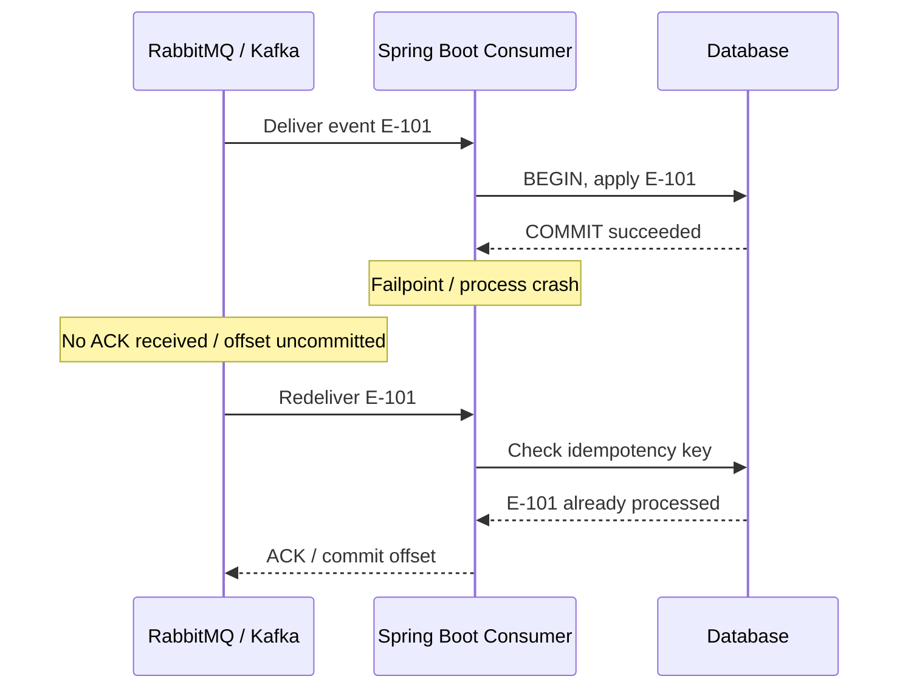

# Simulating Successful Commit Before Acknowledgment

## 1. Why is this an important edge case?

In a Spring Boot application integrating with a database and a message broker, a consumer typically performs two actions:

1. **Write business changes and commit the database transaction.**
2. **Send an acknowledgment (ACK) to the broker confirming the message was processed.**

These two actions belong to **two separate stateful systems**. With standard PostgreSQL/MySQL transactions combined with RabbitMQ or Kafka, Spring Boot does not automatically create a single atomic transaction spanning both the database and the broker.

What happens if step 1 succeeds, then the application stops, loses connectivity, or fails right before step 2?

- The database already contains the result of the first processing attempt.
- The broker has not received the completion acknowledgment, or Kafka has not recorded the corresponding consumer offset.
- When the consumer restarts or delivery is retried, **the exact same message may be delivered again**.
- If the consumer blindly re-executes the side effect, it can deduct stock twice, post duplicate ledger entries, or credit a balance twice.

This is a classic **at-least-once delivery** scenario: the system may redeliver a message to avoid drops, so the application must tolerate repeated processing. This lesson belongs to the *Contracts and Edge Cases* chapter of the Spring Boot integration module: we must verify boundaries across data contracts, transactions, broker acknowledgments, deduplication, testing, and integration observability.

### Incident timeline



**Technical conclusion to prove in this lesson:** a message can be delivered twice while the business mutation is **applied exactly once**. Never infer from listener invocation count that the database was updated the same number of times.

## 2. Distinguish three milestones often conflated

| Milestone | Meaning | What is NOT yet guaranteed |
| --- | --- | --- |
| Consumer **receives** message | Broker delivers the message to the application. | The database has not necessarily changed. |
| Database **COMMIT** succeeds | Changes inside the DB transaction are durable per DB guarantees. | The broker does not necessarily know the consumer finished. |
| Broker **records ACK** / Kafka **commits offset** | The broker can stop redelivering the message per confirmed progress. | ACK itself does not commit the database. |

In RabbitMQ, a *consumer acknowledgment* for a delivery is usually sent via `basicAck(deliveryTag, false)`. The delivery tag is scoped to the **receiving channel**, not a business ID for deduplication. In Kafka, `Acknowledgment.acknowledge()` is a Spring Kafka API for managing offset commits per `AckMode`; calling this method does not mean the offset is immediately committed synchronously to the broker under every configuration.

Do not confuse these concepts:

- **Database COMMIT**: completing the database transaction.
- **Consumer ACK**: confirming a delivery has been handled.
- **RabbitMQ Producer confirm**: broker confirming that a producer published a message; this is a different flow from consumer ACK.
- **Kafka offset commit**: marking consumption progress; does not turn database updates into part of a Kafka transaction.

## 3. Failure matrix by timing

| Failure point | Database | Broker | Consequence on retry |
| --- | --- | --- | --- |
| Before DB commit | Transaction may roll back. | Not ACKed. | Reprocesses from scratch; inspect DB if commit outcome is ambiguous. |
| **After DB commit, before ACK** | **Result already persisted.** | **Completion not recorded.** | **Message may redeliver; high risk of duplicate side effects.** |
| While sending ACK / committing offset | Result already persisted. | Acknowledgment status uncertain due to network error. | Must still treat redelivery as possible. |
| After broker records progress | Result already persisted. | Broker records processed state. | Normally no further redelivery for that progress checkpoint. |

A dangerous ordering is **ACK first, DB commit later**. If the broker records the ACK and the DB transaction then fails, the message can lose its chance to be retried. The foundational rule for normal consumers:

> Acknowledge the broker **only after** the DB transaction has committed successfully, while ensuring message reprocessing is idempotent.

This principle achieves **at-least-once + idempotency**, without automatically creating distributed exactly-once semantics.

## 4. Event contract and database used in the simulation

The example uses Spring Boot, Spring AMQP, RabbitMQ, Spring JDBC, and PostgreSQL. A `PaymentConfirmed` event confirms payment for an order with:

| Field | Meaning | Constraints |
| --- | --- | --- |
| `eventId` | Unique ID of the **event**, preserved across retries/redeliveries. | Required UUID. |
| `paymentId` | Business ID of the **payment**. | Required UUID, never reused for another payment. |
| `orderId` | Order receiving payment. | UUID and the order must exist. |
| `amountMinor` | Monetary amount in minor units (e.g., cents), avoiding floating-point errors. | Positive integer. |

Sample JSON:

```json
{
  "eventId": "11111111-1111-4111-8111-111111111111",
  "paymentId": "22222222-2222-4222-8222-222222222222",
  "orderId": "33333333-3333-4333-8333-333333333333",
  "amountMinor": 5000
}
```

The database uses two defensive layers:

- `processed_inbox` blocks reprocessing the same `(consumer_id, event_id)`.
- `applied_payments` blocks applying the same **`paymentId`** twice, even if the producer accidentally emits two distinct event IDs for one payment.

```sql
CREATE TABLE payment_orders (
    order_id UUID PRIMARY KEY,
    paid_minor BIGINT NOT NULL DEFAULT 0
        CHECK (paid_minor >= 0)
);

CREATE TABLE processed_inbox (
    consumer_id TEXT NOT NULL,
    event_id UUID NOT NULL,
    processed_at TIMESTAMPTZ NOT NULL DEFAULT now(),
    PRIMARY KEY (consumer_id, event_id)
);

CREATE TABLE applied_payments (
    payment_id UUID PRIMARY KEY,
    order_id UUID NOT NULL REFERENCES payment_orders(order_id),
    amount_minor BIGINT NOT NULL CHECK (amount_minor > 0)
);

INSERT INTO payment_orders(order_id, paid_minor)
VALUES ('33333333-3333-4333-8333-333333333333', 0);
```

These tables are written for PostgreSQL. For MySQL, adjust upsert syntax and column types. Every write to `processed_inbox`, `applied_payments`, and `payment_orders` must run **inside the same DB transaction**: if updating the order fails, the processed-event marker must roll back too.

## 5. Configuring RabbitMQ to observe manual ACK

To place a failpoint deliberately right before ACK, use `AcknowledgeMode.MANUAL`. Below is a sample Spring Boot configuration using Spring AMQP; the `payments.confirmed` queue must be declared via infrastructure config or a matching `Queue` bean.

```java
import org.springframework.amqp.core.AcknowledgeMode;
import org.springframework.amqp.rabbit.annotation.EnableRabbit;
import org.springframework.amqp.rabbit.config.SimpleRabbitListenerContainerFactory;
import org.springframework.amqp.rabbit.connection.ConnectionFactory;
import org.springframework.context.annotation.Bean;
import org.springframework.context.annotation.Configuration;

@Configuration
@EnableRabbit
public class RabbitConsumerConfig {

    @Bean
    public SimpleRabbitListenerContainerFactory rabbitListenerContainerFactory(
            ConnectionFactory connectionFactory) {

        var factory = new SimpleRabbitListenerContainerFactory();
        factory.setConnectionFactory(connectionFactory);
        factory.setAcknowledgeMode(AcknowledgeMode.MANUAL);
        factory.setConcurrentConsumers(1); // Fixed for easier observation in demo
        factory.setDefaultRequeueRejected(true); // Demo: redeliver on error
        return factory;
    }
}
```

Note: `defaultRequeueRejected(true)` helps observe redelivery in **transient-error simulations**. In production, do not requeue permanently broken messages forever; classify errors, bound retries, and use a dead-letter queue (DLQ).

### Consumer: transaction commits before ACK

The sample below uses `TransactionTemplate` so transaction boundaries are explicit. When `executeWithoutResult(...)` returns normally, the transaction manager has already committed. Putting `@Transactional` on the whole listener while calling `basicAck(...)` **inside the listener** can send the ACK before the transaction interceptor commits upon method return; that pattern **does not cleanly enforce the desired ordering**.

```java
import com.fasterxml.jackson.core.JsonProcessingException;
import com.fasterxml.jackson.databind.ObjectMapper;
import com.rabbitmq.client.Channel;
import java.util.UUID;
import java.util.concurrent.atomic.AtomicBoolean;
import org.springframework.amqp.AmqpRejectAndDontRequeueException;
import org.springframework.amqp.core.Message;
import org.springframework.amqp.rabbit.annotation.RabbitListener;
import org.springframework.beans.factory.annotation.Value;
import org.springframework.jdbc.core.JdbcTemplate;
import org.springframework.stereotype.Component;
import org.springframework.transaction.PlatformTransactionManager;
import org.springframework.transaction.support.TransactionTemplate;

@Component
public class PaymentConfirmedConsumer {
    private static final String CONSUMER_ID = "payment-projection-v1";

    private final JdbcTemplate jdbc;
    private final ObjectMapper json;
    private final TransactionTemplate tx;
    private final AtomicBoolean failAfterCommitOnce;

    public PaymentConfirmedConsumer(
            JdbcTemplate jdbc,
            ObjectMapper json,
            PlatformTransactionManager transactionManager,
            @Value("${demo.fail-after-commit-once:false}") boolean failOnce) {
        this.jdbc = jdbc;
        this.json = json;
        this.tx = new TransactionTemplate(transactionManager);
        this.failAfterCommitOnce = new AtomicBoolean(failOnce);
    }

    @RabbitListener(queues = "payments.confirmed")
    public void consume(Message raw, Channel channel) throws Exception {
        PaymentConfirmed event = decodeAndValidate(raw);
        long tag = raw.getMessageProperties().getDeliveryTag();

        // BEGIN -> update all tables -> COMMIT.
        tx.executeWithoutResult(status -> applyOnce(event));

        // Enabled only in test environments. DB is already committed here.
        if (failAfterCommitOnce.compareAndSet(true, false)) {
            throw new IllegalStateException(
                    "INJECTED: DB committed, RabbitMQ ACK not yet sent");
        }

        // ACK sent after transaction returns successfully.
        channel.basicAck(tag, false);
    }

    private void applyOnce(PaymentConfirmed event) {
        int firstEvent = jdbc.update("""
                INSERT INTO processed_inbox(consumer_id, event_id)
                VALUES (?, ?)
                ON CONFLICT DO NOTHING
                """, CONSUMER_ID, event.eventId());

        if (firstEvent == 0) {
            return; // Already committed this event on a prior delivery.
        }

        int firstPayment = jdbc.update("""
                INSERT INTO applied_payments(
                    payment_id, order_id, amount_minor)
                VALUES (?, ?, ?)
                ON CONFLICT DO NOTHING
                """, event.paymentId(), event.orderId(), event.amountMinor());

        if (firstPayment == 0) {
            // Same paymentId seen in a different event: verify consistency.
            AppliedPayment saved = jdbc.queryForObject("""
                    SELECT order_id, amount_minor
                    FROM applied_payments
                    WHERE payment_id = ?
                    """, (rs, rowNum) -> new AppliedPayment(
                            rs.getObject("order_id", UUID.class),
                            rs.getLong("amount_minor")), event.paymentId());

            if (saved == null
                    || !saved.orderId().equals(event.orderId())
                    || saved.amountMinor() != event.amountMinor()) {
                throw new IllegalStateException(
                        "Conflicting paymentId: " + event.paymentId());
            }
            return;
        }

        int updatedOrders = jdbc.update("""
                UPDATE payment_orders
                   SET paid_minor = paid_minor + ?
                 WHERE order_id = ?
                """, event.amountMinor(), event.orderId());

        if (updatedOrders != 1) {
            // Exception rolls back both inbox and applied_payments.
            throw new IllegalStateException(
                    "Order not found: " + event.orderId());
        }
    }

    private PaymentConfirmed decodeAndValidate(Message raw) {
        try {
            PaymentConfirmed event =
                    json.readValue(raw.getBody(), PaymentConfirmed.class);

            if (event.eventId() == null
                    || event.paymentId() == null
                    || event.orderId() == null
                    || event.amountMinor() <= 0) {
                throw new IllegalArgumentException("Missing/invalid fields");
            }
            return event;
        } catch (JsonProcessingException | IllegalArgumentException ex) {
            // Permanent schema error: no infinite retry; configure DLQ to retain.
            throw new AmqpRejectAndDontRequeueException(
                    "Invalid PaymentConfirmed event", ex);
        }
    }

    public record PaymentConfirmed(
            UUID eventId,
            UUID paymentId,
            UUID orderId,
            long amountMinor) {}

    private record AppliedPayment(UUID orderId, long amountMinor) {}
}
```

The code uses standard APIs across Spring Boot 3.x, Java 17+, Spring AMQP, and PostgreSQL. The project requires matching dependencies: `spring-boot-starter-amqp`, `spring-boot-starter-jdbc`, PostgreSQL JDBC driver, and configured Jackson. A `DataSource` and `PlatformTransactionManager` must manage the JDBC operations. This illustrates **one specific consumer**; production business flows also require validating order state transitions and defining long-term error handling.

### Why must deduplication sit inside the transaction?

Suppose you insert into `processed_inbox` first and the process crashes before adding the amount. If the two writes are not in the same transaction, redelivery sees the event as processed and skips it, losing the payment update. When sharing one transaction:

- First attempt succeeds: `processed_inbox`, `applied_payments`, and `payment_orders` commit together.
- First attempt fails before commit: all changes roll back, allowing redelivery to retry cleanly.
- First attempt commits before ACK: the marker persists durably, so redelivery skips adding the money and ACKs cleanly.

Database unique constraints also protect against **two consumers processing duplicates concurrently** far better than an unconstrained `SELECT` followed by `INSERT`. When relying on a producer-supplied idempotency key, ensure that key has stable semantics and is never regenerated per retry.

## 6. Running the simulation step by step

In an isolated test environment, start PostgreSQL and RabbitMQ, create the three tables from section 4, declare the `payments.confirmed` queue, and configure:

```yaml
demo:
  fail-after-commit-once: true

spring:
  rabbitmq:
    host: localhost
    port: 5672
  datasource:
    url: jdbc:postgresql://localhost:5432/integration_demo
    username: demo
    password: demo
```

This is an **illustrative config snippet**, not an instruction to add an `application.yml` to the repository. Use sample credentials only in local isolated environments. Publish the JSON from section 4 with content type `application/json` to the queue via `RabbitTemplate`, RabbitMQ management UI, or a test publisher.

Expected progression:

| Step | Listener | Database state | Broker state |
| --- | --- | --- | --- |
| T0 | Receives message #1. | `paid_minor = 0` | Delivery unACKed. |
| T1 | `applyOnce` writes inbox, payment, and adds amount. | Transaction **commits**: `paid_minor = 5000`. | Still unACKed. |
| **T2** | **Failpoint throws after commit, before `basicAck`.** | **Remains 5000.** | Container handles error; demo config allows requeue. |
| T3 | Same event is redelivered. | Sees existing inbox key, skips adding money. | Second delivery awaiting ACK. |
| T4 | Second transaction completes, consumer ACKs. | `paid_minor = 5000`. | Confirms consumption progress. |

The `AtomicBoolean` failpoint fires **once per instance** so the redelivery succeeds. Here, the exception simulates the exact **logical fault window**, though the JVM stays alive and the container may send a negative acknowledgment/requeue. An actual **process crash** differs in how the broker detects failure: channel/connection closure or heartbeat timeout triggers requeuing of unACKed messages. Both test the core assumption: **DB committed, broker has not confirmed success**.

### Proving the outcome with SQL

After waiting for the consumer to settle, inspect:

```sql
SELECT paid_minor
FROM payment_orders
WHERE order_id = '33333333-3333-4333-8333-333333333333';
-- Expected: 5000

SELECT COUNT(*) AS inbox_rows
FROM processed_inbox
WHERE consumer_id = 'payment-projection-v1'
  AND event_id = '11111111-1111-4111-8111-111111111111';
-- Expected: 1

SELECT COUNT(*) AS receipt_rows
FROM applied_payments
WHERE payment_id = '22222222-2222-4222-8222-222222222222';
-- Expected: 1
```

If listener invocations equal 2 while all three checks return `5000 / 1 / 1`, the program proved **duplicate delivery did not cause duplicate side effects** for this scenario. Also verify the queue has zero ready/unacked messages left after ACK and no messages unexpectedly routed to a DLQ.

**The test fails** if `paid_minor = 10000`, which indicates the payment was applied twice. If `paid_minor = 0` while the inbox already has a row, the transaction boundary was split wrongly or the processed marker ran too early.

## 7. Simulating a real crash in the exact fault window

Throwing an exception tests the redelivery path quickly, yet to verify process restarts, use a **barrier** enabled exclusively in integration tests:

```java
// Pseudocode in a test-only failpoint, right after tx.executeWithoutResult(...).
signalTestHarness("DB_COMMITTED_BEFORE_ACK", event.eventId());
waitUntilTestHarnessReleasesOrProcessStops();
channel.basicAck(tag, false);
```

Test sequence:

1. Run the consumer application as **a separate process/container** with the post-commit barrier enabled.
2. Publish a single message and wait for the test harness to receive `DB_COMMITTED_BEFORE_ACK`.
3. Query using an independent database connection to confirm the transaction committed and `paid_minor = 5000`. This proves the commit is visible **before** stopping the process.
4. Forcibly terminate the consumer process/container at the barrier before `basicAck` runs. Only do this in test environments.
5. Restart the consumer with the failpoint disabled. The broker can now redeliver the unACKed message.
6. Wait for the consumer to ACK the redelivery; verify `paid_minor = 5000`, one inbox row, and one payment row.

This test is stronger than throwing an in-JVM exception because it genuinely exercises restarts, reconnects, uncertain ACK states, and database durability. Put finite timeouts on barriers and every verification step so tests never hang forever.

Note: **do not simulate this failpoint by throwing inside `@Transactional` or `TransactionTemplate` before completion**. That rolls back the database and tests an entirely different failure.

## 8. Designing automated tests and assertions

An integration test can run Testcontainers for PostgreSQL, RabbitMQ, and a Spring Boot test application. The crucial assertion is not how many times the listener fired, but the **durability and uniqueness of business side effects**.

```java
// Skeleton illustrating integration test idea with initialized fixtures.
@Test
void committedButNotAcked_isRedeliveredWithoutDoublePayment() {
    // Arrange: order exists with paid_minor = 0, empty inbox.
    // consumer configured with fail-after-commit-once=true.
    rabbitTemplate.convertAndSend("payments.confirmed", PAYMENT_EVENT_JSON);

    // Assert eventual: after failure requeues and next delivery ACKs.
    await().atMost(Duration.ofSeconds(15)).untilAsserted(() -> {
        assertThat(jdbc.queryForObject(
                "SELECT paid_minor FROM payment_orders WHERE order_id = ?",
                Long.class, ORDER_ID)).isEqualTo(5000L);
        assertThat(countInbox(EVENT_ID)).isEqualTo(1);
        assertThat(countAppliedPayments(PAYMENT_ID)).isEqualTo(1);
        assertThat(readyAndUnackedMessageCount()).isZero();
    });

    assertThat(deliveriesObserved(EVENT_ID)).isGreaterThanOrEqualTo(2);
}
```

This is a **skeleton**, not a standalone runnable test: `countInbox`, `countAppliedPayments`, `readyAndUnackedMessageCount`, `deliveriesObserved`, and the constants are helper methods/fields to implement in your test fixture. Use Awaitility for async checks with reliable queue inspection and delivery counting. Avoid fixed `Thread.sleep` calls or asserting immediately after publish, which produces flaky tests.

Minimum expanded test suite:

| Case | Fault injection | Required proof |
| --- | --- | --- |
| Commit then lost ACK | Failpoint after `TransactionTemplate`; or kill process at barrier. | Event may redeliver; DB applies once. |
| Failure before commit | Throw exception updating `payment_orders`. | Transaction rolls back inbox too; retry succeeds cleanly. |
| Duplicate `eventId` | Publish identical JSON twice. | Two deliveries, one business mutation. |
| Two `eventId`s for same `paymentId` | Publish two distinct event IDs for the same payment. | Payment ID constraint blocks double crediting. |
| Duplicate key with conflicting values | Same `paymentId`, different `orderId` or amount. | Conflict detected; never silently accept bad data. |
| Schema-corrupt message | Missing `eventId` or malformed JSON. | Rejected without infinite requeue; routed to DLQ if configured. |
| Temporary DB disconnect | Block or disconnect DB during one attempt. | Never ACKs before commit; bounded retry recovers. |
| Restart and multiple consumers | Kill/restart process, run multiple replicas on queue. | Unique keys hold with no duplicate writes in races. |

Separate **delivery count** (broker deliveries observed) from **applied count** (transactions producing business effects). During retries, delivery count rising is expected; applied count must stay 1.

## 9. When replacing RabbitMQ with Kafka

The exact same problem occurs in Kafka, except the completion signal is **offset commit progress** rather than RabbitMQ `basicAck`:

```java
// Boundary illustration: listener container must configure
// AckMode.MANUAL or MANUAL_IMMEDIATE, with auto-commit disabled.
@KafkaListener(topics = "payment-confirmed", groupId = "payments-projection")
public void onPayment(
        PaymentConfirmed event,
        Acknowledgment acknowledgment) {

    tx.executeWithoutResult(status -> applyOnce(event));
    faultInjector.failAfterCommitBeforeAckIfEnabled();
    acknowledgment.acknowledge();
}
```

In Spring Kafka, how `acknowledge()` leads to an offset commit depends on `AckMode`, sync/async commit settings, and listener container configuration; therefore observe **actual committed offsets**, not just a log saying `acknowledge()` was called. If the process crashes after DB commit and before the required offset persists, rebalances or restarts re-read the record.

Even when using Kafka transactions for **Kafka → Kafka** exactly-once processing, updates to external databases still need their own consistency design—typically idempotency, outbox/inbox, or carefully engineered transaction coordination. Never infer from an `exactly_once` setting name that SQL side effects cannot repeat.

With JMS, the concept is similar, though session transaction scopes and acknowledge modes have their own semantics. Never copy RabbitMQ `basicAck` code verbatim to JMS.

## 10. Pitfalls that invalidate simulations

### ACK happened before database commit

A common implementation mistake:

```java
// WRONG example of transaction boundaries:
@Transactional
public void onMessage(..., Channel channel) throws IOException {
    jdbc.update("UPDATE ..."); // Not yet committed.
    channel.basicAck(tag, false); // ACK before method returns/commits.
}
```

When a transaction interceptor wraps the method, commit happens **after the method returns**. This pattern loses messages if DB commit fails after the ACK goes out. Replace it with an explicit narrow transaction, a `@Transactional` service invoked from the listener through a Spring proxy, or a verified post-commit hook.

### Checking only the `redelivered` flag for deduplication

RabbitMQ sets a redelivered flag, but that flag only describes delivery history—it is not a stable business key. Duplicates can come from producer republishes, DLQ replays, or re-emitted events arriving as fresh deliveries. Deduplication keys must come from the **event/business ID contract**, backed by unique constraints or durable idempotency storage.

### Writing the “processed” audit row in a separate transaction

If the audit row commits while the business update fails, redelivery misidentifies the event as done. Keep dependent SQL writes—idempotency markers and business updates—in a single transaction. External steps like HTTP calls, emails, or outbound broker publishes require additional patterns such as transactional outboxes, target API idempotency keys, or sagas.

### Retrying every error infinitely

Malformed JSON or nonexistent order IDs will not heal through endless retries. Separate transient failures (DB unavailable, deadlocks) from permanent failures (contract violations), and configure bounded retries/backoff, DLQs, and alerts. In the example, `AmqpRejectAndDontRequeueException` handles broken payloads; **configure explicit DLX/DLQ topology** if messages must be retained for inspection instead of discarded.

### Same business key with conflicting content

A unique constraint on `paymentId` prevents double counting, yet two messages sharing a `paymentId` with different amounts or order IDs signal a **contract conflict**, not a harmless duplicate. The sample above reads the stored payment and throws on mismatch. In production, classify this exception as a permanent business conflict, emit metrics, and route to investigation or a DLQ with bounded retries.

### Declaring “exactly once” from one test run

A valid SQL state after one simulation is **local evidence for that single test case**, not proof every failure yields exactly-once outcomes. You must also test replica races, post-crash retries, post-ACK disconnects, uncertain transactions, key retention, and delayed replays.

## 11. Observing and troubleshooting in production

At minimum, log and measure:

- `eventId`, `paymentId`, `orderId`, `consumerId`, and trace ID across receipt, commit, and ACK.
- Delivery count, applied event count, detected duplicate count, and DLQ message count.
- Database execution time, commit-to-ACK latency, transaction rollbacks, and ACK/offset commit errors.
- For Kafka: consumer lag, partition, processed offsets, and committed offsets; for RabbitMQ: ready/unacked messages, redeliveries, and channel state.
- Business key conflict rates and retention age of idempotency keys.

Use structured logs without logging sensitive payloads like payment details or PII. Example searchable log sequence:

```text
event=E-101 phase=RECEIVED attempt=1
event=E-101 phase=DB_COMMITTED paymentApplied=true
event=E-101 phase=BEFORE_ACK faultInjected=true
event=E-101 phase=RECEIVED attempt=2
event=E-101 phase=DB_COMMITTED paymentApplied=false duplicate=true
event=E-101 phase=ACK_SENT
```

`ACK_SENT` only proves the application invoked the ACK API; on connection errors, cross-check broker state to confirm actual progress. In Kafka, monitor committed offsets rather than treating `acknowledge()` calls as broker persistence.

During an incident:

1. Identify the message ID and failure stage via traces/logs.
2. Check whether the DB already committed the side effect and idempotency key.
3. Check broker delivery/offset state and the DLQ—avoid manual replays while automatic retries are still running.
4. When replaying, keep business and event IDs intact; monitor duplicate counts and final state.
5. If data conflicts or external side effects are detected, run controlled business reconciliation/compensation.

## 12. Self-check questions

1. Why does a successful `COMMIT` not prove RabbitMQ received `basicAck`?
2. If you throw an exception **inside** `TransactionTemplate` instead of **after** it returns, which failure type are you simulating?
3. Why must a `processed_inbox` row never commit before the business update?
4. What constraint prevents two consumers receiving duplicate deliveries from crediting money twice?
5. How should two messages with the same `paymentId` but different `amountMinor` values be handled?
6. In Spring Kafka, what else must be verified after calling `acknowledgment.acknowledge()`?
7. How do you design a real crash test proving a process terminated **after DB commit and before ACK**?

## Summary

The window between **successful database commit** and **successful broker acknowledgment** is a critical edge case that must be actively tested in Spring Boot integration systems. Simulate it with a post-transaction failpoint, verify message redelivery, and confirm the database applies the side effect only once. Production designs should combine stable event contracts, durable idempotency keys with unique constraints, a single transaction covering inbox and business writes, ACK after commit, and clear retry/DLQ, observability, and recovery testing.

### References

- [Spring AMQP Reference — Message Listener Container Configuration](https://docs.spring.io/spring-amqp/reference/amqp/containerAttributes.html)
- [Spring AMQP Reference — Exception Handling](https://docs.spring.io/spring-amqp/reference/amqp/exception-handling.html)
- [Spring for Apache Kafka Reference — Committing Offsets](https://docs.spring.io/spring-kafka/reference/kafka/receiving-messages/message-listener-container.html)
- [Spring Framework Reference — Programmatic Transaction Management](https://docs.spring.io/spring-framework/reference/data-access/transaction/programmatic.html)
