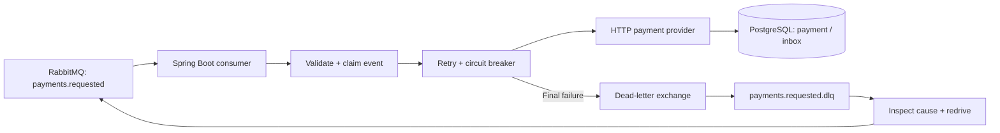
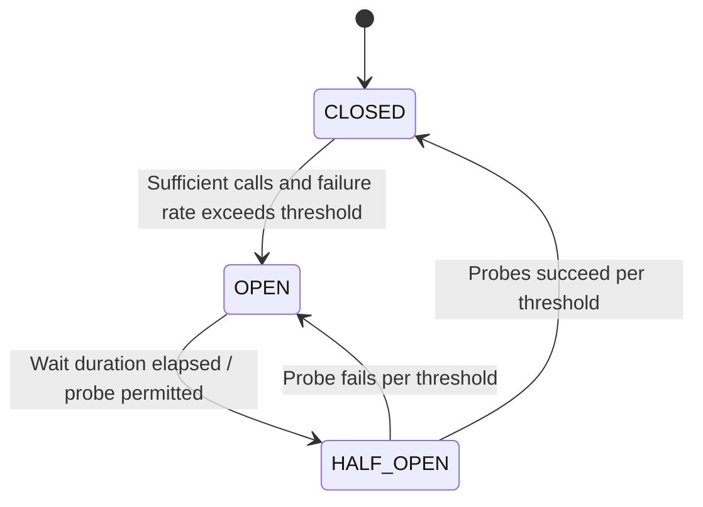
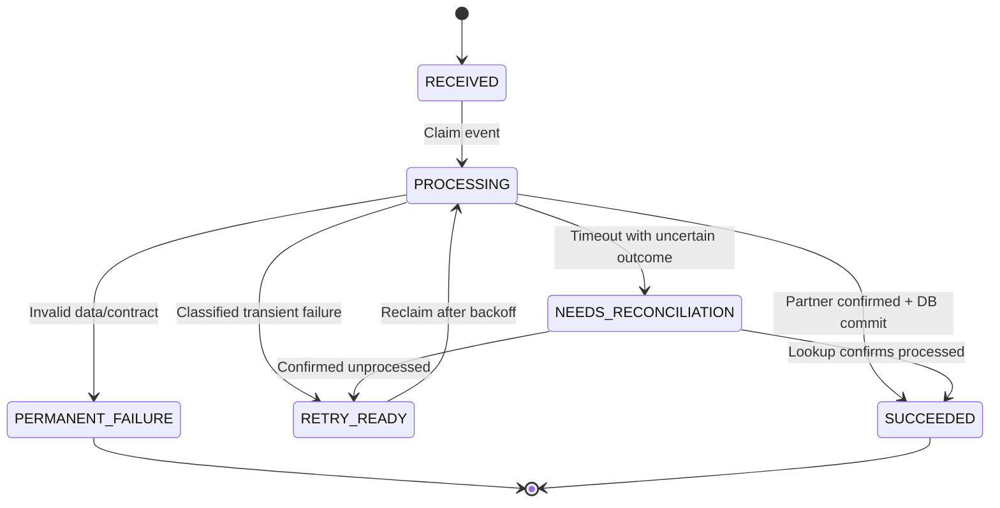

# Testing Retries, Circuit Breakers, Dead-Letter Queues, and Recovery

A Spring Boot integration flow can behave cleanly along the happy path yet still lose data under timeouts, transient failures, HTTP 4xx errors, broker redeliveries, or crashes between two writes. Testing an integration flow therefore cannot stop at confirming an API call succeeded. You must prove the **error-handling contract**: when to retry, when to stop calling an external dependency, where failed messages go, and how to resume safely after partial completion.

This lesson belongs to the **Contracts and Edge Cases** chapter of the `SPRING_BOOT_INTEGRATION` module, where Spring Boot connects HTTP clients, databases, caches, brokers, and Spring Integration adapters. We use a hypothetical payment flow to test retry policies, circuit breakers, dead-letter queues (DLQs), transactions, idempotency, and recovery together. Examples use Java, Resilience4j, Spring AMQP/RabbitMQ, and PostgreSQL; similar principles apply to Kafka, JMS, or other integration flows when adapted to each platform's ACK, retry, and DLQ mechanics.

## 1. Define the contract before writing tests

Suppose the system consumes `PaymentRequested` events from RabbitMQ, checks order status, calls an HTTP payment provider, and persists the result. Three replicas of the application consume from the queue concurrently.



This shows the logical flow. In reality, **making an HTTP call and committing PostgreSQL do not belong to one atomic transaction**. If HTTP creates a payment and the application crashes before writing the database, subsequent processing must recognize the existing request via an idempotency key and reconcile the outcome instead of charging again.

### Message and HTTP contract

Example payload:

```json
{
  "eventId": "evt-7001",
  "orderId": "order-839",
  "amountMinor": 125000,
  "currency": "VND",
  "occurredAt": "2026-11-20T08:30:00Z",
  "schemaVersion": 1
}
```

Key decisions that must be written into the contract:

| Property | Recommended rule | How to test |
| --- | --- | --- |
| `eventId` | Event ID remains stable across broker redeliveries and redrives | Re-send same ID; verify business state updates only once. |
| `orderId` | Business entity identifier; validate existence and eligible state | Orders in invalid states are rejected with clear reason. |
| `amountMinor`, `currency` | Money in minor units; validate currency and bounds | Negative, zero, overflow, unsupported currency. |
| `schemaVersion` | Compatibility rules and rejection for unsupported versions | Older consumer seeing new payload does not silently drop message. |
| Outbound `idempotencyKey` | Stable per payment command, e.g. `payment:order-839` | Multiple HTTP attempts reuse the exact same key. |
| Final status | `SUCCEEDED`, `PERMANENT_FAILURE`, or explicit recovery state | Crash/retry never turns an uncertain state into success. |
| Broker ACK | ACK only once processing or error routing is durably confirmed per contract | Crash before ACK triggers redelivery without duplicate side effects. |

For meaningful tests, distinguish **message delivery**, **logical invocation**, and **HTTP attempt**. One message delivery can produce three HTTP attempts via retries; a failed message ACKed to a DLQ can later be redriven as a new delivery; a crash after commit can trigger another broker delivery of the same event. Conflating all three into a single “retry count” causes broken verification.

## 2. Classifying errors and handling decisions

Not every exception deserves a retry. Contracts should decide based on cause, likelihood of recovering after a delay, and safety of re-sending:

| Signal | Error category | Direct retry? | Circuit breaker? | Final handling |
| --- | --- | --- | --- | --- |
| HTTP 502/503/504 or connection refused | Transient, upstream unavailable | Bounded, with backoff | Yes | Delay or route to DLQ if budget exhausted. |
| HTTP 429 | Rate limit | Yes if allowed by contract; honor valid `Retry-After` | Optional per dedicated policy | Appropriate delay; no hot retry loop. |
| HTTP read timeout after POST | **Uncertain outcome**: partner may have processed | Only with idempotency/reconciliation | Optional | Query status by request ID/key before deciding to resend. |
| HTTP 400 due to invalid payload | Data/contract error | No | Normally not counted as availability failure | DLQ/quarantine with cause and diagnostic data for fixing. |
| HTTP 401/403 | Configuration, permissions, or credential error | Do not loop indefinitely | Alert operations | Halt affected flow and fix configuration/secrets. |
| HTTP 404 | Depends on endpoint semantics | Not by default | Depends on contract | Retry only if partner documents eventual consistency. |
| HTTP 409 | State conflict or duplicate request | Depends on business error code | Usually no | Query status, match keys, and update idempotently. |
| In-app validation exception | Invalid input data | No | No | DLQ with standardized error code. |
| Database deadlock/timeout | Transient, potentially self-recovering | Bounded across **proper transaction scope** | Separate DB circuit if needed | Roll back and retry the entire safe transaction unit. |
| `CallNotPermittedException` when breaker OPEN | Protecting external system | Do not retry immediately through same breaker | Breaker actively protecting | Delay/requeue for later; consider pausing consumer. |
| Code bug, misconfiguration, schema mismatch | Unlikely to self-heal | No hot retry | Do not hide bugs behind breakers | Alert, DLQ/quarantine, and deploy a fix. |

Three principles:

1. **Bounded retries.** Resilience4j's `maxAttempts = 3` includes the initial attempt—not three retries after the first try. Measure attempt counts, elapsed wait, and total processing duration.
2. **Circuit breakers protect failing dependencies.** They do not repair bad messages, heal corrupt data, or replace HTTP client timeouts.
3. **A DLQ holds work needing follow-up.** Routing a message to a DLQ does not mean the business operation is finished; you still need monitoring, triage, remediation, and replay procedures.

## 3. Building a boundary-based test matrix

Instead of pushing every check into heavy `@SpringBootTest` suites, separate layers by goal:

| Test layer | Right tool | What to observe |
| --- | --- | --- |
| Retry policy unit tests | JUnit 5 + fake HTTP client / real Resilience4j | Attempt count, retried exception classes, actual invocation count. |
| Circuit breaker unit tests | JUnit 5 + fake operation | `CLOSED → OPEN → HALF_OPEN`, rejected calls, real request count. |
| HTTP contract tests | WireMock or MockWebServer | Method, URL, headers, idempotency key, error codes, bodies, timeouts. |
| Broker integration tests | Testcontainers RabbitMQ + Spring AMQP | ACK/NACK, DLX routing, message body/headers, no consumer spin loops. |
| Database integration tests | Testcontainers PostgreSQL | Inbox/unique constraints, rollbacks, claims, checkpoints, transactions. |
| Recovery/chaos tests | Two processes/pods or killable test harness | Crash points, redeliveries, stale states, post-restart side effects. |
| Staging end-to-end | Downstream sandbox + real/equivalent broker & DB | Time budgets, alerts, redrive runbooks, rolling deployments. |

Fast unit tests verify error-classification rules. Integration tests prove what mocks cannot: RabbitMQ topology wiring, transaction commits, listener container ACKs, multi-replica contention, and real connection failures.

## 4. Designing testable retries

### 4.1. Place the policy near the HTTP adapter

Example using Resilience4j in Java. Two exceptions represent two adapter-level failure classifications:

```java
public final class TemporaryPartnerFailure extends RuntimeException {
    public TemporaryPartnerFailure(String message) {
        super(message);
    }
    public TemporaryPartnerFailure(String message, Throwable cause) {
        super(message, cause);
    }
}

public final class PermanentPartnerFailure extends RuntimeException {
    public PermanentPartnerFailure(String message) {
        super(message);
    }
}
```

These are illustrative types—place each `public` class in its own Java file per language rules. The HTTP adapter maps 5xx, eligible 429s, and retryable network errors to `TemporaryPartnerFailure`, and permanent validation errors to `PermanentPartnerFailure`. On read timeouts after POST, the adapter must preserve that the outcome is **unknown** and allow retries only when the partner supports idempotency. Never assume `SocketTimeoutException` means the request never reached the server.

```java
import java.time.Duration;
import io.github.resilience4j.retry.Retry;
import io.github.resilience4j.retry.RetryConfig;

Retry retry = Retry.of(
        "payment-partner",
        RetryConfig.custom()
                .maxAttempts(3)
                .waitDuration(Duration.ofMillis(200))
                .retryExceptions(TemporaryPartnerFailure.class)
                .ignoreExceptions(PermanentPartnerFailure.class)
                .build()
);
```

Note that fixed `waitDuration` here keeps the snippet simple; production usually uses exponential backoff with jitter and an end-to-end deadline. With a 5-second per-attempt HTTP timeout, three attempts already burn over 15 seconds before counting backoff, locks/transactions, or broker wait limits. For HTTP 429, parse `Retry-After` explicitly into your delay policy if supported; the configuration above **does not automatically honor that header**.

### 4.2. Testing attempt counts and stop conditions

This unit test runs real Resilience4j against a fake operation—no network or Docker needed:

```java
import static org.junit.jupiter.api.Assertions.*;

import java.time.Duration;
import java.util.concurrent.atomic.AtomicInteger;
import java.util.function.Supplier;
import org.junit.jupiter.api.Test;
import io.github.resilience4j.retry.Retry;
import io.github.resilience4j.retry.RetryConfig;

class RetryPolicyTest {
    private Retry newRetry() {
        return Retry.of("partner", RetryConfig.custom()
                .maxAttempts(3)
                .waitDuration(Duration.ZERO) // unit tests don't need to sleep
                .retryExceptions(TemporaryPartnerFailure.class)
                .ignoreExceptions(PermanentPartnerFailure.class)
                .build());
    }

    @Test
    void transientFailureThenSuccess() {
        AtomicInteger attempts = new AtomicInteger();
        Supplier<String> httpCall = () -> {
            if (attempts.incrementAndGet() < 3) {
                throw new TemporaryPartnerFailure("503");
            }
            return "accepted";
        };

        String result = Retry.decorateSupplier(newRetry(), httpCall).get();

        assertEquals("accepted", result);
        assertEquals(3, attempts.get()); // 1 initial + 2 retries
    }

    @Test
    void transientFailureStopsAfterThreeAttempts() {
        AtomicInteger attempts = new AtomicInteger();
        Supplier<String> httpCall = () -> {
            attempts.incrementAndGet();
            throw new TemporaryPartnerFailure("503");
        };

        assertThrows(TemporaryPartnerFailure.class,
                () -> Retry.decorateSupplier(newRetry(), httpCall).get());
        assertEquals(3, attempts.get());
    }

    @Test
    void permanentFailureDoesNotRetry() {
        AtomicInteger attempts = new AtomicInteger();
        Supplier<String> httpCall = () -> {
            attempts.incrementAndGet();
            throw new PermanentPartnerFailure("400");
        };

        assertThrows(PermanentPartnerFailure.class,
                () -> Retry.decorateSupplier(newRetry(), httpCall).get());
        assertEquals(1, attempts.get());
    }
}
```

Critical assertions are the **actual number of HTTP invocations**, the final exception, and proving non-retryable errors stop after one attempt. Never assert only the return value: broken code could return `accepted` after sending multiple payments with different idempotency keys.

### 4.3. Testing backoff and time budgets

In unit tests, set wait duration to zero to avoid slow scheduler-dependent tests. In integration tests, use a fake HTTP server recording request timestamps, enable real timeouts, and verify:

- The second request arrives **after** the configured backoff, without hot spinning.
- Attempts never exceed `maxAttempts`, even across repeated HTTP 429/503 responses.
- HTTP clients enforce connect/read/response timeouts; total budgets stay within request/message deadlines.
- Every attempt of a single payment command uses **the exact same idempotency key**.
- Canceled requests and thread interrupts are respected per contract rather than swallowed while continuing retries.

Avoid asserting exact millisecond intervals in integration tests due to CI scheduling jitter and GC pauses. Use tolerances, monotonic clocks, and aggregate invariants. To test custom backoff math, extract the delay function and unit-test exact boundary outputs on fixed inputs.

## 5. Testing a circuit breaker as a state machine

A circuit breaker typically has three main states:



When **CLOSED**, calls proceed and failures accumulate in the sliding window. When **OPEN**, calls fail fast (Resilience4j throws `CallNotPermittedException`) so real traffic to the partner drops to zero. When **HALF_OPEN**, a limited number of probe calls are allowed; their outcomes determine whether the breaker closes or re-opens. Whether `OPEN → HALF_OPEN` transitions automatically in the background or lazily on the next incoming call depends on configuration.

Example configuration:

```java
import java.time.Duration;
import io.github.resilience4j.circuitbreaker.CircuitBreaker;
import io.github.resilience4j.circuitbreaker.CircuitBreakerConfig;

CircuitBreaker breaker = CircuitBreaker.of(
        "payment-partner",
        CircuitBreakerConfig.custom()
                .slidingWindowSize(4)
                .minimumNumberOfCalls(4)
                .failureRateThreshold(50.0f)
                .waitDurationInOpenState(Duration.ofSeconds(5))
                .permittedNumberOfCallsInHalfOpenState(1)
                .recordExceptions(TemporaryPartnerFailure.class)
                .ignoreExceptions(PermanentPartnerFailure.class)
                .build()
);
```

This example records only selected transient errors toward the breaker while ignoring permanent business exceptions. Production systems must classify timeouts, auth errors, HTTP 4xx, and `CallNotPermittedException` deliberately per contract rather than treating every exception as partner downtime.

### 5.1. Testing OPEN, call rejection, and HALF_OPEN

```java
import static org.junit.jupiter.api.Assertions.*;

import java.time.Duration;
import java.util.concurrent.atomic.AtomicInteger;
import java.util.function.Supplier;
import org.junit.jupiter.api.Test;
import io.github.resilience4j.circuitbreaker.CallNotPermittedException;
import io.github.resilience4j.circuitbreaker.CircuitBreaker;
import io.github.resilience4j.circuitbreaker.CircuitBreakerConfig;

class CircuitBreakerPolicyTest {

    @Test
    void opensAfterFailuresAndClosesAfterHealthyProbe() {
        CircuitBreaker breaker = CircuitBreaker.of("partner-test",
                CircuitBreakerConfig.custom()
                        .slidingWindowSize(2)
                        .minimumNumberOfCalls(2)
                        .failureRateThreshold(50.0f)
                        .permittedNumberOfCallsInHalfOpenState(1)
                        .waitDurationInOpenState(Duration.ofSeconds(30))
                        .build());

        AtomicInteger httpAttempts = new AtomicInteger();
        Supplier<String> failingHttp = CircuitBreaker.decorateSupplier(
                breaker, () -> {
                    httpAttempts.incrementAndGet();
                    throw new TemporaryPartnerFailure("503");
                });

        assertThrows(TemporaryPartnerFailure.class, failingHttp::get);
        assertThrows(TemporaryPartnerFailure.class, failingHttp::get);
        assertEquals(CircuitBreaker.State.OPEN, breaker.getState());

        assertThrows(CallNotPermittedException.class, failingHttp::get);
        assertEquals(2, httpAttempts.get()); // OPEN blocked the third request

        // Explicit transition to test HALF_OPEN logic without sleeping 30 seconds.
        breaker.transitionToHalfOpenState();

        Supplier<String> healthyHttp =
                CircuitBreaker.decorateSupplier(breaker, () -> "ok");
        assertEquals("ok", healthyHttp.get());
        assertEquals(CircuitBreaker.State.CLOSED, breaker.getState());
    }
}
```

This test verifies state transitions and call rejection. It **does not test timed auto-transition** because it explicitly invokes `transitionToHalfOpenState()`. Add an integration test with a short wait duration, `Awaitility`, and automatic transition (if enabled) or the first probe call after the wait expires to verify production settings.

Additional tests to write:

1. Before reaching `minimumNumberOfCalls`, the breaker does not trip prematurely.
2. With mixed successes/failures, the failure rate computes over the **right window type** (`COUNT_BASED`/`TIME_BASED`).
3. While `OPEN`, zero real HTTP requests go out; fallbacks are never mistaken for completed payments.
4. While `HALF_OPEN`, only the permitted probe count executes; extra concurrent calls are rejected.
5. A failed probe re-opens the breaker per config; enough healthy probes close it.
6. If each replica maintains an independent breaker, state is local; never assume one pod tripping opens breakers on all other pods.

## 6. Composition order of retry and circuit breaker

Both retry and circuit breaker can wrap a call. **Wrapping order defines what unit the breaker counts**, so make it explicit in tests:

```java
Supplier<Receipt> original = () -> partnerClient.charge(command);

// Circuit breaker outside: one logical invocation may span multiple HTTP attempts.
Supplier<Receipt> retried = Retry.decorateSupplier(retry, original);
Supplier<Receipt> protectedCall =
        CircuitBreaker.decorateSupplier(breaker, retried);

Receipt receipt = protectedCall.get();
```

With this ordering, if one logical call tries HTTP three times and still fails, the breaker records **one failure for that logical call**. When the breaker is `OPEN`, the inner retry does not run at all. If reversed to `Retry.decorateSupplier(retry, CircuitBreaker.decorateSupplier(breaker, original))`, the breaker sees every individual HTTP attempt—and retry may even keep hammering an open breaker if `CallNotPermittedException` is accidentally configured as retryable.

In Spring Boot, `@Retry` and `@CircuitBreaker` via AOP depend on aspect ordering and configuration. When exact attempt counts matter, compose decorators explicitly as shown or write tests verifying actual aspect order. **Never** stack Resilience4j retries, Spring Retry on listener containers, and retries inside the HTTP client without computing total budget: three layers of three attempts each can fire up to 27 HTTP calls in a worst-case failure.

| Composition | What the breaker records | What tests must prove |
| --- | --- | --- |
| `Breaker(Retry(HTTP))` | One outcome after the full retry chain | Final exhausted failure counts as one call; OPEN blocks the whole chain. |
| `Retry(Breaker(HTTP))` | Every individual attempt hitting the breaker | Breaker can open mid-retry; config does not retry `CallNotPermittedException`. |
| Listener-container retry + HTTP retry | Multiple message deliveries, each making multiple HTTP attempts | Total budget capped; no duplicate side effects or infinite loops. |

For payment POSTs, safe retries rely on **the exact same idempotency key across every attempt and redelivery**, regardless of decorator order.

## 7. Building a verifiable dead-letter queue

A queue typically configures a dead-letter exchange (DLX) and routing key so the broker forwards messages when consumers **reject/nack without requeuing**, messages expire, or queue limits trigger dead-lettering. In RabbitMQ, DLX only works when exchanges, bindings, and publish permissions are properly wired; a DLQ does not magically appear just because a listener throws an exception.

Spring AMQP example:

```java
import org.springframework.amqp.core.*;
import org.springframework.context.annotation.Bean;
import org.springframework.context.annotation.Configuration;

@Configuration(proxyBeanMethods = false)
public class PaymentRabbitTopology {
    @Bean
    DirectExchange paymentExchange() {
        return new DirectExchange("payments.main", true, false);
    }

    @Bean
    DirectExchange paymentDeadExchange() {
        return new DirectExchange("payments.dlx", true, false);
    }

    @Bean
    Queue paymentQueue() {
        return QueueBuilder.durable("payments.requested")
                .deadLetterExchange("payments.dlx")
                .deadLetterRoutingKey("payments.dead")
                .build();
    }

    @Bean
    Queue paymentDeadQueue() {
        return QueueBuilder.durable("payments.requested.dlq").build();
    }

    @Bean
    Binding paymentBinding(Queue paymentQueue,
                           DirectExchange paymentExchange) {
        return BindingBuilder.bind(paymentQueue)
                .to(paymentExchange).with("payments.requested");
    }

    @Bean
    Binding deadBinding(Queue paymentDeadQueue,
                        DirectExchange paymentDeadExchange) {
        return BindingBuilder.bind(paymentDeadQueue)
                .to(paymentDeadExchange).with("payments.dead");
    }
}
```

In this setup, `payments.requested` receives messages from `payments.main` via key `payments.requested`; when dead-lettered, messages route through `payments.dlx` to `payments.requested.dlq`.

Sample `application.yml` for default `SimpleRabbitListenerContainerFactory`:

```yaml
spring:
  rabbitmq:
    listener:
      simple:
        acknowledge-mode: auto
        default-requeue-rejected: false
```

In `AUTO` mode, if the listener **returns normally**, the container ACKs; if the listener throws and the container is configured not to requeue, the message is rejected/nacked with `requeue=false`. On a queue with a valid DLX, the broker dead-letters the message. Custom error handlers or retry advice can alter this path; testing real topology and containers is the final proof.

```java
import org.springframework.amqp.AmqpRejectAndDontRequeueException;
import org.springframework.amqp.rabbit.annotation.RabbitListener;
import org.springframework.stereotype.Component;

@Component
public class PaymentListener {
    private final PaymentProcessor processor;

    public PaymentListener(PaymentProcessor processor) {
        this.processor = processor;
    }

    @RabbitListener(queues = "payments.requested")
    public void receive(PaymentRequested event) {
        try {
            processor.process(event);
        } catch (RuntimeException error) {
            // Illustrative policy: after bounded retries in the service,
            // route message to DLQ for investigation and controlled redrive.
            throw new AmqpRejectAndDontRequeueException(
                    "Payment event failed: " + event.eventId(), error);
        }
    }
}
```

This is a **one-step policy**: final failures route to the DLQ instead of returning straight to the main queue. If a circuit breaker is `OPEN` during a partner outage, dumping thousands of healthy messages into a DLQ may be undesirable; larger systems often pause consumers or use delayed retry queues with explicit counts/budgets. Never construct an infinite `main → retry → main` cycle without retry counts, max-attempt caps, and a final error sink.

This example assumes the project defines `PaymentRequested`, `PaymentProcessor`, and a JSON message converter. Configure real converters, validation, and schema/version checks in practice. In production, managing DLX via RabbitMQ broker policies is often easier to evolve than hardcoding `x-dead-letter-*` arguments inside queue definitions; if you change policies, update topology tests accordingly.

### ACK, reject, retry, and dead-letter are not the same

| Listener/container action | Meaning | Typical outcome |
| --- | --- | --- |
| ACK after work succeeds | Removes processed delivery from queue | Delivery gone; crash before ACK can still redeliver. |
| `basicNack(..., requeue=true)` | Returns delivery to queue | Can create a hot retry loop if error persists. |
| `basicReject(..., requeue=false)` or equivalent | Rejects without re-queuing to main queue | Broker dead-letters if queue has valid DLX; otherwise risks dropping message. |
| In-listener retry | One delivery, multiple code executions | Does not necessarily add broker deliveries or increment `x-death`. |
| Delay queue/redrive | New delivery at a later time | Needs budgets and idempotency; can change processing order. |

With `MANUAL` acknowledgment, application code must call `basicAck` or `basicNack/basicReject` on the right `Channel` and delivery tag, ensuring it never ACKs before business transactions commit. Do not mix manual ACK calls with the `AUTO` setup above without updating container config. RabbitMQ ACKs and database commits do not form a cross-system atomic transaction by default.

## 8. RabbitMQ integration test: failed messages genuinely reach the DLQ

A test verifying `processor.process()` throws an exception does not prove the broker dead-letters messages. You need real RabbitMQ, real queues/bindings, and a running listener.

Test dependencies usually include JUnit/Spring Boot Test, Testcontainers RabbitMQ, and Awaitility; pin versions compatible with your project BOM. Example test skeleton:

```java
import static org.junit.jupiter.api.Assertions.*;
import static org.awaitility.Awaitility.await;

import java.time.Duration;
import org.junit.jupiter.api.Test;
import org.springframework.amqp.core.Message;
import org.springframework.amqp.rabbit.core.RabbitTemplate;
import org.springframework.beans.factory.annotation.Autowired;
import org.springframework.boot.test.context.SpringBootTest;
import org.springframework.test.context.DynamicPropertyRegistry;
import org.springframework.test.context.DynamicPropertySource;
import org.testcontainers.containers.RabbitMQContainer;
import org.testcontainers.junit.jupiter.Container;
import org.testcontainers.junit.jupiter.Testcontainers;

@SpringBootTest
@Testcontainers
class PaymentDeadLetterIT {

    @Container
    static final RabbitMQContainer rabbit =
            new RabbitMQContainer("rabbitmq:4.1-management");

    @DynamicPropertySource
    static void rabbitProperties(DynamicPropertyRegistry registry) {
        registry.add("spring.rabbitmq.addresses", rabbit::getAmqpUrl);
    }

    @Autowired
    RabbitTemplate rabbitTemplate;

    @Test
    void poisonMessageIsDeadLettered() {
        // Arrange fake HTTP/processor to fail permanently for this event.
        PaymentRequested event = invalidPaymentRequested("evt-poison-1");
        rabbitTemplate.convertAndSend(
                "payments.main", "payments.requested", event);

        await().atMost(Duration.ofSeconds(10)).untilAsserted(() -> {
            Message dead = rabbitTemplate.receive("payments.requested.dlq");
            assertNotNull(dead);
            assertNotNull(dead.getMessageProperties()
                    .getHeaders().get("x-death"));
            // Deserialize and compare eventId, schemaVersion, payload...
        });
    }
}
```

This is an **integration test skeleton**, not a self-contained runnable file: `invalidPaymentRequested(...)` is a project helper and the fake HTTP/processor must be wired to fail deterministically. It also assumes `RabbitAdmin` declares queues/bindings on context startup, the consumer uses a matching JSON converter, and tests use isolated broker namespaces. Calling `receive()` **consumes the message off the DLQ**, so isolate data/queues per test or clean up explicitly.

When running the test, verify additionally:

- `eventId` and payload in the DLQ match the sent event without losing diagnostic data.
- The `x-death` header records the expected reason/origin when generated by the broker; never treat `x-death` counts as Resilience4j attempt counts.
- Under the one-step policy, the message does not bounce back to the main queue after dead-lettering.
- The consumer triggers only the configured HTTP attempt count; no unbounded `nack(requeue=true)` loop occurs.
- **Successful** messages never appear in the DLQ and are ACKed after commit.
- If you alter a routing key or omit the DLX, the test must fail and catch the broken topology.

RabbitMQ messages can go unrouted if DLX/bindings/permissions are wrong. Always verify end-to-end through the broker, unroutable/dead-letter metrics, and publish permissions rather than asserting only that a listener threw an exception.

## 9. Durable state and idempotency for recovery

Suppose the partner created the payment, then the application crashed before writing `SUCCEEDED`. The broker redelivers the message; if the app sends a new POST with a different key, the customer risks being charged twice. Neither retries nor DLQs solve this alone.

Minimum state machine for each `eventId`:



Critical contract rules:

1. Enforce a unique constraint on `event_id` or the appropriate business key so two logical records cannot duplicate.
2. Claiming `PROCESSING` must be atomic, with a lease/timeout and stuck-job recovery; rows stuck in `PROCESSING` forever are a design bug.
3. Record `SUCCEEDED` only after the external result is confirmed and business data commits cleanly.
4. For uncertain responses, **query by idempotency key or transaction ID** before deciding to re-send POST.
5. When another worker can reclaim an expired lease, enforce `generation`/optimistic versioning so a slow previous worker cannot overwrite a newer one.

Example PostgreSQL schema:

```sql
CREATE TABLE payment_job (
    event_id          VARCHAR(100) PRIMARY KEY,
    order_id          VARCHAR(100) NOT NULL,
    idempotency_key   VARCHAR(150) NOT NULL UNIQUE,
    status            VARCHAR(32) NOT NULL,
    generation        BIGINT NOT NULL DEFAULT 0,
    claim_until       TIMESTAMPTZ,
    attempts_total    INTEGER NOT NULL DEFAULT 0,
    partner_txn_id    VARCHAR(150),
    last_error_code   VARCHAR(80),
    updated_at        TIMESTAMPTZ NOT NULL DEFAULT CURRENT_TIMESTAMP
);
```

Example claim query for a previously inserted job:

```sql
UPDATE payment_job
SET status = 'PROCESSING',
    generation = generation + 1,
    claim_until = CURRENT_TIMESTAMP + INTERVAL '2 minutes',
    updated_at = CURRENT_TIMESTAMP
WHERE event_id = :eventId
  AND (
       status = 'RETRY_READY'
       OR (status = 'PROCESSING' AND claim_until < CURRENT_TIMESTAMP)
  )
RETURNING generation;
```

Handle initial `RECEIVED` status explicitly too (e.g., permitting claims from `RECEIVED` under the same pattern), and check if a job is already `SUCCEEDED` beforehand. The returned `generation` identifies the current worker's epoch. When persisting final results, filter by `WHERE event_id = :eventId AND generation = :generation AND status = 'PROCESSING'`; 0 affected rows reveals ownership moved to another worker. Because lease expiration does not cancel an in-flight HTTP request, partner-side idempotency remains mandatory.

**Never** insert and commit a `processed_event` marker before calling HTTP; if the process dies after inserting the marker and before the HTTP call, retries will falsely assume the payment finished. Keep local markers and local DB updates in one transaction, while giving remote HTTP calls explicit in-progress, reconciliation, and idempotency state. No local transaction automatically spans RabbitMQ ACKs, PostgreSQL commits, and HTTP gateways.

## 10. Testing crash windows and redeliveries

The hardest part of recovery is testing **gaps between two operations**. Using the same `PaymentRequested` event, deliberately inject crashes or exceptions at each boundary:

| Failure point | What might exist in the system? | Recovery behavior to prove |
| --- | --- | --- |
| Before DB claim | Message unACKed, no job state yet | Redelivery claims and processes normally. |
| After claim, before HTTP | `PROCESSING` exists without HTTP sent | Lease expires or recovery job reclaims; event is not lost. |
| After HTTP sent, before response | Partner may have succeeded | Query by idempotency key/partner reference; never resend with new key. |
| After HTTP success, before DB commit | Partner side effect exists, DB lacks `SUCCEEDED` | Redelivery looks up result and commits exactly one business record. |
| After DB commit, before broker ACK | DB holds `SUCCEEDED`, broker may redeliver | Handler detects completion and ACKs without calling HTTP again. |
| After reject, before checking DLQ | Broker dead-lettered, observability lagged | Verify real queue and message ID; never treat local logs as truth. |
| After redrive publish, before ACK/removing original DLQ item | Event may have two deliveries | Idempotency prevents duplicate side effects; redrive leaves audit trail. |
| Worker A lease expires, Worker B reclaims | Both workers may overlap temporarily | Generation/version check guards DB; idempotency guards HTTP. |

A practical test setup uses a fake HTTP server tracking **counts per idempotency key** that can drop/time out responses after recording the server-side transaction. After crashing and retrying, assert only one transaction exists for that key while local final state reaches `SUCCEEDED`.

For genuine crash simulations, kill the process/container after a checkpoint writes, then start a new process against the same broker and database. Throwing exceptions in the same JVM helps unit/integration tests, but does not fully mimic severed connections, unsent ACKs, or interrupted threads during process termination.

## 11. Recovery and redrives from a DLQ

Redriving means returning quarantined messages back into the pipeline **after diagnosing and fixing the root cause**. It differs from automated retries because it includes triage, scope selection, and impact checks against current data.

Minimal redrive runbook:

1. Gather `eventId`, `orderId`, `schemaVersion`, error code, receipt timestamp, and attempt history; classify as transient, poison message, bug, schema mismatch, or credential failure.
2. Verify or resolve the root cause: partner healthy, schema supported, data corrected per procedure, secret valid, or hotfix deployed.
3. Reconcile current state in `payment_job` and at the partner. If already `SUCCEEDED`, do not re-trigger side effects; mark resolved/skipped with an audit entry.
4. Select a small batch, keep **the exact same `eventId` and idempotency key**, and preserve traceability data. Increment `replayCount` in operational metadata and enforce a replay cap.
5. Publish to the valid exchange/routing key using publisher confirms and routing checks; only after publish confirmation, acknowledge/remove the original DLQ delivery per redrive tooling.
6. Monitor the replay batch and compare DB/partner state before and after; if failures recur, halt the batch and investigate rather than replaying endlessly.

Never hand-edit a DLQ payload and re-publish without its `eventId`, because changing identity defeats idempotency. If business rules require issuing a brand-new command after fixing data, emit a **new event** under an explicit contract linked to the old one for auditing instead of faking a replay.

### Redrives also have a failure window

`publish(new message)` and `ACK(original DLQ delivery)` do not share a global atomic transaction. ACKing first followed by a publish failure loses the message; publishing successfully and crashing before ACK leaves the original message in the DLQ with potential re-publishing. Publisher confirms, audit/redrive statuses, and idempotency make the second case safely recoverable.

Production tooling should provide restricted-access redrive controls with dry runs, filtering by error code/time window, rate limits, approval gates where required, and pause switches. A DLQ is not permanent unlimited storage: enforce retention, capacity, alerting, and forensic export policies.

## 12. Recommended pre-release end-to-end matrix

| Scenario | Input/simulation | Critical assertions |
| --- | --- | --- |
| First-attempt success | HTTP 200, DB ready | One HTTP attempt, `SUCCEEDED`, one ACK, DLQ empty. |
| Success after transient errors | HTTP 503, 503, 200 | Three attempts with backoff, **same idempotency key**, `SUCCEEDED`. |
| Exhausted retries | Continuous HTTP 503 | Never exceeds three attempts/invocation; routes to delay/DLQ properly. |
| Permanent failure | HTTP 400 payload error | One attempt, does not trip breaker, DLQ holds standardized reason. |
| Rate limit | HTTP 429, `Retry-After` | Delay respects contract; no request storm. |
| POST timeout after partner processed | Fake server commits then times out | Reconciliation preserves one partner transaction. |
| Breaker OPEN | Failure threshold reached | `CallNotPermittedException`, **0 HTTP attempts** for rejected calls. |
| Breaker HALF_OPEN | After wait duration | Only permitted probe runs; success/failure transitions properly. |
| Misconfigured DLX | Mismatched binding/routing | Test detects unroutable/missing DLQ; never reports false success. |
| Consumer crash before ACK | Kill process after DB commit | Redelivery may happen, yet HTTP is not called again. |
| Duplicate delivery | Two messages sharing `eventId` | One business outcome; both deliveries conclude safely. |
| Poison message | Invalid payload/`schemaVersion` | Quarantined, no spin loop, metadata sufficient to diagnose. |
| Redrive after fix | Replay one DLQ message | Same ID/key, replay audited, succeeds or returns to DLQ safely. |
| Redrive crash mid-way | Publish succeeds then crash before DLQ ACK | Zero duplicate side effects despite multiple deliveries. |
| Two replicas receive same logical event | Concurrent same `orderId` | Claim/unique constraint/version guard protects state. |
| Prolonged downstream outage | Breaker stays OPEN | Consumer avoids hot loop; bounded backlog/alerts/quotas. |

Run a subset of tests across **both old and new schemas** during rolling deployments. For example, when adding a JSON field, verify older consumers ignore unknown fields; when changing an existing field's meaning, verify a new `schemaVersion` and migration step. Retries succeeding on schema-broken data still produce wrong effects, so data contracts and error contracts must be tested together.

## 13. Avoiding flawed or brittle tests

Common testing mistakes:

- **Mocking all of Resilience4j.** Mocking retry and circuit breaker verifies only your stubbed branches, not your real resilience config.
- **Asserting only `@RabbitListener` throws.** That never proves the message reached the DLQ; use real RabbitMQ.
- **Using `Thread.sleep(5000)` waiting for breakers to open/close.** Slow and flaky; use explicit state transitions in unit tests, and `Awaitility` plus controlled clocks/delays in integration tests.
- **Counting retries via `x-death`.** That header tracks broker dead-letter events, not client HTTP attempt counts.
- **Sharing one DB/queue across parallel tests.** Stale breaker states, messages, and inbox rows create order-dependent flakiness; isolate identifiers and resources.
- **ACKing before committing.** Tests pass on happy paths yet lose messages if DB commits fail right after ACK.
- **Seeing `SUCCEEDED` and assuming no double charge occurred.** Measure side-effect counts at the fake partner, compare idempotency keys, and test crash points.
- **Equating timeouts with certain failure.** Response timeouts can occur after server commit; include “server succeeded, client unaware” simulations.
- **Retrying inside long transactions.** Each attempt holds locks/connections too long; define crisp transaction boundaries and load-test slow downstreams.
- **Testing 3 HTTP retries without accounting for broker-level retries.** Total HTTP calls during prolonged outages can multiply across listener redeliveries or redrives.

In Spring Integration flows, error handling also depends on channels and adapters. Failures on `DirectChannel` propagate synchronously to callers, while async tasks emit `ErrorMessage`s to an error channel. Logging an error on `errorChannel` does not automatically mean the broker message was ACKed or NACKed properly. Test all the way to the broker/HTTP/database boundaries promised by the contract, including headers, transactions, and acknowledgments.

## 14. Observability and alerts for evidence-based recovery

Tests should also prove the system leaves sufficient diagnostic signals:

| Metric/log | Role |
| --- | --- |
| `retry.attempts`, `retry.exhausted` by error type/partner | Separates first-try successes from retry-assisted successes. |
| `circuitbreaker.state` and rejected-call rate | Detects prolonged `OPEN` states or repeated `HALF_OPEN` probe failures. |
| `http.client.duration`, timeouts, status classes | Monitors deadlines, 429s, and 5xx without logging sensitive payloads. |
| `rabbitmq.queue.depth`, `dlq.depth`, `oldest.message.age` | Spots backlogs, DLQ growth, or stale unprocessed items. |
| `payment_job.status`, `claim_until`, `last_error_code`, `updated_at` | Finds jobs stuck in `PROCESSING` needing reconciliation. |
| `eventId`, `orderId`, `traceId`, `idempotencyKey` in controlled logs | Correlates requests, deliveries, DB rows, and partner calls. |
| `redrive.count`, `redrive.outcome`, operator/batch ID | Audits recovery runs and prevents endless replays. |

Never use `eventId` or `orderId` as high-cardinality metric labels; keep them in policy-compliant traces/logs. Passwords, access tokens, card details, and sensitive payloads must never leak into logs or unguarded DLQs. DLQs may require encryption, masking, and retention per operational policy.

Effective alerts combine **growing DLQ + rising message age + error/rate-limit rates** rather than firing on a single exception counter. A breaker opening briefly during a blip can be normal; a breaker stuck `OPEN` alongside a climbing backlog demands intervention.

## 15. Practical checklist

Before declaring an integration flow compliant on contracts and edge cases, confirm:

- [ ] Error classification table separates retryable, permanent, and ambiguous errors with distinct policies.
- [ ] `maxAttempts`, backoff, timeouts, and total deadlines are tested without unintended multiplicative retries across layers.
- [ ] Retrying a write command reuses one stable idempotency key across all attempts and redeliveries.
- [ ] Circuit breaker tests cover `CLOSED`, `OPEN`, `HALF_OPEN`, zero leaked HTTP calls while `OPEN`, and consumer behavior when `OPEN`.
- [ ] DLX/DLQ topology, permissions, and ACK/NACK behavior are verified against a real broker; poison messages never loop.
- [ ] Inbox/unique constraints, durable job states, and expired-`PROCESSING` lease recovery are implemented.
- [ ] Simulated crashes after HTTP success, after DB commit before ACK, and during redrives.
- [ ] Redrive runbooks cover root-cause checks, batching, publisher confirms, auditing, replay caps, and pre-replay reconciliation.
- [ ] Payload/schemaVersion contracts stay compatible during rolling updates.
- [ ] Tests emit sufficient metrics/logs to catch retry storms, DLQ spikes, prolonged `OPEN` breakers, and stuck jobs.

**Exercise:** Build a Spring Boot service consuming `PaymentRequested` from RabbitMQ, calling a fake payment HTTP server, and storing results in PostgreSQL. Configure Resilience4j with three attempts and backoff, a circuit breaker at a 50% threshold after four logical calls, and a DLQ. Write four test suites: (1) 503 → 503 → 200 resulting in a single payment per idempotency key; (2) 400 with zero retries routed straight to the DLQ; (3) breaker `OPEN` blocking HTTP calls and `HALF_OPEN` recovering on a healthy probe; (4) kill the consumer after the fake partner records payment and before DB commit, restart, and reconcile to `SUCCEEDED` without a second transaction. Finish with a controlled, audited redrive from the DLQ.

An integration system earns reliability when **every failure mode has an observable contract and tests at the exact boundaries**. Retries absorb transient blips, circuit breakers contain cascading failures, dead-letter queues preserve items needing intervention, and idempotency, durable state, and controlled redrives govern safe recovery from inevitable faults.
