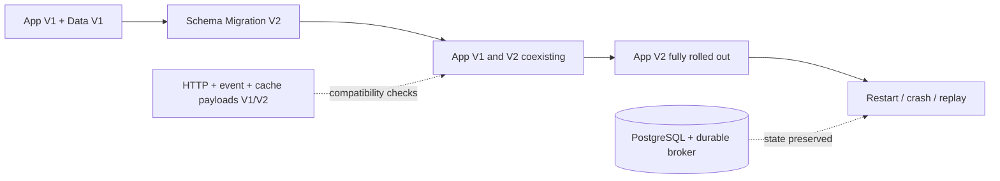
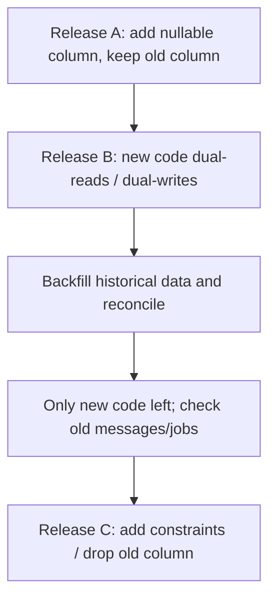
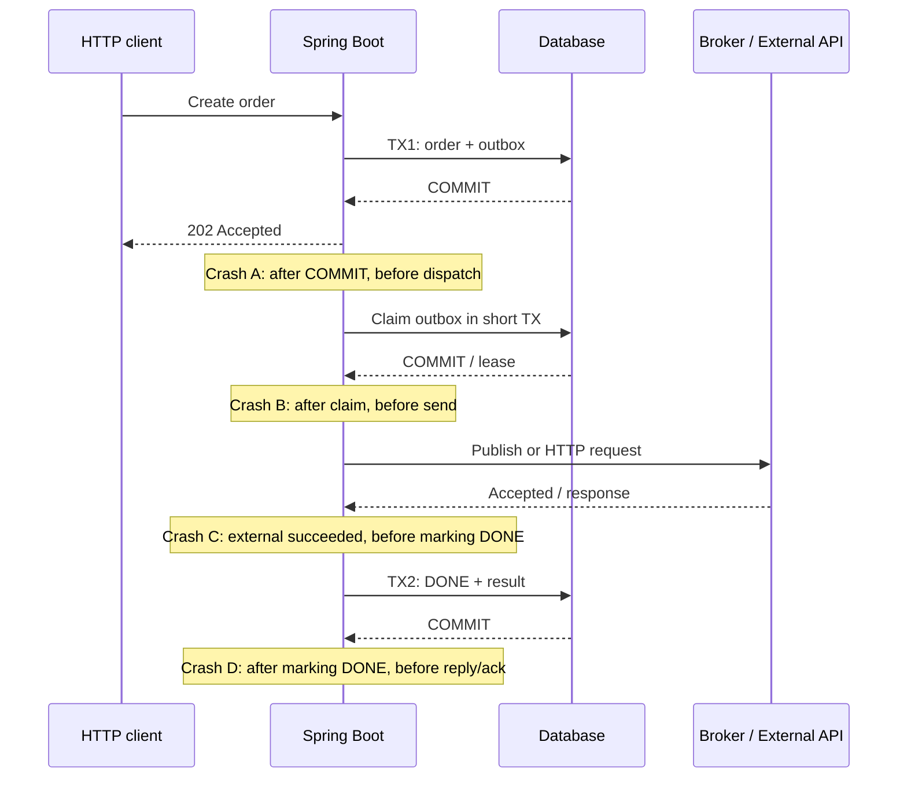

# Testing Migrations, Data Versioning, and Application Restarts

## 1. Why is testing clean startup still not enough?

In **SPRING_BOOT_INTEGRATION**, Spring Boot can combine JDBC/JPA, Redis, Kafka/RabbitMQ, HTTP clients, and Spring Integration adapters inside a single workflow. Each component carries its own data and lifecycle. During an application upgrade, a SQL migration may succeed while an older consumer fails to read new events; a service may restart cleanly yet drop messages received right before a crash.

Three coupled areas must be tested together:

1. **Data/schema migrations:** existing table structures and historical rows transition cleanly from old to new states while preserving business meaning.
2. **Data contract versioning:** HTTP payloads, broker events, outbox/inbox records, and cache entries can be produced by multiple running app versions simultaneously; producers and consumers must understand all supported versions.
3. **Restarts and recovery:** after a process dies or a new release deploys, committed data, in-flight work, and retry states continue processing properly.

A test that spins up an **empty database and runs the latest migration** only proves *fresh install* initialization. It does not prove migrations work against historical production-like data, does not test rolling-deployment compatibility, and does not verify crash recovery.



**Goal:** after every step, business invariants remain intact—even with legacy data, coexisting app versions, or crashes between `COMMIT`s.

## 2. Distinguishing types of versions

“Data version” is not a single number. Within one release, different integration layers carry separate versions:

| Type | Where managed | Example | What can break |
| --- | --- | --- | --- |
| **Database schema version** | Flyway/Liquibase migration history | `V1__create_orders.sql` → `V2__add_payment_state.sql` | New columns break old code; flawed backfill |
| **HTTP API version** | URI, media type, headers, or partner contract | `/api/v1/orders`, `/api/v2/orders` | New callers or old partners misread fields/statuses |
| **Event schema version** | Envelope/message headers/schema registry | `schemaVersion: 1` or `2` | Older consumers fail deserializing or misinterpret new events |
| **Stored payload version** | Outbox/inbox JSON records, job tables | `payload_version = 2` | New workers fail reading pending jobs written by old releases |
| **Cache data format** | Serialization + namespace/key prefix | `catalog:v2:productDetails::SKU-1` | Changed classes break deserialization of old cache entries |
| **Application release** | Artifact/container image | `order-service 2.4` | New code running against mismatched DB/message formats |

Never assume **app V2 always runs with DB V2 and reads only event V2**. During rolling deployments, app V1 and V2 run side by side. Older messages also linger in brokers long after every app instance upgrades.

Invariants to define before writing tests:

- Each `orderId` maps consistently to one order; column changes never duplicate rows or break foreign keys.
- Monetary values use exact decimal types without rounding drift during conversions.
- Each `operationId` corresponds to at most one business side effect; retries never trigger double payments.
- Messages committed to the outbox remain processable after restarts.
- Uncertain values like `UNKNOWN` never silently degrade into `FAILED` simply because a field is missing.
- Legacy code does not break while running concurrently against an expanded schema.

## 3. Database migrations: testing both legacy data and new schemas

Spring Boot typically integrates Flyway or Liquibase for migrations; pick one primary tool with explicit versioning, rollout, and startup rules. The examples below use **Flyway** and PostgreSQL, since PostgreSQL exercises real column types, constraints, and transactional behavior.

### 3.1. Example V1: orders table in active production use

Suppose `db/migration/V1__create_orders.sql` defines:

```sql
CREATE TABLE orders (
    id UUID PRIMARY KEY,
    legacy_status VARCHAR(24) NOT NULL,
    amount NUMERIC(18, 2) NOT NULL CHECK (amount >= 0)
);
```

V1 already holds millions of rows where `legacy_status` is `NEW` or `PAID`. The new release adds `payment_state` with richer semantics: `PENDING`, `CAPTURED`, or `UNKNOWN`. Dropping `legacy_status` immediately or marking `payment_state NOT NULL` outright breaks running V1 instances when reading or writing.

An **expand-first** migration in `db/migration/V2__add_payment_state.sql` can be:

```sql
ALTER TABLE orders
    ADD COLUMN payment_state VARCHAR(24);

UPDATE orders
SET payment_state = CASE legacy_status
    WHEN 'NEW' THEN 'PENDING'
    WHEN 'PAID' THEN 'CAPTURED'
    ELSE 'UNKNOWN'
END
WHERE payment_state IS NULL;
```

At V2, the legacy column remains so V1 instances continue operating. `payment_state` temporarily allows `NULL` because V1 instances can still insert new rows **after the migration runs** without populating the new column.

**Common blind spot:** a one-time backfill does not ensure future rows written by V1 have `payment_state`. Tests must verify V1 continuing to write after V2 runs, followed by V2 reads. V2 code must tolerate null/legacy values during the transition or use an intentional dual-write/sync strategy.

### 3.2. Expand → migrate data → contract

Safe schema changes usually span multiple releases:



| Phase | Schema/app changes | What to test |
| --- | --- | --- |
| **Expand** | Add compatible columns/tables/indexes; preserve old read/write paths | V1 still reads/writes; V2 reads both legacy and new rows |
| **Migrate data** | Batched backfill with checkpoints and reconciliation | Zero skipped rows, zero duplicates, idempotent reruns |
| **Switch readers/writers** | V2 writes new format and handles fallbacks where needed | Never conflate `null` with business states; app rollback stays viable within support window |
| **Contract** | Once V1 is gone and data converges, enforce `NOT NULL` or drop old column | No remaining code, batch job, or consumer reads old fields |

**Never treat Flyway undo/rollback SQL as a default recovery path.** Once migrations apply and live writes continue, reversing schemas is harder than rolling back app binaries. Often you need a forward fix migration and tested backup/restore plans. DDL transactionality varies across PostgreSQL, MySQL, and specific statements.

### 3.3. Migrations that produce “false green” tests

- **Adding a column with a default:** tests verify column existence while skipping whether historical rows backfilled with accurate semantics.
- **Changing `VARCHAR` → `ENUM`:** clean test fixtures hold only valid values; production holds unexpected strings or legacy aliases.
- **Adding a unique constraint:** empty/clean test DBs have no duplicates; production fails index creation.
- **Adding a foreign key:** historical tables hold orphaned rows or mismatched IDs.
- **Changing money/timestamp types:** overflows, timezone shifts, or precision loss.
- **Rename/drop:** rolling-deployment V1 instances still query old names.
- **Full-table backfill:** locks tables too long, spikes WAL, delays replicas, or times out deployment hooks.

Fixtures should include **legacy rows, boundary values, nulls allowed by old schemas, duplicates, timezones, large amounts, and Unicode strings**. For breaking constraints, clean/deduplicate data deliberately before tightening constraints.

## 4. Testing V1 → V2 migrations with Testcontainers

Avoid using H2 alone to verify PostgreSQL migrations: types, indexes, DDL transactions, locking, JSONB, and constraints behave very differently. **Testcontainers** runs real PostgreSQL in isolation to test schemas and data.

Suppose the app uses Maven with `spring-boot-starter-jdbc`, Flyway, and test dependencies:

```xml
<dependencies>
    <dependency>
        <groupId>org.springframework.boot</groupId>
        <artifactId>spring-boot-starter-jdbc</artifactId>
    </dependency>
    <dependency>
        <groupId>org.flywaydb</groupId>
        <artifactId>flyway-core</artifactId>
    </dependency>
    <!-- Modern Flyway separates PostgreSQL support into its own module. -->
    <dependency>
        <groupId>org.flywaydb</groupId>
        <artifactId>flyway-database-postgresql</artifactId>
    </dependency>
    <dependency>
        <groupId>org.springframework.boot</groupId>
        <artifactId>spring-boot-starter-test</artifactId>
        <scope>test</scope>
    </dependency>
    <dependency>
        <groupId>org.testcontainers</groupId>
        <artifactId>junit-jupiter</artifactId>
        <scope>test</scope>
    </dependency>
    <dependency>
        <groupId>org.testcontainers</groupId>
        <artifactId>postgresql</artifactId>
        <scope>test</scope>
    </dependency>
</dependencies>
```

In real projects, manage Flyway/Testcontainers versions via your Spring Boot BOM rather than mixing arbitrary module versions.

### 4.1. Testing an upgrade from a real V1 database

An independent JUnit test initializes a clean database **inside a test container**, migrates to V1, seeds V1 rows, and then upgrades to V2:

```java
import static org.assertj.core.api.Assertions.assertThat;

import java.sql.Connection;
import java.sql.DriverManager;
import java.sql.ResultSet;
import java.sql.Statement;
import java.util.UUID;

import org.flywaydb.core.Flyway;
import org.junit.jupiter.api.Test;
import org.testcontainers.containers.PostgreSQLContainer;
import org.testcontainers.junit.jupiter.Container;
import org.testcontainers.junit.jupiter.Testcontainers;

@Testcontainers
class SchemaUpgradeTest {

    @Container
    static final PostgreSQLContainer<?> postgres =
            new PostgreSQLContainer<>("postgres:16-alpine");

    private Flyway flywayTo(String targetVersion) {
        return Flyway.configure()
                .dataSource(
                        postgres.getJdbcUrl(),
                        postgres.getUsername(),
                        postgres.getPassword())
                .locations("classpath:db/migration")
                .target(targetVersion)
                .load();
    }

    @Test
    void upgradesOldOrdersWithoutLosingState() throws Exception {
        flywayTo("1").migrate();

        UUID orderId = UUID.randomUUID();
        try (Connection connection = DriverManager.getConnection(
                    postgres.getJdbcUrl(),
                    postgres.getUsername(),
                    postgres.getPassword());
             var ps = connection.prepareStatement(
                    "INSERT INTO orders(id, legacy_status, amount) " +
                    "VALUES (?, 'PAID', 120000.50)")) {
            ps.setObject(1, orderId);
            assertThat(ps.executeUpdate()).isEqualTo(1);
        }

        // A new Flyway instance runs remaining migrations on the same DB.
        flywayTo("2").migrate();
        flywayTo("2").validate();

        try (Connection connection = DriverManager.getConnection(
                    postgres.getJdbcUrl(),
                    postgres.getUsername(),
                    postgres.getPassword());
             var ps = connection.prepareStatement(
                    "SELECT legacy_status, payment_state, amount " +
                    "FROM orders WHERE id = ?")) {
            ps.setObject(1, orderId);
            try (ResultSet rs = ps.executeQuery()) {
                assertThat(rs.next()).isTrue();
                assertThat(rs.getString("legacy_status")).isEqualTo("PAID");
                assertThat(rs.getString("payment_state")).isEqualTo("CAPTURED");
                assertThat(rs.getBigDecimal("amount"))
                        .isEqualByComparingTo("120000.50");
                assertThat(rs.next()).isFalse();
            }
        }
    }
}
```

This assumes only `V1__create_orders.sql` and `V2__add_payment_state.sql` exist in the illustrative migration set; adjust target versions and fixtures for your project. With a single test in the class, the container boots once for that test; if adding multiple tests sharing one container, **isolate data across cases** (separate databases/schemas or container lifecycles) to prevent order-dependent coupling.

What this test proves:

- Migration V1 initializes the legacy schema cleanly.
- Data **inserted before V2** survives migration intact.
- Mapping `PAID → CAPTURED` works; monetary values remain exact.
- V1/V2 checksums and history validate cleanly via `Flyway.validate()`.
- Runs without touching production servers or live data.

What is **not yet** tested: whether app V1 still works on DB V2, V1 inserting new rows after V2, concurrent startup migrations, large-table performance, and failure rollbacks.

### 4.2. Add a “V1 still writes after V2” test

An important compatibility test:

1. Run V1 → V2 as above.
2. Using V1's SQL/DAO path, insert only `id`, `legacy_status`, and `amount` into the table that now contains `payment_state`.
3. Read using V2 code; verify rows with `payment_state = NULL` resolve via `legacy_status` without `NullPointerException` or defaulting to `FAILED`.
4. Run the next backfill pass or dual-write path; verify new rows converge to V2 values.
5. Only after zero V1 writers remain, test enforcing `NOT NULL` or dropping the old column.

This marks the difference between **migrations executing** and **safe zero-downtime upgrades across coexisting versions**.

## 5. Testing startup through Spring Boot auto-configuration

The previous test invoked Flyway directly. Add a Spring Boot integration test verifying your real config: datasource, migration locations, JPA mappings, bean initialization, and listeners starting only after schemas are ready.

```java
import static org.assertj.core.api.Assertions.assertThat;

import org.junit.jupiter.api.Test;
import org.springframework.beans.factory.annotation.Autowired;
import org.springframework.boot.test.context.SpringBootTest;
import org.springframework.jdbc.core.JdbcTemplate;
import org.springframework.test.context.DynamicPropertyRegistry;
import org.springframework.test.context.DynamicPropertySource;
import org.testcontainers.containers.PostgreSQLContainer;
import org.testcontainers.junit.jupiter.Container;
import org.testcontainers.junit.jupiter.Testcontainers;

@Testcontainers
@SpringBootTest
class ApplicationStartupWithMigrationTest {

    @Container
    static final PostgreSQLContainer<?> postgres =
            new PostgreSQLContainer<>("postgres:16-alpine");

    @DynamicPropertySource
    static void databaseProperties(DynamicPropertyRegistry registry) {
        registry.add("spring.datasource.url", postgres::getJdbcUrl);
        registry.add("spring.datasource.username", postgres::getUsername);
        registry.add("spring.datasource.password", postgres::getPassword);
        registry.add("spring.flyway.enabled", () -> true);
    }

    @Autowired
    JdbcTemplate jdbc;

    @Test
    void startsAfterApplyingMigrations() {
        Integer count = jdbc.queryForObject(
                "SELECT count(*) FROM flyway_schema_history " +
                "WHERE success = true",
                Integer.class);

        assertThat(count).isGreaterThanOrEqualTo(2);

        Integer columns = jdbc.queryForObject(
                "SELECT count(*) FROM information_schema.columns " +
                "WHERE table_name = 'orders' " +
                "AND column_name = 'payment_state'",
                Integer.class);
        assertThat(columns).isEqualTo(1);
    }
}
```

This example uses default PostgreSQL `public` schema and assumes the two sample migrations exist on the classpath. If your app uses multiple schemas or complex migration histories, filter by schema and avoid hardcoding arbitrary migration counts.

When using Hibernate/JPA, **ensure Flyway/Liquibase owns the schema**; a test setting `spring.jpa.hibernate.ddl-auto=create` can recreate tables behind the scenes, masking missing migrations. Use `validate` where suitable so Hibernate verifies entity mappings against migrated tables instead of generating schemas itself during migration tests.

### Do not confuse different kinds of restarts

| Testing technique | What it actually tests | What it does NOT prove |
| --- | --- | --- |
| Single `@SpringBootTest` | Context startup, auto-configuration, migrations, bean wiring | Does not prove restart or crash recovery |
| `@DirtiesContext` recreating context | New context inside the same JVM | Not a process crash; static memory/process resources can persist |
| Stop context then restart against same DB | App restarts with persisted data intact | Does not test power loss or hard kills |
| Start **process A**, kill it, start **process B** on same DB/broker | Recovery across a true process boundary | Insufficient unless crash checkpoints are targeted |
| Destroy DB container and boot fresh DB | Initializing a brand-new environment | Does not test post-restart persistence |

Match the test type to the claim. To prove survival under `SIGKILL` or container restarts, build a two-process harness while **keeping DB/broker volumes persistent**. Never treat closing/reopening a Spring context as proof of crash recovery.

## 6. Testing API and event contract versioning

Database schemas and message schemas change at different cadences. V1 events can linger in Kafka/RabbitMQ when consumer V2 deploys; V1 HTTP clients can keep hitting API V2 during rolling deployments.

### 6.1. Example V1 and V2 events

Suppose V1 emits:

```json
{
  "schemaVersion": 1,
  "eventId": "evt-42",
  "orderId": "order-42",
  "status": "PAID"
}
```

V2 emits:

```json
{
  "schemaVersion": 2,
  "eventId": "evt-43",
  "orderId": "order-43",
  "payment": {
    "state": "CAPTURED",
    "currency": "VND"
  }
}
```

This is a **structural and semantic change**; consumer V1 expecting `status` will not understand `payment.state`. Consumer V2 can read both via a compatible normalization layer. During rolling updates, **do not emit V2 events to un-upgraded V1 consumers** unless forward compatibility is guaranteed. Upgrade consumers first, maintain V1 formatting during transition, or publish to a new topic/version.

### 6.2. Normalizing payloads by version

Java/Jackson example (abbreviated to focus on versioned decoding):

```java
import com.fasterxml.jackson.core.JsonProcessingException;
import com.fasterxml.jackson.databind.JsonNode;
import com.fasterxml.jackson.databind.ObjectMapper;

public final class OrderEventReader {

    private final ObjectMapper mapper;

    public OrderEventReader(ObjectMapper mapper) {
        this.mapper = mapper;
    }

    public NormalizedOrderEvent decode(String json)
            throws JsonProcessingException {
        JsonNode root = mapper.readTree(json);
        if (root == null || !root.isObject()) {
            throw new IllegalArgumentException("Event must be a JSON object");
        }

        int version = root.path("schemaVersion").asInt(-1);
        String eventId = requiredText(root, "eventId");
        String orderId = requiredText(root, "orderId");

        String state = switch (version) {
            case 1 -> switch (requiredText(root, "status")) {
                case "PAID" -> "CAPTURED";
                case "NEW" -> "PENDING";
                default -> throw new IllegalArgumentException(
                        "Unknown V1 order status");
            };
            case 2 -> requiredText(
                    root.path("payment"), "state");
            default -> throw new UnsupportedSchemaVersionException(version);
        };

        return new NormalizedOrderEvent(eventId, orderId, state);
    }

    private static String requiredText(JsonNode object, String field) {
        JsonNode value = object.path(field);
        if (!value.isTextual() || value.textValue().isBlank()) {
            throw new IllegalArgumentException(
                    "Missing or invalid field: " + field);
        }
        return value.textValue();
    }

    public record NormalizedOrderEvent(
            String eventId, String orderId, String paymentState) {}

    public static final class UnsupportedSchemaVersionException
            extends RuntimeException {
        public UnsupportedSchemaVersionException(int version) {
            super("Unsupported schemaVersion: " + version);
        }
    }
}
```

This is an **event-decoding adapter**, not database migration code. Real producers/consumers must also validate allowed state enums, duplicate `eventId`s, timestamps/timezones, currencies, tenant identity, payload limits, and sender authentication.

Never coerce an unrecognized version silently into V2. On an unsupported `schemaVersion = 3`, route to quarantine/dead-letter or fail per contract—never fill critical business fields with optimistic “success” defaults.

### 6.3. Compatibility matrix

| Producer | Consumer | Expectations and required tests |
| --- | --- | --- |
| V1 | V1 | Legacy V1 traffic keeps working |
| V1 | V2 | Consumer V2 decodes and normalizes V1 accurately |
| V2 | V2 | New fields and constraints verified |
| V2 | V1 | Valid only if V1 has proven forward compatibility; otherwise block emitting V2 to V1 |
| Unsupported version | V2 | Classified error; zero side effects applied from bad data |
| V1 with extra optional field | V2 | Unknown-field behavior matches contract |
| V2 missing required field | V2 | Explicit failure; no unsafe defaults |
| Duplicate `eventId` | Any consumer | Side effect applies at most once per business key |

**Schema compatibility** (parseable structure) differs from **semantic compatibility** (preserved business meaning). Adding an enum constant may pass JSON decoding while crashing a consumer `switch`. Switching amounts from VND to cents parses cleanly yet miscalculates 100x. Assert **normalized meaning**, not just “deserializes without error.”

## 7. HTTP contracts, queued payloads, and caches must also be versioned

### 7.1. HTTP APIs: status codes, media types, and edge values

When evolving HTTP contracts, test at least:

- Client V1 calling the updated endpoint; does the server still accept legacy fields?
- Client V2 receiving responses from server V1; how are absent new fields handled?
- Have HTTP `404`, `409`, `422`, `429`, or `503` semantics remained unchanged?
- Are pagination, timezones, decimals, encoding, media types, and unknown enum values still compatible?
- If the endpoint adopts idempotency keys, do keys stay stable across timeout retries?
- When versioning via URI or headers, does the server reject unsupported versions explicitly?

Tests with `MockRestServiceServer` (synchronous RestTemplate/RestClient) or HTTP stub servers (WebClient) verify each side of the contract. When independent teams own APIs, add **consumer-driven contract tests** or CI schema validation across all supported versions.

### 7.2. Outbox, inbox, and pending jobs from earlier releases

A job persisted in the DB may still await execution across multiple deployments:

```text
outbox:
  id = evt-42
  payload_version = 1
  payload_json = {"schemaVersion":1,...}
  state = PENDING
```

Worker V2 must still decode V1 payloads until you are certain zero V1 jobs remain. If you refactor Java classes or serialized bytes without preserving compatible adapters, new workers can crash right after restart.

Store immutable identifiers (`eventId`/`operationId`), format versions, and payloads decoupled from runtime Java class serialization. For Kafka, RabbitMQ, or Spring Integration persistent `MessageStore`s, check **queued/stored messages** both before and after upgrades.

### 7.3. Redis cache: keys/versions and serialization

Cache entries can outlive the process that wrote them. When modifying DTOs or serializers, test V2 reading entries written by V1. If incompatible, version the namespace/key prefix, e.g.:

```text
catalog:v1:productDetails::SKU-100
catalog:v2:productDetails::SKU-100
```

This isolates old and new formats at the cost of extra memory during transition; enforce TTLs and cleanup plans. **Never treat a cache as the source of truth**: flushing caches clears incompatible formats, whereas DB/outbox/broker migrations must preserve data.

## 8. Restarts: crash windows that must be tested

A reliable integration flow executes multiple independent steps:



Four windows with distinct consequences:

| Window | State remaining after restart | Expected behavior |
| --- | --- | --- |
| **A:** DB committed, not yet dispatched | Outbox `PENDING` | New worker picks up job and continues |
| **B:** Claimed then crashed before send | Job `PROCESSING` with lease | Lease expires; another worker reclaims conditionally |
| **C:** Downstream succeeded, `DONE` not yet persisted | Job may be retried | Reuse same operation ID/idempotency key or reconcile; zero duplicate effects |
| **D:** `DONE` persisted, caller/consumer missed reply/ack | Retry/duplicate may arrive | Return cached outcome; deduplicate without running twice |
| DB transaction rolls back before commit | No committed business/outbox rows | No phantom jobs emitted; no uncommitted reads |
| App stops mid-migration | Partial state depending on DB/DDL | Flyway/Liquibase detects failure, halts startup, or requires controlled repair |

Under **at-least-once delivery**, duplicate arrivals are normal. An `inbox_processed` table with a unique constraint on `(consumer_name, event_id)` or equivalent provides durable tracking. Execute **deduplication and business writes inside one local transaction** when sharing the same DB. When side effects happen in external systems, local DB unique constraints do not replace partner-side idempotency.

### Example job state machine

```text
PENDING -> PROCESSING -> DONE
                |         ^
                +-> UNKNOWN -> RECONCILE -> DONE / FAILED
                |
                +-> RETRY (after backoff)
```

Never transition `UNKNOWN` straight to `FAILED` on a response timeout. The downstream may have committed before the reply dropped. Every retry of a state-changing POST requires a stable operation ID and safe retry checks.

## 9. Writing restart tests that actually prove recovery

### 9.1. Keep DB and broker state across app restarts

A recovery test must **preserve durable storage** while stopping and starting the application. With Testcontainers, keep one PostgreSQL container and one broker container running across both process lifecycles—never wipe volumes or call `flyway.clean()` mid-test.

Two-process test script:

1. Start test PostgreSQL and broker; apply V1 or the release's baseline schema.
2. Start **app process A** with controlled test fault-injection flags enabled.
3. Submit a business request; assert via polling until `order + outbox` **has committed**.
4. Force-stop A at a checkpoint—for instance, after external HTTP success and before marking `DONE`.
5. Start **app process B** against the same DB and broker (optionally on the newer version).
6. Wait for B to claim/recover and finish pending work.
7. Assert final DB state, side-effect count at stub HTTP/broker, idempotency keys, and zero duplicates.
8. Shut down B and test containers cleanly.

Use latches, test checkpoints, and committed DB state rather than `Thread.sleep(5000)` to coordinate deterministically. For real **process kills**, use an external out-of-process signal (dedicated test HTTP endpoint or flag) so the harness knows the checkpoint was reached before killing; do not depend on unflushed stdout logs. Enforce timeouts on every wait.

### 9.2. Distinguish app restarts from data resets

Restarting an app against a freshly wiped database tests **clean initialization**, not recovery. Putting `@Transactional` on a test method rolls back uncommitted fixtures when the test exits and hides them from separate worker threads. For restart tests, commit fixtures explicitly via `TransactionTemplate` or explicit transaction boundaries, then verify from another connection.

To catch stale in-memory state bugs, use separate processes or verify static caches/in-memory queues start empty. `@DirtiesContext` inside one JVM does not completely simulate losing process memory.

### 9.3. Restart and version matrix

| DB before restart | App before → after | Remaining data/jobs | What to assert |
| --- | --- | --- | --- |
| V1 → migrate V2 | V1 → V2 | V1 rows | Migrates cleanly and V2 reads historical rows |
| V2 | V1 → V2 | V1 kept writing during rolling window | V2 handles rows missing new fields |
| V2 | V2 → V1 app rollback | New rows written by V2 | Rollback only succeeds when designed backward-compatible |
| V2 | V2 → V2 | Outbox `PENDING` | New worker resumes pending jobs |
| V2 | V2 → V2 | Expired `PROCESSING` lease | Safely reclaimed/retried without losing jobs |
| V2 | V1 → V2 | Unconsumed V1 events | Consumer V2 decodes and deduplicates cleanly |
| V2 | V2 → V2 | Broker delivered message before ACK | Redelivery occurs without duplicating business effect |

Rolling back **binaries** is not rolling back **database schemas**. A new schema can remain compatible with older binaries if evolved via expand–contract, though never automatically.

## 10. Migrations when multiple instances boot concurrently

In Kubernetes or multi-VM deployments, multiple Spring Boot pods often boot simultaneously. Flyway/Liquibase coordinate via history/lock tables, yet you must test against your real database, timeouts, and deployment topology.

Scenarios to simulate:

- Two instances attempt migrations concurrently; one applies schema changes safely while the other waits, proceeds, or fails gracefully.
- Migration runs longer than readiness/startup probes: orchestrator may kill the container mid-migration.
- New pods boot early while old pods still serve requests; schema edits must not break old pods instantly.
- A migration fails in production-like staging; the app must stay unready rather than serving traffic against a broken schema.
- Large data backfills must run in checkpointed batches with retries and minimal locking.

If your platform requires migrations **before** app pods start serving, run a dedicated migration job with scoped DB privileges and monitoring. When doing so, test deploy ordering, readiness probes, and compatibility of older running pods against the newly expanded schema.

**Never run `repair` automatically to ignore checksum mismatches** just to make pods pass readiness. Changed Flyway checksums can mean an applied historical migration was modified; investigate and repair deliberately. Likewise, never enable `clean` on real-data environments to work around a failed migration.

## 11. Data migration failing mid-way: roll back or resume?

Some DB/DDL operations roll back atomically inside transactions; others commit individually, resist rollback, or have database-specific limits. Moreover, **batched backfills** intentionally commit piece by piece. Test idempotency and checkpoints rather than expecting “all-or-nothing rollback.”

Example backfill job:

```text
Step 1: select 500 orders missing payment_state
Step 2: update using verified mapping rules
Step 3: commit batch + checkpoint
Step 4: repeat until done
```

If the process dies after batch 37, restarting must not rerun unsafe operations from scratch. Use predicates like `WHERE payment_state IS NULL`, checkpoints, or versioned conditional updates so reruns are idempotent. Account for concurrent new writers: when live traffic updates a row concurrently, backfills must never overwrite newer values with stale snapshots.

Valuable checks:

1. Stop backfill mid-run, restart, and finish.
2. Verify rows still missing `payment_state` reach 0 before tightening `NOT NULL`.
3. Verify edge-case mappings per status, not just total row counts.
4. Run concurrent V1 writers; V2 must never assume every row is already backfilled.
5. Run backfill multiple times; results stay idempotent with zero duplicates.
6. Measure lock waits, per-batch duration, WAL volume, and replica lag in production-like environments.

For **destructive** migrations, test backup/restore procedures in staging and keep verification evidence. An untested snapshot is not a recovery plan.

## 12. Edge-case CI test matrix

| Group | Fixture/stimulus | Expectation |
| --- | --- | --- |
| Fresh install | Empty DB migrated to latest | Schema and app start cleanly |
| Upgrade from legacy version | V1 schema seeded with sanitized realistic data | Data preserved; statuses mapped accurately |
| Schema compatibility | V1 writer against expanded V2 schema | No errors; V2 reader interprets new rows |
| Constraints | Duplicates, orphans, nulls, weird values | Migration fails clearly or cleans data explicitly first |
| Monetary/timezones | Large `BigDecimal`s, multi-timezone timestamps | Zero precision or semantic loss |
| Migration rerun | Restart app after migration | Does not re-run applied migrations or lose data |
| Migration checksum | Modify an already-applied migration in test fixture | Validation catches mismatch |
| Concurrent startup | Two instances migrate simultaneously | Locking/coordination succeeds; no duplicate DDL |
| Event backward compatibility | Consumer V2 reads V1 events | Normalizes state cleanly |
| Event forward compatibility | Consumer V1 sees V2 event | Valid only with explicit contract; else block early V2 publishing |
| Unsupported schema | `schemaVersion=99` | Quarantines/errors with zero side effects |
| Legacy stored job | Pending outbox/inbox from prior release | New worker decodes and recovers |
| Crash after commit | Order + outbox committed, unpublished | Job resumes after restart |
| Crash after external success | Downstream succeeded, DB lacks DONE | Reconciles/retries same operation ID; zero double effects |
| Duplicate delivery | Broker redelivers same `eventId` | Deduplicated via unique constraint/state |
| Cache version | V2 reads V1 keys/formats | Compatible or cleanly separated by namespace |
| Partial backfill | Crash after several batches | Resumes idempotently without clobbering newer writes |
| Readiness | Migration incomplete or failed | App stays unready against mismatched schema |

Not every test needs to run on every commit. Tiering keeps CI fast and meaningful: unit/contract tests on every commit, Testcontainers migrations on PRs and pre-release, multi-process chaos/restart tests on dedicated pipelines. Any migration risking data loss must be tested before release.

## 13. Observability and deployment checklist

### Post-migration/restart monitoring

Useful metrics and logs include:

- Current migration version, execution duration, checksum/validation status, and instances waiting on locks.
- Rows backfilled vs. remaining, mapping error counts, and batch retries.
- Event versions seen per consumer, unsupported-schema rejections, and quarantine counts.
- Age of `PENDING` outbox/inbox items, expired `PROCESSING` claims, retry counts, and dead-letter counts.
- Duplicate message skip rates, reconciled side effects, and `UNKNOWN`-to-final convergence times.
- Post-deploy readiness/startup failures; serializer/DTO errors across Redis, brokers, and HTTP clients.
- Database connection pool/lock waits, broker lag, and downstream timeouts during rolling deploys.

Include correlation IDs, event IDs, and operation IDs in logs for traceability without recording unredacted tokens, sensitive bodies, or PII. For unrecognized event schemas, preserve metadata/error artifacts under security and retention rules—never silently drop them while reporting success.

### Reviewer checklist

1. Identified **DB schema versions**, payload/event versions, app releases, and coexisting combinations.
2. Tested **upgrade over a V1-populated DB**, in addition to fresh DB installs.
3. Tested V1 writers continuing after **expand migrations** and V2 readers tolerating missing new fields.
4. Designed resumable backfills with count reconciliation and edge-case coverage.
5. Deferred dropping columns, changing types, or tightening constraints until zero legacy code/jobs depend on them.
6. New consumers read older events/jobs; older consumers are never fed incompatible new event formats.
7. Verified cache serialization and key namespaces across deployments and rollbacks.
8. Tested crashes before/after `COMMIT`, before/after publish, and before/after downstream side effects.
9. Outbox/inbox/acks maintain durable state, deduplication, and idempotency—no reliance on RAM queues for critical recovery.
10. Restart tests preserve DB/broker volumes; multi-process tests prove survival across true process kills.
11. Planned concurrent startup migrations, readiness probes, binary rollbacks, and forward fixes/restores.
12. CI and dashboards confirm core invariants hold after rollout.

**Rule of thumb:** A safe release must prove **old data still retains meaning**, **old and new versions interoperate across the support window**, and **committed work recovers cleanly after restarts**. Testing migrations, data versioning, and restarts must rest on durable storage and real Spring Boot Integration crash points—not merely booting the app against an empty database.

### References

- [Spring Boot Reference — Database Initialization](https://docs.spring.io/spring-boot/reference/how-to/data-initialization.html): Flyway, Liquibase, and schema initialization.
- [Flyway Documentation](https://documentation.red-gate.com/fd): migration history, validation, targets, repair, and workflows.
- [Liquibase Documentation](https://docs.liquibase.com/): changelogs, updates, validation, rollbacks, and locking.
- [Testcontainers for Java](https://java.testcontainers.org/): spinning up real PostgreSQL and brokers in tests.
- [Spring Framework Reference — Transaction Management](https://docs.spring.io/spring-framework/reference/data-access/transaction.html): commits, rollbacks, and transaction boundaries.
- [Spring Integration Reference — Message Store](https://docs.spring.io/spring-integration/reference/message-store.html): durable message persistence and flow recovery.
