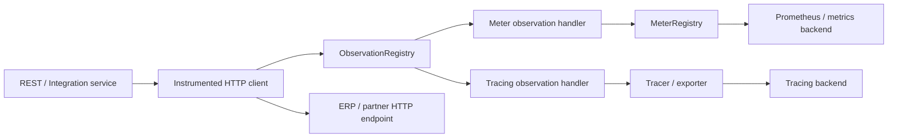
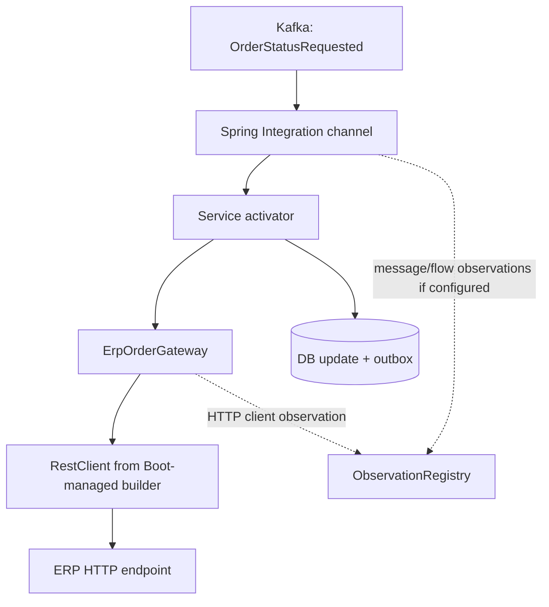

# HTTP Client Metrics and Conditions for Using Managed Builders

## 1. Why Must HTTP Clients Be Observed at the Integration Layer?

In a Spring Boot system, an incoming API request can trigger multiple steps: fetching an order from PostgreSQL, querying Redis, calling an ERP over HTTP or SOAP, and then publishing an event to Kafka/RabbitMQ. If the API is slow, looking only at **HTTP server** metrics cannot tell where the time was spent. You need signals for each **outbound HTTP client**: which service is called, how often, what latency looks like, which errors occur, and which trace they belong to.

In the **SPRING_BOOT_INTEGRATION** module, HTTP client observability is part of organizing integrations across HTTP clients, databases, caches, message brokers, and Spring Integration adapters. Metrics must inform practical decisions: tuning timeouts and concurrency, distinguishing contract errors from network errors, evaluating retries, detecting connection pool exhaustion, and reconciling transactions with unknown outcomes.

**Core question of this lesson:** Why do two HTTP clients both succeed yet only one produces metrics/tracing? A major reason is **whether the application uses a builder managed by Spring Boot or instantiates the client with raw APIs**.

Running example: `order-api` calls the ERP endpoint `GET /orders/{id}/status` using `RestClient`. Monitoring dashboards must show outbound call counts by method, URI template, status code, latency, and errors without creating new labels per `orderId`. When the ERP slows down or a gateway returns HTTP 503, operations must distinguish **slow upstream response**, **inability to acquire a connection**, and **repeated caller retries**.

After this lesson, you will be able to:

- Distinguish metrics, observations, tracing, and logs in an HTTP client flow.
- Explain the conditions under which Boot automatically attaches observability to `RestTemplate`, `RestClient`, and `WebClient`.
- Use `RestTemplateBuilder`, `RestClient.Builder`, and `WebClient.Builder` injected from the Spring context to preserve Boot customizers.
- Identify situations where manual client creation loses HTTP client metrics/tracing.
- Design low-cardinality URI tags and attach timeouts, retries, exceptions, and correlation IDs with accurate semantics.
- Verify actual telemetry through tests, metrics endpoints, traces, and dashboards.

## 2. The Three Signals: Metrics, Traces, and Logs

| Signal | Question answered | Example when calling ERP |
|---|---|---|
| **Metrics** | How do rates, latency, trends, and saturation change? | Rate 50 calls/s, p95 350 ms, 2% HTTP 5xx. |
| **Distributed traces** | Which steps did a single request pass through and where did it spend time? | HTTP inbound → JDBC → HTTP client to ERP → outbox. |
| **Logs** | What did the system record at a specific error moment? | Timeout on second attempt, request ID, standardized error code. |

Spring Framework 6+ builds many of these signals on top of the **Micrometer Observation** abstraction. An observation represents an activity with start/end timestamps, a name, contextual data, and tags. When wired to appropriate handlers, the same observation can generate both **timer/counter metrics** and **trace spans**.

However, three layers must be kept distinct:

1. **Instrumentation:** The HTTP client actually emits observations when sending requests.
2. **Observation registry and handlers:** An `ObservationRegistry` and mechanisms converting observations into metrics/tracing exist.
3. **Registry/exporter/collector:** Metrics or traces are stored/exported to a queryable destination such as Prometheus or a tracing backend.

If any layer is missing, dashboards may show no data. For example, having an instrumented HTTP client bean without a `MeterRegistry`/suitable handler yields no metric numbers to export; having a Micrometer registry while manually instantiating clients without instrumentation yields inbound metrics but no outbound metrics.



**Observation does not automatically mean export.** Metric names, standard tags, trace sampling, and export behavior also depend on Spring Boot, Micrometer, HTTP driver versions, and registry configuration.

## 3. General Conditions for HTTP Clients to Emit Metrics

In a typical Spring Boot 3.x setup, verify:

- Appropriate Spring HTTP client and Micrometer/Actuator dependencies are on the classpath.
- The Spring context has an `ObservationRegistry` configured to receive HTTP observations.
- The client is **built or customized through a mechanism wired to the registry**—typically a Boot-provided builder.
- A suitable `MeterRegistry` and collection/export mechanism exist if observing metrics externally.
- Requests **actually execute**. Bean initialization or creating an unsubscribed `Mono` does not generate HTTP client request metrics.
- No filter, customizer, configuration, or metric-filtering rule drops the signal under inspection.

Example Maven dependencies for a Spring Boot 3.x application:

```xml
<dependency>
    <groupId>org.springframework.boot</groupId>
    <artifactId>spring-boot-starter-actuator</artifactId>
</dependency>
<dependency>
    <groupId>io.micrometer</groupId>
    <artifactId>micrometer-registry-prometheus</artifactId>
    <scope>runtime</scope>
</dependency>
```

`spring-boot-starter-actuator` brings most of Boot's commonly used Micrometer/observability infrastructure. `micrometer-registry-prometheus` is optional **if** Prometheus scraping is needed; if using another registry, choose the corresponding dependency/exporter. HTTP client dependencies must still be declared appropriately: `spring-boot-starter-web` for common synchronous clients, or `spring-boot-starter-webflux` if using `WebClient`.

Example development configuration:

```yaml
management:
  endpoints:
    web:
      exposure:
        include: health,info,metrics,prometheus
```

The `/actuator/metrics` endpoint supports inspecting metrics when enabled; `/actuator/prometheus` only contains data when a Prometheus registry is configured. In production, management endpoints must be protected via network/security controls and access policies; never expose sensitive telemetry indiscriminately.

## 4. Which Builders Are Managed by Spring Boot?

In the Spring Boot 3.x generation, there are three common HTTP client paths:

| Client | Builder to inject from Spring | Version notes and characteristics |
|---|---|---|
| `RestTemplate` | `RestTemplateBuilder` | Available since earlier Boot generations; Boot usually provides a builder rather than a single shared default `RestTemplate`. |
| `RestClient` | `RestClient.Builder` | `RestClient` appeared in Spring Framework 6.1, corresponding to Spring Boot 3.2+ in Boot 3.x. |
| `WebClient` | `WebClient.Builder` | Requires Spring WebFlux on the classpath; Boot configures the builder when auto-configuration conditions match. |

In standard configurations, Boot-managed builders may already have an **observation registry**, message converters/codecs, connector/request factories, customizers, and other settings applied. Therefore, how you instantiate a client affects not only metrics but also timeouts, proxies, SSL, authentication interceptors, tracers, and resource sharing.

Compare these two approaches:

```java
// Eligible to receive full Spring Boot customizers/observations:
public ErpGateway(RestClient.Builder bootBuilder) {
    this.client = bootBuilder.baseUrl(erpUrl).build();
}
```

```java
// Created outside Boot's mechanism: does not automatically get Boot observation.
RestClient client = RestClient.create(erpUrl);
// Similarly, new RestTemplate() or WebClient.create(erpUrl)
// does not automatically inherit customizers from Boot-managed builders.
```

**This does not mean manual creation can never be observed.** You can manually configure an `ObservationRegistry` and corresponding instrumentation. However, when using Spring Boot, injecting the managed builder is far less likely to miss configuration pieces.

### 4.1. Beware of Custom-Declared Beans

Spring Boot auto-configuration is conditional. If the application defines its own builder or related `Executor`/client/registry beans, an auto-configuration branch may **back off** or customizers may not apply. To know for sure, enable the **Condition Evaluation Report** for your running version and inspect actual beans. Do not assume every `RestClient.Builder` or `WebClient.Builder` object has been instrumented by Boot.

## 5. `RestClient.Builder`: Example of an Observed Synchronous Client

`RestClient` is Spring Framework 6.1+'s fluent synchronous API. Below is a configuration suited to Spring Boot 3.2+ where Boot supplies `RestClient.Builder`:

```java
import org.springframework.beans.factory.annotation.Value;
import org.springframework.context.annotation.Bean;
import org.springframework.context.annotation.Configuration;
import org.springframework.web.client.RestClient;

@Configuration
public class ErpClientConfiguration {

    @Bean
    RestClient erpRestClient(
            RestClient.Builder builder,
            @Value("${integration.erp.base-url}") String baseUrl) {

        return builder
                .baseUrl(baseUrl)
                .defaultHeader("Accept", "application/json")
                .build();
    }
}
```

`application.yml`:

```yaml
integration:
  erp:
    base-url: ${ERP_BASE_URL}
```

Using the `erpRestClient` bean in an adapter:

```java
import org.springframework.stereotype.Component;
import org.springframework.web.client.RestClient;

@Component
public class ErpOrderGateway {

    private final RestClient erpRestClient;

    public ErpOrderGateway(RestClient erpRestClient) {
        this.erpRestClient = erpRestClient;
    }

    public OrderStatusResponse getStatus(String orderId) {
        return erpRestClient.get()
                .uri("/orders/{id}/status", orderId)
                .retrieve()
                .body(OrderStatusResponse.class);
    }
}
```

`OrderStatusResponse` is an application-defined DTO. This example omits full HTTP status handling, error mapping, and retries; production code must classify `4xx`, `5xx`, timeouts, and indeterminate outcomes per the ERP contract.

The line `.uri("/orders/{id}/status", orderId)` is especially valuable: it **preserves the URI template** so metric tags can represent a stable route instead of creating a new tag series for every `orderId`. This remains a **blocking HTTP client**: a timer does not turn `getStatus` into an asynchronous operation.

### When Replacing the Request Factory

You may need Apache HttpClient, JDK HttpClient, or another transport to configure connection pooling, TLS, proxies, or timeouts. When customizing the transport, **start from the Boot-injected builder** and then apply the specific request factory. Do not bypass the Boot builder and build from scratch just to configure timeouts.

If the transport provides its own metrics (leased/pending connections, acquire timeouts, etc.), those serve as **complementary signals** to HTTP client request metrics. A request-level timer alone cannot tell whether the client is waiting on a connection pool or the upstream is processing slowly.

## 6. `RestTemplateBuilder`: Preserving Observability for Legacy RestTemplate

`RestTemplate` is still widely used in older codebases and many SOAP/integration adapters. With Spring Boot, typically inject `RestTemplateBuilder` to create beans:

```java
import org.springframework.beans.factory.annotation.Value;
import org.springframework.boot.web.client.RestTemplateBuilder;
import org.springframework.context.annotation.Bean;
import org.springframework.context.annotation.Configuration;
import org.springframework.web.client.RestTemplate;

@Configuration
class LegacyErpRestTemplateConfiguration {

    @Bean
    RestTemplate legacyErpRestTemplate(
            RestTemplateBuilder builder,
            @Value("${integration.erp.base-url}") String baseUrl) {

        return builder
                .rootUri(baseUrl)
                .build();
    }
}
```

When the builder is auto-configured by Boot, applicable `RestTemplateCustomizer`s—including observation setup if infrastructure conditions are met—can be applied to it. Conversely, writing `new RestTemplate()` directly across the codebase can skip customization and leave those requests missing from outbound charts.

An easy oversight: **Spring Boot does not necessarily create a single default `RestTemplate` bean**. It typically provides `RestTemplateBuilder` so the application builds `RestTemplate` instances per use case. If a codebase has multiple `RestTemplate` beans, inspect **each initialization path**, especially clients instantiated via `new` inside internal libraries.

### Beware When Replacing Customizers

A custom `RestTemplateBuilder` configuration or a helper that constructs clients while bypassing the managed builder may fail to run Boot's customizers. When adding timeout or authentication customizers, check whether your logic **preserves existing customizers** instead of inadvertently replacing the entire customizer set. Never treat "HTTP returned 200" as proof that observation still works.

## 7. `WebClient.Builder`: Reactive Client and Execution Timing

For `WebClient`, Spring Boot can auto-configure a `WebClient.Builder` carrying the necessary settings. Declaration:

```java
import org.springframework.beans.factory.annotation.Value;
import org.springframework.context.annotation.Bean;
import org.springframework.context.annotation.Configuration;
import org.springframework.web.reactive.function.client.WebClient;

@Configuration
class ErpWebClientConfiguration {

    @Bean
    WebClient erpWebClient(
            WebClient.Builder builder,
            @Value("${integration.erp.base-url}") String baseUrl) {

        return builder
                .baseUrl(baseUrl)
                .build();
    }
}
```

Client:

```java
import reactor.core.publisher.Mono;
import org.springframework.web.reactive.function.client.WebClient;

public Mono<OrderStatusResponse> getStatus(String orderId, WebClient client) {
    return client.get()
            .uri("/orders/{id}/status", orderId)
            .retrieve()
            .bodyToMono(OrderStatusResponse.class);
}
```

**A reactive request only starts when the publisher is subscribed to.** Returning a `Mono` from a method that nobody subscribes to never executes the HTTP request and emits no corresponding metrics. Calling `.block()` on a Netty event loop to "get the result immediately" can stall the system; if the rest of the app is blocking MVC/JDBC, choose clear boundaries to avoid uncontrolled model mixing.

`WebClient.Builder` is mutable when configured; Boot generally provides the builder with a scope allowing relatively independent customization per injection point. If sharing a builder manually, use `builder.clone()` when independent configuration branches are needed and avoid mutating a builder concurrently used by other components.

### How Do Reactor Netty Metrics Differ from HTTP Client Observation?

When `WebClient` runs on Reactor Netty, transport signals can be enabled/collected: active/idle/pending connections, pending acquires, connection errors, TLS/network. These do not replace `WebClient`'s **HTTP client request observations**.

| Signal | Meaning |
|---|---|
| HTTP client request timer | HTTP call duration and outcome by method/URI template/status. |
| Reactor Netty connection provider metrics | Active/idle connection counts, wait times, or pool errors depending on instrumentation. |
| Reactor Netty byte/event-loop metrics | Network/runtime characteristics; depends on configuration and version. |
| Outbound trace span | Call position within the activity chain, metadata, and propagation. |

Do not enable every Netty metric without considering cardinality cost and emitted data volume.

## 8. When Does a Managed Builder Truly Matter?

Different initialization patterns produce different results:

| Initialization pattern | Likelihood of receiving Boot customization/observation | Notes |
|---|---|---|
| Inject `RestClient.Builder` from context then `build()` | Usually received via matching auto-configuration. | Preferred option for RestClient in Boot 3.2+. |
| Inject `RestTemplateBuilder` then `build()` | Usually receives `RestTemplateCustomizer`. | Appropriate for RestTemplate. |
| Inject `WebClient.Builder` then `build()` | Usually receives `WebClientCustomizer`. | Appropriate for WebClient. |
| Standalone `RestClient.create(...)` or `RestClient.builder()` | Does not automatically inherit Boot customizers. | Requires explicit instrumentation if used. |
| `new RestTemplate()` | Not automatically wired with Boot observations. | Common in legacy code or library-created clients. |
| Standalone `WebClient.create(...)` or `WebClient.builder()` | Does not automatically inherit Boot builder customizations. | Check connection provider and observation registry. |
| Defining a custom builder bean | Depends on whether the bean runs customizers. | May cause auto-configuration to back off. |
| Other HTTP libraries (Feign, direct OkHttp, direct Apache HttpClient...) | Depends on each library's own instrumentation. | Cannot be inferred from Boot's RestClient/WebClient configuration. |

Key verification question: **Was the object actually performing the HTTP call built from a builder carrying the observation registry?** Seeing class names on the dependency graph or having Actuator in the application is not enough to answer yes.

### 8.1. When Manual Client Creation Is Needed

`RestClient.Builder` provides an API to attach an observation registry in Spring Framework 6.1+:

```java
import io.micrometer.observation.ObservationRegistry;
import org.springframework.web.client.RestClient;

RestClient createManually(
        ObservationRegistry observationRegistry,
        String endpoint) {

    return RestClient.builder()
            .baseUrl(endpoint)
            .observationRegistry(observationRegistry)
            .build();
}
```

This snippet illustrates how to **attach a registry manually** when direct instantiation is genuinely necessary. It does not guarantee receiving other Boot-provided customizers: transport, SSL, codecs, security, interceptors, or pooling still require explicit setup. In a standard Boot application, injecting the appropriate builder is usually simpler and more consistent.

`WebClient.Builder` has an equivalent API for attaching an `ObservationRegistry`; for `RestTemplate`, the observation registry can be configured on the instance via the corresponding Spring API. Do not combine manual wiring and Boot wiring without checking, as adding instrumentation multiple times can cause **double counting** or malformed nested trace spans.

## 9. URI Templates and Cardinality: A Critical Metrics Decision

A metric carries tags (labels). Each distinct combination of tag values can create a new time series. Recording `uri=/orders/123`, `uri=/orders/124`, etc., causes time series to grow with order count.

Prefer writing:

```java
restClient.get()
    .uri("/orders/{id}/status", orderId)
    .retrieve()
    .body(OrderStatusResponse.class);
```

Avoid:

```java
// Bad: pre-concatenating a dynamic ID into the URI can lose template information.
String endpoint = "/orders/" + orderId + "/status";
restClient.get().uri(endpoint).retrieve().body(OrderStatusResponse.class);
```

Depending on the client and API path, when the template is lost the framework may assign `UNKNOWN`/`none` as the URI or use unstable values. Do not rely on a single guess: **inspect the actual tags** in your metrics backend.

| Common tag | Recommended values | Values to avoid |
|---|---|---|
| `method` | `GET`, `POST`, `PUT`. | Data from payload. |
| `uri` | `/orders/{id}/status`, `/customers/{id}`. | Concrete IDs, URLs with queries containing personal data. |
| `client.name` or equivalent host | Finite system host/alias names. | Arbitrary user-supplied hosts creating unbounded series. |
| `status` or outcome group | `200`, `404`, `5xx` per convention. | Entire response body. |
| `exception` | Finite standardized exception class names. | Error messages, stack traces, account info. |
| Custom business tags | `partner=erp-a`, `operation=order-status`. | `orderId`, `customerId`, `requestId`, correlation ID. |

**Low-cardinality tags** belong in aggregations and alerts; **high-cardinality contextual data** belongs in access-controlled traces/logs, not pushed by default into metric labels. Before adding custom observation conventions, understand the framework-provided tags and cardinality limits.

### 9.1. Do Not Put Full URLs into Metric Names

Metric names should remain stable by operation type, such as the framework's standard HTTP client observation name. Concrete URLs should be normalized into bounded template/host tags. Creating metrics named `http.client.erp.order-123` or one metric per ID makes dashboards and retention unmanageable.

## 10. Default Metrics: What Is Measured and What Is Not?

In common Spring Boot 3.x/Micrometer setups, HTTP client observations often have an **observation name** like `http.client.requests`; the exported timer in the backend may be transformed according to registry conventions, e.g., Prometheus appends `_seconds_count` and `_seconds_sum`. Across some versions and semantic conventions, instrument names can be normalized differently. **Inspect actual output from your running version** rather than hard-coding dashboard queries copied from another version.

An HTTP client timer generally shows call counts and latency distributions by tags. It **does not necessarily show**:

- Total inbound HTTP processing time on the caller, including internal queuing.
- Standalone connection pool wait time if instrumentation does not separate segments.
- Logical business attempt totals when one logical operation retries multiple HTTP calls; typically **each HTTP attempt** produces its own observation.
- Whether a write request committed on the ERP side after a client timeout.
- Business success when an HTTP 200 contains an error code inside the body.

Therefore, add **business-operation observations/metrics** for critical actions, separate from HTTP transport.

Illustrative example:

```text
order.status.lookup
  ├─ attempt 1: HTTP GET ERP → 503 (120 ms)
  ├─ backoff → 60 ms
  └─ attempt 2: HTTP GET ERP → 200 (280 ms)

HTTP client metrics: 2 HTTP requests
Business operation metric: 1 lookup, ~460 ms including backoff
```

Both datasets are accurate and answer different questions. Dashboards must not divide two HTTP calls per operation and misinterpret them as two processed orders.

### 10.1. Latency Percentiles and Histograms

Timers provide count, sum, max, and percentiles/histograms depending on registry support. When aggregating p95/p99 across multiple instances, histogram-based percentiles are preferable to averaging per-instance percentiles. Weigh memory and series cost before enabling histograms across every tag combination.

Do not rely solely on p50 to declare an upstream healthy: a small fraction of requests waiting on pools or timing out can spike p99 while the median stays flat.

## 11. Adding Business Metrics Without Double-Counting HTTP Requests

Suppose `ErpOrderGateway` has a `getStatus` method using retries. You can record a timer at the **business adapter layer** to measure total caller wait time, including attempts, backoff, and result parsing.

Example using `MeterRegistry`:

```java
import io.micrometer.core.instrument.MeterRegistry;
import io.micrometer.core.instrument.Timer;
import java.util.function.Supplier;

public class ObservedErpService {
    private final MeterRegistry registry;
    private final ErpOrderGateway gateway;

    public ObservedErpService(
            MeterRegistry registry,
            ErpOrderGateway gateway) {
        this.registry = registry;
        this.gateway = gateway;
    }

    public OrderStatusResponse fetch(String orderId) {
        Timer.Sample sample = Timer.start(registry);
        String outcome = "failure";

        try {
            OrderStatusResponse result = gateway.getStatus(orderId);
            outcome = "success";
            return result;
        } finally {
            sample.stop(Timer.builder("integration.erp.lookup.duration")
                    .tag("operation", "order-status")
                    .tag("outcome", outcome)
                    .register(registry));
        }
    }
}
```

In this example, `orderId` is **not** added as a tag. If an exception occurs, `finally` still records duration with a failure outcome. For pipelines with fallbacks or stale data responses, distinguish outcomes such as `success`, `fallback`, `timeout`, or `rejected` as long as the label set is finite and matches the business contract.

In systems already using Micrometer Observation, you can create a **business-level observation** instead of a raw timer so metrics and traces share one standard. Do not layer another identically named observation onto HTTP instrumentation without clear purpose, as it can inflate series counts or miscount attempts.

## 12. Classifying HTTP Outcomes with Accurate Semantics

| Situation | HTTP client signal | Business signal to add |
|---|---|---|
| HTTP 200, valid data | Status 200, request timer. | Completed one lookup/command. |
| HTTP 200 with `businessError` in body | Status 200, possibly no exception. | Explicitly record `business_rejected`/standardized error code. |
| HTTP 404 looking up nonexistent entity | HTTP 404, depending on client exception on `retrieve`. | May be a normal outcome, not necessarily an incident. |
| HTTP 429 from partner | Status 429 and latency. | Upstream throttling, retry budget, quota. |
| HTTP 503 then retry succeeds | At least two HTTP attempts. | One business operation succeeded after retry, with attempt count. |
| Connect timeout | Possibly no HTTP response status. | Transport error, safe for retry policy if appropriate. |
| Read/response timeout after write command | May record error observation even if server committed. | Business outcome `UNKNOWN` requiring reconciliation. |
| Bulkhead reject before HTTP call | Does not necessarily create HTTP client metric. | Separately record rejection/saturation at admission layer. |
| Request cancelled before subscribing reactive `Mono` | No outbound HTTP request. | Record cancellation at business layer if needed. |

**Do not equate HTTP status with business correctness.** Creating a payment followed by a client timeout requires metrics for unknown state and transactions pending reconciliation; counting timeouts alone is not enough to keep the system safe.

## 13. How Retries, Circuit Breakers, and Timeouts Affect Metric Reading

Libraries such as Resilience4j can wrap an HTTP client to provide retries, circuit breakers, rate limiters, and bulkheads. When combined with instrumentation:

- **Request timers** typically measure each HTTP attempt, potentially including network latency or instrumented client overhead.
- **Retry metrics** show retry counts, retries skipped on non-retryable errors, and exhausted attempts if instrumented.
- **Circuit breaker metrics** show breaker state, short-circuited calls blocked before reaching the HTTP client, and outcome distributions.
- **Bulkhead metrics** show in-flight count, waiting permits, and rejected requests.
- **Business timers** outside resilience wrappers measure the full logical operation, including retries, backoff, and fallbacks.

Instrumentation placement determines semantics. Placing a timer inside a retry callback measures **each attempt**; placing it outside the retry measures **one logical call**. Both are useful when clearly named and not treated as identical counts.

### 13.1. Distinguishing Timeouts

```text
caller deadline
  ├─ acquire bulkhead permit
  ├─ wait for connection from pool
  ├─ DNS / TCP connect / TLS
  ├─ send HTTP request, wait for and read response
  ├─ deserialize payload
  └─ retry/backoff if budget remains
```

A single HTTP client timer may not split all of these phases. To pinpoint bottlenecks, combine connection pool metrics, thread/queue metrics, trace spans, and error logs classified by `connect`, `acquire`, `read`, and `overall deadline`.

Do not set only a socket timeout and assume total request time is bounded. For user-facing endpoints, enforce an end-to-end deadline and budget each dependency, including retry counts.

## 14. HTTP Client Tracing: Correlation and Header Propagation

When tracing is configured, an instrumented HTTP client can create a **client span** and propagate trace context to downstream services via supported headers, such as W3C Trace Context. This is essential to connect:

```text
traceId = 4bf92f...
  span: HTTP GET /orders/{id}
    span: database lookup
    span: ERP HTTP GET /orders/{id}/status
    span: outbox insert
```

Having a client span **does not guarantee** the ERP side appears as a downstream server span: the ERP must also support context propagation and have telemetry enabled. If the ERP is uninstrumented, you still see the client span and outbound duration, but not internal ERP steps.

In Spring Boot 3.x, tracing can use a Micrometer Tracing bridge with OpenTelemetry or Brave plus a compatible exporter. Dependencies/exporters and sampling must be configured separately; adding Actuator **does not automatically produce distributed traces sent to a backend**.

### Passing Correlation IDs Does Not Replace Trace Context

A business `correlationId` is used for log lookup and reconciliation; `traceId` links spans. The two may be logged together but carry different meanings. Never push `traceId` or `correlationId` into high-cardinality metric tags. When sending a business header to a partner, use a controlled interceptor/filter and never copy tokens or PII into tracing headers.

### 14.1. Async and Reactive Cases

When executing via `@Async`, `TaskExecutor`, `ExecutorChannel`, or callbacks on another thread, the caller's **MDC/ThreadLocal does not automatically carry over completely**. You may need a `TaskDecorator` or proper context propagation mechanism, while Reactor uses Reactor Context for reactive pipelines. Missing propagation can split traces even though HTTP client metrics still appear. Test explicitly across async boundaries.

## 15. Spring Integration, Brokers, and Instrumentation Boundaries

Spring Integration can make outbound HTTP calls through adapters, service activators using `RestClient`/`WebClient`, or third-party HTTP clients. Each path has its own instrumentation behavior.

Example flow:



When a service activator uses an instrumented `ErpOrderGateway`, outbound HTTP metrics can appear **even though the trigger was Kafka rather than an HTTP server**. However, linking the trace back to the Kafka message also depends on listener instrumentation and context propagation.

If code makes HTTP calls through a Spring Integration adapter that does not use Boot-built `RestClient`/`WebClient`/`RestTemplate`, do not assume it shares the same default metrics. Inspect the actual HTTP stack and the adapter's own instrumentation. Likewise, JDBC metrics, broker consumer lag, and cache metrics are **independent signals** that do not automatically appear just because HTTP client observation is enabled.

## 16. Testing That Managed Builders Actually Emit Observations

A meaningful test must invoke the **Spring-injected client** against an HTTP stub and verify metrics/observations are recorded after the request finishes. Simply asserting that a `RestClient` bean exists does not prove instrumentation works.

Recommended test suite:

| Test case | What to prove |
|---|---|
| Application context | Correct builder beans, `ObservationRegistry`, and meter registry exist when configured. |
| Successful HTTP stub | Calling templated URI returning 200 records observation/timer after a real request. |
| HTTP 500/timeout | Errors are recorded as expected by framework and business layer. |
| URI template | Two different order IDs share the same normalized URI tag value. |
| Manually created client | Demonstrate presence/absence of instrumentation per configuration; avoid assumptions. |
| Retry | Two HTTP attempts produce only one business operation measurement. |
| Multiple clients | `erpRestClient` and `partnerWebClient` both retain instrumentation after custom transport setup. |
| Tracing | Outbound span appears and trace context headers are sent when tracing is enabled in tests. |
| Async | Context is not lost across `@Async`/executors if continuous traces are required. |

Example Spring Boot 3.x test skeleton (requires project-provided HTTP stub and assertion libraries):

```java
@SpringBootTest
@AutoConfigureObservability
class ErpClientObservabilityTest {

    @Autowired RestClient erpRestClient;
    @Autowired MeterRegistry registry;

    @Test
    void recordsOutboundHttpClientMetric() {
        // HTTP stub returns a deterministic response for /orders/42/status.
        erpRestClient.get()
                .uri("/orders/{id}/status", "42")
                .retrieve()
                .toBodilessEntity();

        // Check the actual metric name and tags matching your version.
        assertThat(registry.find("http.client.requests").timers())
                .isNotEmpty();
    }
}
```

This is an **illustrative skeleton**: you must supply imports, an HTTP stub, a test base URL, and test dependencies, while ensuring the registry used in the test actually receives metrics. In some Spring Boot test setups, observability/exporters are restricted to avoid sending real telemetry; `@AutoConfigureObservability` may be necessary, though details depend on version. Never let tests emit traces/metrics to production environments.

With `WebClient`, subscribe to the publisher and await completion before asserting; if a test only constructs a `Mono` and immediately reads metrics, concluding "instrumentation doesn't work" will be wrong.

### Testing Cardinality

Call `/orders/42/status` and `/orders/99/status` using the same template, then verify the number of series created for `uri`. Do not assert only that total count equals two; verify **tags contain no concrete IDs**. When tests validate percentiles/histograms, the test registry and histogram configuration must match the target environment.

## 17. Troubleshooting Missing HTTP Client Metrics

| Symptom | First check | Resolution |
|---|---|---|
| Server metrics exist, outbound client metrics missing | Was client created with `new`/`create`/manual builder? | Inject Boot-managed builder or explicitly attach observation registry. |
| `/actuator/prometheus` missing | Are Prometheus registry and endpoint exposure configured? | Add appropriate dependency/configuration and secure endpoint. |
| Builder injected yet client emits no metrics | Did HTTP call execute? Are registry/handlers active? | Check context, registry, and test against HTTP stub. |
| WebClient records no metrics | Unsubscribed `Mono`; custom connector/filter? | Subscribe, check instrumentation and transport. |
| One RestTemplate bean has metrics, another does not | Two different client creation paths. | Inspect every factory/builder and customizer. |
| Metrics disappeared after SSL/timeout config change | Custom builder/request factory overwrote Boot settings. | Keep instrumented builder and apply custom transport on the same builder. |
| Too many metric series | URI/host/custom tag contains IDs or dynamic URLs. | Use URI templates, tag allowlists, and audit cardinality. |
| Timer increments yet traces are absent | Tracing bridge/exporter or sampling not enabled. | Verify tracing config, exporter, sampling, and propagation. |
| Trace breaks across thread switch | `@Async`, executor, or Reactor context not propagated. | Design context propagation across async boundaries. |
| HTTP 200 yet business dashboard reports failure | Response body holds business error or mapping failed. | Measure business outcomes separately from HTTP status. |
| HTTP request count far exceeds business count | Retries, redirect follow-ups, or fan-out. | Separate HTTP attempt rate from logical operation rate. |
| Connection pool exhausted yet HTTP timer looks unclear | Missing pool metrics or separate acquire timing. | Enable transport/pool instrumentation and inspect pending/active. |

### 17.1. Inspecting Auto-Configuration Conditions

In development, you can run:

```bash
java -jar integration-app.jar --debug
```

Use the Condition Evaluation Report to inspect branches related to `RestClient`, `RestTemplate`, `WebClient`, `ObservationRegistry`, metrics, and tracing. Exact auto-configuration names may vary across Boot versions; rely on the matched/unmatched condition messages from your actual application.

A sensible diagnostic sequence:

1. Verify dependencies and Spring Boot/Spring Framework/Micrometer versions.
2. Confirm builder beans come from the Spring context and are created when observation infrastructure is ready.
3. Confirm clients are built from those **exact** builders with no `new` fallback in adapters.
4. Execute a real request to a stub and inspect the timer in `MeterRegistry`.
5. Verify URI tags, status/error tags, retries, and metric filtering.
6. If traces are needed, verify exporter, sampler, and downstream propagation.

## 18. Security, Sensitive Data, and Telemetry Cost

An outbound HTTP request can contain API tokens, account numbers, national IDs, order details, or partner payloads. Never write these values into metrics, trace attributes, or logs just for easier debugging.

Guidelines:

- Never attach `Authorization`, cookies, query tokens, request/response bodies, or customer IDs as metric tags.
- Never use full URLs containing sensitive info as span names. If URLs must be logged, apply sanitization and proper access controls.
- For `client.name` or partner aliases, normalize to a small set of values; arbitrary user-supplied hosts can cause huge cardinality.
- Apply sampling, export limits, retention, and redaction per environment; low trace sampling does not mean metrics are sampled the same way.
- When payloads are needed for incident debugging, use controlled debug modes, mask secrets, and set short retention.
- Secure Actuator/metrics endpoints and tracing backends with access controls; telemetry can expose internal topology.

**Instrumentation has overhead.** Histograms, custom tags, body logging, HTTP wire logging, and unbounded exports increase CPU, heap, network, and storage cost. Choose signals from operational goals rather than turning everything on.

## 19. Dependency Dashboards and Alerts

For `erp-order-status`, separate **HTTP transport** and **business workflow** on dashboards:

| Group | Metrics/aspects to monitor | Operational question |
|---|---|---|
| Request rate | Outbound requests/s by operation/method. | Is traffic rising from users or a retry storm? |
| HTTP errors | `4xx`, `429`, `5xx`, connection/timeout errors. | Contract bug, quota limit, or upstream outage? |
| Latency | p50/p95/p99 of HTTP requests and business operations. | Is latency rising per attempt or from retry/backoff? |
| Saturation | HTTP pool active/pending/acquire timeout, bulkhead rejections. | Is the client out of connections or is the ERP out of capacity? |
| Workflow correctness | Count of `PENDING`/`UNKNOWN` commands awaiting reconciliation. | Are there side effects whose commit state is unknown? |
| Retry | Attempt count, retry rate, circuit breaker state. | Are retries healing transient faults or amplifying load? |
| Correlation | Trace links/correlation IDs in access-controlled logs. | Can we trace a specific failed request? |

Example: p99 rises and pool pending is high, yet ERP statuses are mostly 200. Looking only at `http.client.requests` could wrongly blame a slow ERP, when the real bottleneck is **connection acquisition**. Conversely, if the pool is idle while upstream response times climb, inspect the ERP and network.

Alerts should be grounded in SLOs and verified saturation signals rather than blindly increasing pools/retries when errors rise. When a partner system degrades, maintain runbooks for timeouts, concurrency caps, unknown errors, contract-allowed fallbacks, and reconciliation.

## 20. HTTP Client Observability Checklist

- [ ] Confirm Spring Boot/Spring Framework/Micrometer versions; `RestClient` requires a compatible Framework generation.
- [ ] Ensure Actuator, `ObservationRegistry`, `MeterRegistry`, and required exporters/registries are configured.
- [ ] Create `RestClient` from the Spring Boot-injected `RestClient.Builder`.
- [ ] Create `RestTemplate` from the Boot-configured `RestTemplateBuilder`.
- [ ] Create `WebClient` from the Boot-managed `WebClient.Builder`; reactive publishers must be subscribed to.
- [ ] Verify clients with custom request factories/connectors preserve the observation registry and essential customizers.
- [ ] Use URI templates; never attach order ID, user ID, token, or request ID as metric tags.
- [ ] Separate per-attempt HTTP metrics from logical business operations involving retries/fallbacks.
- [ ] Measure timeouts/acquisition, connection pool saturation, bulkhead rejections, and circuit breakers alongside HTTP timers.
- [ ] Clearly distinguish HTTP status from business status; timed-out write commands may require reconciliation.
- [ ] Configure and test tracing bridge/exporter and context propagation when distributed traces are needed.
- [ ] Test real requests against stubs to verify timers/spans, URI cardinality, and exception behavior.
- [ ] Use the Condition Evaluation Report to detect backed-off auto-configurations.
- [ ] Secure Actuator endpoints and telemetry data; bound histograms, cardinality, and retention.
- [ ] Maintain dashboards, SLOs, and runbooks for every critical dependency.

## 21. Conclusion

**HTTP client metrics in Spring Boot depend on both the observation infrastructure and how the HTTP client is created.** Having Actuator in an application does not automatically guarantee every outbound call is measured. In standard Boot configurations, injecting `RestTemplateBuilder`, `RestClient.Builder`, and `WebClient.Builder` is the critical path to preserving the observation registry and related customizers; creating clients manually with `new`, `create`, or raw builders can bypass that wiring.

For reliable integration observability, combine **stable URI tags, HTTP attempt metrics, business outcome metrics, tracing, connection pool signals, retries, and deadlines**. When a request crosses databases, caches, brokers, and partner APIs, telemetry must tell you **where bottlenecks sit and which side effects are confirmed**, enabling safe operation and recovery of integration flows.
